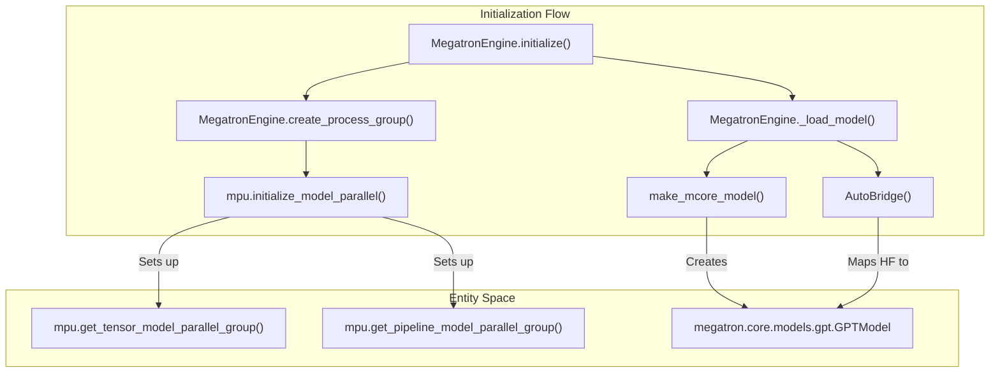
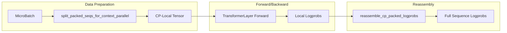

<!-- source: DeepWiki mcp.deepwiki.com · repo areal-project/AReaL · page 3.2 Megatron-Core Engine · fetched 2026-10-21 -->

# Megatron-Core Engine

Relevant source files

The following files were used as context for generating this wiki page:

- [areal/api/cli_args.py](areal/api/cli_args.py)
- [areal/engine/core/model.py](areal/engine/core/model.py)
- [areal/engine/fsdp_engine.py](areal/engine/fsdp_engine.py)
- [areal/engine/megatron_engine.py](areal/engine/megatron_engine.py)
- [areal/engine/megatron_utils/megatron.py](areal/engine/megatron_utils/megatron.py)
- [areal/engine/megatron_utils/megatron_lora.py](areal/engine/megatron_utils/megatron_lora.py)
- [areal/engine/megatron_utils/packed_context_parallel.py](areal/engine/megatron_utils/packed_context_parallel.py)
- [areal/engine/vllm_ext/vllm_worker_extension.py](areal/engine/vllm_ext/vllm_worker_extension.py)
- [areal/experimental/engine/archon_engine.py](areal/experimental/engine/archon_engine.py)
- [areal/models/mcore/bailing_moe.py](areal/models/mcore/bailing_moe.py)
- [areal/models/mcore/bailing_moe_bridge.py](areal/models/mcore/bailing_moe_bridge.py)
- [areal/models/mcore/hf_load.py](areal/models/mcore/hf_load.py)
- [areal/models/mcore/hf_save.py](areal/models/mcore/hf_save.py)
- [areal/models/mcore/lightning_attention.py](areal/models/mcore/lightning_attention.py)
- [areal/models/mcore/registry.py](areal/models/mcore/registry.py)
- [areal/trainer/sft/lm_engine.py](areal/trainer/sft/lm_engine.py)
- [areal/utils/stats_logger.py](areal/utils/stats_logger.py)
- [areal/utils/testing_utils.py](areal/utils/testing_utils.py)
- [docs/en/cli_reference.md](docs/en/cli_reference.md)
- [docs/en/reference/lora.md](docs/en/reference/lora.md)
- [docs/zh/cli_reference.md](docs/zh/cli_reference.md)
- [docs/zh/reference/lora.md](docs/zh/reference/lora.md)
- [examples/math/gsm8k_grpo_megatron_lora_moe.yaml](examples/math/gsm8k_grpo_megatron_lora_moe.yaml)
- [tests/test_megatron_engine_distributed.py](tests/test_megatron_engine_distributed.py)
- [tests/test_megatron_engine_vlm.py](tests/test_megatron_engine_vlm.py)
- [tests/test_megatron_engine_vlm_distributed.py](tests/test_megatron_engine_vlm_distributed.py)
- [tests/test_reassemble_cp_logprobs.py](tests/test_reassemble_cp_logprobs.py)
- [tests/torchrun/run_megatron_engine_distributed.py](tests/torchrun/run_megatron_engine_distributed.py)
- [tests/torchrun/run_megatron_engine_vlm_distributed.py](tests/torchrun/run_megatron_engine_vlm_distributed.py)

The `MegatronEngine` is a high-performance training backend for AReaL that leverages NVIDIA's Megatron-Core (MCore) library. It provides advanced 3D parallelism (Tensor, Pipeline, and Data Parallelism), native FP8 training support, and specialized integration for Vision-Language Models (VLM) and Mixture-of-Experts (MoE) architectures.

## Architecture Overview

`MegatronEngine` implements the `TrainEngine` interface [areal/engine/megatron_engine.py:168-168](). It manages the lifecycle of Megatron-Core models, from process group initialization to weight synchronization with HuggingFace formats.

### Data Flow and Parallelism
The engine supports complex parallelism strategies defined via `MegatronParallelStrategy` [areal/api/cli_args.py:440-458](), including:
*   **Tensor Parallelism (TP):** Intra-layer sharding.
*   **Pipeline Parallelism (PP):** Inter-layer sharding across stages.
*   **Context Parallelism (CP):** Sequence-dimension sharding for long-context training [areal/engine/megatron_utils/packed_context_parallel.py:14-71]().
*   **Expert Parallelism (EP):** Sharding of MoE experts [areal/models/mcore/hf_load.py:173-181]().

### Code Entity Map: Engine Initialization
The following diagram illustrates how the `MegatronEngine` initializes the distributed environment and the model.

**Sources:** [areal/engine/megatron_engine.py:223-286](), [areal/models/mcore/registry.py:1-100](), [areal/engine/megatron_engine.py:348-430]()

---

## HuggingFace-to-MCore Bridging

A core feature of `MegatronEngine` is the ability to load standard HuggingFace (HF) weights into sharded Megatron-Core models and save them back to HF format without requiring manual conversion scripts.

### Weight Loading (`hf_load`)
The `load_weights_from_hf_with_mbridge_fast` function [areal/models/mcore/hf_load.py:86-86]() uses `mbridge` to perform "just-in-time" sharding.
*   **Fused Layers:** Interleaves QKV weights from HF's concatenated format `[Q, K, V]` to MCore's interleaved format `[H, 3, D]` [areal/models/mcore/hf_load.py:77-140]().
*   **MoE Experts:** Dynamically slices global expert weights based on `ep_rank` and `tp_rank` [areal/models/mcore/hf_load.py:159-210]().

### Weight Saving (`hf_save`)
Saving involves all-gathering sharded parameters across TP and PP ranks to reconstruct the full HF-compatible tensors.
*   **De-interleaving:** Reverses the interleaved QKV format during `all_gather_param` [areal/engine/megatron_utils/megatron.py:126-197]().
*   **Stacked Experts:** Detects if the bridge uses stacked tensors (e.g., Qwen3-VL-MoE) to correctly group experts back into single tensors [areal/models/mcore/hf_save.py:184-210]().

**Sources:** [areal/models/mcore/hf_load.py:1-210](), [areal/models/mcore/hf_save.py:1-210](), [areal/engine/megatron_utils/megatron.py:33-83]()

---

## Pipeline Parallel Schedules

`MegatronEngine` supports sophisticated pipeline schedules to minimize bubbles. It utilizes `get_forward_backward_func` [areal/engine/megatron_engine.py:29-29]() from MCore.

| Schedule Type | Description | Key Function |
| :--- | :--- | :--- |
| **Simple** | Standard non-interleaved PP. | `forward_backward_pipelining_without_interleaving` |
| **Interleaved** | Reduces bubble size by splitting layers into chunks. | `forward_backward_pipelining_with_interleaving` |

The engine configures layer splits via `configure_pipeline_layer_splits` [areal/engine/megatron_utils/pipeline_parallel.py:81-83](), which calculates how many layers each PP stage should hold based on the total layers and stage count.

**Sources:** [areal/engine/megatron_engine.py:794-843](), [areal/engine/megatron_utils/pipeline_parallel.py:1-83]()

---

## FP8 Training and LoRA

### FP8 Training
`MegatronEngine` supports blockwise FP8 training via Transformer Engine (TE).
*   **Dequantization:** The `FP8BlockwiseTensorHelper` [areal/engine/megatron_utils/fp8.py:16-22]() manages rowwise data and scale inverses.
*   **Conversion:** Tensors are converted between TE FP8 and PyTorch-native FP8 formats during checkpointing to ensure compatibility with inference engines like vLLM [areal/models/mcore/hf_save.py:74-116]().

### LoRA Support
LoRA is implemented by patching the MCore model using `MegatronBridgeLoRA` [areal/engine/megatron_engine.py:21-21]().
*   **Target Modules:** Automatically identifies target modules (e.g., `q_proj`, `v_proj`) compatible with vLLM [areal/engine/megatron_utils/megatron_lora.py:73-73]().
*   **Weight Sync:** Supports synchronizing LoRA weights to remote inference workers via the `areal_update_weights_lora` protocol [areal/engine/vllm_ext/vllm_worker_extension.py:58-87]().

**Sources:** [areal/engine/megatron_utils/fp8.py:1-50](), [areal/engine/megatron_utils/megatron_lora.py:1-80](), [areal/engine/vllm_ext/vllm_worker_extension.py:103-131]()

---

## VLM and Context Parallelism

For Vision-Language Models, `MegatronEngine` handles multi-modal data through specialized sequence packing.

### Context Parallel (CP) Packing
When `cp_size > 1`, sequences are split into interleaved chunks to balance load during causal masking [areal/engine/megatron_utils/packed_context_parallel.py:14-37]().

The `reassemble_cp_packed_logprobs` function [areal/engine/megatron_utils/packed_context_parallel.py:148-180]() performs a differentiable all-gather followed by a permutation to restore the original sequence order for loss computation.

**Sources:** [areal/engine/megatron_utils/packed_context_parallel.py:1-180](), [areal/engine/megatron_engine.py:74-80]()

---

