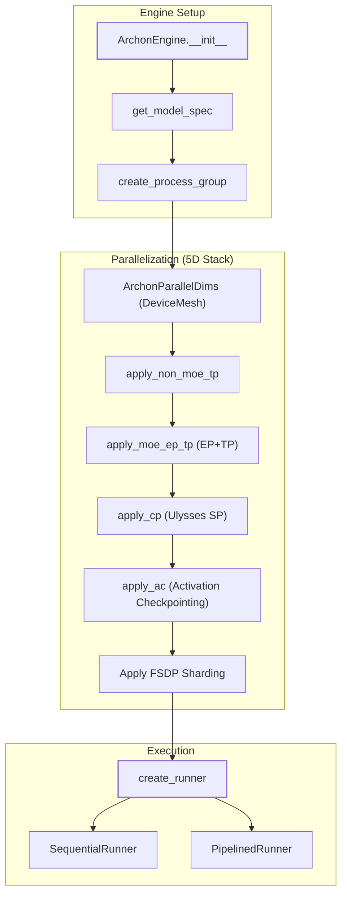
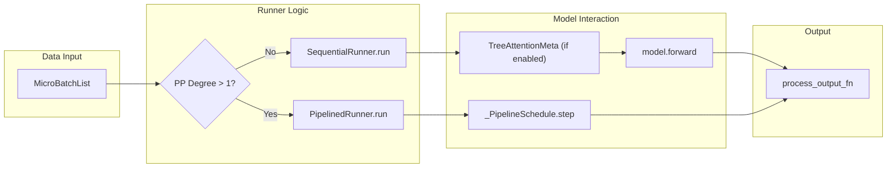

<!-- source: DeepWiki mcp.deepwiki.com · repo areal-project/AReaL · page 3.3 Archon Engine (Experimental) · fetched 2026-10-21 -->

# Archon Engine (Experimental)

Relevant source files

The following files were used as context for generating this wiki page:

- [.claude/agents/planner.md](.claude/agents/planner.md)
- [areal/api/cli_args.py](areal/api/cli_args.py)
- [areal/engine/core/train_engine.py](areal/engine/core/train_engine.py)
- [areal/engine/fsdp_engine.py](areal/engine/fsdp_engine.py)
- [areal/engine/fsdp_utils/__init__.py](areal/engine/fsdp_utils/__init__.py)
- [areal/engine/fsdp_utils/optimizer.py](areal/engine/fsdp_utils/optimizer.py)
- [areal/engine/megatron_engine.py](areal/engine/megatron_engine.py)
- [areal/experimental/engine/archon_checkpoint.py](areal/experimental/engine/archon_checkpoint.py)
- [areal/experimental/engine/archon_engine.py](areal/experimental/engine/archon_engine.py)
- [areal/experimental/engine/archon_runner.py](areal/experimental/engine/archon_runner.py)
- [areal/experimental/engine/archon_utils.py](areal/experimental/engine/archon_utils.py)
- [areal/experimental/models/archon/activation_checkpoint.py](areal/experimental/models/archon/activation_checkpoint.py)
- [areal/experimental/models/archon/base.py](areal/experimental/models/archon/base.py)
- [areal/experimental/models/archon/compile.py](areal/experimental/models/archon/compile.py)
- [areal/experimental/models/archon/expert_parallel.py](areal/experimental/models/archon/expert_parallel.py)
- [areal/experimental/models/archon/fp8.py](areal/experimental/models/archon/fp8.py)
- [areal/experimental/models/archon/fp8_checkpoint.py](areal/experimental/models/archon/fp8_checkpoint.py)
- [areal/experimental/models/archon/model_spec.py](areal/experimental/models/archon/model_spec.py)
- [areal/experimental/models/archon/moe/__init__.py](areal/experimental/models/archon/moe/__init__.py)
- [areal/experimental/models/archon/moe/args.py](areal/experimental/models/archon/moe/args.py)
- [areal/experimental/models/archon/moe/grouped_experts.py](areal/experimental/models/archon/moe/grouped_experts.py)
- [areal/experimental/models/archon/moe/moe.py](areal/experimental/models/archon/moe/moe.py)
- [areal/experimental/models/archon/moe/router.py](areal/experimental/models/archon/moe/router.py)
- [areal/experimental/models/archon/moe/utils.py](areal/experimental/models/archon/moe/utils.py)
- [areal/experimental/models/archon/moe_weight_converter.py](areal/experimental/models/archon/moe_weight_converter.py)
- [areal/experimental/models/archon/parallel_dims.py](areal/experimental/models/archon/parallel_dims.py)
- [areal/experimental/models/archon/qwen2/infra/parallelize.py](areal/experimental/models/archon/qwen2/infra/parallelize.py)
- [areal/experimental/models/archon/qwen2/model/args.py](areal/experimental/models/archon/qwen2/model/args.py)
- [areal/experimental/models/archon/qwen2/model/model.py](areal/experimental/models/archon/qwen2/model/model.py)
- [areal/experimental/models/archon/qwen3/infra/parallelize.py](areal/experimental/models/archon/qwen3/infra/parallelize.py)
- [areal/experimental/models/archon/qwen3/model/args.py](areal/experimental/models/archon/qwen3/model/args.py)
- [areal/experimental/models/archon/qwen3/model/model.py](areal/experimental/models/archon/qwen3/model/model.py)
- [areal/experimental/models/archon/qwen3_5/model/state_dict_adapter.py](areal/experimental/models/archon/qwen3_5/model/state_dict_adapter.py)
- [areal/trainer/rw/rw_engine.py](areal/trainer/rw/rw_engine.py)
- [areal/utils/data.py](areal/utils/data.py)
- [areal/utils/recover.py](areal/utils/recover.py)
- [areal/utils/saver.py](areal/utils/saver.py)
- [docs/en/best_practices/handling_oom.md](docs/en/best_practices/handling_oom.md)
- [docs/en/cli_reference.md](docs/en/cli_reference.md)
- [docs/zh/best_practices/handling_oom.md](docs/zh/best_practices/handling_oom.md)
- [docs/zh/cli_reference.md](docs/zh/cli_reference.md)
- [examples/math/gsm8k_sft_archon_fp8.yaml](examples/math/gsm8k_sft_archon_fp8.yaml)
- [tests/experimental/archon/conftest.py](tests/experimental/archon/conftest.py)
- [tests/experimental/archon/test_moe_common.py](tests/experimental/archon/test_moe_common.py)
- [tests/experimental/archon/torchrun/run_ep_tests.py](tests/experimental/archon/torchrun/run_ep_tests.py)
- [tests/test_eval_dispatch.py](tests/test_eval_dispatch.py)
- [tests/test_packed_vs_padded_consistency.py](tests/test_packed_vs_padded_consistency.py)
- [tests/test_per_layer_optim_step.py](tests/test_per_layer_optim_step.py)

The **Archon Engine** is AReaL's native, torch-native training backend designed for high-performance large model training. Unlike the FSDP2 or Megatron backends which rely on specific external frameworks, Archon is built directly on PyTorch's `distributed.tensor` (DTensor) and `distributed.pipelining` abstractions to provide a flexible "5D" parallelism stack.

## System Architecture

The Archon Engine implements the `TrainEngine` interface [areal/experimental/engine/archon_engine.py:147-148](). It orchestrates model parallelization, distributed checkpointing, and high-performance execution through specialized "Runners".

### Core Engine Components
*   **ArchonEngine**: The primary entry point that manages the lifecycle of the model, optimizer, and scheduler [areal/experimental/engine/archon_engine.py:147-200]().
*   **ModelSpec**: A registry system that defines how different model architectures (e.g., Qwen2, Qwen3) map to parallelization strategies [areal/experimental/models/archon/archon_engine.py:163-166]().
*   **ForwardBackwardRunner**: An abstraction that encapsulates the execution logic for either sequential (non-pipelined) or pipelined training [areal/experimental/engine/archon_runner.py:30-53]().

### Data Flow and Parallelism
The engine uses a 5D parallelism strategy, combining Data Parallelism (DP), Tensor Parallelism (TP), Context Parallelism (CP/Ulysses), Expert Parallelism (EP), and Expert Tensor Parallelism (ETP) [areal/experimental/models/archon/qwen3/infra/parallelize.py:97-133]().

#### Engine Initialization Flow
Title: Archon Engine Initialization and Parallelization

Sources: [areal/experimental/engine/archon_engine.py:147-200](), [areal/experimental/models/archon/qwen3/infra/parallelize.py:86-176](), [areal/experimental/engine/archon_runner.py:56-124]()

## 5D Parallelism Implementation

Archon's parallelization logic is centralized in model-specific `parallelize` modules.

### Parallel Dimensions
The engine utilizes `ArchonParallelDims` to manage the multi-dimensional `DeviceMesh`. This allows for fine-grained control over how parameters and activations are sharded across the cluster [areal/experimental/models/archon/qwen3/infra/parallelize.py:88-112]().

| Parallelism Type | Implementation Detail | Code Reference |
| :--- | :--- | :--- |
| **Tensor (TP)** | Column/Row-wise sharding for dense layers. | [areal/experimental/models/archon/qwen3/infra/parallelize.py:135-137]() |
| **Expert (EP)** | All-to-All token dispatching for MoE layers. | [areal/experimental/models/archon/qwen3/infra/parallelize.py:141-150]() |
| **Context (CP)** | Ulysses Sequence Parallelism using All-to-All. | [areal/experimental/models/archon/qwen3/infra/parallelize.py:153-155]() |
| **Pipeline (PP)** | Torch-native `PipelineStage` with ZBV/DualPipe schedules. | [areal/experimental/engine/archon_engine.py:18-22]() |
| **Data (FSDP)** | `fully_shard` API for parameter sharding. | [areal/experimental/models/archon/qwen3/infra/parallelize.py:171-176]() |

Sources: [areal/experimental/models/archon/qwen3/infra/parallelize.py:86-176](), [areal/experimental/engine/archon_engine.py:18-22]()

## Execution Strategies (Runners)

Archon separates the training loop from the model architecture via `ForwardBackwardRunner` [areal/experimental/engine/archon_runner.py:30]().

### SequentialRunner
Used when pipeline parallelism is disabled (`pp=1`). It processes micro-batches one by one, supporting tree-structured attention for shared-prefix RL training [areal/experimental/engine/archon_runner.py:56-121]().

### PipelinedRunner
Orchestrates pipeline stages using PyTorch's native schedules (e.g., `ScheduleZBVZeroBubble`, `ScheduleDualPipeV`). It manages `PipelineStage` objects and handles the communication between ranks in the pipeline [areal/experimental/engine/archon_runner.py:124-199]().

Title: Forward/Backward Execution Flow

Sources: [areal/experimental/engine/archon_runner.py:30-200](), [areal/experimental/engine/archon_engine.py:18-22]()

## Checkpoint Management

Archon uses **Distributed Checkpoint (DCP)** as its primary format, wrapped in the `DCPState` class [areal/experimental/engine/archon_checkpoint.py:86]().

### Key Features
*   **Flattened Optimizer States**: Uses `flatten_optimizer_state_dict=True` to prevent index collisions across pipeline stages by using parameter FQNs as keys [areal/experimental/engine/archon_checkpoint.py:90-92]().
*   **HuggingFace Integration**: Supports converting native DCP shards to standard HuggingFace `safetensors` format using `save_model_to_hf` [areal/experimental/engine/archon_checkpoint.py:52]().
*   **MoE Weight Conversion**: Includes specialized utilities for handling MoE expert weights during state dict loading/saving [areal/experimental/engine/archon_checkpoint.py:135-143]().

Sources: [areal/experimental/engine/archon_checkpoint.py:86-165]()

## FP8 Support and MoE

The engine provides experimental support for FP8 training and advanced Mixture-of-Experts (MoE) configurations.

### FP8 Support
FP8 is integrated via `ArchonFP8Config`, allowing for reduced memory footprint and faster computation on supported hardware (e.g., NVIDIA H100). This is managed during the model parallelization phase [areal/api/cli_args.py:11384-11389]().

### MoE Architectures
Archon supports advanced MoE features including:
*   **Grouped Experts**: Grouping experts to optimize communication in EP [areal/experimental/models/archon/qwen3/infra/parallelize.py:36]().
*   **Expert Tensor Parallelism (ETP)**: Applying TP inside individual experts to handle extremely large expert layers [areal/experimental/models/archon/qwen3/infra/parallelize.py:142-150]().

Sources: [areal/api/cli_args.py:11384-11389](), [areal/experimental/models/archon/qwen3/infra/parallelize.py:141-150]()

---

