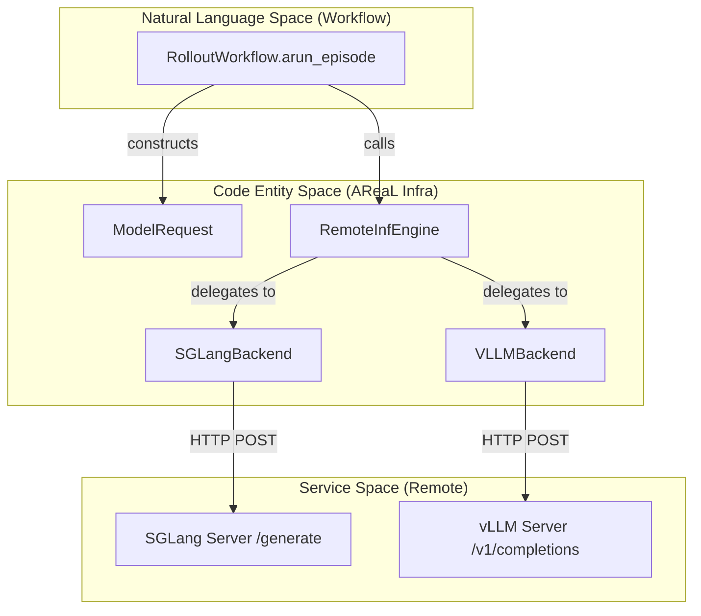
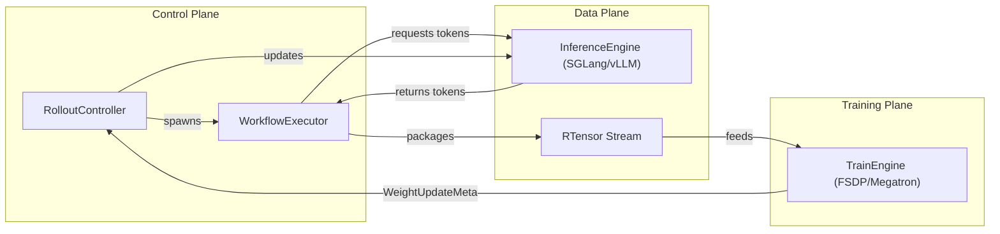

<!-- source: DeepWiki mcp.deepwiki.com · repo areal-project/AReaL · page 4 Inference Engines & Rollout · fetched 2026-10-21 -->

# Inference Engines & Rollout

Relevant source files

The following files were used as context for generating this wiki page:

- [.github/workflows/pre-commit.yml](.github/workflows/pre-commit.yml)
- [AGENTS.md](AGENTS.md)
- [CLAUDE.md](CLAUDE.md)
- [CONTRIBUTING.md](CONTRIBUTING.md)
- [README.md](README.md)
- [ROADMAP.md](ROADMAP.md)
- [areal/api/engine_api.py](areal/api/engine_api.py)
- [areal/api/io_struct.py](areal/api/io_struct.py)
- [areal/api/workflow_api.py](areal/api/workflow_api.py)
- [areal/engine/sglang_remote.py](areal/engine/sglang_remote.py)
- [areal/engine/vllm_remote.py](areal/engine/vllm_remote.py)
- [blog/AReaL_v0_2.md](blog/AReaL_v0_2.md)
- [examples/math/gsm8k_grpo_lora.yaml](examples/math/gsm8k_grpo_lora.yaml)

AReaL is designed around a **fully asynchronous RL training paradigm** [README.md:19-21](). This architecture decouples the training loop from the rollout generation process, allowing high-throughput inference backends like **SGLang** and **vLLM** to run in parallel with training engines.

The inference subsystem is responsible for generating trajectories (rollouts) based on the current policy weights. This involves orchestrating remote inference servers, managing weight synchronization to ensure rollouts are not too "stale," and providing a unified interface for complex agentic workflows.

## Inference Backends: SGLang & vLLM

AReaL leverages industry-standard inference engines as its remote backends. These are wrapped by the `InferenceEngine` API [areal/api/engine_api.py:15-24](), which provides a consistent interface for the rest of the system regardless of the underlying server.

*   **SGLang Backend**: Optimized for scenarios where multiple responses are sampled from the same prompt using its Radix Attention mechanism [blog/AReaL_v0_2.md:62-67](). It supports weight updates via disk or distributed NCCL (XCCL) [areal/engine/sglang_remote.py:129-187]().
*   **vLLM Backend**: Provides a robust alternative with a flat payload structure and specialized support for Vision-Language Models (VLM) via chat completion endpoints [areal/engine/vllm_remote.py:44-96]().

For details on configuration, weight update modes, and LoRA versioning, see **[SGLang & vLLM Remote Engines](#4.1)**.

### Inference Entity Mapping

The following diagram shows how high-level inference requests are mapped to specific code entities and backend implementations.

**Diagram: Inference Request Flow**

**Sources:** [areal/api/workflow_api.py:16-18](), [areal/api/io_struct.py:28-44](), [areal/engine/sglang_remote.py:43-89](), [areal/engine/vllm_remote.py:44-96]()

---

## Rollout Orchestration & Staleness

The `RolloutController` (and its high-performance successor `RolloutControllerV2`) is the brain of the rollout subsystem. It manages a pool of inference workers and ensures that the data being generated is "on-policy" enough for the trainer.

Key responsibilities include:
*   **Weight Synchronization**: Coordinating with the `TrainEngine` to push new weights to inference servers using the **AWEX** protocol or disk-based updates [areal/api/io_struct.py:183-202]().
*   **Staleness Management**: Tracking the `max_head_offpolicyness` to pause rollouts if the inference policy lags too far behind the trainer's current version.
*   **Workflow Execution**: Managing the lifecycle of `WorkflowExecutor` instances that run the actual RL logic (e.g., RLVR, multi-turn reasoning) [areal/api/workflow_api.py:14-39]().

For details on task queuing and weight versioning, see **[Rollout Controller & Staleness Management](#4.2)**.

---

## Experimental Inference Service

For massive scale (e.g., 1000+ GPU clusters), AReaL provides an experimental three-tier microservice stack. This moves rollout orchestration into a distributed service architecture.

| Component | Role | Code Reference |
| :--- | :--- | :--- |
| **InferenceGateway** | Entry point for requests; handles session pinning. | [areal/experimental/inference/gateway.py]() |
| **InferenceRouter** | Balances load across multiple inference backends. | [areal/experimental/inference/router.py]() |
| **InferenceDataProxy** | Buffers trajectories and exports them as `RTensor` batches. | [areal/experimental/inference/data_proxy.py]() |

This stack enables "Online RL" where the trainer connects to a persistent proxy server, allowing for elastic scaling of inference resources.

For details on the InfBridge abstraction and trajectory buffering, see **[Experimental Inference Service (Gateway/Router/DataProxy)](#4.3)**.

### Component Relationship

The following diagram illustrates how the different controllers and engines interact to produce training data.

**Diagram: Rollout Subsystem Architecture**

**Sources:** [areal/api/engine_api.py:175-183](), [areal/api/io_struct.py:183-214](), [areal/api/workflow_api.py:16-18](), [README.md:19-21]()

---

## Child Pages
*   **[SGLang & vLLM Remote Engines](#4.1)**: Implementation details of the `SGLangBackend` and `VLLMBackend`.
*   **[Rollout Controller & Staleness Management](#4.2)**: Logic for `max_head_offpolicyness` and the `RolloutController` loop.
*   **[Experimental Inference Service (Gateway/Router/DataProxy)](#4.3)**: Deep dive into the `InferenceGateway`, `Router`, and `DataProxy` microservices.

---

