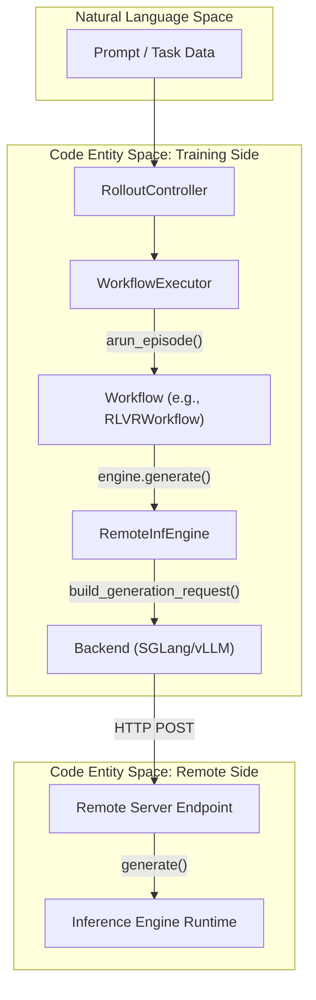
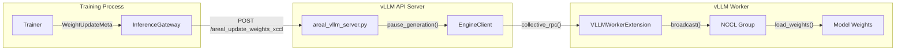

<!-- source: DeepWiki mcp.deepwiki.com · repo areal-project/AReaL · page 4.1 SGLang & vLLM Remote Engines · fetched 2026-10-21 -->

# SGLang & vLLM Remote Engines

Relevant source files

The following files were used as context for generating this wiki page:

- [.agents/skills/upgrade-deps/checklists/sglang.md](.agents/skills/upgrade-deps/checklists/sglang.md)
- [areal/api/engine_api.py](areal/api/engine_api.py)
- [areal/api/io_struct.py](areal/api/io_struct.py)
- [areal/api/workflow_api.py](areal/api/workflow_api.py)
- [areal/engine/megatron_utils/megatron_lora.py](areal/engine/megatron_utils/megatron_lora.py)
- [areal/engine/sglang_remote.py](areal/engine/sglang_remote.py)
- [areal/engine/vllm_ext/areal_vllm_server.py](areal/engine/vllm_ext/areal_vllm_server.py)
- [areal/engine/vllm_ext/vllm_worker_extension.py](areal/engine/vllm_ext/vllm_worker_extension.py)
- [areal/engine/vllm_remote.py](areal/engine/vllm_remote.py)
- [areal/experimental/weight_update/awex/fsdp_adapter.py](areal/experimental/weight_update/awex/fsdp_adapter.py)
- [areal/experimental/weight_update/awex/megatron_adapter.py](areal/experimental/weight_update/awex/megatron_adapter.py)
- [areal/experimental/weight_update/awex/sglang_adapter.py](areal/experimental/weight_update/awex/sglang_adapter.py)
- [areal/experimental/weight_update/inference_adapter.py](areal/experimental/weight_update/inference_adapter.py)
- [areal/experimental/weight_update/training_adapter.py](areal/experimental/weight_update/training_adapter.py)
- [areal/tools/validate_docker_installation.py](areal/tools/validate_docker_installation.py)
- [areal/tools/validation_base.py](areal/tools/validation_base.py)
- [areal/utils/stats_logger.py](areal/utils/stats_logger.py)
- [docs/en/reference/lora.md](docs/en/reference/lora.md)
- [docs/zh/reference/lora.md](docs/zh/reference/lora.md)
- [examples/math/gsm8k_grpo_lora.yaml](examples/math/gsm8k_grpo_lora.yaml)
- [examples/math/gsm8k_grpo_megatron_lora_moe.yaml](examples/math/gsm8k_grpo_megatron_lora_moe.yaml)
- [tests/experimental/weight_update/test_nccl_integration.py](tests/experimental/weight_update/test_nccl_integration.py)
- [tests/test_sglang_pp_distributed.py](tests/test_sglang_pp_distributed.py)

AReaL utilizes high-performance inference frameworks, specifically **SGLang** and **vLLM**, to perform rollout generation. These are wrapped as remote engines that communicate with the training cluster via HTTP and specialized weight-update protocols. This design allows for physical decoupling between training and inference resources, enabling asynchronous RL where inference can run on separate nodes or even different GPU architectures.

### Remote Engine Architecture

The core of the remote inference system is the `RemoteInfEngine`, which implements the `InferenceEngine` API [areal/api/engine_api.py:321-325](). It manages a pool of remote server instances, handling request dispatching, response parsing, and health monitoring.

#### Backend Implementations
Each framework is supported through a specific backend class that maps AReaL's internal `ModelRequest` and `ModelResponse` structures to the framework's native HTTP API:

*   **`SGLangBackend`**: Handles communication with the SGLang Runtime [areal/engine/sglang_remote.py:40-41]().
*   **`VLLMBackend`**: Handles communication with the vLLM engine [areal/engine/vllm_remote.py:41-42]().

#### Data Flow: Natural Language to Code Entities

The following diagram illustrates how a rollout request moves from the training logic into the remote inference infrastructure.

**Rollout Request Execution Flow**

Sources: [areal/infra/rollout_controller.py](), [areal/api/workflow_api.py:14-18](), [areal/engine/sglang_remote.py:43-45](), [areal/engine/vllm_remote.py:44-46]()

---

### Weight Update Modes

A critical requirement for RL is the ability to update the inference model weights as the training model evolves. AReaL supports three primary modes for this synchronization, defined in `WeightUpdateMeta` [areal/api/io_struct.py:183-184]().

| Mode | Description | Key Functions |
| :--- | :--- | :--- |
| **Disk** | The trainer saves weights to a shared filesystem; the remote engine reloads from that path. | `build_disk_weight_update_requests` [areal/engine/sglang_remote.py:129-131]() |
| **XCCL** | Weights are broadcast directly from the trainer's GPU to the inference GPU via NCCL/HCCL. | `areal_update_weight_xccl` [areal/engine/vllm_ext/vllm_worker_extension.py:133-134]() |
| **AWEX** | An experimental high-performance protocol for cross-cluster weight transfer. | `AwexTrainingAdapter` [areal/experimental/weight_update/training_adapter.py]() |

#### LoRA Versioning
For Parameter-Efficient Fine-Tuning (PEFT), AReaL uses a versioning system to manage multiple LoRA adapters. Each update increments a version number, and the engine generates a versioned name (e.g., `lora-v1`, `lora-v2`) to ensure the correct adapter is used for specific rollout requests [areal/api/io_struct.py:161-163]().

Sources: [areal/api/io_struct.py:183-211](), [areal/engine/sglang_remote.py:129-160](), [areal/engine/vllm_remote.py:129-148]()

---

### Implementation Details: SGLang

The `SGLangBackend` translates AReaL `ModelRequest` objects into the SGLang `/generate` endpoint payload [areal/engine/sglang_remote.py:89]().

*   **Generation**: Supports `top_p`, `top_k`, `temperature`, and `stop_token_ids` [areal/engine/sglang_remote.py:56-65]().
*   **MoE Support**: Can extract routed expert information if `return_routed_experts` is enabled in metadata [areal/engine/sglang_remote.py:78-79](). It parses the base64-encoded expert indices from the response `meta_info` [areal/engine/sglang_remote.py:101-110]().
*   **Weight Updates**: Uses `/update_weights_from_disk` for full models and `/load_lora_adapter` for LoRA [areal/engine/sglang_remote.py:140-159]().

Sources: [areal/engine/sglang_remote.py:40-127]()

---

### Implementation Details: vLLM

The `VLLMBackend` interacts with a customized vLLM server (`areal_vllm_server.py`) that includes additional endpoints for weight management.

*   **API Mapping**: Uses `/v1/completions` for text and `/v1/chat/completions` for vision-language models [areal/engine/vllm_remote.py:93-96]().
*   **Server Extensions**: The AReaL-specific vLLM server provides endpoints like `/areal_update_weights` and `/areal_update_weights_xccl` [areal/engine/vllm_ext/areal_vllm_server.py:164-207]().
*   **Worker Extension**: The `VLLMWorkerExtension` class is injected into vLLM workers to handle the low-level weight loading into the GPU memory [areal/engine/vllm_ext/vllm_worker_extension.py:30-39]().

**vLLM Weight Update Lifecycle**

Sources: [areal/engine/vllm_ext/areal_vllm_server.py:164-207](), [areal/engine/vllm_ext/vllm_worker_extension.py:133-165]()

---

### WorkflowExecutor Lifecycle

The `WorkflowExecutor` is the runtime component that executes `RolloutWorkflow` instances [areal/api/workflow_api.py:14-18](). It manages the lifecycle of an episode:

1.  **Initialization**: Loads the specified workflow class.
2.  **Execution**: Calls `arun_episode()`, passing the `InferenceEngine` instance [areal/api/workflow_api.py:16-17]().
3.  **Request Handling**: The workflow uses the engine's `generate()` method, which the `RemoteInfEngine` routes to the remote backends.
4.  **Completion**: Collects the generated tokens, logprobs, and metadata into a `ModelResponse` [areal/api/io_struct.py:63-81]().

Sources: [areal/api/workflow_api.py:14-39](), [areal/infra/rollout_controller.py]()

---

