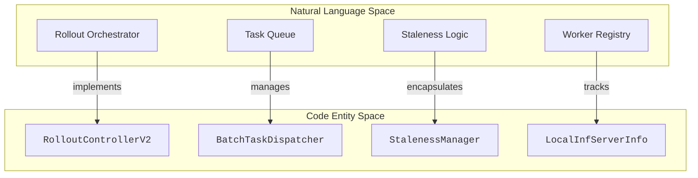
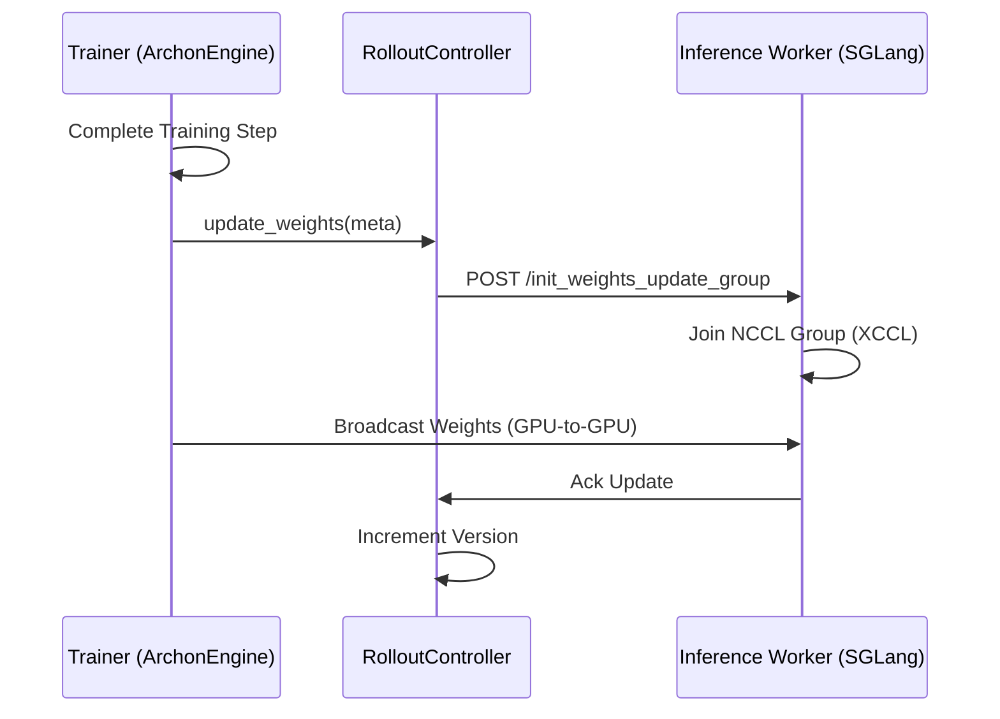

<!-- source: DeepWiki mcp.deepwiki.com · repo areal-project/AReaL · page 4.2 Rollout Controller & Staleness Management · fetched 2026-10-21 -->

# Rollout Controller & Staleness Management

Relevant source files

The following files were used as context for generating this wiki page:

- [.github/ISSUE_TEMPLATE/config.yml](.github/ISSUE_TEMPLATE/config.yml)
- [areal/api/alloc_mode.py](areal/api/alloc_mode.py)
- [areal/experimental/engine/archon_weight_sync.py](areal/experimental/engine/archon_weight_sync.py)
- [areal/experimental/inference_service/controller/controller.py](areal/experimental/inference_service/controller/controller.py)
- [areal/experimental/inference_service/sglang/launch_server.py](areal/experimental/inference_service/sglang/launch_server.py)
- [areal/experimental/inference_service/sglang/pp_bridge.py](areal/experimental/inference_service/sglang/pp_bridge.py)
- [areal/experimental/inference_service/sglang/scheduler.py](areal/experimental/inference_service/sglang/scheduler.py)
- [areal/experimental/training_service/controller/controller.py](areal/experimental/training_service/controller/controller.py)
- [areal/experimental/weight_update/controller/config.py](areal/experimental/weight_update/controller/config.py)
- [areal/experimental/weight_update/controller/controller.py](areal/experimental/weight_update/controller/controller.py)
- [areal/experimental/weight_update/gateway/app.py](areal/experimental/weight_update/gateway/app.py)
- [areal/experimental/weight_update/gateway/config.py](areal/experimental/weight_update/gateway/config.py)
- [areal/infra/controller/rollout_controller.py](areal/infra/controller/rollout_controller.py)
- [areal/infra/launcher/sglang_server.py](areal/infra/launcher/sglang_server.py)
- [areal/infra/remote_inf_engine.py](areal/infra/remote_inf_engine.py)
- [areal/infra/utils/concurrent.py](areal/infra/utils/concurrent.py)
- [blog/AReaL_v0_3.md](blog/AReaL_v0_3.md)
- [docs/en/version_history.md](docs/en/version_history.md)
- [docs/zh/version_history.md](docs/zh/version_history.md)
- [examples/countdown/README.md](examples/countdown/README.md)
- [examples/tau2/README.md](examples/tau2/README.md)
- [tests/experimental/inference_service/test_controller.py](tests/experimental/inference_service/test_controller.py)
- [tests/experimental/inference_service/test_controller_version.py](tests/experimental/inference_service/test_controller_version.py)
- [tests/experimental/inference_service/test_external_model.py](tests/experimental/inference_service/test_external_model.py)
- [tests/experimental/inference_service/test_external_model_integration.py](tests/experimental/inference_service/test_external_model_integration.py)
- [tests/experimental/inference_service/test_online_stack.py](tests/experimental/inference_service/test_online_stack.py)
- [tests/experimental/training_service/test_controller_integration.py](tests/experimental/training_service/test_controller_integration.py)
- [tests/experimental/training_service/test_controller_unit.py](tests/experimental/training_service/test_controller_unit.py)
- [tests/experimental/weight_update/test_disk_integration.py](tests/experimental/weight_update/test_disk_integration.py)
- [tests/experimental/weight_update/test_wu_controller.py](tests/experimental/weight_update/test_wu_controller.py)
- [tests/test_sglang_pp_unit.py](tests/test_sglang_pp_unit.py)

The `RolloutController` is the central orchestration component of AReaL's asynchronous RL pipeline. It bridges the gap between the Training Engines and the Inference Workers, managing the lifecycle of rollout generation, trajectory buffering, and weight synchronization. Its primary goal is to maximize hardware utilization by allowing training and inference to proceed on separate GPU clusters with minimal synchronization overhead.

## 1. Rollout Controller Architecture

AReaL provides two implementations of the controller: the standard `RolloutController` and the enhanced `RolloutControllerV2`. Both are designed to be duck-type compatible from the perspective of the Trainer [areal/experimental/inference_service/controller/controller.py:68-70]().

### RolloutController (Standard)
The standard controller manages a pool of `Worker` objects launched via the `Scheduler` [areal/infra/controller/rollout_controller.py:87-89](). It uses an internal `BatchTaskDispatcher` to route `ModelRequest` tasks to remote inference engines [areal/infra/controller/rollout_controller.py:105-107]().

### RolloutControllerV2 (Service-Oriented)
`RolloutControllerV2` is a parallel implementation that routes all traffic through a multi-tier HTTP stack: **Gateway → Router → Data Proxy → Inference Backend** [areal/experimental/inference_service/controller/controller.py:3-6](). This version is optimized for high-throughput online scenarios and external API integration.

### Entity Mapping: Natural Language to Code
The following diagram maps high-level system concepts to the specific code entities implementing them.

**System Entity Mapping**

Sources: [areal/experimental/inference_service/controller/controller.py:65-150](), [areal/infra/controller/rollout_controller.py:72-134](), [areal/infra/staleness_manager.py]()

---

## 2. Staleness Management

In asynchronous RL, "staleness" refers to the difference between the model version used to generate a rollout and the current version of the model being trained. If the rollout policy is too far "off-policy," training stability can degrade.

### max_head_offpolicyness
The controller uses a `StalenessManager` to track the version of every rollout task. The key configuration parameter is `max_head_offpolicyness` [areal/api/cli_args.py:38](). 
- If the difference between the current training version and the oldest active rollout version exceeds this limit, the controller throttles new rollout requests [areal/infra/controller/rollout_controller.py:206-210]().
- This ensures that the replay buffer does not become saturated with obsolete data.

### Implementation Flow
The `StalenessManager` maintains a count of active rollouts per version. When the trainer increments the global model version via `update_weights()`, the manager checks if the system can accept more tasks based on the `max_head_offpolicyness` constraint.

Sources: [areal/api/cli_args.py:38](), [areal/infra/controller/rollout_controller.py:206-210](), [areal/experimental/inference_service/controller/controller.py:148-149]()

---

## 3. Weight Update Protocol (AWEX & XCCL)

The controller orchestrates the synchronization of weights from the Trainer (e.g., `ArchonEngine`) to the Inference Workers. This is handled via the `WeightUpdateMeta` structure [areal/api/io_struct.py]().

### AWEX (Asynchronous Weight Exchange)
AWEX is the protocol for updating weights without stopping the inference service. The process follows these steps:
1.  **Trainer** completes a gradient step and triggers `update_weights`.
2.  **Controller** receives the new `WeightUpdateMeta` (containing the new version number and weight location).
3.  **Controller** calls `init_weights_update_group` on the inference workers [areal/infra/remote_inf_engine.py:215-218]().
4.  **Inference Workers** join a temporary NCCL/XCCL group to pull weights directly from the trainer's GPU memory or from disk [areal/experimental/engine/archon_weight_sync.py:62-92]().

### Pipeline Parallel (PP) Synchronization
When the inference engine uses pipeline parallelism (`pp_size > 1`), the controller and engine must coordinate per-PP-rank groups. Each training PP-stage head creates its own `update_weight_group_{pp_rank}`, which is joined only by the corresponding inference workers for that stage [areal/experimental/engine/archon_weight_sync.py:142-160]().

**Weight Update Sequence**

Sources: [areal/experimental/engine/archon_weight_sync.py:62-134](), [areal/infra/remote_inf_engine.py:194-218](), [areal/infra/controller/rollout_controller.py:95-96]()

---

## 4. Task Queuing and Workflow Execution

The controller manages the execution of `RolloutWorkflow` objects. A workflow defines the logic for a single episode (e.g., multi-turn reasoning or tool use).

### Workflow Resolution
The controller resolves workflows from strings or classes. In `RolloutControllerV2`, if a custom agent class is provided, it is wrapped in an `InferenceServiceWorkflow` [areal/experimental/inference_service/controller/controller.py:534-550]().

### Batch Dispatching
The `BatchTaskDispatcher` (used in the standard controller) aggregates individual prompt requests into batches to maximize the efficiency of the remote `InferenceEngine` [areal/infra/controller/rollout_controller.py:105-107](). It handles:
- **Task ID Generation**: Every rollout is assigned a unique `task_id` for tracking [areal/infra/controller/rollout_controller.py:98]().
- **Result Callbacks**: Workers return results via an HTTP callback server hosted by the controller [areal/infra/controller/rollout_controller.py:109-116]().

### Online Callback Server
The controller runs a background thread with a Flask or FastAPI app to receive completed trajectories from workers [areal/experimental/inference_service/controller/controller.py:157-163](). This allows the system to be truly asynchronous: the controller "fires and forgets" the request and processes the result only when the worker pushes it back.

Sources: [areal/experimental/inference_service/controller/controller.py:534-550](), [areal/infra/controller/rollout_controller.py:98-116](), [areal/infra/remote_inf_engine.py:70-85]()

---

