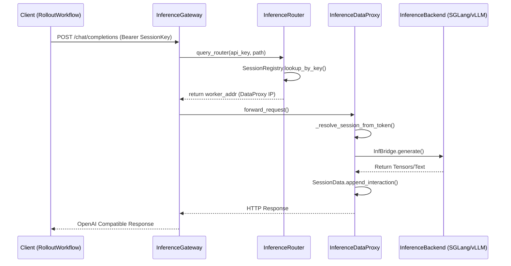
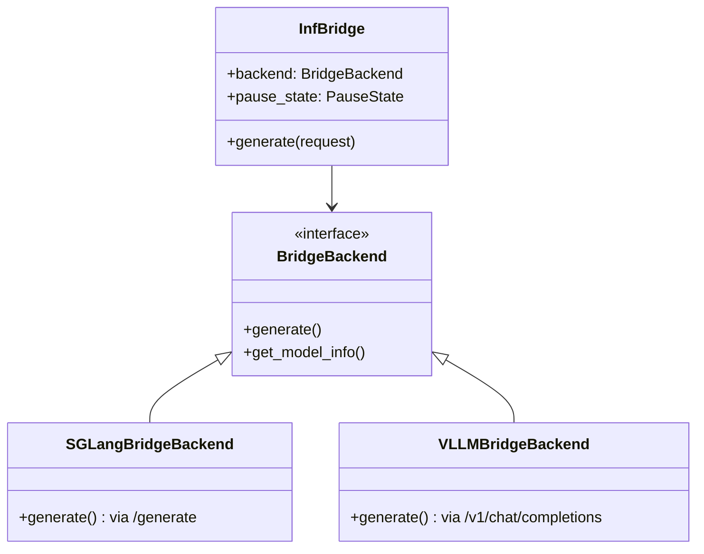

<!-- source: DeepWiki mcp.deepwiki.com · repo areal-project/AReaL · page 4.3 Experimental Inference Service (Gateway/Router/DataProxy) · fetched 2026-10-21 -->

# Experimental Inference Service (Gateway/Router/DataProxy)

Relevant source files

The following files were used as context for generating this wiki page:

- [areal/experimental/inference_service/backend.py](areal/experimental/inference_service/backend.py)
- [areal/experimental/inference_service/controller/controller.py](areal/experimental/inference_service/controller/controller.py)
- [areal/experimental/inference_service/controller/workflow.py](areal/experimental/inference_service/controller/workflow.py)
- [areal/experimental/inference_service/data_proxy/__main__.py](areal/experimental/inference_service/data_proxy/__main__.py)
- [areal/experimental/inference_service/data_proxy/app.py](areal/experimental/inference_service/data_proxy/app.py)
- [areal/experimental/inference_service/data_proxy/config.py](areal/experimental/inference_service/data_proxy/config.py)
- [areal/experimental/inference_service/data_proxy/pause.py](areal/experimental/inference_service/data_proxy/pause.py)
- [areal/experimental/inference_service/gateway/app.py](areal/experimental/inference_service/gateway/app.py)
- [areal/experimental/inference_service/gateway/streaming.py](areal/experimental/inference_service/gateway/streaming.py)
- [areal/experimental/inference_service/inf_bridge.py](areal/experimental/inference_service/inf_bridge.py)
- [areal/experimental/inference_service/router/app.py](areal/experimental/inference_service/router/app.py)
- [areal/experimental/inference_service/router/state.py](areal/experimental/inference_service/router/state.py)
- [areal/experimental/inference_service/sglang/__init__.py](areal/experimental/inference_service/sglang/__init__.py)
- [areal/experimental/inference_service/sglang/bridge.py](areal/experimental/inference_service/sglang/bridge.py)
- [areal/experimental/inference_service/vllm/__init__.py](areal/experimental/inference_service/vllm/__init__.py)
- [areal/experimental/inference_service/vllm/bridge.py](areal/experimental/inference_service/vllm/bridge.py)
- [tests/experimental/inference_service/test_controller.py](tests/experimental/inference_service/test_controller.py)
- [tests/experimental/inference_service/test_controller_integration.py](tests/experimental/inference_service/test_controller_integration.py)
- [tests/experimental/inference_service/test_controller_version.py](tests/experimental/inference_service/test_controller_version.py)
- [tests/experimental/inference_service/test_data_proxy_chat.py](tests/experimental/inference_service/test_data_proxy_chat.py)
- [tests/experimental/inference_service/test_data_proxy_integration.py](tests/experimental/inference_service/test_data_proxy_integration.py)
- [tests/experimental/inference_service/test_data_proxy_pause.py](tests/experimental/inference_service/test_data_proxy_pause.py)
- [tests/experimental/inference_service/test_data_proxy_standalone.py](tests/experimental/inference_service/test_data_proxy_standalone.py)
- [tests/experimental/inference_service/test_data_proxy_version.py](tests/experimental/inference_service/test_data_proxy_version.py)
- [tests/experimental/inference_service/test_external_model.py](tests/experimental/inference_service/test_external_model.py)
- [tests/experimental/inference_service/test_external_model_integration.py](tests/experimental/inference_service/test_external_model_integration.py)
- [tests/experimental/inference_service/test_gateway.py](tests/experimental/inference_service/test_gateway.py)
- [tests/experimental/inference_service/test_gateway_integration.py](tests/experimental/inference_service/test_gateway_integration.py)
- [tests/experimental/inference_service/test_image_input.py](tests/experimental/inference_service/test_image_input.py)
- [tests/experimental/inference_service/test_inf_bridge.py](tests/experimental/inference_service/test_inf_bridge.py)
- [tests/experimental/inference_service/test_online_stack.py](tests/experimental/inference_service/test_online_stack.py)
- [tests/experimental/inference_service/test_router.py](tests/experimental/inference_service/test_router.py)
- [tests/test_sglang_pp_unit.py](tests/test_sglang_pp_unit.py)

The Experimental Inference Service is a three-tier microservice stack designed to provide scalable, stateful, and asynchronous inference for Reinforcement Learning (RL) workflows. Unlike the standard `RolloutController`, this stack decouples the inference backend (SGLang/vLLM) from the training loop using an HTTP-based proxy architecture that supports session pinning, trajectory buffering, and model versioning [areal/experimental/inference_service/controller/controller.py:3-9]().

## System Architecture

The service consists of three primary components orchestrated by `RolloutControllerV2`:

1.  **InferenceGateway**: A thin, stateless entry point that handles authentication and forwards requests based on routing logic [areal/experimental/inference_service/gateway/app.py:3-7]().
2.  **InferenceRouter**: The control plane that maintains worker health, manages session-to-worker mappings (pinning), and implements routing strategies [areal/experimental/inference_service/router/app.py:3-7]().
3.  **InferenceDataProxy**: A stateful sidecar that sits in front of the inference engine (e.g., SGLang). It buffers trajectories, handles session lifecycle, and manages the `InfBridge` for backend communication [areal/experimental/inference_service/data_proxy/app.py:22-32]().

### Data Flow and Entity Mapping

The following diagram bridges the high-level request flow to the specific code entities involved in the transaction.

**Figure 1: Request Routing and Execution Flow**

Sources: [areal/experimental/inference_service/gateway/app.py:125-176](), [areal/experimental/inference_service/gateway/streaming.py:48-84](), [areal/experimental/inference_service/router/state.py:116-119](), [areal/experimental/inference_service/data_proxy/app.py:138-154]()

## Component Deep Dive

### 1. InferenceRouter
The Router acts as the "brain" of the stack. It does not proxy data traffic but provides the `worker_addr` for any given request [areal/experimental/inference_service/router/app.py:7-12]().

*   **WorkerRegistry**: Tracks active `InferenceDataProxy` instances and their health status via background polling [areal/experimental/inference_service/router/state.py:27-33]().
*   **SessionRegistry**: Maintains the mapping between `session_id` (or `session_api_key`) and a specific `worker_addr` to ensure multi-turn conversations stay on the same backend instance [areal/experimental/inference_service/router/state.py:93-99]().
*   **Routing Strategies**: Supports `round_robin`, `least_request`, and `random` strategies via `get_strategy()` [areal/experimental/inference_service/router/strategies.py:31]().

### 2. InferenceDataProxy
The Data Proxy is the most complex tier, providing the interface between RL logic and standard LLM serving.

*   **Session Management**: Every RL episode is a `SessionData` object. It stores `interactions` (prompt/completion pairs) and associated metadata like `logprobs` and `rewards` [areal/experimental/inference_service/data_proxy/session.py:22-32]().
*   **Trajectory Buffering**: Instead of returning all RL-specific tensors (like logprobs for every token) in the `chat/completions` response, the proxy buffers them in memory.
*   **Trajectory Export**: When an episode ends, the controller calls `/export_trajectories`. The proxy then serializes the buffered `SessionData` into `RTensor` compatible formats for the trainer [areal/experimental/inference_service/controller/workflow.py:102-123]().

### 3. InfBridge Abstraction
The `InfBridge` class provides a unified interface to different inference backends. It wraps backend-specific logic (e.g., `SGLangBridgeBackend` or `VLLMBridgeBackend`) and handles generation pausing/resuming [areal/experimental/inference_service/inf_bridge.py:182-190]().

**Figure 2: InfBridge Backend Integration**

Sources: [areal/experimental/inference_service/inf_bridge.py:36-45](), [areal/experimental/inference_service/sglang/bridge.py:37](), [areal/experimental/inference_service/vllm/bridge.py:38]()

## RolloutControllerV2 Lifecycle

`RolloutControllerV2` manages the deployment and health of the entire stack.

| Phase | Action | Code Reference |
| :--- | :--- | :--- |
| **Initialization** | Resolves worker addresses and launches microservices via `Scheduler`. | [areal/experimental/inference_service/controller/controller.py:193-200]() |
| **Worker Setup** | Forks inference engines (SGLang/vLLM) and DataProxies on NPU/GPU nodes. | [areal/experimental/inference_service/controller/controller.py:7-9]() |
| **Registration** | DataProxies register themselves with the Router. | [areal/experimental/inference_service/router/app.py:66-73]() |
| **Execution** | Orchestrates `InferenceServiceWorkflow` to run episodes. | [areal/experimental/inference_service/controller/workflow.py:44-55]() |
| **Teardown** | Kills forked processes and unregisters workers. | [areal/experimental/inference_service/controller/controller.py:168-171]() |

### Session Pinning and Multi-Turn
When a new session starts via `POST /rl/start_session` at the Gateway, the Router assigns a worker and pins that `session_id` to the worker's address [areal/experimental/inference_service/gateway/app.py:236-240](). Subsequent requests using the same `session_api_key` are guaranteed to be routed to the same `InferenceDataProxy`, allowing for stateful multi-turn interactions and consistent trajectory buffering [areal/experimental/inference_service/router/state.py:107-110]().

### Health Polling
The Router runs a background task `_poll_workers()` that periodically sends GET requests to the `/health` endpoint of all registered `worker_addr` [areal/experimental/inference_service/router/app.py:190-205](). If a worker fails to respond, it is marked unhealthy and excluded from the `get_healthy_workers()` list used by routing strategies [areal/experimental/inference_service/router/state.py:77-81]().

Sources:
- `areal/experimental/inference_service/controller/controller.py`
- `areal/experimental/inference_service/controller/workflow.py`
- `areal/experimental/inference_service/gateway/app.py`
- `areal/experimental/inference_service/gateway/streaming.py`
- `areal/experimental/inference_service/router/app.py`
- `areal/experimental/inference_service/router/state.py`
- `areal/experimental/inference_service/data_proxy/app.py`
- `areal/experimental/inference_service/inf_bridge.py`

---

