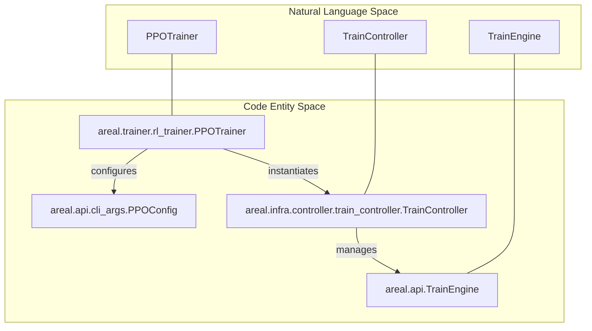
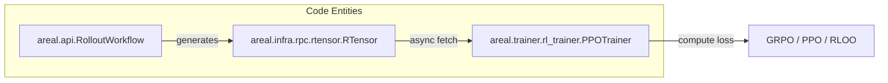

<!-- source: DeepWiki mcp.deepwiki.com · repo areal-project/AReaL · page 5 RL Algorithms & Trainers · fetched 2026-10-21 -->

# RL Algorithms & Trainers

Relevant source files

The following files were used as context for generating this wiki page:

- [.github/workflows/pre-commit.yml](.github/workflows/pre-commit.yml)
- [AGENTS.md](AGENTS.md)
- [CLAUDE.md](CLAUDE.md)
- [CONTRIBUTING.md](CONTRIBUTING.md)
- [README.md](README.md)
- [ROADMAP.md](ROADMAP.md)
- [areal/infra/controller/train_controller.py](areal/infra/controller/train_controller.py)
- [areal/infra/rpc/rtensor.py](areal/infra/rpc/rtensor.py)
- [areal/trainer/dpo_trainer.py](areal/trainer/dpo_trainer.py)
- [areal/trainer/rl_trainer.py](areal/trainer/rl_trainer.py)
- [areal/trainer/rw_trainer.py](areal/trainer/rw_trainer.py)
- [areal/trainer/sft_trainer.py](areal/trainer/sft_trainer.py)
- [blog/AReaL_v0_2.md](blog/AReaL_v0_2.md)
- [tests/test_rtensor.py](tests/test_rtensor.py)

This section provides an overview of the Reinforcement Learning (RL) training algorithms and the orchestration classes (Trainers) supported by AReaL. AReaL is designed around a **fully asynchronous RL training paradigm**, optimized for high-throughput alignment of large-scale reasoning and agentic models [README.md:15-21]().

The system decouples the generation of experience (rollout) from the model optimization (training), allowing multiple engines to work in parallel. High-level orchestration is handled by specialized `Trainer` classes that manage the lifecycle of models, data distribution, and synchronization.

### System Orchestration Overview

The training process in AReaL is managed by a `TrainController` which coordinates distributed workers and engines [areal/infra/controller/train_controller.py:174-187](). The high-level logic for specific RL or supervised routines is encapsulated in Trainer classes.

| Trainer Class | Purpose | Primary Components |
| :--- | :--- | :--- |
| `PPOTrainer` | Distributed PPO/RLOO/GRPO orchestration | Actor, Critic, Reference, Teacher models [areal/trainer/rl_trainer.py:105-189]() |
| `SFTTrainer` | Supervised Fine-Tuning | Actor (LM) engine [areal/trainer/sft_trainer.py:54-80]() |
| `DPOTrainer` | Direct Preference Optimization | Actor and Reference models |
| `RWTrainer` | Reward Model training | Actor (RM) engine [areal/trainer/rw_trainer.py:76-105]() |

#### Trainer-Engine Relationship
The following diagram illustrates how the `PPOTrainer` bridges high-level configuration to distributed execution via the `TrainController`.

**Trainer to Controller Mapping**

Sources: [areal/trainer/rl_trainer.py:105-132](), [areal/infra/controller/train_controller.py:189-198]()

---

### PPO Trainer & Actor/Critic
The `PPOTrainer` is the most complex orchestrator in AReaL. It manages up to four distinct model roles: **Actor** (the policy being trained), **Critic** (value function), **Reference** (frozen policy for KL divergence), and **Teacher** (for distillation) [areal/trainer/rl_trainer.py:170-189]().

Key features include:
- **Decoupled Logic**: Support for running rollout and training on different backend engines or offloading them to CPU to save VRAM [areal/trainer/rl_trainer.py:136-146]().
- **Advantage Estimation**: Implementation of Generalized Advantage Estimation (GAE).
- **Online Mode**: Support for agentic RL where data is streamed from live environments [areal/trainer/rl_trainer.py:153-162]().

For details, see [PPO Trainer & Actor/Critic](#5.1).

### SFT, DPO & Reward Model Trainers
While AReaL is RL-centric, it provides robust trainers for the prerequisite stages of the alignment pipeline:
- **SFTTrainer**: Standard cross-entropy training on prompt-completion pairs [areal/trainer/sft_trainer.py:148-191]().
- **DPOTrainer**: Preference-based optimization without a separate reward model.
- **RWTrainer**: Training reward models using a pairwise ranking loss [areal/trainer/rw_trainer.py:54-73]().

These trainers utilize the same `DataController` and `TrainEngine` abstractions as the RL trainers, ensuring consistency in performance and memory optimizations like sequence packing.

For details, see [SFT, DPO & Reward Model Trainers](#5.2).

### Supported RL Algorithms
AReaL supports a wide array of RL algorithms beyond standard PPO, often selected via configuration keys in `PPOConfig` or specific algorithm implementations:
- **GRPO**: Group Relative Policy Optimization, widely used for reasoning models (e.g., DeepSeek-R1) to eliminate the need for a separate Critic model [blog/AReaL_v0_2.md:125-130]().
- **RLOO**: REINFORCE Leave-One-Out for low-variance policy gradients.
- **DAPO/GSPO**: Specialized preference-based and sequence-level optimization algorithms.

The following diagram shows how algorithm-specific logic interacts with the distributed `RTensor` system for experience replay.

**Experience Flow and Algorithms**

Sources: [areal/infra/rpc/rtensor.py:25-39](), [areal/trainer/rl_trainer.py:105-111](), [blog/AReaL_v0_2.md:125-137]()

For details, see [Supported RL Algorithms](#5.3).

---
**Child Pages:**
- [PPO Trainer & Actor/Critic](#5.1)
- [SFT, DPO & Reward Model Trainers](#5.2)
- [Supported RL Algorithms](#5.3)

---

