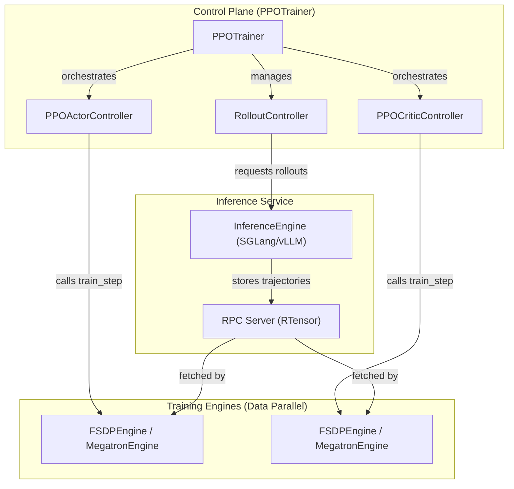
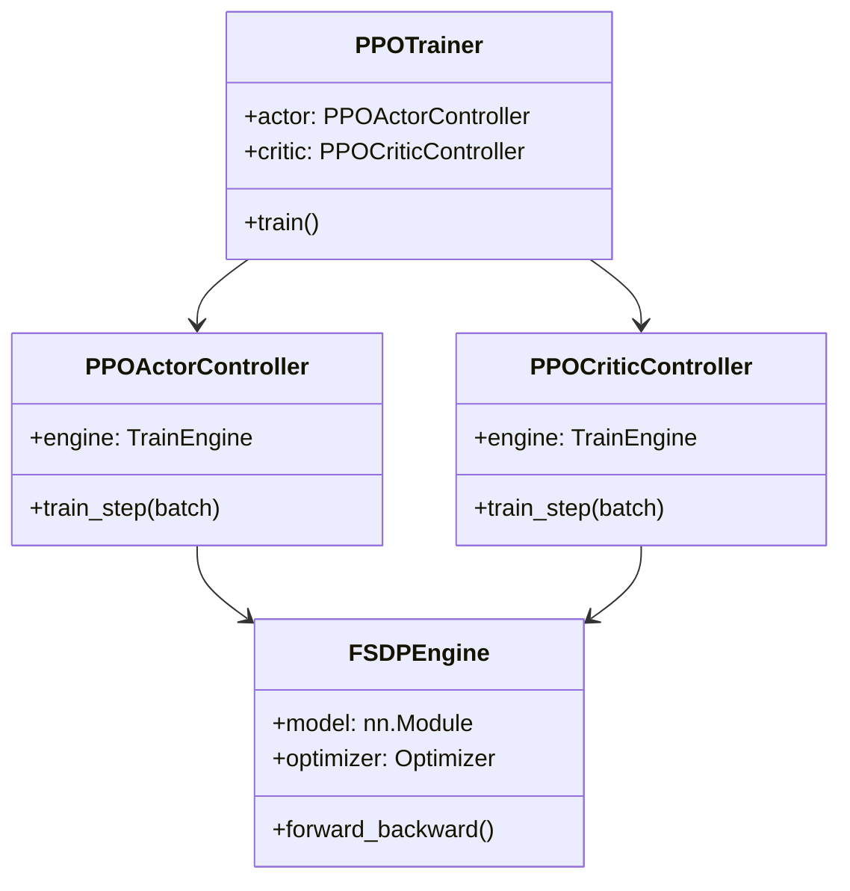

<!-- source: DeepWiki mcp.deepwiki.com · repo areal-project/AReaL · page 5.1 PPO Trainer & Actor/Critic · fetched 2026-10-21 -->

# PPO Trainer & Actor/Critic

Relevant source files

The following files were used as context for generating this wiki page:

- [areal/api/cli_args.py](areal/api/cli_args.py)
- [areal/engine/fsdp_engine.py](areal/engine/fsdp_engine.py)
- [areal/engine/megatron_engine.py](areal/engine/megatron_engine.py)
- [areal/experimental/engine/archon_engine.py](areal/experimental/engine/archon_engine.py)
- [areal/infra/controller/train_controller.py](areal/infra/controller/train_controller.py)
- [areal/infra/rpc/rtensor.py](areal/infra/rpc/rtensor.py)
- [areal/trainer/dpo_trainer.py](areal/trainer/dpo_trainer.py)
- [areal/trainer/ppo/actor.py](areal/trainer/ppo/actor.py)
- [areal/trainer/ppo/critic.py](areal/trainer/ppo/critic.py)
- [areal/trainer/ppo/stats.py](areal/trainer/ppo/stats.py)
- [areal/trainer/rl_trainer.py](areal/trainer/rl_trainer.py)
- [areal/trainer/rw_trainer.py](areal/trainer/rw_trainer.py)
- [areal/trainer/sft_trainer.py](areal/trainer/sft_trainer.py)
- [docs/en/algorithms/distillation.md](docs/en/algorithms/distillation.md)
- [docs/en/cli_reference.md](docs/en/cli_reference.md)
- [docs/zh/cli_reference.md](docs/zh/cli_reference.md)
- [examples/countdown/train_config.yaml](examples/countdown/train_config.yaml)
- [examples/distillation/gsm8k_grpo_distill.yaml](examples/distillation/gsm8k_grpo_distill.yaml)
- [examples/math/gsm8k_grpo.yaml](examples/math/gsm8k_grpo.yaml)
- [examples/math/gsm8k_rloo.yaml](examples/math/gsm8k_rloo.yaml)
- [examples/math/gsm8k_sft.yaml](examples/math/gsm8k_sft.yaml)
- [examples/tir/tir_math_config.yaml](examples/tir/tir_math_config.yaml)
- [examples/vlm/clevr_count_70k_grpo.yaml](examples/vlm/clevr_count_70k_grpo.yaml)
- [examples/vlm/clevr_count_70k_sft.yaml](examples/vlm/clevr_count_70k_sft.yaml)
- [tests/test_ppo_stats.py](tests/test_ppo_stats.py)
- [tests/test_rtensor.py](tests/test_rtensor.py)

The PPO (Proximal Policy Optimization) implementation in AReaL is centered around the `PPOTrainer` class, which orchestrates a distributed, asynchronous reinforcement learning loop. It manages the lifecycle and interaction of four primary model roles: the **Actor** (policy), the **Critic** (value function), the **Reference** model (KL divergence anchor), and an optional **Teacher** model (for distillation).

## PPOTrainer Orchestration

The `PPOTrainer` [areal/trainer/rl_trainer.py:105-105]() acts as the central controller. It initializes the training engines, manages the data flow between rollout workers and training workers, and handles the high-level training loop.

### Component Management
The trainer instantiates specific controllers for each model role based on the configuration:
*   **Actor**: Managed via `PPOActorController` [areal/trainer/rl_trainer.py:72-72]().
*   **Critic**: Managed via `PPOCriticController` [areal/trainer/rl_trainer.py:73-73]().
*   **Reference/Teacher**: Initialized as standard `TrainEngine` instances but typically set to evaluation mode [areal/trainer/rl_trainer.py:178-188]().

### Data Flow and Parallelism
Data is moved across the distributed system using the `RTensor` (Remote Tensor) abstraction [areal/infra/rpc/rtensor.py:16-16](). Trajectories generated by remote inference engines (like SGLang or vLLM) are stored in an RPC-based data service and fetched by the trainer as needed.

**System Entity Mapping: PPO Training Loop**

**Sources:** [areal/trainer/rl_trainer.py:105-171](), [areal/infra/controller/train_controller.py:174-202](), [areal/infra/rpc/rtensor.py:16-16]().

---

## Actor and Critic Implementation

The Actor and Critic are implemented using the `TrainEngine` interface, allowing them to run on different backends such as `FSDPEngine` [areal/engine/fsdp_engine.py:219-219]() or `MegatronEngine` [areal/engine/megatron_engine.py:168-168]().

### Advantage Estimation
Advantages are calculated to guide the Actor's policy updates. The system supports various normalization levels (batch or group) via `NormConfig` [areal/api/cli_args.py:41-41]().
*   **Group Normalization**: Specifically used for algorithms like GRPO, where advantages are normalized within a group of samples generated from the same prompt [areal/api/cli_args.py:75-77]().
*   **Advantage Clipping**: Controlled by `eps_clip` in the `PPOActorConfig` [examples/math/gsm8k_grpo.yaml:64-64]().

### Decoupled PPO Loss
The trainer supports a decoupled PPO loss [examples/math/gsm8k_grpo.yaml:71-71](), allowing the Actor and Critic to be updated with different frequencies or micro-batch configurations. This is facilitated by `MicroBatchSpec` [areal/api/cli_args.py:98-98](), which handles sequence packing and splitting to maximize throughput.

**Code Entity Relationship: Actor/Critic Interaction**

**Sources:** [areal/trainer/rl_trainer.py:171-177](), [areal/engine/fsdp_engine.py:219-225](), [areal/api/cli_args.py:41-78]().

---

## Advanced Training Features

### Rejection Sampling
To improve sample efficiency, AReaL implements rejection sampling [areal/api/cli_args.py:82-82](). This is configured via `RejectionSamplingConfig`, which allows filtering trajectories based on metrics like the importance sampling ratio [examples/math/gsm8k_grpo.yaml:72-74]().

### Model Offloading
To save VRAM, AReaL supports aggressive model offloading. The `PPOTrainer` determines offloading needs based on whether the Actor and Rollout engines are co-located [areal/trainer/rl_trainer.py:136-146]().
*   **CPU Offload**: Managed via `CPUOffloadPolicy` in FSDP [areal/engine/fsdp_engine.py:32-32]().
*   **Activation Checkpointing**: Enabled to trade computation for memory [areal/engine/fsdp_engine.py:112-112]().

### Weight Synchronization
As an asynchronous RL framework, AReaL must synchronize weights between the Training workers (Actor) and Inference workers (Rollout).
*   **XCCL/AWEX**: The system uses high-performance protocols like `xccl` for weight updates [examples/math/gsm8k_grpo.yaml:82-82]().
*   **Version Tracking**: The `RolloutController` tracks the `max_head_offpolicyness` to ensure inference does not drift too far from the current training weights [examples/math/gsm8k_grpo.yaml:28-28]().

| Feature | Configuration Key | Implementation Detail |
| :--- | :--- | :--- |
| **KL Control** | `actor.kl_ctl` | Penalizes divergence from `ref` model [examples/math/gsm8k_grpo.yaml:68-68](). |
| **Logprob Recomputation** | `actor.recompute_logprob` | Re-runs forward pass during PPO steps to save memory [examples/math/gsm8k_grpo.yaml:70-70](). |
| **Sequence Packing** | `mb_spec.packing_algorithm` | Uses `ffd` (First Fit Decreasing) or `kk` to pack variable length sequences [areal/api/cli_args.py:126-138](). |

**Sources:** [areal/trainer/rl_trainer.py:136-146](), [areal/api/cli_args.py:126-138](), [examples/math/gsm8k_grpo.yaml:21-82]().

---

