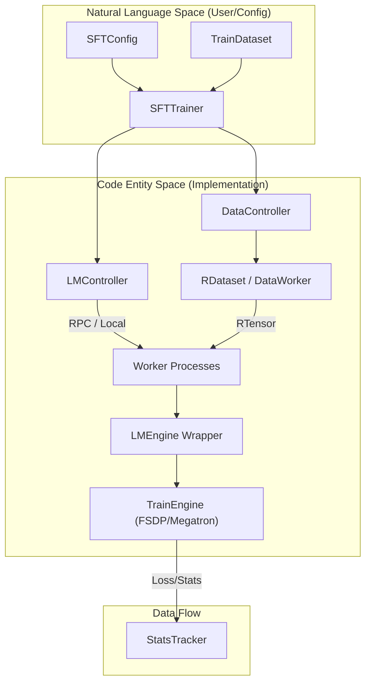
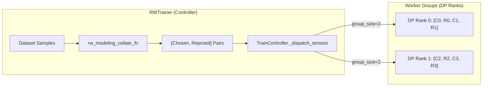

<!-- source: DeepWiki mcp.deepwiki.com · repo areal-project/AReaL · page 5.2 SFT, DPO & Reward Model Trainers · fetched 2026-10-21 -->

# SFT, DPO & Reward Model Trainers

Relevant source files

The following files were used as context for generating this wiki page:

- [areal/engine/megatron_utils/packed_context_parallel.py](areal/engine/megatron_utils/packed_context_parallel.py)
- [areal/infra/controller/train_controller.py](areal/infra/controller/train_controller.py)
- [areal/infra/rpc/rtensor.py](areal/infra/rpc/rtensor.py)
- [areal/trainer/dpo_trainer.py](areal/trainer/dpo_trainer.py)
- [areal/trainer/rl_trainer.py](areal/trainer/rl_trainer.py)
- [areal/trainer/rw_trainer.py](areal/trainer/rw_trainer.py)
- [areal/trainer/sft/lm_engine.py](areal/trainer/sft/lm_engine.py)
- [areal/trainer/sft_trainer.py](areal/trainer/sft_trainer.py)
- [examples/countdown/train.py](examples/countdown/train.py)
- [examples/math/boba_grpo.py](examples/math/boba_grpo.py)
- [examples/math/gsm8k_sft.py](examples/math/gsm8k_sft.py)
- [examples/tir/train_tir.py](examples/tir/train_tir.py)
- [examples/vlm/clevr_count_70k_grpo.py](examples/vlm/clevr_count_70k_grpo.py)
- [examples/vlm/clevr_count_70k_sft.py](examples/vlm/clevr_count_70k_sft.py)
- [tests/test_reassemble_cp_logprobs.py](tests/test_reassemble_cp_logprobs.py)
- [tests/test_rtensor.py](tests/test_rtensor.py)

This page describes the implementation of Supervised Fine-Tuning (`SFTTrainer`), Direct Preference Optimization (`DPOTrainer`), and Reward Model training (`RWTrainer`) in AReaL. These trainers manage the training lifecycle for their respective tasks, including data collation, distributed engine management, and evaluation loops.

## Trainer Architecture Overview

The trainers in AReaL serve as high-level orchestrators that bridge the gap between datasets and the underlying training engines (FSDP2, Megatron, or Archon). Each trainer follows a similar pattern: initializing a `Scheduler`, setting up `DataController` for distributed data loading, and managing a `TrainController` that executes operations across worker processes.

### Component Relationship

The following diagram illustrates how the `SFTTrainer` (as a representative example) interacts with the core infrastructure and training engines.

**SFT Training Flow and Entity Mapping**

**Sources:** [areal/trainer/sft_trainer.py:54-113](), [areal/trainer/sft/lm_engine.py:52-64](), [areal/infra/controller/train_controller.py:189-205]()

---

## Supervised Fine-Tuning (SFT)

The `SFTTrainer` implements standard language modeling training. It uses the `LMEngine` wrapper to execute training steps and calculate the SFT loss.

### Data Collation and Flow
For SFT, the trainer expects a dataset where each item contains `input_ids` and a `loss_mask`. The `loss_mask` is typically used to ignore prompt tokens during loss calculation.
- **Shift Logic:** The `LMEngine` automatically performs a `torch.roll` on the `loss_mask` with `shifts=-1` to align the mask with the next-token prediction targets [areal/trainer/sft/lm_engine.py:29-29]().
- **Packed Loss:** The `compute_packed_sft_loss` function handles 1D packed sequences, using `cu_seqlens` to separate individual sequences within a batch and calculating per-sequence perplexity (PPL) for logging [areal/trainer/sft/lm_engine.py:81-131]().

### SFT Training Loop
The main loop in `SFTTrainer.train()` handles:
1.  **Data Loading:** Fetching batches via `cycle_dataloader` and broadcasting them across the DP group [areal/trainer/sft_trainer.py:161-179]().
2.  **Execution:** Calling `self.actor.train_lm(batch)`, which triggers the `LMController` to dispatch the task to workers [areal/trainer/sft_trainer.py:194-194]().
3.  **Checkpointing:** Managing periodic saves via the `Saver` and `RecoverHandler` [areal/trainer/sft_trainer.py:202-211]().

**Sources:** [areal/trainer/sft_trainer.py:148-220](), [areal/trainer/sft/lm_engine.py:18-36]()

---

## Reward Model Training (RW)

The `RWTrainer` is designed for training Bradley-Terry reward models using preference pairs (chosen vs. rejected).

### RW Data Collation
Reward modeling requires a specific collation strategy implemented in `rw_modeling_collate_fn`.
- It transforms each dataset item into two distinct entries: one for the `chosen_ids` and one for the `rejected_ids` [areal/trainer/rw_trainer.py:54-73]().
- These pairs are kept together during dispatch to ensure they land on the same training rank for the contrastive loss calculation.

### RW Dispatch Strategy
The `TrainController` uses a `group_size` parameter during data dispatch. For reward modeling, `group_size=2` ensures that the chosen and rejected samples of a pair are never split across different Data Parallel (DP) ranks [areal/infra/controller/train_controller.py:76-122]().

**RW Data Dispatch Diagram**

**Sources:** [areal/trainer/rw_trainer.py:54-73](), [areal/infra/controller/train_controller.py:81-101]()

---

## Direct Preference Optimization (DPO)

The `DPOTrainer` manages the DPO algorithm, which requires an Actor (Policy) model and a Reference model.

### Engine Management
- **Actor:** The model being optimized.
- **Reference:** A frozen copy of the model used to calculate the log-probability ratio.
- **Offloading:** The trainer supports offloading the reference model to CPU to save GPU memory, managed via the `ref.offload` configuration [areal/trainer/rl_trainer.py:143-143]().

### DPO Training Loop
Similar to PPO, DPO involves calculating log-probabilities for both chosen and rejected completions under both the actor and reference models. The `DPOTrainer` coordinates these forward passes across the distributed engine and computes the DPO loss (typically the sigmoid of the log-ratio difference).

---

## Shared Infrastructure

All three trainers leverage common AReaL utilities for distributed orchestration and memory management.

### Engine Initialization
Trainers use `_create_actor` (or similar methods) to instantiate a `TrainController`. This controller:
- Finds free ports for distributed communication [areal/infra/controller/train_controller.py:27-27]().
- Spawns worker processes using the configured `Scheduler` (Local, Ray, or Slurm) [areal/infra/controller/train_controller.py:193-197]().
- Initializes the specific backend (e.g., `FSDPEngine`) on each worker [areal/infra/controller/train_controller.py:202-205]().

### Memory & Performance Tracking
- **Memory Profiling:** Trainers can trigger memory snapshots at specific steps using `actor.start_memory_profile()` [areal/trainer/sft_trainer.py:187-187]().
- **PerfTracer:** Execution spans are wrapped in `perf_tracer.trace_scope` to provide detailed timelines of IO (data loading), compute (forward/backward), and communication [areal/trainer/sft_trainer.py:173-177]().

### Stats Logging
Metrics are aggregated via `stats_tracker`. For example, in SFT, `compute_packed_sft_loss` logs:
- `ppl` (Perplexity) [areal/trainer/sft/lm_engine.py:121-121]().
- `loss` [areal/trainer/sft/lm_engine.py:122-122]().
- Token statistics (`n_valid_tokens`, `prompt_tokens`) [areal/trainer/sft/lm_engine.py:115-120]().

**Sources:** [areal/trainer/sft_trainer.py:146-147](), [areal/trainer/rw_trainer.py:179-180](), [areal/trainer/sft/lm_engine.py:114-129](), [areal/infra/controller/train_controller.py:189-210]()

---

