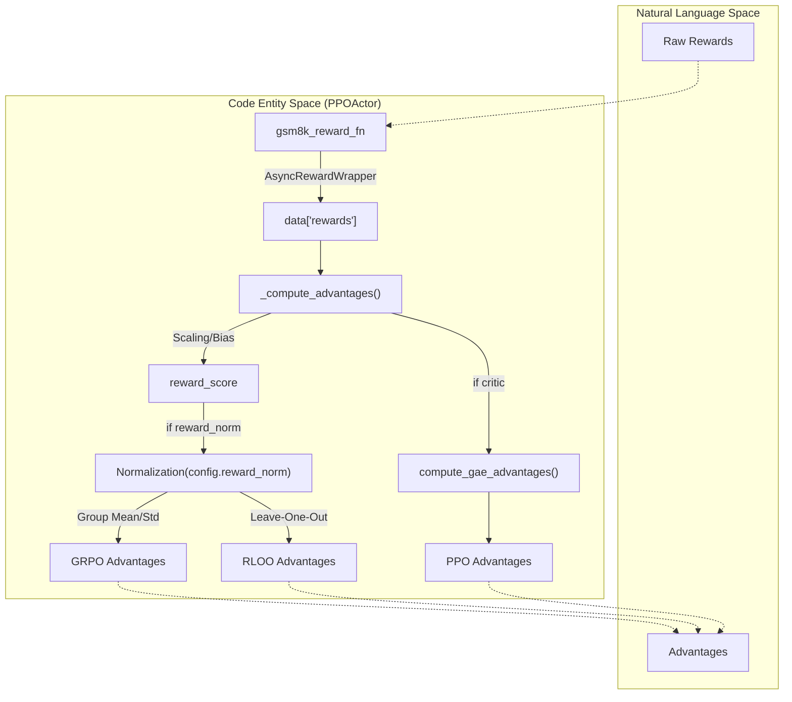
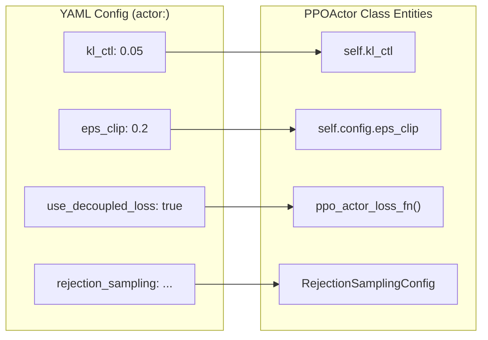

<!-- source: DeepWiki mcp.deepwiki.com · repo areal-project/AReaL · page 5.3 Supported RL Algorithms · fetched 2026-10-21 -->

# Supported RL Algorithms

Relevant source files

The following files were used as context for generating this wiki page:

- [.claude/commands/translate-doc-zh.md](.claude/commands/translate-doc-zh.md)
- [areal/models/transformers/vision_sp_shard.py](areal/models/transformers/vision_sp_shard.py)
- [areal/trainer/ppo/actor.py](areal/trainer/ppo/actor.py)
- [areal/trainer/ppo/critic.py](areal/trainer/ppo/critic.py)
- [areal/trainer/ppo/stats.py](areal/trainer/ppo/stats.py)
- [docs/build_all.sh](docs/build_all.sh)
- [docs/en/algorithms/distillation.md](docs/en/algorithms/distillation.md)
- [docs/en/algorithms/grpo_series.md](docs/en/algorithms/grpo_series.md)
- [docs/en/algorithms/m2po.md](docs/en/algorithms/m2po.md)
- [docs/zh/algorithms/grpo_series.md](docs/zh/algorithms/grpo_series.md)
- [docs/zh/algorithms/m2po.md](docs/zh/algorithms/m2po.md)
- [examples/camel/config.yaml](examples/camel/config.yaml)
- [examples/camel/train.py](examples/camel/train.py)
- [examples/countdown/train_config.yaml](examples/countdown/train_config.yaml)
- [examples/distillation/gsm8k_grpo_distill.yaml](examples/distillation/gsm8k_grpo_distill.yaml)
- [examples/math/gsm8k_dapo_dynamic_bs.yaml](examples/math/gsm8k_dapo_dynamic_bs.yaml)
- [examples/math/gsm8k_drgrpo.yaml](examples/math/gsm8k_drgrpo.yaml)
- [examples/math/gsm8k_grpo.yaml](examples/math/gsm8k_grpo.yaml)
- [examples/math/gsm8k_gspo.yaml](examples/math/gsm8k_gspo.yaml)
- [examples/math/gsm8k_liteppo.yaml](examples/math/gsm8k_liteppo.yaml)
- [examples/math/gsm8k_m2po.yaml](examples/math/gsm8k_m2po.yaml)
- [examples/math/gsm8k_ppo.yaml](examples/math/gsm8k_ppo.yaml)
- [examples/math/gsm8k_reinforce.yaml](examples/math/gsm8k_reinforce.yaml)
- [examples/math/gsm8k_reinforce_baseline.yaml](examples/math/gsm8k_reinforce_baseline.yaml)
- [examples/math/gsm8k_rloo.yaml](examples/math/gsm8k_rloo.yaml)
- [examples/math/gsm8k_sft.yaml](examples/math/gsm8k_sft.yaml)
- [examples/skypilot/gsm8k_grpo_ray.yaml](examples/skypilot/gsm8k_grpo_ray.yaml)
- [examples/tir/tir_math_config.yaml](examples/tir/tir_math_config.yaml)
- [examples/vlm/clevr_count_70k_grpo.yaml](examples/vlm/clevr_count_70k_grpo.yaml)
- [examples/vlm/clevr_count_70k_sft.yaml](examples/vlm/clevr_count_70k_sft.yaml)
- [tests/test_ppo_stats.py](tests/test_ppo_stats.py)
- [tests/test_vision_sp_shard.py](tests/test_vision_sp_shard.py)

This page serves as a technical reference for the Reinforcement Learning (RL) algorithms supported in AReaL. AReaL provides a unified framework for executing various policy gradient and preference optimization algorithms, primarily orchestrated through the `PPOTrainer` [areal/trainer/ppo/trainer.py:46-50]().

## Algorithm Overview

AReaL supports a wide range of algorithms by modularizing the advantage estimation and loss computation within the `PPOActor` [areal/trainer/ppo/actor.py:43-45]() and `PPOCritic` [areal/trainer/ppo/critic.py:28-30]() classes.

| Algorithm | Primary Mechanism | Key YAML Configuration |
| :--- | :--- | :--- |
| **PPO** | Actor-Critic with Clipped Objective | `critic` block enabled; `kl_ctl > 0` |
| **GRPO** | Group Relative Policy Optimization | `reward_norm: {mean_level: group, std_level: group}` |
| **RLOO** | REINFORCE Leave-One-Out | `reward_norm: {mean_leave1out: true}` |
| **REINFORCE**| Vanilla Policy Gradient | `critic: null`, `kl_ctl: 0.0` |
| **M2PO** | Margin-Maximized Policy Optimization | `m2_threshold: <float>`, `eps_clip: 0.0` |
| **GSPO** | Group-based Soft Policy Optimization | `reward_norm: {mean_level: group}`, `kl_ctl > 0` |
| **DAPO** | Dynamic Batch-size Policy Optimization | `actor: {dynamic_bs: true}` |
| **LitePPO** | Memory-efficient PPO | Optimized `mb_spec` and `offload` |
| **Distillation**| Knowledge Distillation via RL | `teacher` config block |

Sources: [areal/trainer/ppo/actor.py:43-128](), [examples/math/gsm8k_grpo.yaml:75-81](), [examples/math/gsm8k_m2po.yaml:82-82]()

---

## Implementation Logic

The `PPOActor` class is the central entity for computing rewards, advantages, and losses. It handles the transition between standard on-policy PPO and decoupled off-policy PPO [areal/trainer/ppo/actor.py:80-91]().

### Advantage Estimation Data Flow

The following diagram illustrates how raw rewards from the `RolloutWorkflow` are transformed into advantages based on the selected algorithm.

**Advantage Computation Workflow**

Sources: [areal/trainer/ppo/actor.py:145-180](), [examples/camel/train.py:27-33](), [areal/utils/data.py:29-32]()

---

## Detailed Algorithm Reference

### 1. GRPO (Group Relative Policy Optimization)
GRPO eliminates the need for a critic model by normalizing rewards within a group of samples generated from the same prompt [examples/math/gsm8k_grpo.yaml:75-78]().

*   **Config Key**: `reward_norm`
*   **Mechanism**: Uses `mean_level: group` and `std_level: group`. The `group_size` must match `n_samples` in `gconfig` [examples/math/gsm8k_grpo.yaml:76-78]().
*   **Implementation**: `Normalization` class in `areal/utils/data.py` computes the mean and standard deviation across the `n_samples` dimension.

### 2. RLOO (REINFORCE Leave-One-Out)
RLOO is a variation of REINFORCE that uses the average of other samples in the same group as a baseline to reduce variance [examples/math/gsm8k_rloo.yaml:74-78]().

*   **Config Key**: `mean_leave1out: true`
*   **Implementation**: In `_compute_advantages`, the reward for sample $i$ is baselined against $\frac{1}{N-1} \sum_{j \neq i} R_j$ [areal/trainer/ppo/actor.py:172-174]().

### 3. M2PO (Margin-Maximized Policy Optimization)
M2PO focuses on maximizing the margin between correct and incorrect responses [examples/math/gsm8k_m2po.yaml:82-82]().

*   **Config Key**: `m2_threshold`
*   **Mechanism**: Replaces the standard PPO clip with a margin-based threshold. It typically sets `eps_clip: 0.0` to disable standard clipping [examples/math/gsm8k_m2po.yaml:63-82]().

### 4. PPO (Proximal Policy Optimization)
The standard actor-critic implementation. Requires a `critic` configuration block [examples/math/gsm8k_ppo.yaml:86-103]().

*   **Logic**: `PPOActor` computes log-probabilities and the `PPOCritic` computes state values.
*   **Advantage**: Uses Generalized Advantage Estimation (GAE) [areal/trainer/ppo/actor.py:61-62]().

---

## Training Configuration Mapping

The algorithms are configured via the `PPOActorConfig` dataclass, which is populated from the YAML `actor` block [areal/api/cli_args.py:9-12]().

**Configuration to Code Mapping**

Sources: [areal/trainer/ppo/actor.py:43-65](), [areal/utils/functional.py:33-37](), [examples/math/gsm8k_grpo.yaml:63-74]()

### Rejection Sampling
AReaL supports rejection sampling during the training phase (off-policy PPO). This is configured via the `rejection_sampling` key [areal/trainer/ppo/actor.py:105-112]().

*   **Metric**: Can be `ratio` (importance weight) or `kl` [examples/math/gsm8k_grpo.yaml:73-73]().
*   **Action**: Defines what to do with samples exceeding the `upper` bound (e.g., clipping or dropping).

### Decoupled PPO
Decoupled PPO allows the training to be off-policy relative to the behavior policy used during rollout [areal/trainer/ppo/actor.py:89-91]().

*   **`use_decoupled_loss: true`**: Enables importance sampling between the current policy $\pi_\theta$ and the behavior policy $\pi_{behave}$ [areal/trainer/ppo/actor.py:90-91]().
*   **`prox_logp_method`**: Determines how the proximal policy is calculated (e.g., `recompute` via a forward pass or `loglinear` approximation) [areal/trainer/ppo/actor.py:93-101]().

Sources: [areal/trainer/ppo/actor.py:71-128](), [areal/utils/constants.py:17-26](), [examples/math/gsm8k_grpo.yaml:70-74]()

---

