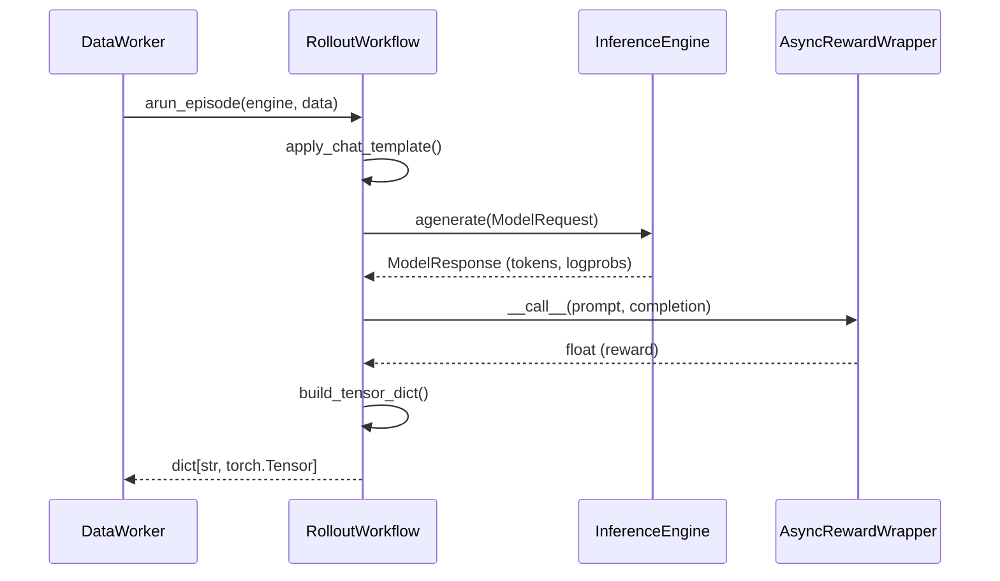
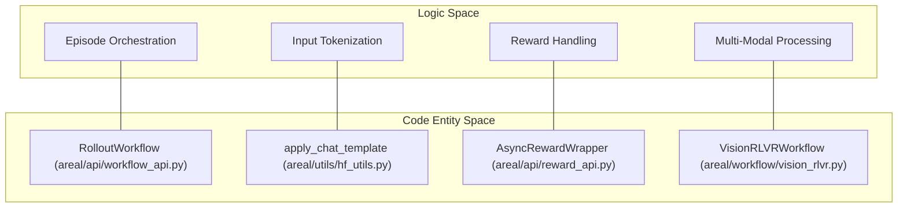

<!-- source: DeepWiki mcp.deepwiki.com · repo areal-project/AReaL · page 6 Rollout Workflows · fetched 2026-10-21 -->

# Rollout Workflows

Relevant source files

The following files were used as context for generating this wiki page:

- [areal/experimental/inference_service/data_proxy/tokenizer_proxy.py](areal/experimental/inference_service/data_proxy/tokenizer_proxy.py)
- [areal/utils/hf_utils.py](areal/utils/hf_utils.py)
- [areal/workflow/multi_turn.py](areal/workflow/multi_turn.py)
- [areal/workflow/rlvr.py](areal/workflow/rlvr.py)
- [areal/workflow/vision_rlvr.py](areal/workflow/vision_rlvr.py)
- [examples/scaffolding/search_scaffolding.py](examples/scaffolding/search_scaffolding.py)
- [examples/scaffolding/tests/test_worker.py](examples/scaffolding/tests/test_worker.py)
- [examples/scaffolding/workflow.py](examples/scaffolding/workflow.py)
- [examples/tir/tir_workflow.py](examples/tir/tir_workflow.py)

Rollout Workflows in AReaL define the lifecycle of an RL episode, bridging the gap between raw data samples and the tensors required for training. They encapsulate the logic for prompt construction, model inference, reward computation, and trajectory post-processing. All workflows implement the `RolloutWorkflow` interface, which is primarily driven by the `arun_episode` asynchronous method [areal/api/workflow_api.py:16-17]().

### Workflow Abstraction

The `RolloutWorkflow` serves as a strategy pattern for different RL tasks. It receives an `InferenceEngine` and a data dictionary, then returns a dictionary of PyTorch tensors formatted for the `PPOTrainer`.

| Component | Responsibility |
| :--- | :--- |
| **Input Processing** | Applying chat templates and tokenizing input messages [areal/workflow/rlvr.py:31-42](). |
| **Inference Orchestration** | Calling `engine.agenerate` with specific `ModelRequest` parameters [areal/workflow/rlvr.py:130-132](). |
| **Reward Computation** | Executing verifiable or model-based reward functions [areal/workflow/rlvr.py:84-109](). |
| **Tensor Preparation** | Packing sequences, masks, logprobs, and rewards into training-ready tensors [areal/workflow/rlvr.py:165-178](). |

### Workflow Execution Flow

The following diagram illustrates how the `RolloutWorkflow` interacts with system components to transform a dataset sample into a training trajectory.

**Workflow Interaction Sequence**

Sources: [areal/workflow/rlvr.py:139-178](), [areal/api/workflow_api.py:16-17]()

---

## RLVR & Vision Workflows

The **RLVR (Reinforcement Learning from Verifiable Rewards)** workflow is the standard implementation for reasoning tasks. It focuses on single-turn interactions where the model's output can be verified by a deterministic function (e.g., a math checker).

The **Vision RLVR** extension adds support for multi-modal inputs. It utilizes a `transformers.AutoProcessor` to handle image tokenization and ensures that `mm_token_type_ids` and `pixel_values` are correctly aligned in the resulting tensors for training VLMs.

For details, see [RLVR & Vision Workflows](#6.1).

Sources: [areal/workflow/rlvr.py:49-62](), [areal/workflow/vision_rlvr.py:26-43]()

---

## Multi-Turn & Agentic Workflows

AReaL supports complex episode structures beyond single-turn completion. 

*   **Multi-Turn Workflow**: Implements retry loops where the model is prompted to correct its own mistakes if the initial reward is zero, applying a `turn_discount` to subsequent attempts [areal/workflow/multi_turn.py:19-39]().
*   **TIR (Tool-Integrated Reasoning)**: Manages episodes where the model can call external tools (like a Python interpreter). It handles the state transition between generation and tool execution [examples/tir/tir_workflow.py:47-80]().
*   **Scaffolding**: A modular framework that uses a `TrajectoryMaker` to orchestrate multiple LLM calls within a single episode, often used for search agents or multi-step reasoning [examples/scaffolding/workflow.py:42-63]().

For details, see [Multi-Turn & Agentic Workflows](#6.2).

Sources: [areal/workflow/multi_turn.py:76-118](), [examples/tir/tir_workflow.py:171-200](), [examples/scaffolding/workflow.py:146-152]()

---

## Agent Service (Experimental)

The **Agent Service** is a microservice-based architecture designed for high-scale, stateful agentic RL. Unlike the standard in-process workflows, the Agent Service decouples the agent logic from the rollout worker. It uses a `Gateway` and `Router` to manage long-running sessions, allowing for asynchronous tool execution and persistent state management across turns.

For details, see [Agent Service (Experimental)](#6.3).

Sources: [areal/experimental/inference_service/data_proxy/tokenizer_proxy.py:10-16]()

---

## System Mapping: Logic to Entities

This diagram bridges the conceptual "Rollout" phase to the specific classes and files that implement them in the AReaL codebase.

**Code Entity Mapping**

Sources: [areal/api/workflow_api.py:16-17](), [areal/utils/hf_utils.py:36-47](), [areal/workflow/vision_rlvr.py:26-43]()

---

