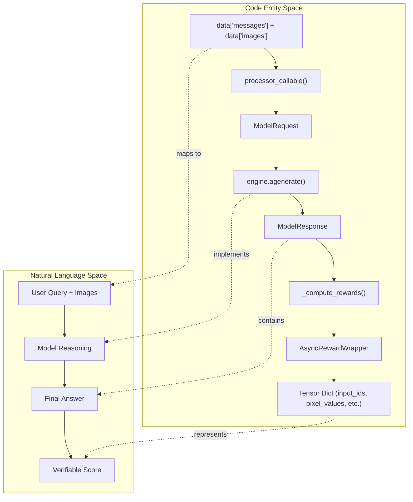
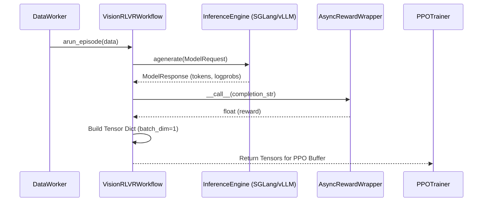

<!-- source: DeepWiki mcp.deepwiki.com · repo areal-project/AReaL · page 6.1 RLVR & Vision Workflows · fetched 2026-10-21 -->

# RLVR & Vision Workflows

<details>
<summary>Relevant source files</summary>

The following files were used as context for generating this wiki page:

- [areal/api/reward_api.py](areal/api/reward_api.py)
- [areal/dataset/clevr_count_70k.py](areal/dataset/clevr_count_70k.py)
- [areal/dataset/geometry3k.py](areal/dataset/geometry3k.py)
- [areal/dataset/gsm8k.py](areal/dataset/gsm8k.py)
- [areal/dataset/torl_data.py](areal/dataset/torl_data.py)
- [areal/experimental/inference_service/data_proxy/tokenizer_proxy.py](areal/experimental/inference_service/data_proxy/tokenizer_proxy.py)
- [areal/utils/hf_utils.py](areal/utils/hf_utils.py)
- [areal/workflow/multi_turn.py](areal/workflow/multi_turn.py)
- [areal/workflow/rlvr.py](areal/workflow/rlvr.py)
- [areal/workflow/vision_rlvr.py](areal/workflow/vision_rlvr.py)
- [examples/scaffolding/search_scaffolding.py](examples/scaffolding/search_scaffolding.py)
- [examples/scaffolding/tests/test_worker.py](examples/scaffolding/tests/test_worker.py)
- [examples/scaffolding/workflow.py](examples/scaffolding/workflow.py)
- [examples/tir/README_zh.md](examples/tir/README_zh.md)
- [examples/tir/figures/task_reward.png](examples/tir/figures/task_reward.png)
- [examples/tir/figures/tool_call_count.png](examples/tir/figures/tool_call_count.png)
- [examples/tir/prompts.py](examples/tir/prompts.py)
- [examples/tir/tests/data/sample_math.jsonl](examples/tir/tests/data/sample_math.jsonl)
- [examples/tir/tir_workflow.py](examples/tir/tir_workflow.py)

</details>


This section details the standard Reinforcement Learning from Verifiable Rewards (RLVR) workflow and its extension for Vision-Language Models (VLM). These workflows govern the episode lifecycle—from prompt tokenization and multi-modal data processing to inference generation and verifiable reward computation—culminating in the preparation of packed tensors for PPO training.

## RLVR Workflow Overview

The `RLVRWorkflow` is a single-turn reward learning workflow designed for reasoning tasks where the model's output can be verified against a ground truth (e.g., math problems). It supports optional "thinking" tokens to encourage chain-of-thought reasoning before the final answer [areal/workflow/rlvr.py:50-57]().

### Episode Lifecycle
1.  **Prompt Preparation**: The workflow extracts the prompt from the dataset and applies a chat template using `apply_chat_template` [areal/workflow/rlvr.py:147-151]().
2.  **Inference**: It constructs a `ModelRequest` and calls `engine.agenerate` to obtain the model's response [areal/workflow/rlvr.py:152-162]().
3.  **Reward Computation**: The completion is decoded, and a verifiable reward function (wrapped in `AsyncRewardWrapper`) is called to score the response [areal/workflow/rlvr.py:84-109]().
4.  **Tensor Preparation**: The input tokens, output tokens, logprobs, and rewards are converted into a dictionary of `torch.Tensor` objects with a batch dimension of 1, ready for the PPO trainer [areal/workflow/rlvr.py:165-178]().

### Reward Verification System
Rewards in RLVR are typically computed by external functions that compare the model's output to a reference solution. AReaL uses an `AsyncRewardWrapper` to manage these computations:
*   **Process Isolation**: Executes reward functions in a `ProcessPoolExecutor` to prevent blocking the main event loop and isolate potentially unsafe evaluation code [areal/api/reward_api.py:63-73]().
*   **Timeout & Retries**: Includes built-in timeout handling and automatic recovery from broken process pools [areal/api/reward_api.py:138-183]().
*   **Heuristic Scaling**: Automatically determines the number of workers based on CPU core count and available accelerators [areal/api/reward_api.py:83-88]().

**Sources:** [areal/workflow/rlvr.py:1-178](), [areal/api/reward_api.py:1-183]()

---

## Vision RLVR Workflow

The `VisionRLVRWorkflow` extends the standard RLVR logic to handle multi-modal inputs, specifically for Vision-Language Models (VLMs). It integrates with HuggingFace `AutoProcessor` to handle image tokenization and feature extraction [areal/workflow/vision_rlvr.py:26-43]().

### Multi-Modal Data Flow
Unlike text-only workflows, the Vision workflow must synchronize text tokens with image embeddings and special vision tokens (e.g., `<|image_pad|>`, `<|vision_start|>`).

| Component | Responsibility | Code Reference |
| :--- | :--- | :--- |
| **Processor** | Encodes images into `pixel_values` and text into `input_ids`. | [areal/workflow/vision_rlvr.py:112-117]() |
| **Image Conversion** | Converts PIL images to base64 for transmission to remote engines. | [areal/workflow/vision_rlvr.py:122]() |
| **Token Mapping** | Aligns `mm_token_type_ids` with generated output tokens. | [areal/workflow/vision_rlvr.py:141-142]() |
| **Tensor Assembly** | Packs `pixel_values` and `image_grid_thw` into the final result. | [areal/workflow/vision_rlvr.py:148-167]() |

### Implementation of Vision RLVR
The `arun_episode` method in `VisionRLVRWorkflow` manages the coordination between the inference engine and the multi-modal data structures.

**Workflow Data Flow: Natural Language to Code Entities**
The following diagram maps the logical flow of a Vision RLVR episode to the specific code entities in `areal/workflow/vision_rlvr.py`.


**Sources:** [areal/workflow/vision_rlvr.py:103-167](), [areal/dataset/geometry3k.py:131-186]()

---

## Specialized Workflow Variants

AReaL provides several specialized workflows that build upon the RLVR base to handle complex interaction patterns.

### Multi-Turn Retry Workflow
The `MultiTurnWorkflow` implements a "retry-until-correct" logic. If the model produces an incorrect answer (reward = 0), the workflow appends a feedback prompt and allows the model to try again, up to a defined `max_turns` [areal/workflow/multi_turn.py:19-29]().
*   **Turn Discounting**: Rewards are multiplied by a `turn_discount` (e.g., 0.9) for every additional turn taken [areal/workflow/multi_turn.py:73-120]().
*   **Prompt Amending**: Automatically constructs correction prompts like "Your answer is either wrong or not parsable..." to guide the model [areal/workflow/multi_turn.py:44-56]().

### Tool-Integrated Reasoning (TIR)
The `TIRWorkflow` enables models to interact with external tools (e.g., a Python interpreter) during the reasoning process [examples/tir/tir_workflow.py:47-57]().
*   **Tool Manager**: Orchestrates the execution of tool calls and formats the results (e.g., ````output\n...````) back into the conversation [examples/tir/tir_workflow.py:72-100]().
*   **Stateful Trajectories**: Manages a loop of generation, tool detection (via markers like `<tool_call>`), execution, and re-injection of results into the model's context [examples/tir/tir_workflow.py:158-203]().

**Sources:** [areal/workflow/multi_turn.py:1-135](), [examples/tir/tir_workflow.py:1-203]()

---

## Tensor Preparation for PPO

After the rollout is completed by the workflow, the data is converted into a structured tensor dictionary. This format is critical for the `PPOTrainer` to calculate advantages and perform updates.

### Tensor Mapping Table
| Tensor Key | Shape | Description | Source |
| :--- | :--- | :--- | :--- |
| `input_ids` | `(1, SeqLen)` | Combined prompt and completion tokens. | [areal/workflow/rlvr.py:171]() |
| `logprobs` | `(1, SeqLen)` | Log probabilities for generated tokens (0.0 for prompt). | [areal/workflow/rlvr.py:173]() |
| `loss_mask` | `(1, SeqLen)` | Binary mask (1 for completion tokens, 0 for prompt). | [areal/workflow/rlvr.py:172]() |
| `rewards` | `(1,)` | The scalar reward value from the verification function. | [areal/workflow/rlvr.py:176]() |
| `multi_modal_input` | `List[Dict]` | Vision-specific features (pixel values, grids). | [areal/workflow/vision_rlvr.py:163]() |
| `versions` | `(1, SeqLen)` | Tracking for staleness management/weight versions. | [areal/workflow/rlvr.py:174]() |

**Workflow to Trainer Interaction Diagram**
This diagram shows how the `RolloutWorkflow` entities interact with the `InferenceEngine` and `PPOTrainer`.



**Sources:** [areal/workflow/vision_rlvr.py:156-167](), [areal/workflow/rlvr.py:170-178](), [areal/api/reward_api.py:138-158]()

---

