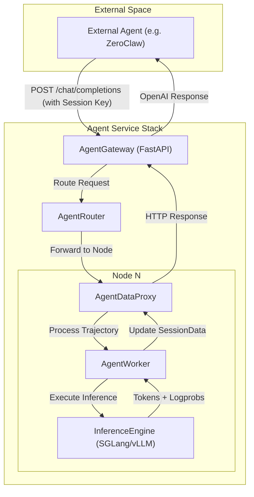
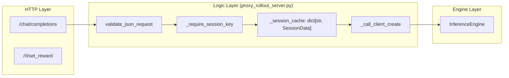

<!-- source: DeepWiki mcp.deepwiki.com · repo areal-project/AReaL · page 6.3 Agent Service (Experimental) · fetched 2026-10-21 -->

# Agent Service (Experimental)

<details>
<summary>Relevant source files</summary>

The following files were used as context for generating this wiki page:

- [areal/experimental/agent_service/README.md](areal/experimental/agent_service/README.md)
- [areal/experimental/agent_service/__init__.py](areal/experimental/agent_service/__init__.py)
- [areal/experimental/agent_service/controller/__init__.py](areal/experimental/agent_service/controller/__init__.py)
- [areal/experimental/agent_service/controller/controller.py](areal/experimental/agent_service/controller/controller.py)
- [areal/experimental/agent_service/data_proxy/__main__.py](areal/experimental/agent_service/data_proxy/__main__.py)
- [areal/experimental/agent_service/gateway/__main__.py](areal/experimental/agent_service/gateway/__main__.py)
- [areal/experimental/agent_service/router/__main__.py](areal/experimental/agent_service/router/__main__.py)
- [areal/experimental/agent_service/worker/__main__.py](areal/experimental/agent_service/worker/__main__.py)
- [areal/experimental/inference_service/gateway/__main__.py](areal/experimental/inference_service/gateway/__main__.py)
- [areal/experimental/inference_service/router/__main__.py](areal/experimental/inference_service/router/__main__.py)
- [areal/experimental/openai/proxy/proxy_rollout_server.py](areal/experimental/openai/proxy/proxy_rollout_server.py)
- [areal/experimental/openai/proxy/workflow.py](areal/experimental/openai/proxy/workflow.py)
- [areal/experimental/training_service/data_proxy/__main__.py](areal/experimental/training_service/data_proxy/__main__.py)
- [areal/experimental/training_service/gateway/__main__.py](areal/experimental/training_service/gateway/__main__.py)
- [areal/experimental/training_service/router/__main__.py](areal/experimental/training_service/router/__main__.py)
- [areal/experimental/training_service/worker/__main__.py](areal/experimental/training_service/worker/__main__.py)
- [areal/infra/utils/http.py](areal/infra/utils/http.py)
- [areal/utils/logging.py](areal/utils/logging.py)
- [docs/en/tutorial/agentic_rl.md](docs/en/tutorial/agentic_rl.md)
- [docs/en/tutorial/online_proxy.md](docs/en/tutorial/online_proxy.md)
- [docs/zh/tutorial/online_proxy.md](docs/zh/tutorial/online_proxy.md)
- [examples/agent_service/README.md](examples/agent_service/README.md)
- [examples/agent_service/run_agent_service.py](examples/agent_service/run_agent_service.py)
- [examples/experimental/inference_service/README.md](examples/experimental/inference_service/README.md)
- [examples/openclaw/README.md](examples/openclaw/README.md)
- [tests/experimental/agent_service/test_guard.py](tests/experimental/agent_service/test_guard.py)
- [tests/experimental/openai/test_streaming_chat_completions.py](tests/experimental/openai/test_streaming_chat_completions.py)

</details>


The **Agent Service** is an experimental microservice-based architecture designed to host stateful, multi-turn agent sessions. It allows external agent runtimes (e.g., ZeroClaw, CAMEL-AI, or custom scripts) to interact with models hosted by AReaL via OpenAI-compatible APIs while automatically capturing token-level data and log-probabilities required for Reinforcement Learning (RL) training [docs/en/tutorial/online_proxy.md:1-7]().

## Overview and Scope

Unlike the standard `inline` or `subproc` rollout modes where the agent logic runs within the AReaL process tree, the `online` mode decouples the agent execution from the RL infrastructure [docs/en/tutorial/online_proxy.md:13-20](). This is achieved through a three-tier proxy stack that bridges the gap between high-level Chat Completion APIs and the low-level requirements of RL algorithms like PPO [docs/en/tutorial/online_proxy.md:27-63]().

### Key Capabilities
- **Stateful Session Management**: Tracks multi-turn interactions across multiple HTTP requests [areal/experimental/openai/proxy/proxy_rollout_server.py:98-109]().
- **Token-Level Tracking**: Captures log-probabilities and token IDs during inference for precise advantage estimation [docs/en/tutorial/online_proxy.md:70-72]().
- **Tool-Use Support**: Transparently handles tool-calling sequences within the proxy layer [docs/en/tutorial/agentic_rl.md:30-33]().
- **Dynamic Reward Assignment**: Allows external systems to post rewards to specific sessions or individual interactions [areal/experimental/openai/proxy/proxy_rollout_server.py:48-55]().

Sources: [docs/en/tutorial/online_proxy.md:1-74](), [areal/experimental/openai/proxy/proxy_rollout_server.py:40-109](), [docs/en/tutorial/agentic_rl.md:11-44]()

---

## System Architecture

The Agent Service stack consists of four primary components: the **Gateway**, **Router**, **DataProxy**, and **Worker**. These components interact to provide a scalable, authenticated entry point for external agents.

### Logical Data Flow
The following diagram illustrates how an external request (e.g., from `ZeroClaw`) traverses the service stack to the underlying `InferenceEngine` (SGLang/vLLM) and back.

**Diagram: Agent Service Component Interaction**

Sources: [docs/en/tutorial/online_proxy.md:27-63](), [areal/experimental/agent_service/gateway/__main__.py:10-12](), [areal/experimental/agent_service/worker/__main__.py:5-11]()

---

## Component Implementation

### 1. Agent Gateway
The `AgentGateway` is a stateless FastAPI application that acts as the entry point. It handles two-tier authentication:
- **Admin API Key**: Configured via `rollout.agent.admin_api_key` for management tasks like `/rl/start_session` [areal/experimental/openai/proxy/proxy_rollout_server.py:176-184]().
- **Session API Key**: Dynamically generated per session to isolate trajectories [areal/experimental/openai/proxy/proxy_rollout_server.py:187-196]().

Key routes include:
- `POST /chat/completions`: Standard OpenAI interface [areal/experimental/openai/proxy/proxy_rollout_server.py:42]().
- `POST /rl/start_session`: Initializes a new `SessionData` object [areal/experimental/openai/proxy/proxy_rollout_server.py:49]().
- `POST /rl/set_reward`: Assigns a scalar reward to the current session [areal/experimental/openai/proxy/proxy_rollout_server.py:48]().

### 2. Agent Worker & DataProxy
The `AgentWorker` (implemented in `areal/experimental/agent_service/worker/app.py`) manages the lifecycle of an agent instance [areal/experimental/agent_service/worker/__main__.py:17-30](). It interacts with the `AgentDataProxy`, which buffers `InteractionWithTokenLogpReward` objects until the session is closed and ready for export to the `PPOTrainer` [areal/experimental/openai/proxy/workflow.py:180-195]().

### 3. Proxy Rollout Server
The `ProxyRolloutServer` is the core implementation that bridges HTTP requests to the `InferenceEngine`. It maintains a `_session_cache` of `SessionData` and handles the mapping between API keys and session IDs [areal/experimental/openai/proxy/proxy_rollout_server.py:95-109]().

**Diagram: Code Entity Mapping (Request Handling)**

Sources: [areal/experimental/openai/proxy/proxy_rollout_server.py:135-150](), [areal/experimental/openai/proxy/proxy_rollout_server.py:187-196](), [areal/experimental/openai/proxy/proxy_rollout_server.py:95-109]()

---

## Integration with RL Training Loop

The Agent Service integrates with the `PPOTrainer` via the `OpenAIProxyWorkflow`.

### Workflow Lifecycle (`OpenAIProxyWorkflow`)
1. **Capacity Granting**: The workflow calls `_grant_capacity` to notify the gateway that the system is ready to accept new agent sessions [areal/experimental/openai/proxy/workflow.py:156-162]().
2. **Session Monitoring**: In `online` mode, the workflow waits for an external user to complete a session [areal/experimental/openai/proxy/workflow.py:180-185]().
3. **Trajectory Export**: Once a session ends (via `/rl/end_session` or timeout), the gateway triggers an export. The `OpenAIProxyWorkflow` collects these trajectories and converts them into the format required for the PPO actor/critic update [areal/experimental/openai/proxy/workflow.py:197-205]().

### Staleness Control
The service utilizes AReaL's staleness management. Requests are only permitted if the rollout is within the allowed `max_head_offpolicyness` window [areal/experimental/openai/proxy/workflow.py:172-177](). If the training process falls behind, the gateway will return HTTP 429 (Too Many Requests) to the external agent runtimes [docs/en/tutorial/online_proxy.md:206-208]().

Sources: [areal/experimental/openai/proxy/workflow.py:72-205](), [docs/en/tutorial/online_proxy.md:183-208]()

---

## Configuration

To enable the Agent Service, the `rollout.agent.mode` must be set to `online` in the experiment configuration [docs/en/tutorial/online_proxy.md:79-88]().

| Key | Type | Description |
| :--- | :--- | :--- |
| `mode` | `str` | Must be set to `online`. |
| `admin_api_key` | `str` | Secret key for management endpoints. |
| `session_timeout_seconds` | `int` | Maximum duration before an idle session is discarded. |
| `proxy_gateway_addr` | `str` | The HTTP address where the gateway is reachable. |

Example YAML snippet:
```yaml
rollout:
  agent:
    mode: online
    admin_api_key: "my-secret-admin-key"
    session_timeout_seconds: 3600
```
Sources: [docs/en/tutorial/online_proxy.md:79-88](), [areal/experimental/openai/proxy/workflow.py:84-97]()

---

