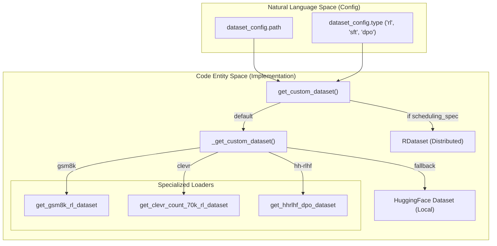
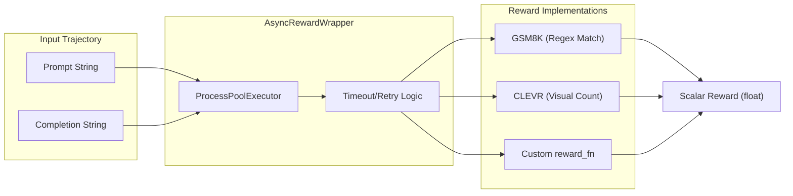

<!-- source: DeepWiki mcp.deepwiki.com · repo areal-project/AReaL · page 7 Datasets & Rewards · fetched 2026-10-21 -->

# Datasets & Rewards

Relevant source files

The following files were used as context for generating this wiki page:

- [areal/api/reward_api.py](areal/api/reward_api.py)
- [areal/dataset/__init__.py](areal/dataset/__init__.py)
- [examples/alignment/README.md](examples/alignment/README.md)

AReaL provides a flexible subsystem for managing training data and evaluating model outputs through verifiable rewards. This system bridges the gap between raw data on disk (Natural Language Space) and the tensors required by the training engines (Code Entity Space). The architecture supports both standard HuggingFace-style datasets and a distributed `RDataset` abstraction for large-scale training.

### Dataset Architecture
The dataset subsystem is centered around the `get_custom_dataset` factory function [areal/dataset/__init__.py:165-206](), which resolves dataset configurations into either local HuggingFace `Dataset` objects or remote `RDataset` instances [areal/dataset/__init__.py:181-187](). AReaL includes specialized loaders for reasoning (GSM8K, NuminaMath), vision (CLEVR-Count, Geometry3K), and preference alignment (HHRLHF).

For details, see [Built-in Datasets](#7.1).

### Reward System
Rewards in AReaL are primarily "verifiable," meaning they are computed programmatically (e.g., checking a math answer or executing code) rather than relying solely on a learned Reward Model. The `reward_fn` interface [areal/api/reward_api.py:41-60]() provides a standardized signature for these functions. To prevent slow reward scripts from blocking the RL pipeline, AReaL uses the `AsyncRewardWrapper` [areal/api/reward_api.py:63-138](), which executes reward logic in a managed `ProcessPoolExecutor` with timeout and retry logic [areal/api/reward_api.py:150-185]().

For details, see [Reward Functions](#7.2).

### System Mapping: Data to Code

The following diagram illustrates how dataset configurations in YAML map to specific code entities and data flows within the system.

**Data Configuration to Implementation Mapping**

Sources: [areal/dataset/__init__.py:27-162](), [areal/dataset/__init__.py:165-206]()

### Reward Execution Flow

The following diagram shows how a raw model completion is processed by the reward subsystem to produce a scalar signal for the trainer.

**Reward Processing Pipeline**

Sources: [areal/api/reward_api.py:41-60](), [areal/api/reward_api.py:63-138](), [areal/api/reward_api.py:150-185]()

### Key Components

| Component | Code Entity | Role |
| :--- | :--- | :--- |
| **Dataset Factory** | `get_custom_dataset` | Entry point for creating datasets from `_DatasetConfig` [areal/dataset/__init__.py:165](). |
| **Reward Interface** | `reward_fn` | Standardized signature for computing rewards from text/ids [areal/api/reward_api.py:41](). |
| **Async Executor** | `AsyncRewardWrapper` | Manages a `ProcessPoolExecutor` to run rewards asynchronously [areal/api/reward_api.py:63](). |
| **Distributed Data** | `RDataset` | Handles data loading across distributed `DataWorker` nodes [areal/dataset/__init__.py:181](). |

### Supported Tasks & Datasets
AReaL supports a wide range of training tasks out-of-the-box:

*   **Reasoning & Math:** GSM8K [areal/dataset/__init__.py:36-55](), NuminaMath, and ToRL [areal/dataset/__init__.py:126-135]().
*   **Vision-Language:** CLEVR-Count-70K [areal/dataset/__init__.py:56-75](), Geometry3K [areal/dataset/__init__.py:76-95](), and VIRL39K [areal/dataset/__init__.py:96-105]().
*   **Alignment:** Anthropic HH-RLHF for Reward Modeling (`rw`) and DPO [areal/dataset/__init__.py:106-125]().

Sources: [areal/dataset/__init__.py:15-22](), [examples/alignment/README.md:1-11]()

---

