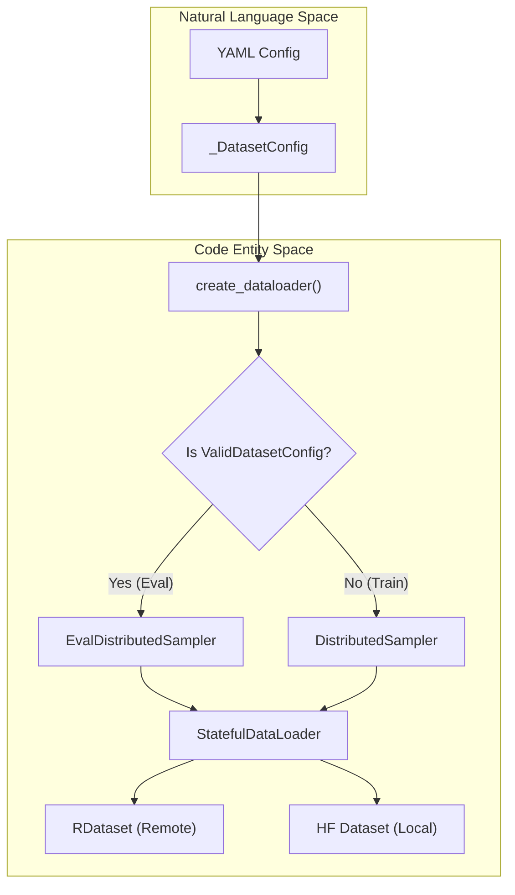
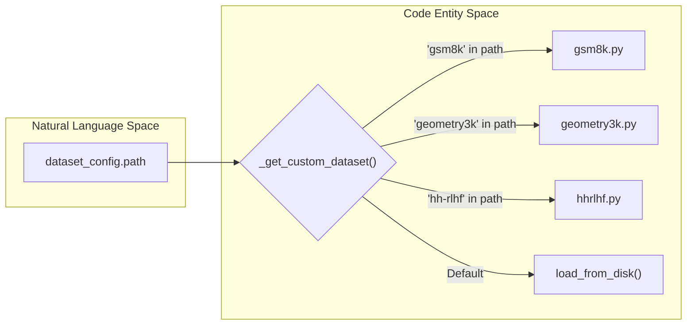

<!-- source: DeepWiki mcp.deepwiki.com · repo areal-project/AReaL · page 7.1 Built-in Datasets · fetched 2026-10-21 -->

# Built-in Datasets

Relevant source files

The following files were used as context for generating this wiki page:

- [areal/dataset/__init__.py](areal/dataset/__init__.py)
- [areal/dataset/clevr_count_70k.py](areal/dataset/clevr_count_70k.py)
- [areal/dataset/geometry3k.py](areal/dataset/geometry3k.py)
- [areal/dataset/gsm8k.py](areal/dataset/gsm8k.py)
- [areal/dataset/torl_data.py](areal/dataset/torl_data.py)
- [areal/infra/dist_rollout.py](areal/infra/dist_rollout.py)
- [areal/utils/dataloader.py](areal/utils/dataloader.py)
- [areal/utils/evaluator.py](areal/utils/evaluator.py)
- [areal/utils/lock.py](areal/utils/lock.py)
- [areal/utils/printing.py](areal/utils/printing.py)
- [areal/utils/save_load.py](areal/utils/save_load.py)
- [areal/utils/seqpack.py](areal/utils/seqpack.py)
- [areal/utils/timeutil.py](areal/utils/timeutil.py)
- [docs/en/algorithms/sequence_packing.md](docs/en/algorithms/sequence_packing.md)
- [docs/en/reference/metrics_tracking.md](docs/en/reference/metrics_tracking.md)
- [docs/zh/algorithms/sequence_packing.md](docs/zh/algorithms/sequence_packing.md)
- [docs/zh/reference/metrics_tracking.md](docs/zh/reference/metrics_tracking.md)
- [examples/alignment/README.md](examples/alignment/README.md)
- [examples/tir/README_zh.md](examples/tir/README_zh.md)
- [examples/tir/figures/task_reward.png](examples/tir/figures/task_reward.png)
- [examples/tir/figures/tool_call_count.png](examples/tir/figures/tool_call_count.png)
- [examples/tir/prompts.py](examples/tir/prompts.py)
- [examples/tir/tests/data/sample_math.jsonl](examples/tir/tests/data/sample_math.jsonl)
- [tests/test_kk_allocate.py](tests/test_kk_allocate.py)

The AReaL framework provides a robust data pipeline designed for distributed Reinforcement Learning (RL) and Supervised Fine-Tuning (SFT). This system is centered around the `StatefulDataLoader` and a suite of pre-implemented datasets that support multi-modal inputs, reasoning tasks, and preference alignment.

## StatefulDataLoader and Distributed Sampling

AReaL utilizes the `torchdata.stateful_dataloader.StatefulDataLoader` to ensure training can be resumed precisely from the last checkpointed state [areal/utils/dataloader.py:8-9](). The data pipeline is designed to handle distributed environments by sharding data across ranks while avoiding common evaluation biases.

### Key Components

| Class | Description |
| :--- | :--- |
| `create_dataloader` | The primary entry point for instantiating a `StatefulDataLoader`. It automatically selects the appropriate sampler based on whether the task is training or validation [areal/utils/dataloader.py:13-19](). |
| `EvalDistributedSampler` | A specialized sampler for evaluation that **does not pad** the dataset. It ensures every sample is evaluated exactly once across the cluster, even if the dataset size is not divisible by the world size [areal/utils/dataloader.py:65-82](). |
| `_PrefetchAwareSampler` | Used with `RDataset` to trigger data prefetching, optimizing throughput for remote datasets [areal/utils/dataloader.py:43-43](). |

### Data Loading Flow

The following diagram illustrates how a dataset configuration is transformed into a functional distributed dataloader.

**Dataloader Initialization Logic**

Sources: [areal/utils/dataloader.py:13-62](), [areal/api/cli_args.py:10-11]()

---

## Built-in Dataset Implementations

AReaL includes optimized loaders for several benchmark datasets. These are registered in `areal/dataset/__init__.py` and can be invoked via the `get_custom_dataset` function [areal/dataset/__init__.py:165-171]().

### 1. GSM8K (Math Reasoning)
Used for training reasoning models. It supports both SFT and RL formats. The RL version typically appends instruction-following prompts to encourage chain-of-thought reasoning [areal/dataset/__init__.py:36-55]().

### 2. NuminaMath (TIR/Reasoning)
Integrated via the `torl_data` module, specifically for Tool-Integrated Reasoning (TIR) tasks [areal/dataset/__init__.py:126-135]().

### 3. CLEVR-Count-70K (Vision)
A vision-language dataset focused on counting objects.
*   **SFT Mode**: Pre-processes images to a fixed size (336x336) and generates `loss_mask` for the answer tokens [areal/dataset/clevr_count_70k.py:38-50]().
*   **RL Mode**: Formats the prompt to request the answer in a specific `[ ]` format and includes system prompts for counting tasks [areal/dataset/clevr_count_70k.py:183-188]().

### 4. Geometry3K (Vision Reasoning)
A geometry problem-solving dataset.
*   **Processing**: Images are padded to square or center-cropped to 512x512 for SFT [areal/dataset/geometry3k.py:44-76]().
*   **RL Prompting**: Appends internal monologue instructions (e.g., `<think>` tags) and requires the final answer in a `\boxed{}` [areal/dataset/geometry3k.py:144-148]().

### 5. HHRLHF (Alignment)
Supports preference alignment via Reward Model (RM) training and Direct Preference Optimization (DPO) [areal/dataset/__init__.py:106-125]().
*   **RW Type**: Formats chosen/rejected pairs for Bradley-Terry loss [examples/alignment/README.md:23-25]().
*   **DPO Type**: Used for direct policy alignment without a separate RM [examples/alignment/README.md:49-60]().

### 6. VIRL39K & ToRL
Specialized datasets for vision-RL and tool-use RL workflows [areal/dataset/__init__.py:96-105](), [areal/dataset/__init__.py:126-135]().

---

## Custom Dataset Registration

To add a new dataset to AReaL, follow this registration pattern:

1.  **Implement the Loader**: Create a file in `areal/dataset/` (e.g., `my_dataset.py`) containing `get_my_dataset_sft_dataset` and `get_my_dataset_rl_dataset`.
2.  **Register in Init**: Update `areal/dataset/__init__.py`.

**Dataset Registration Mapping**

Sources: [areal/dataset/__init__.py:27-162]()

### Fallback Mechanism
If a dataset path is not explicitly recognized in the `_get_custom_dataset` logic, AReaL attempts to load it as a generic HuggingFace dataset from disk using `load_from_disk(path)` [areal/dataset/__init__.py:137-142]().

---

## Data Flow in Distributed Rollout

In RL workflows, data is not just loaded; it is generated (rollouts) and then redistributed across the training ranks to ensure load balancing.

**Redistribution Mechanism**
*   **Redistribution**: Trajectories are gathered from all ranks and re-allocated using algorithms like **FFD** (First Fit Decreasing) or **KK** (Karmarkar-Karp) based on their sequence lengths [areal/infra/dist_rollout.py:29-33](), [areal/infra/dist_rollout.py:79-84]().
*   **Broadcasting**: Once balanced, data is broadcast to the context and model parallel groups to ensure all workers have the necessary tensors for the backward pass [areal/infra/dist_rollout.py:141-145]().

Sources: [areal/infra/dist_rollout.py:29-94](), [areal/utils/seqpack.py:161-187]()

---

