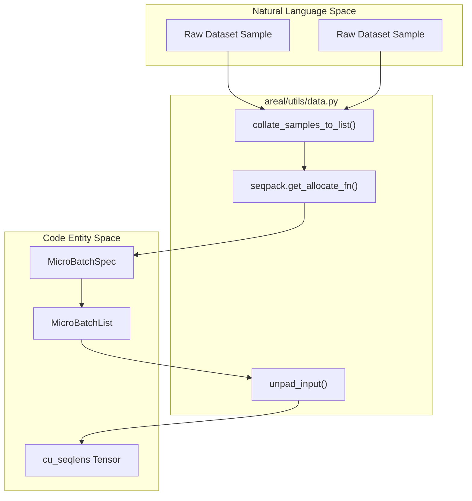
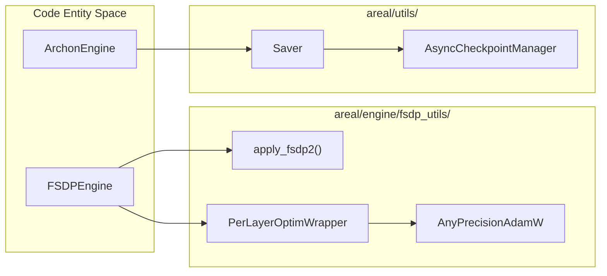

<!-- source: DeepWiki mcp.deepwiki.com · repo areal-project/AReaL · page 8 Memory Optimization & Data Pipeline · fetched 2026-10-21 -->

# Memory Optimization & Data Pipeline

Relevant source files

The following files were used as context for generating this wiki page:

- [.github/workflows/pre-commit.yml](.github/workflows/pre-commit.yml)
- [AGENTS.md](AGENTS.md)
- [CLAUDE.md](CLAUDE.md)
- [CONTRIBUTING.md](CONTRIBUTING.md)
- [README.md](README.md)
- [ROADMAP.md](ROADMAP.md)
- [areal/engine/fsdp_utils/__init__.py](areal/engine/fsdp_utils/__init__.py)
- [areal/engine/fsdp_utils/optimizer.py](areal/engine/fsdp_utils/optimizer.py)
- [areal/experimental/models/archon/moe_weight_converter.py](areal/experimental/models/archon/moe_weight_converter.py)
- [areal/utils/data.py](areal/utils/data.py)
- [areal/utils/recover.py](areal/utils/recover.py)
- [areal/utils/saver.py](areal/utils/saver.py)
- [blog/AReaL_v0_2.md](blog/AReaL_v0_2.md)
- [docs/en/best_practices/handling_oom.md](docs/en/best_practices/handling_oom.md)
- [docs/zh/best_practices/handling_oom.md](docs/zh/best_practices/handling_oom.md)
- [tests/experimental/archon/torchrun/run_ep_tests.py](tests/experimental/archon/torchrun/run_ep_tests.py)
- [tests/test_per_layer_optim_step.py](tests/test_per_layer_optim_step.py)

AReaL is engineered to handle large-scale Reinforcement Learning (RL) training by maximizing hardware utilization and minimizing memory overhead. This is achieved through a combination of variable-length sequence packing, advanced optimizer memory management, and high-performance checkpointing systems. These techniques allow AReaL to scale to 1000+ GPU clusters while maintaining high throughput for reasoning and agentic models [[README.md:77-84](), [blog/AReaL_v0_2.md:77-84]()].

## Sequence Packing & Micro-Batch Allocation

Traditional padding in variable-length sequence training leads to significant computational waste. AReaL eliminates this by packing sequences into 1D tensors and utilizing a dynamic allocation algorithm to balance micro-batch sizes [[blog/AReaL_v0_2.md:69-75]()].

- **1D Packing**: Sequences are concatenated into a single dimension, with `cu_seqlens` (cumulative sequence lengths) tracking boundaries [[areal/utils/data.py:35-37](), [areal/utils/data.py:183-195]()].
- **Dynamic Allocation**: AReaL uses algorithms like First-Fit Decreasing (FFD) or Karmarkar-Karp (KK) to distribute sequences across GPUs based on a maximum token budget, maximizing memory utilization [[areal/utils/data.py:22-22](), [blog/AReaL_v0_2.md:72-74]()].
- **Micro-Batch Specification**: The `MicroBatchSpec` and `MicroBatchList` classes manage how these packed sequences are sliced and fed into the training engines [[areal/utils/data.py:18-20]()].

For details, see [Sequence Packing & Micro-Batch Allocation](#8.1).

## Per-Layer Optimizer & CPU Offload

To reduce the memory footprint of optimizer states (which often exceed model parameter size), AReaL implements a per-layer optimization strategy and flexible offloading policies [[areal/engine/fsdp_utils/optimizer.py:44-56]()].

- **PerLayerOptimWrapper**: This wrapper enables a pipelined execution where gradients are reduced and optimizer steps are performed layer-by-layer, allowing memory for optimizer states to be recycled or offloaded [[areal/engine/fsdp_utils/__init__.py:16-20]()].
- **AnyPrecisionAdamW**: A specialized optimizer that supports Kahan summation and flexible dtypes (e.g., `bfloat16` for momentum and variance) to maintain numerical stability while saving 50% of optimizer state memory [[areal/engine/fsdp_utils/optimizer.py:44-101]()].
- **CPU Offload**: Integration with `CPUOffloadPolicy` and `torch_memory_saver` (TMS) allows for aggressive offloading of weights and states to host memory [[areal/engine/fsdp_utils/__init__.py:10-13](), [areal/engine/fsdp_utils/__init__.py:110-115]()].

For details, see [Per-Layer Optimizer & CPU Offload](#8.2).

## Checkpointing & Recovery

AReaL provides a robust system for saving model states and resuming interrupted training runs, supporting both synchronous and asynchronous modes [[areal/utils/saver.py:23-33]()].

- **AsyncCheckpointManager**: Primarily used with the Archon engine, this allows for non-blocking checkpointing by staging data to CPU memory before writing to disk, minimizing training stalls [[areal/utils/saver.py:170-180](), [areal/utils/saver.py:105-120]()].
- **RecoverHandler**: Manages the `RecoverInfo` manifest, which tracks `StepInfo` (epoch, step, global step) and the states of the dataloader, evaluator, and stats logger [[areal/utils/recover.py:41-51](), [areal/utils/recover.py:151-165]()].
- **Format Support**: Supports both HuggingFace (HF) and Distributed Checkpoint (DCP) formats for broad compatibility [[areal/utils/saver.py:150-157]()].

For details, see [Checkpointing & Recovery](#8.3).

## Data Flow Overview

The following diagram illustrates how data moves from raw samples to optimized training batches.

### Diagram: Data Preparation Pipeline

Sources: [areal/utils/data.py:148-180](), [areal/utils/data.py:22-22](), [areal/utils/data.py:183-195]()

## Memory Management Architecture

The relationship between the training engines and the memory optimization wrappers is shown below.

### Diagram: Engine & Optimizer Integration

Sources: [areal/engine/fsdp_utils/__init__.py:62-67](), [areal/engine/fsdp_utils/optimizer.py:44-56](), [areal/utils/saver.py:23-33](), [areal/utils/saver.py:170-180]()

| Feature | Primary Code Entities | Key Benefit |
| :--- | :--- | :--- |
| **Sequence Packing** | `areal.utils.seqpack`, `cu_seqlens` | Eliminates padding waste; ~1.5x throughput [[blog/AReaL_v0_2.md:13-15]()] |
| **Mixed Precision** | `AnyPrecisionAdamW`, `KahanSum` | Reduces memory for optimizer states by 50% [[areal/engine/fsdp_utils/optimizer.py:58-63]()] |
| **Async Saving** | `AsyncCheckpointManager`, `Saver` | Overlaps I/O with computation [[areal/utils/saver.py:105-120]()] |
| **State Recovery** | `RecoverHandler`, `RecoverInfo` | Guarantees exact resumption of training [[areal/utils/recover.py:151-165]()] |

Sources: [areal/engine/fsdp_utils/optimizer.py:44-101](), [areal/utils/data.py:183-195](), [areal/utils/saver.py:23-33](), [areal/utils/recover.py:41-51](), [blog/AReaL_v0_2.md:13-15]()

---

