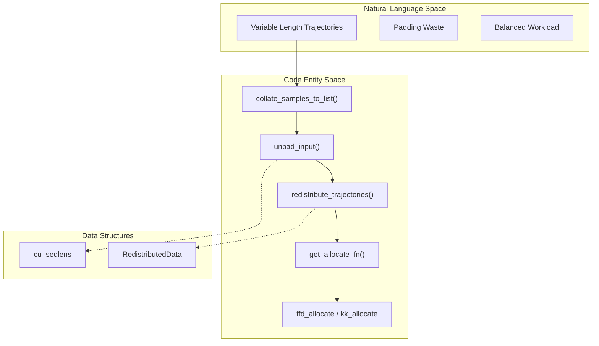
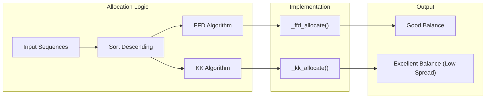

<!-- source: DeepWiki mcp.deepwiki.com · repo areal-project/AReaL · page 8.1 Sequence Packing & Micro-Batch Allocation · fetched 2026-10-21 -->

# Sequence Packing & Micro-Batch Allocation

Relevant source files

The following files were used as context for generating this wiki page:

- [areal/engine/fsdp_utils/__init__.py](areal/engine/fsdp_utils/__init__.py)
- [areal/engine/fsdp_utils/optimizer.py](areal/engine/fsdp_utils/optimizer.py)
- [areal/experimental/models/archon/moe_weight_converter.py](areal/experimental/models/archon/moe_weight_converter.py)
- [areal/infra/dist_rollout.py](areal/infra/dist_rollout.py)
- [areal/utils/data.py](areal/utils/data.py)
- [areal/utils/recover.py](areal/utils/recover.py)
- [areal/utils/saver.py](areal/utils/saver.py)
- [areal/utils/seqpack.py](areal/utils/seqpack.py)
- [docs/en/algorithms/sequence_packing.md](docs/en/algorithms/sequence_packing.md)
- [docs/en/best_practices/handling_oom.md](docs/en/best_practices/handling_oom.md)
- [docs/en/reference/alloc_mode.md](docs/en/reference/alloc_mode.md)
- [docs/zh/algorithms/sequence_packing.md](docs/zh/algorithms/sequence_packing.md)
- [docs/zh/best_practices/handling_oom.md](docs/zh/best_practices/handling_oom.md)
- [docs/zh/reference/alloc_mode.md](docs/zh/reference/alloc_mode.md)
- [tests/experimental/archon/torchrun/run_ep_tests.py](tests/experimental/archon/torchrun/run_ep_tests.py)
- [tests/test_kk_allocate.py](tests/test_kk_allocate.py)
- [tests/test_kk_e2e.py](tests/test_kk_e2e.py)
- [tests/test_per_layer_optim_step.py](tests/test_per_layer_optim_step.py)

In Reinforcement Learning from Human Feedback (RLHF) and other large-scale RL training, sequence lengths often vary significantly due to open-ended generation. Standard padding to a fixed maximum length results in massive computational waste. AReaL eliminates this waste using **1D Sequence Packing**, where multiple variable-length sequences are concatenated into a single flat buffer, and **Load-Balanced Micro-Batch Allocation**, which ensures that computational work is distributed evenly across Data Parallel (DP) ranks.

## 1D Sequence Packing & cu_seqlens

AReaL utilizes "packed" sequences where padding is removed, and sequences are concatenated along the sequence dimension [areal/utils/data.py:183-195](). To allow the model (especially Flash Attention) to distinguish between individual sequences within the packed buffer, AReaL maintains a `cu_seqlens` (cumulative sequence lengths) tensor [areal/utils/data.py:35-37]().

### Data Flow: From Padded to Packed
1.  **Rollout Generation**: Inference engines often return padded tensors [areal/utils/data.py:105-145]().
2.  **Unpadding**: The `unpad_input` function uses the `attention_mask` to extract non-pad indices and compute `cu_seqlens` [areal/utils/data.py:183-195]().
3.  **Redistribution**: Trajectories are gathered and redistributed across the DP group to balance the token count [areal/infra/dist_rollout.py:29-94]().

### Natural Language to Code Entity Space: Sequence Handling
The following diagram maps the conceptual sequence transformation to the specific functions in the `DataUtils` and `DistRollout` modules.

Title: Sequence Packing Data Flow

Sources: [areal/utils/data.py:148-195](), [areal/infra/dist_rollout.py:29-94](), [areal/utils/seqpack.py:167-188]()

## Micro-Batch Specification (`MicroBatchSpec`)

The `MicroBatchSpec` dataclass defines the constraints for the allocation algorithms [areal/api/cli_args.py](). It determines how many micro-batches are created and how they are sized.

| Parameter | Description |
| :--- | :--- |
| `max_tokens_per_mb` | The hard limit of tokens allowed in a single micro-batch. |
| `n_mbs` | The number of micro-batches to generate. |
| `n_mbs_divisor` | Ensures the total number of micro-batches is a multiple of this value (useful for pipeline parallelism). |
| `packing_algorithm` | Choice between `ffd` (First Fit Decreasing) and `kk` (Karmarkar-Karp). |

Sources: [areal/api/cli_args.py](), [docs/en/algorithms/sequence_packing.md:16-32]()

## Allocation Algorithms: FFD vs. KK

AReaL supports two primary algorithms for partitioning sequences into micro-batches [areal/utils/seqpack.py:157-164]().

### 1. First Fit Decreasing (FFD)
FFD is a greedy bin-packing heuristic. It sorts sequences by length in descending order and assigns each to the first micro-batch (bin) that has sufficient remaining capacity [areal/utils/seqpack.py:196-203]().
*   **Pros**: Fast, simple.
*   **Cons**: Can result in "tail" imbalance where the last few ranks have significantly fewer tokens.

### 2. Karmarkar-Karp (KK)
KK (also known as the Largest Differencing Method) is a more sophisticated partitioning algorithm. It iteratively merges the two most imbalanced partial partitions using a max-heap to produce near-optimal balance [areal/utils/seqpack.py:236-245]().
*   **Pros**: Significantly reduces the "spread" (max tokens - min tokens) across DP ranks, minimizing synchronization wait time [tests/test_kk_e2e.py:101-112]().
*   **Cons**: Slightly higher computational complexity (O(n log n · k)).

### Comparison of Balance Quality
In distributed training, the slowest rank (the one with the most tokens) determines the step time. KK aims to minimize this bottleneck.

Title: Allocation Strategy Comparison

Sources: [areal/utils/seqpack.py:196-245](), [tests/test_kk_e2e.py:101-112](), [docs/en/algorithms/sequence_packing.md:8-14]()

## Implementation Details

### `MicroBatchList` and `pad_mb_list`
After sequences are allocated to micro-batches, they are often padded slightly to meet hardware alignment requirements. The `N_TOKENS_PER_PAGE` alignment (typically 128 or 256) ensures that the total token count in a micro-batch is compatible with optimized attention kernels like Flash Attention or Triton-based implementations [areal/utils/math.py:21]().

### Data Redistribution
The `redistribute_trajectories` function is the core of the distributed load-balancing logic [areal/infra/dist_rollout.py:29-33]().
1.  It performs an `all_gather` of trajectories from all DP ranks [areal/infra/dist_rollout.py:60]().
2.  It extracts the sequence lengths from `attention_mask` [areal/infra/dist_rollout.py:68]().
3.  It calls the selected allocation function (`ffd_allocate` or `kk_allocate`) to determine which trajectory indices belong to which rank [areal/infra/dist_rollout.py:79-84]().
4.  Each rank then slices the global list to get its local work batch [areal/infra/dist_rollout.py:88]().

### Token Alignment
To maximize hardware utilization, AReaL aligns micro-batch sizes.
*   **`align(n, alignment)`**: Rounds the token count up to the nearest multiple of `N_TOKENS_PER_PAGE` [areal/utils/math.py:21]().
*   **Padding**: If a micro-batch is slightly under the alignment boundary, minimal padding is added to the end of the packed sequence to satisfy kernel requirements without significant waste.

Sources: [areal/infra/dist_rollout.py:29-94](), [areal/utils/data.py:21-22](), [areal/utils/seqpack.py:167-188]()

---

