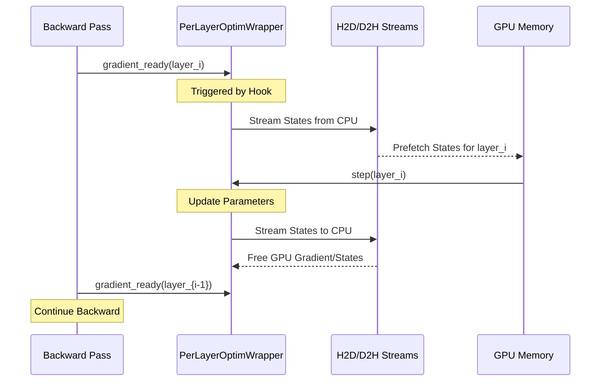
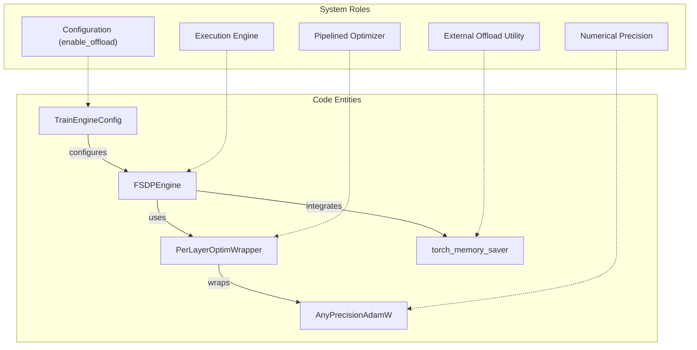

<!-- source: DeepWiki mcp.deepwiki.com · repo areal-project/AReaL · page 8.2 Per-Layer Optimizer & CPU Offload · fetched 2026-10-21 -->

# Per-Layer Optimizer & CPU Offload

Relevant source files

The following files were used as context for generating this wiki page:

- [areal/api/cli_args.py](areal/api/cli_args.py)
- [areal/engine/fsdp_engine.py](areal/engine/fsdp_engine.py)
- [areal/engine/fsdp_utils/__init__.py](areal/engine/fsdp_utils/__init__.py)
- [areal/engine/fsdp_utils/optimizer.py](areal/engine/fsdp_utils/optimizer.py)
- [areal/engine/megatron_engine.py](areal/engine/megatron_engine.py)
- [areal/experimental/engine/archon_engine.py](areal/experimental/engine/archon_engine.py)
- [areal/experimental/models/archon/moe_weight_converter.py](areal/experimental/models/archon/moe_weight_converter.py)
- [areal/utils/data.py](areal/utils/data.py)
- [areal/utils/recover.py](areal/utils/recover.py)
- [areal/utils/saver.py](areal/utils/saver.py)
- [docs/en/_toc.yml](docs/en/_toc.yml)
- [docs/en/best_practices/handling_oom.md](docs/en/best_practices/handling_oom.md)
- [docs/en/cli_reference.md](docs/en/cli_reference.md)
- [docs/en/reference/tree_training.md](docs/en/reference/tree_training.md)
- [docs/en/tutorial/archon.md](docs/en/tutorial/archon.md)
- [docs/en/tutorial/megatron.md](docs/en/tutorial/megatron.md)
- [docs/zh/_toc.yml](docs/zh/_toc.yml)
- [docs/zh/best_practices/handling_oom.md](docs/zh/best_practices/handling_oom.md)
- [docs/zh/cli_reference.md](docs/zh/cli_reference.md)
- [docs/zh/reference/tree_training.md](docs/zh/reference/tree_training.md)
- [docs/zh/tutorial/archon.md](docs/zh/tutorial/archon.md)
- [docs/zh/tutorial/megatron.md](docs/zh/tutorial/megatron.md)
- [tests/experimental/archon/torchrun/run_ep_tests.py](tests/experimental/archon/torchrun/run_ep_tests.py)
- [tests/test_per_layer_optim_step.py](tests/test_per_layer_optim_step.py)

AReaL implements several memory-efficient training techniques designed to scale Large Language Model (LLM) training on memory-constrained hardware. These techniques center around overlapping computation with communication and offloading optimizer states and parameters to CPU memory without sacrificing training throughput.

## Per-Layer Optimizer Wrapper

The `PerLayerOptimWrapper` is a specialized optimizer wrapper used primarily in the `FSDPEngine` and `ArchonEngine`. It implements a pipelined approach to optimizer updates by wrapping individual layers (or FSDP units) rather than applying a global optimizer step after the full backward pass [areal/engine/fsdp_utils/optimizer.py:341-355]().

### Pipelined Data Flow
When using `PerLayerOptimWrapper`, the optimizer step for a layer is triggered immediately after its gradients are computed during the backward pass. This allows for:
1.  **H2D/D2H Streaming**: Moving optimizer states between CPU and GPU via dedicated CUDA streams, overlapping with the backward pass of subsequent layers [areal/engine/fsdp_utils/optimizer.py:448-460]().
2.  **Reduced Peak Memory**: Gradients can be released or moved to CPU immediately after the local optimizer update, preventing the accumulation of gradients for all layers simultaneously [areal/engine/fsdp_utils/optimizer.py:475-485]().

### Optimizer Pipelining Logic
The following diagram illustrates how `PerLayerOptimWrapper` intercepts the training loop to overlap optimizer updates with backward computation.

**Diagram: Per-Layer Optimizer Execution Flow**

Sources: [areal/engine/fsdp_utils/optimizer.py:341-510](), [areal/engine/fsdp_engine.py:286-300]()

## AnyPrecisionAdamW & Kahan Summation

To support high-precision training with lower-precision storage (e.g., BF16), AReaL provides `AnyPrecisionAdamW`. This optimizer can maintain master weights and optimizer states in various precisions [areal/engine/fsdp_utils/optimizer.py:118-135]().

### Kahan Summation
To mitigate rounding errors when using 16-bit floating point formats for weights, `AnyPrecisionAdamW` implements **Kahan Summation**. It maintains a "compensation" term to track small increments that would otherwise be lost during the addition of small updates to large parameter values [areal/engine/fsdp_utils/optimizer.py:165-180]().

| Feature | Implementation |
| :--- | :--- |
| **Optimizer Class** | `AnyPrecisionAdamW` [areal/engine/fsdp_utils/optimizer.py:118]() |
| **Summation Logic** | Kahan Summation for precision [areal/engine/fsdp_utils/optimizer.py:165-180]() |
| **Weight Decay** | Decoupled AdamW style [areal/engine/fsdp_utils/optimizer.py:155-160]() |
| **State Precisions** | Supports `torch.bfloat16`, `torch.float16`, `torch.float32` [areal/engine/fsdp_utils/optimizer.py:130-140]() |

Sources: [areal/engine/fsdp_utils/optimizer.py:118-200]()

## CPU Offload Policies

AReaL utilizes standard and custom CPU offload policies to manage the memory footprint of large models.

### FSDP2 CPU Offload
In the `FSDPEngine`, AReaL leverages PyTorch's `CPUOffloadPolicy`. When enabled via `TrainEngineConfig.enable_offload`, parameters and gradients are moved to CPU memory when not actively involved in computation [areal/engine/fsdp_engine.py:220-240](), [areal/api/cli_args.py:104-107]().

### torch_memory_saver (TMS) Integration
AReaL integrates with `torch_memory_saver` (TMS), an external utility that provides advanced memory management for PyTorch. It is enabled through the `enable_offload` flag in the experiment configuration [areal/api/cli_args.py:104-107]().

**Entity Mapping: Memory Optimization Components**

Sources: [areal/api/cli_args.py:104-107](), [areal/engine/fsdp_engine.py:220-250](), [areal/utils/offload.py:132-133]()

## Implementation Details

### Configuration
CPU offloading and per-layer optimization are configured via the `OptimizerConfig` and `TrainEngineConfig` dataclasses:
*   `enable_offload`: Boolean flag to toggle TMS and general offloading [areal/api/cli_args.py:104-107]().
*   `optimizer.name`: Set to `"AnyPrecisionAdamW"` to enable the high-precision optimizer [areal/api/cli_args.py:330-340]().

### Data Flow in FSDPEngine
1.  **Initialization**: `FSDPEngine` initializes the model and applies FSDP2 sharding [areal/engine/fsdp_engine.py:220-240]().
2.  **Optimizer Wrapping**: If `PerLayerOptimWrapper` is used, the engine wraps the FSDP-sharded modules [areal/engine/fsdp_engine.py:286-300]().
3.  **Forward/Backward**: During the backward pass, `PerLayerOptimWrapper` hooks into the gradient synchronization points to perform local updates [areal/engine/fsdp_utils/optimizer.py:440-450]().
4.  **Offloading**: If `CPUOffloadPolicy` is active, FSDP handles the movement of parameters to CPU [areal/engine/fsdp_utils/__init__.py:10-15]().

Sources: [areal/engine/fsdp_engine.py:220-300](), [areal/api/cli_args.py:100-400](), [areal/engine/fsdp_utils/optimizer.py:341-510]()

---

