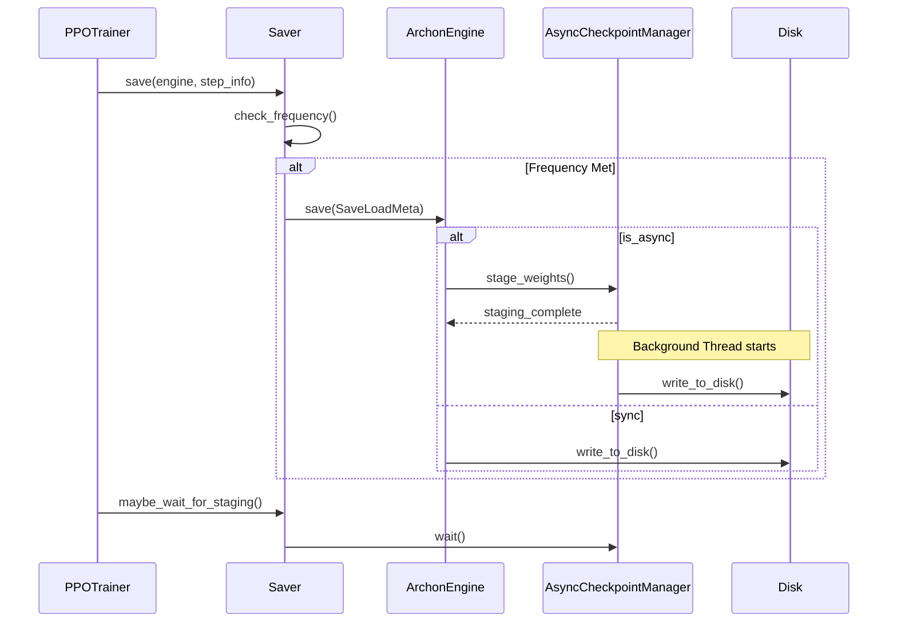
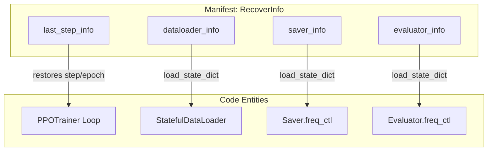

<!-- source: DeepWiki mcp.deepwiki.com · repo areal-project/AReaL · page 8.3 Checkpointing & Recovery · fetched 2026-10-21 -->

# Checkpointing & Recovery

Relevant source files

The following files were used as context for generating this wiki page:

- [areal/engine/fsdp_utils/__init__.py](areal/engine/fsdp_utils/__init__.py)
- [areal/engine/fsdp_utils/optimizer.py](areal/engine/fsdp_utils/optimizer.py)
- [areal/experimental/models/archon/moe_weight_converter.py](areal/experimental/models/archon/moe_weight_converter.py)
- [areal/utils/data.py](areal/utils/data.py)
- [areal/utils/dataloader.py](areal/utils/dataloader.py)
- [areal/utils/evaluator.py](areal/utils/evaluator.py)
- [areal/utils/lock.py](areal/utils/lock.py)
- [areal/utils/printing.py](areal/utils/printing.py)
- [areal/utils/recover.py](areal/utils/recover.py)
- [areal/utils/save_load.py](areal/utils/save_load.py)
- [areal/utils/saver.py](areal/utils/saver.py)
- [areal/utils/timeutil.py](areal/utils/timeutil.py)
- [docs/_config.yml.backup](docs/_config.yml.backup)
- [docs/en/_config.yml](docs/en/_config.yml)
- [docs/en/best_practices/handling_oom.md](docs/en/best_practices/handling_oom.md)
- [docs/en/customization/dataset.md](docs/en/customization/dataset.md)
- [docs/en/reference/ai_assisted_dev.md](docs/en/reference/ai_assisted_dev.md)
- [docs/en/reference/checkpointing.md](docs/en/reference/checkpointing.md)
- [docs/en/reference/metrics_tracking.md](docs/en/reference/metrics_tracking.md)
- [docs/en/tutorial/eval.md](docs/en/tutorial/eval.md)
- [docs/en/tutorial/gsm8k_grpo.md](docs/en/tutorial/gsm8k_grpo.md)
- [docs/zh/best_practices/handling_oom.md](docs/zh/best_practices/handling_oom.md)
- [docs/zh/reference/ai_assisted_dev.md](docs/zh/reference/ai_assisted_dev.md)
- [docs/zh/reference/metrics_tracking.md](docs/zh/reference/metrics_tracking.md)
- [docs/zh/tutorial/eval.md](docs/zh/tutorial/eval.md)
- [tests/experimental/archon/torchrun/run_ep_tests.py](tests/experimental/archon/torchrun/run_ep_tests.py)
- [tests/test_per_layer_optim_step.py](tests/test_per_layer_optim_step.py)

AReaL provides a robust checkpointing and recovery system designed for distributed RL training. The system is centered around the `Saver` and `RecoverHandler` classes, supporting both synchronous and asynchronous checkpointing, multiple weight formats (HuggingFace and Distributed Checkpoint/DCP), and comprehensive state restoration for interrupted runs.

## Saver System

The `Saver` class manages the logic for persisting model weights and training states based on configured frequencies.

### Configuration and Frequency Control
The `Saver` uses `EpochStepTimeFreqCtl` [areal/utils/timeutil.py:145-182]() to determine when to trigger a save operation based on epochs, steps, or elapsed time [areal/utils/saver.py:27-31]().

### Save Paths and Hierarchy
AReaL organizes checkpoints in a structured directory hierarchy:
*   **Root Path**: `checkpoints/<user>/<experiment_name>/<trial_name>` [areal/utils/saver.py:36-45]()
*   **Model Path**: Subdirectories named by engine/component (e.g., "default", "actor") [areal/utils/saver.py:48-59]()
*   **Step Path**: Specific folders for steps: `epoch{e}epochstep{s}globalstep{g}` [areal/utils/saver.py:62-76]()

### Checkpoint Formats
The system supports two primary formats defined in `SaveLoadMeta` [areal/api/__init__.py]():
1.  **HF (HuggingFace)**: Standard format for interoperability.
2.  **DCP (Distributed Checkpoint)**: Optimized for large-scale distributed training using `torch.distributed.checkpoint`.

Sources: [areal/utils/saver.py:23-145](), [areal/utils/timeutil.py:145-182]()

---

## Asynchronous Checkpointing

To minimize training downtime, AReaL implements an asynchronous checkpointing mechanism via the `AsyncCheckpointManager`.

### Implementation Details
Asynchronous saving is currently supported for the `ArchonEngine` [areal/utils/saver.py:107-120](). It works by "staging" the model weights to a temporary buffer (often on CPU or a dedicated staging area) before performing the I/O operation in a background thread.

### Workflow
1.  **Trigger**: `Saver.save` is called.
2.  **Staging**: If `AsyncMode.ASYNC` is active, the engine stages weights.
3.  **Background I/O**: The `AsyncCheckpointManager` handles the actual disk write [areal/utils/saver.py:160-180]().
4.  **Synchronization**: The `maybe_wait_for_staging` method ensures that staging is complete before the next PPO update begins to prevent data corruption [areal/utils/saver.py:182-185]().

### Saver/Engine Interaction Diagram
This diagram shows how the `Saver` interacts with training engines and the `AsyncCheckpointManager`.

Title: Saver and Async Execution Flow

Sources: [areal/utils/saver.py:160-192](), [areal/utils/async_checkpoint.py:1-50]()

---

## Recovery and Manifest System

Recovery is managed by the `RecoverHandler`, which utilizes a manifest-like object called `RecoverInfo` to reconstruct the exact state of a training run.

### RecoverInfo Manifest
The `RecoverInfo` dataclass [areal/utils/recover.py:41-50]() aggregates metadata from all critical subsystems:
*   `last_step_info`: The `StepInfo` of the last successful checkpoint [areal/utils/recover.py:44]().
*   `saver_info` / `evaluator_info`: State of frequency controllers [areal/utils/recover.py:46-47]().
*   `dataloader_info`: The state of the `StatefulDataLoader` [areal/utils/recover.py:49]().
*   `checkpoint_info`: Metadata about the saved weights [areal/utils/recover.py:50]().

### Manifest Persistence
*   **Dumping**: When saving, `RecoverInfo.dump()` writes JSON and PKL files into a `recover_info` directory [areal/utils/recover.py:52-94]().
*   **Distributed Handling**: For dataloaders, the state is gathered from all ranks via `dist.all_gather_object` and stored as a list [areal/utils/recover.py:57-68]().

### The Recovery Process
When a run is resumed, the `RecoverHandler` performs the following steps:
1.  **Locate Manifest**: Finds the `recover_info` directory in the checkpoint root [areal/utils/recover.py:168-176]().
2.  **Load State**: `RecoverInfo.load()` reads the metadata and distributes dataloader shards to the correct ranks [areal/utils/recover.py:96-145]().
3.  **Engine Restore**: The training engine loads model weights and optimizer states using the path provided in the manifest.
4.  **Step Resumption**: Training resumes from `last_step_info.next()`.

### Recovery Data Flow Diagram
This diagram maps the `RecoverInfo` manifest to the code entities it restores.

Title: Recovery Manifest Mapping

Sources: [areal/utils/recover.py:41-149](), [areal/utils/dataloader.py:8-16](), [areal/utils/evaluator.py:10-25]()

---

## Distributed State Management

In a distributed environment, ensuring all ranks are synchronized during checkpointing is critical.

### Stateful Dataloader
AReaL uses `StatefulDataLoader` [areal/utils/dataloader.py:8]() to ensure that the dataset position is preserved across restarts. The `RecoverHandler` gathers these states into a list [areal/utils/recover.py:61]() and, upon recovery, slices the list using `dist.get_rank()` to restore the local shard's position [areal/utils/recover.py:136]().

### FSDP2 State Loading
For models sharded via FSDP2, AReaL provides `fsdp2_load_full_state_dict` [areal/engine/fsdp_utils/__init__.py:110](). This function handles:
*   Materializing meta-tensors on device [areal/engine/fsdp_utils/__init__.py:136-137]().
*   Broadcasting weights from Rank 0 to all other ranks [areal/engine/fsdp_utils/__init__.py:143]().
*   Synchronizing non-sharded buffers like `rotary_emb` [areal/engine/fsdp_utils/__init__.py:153-154]().

Sources: [areal/utils/recover.py:57-68](), [areal/utils/dataloader.py:49-62](), [areal/engine/fsdp_utils/__init__.py:110-161]()

---

