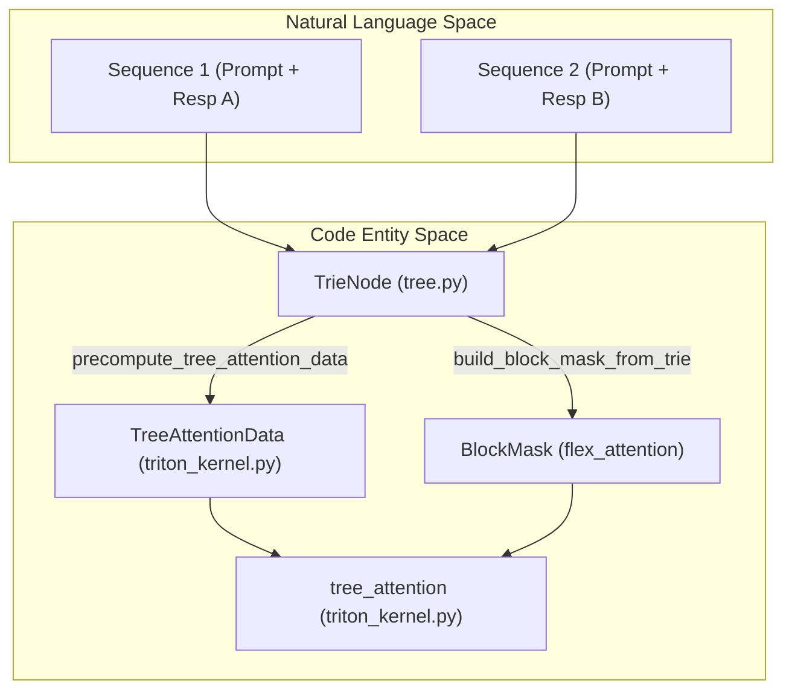
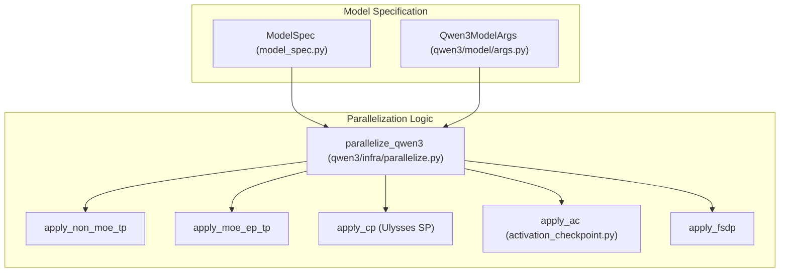

<!-- source: DeepWiki mcp.deepwiki.com · repo areal-project/AReaL · page 9 Model Architectures · fetched 2026-10-21 -->

# Model Architectures

Relevant source files

The following files were used as context for generating this wiki page:

- [areal/experimental/models/archon/activation_checkpoint.py](areal/experimental/models/archon/activation_checkpoint.py)
- [areal/experimental/models/archon/compile.py](areal/experimental/models/archon/compile.py)
- [areal/experimental/models/archon/model_spec.py](areal/experimental/models/archon/model_spec.py)
- [areal/experimental/models/archon/moe/args.py](areal/experimental/models/archon/moe/args.py)
- [areal/experimental/models/archon/moe/moe.py](areal/experimental/models/archon/moe/moe.py)
- [areal/experimental/models/archon/parallel_dims.py](areal/experimental/models/archon/parallel_dims.py)
- [areal/experimental/models/archon/qwen2/infra/parallelize.py](areal/experimental/models/archon/qwen2/infra/parallelize.py)
- [areal/experimental/models/archon/qwen2/model/model.py](areal/experimental/models/archon/qwen2/model/model.py)
- [areal/experimental/models/archon/qwen3/infra/parallelize.py](areal/experimental/models/archon/qwen3/infra/parallelize.py)
- [areal/experimental/models/archon/qwen3/model/model.py](areal/experimental/models/archon/qwen3/model/model.py)
- [areal/models/tree_attn/constants.py](areal/models/tree_attn/constants.py)
- [areal/models/tree_attn/functional.py](areal/models/tree_attn/functional.py)
- [areal/models/tree_attn/module.py](areal/models/tree_attn/module.py)
- [areal/models/tree_attn/module_fsdp.py](areal/models/tree_attn/module_fsdp.py)
- [areal/models/tree_attn/module_megatron.py](areal/models/tree_attn/module_megatron.py)
- [areal/models/tree_attn/tree.py](areal/models/tree_attn/tree.py)
- [areal/models/tree_attn/triton_kernel.py](areal/models/tree_attn/triton_kernel.py)

AReaL provides optimized model implementations designed for high-throughput RL training. The architecture is split into two primary tracks: **Tree Attention**, which optimizes training for shared-prefix sequences (common in RL rollout-training loops), and the **Archon Model Family**, which provides native, highly parallelized implementations of popular architectures like Qwen2 and Qwen3.

## Tree Attention

Tree Attention is a specialized attention mechanism designed to eliminate redundant computation when multiple sequences share a common prefix (e.g., multiple completions generated from the same prompt). Instead of processing each sequence independently, AReaL constructs a `TrieNode` structure [areal/models/tree_attn/tree.py:41-78]() to represent the shared prefix tree.

This mechanism integrates with major training backends:
- **FSDP**: Uses `patch_fsdp_for_tree_training` [areal/models/tree_attn/module_fsdp.py:6-7]() to handle tree-structured masks.
- **Megatron-Core**: Uses `patch_bridge_for_tree_training` [areal/models/tree_attn/module_megatron.py:171-189]() to inject tree attention into the `LLMBridge`.
- **Triton**: Provides optimized kernels for tree-structured attention [areal/models/tree_attn/triton_kernel.py:23-27]().

### Tree Construction Workflow

The following diagram illustrates how raw sequences are converted into a trie and then into hardware-efficient attention masks.

**Trie to Mask Transformation**

Sources: [areal/models/tree_attn/tree.py:41-78](), [areal/models/tree_attn/triton_kernel.py:23-27](), [areal/models/tree_attn/module.py:9-14]()

For details on trie construction and Triton kernels, see [Tree Attention](#9.1).

---

## Archon Model Family

The Archon family consists of native PyTorch implementations of the Qwen2 and Qwen3 architectures. These models are designed for "5D Parallelism" (DP, TP, CP, EP, PP) and are optimized for the AReaL training engines.

Key features include:
- **Architecture Support**: Native implementations for Qwen2 [areal/experimental/models/archon/qwen2/model/model.py:32]() and Qwen3 [areal/experimental/models/archon/qwen3/model/model.py:75]().
- **Mixture of Experts (MoE)**: Support for `GroupedExperts` [areal/experimental/models/archon/moe/moe.py:88]() and `TokenChoiceTopKRouter` [areal/experimental/models/archon/moe/moe.py:74]().
- **Parallelization Protocols**: Models implement `ParallelizeFn` and `PipeliningFn` [areal/experimental/models/archon/model_spec.py:26-83]() to standardize how distributed strategies are applied.

### Parallelization Strategy

Archon uses a structured approach to apply various parallelism dimensions via `ArchonParallelDims` [areal/experimental/models/archon/parallel_dims.py:27-124]().

**Archon Parallelization Flow**

Sources: [areal/experimental/models/archon/qwen3/infra/parallelize.py:86-110](), [areal/experimental/models/archon/model_spec.py:86-96](), [areal/experimental/models/archon/parallel_dims.py:48-57]()

### Component Overview

| Component | Description | File |
| :--- | :--- | :--- |
| `ArchonParallelDims` | Manages mesh dimensions for TP, CP, EP, PP, and FSDP. | [areal/experimental/models/archon/parallel_dims.py:27-124]() |
| `MoE` | Mixture of Experts layer with router and grouped expert support. | [areal/experimental/models/archon/moe/moe.py:40-61]() |
| `ActivationCheckpointConfig` | Configures selective or full activation checkpointing. | [areal/experimental/models/archon/activation_checkpoint.py:37-68]() |
| `RMSNorm` | Root Mean Square Layer Normalization used in Qwen blocks. | [areal/experimental/models/archon/qwen3/model/model.py:75-96]() |

For details on specific model configurations and MoE routing, see [Archon Model Family (Qwen2/Qwen3/MoE)](#9.2).

---

