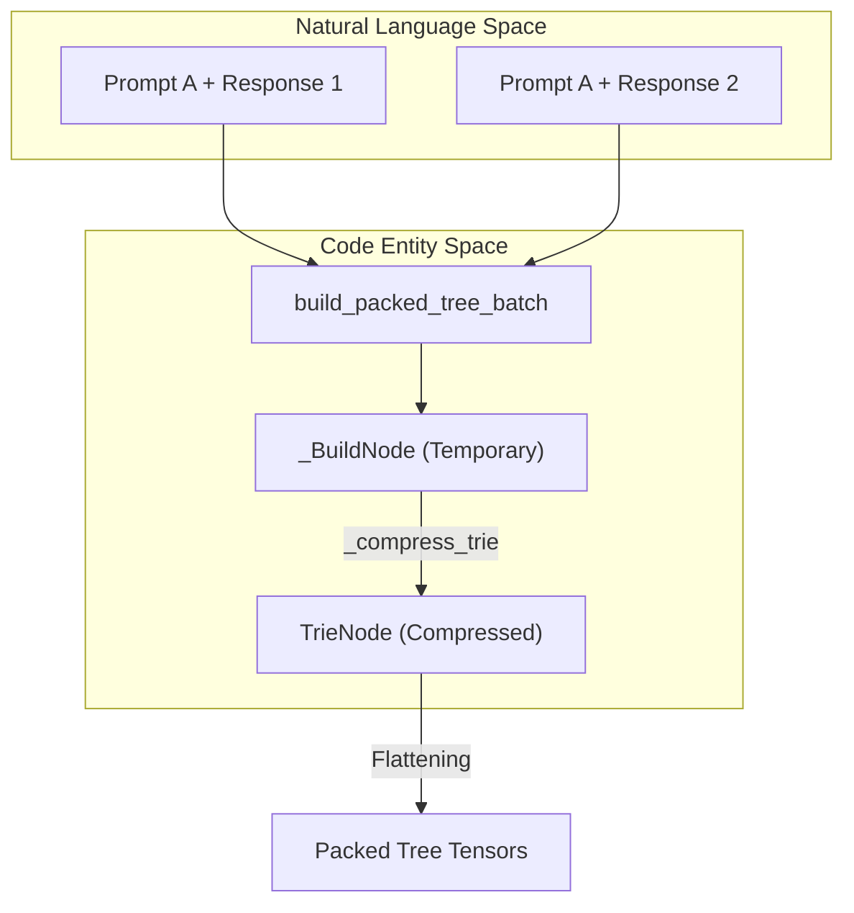
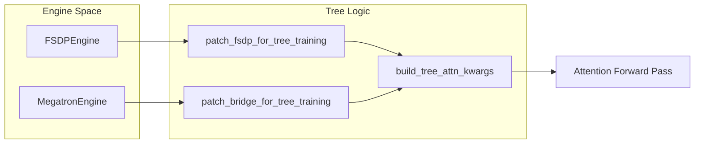

<!-- source: DeepWiki mcp.deepwiki.com · repo areal-project/AReaL · page 9.1 Tree Attention · fetched 2026-10-21 -->

# Tree Attention

<details>
<summary>Relevant source files</summary>

The following files were used as context for generating this wiki page:

- [areal/api/cli_args.py](areal/api/cli_args.py)
- [areal/engine/fsdp_engine.py](areal/engine/fsdp_engine.py)
- [areal/engine/megatron_engine.py](areal/engine/megatron_engine.py)
- [areal/experimental/engine/archon_engine.py](areal/experimental/engine/archon_engine.py)
- [areal/models/tree_attn/constants.py](areal/models/tree_attn/constants.py)
- [areal/models/tree_attn/functional.py](areal/models/tree_attn/functional.py)
- [areal/models/tree_attn/module.py](areal/models/tree_attn/module.py)
- [areal/models/tree_attn/module_fsdp.py](areal/models/tree_attn/module_fsdp.py)
- [areal/models/tree_attn/module_megatron.py](areal/models/tree_attn/module_megatron.py)
- [areal/models/tree_attn/tree.py](areal/models/tree_attn/tree.py)
- [areal/models/tree_attn/triton_kernel.py](areal/models/tree_attn/triton_kernel.py)
- [docs/en/_toc.yml](docs/en/_toc.yml)
- [docs/en/cli_reference.md](docs/en/cli_reference.md)
- [docs/en/reference/tree_training.md](docs/en/reference/tree_training.md)
- [docs/en/tutorial/archon.md](docs/en/tutorial/archon.md)
- [docs/en/tutorial/megatron.md](docs/en/tutorial/megatron.md)
- [docs/zh/_toc.yml](docs/zh/_toc.yml)
- [docs/zh/cli_reference.md](docs/zh/cli_reference.md)
- [docs/zh/reference/tree_training.md](docs/zh/reference/tree_training.md)
- [docs/zh/tutorial/archon.md](docs/zh/tutorial/archon.md)
- [docs/zh/tutorial/megatron.md](docs/zh/tutorial/megatron.md)

</details>


Tree Attention is a specialized attention mechanism designed for efficient training on sequences that share common prefixes (e.g., multiple samples generated from the same prompt in RLVR or PPO). By structuring these sequences into a **Trie** (prefix tree), AReaL avoids redundant computation of shared prefix hidden states, significantly increasing throughput during the training of multi-sample reinforcement learning algorithms.

## Overview and Purpose

In standard sequence packing, shared prefixes are re-computed for every sample in a batch. Tree Attention eliminates this redundancy by:
1.  **Trie Construction**: Compressing a batch of sequences into a tree where common prefixes are represented by shared nodes.
2.  **Tree-Structured Attention**: Using specialized attention masks or kernels to ensure tokens only attend to their ancestors in the tree.
3.  **Logprob Reconstruction**: Gathering log-probabilities from the tree structure back into individual sequence trajectories for RL loss computation.

Tree training is particularly effective when the number of samples per prompt ($G$) is large (e.g., $G \ge 8$), as it reduces the effective sequence length processed by the Transformer.

Sources: `areal/models/tree_attn/tree.py:3-8`(), `areal/api/cli_args.py:1143-1150`()

---

## Data Structures and Trie Construction

The core of the tree attention system is the `TrieNode`. During the data preparation phase, individual sequences are inserted into a temporary trie and then compressed into a contiguous representation.

### TrieNode Specification
A `TrieNode` represents a contiguous run of tokens shared by a specific set of sequence IDs.

| Attribute | Description |
| :--- | :--- |
| `tokens` | List of token IDs stored in this node. |
| `start_idx` / `end_idx` | Indices in the flattened tree tensor. |
| `sequence_ids` | The set of sequences that pass through this node. |
| `children` | Diverging paths where sequences differ. |

Sources: `areal/models/tree_attn/tree.py:41-77`()

### Construction Flow
The construction process involves building a raw trie and then compressing linear chains (nodes with only one child) into single `TrieNode` instances to minimize the number of nodes.


Sources: `areal/models/tree_attn/tree.py:127-140`(), `areal/models/tree_attn/tree.py:171-204`(), `areal/models/tree_attn/tree.py:438-460`()

---

## Attention Implementation

AReaL supports three primary methods for executing tree-structured attention, depending on the training engine and hardware capabilities.

### 1. BlockMask (FlexAttention)
For engines using PyTorch `flex_attention`, AReaL generates a `BlockMask` that encodes the tree structure. A token at position $i$ can attend to position $j$ if and only if $j$ is an ancestor of $i$ in the trie.

### 2. Triton Tree Attention Kernel
For maximum performance, a custom Triton kernel is provided. This kernel uses precomputed KV-indices and offsets to perform sparse attention directly on the packed tree structure.
*   **Key Function**: `tree_attention` in `areal/models/tree_attn/triton_kernel.py`.
*   **Data Prep**: `precompute_tree_attention_data` computes the sparse indexing metadata required by the kernel.

### 3. Dense Masking (Fallback)
A standard 2D attention mask can be generated from the trie, though this is less memory-efficient than the sparse approaches.

Sources: `areal/models/tree_attn/tree.py:307-330`(), `areal/models/tree_attn/triton_kernel.py:23-27`(), `areal/models/tree_attn/module_megatron.py:85-118`()

---

## Engine Integration

Tree Attention is integrated into AReaL's major training backends via monkey-patching and specialized forward/backward hooks.

### FSDP2 Integration
The `FSDPEngine` uses `patch_fsdp_for_tree_training` to modify the model's attention layers. It prepares a `FSDPTrainContext` containing the `TrieNode` structure to guide the forward pass.

### Megatron-Core Integration
The `MegatronEngine` utilizes `patch_bridge_for_tree_training` to wrap the standard `SelfAttention` with `PytorchFlexAttention`. This allows Megatron-Core models to consume the tree-structured `BlockMask` or `TreeAttentionData`.


Sources: `areal/engine/fsdp_engine.py:103-107`(), `areal/models/tree_attn/module_megatron.py:171-198`(), `areal/models/tree_attn/module_fsdp.py:145-160`()

---

## Logprob and Entropy Computation

Because the model forward pass happens on a compressed tree, the resulting logits must be mapped back to the original sequence trajectories to compute RL losses (e.g., PPO clip loss).

1.  **Internal Node Logprobs**: Logprobs for tokens within a single `TrieNode` are computed normally using `gather_logprobs`.
2.  **Transition Logprobs**: Logprobs for the first token of a child node (predicted by the last token of the parent node) are computed as transitions.
3.  **Merging**: The `merge_packed_tree_results` function reconstructs the full logprob and entropy tensors for each sequence ID in the batch.

Sources: `areal/models/tree_attn/functional.py:26-34`(), `areal/models/tree_attn/functional.py:130-137`(), `areal/models/tree_attn/functional.py:321-340`()

---

## Configuration and Usage

Tree training is enabled via the `TrainEngineConfig`. It is highly recommended for GRPO or PPO workflows where `n_samples` per prompt is high.

### CLI Parameters
| Parameter | Description |
| :--- | :--- |
| `enable_tree_training` | Global toggle to enable tree-structured training. |
| `attn_impl` | Set to `flex_attention` or `triton` for optimal tree performance. |

Example configuration:
```yaml
actor:
  enable_tree_training: True
  attn_impl: "flex_attention"
```

Sources: `areal/api/cli_args.py:1143-1150`(), `areal/api/cli_args.py:1174-1185`()

---

