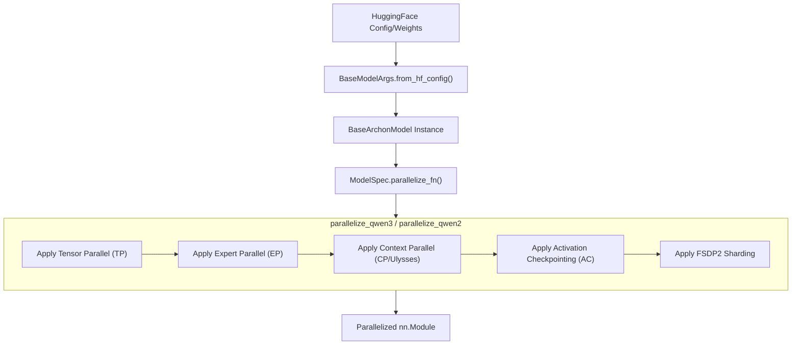
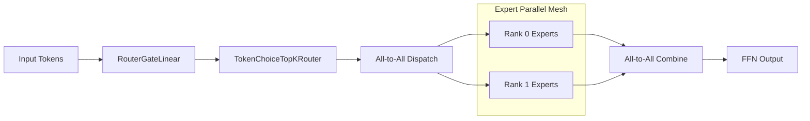

<!-- source: DeepWiki mcp.deepwiki.com · repo areal-project/AReaL · page 9.2 Archon Model Family (Qwen2/Qwen3/MoE) · fetched 2026-10-21 -->

# Archon Model Family (Qwen2/Qwen3/MoE)

Relevant source files

The following files were used as context for generating this wiki page:

- [areal/engine/fsdp_utils/__init__.py](areal/engine/fsdp_utils/__init__.py)
- [areal/engine/fsdp_utils/optimizer.py](areal/engine/fsdp_utils/optimizer.py)
- [areal/experimental/engine/archon_checkpoint.py](areal/experimental/engine/archon_checkpoint.py)
- [areal/experimental/engine/archon_utils.py](areal/experimental/engine/archon_utils.py)
- [areal/experimental/models/archon/activation_checkpoint.py](areal/experimental/models/archon/activation_checkpoint.py)
- [areal/experimental/models/archon/base.py](areal/experimental/models/archon/base.py)
- [areal/experimental/models/archon/compile.py](areal/experimental/models/archon/compile.py)
- [areal/experimental/models/archon/expert_parallel.py](areal/experimental/models/archon/expert_parallel.py)
- [areal/experimental/models/archon/fp8.py](areal/experimental/models/archon/fp8.py)
- [areal/experimental/models/archon/fp8_checkpoint.py](areal/experimental/models/archon/fp8_checkpoint.py)
- [areal/experimental/models/archon/model_spec.py](areal/experimental/models/archon/model_spec.py)
- [areal/experimental/models/archon/moe/__init__.py](areal/experimental/models/archon/moe/__init__.py)
- [areal/experimental/models/archon/moe/args.py](areal/experimental/models/archon/moe/args.py)
- [areal/experimental/models/archon/moe/grouped_experts.py](areal/experimental/models/archon/moe/grouped_experts.py)
- [areal/experimental/models/archon/moe/moe.py](areal/experimental/models/archon/moe/moe.py)
- [areal/experimental/models/archon/moe/router.py](areal/experimental/models/archon/moe/router.py)
- [areal/experimental/models/archon/moe/utils.py](areal/experimental/models/archon/moe/utils.py)
- [areal/experimental/models/archon/moe_weight_converter.py](areal/experimental/models/archon/moe_weight_converter.py)
- [areal/experimental/models/archon/parallel_dims.py](areal/experimental/models/archon/parallel_dims.py)
- [areal/experimental/models/archon/qwen2/infra/parallelize.py](areal/experimental/models/archon/qwen2/infra/parallelize.py)
- [areal/experimental/models/archon/qwen2/model/args.py](areal/experimental/models/archon/qwen2/model/args.py)
- [areal/experimental/models/archon/qwen2/model/model.py](areal/experimental/models/archon/qwen2/model/model.py)
- [areal/experimental/models/archon/qwen3/infra/parallelize.py](areal/experimental/models/archon/qwen3/infra/parallelize.py)
- [areal/experimental/models/archon/qwen3/model/args.py](areal/experimental/models/archon/qwen3/model/args.py)
- [areal/experimental/models/archon/qwen3/model/model.py](areal/experimental/models/archon/qwen3/model/model.py)
- [areal/experimental/models/archon/qwen3_5/model/state_dict_adapter.py](areal/experimental/models/archon/qwen3_5/model/state_dict_adapter.py)
- [areal/utils/data.py](areal/utils/data.py)
- [areal/utils/recover.py](areal/utils/recover.py)
- [areal/utils/saver.py](areal/utils/saver.py)
- [docs/en/best_practices/handling_oom.md](docs/en/best_practices/handling_oom.md)
- [docs/zh/best_practices/handling_oom.md](docs/zh/best_practices/handling_oom.md)
- [examples/math/gsm8k_sft_archon_fp8.yaml](examples/math/gsm8k_sft_archon_fp8.yaml)
- [tests/experimental/archon/conftest.py](tests/experimental/archon/conftest.py)
- [tests/experimental/archon/test_moe_common.py](tests/experimental/archon/test_moe_common.py)
- [tests/experimental/archon/torchrun/run_ep_tests.py](tests/experimental/archon/torchrun/run_ep_tests.py)
- [tests/test_packed_vs_padded_consistency.py](tests/test_packed_vs_padded_consistency.py)
- [tests/test_per_layer_optim_step.py](tests/test_per_layer_optim_step.py)

The Archon model family represents AReaL's native, high-performance implementation of modern Transformer architectures, specifically optimized for distributed Reinforcement Learning workloads. Unlike generic wrappers, Archon provides deep integration with 5D parallelism (DP/TP/CP/EP/PP) and FP8 training, specifically targeting the Qwen2 and Qwen3 (including Qwen3.5) model lineages in both dense and Mixture-of-Experts (MoE) configurations.

## Architecture Overview

The Archon system is built around the `ModelSpec` abstraction, which decouples model definitions from their distributed execution strategies. This allows the same model logic to be used across different sharding and pipelining configurations.

### Model Specification and Registration
Each model in the family is defined by a `ModelSpec` that binds the core `nn.Module` with its specific configuration logic and parallelization protocols.

*   **`ModelSpec`**: A dataclass that holds the model class, its arguments class, state dict adapter, and the functions required for parallelization and pipelining [areal/experimental/models/archon/model_spec.py:86-96]().
*   **`ParallelizeFn`**: A protocol defining how to apply TP, CP, EP, and FSDP to a model instance [areal/experimental/models/archon/model_spec.py:26-52]().
*   **`PipeliningFn`**: A protocol for splitting the model into stages for Pipeline Parallelism [areal/experimental/models/archon/model_spec.py:55-82]().

### Data Flow: From HF to Archon
The following diagram illustrates how a HuggingFace model is transformed into a distributed Archon instance.

**Model Initialization and Parallelization Flow**

Sources: [areal/experimental/models/archon/model_spec.py:86-110](), [areal/experimental/models/archon/qwen3/infra/parallelize.py:86-110](), [areal/experimental/models/archon/base.py:47-54]()

---

## Mixture-of-Experts (MoE) Implementation

Archon provides a highly optimized MoE implementation supporting massive expert counts through Expert Parallelism (EP).

### MoE Routing and Gating
The routing mechanism determines token-to-expert assignment. Archon implements `TokenChoiceTopKRouter` which supports:
*   **Standard Top-K**: Tokens are routed to the $k$ experts with the highest scores [areal/experimental/models/archon/moe/router.py:109-122]().
*   **Node-Limited Routing**: Experts are grouped, and tokens are restricted to a subset of groups to reduce inter-node communication [areal/experimental/models/archon/moe/router.py:181-200]().
*   **Higher Precision Gating**: The `RouterGateLinear` can perform GEMM in `float32` for numerical stability while keeping activations in `bfloat16` [areal/experimental/models/archon/moe/router.py:76-88]().

### Expert Parallelism (EP)
Archon uses `All-to-All` communication primitives to distribute experts across the `ep` dimension of the `DeviceMesh`.
*   **`GroupedExperts`**: Efficiently manages multiple experts on a single rank by stacking their weights [areal/experimental/models/archon/moe/grouped_experts.py]().
*   **`ExpertParallel`**: A style that wraps MoE layers to handle the dispatch and combine operations via `torch.distributed` [areal/experimental/models/archon/expert_parallel.py]().

**MoE Data Flow**

Sources: [areal/experimental/models/archon/moe/router.py:109-158](), [areal/experimental/models/archon/qwen3/infra/parallelize.py:139-151]()

---

## Parallelization Protocols

Archon implements a "Parallelize Function" for each model family (e.g., `parallelize_qwen3`). The order of operations is critical for correctness.

| Strategy | Implementation Detail | Source |
| :--- | :--- | :--- |
| **Tensor Parallel (TP)** | Column/Row-wise sharding of attention and dense FFN layers. | [areal/experimental/models/archon/qwen3/infra/parallelize.py:135-137]() |
| **Expert Parallel (EP)** | Sharding MoE experts across the `ep` mesh dimension. | [areal/experimental/models/archon/qwen3/infra/parallelize.py:139-151]() |
| **Context Parallel (CP)** | Ulysses Sequence Parallelism using All-to-All to split heads. | [areal/experimental/models/archon/qwen3/infra/parallelize.py:153-155]() |
| **Activation Checkpoint** | Selective AC applied after TP/CP but before FSDP. | [areal/experimental/models/archon/qwen3/infra/parallelize.py:157-164]() |
| **FSDP2** | Final sharding of remaining parameters and gradients. | [areal/experimental/models/archon/qwen3/infra/parallelize.py:171-180]() |

### Context Parallelism (Ulysses SP)
Unlike Ring Attention, Archon's `Attention` module uses Ulysses SP. It performs `gather_heads_scatter_seq` and `gather_seq_scatter_heads` around the attention core to ensure that while sequence parts are distributed, each attention head sees the full context assigned to it [areal/experimental/models/archon/qwen3/model/model.py:103-109](), [areal/experimental/models/archon/qwen3/model/model.py:220-235]().

---

## State Dict Adapters and Checkpointing

Archon uses `BaseStateDictAdapter` to bridge the gap between HuggingFace's naming conventions and Archon's internal structure.

### Conversion Logic
*   **`from_hf`**: Converts a flat HF state dict into the format expected by Archon's sharded modules [areal/experimental/models/archon/base.py:132-133]().
*   **`to_hf`**: Reverses the process for saving compatible checkpoints [areal/experimental/models/archon/base.py:135-136]().
*   **`fqn_to_index_mapping`**: Supports multi-file HF checkpoints by parsing `model.safetensors.index.json` [areal/experimental/models/archon/base.py:81-103]().

### Distributed Checkpoint (DCP)
For large-scale training, Archon utilizes `DCPState` to handle asynchronous and sharded checkpointing.
*   **`DCPState`**: A wrapper that manages model parts and optimizer states, ensuring that in Pipeline Parallel (PP) mode, only the relevant keys for each stage are loaded [areal/experimental/engine/archon_checkpoint.py:86-115]().
*   **Asynchronous Staging**: Uses `AsyncCheckpointManager` to stage weights to CPU/pinned memory before writing to disk, minimizing training downtime [areal/utils/saver.py:160-180]().

---

## FP8 Support

Archon includes experimental support for FP8 training via `areal/experimental/models/archon/fp8.py`.
*   **Scaling Factors**: Automatically manages scaling factors for activations and weights to maintain precision in FP8 [areal/experimental/models/archon/fp8.py]().
*   **Checkpoints**: Special handling in `fp8_checkpoint.py` ensures that scaling metadata is preserved during save/load cycles [areal/experimental/models/archon/fp8_checkpoint.py]().

Sources:
*   `areal/experimental/models/archon/model_spec.py`
*   `areal/experimental/models/archon/qwen3/infra/parallelize.py`
*   `areal/experimental/models/archon/moe/router.py`
*   `areal/experimental/models/archon/qwen3/model/model.py`
*   `areal/experimental/engine/archon_checkpoint.py`
*   `areal/experimental/models/archon/base.py`
*   `areal/utils/saver.py`

---

