# Page: AReaL Overview

# AReaL Overview

<details>
<summary>Relevant source files</summary>

The following files were used as context for generating this wiki page:

- [.github/ISSUE_TEMPLATE/config.yml](.github/ISSUE_TEMPLATE/config.yml)
- [.github/workflows/pre-commit.yml](.github/workflows/pre-commit.yml)
- [AGENTS.md](AGENTS.md)
- [CLAUDE.md](CLAUDE.md)
- [CONTRIBUTING.md](CONTRIBUTING.md)
- [README.md](README.md)
- [ROADMAP.md](ROADMAP.md)
- [areal/api/alloc_mode.py](areal/api/alloc_mode.py)
- [assets/community/README.md](assets/community/README.md)
- [assets/figures/1.5b_time_n1n4n16.png](assets/figures/1.5b_time_n1n4n16.png)
- [assets/figures/7b_zero_eval_acc.png](assets/figures/7b_zero_eval_acc.png)
- [assets/figures/7b_zero_training_curve.png](assets/figures/7b_zero_training_curve.png)
- [assets/figures/algo_ablation.png](assets/figures/algo_ablation.png)
- [assets/figures/arch.png](assets/figures/arch.png)
- [assets/figures/areal_lite_layers.png](assets/figures/areal_lite_layers.png)
- [assets/figures/async_scaling_vs_verl.png](assets/figures/async_scaling_vs_verl.png)
- [assets/figures/async_timeline.png](assets/figures/async_timeline.png)
- [blog/AReaL_v0_2.md](blog/AReaL_v0_2.md)
- [blog/AReaL_v0_3.md](blog/AReaL_v0_3.md)
- [docs/en/version_history.md](docs/en/version_history.md)
- [docs/zh/version_history.md](docs/zh/version_history.md)
- [examples/countdown/README.md](examples/countdown/README.md)
- [examples/tau2/README.md](examples/tau2/README.md)

</details>


**AReaL** is a large-scale reinforcement learning (RL) infrastructure designed to bridge foundation model training with modern agent-based applications. Developed by researchers from Tsinghua IIIS and the AReaL Team at Ant Group, it provides a highly efficient, fully asynchronous RL training paradigm [README.md:15-21]().

AReaL's mission is to make building AI agents accessible and cost-effective by providing a system that scales from local development to 1000+ GPU clusters while maintaining industry-leading throughput [README.md:23-36]().

## Core Design Philosophy: Asynchronous RL

The central innovation of AReaL is its **fully asynchronous architecture**, which decouples generation (inference) from model updates (training). This design addresses two critical bottlenecks in traditional synchronous RL systems:

1.  **Device Underutilization**: In synchronous systems, the generation step must wait for the longest sequence in a batch to finish. AReaL allows rollout workers to generate trajectories continuously [blog/AReaL_v0_3.md:49-51]().
2.  **Scalability Limits**: Traditional systems often distribute generation across all devices, pushing decoding into a memory-IO-bound regime. AReaL decouples these into separate GPU clusters to maintain hardware efficiency at scale [blog/AReaL_v0_3.md:68-75]().

### System Component Relationship

The following diagram illustrates how the core components interact within the asynchronous execution model.

**AReaL Asynchronous Data Flow**
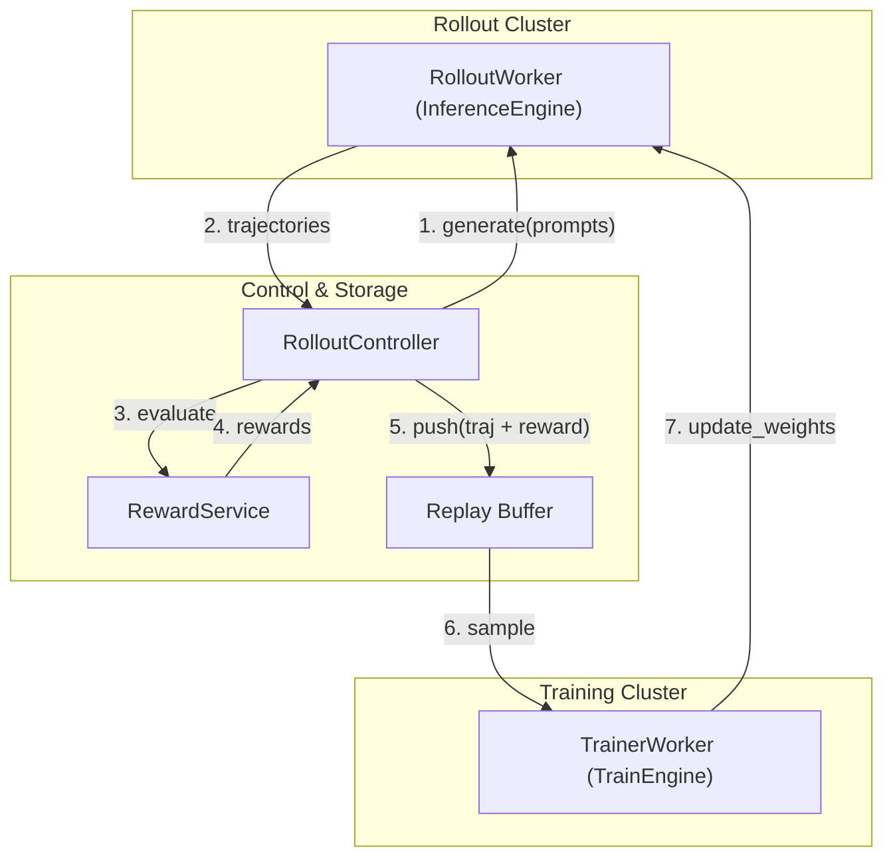
Sources: [blog/AReaL_v0_3.md:82-116](), [areal/api/cli_args.py:49-86]()

## Key Capabilities

*   **Agentic RL Support**: Modular design for multi-turn interactions, tool-integrated reasoning (TIR), and complex environment simulations like `Tau2-Bench` [examples/tau2/README.md:5-15]().
*   **Diverse Training Engines**: Native support for `FSDPEngine`, `MegatronEngine`, and the experimental `ArchonEngine` which supports 5D parallelism [AGENTS.md:7](), [areal/api/alloc_mode.py:33-60]().
*   **Memory Optimization**: Features like sequence packing (eliminating padding), per-layer optimizer streaming, and CPU offloading to maximize GPU utilization [blog/AReaL_v0_2.md:71-75]().
*   **Cross-Platform Hardware**: Stable support for both NVIDIA GPUs (CUDA) and Ascend NPUs [README.md:82-87](), [AGENTS.md:11]().

## System Entity Map

This diagram maps the high-level system concepts to the specific code entities and directory structures that implement them.

**Code Entity Mapping**
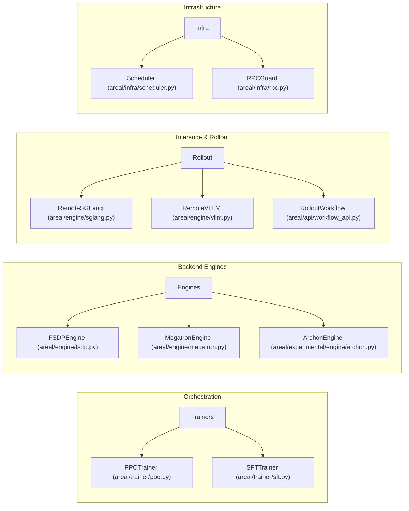
Sources: [AGENTS.md:61-76](), [CLAUDE.md:12-24](), [areal/api/alloc_mode.py:16-21]()

## Subsystem Navigation

AReaL is organized into several major subsystems that work in concert:

| Subsystem | Responsibility | Key Classes/Files |
| :--- | :--- | :--- |
| **Configuration** | Centralized experiment and resource config | `areal/api/cli_args.py`, `areal/api/alloc_mode.py` |
| **Infrastructure** | Distributed worker lifecycle and RPC | `areal/infra/scheduler.py`, `areal/infra/rpc.py` |
| **Training Engines** | Model sharding and weight updates | `FSDPEngine`, `MegatronEngine`, `ArchonEngine` |
| **Inference Engines** | High-throughput trajectory generation | `RemoteSGLang`, `RemoteVLLM` |
| **Rollout Workflows** | Logic for environment interaction | `RLVRWorkflow`, `MultiTurnWorkflow` |
| **Data & Rewards** | Dataset loading and reward computation | `areal/dataset/`, `areal/reward/` |

## Child Pages

For more detailed information on specific aspects of AReaL, please refer to the following child pages:

*   **[Getting Started & Installation](#1.1)**: Detailed setup instructions for local, Docker, and cloud environments, including NPU support.
*   **[Roadmap & Version History](#1.2)**: A look at the project's evolution and future development plans.

Sources: [README.md:120-131](), [ROADMAP.md:1-10](), [AGENTS.md:58-76]()

---

# Page: Getting Started & Installation

# Getting Started & Installation

<details>
<summary>Relevant source files</summary>

The following files were used as context for generating this wiki page:

- [.github/workflows/tag-release-image.yml](.github/workflows/tag-release-image.yml)
- [Dockerfile](Dockerfile)
- [areal/tools/check_pyproject_consistency.py](areal/tools/check_pyproject_consistency.py)
- [docs/en/tutorial/installation.md](docs/en/tutorial/installation.md)
- [docs/en/tutorial/installation_npu.md](docs/en/tutorial/installation_npu.md)
- [docs/en/tutorial/quickstart.md](docs/en/tutorial/quickstart.md)
- [docs/zh/tutorial/installation.md](docs/zh/tutorial/installation.md)
- [docs/zh/tutorial/installation_npu.md](docs/zh/tutorial/installation_npu.md)
- [docs/zh/tutorial/quickstart.md](docs/zh/tutorial/quickstart.md)
- [examples/skypilot/README.md](examples/skypilot/README.md)
- [examples/skypilot/ray_cluster.sky.yaml](examples/skypilot/ray_cluster.sky.yaml)
- [examples/skypilot/single_node.sky.yaml](examples/skypilot/single_node.sky.yaml)
- [pyproject.toml](pyproject.toml)
- [pyproject.vllm.toml](pyproject.vllm.toml)
- [scripts/uv_lock.sh](scripts/uv_lock.sh)
- [uv.lock](uv.lock)
- [uv.vllm.lock](uv.vllm.lock)

</details>


This page provides a comprehensive guide to setting up the AReaL environment. AReaL is designed for large-scale asynchronous reinforcement learning and requires specific hardware and software configurations to achieve optimal performance.

## Prerequisites

### Hardware Requirements
AReaL is optimized for high-performance compute clusters. The following configuration is extensively tested for large-scale training [docs/en/tutorial/installation.md:7-16]():

| Component | Requirement |
| :--- | :--- |
| **GPU** | 8x NVIDIA H800/A100 per node |
| **CPU** | 64 cores per node |
| **Memory** | 1TB RAM per node |
| **Network** | NVSwitch + RoCE 3.2 Tbps |
| **Storage** | 1TB local (single-node) / 10TB shared NAS (distributed) |

### Software Requirements
| Component | Version |
| :--- | :--- |
| **OS** | Ubuntu 22.04 / CentOS 7 [docs/en/tutorial/installation.md:21]() |
| **NVIDIA Driver** | 550.127.08+ [docs/en/tutorial/installation.md:22]() |
| **CUDA** | 12.8 [docs/en/tutorial/installation.md:23]() |
| **Python** | 3.11 or 3.12 [pyproject.toml:10]() |
| **Docker** | 27.5.1 [docs/en/tutorial/installation.md:25]() |

**Sources:** [docs/en/tutorial/installation.md:7-31](), [pyproject.toml:10-41]()

---

## Installation Options

### 1. Docker-Based Installation (Recommended)
Docker is the preferred method as it encapsulates complex C++ extensions (FlashAttention, Apex, TransformerEngine) and ensures binary compatibility with specific PyTorch versions.

AReaL provides two primary image variants based on the desired inference backend [Dockerfile:1-7]():
*   **SGLang Variant**: `ghcr.io/areal-project/areal-runtime:v1.0.4-sglang` (Default)
*   **vLLM Variant**: `ghcr.io/areal-project/areal-runtime:v1.0.4-vllm`

**Deployment Workflow:**
```bash
# Pull and run the container
docker pull ghcr.io/areal-project/areal-runtime:v1.0.4-sglang
docker run -it --privileged --gpus all --network host \
   --shm-size 700g -v /path/to/shared_storage:/storage \
   ghcr.io/areal-project/areal-runtime:v1.0.4-sglang

# Inside the container, install the local AReaL package
git clone https://github.com/areal-project/AReaL /storage/AReaL
cd /storage/AReaL
uv pip install -e . --no-deps
```

**Sources:** [docs/en/tutorial/installation.md:39-58](), [Dockerfile:1-15]()

### 2. Local Installation (uv-based)
AReaL uses `uv` for lightning-fast dependency management and environment isolation.

#### Standard Setup (SGLang)
```bash
git clone https://github.com/areal-project/AReaL
cd AReaL
# Install with CUDA training extras
uv sync --extra cuda
source .venv/bin/activate
```

#### vLLM Setup
Because SGLang and vLLM require incompatible versions of `torch` and `torchao`, you must swap the configuration files [pyproject.vllm.toml:1-15]():
```bash
cp pyproject.vllm.toml pyproject.toml
cp uv.vllm.lock uv.lock
uv sync --extra cuda
```

**Sources:** [docs/en/tutorial/installation.md:60-124](), [pyproject.vllm.toml:1-15](), [scripts/uv_lock.sh:1-10]()

---

## Dependency Mapping & Build System

AReaL utilizes `uv` to resolve complex dependency trees involving distributed computing and ML kernels.

### Dependency Graph to Code Entities
The following diagram maps high-level system requirements to the specific code-defined dependency groups and configuration files.

**Dependency Architecture**
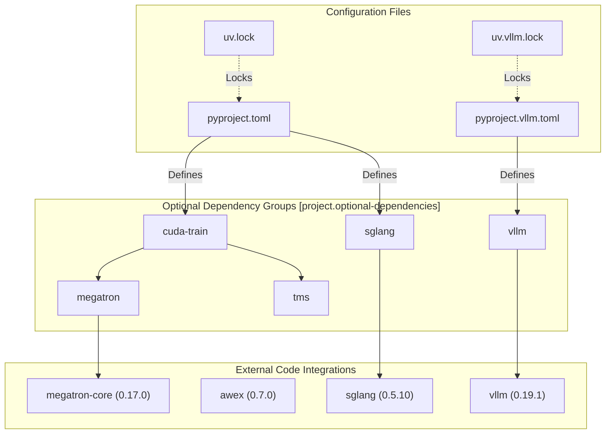
**Sources:** [pyproject.toml:141-182](), [pyproject.vllm.toml:158-193](), [uv.lock:21-37](), [uv.vllm.lock:21-33]()

---

## Cloud Deployment with SkyPilot

AReaL supports seamless cloud deployment using [SkyPilot](https://github.com/skypilot-org/skypilot). This allows users to launch distributed experiments on GCP, AWS, or K8S with a single command.

### Multi-Node Ray Cluster
SkyPilot can provision a cluster and automatically initialize a Ray environment for AReaL [examples/skypilot/ray_cluster.sky.yaml:17-45]().

**Deployment Logic Flow**
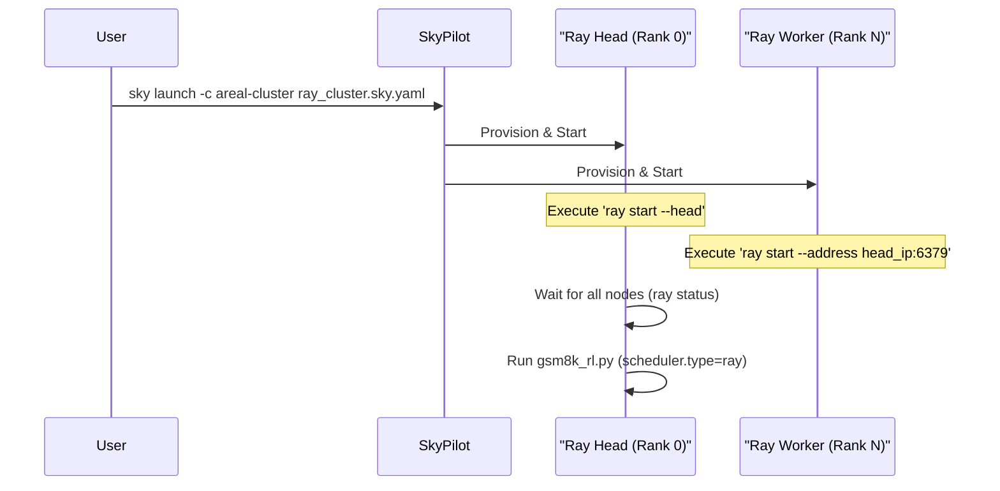

**Sources:** [examples/skypilot/README.md:68-152](), [examples/skypilot/ray_cluster.sky.yaml:1-48]()

---

## NPU Support & Specialized Hardware

While AReaL is primarily optimized for NVIDIA CUDA, it includes experimental support for Huawei NPU (Ascend) devices.

### NPU Configuration
NPU support requires the `cann` (Compute Architecture for Neural Networks) toolkit and specialized versions of PyTorch (Torch-NPU).
*   **Documentation**: Detailed NPU setup is available in [docs/en/tutorial/installation_npu.md]().
*   **Key Differences**: Instead of `flash-attn`, NPUs use the `npu_fusion_attention` implementation provided by the CANN runtime.

**Sources:** [docs/en/tutorial/installation_npu.md](), [pyproject.toml:45-46]()

---

## Advanced: Manual Extension Compilation

For non-Docker environments requiring maximum performance (e.g., FP8 training), several C++ extensions must be compiled manually after `uv sync`.

| Extension | Purpose | Command |
| :--- | :--- | :--- |
| **Apex** | Pipelined H2D/D2H, Fused Kernels | `NVCC_APPEND_FLAGS="--threads 4" APEX_PARALLEL_BUILD=8 uv pip install git+https://github.com/NVIDIA/apex.git` |
| **TransformerEngine** | FP8 Training Support | `uv pip install git+https://github.com/NVIDIA/TransformerEngine.git@stable` |
| **DeepEP** | MoE Communication Library | `TORCH_CUDA_ARCH_LIST="9.0" uv pip install git+https://github.com/deepseek-ai/DeepEP` |

**Sources:** [Dockerfile:83-112](), [docs/zh/tutorial/installation.md:179-190]()

---

# Page: Roadmap & Version History

# Roadmap & Version History

<details>
<summary>Relevant source files</summary>

The following files were used as context for generating this wiki page:

- [.github/ISSUE_TEMPLATE/config.yml](.github/ISSUE_TEMPLATE/config.yml)
- [.github/workflows/pre-commit.yml](.github/workflows/pre-commit.yml)
- [AGENTS.md](AGENTS.md)
- [CLAUDE.md](CLAUDE.md)
- [CONTRIBUTING.md](CONTRIBUTING.md)
- [README.md](README.md)
- [ROADMAP.md](ROADMAP.md)
- [areal/api/alloc_mode.py](areal/api/alloc_mode.py)
- [blog/AReaL_v0_2.md](blog/AReaL_v0_2.md)
- [blog/AReaL_v0_3.md](blog/AReaL_v0_3.md)
- [docs/en/_toc.yml](docs/en/_toc.yml)
- [docs/en/reference/tree_training.md](docs/en/reference/tree_training.md)
- [docs/en/tutorial/archon.md](docs/en/tutorial/archon.md)
- [docs/en/tutorial/megatron.md](docs/en/tutorial/megatron.md)
- [docs/en/version_history.md](docs/en/version_history.md)
- [docs/zh/_toc.yml](docs/zh/_toc.yml)
- [docs/zh/reference/tree_training.md](docs/zh/reference/tree_training.md)
- [docs/zh/tutorial/archon.md](docs/zh/tutorial/archon.md)
- [docs/zh/tutorial/megatron.md](docs/zh/tutorial/megatron.md)
- [docs/zh/version_history.md](docs/zh/version_history.md)
- [examples/countdown/README.md](examples/countdown/README.md)
- [examples/tau2/README.md](examples/tau2/README.md)

</details>


This page provides a technical summary of AReaL's evolution, its milestone releases, and the architectural roadmap for the future. AReaL is built on a **fully asynchronous RL training paradigm** [README.md:19-21](), designed to maximize hardware utilization by decoupling generation and training [blog/AReaL_v0_3.md:79-83]().

## Version History

AReaL follows a quarterly major release cycle and bi-weekly minor releases [ROADMAP.md:189-191]().

### v0.1: Initial Release (Feb 2025)
The foundational release focused on reproducible results for 1.5B and 7B Large Reasoning Models (LRMs) [README.md:114-117]().
*   **Key Features**: Initial asynchronous infrastructure, basic PPO/GRPO support, and math reasoning datasets.

### v0.2: "Boba" Release (Mar 2025)
Significant performance optimizations and state-of-the-art (SOTA) model weights [README.md:109-113]().
*   **SGLang Integration**: Replaced vLLM 0.6.3 with SGLang v0.4.0 as the generation backend, utilizing **Radix Attention** for 1.5x throughput gains [blog/AReaL_v0_2.md:13-15, 60-64]().
*   **Variable-Length Packing**: Implemented 1D sequence packing to eliminate padding waste in variable-length LRM outputs [blog/AReaL_v0_2.md:69-75]().
*   **GDRDMA Support**: Optimized NCCL with GPU-Direct RDMA for 1K-GPU scaling [blog/AReaL_v0_2.md:77-83]().

### v0.3: "Boba²" Release (Jun 2025)
A major architectural milestone introducing fully asynchronous system-algorithm co-design [README.md:102-107]().
*   **2.77x Speedup**: Achieved by decoupling generation and training across separate GPU clusters [blog/AReaL_v0_3.md:9-12, 79-83]().
*   **Interruptible Rollout**: Introduction of `update_weights` requests that can interrupt ongoing generations, allowing for in-flight parameter updates [blog/AReaL_v0_3.md:91-99]().
*   **Multi-Turn Agentic RL**: Experimental support for agentic workflows, such as tool-use and reasoning loops [blog/AReaL_v0_3.md:13-14]().

### AReaL-lite (Jul 2025)
A lightweight, algorithm-first version with 80% fewer lines of code, maintaining core asynchronous functionality [README.md:93-100]().

### Recent Milestones (Late 2025 - Early 2026)
*   **Ascend NPU Support**: Stable training support for Huawei Ascend hardware via the `ascend` branch [README.md:82-87]().
*   **Archon Engine**: A new PyTorch-native backend supporting 5D parallelism (DP/TP/PP/CP/EP) [ROADMAP.md:77, areal/api/alloc_mode.py:32-60]().
*   **AReaL-SEA**: A self-evolving data synthesis engine for large-scale MoE models [README.md:68-74]().

---

## Architectural Evolution

The core shift in AReaL's history was moving from synchronous batched generation to a decoupled, asynchronous microservice architecture.

### Asynchronous System Components
The system transitioned to four core components to solve the inference-underutilization problem [blog/AReaL_v0_3.md:47-52, 82-88]().

| Component | Role in v0.3 Architecture |
| :--- | :--- |
| `RolloutWorker` | Handles `generate` and `update_weights` requests; supports KV-cache flushing [blog/AReaL_v0_3.md:91-99](). |
| `RewardService` | Independent service for verifiable reward computation (e.g., unit tests) [blog/AReaL_v0_3.md:101-103](). |
| `TrainerWorker` | Continuously samples from replay buffer and performs PPO updates [blog/AReaL_v0_3.md:105-108](). |
| `RolloutController` | Orchestrates data flow between rollout, reward, and trainer components [blog/AReaL_v0_3.md:110-116](). |

### Data Flow and Code Entity Mapping

The following diagram bridges the high-level asynchronous logic with specific code entities used in the implementation.

**Diagram: Asynchronous Training Data Flow**
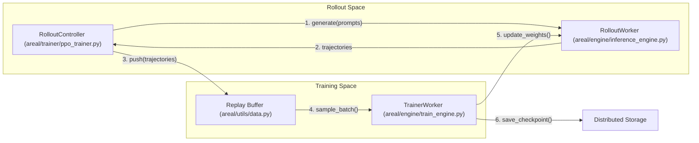
*Sources: [blog/AReaL_v0_3.md:85-117](), [areal/api/cli_args.py:49-53]()*

---

## 2026 Q1 Roadmap

The current development focus (due April 30, 2026) centers on the **Archon backend** and **Agentic RL** scalability [ROADMAP.md:10-12]().

### Backend Enhancements
*   **Zero-Bubble Pipeline Parallelism (ZBPP)**: Implementation of ZBPP and ZBPP-V for the Archon backend [ROADMAP.md:25]().
*   **FP8 Training**: Native FP8 support for the Archon engine to match Megatron-Core capabilities [ROADMAP.md:26]().
*   **LoRA Support**: Bringing Low-Rank Adaptation to the Archon backend [ROADMAP.md:34]().
*   **Weight Sync Optimization**: Utilizing `awex` as a high-performance weight synchronization engine for colocation modes [ROADMAP.md:35]().

### Usability & Infrastructure
*   **Module Refactoring**: Flattening the import structure of `areal` modules for better developer experience [ROADMAP.md:45]().
*   **Online RL Proxy**: Supporting RL training via a proxy server for black-box agent applications [ROADMAP.md:33, README.md:31-34]().
*   **Elastic Updates**: Acceleration of weight updates to minimize interruption overhead during asynchronous rollout [ROADMAP.md:38]().

### Feature Comparison by Backend

AReaL supports multiple training backends, each with a different roadmap status.

| Feature | FSDP2 Engine | Megatron Engine | Archon Engine |
| :--- | :--- | :--- | :--- |
| **Status** | Stable | Stable | Experimental/Active |
| **Parallelism** | DP, TP, CP (Ulysses) | DP, TP, PP, CP, EP | DP, TP, PP, CP, EP, ETP |
| **FP8 Support** | No | Yes | **Planned (Q1)** |
| **LoRA Support** | Yes | Yes | **Planned (Q1)** |
| **Tree Training** | Yes | Yes | Yes |

*Sources: [areal/api/alloc_mode.py:32-60](), [ROADMAP.md:21-40](), [blog/AReaL_v0_2.md:131-132]()*

---

## 5D Parallelism Strategy

The roadmap for the **Archon** engine includes a unified 5D parallelism strategy defined in `ParallelStrategy` [areal/api/alloc_mode.py:33-60]().

**Diagram: Parallelism Dimension Mapping**
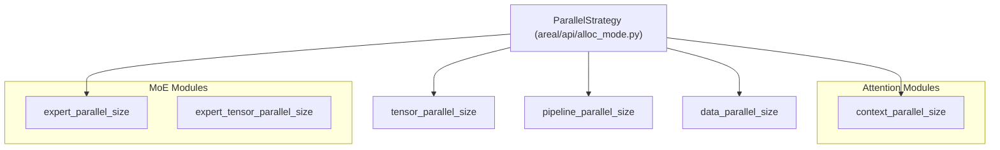
*Sources: [areal/api/alloc_mode.py:62-91]()*

This strategy allows AReaL to scale from single-node setups to 1000+ GPU clusters by configuring the `ParallelStrategy` dataclass within the `TrainEngineConfig` [areal/api/alloc_mode.py:152-160]().

---

# Page: Core Architecture

# Core Architecture

<details>
<summary>Relevant source files</summary>

The following files were used as context for generating this wiki page:

- [.github/ISSUE_TEMPLATE/config.yml](.github/ISSUE_TEMPLATE/config.yml)
- [.github/workflows/pre-commit.yml](.github/workflows/pre-commit.yml)
- [AGENTS.md](AGENTS.md)
- [CLAUDE.md](CLAUDE.md)
- [CONTRIBUTING.md](CONTRIBUTING.md)
- [README.md](README.md)
- [ROADMAP.md](ROADMAP.md)
- [areal/api/alloc_mode.py](areal/api/alloc_mode.py)
- [areal/api/cli_args.py](areal/api/cli_args.py)
- [areal/engine/fsdp_engine.py](areal/engine/fsdp_engine.py)
- [areal/engine/megatron_engine.py](areal/engine/megatron_engine.py)
- [areal/experimental/engine/archon_engine.py](areal/experimental/engine/archon_engine.py)
- [blog/AReaL_v0_2.md](blog/AReaL_v0_2.md)
- [blog/AReaL_v0_3.md](blog/AReaL_v0_3.md)
- [docs/en/cli_reference.md](docs/en/cli_reference.md)
- [docs/en/version_history.md](docs/en/version_history.md)
- [docs/zh/cli_reference.md](docs/zh/cli_reference.md)
- [docs/zh/version_history.md](docs/zh/version_history.md)
- [examples/countdown/README.md](examples/countdown/README.md)
- [examples/tau2/README.md](examples/tau2/README.md)

</details>


AReaL is designed as a high-performance, fully asynchronous reinforcement learning system optimized for large-scale foundation model alignment. Unlike traditional synchronous RL frameworks where generation and training happen sequentially, AReaL decouples these processes into independent, concurrent services. This architecture eliminates hardware underutilization caused by variable-length sequence generation and enables industry-leading scalability across thousands of GPUs.

Sources: [README.md:15-21](), [blog/AReaL_v0_3.md:79-87]()

## The Four-Component Model

The system architecture is structured into four primary functional components that interact asynchronously to maintain high throughput.

### 1. Rollout Workers
These workers host the policy model using high-performance inference engines like SGLang or vLLM. They handle `generate` requests from the controller and `update_weights` requests from the trainers. A key feature is the **Interruptible Rollout**, where workers can update model weights in-flight, re-computing KV caches to ensure trajectories remain as on-policy as possible.
- **Code Entities**: `InferenceEngine` [areal/api/cli_args.py:452-453](), `SGLangEngine`, `vLLMEngine`.
- **For details, see [Inference Engines & Rollout](#4)**.

### 2. Reward Service
An asynchronous service that evaluates generated responses. For verifiable rewards (e.g., math or coding), it executes unit tests or symbolic solvers to provide ground-truth feedback.
- **Code Entities**: `AsyncRewardWrapper`, `reward_fn`.
- **For details, see [Datasets & Rewards](#7)**.

### 3. Trainer Workers
These workers run the training backend (FSDP2, Megatron-Core, or Archon). They consume completed trajectories from the data service, compute gradients, update model parameters, and trigger weight synchronization across the cluster.
- **Code Entities**: `TrainEngine` [areal/api/cli_args.py:417-418](), `FSDPEngine` [areal/engine/fsdp_engine.py:219-220](), `MegatronEngine` [areal/engine/megatron_engine.py:168-169]().
- **For details, see [Training Engines](#3)**.

### 4. Rollout Controller
The orchestrator that manages the lifecycle of an RL episode. It fetches prompts from the dataset, dispatches them to Rollout Workers, routes responses to the Reward Service, and pushes the final trajectories into the replay buffer for the Trainers.
- **Code Entities**: `DistRolloutCoordinator` [areal/infra/dist_rollout.py:1-20](), `RolloutWorkflow`.
- **For details, see [Rollout Controller & Staleness Management](#4.2)**.

Sources: [blog/AReaL_v0_3.md:89-117](), [AGENTS.md:61-72]()

## Asynchronous Execution & Data Flow

The following diagram illustrates the transition from high-level RL concepts to the specific code entities that implement the asynchronous data flow.

**Diagram: System Component Interaction**
```mermaid
graph TD
    subgraph "Control Plane"
        [RolloutController] -- "dispatch prompts" --> [InferenceEngine]
        [RolloutController] -- "request reward" --> [RewardService]
    end

    subgraph "Data Plane"
        [InferenceEngine] -- "trajectories (RTensor)" --> [DataController]
        [RewardService] -- "scores" --> [DataController]
        [DataController] -- "shuffled batches" --> [TrainEngine]
    end

    subgraph "Synchronization"
        [TrainEngine] -- "WeightUpdateMeta" --> [InferenceEngine]
    end

    [InferenceEngine] --> |"SGLang/vLLM"| [Rollout_Worker_Proc]
    [TrainEngine] --> |"FSDP2/MCore"| [Trainer_Worker_Proc]
    [DataController] --> |"RDataset"| [Shared_Replay_Buffer]
```
Sources: [blog/AReaL_v0_3.md:85-87](), [areal/api/cli_args.py:417-453](), [areal/infra/dist_rollout.py:1-20]()

## Subsystem Interaction Map

The architecture relies on several underlying infrastructure layers to handle the complexities of distributed execution.

| Subsystem | Responsibility | Key Code Entities |
| :--- | :--- | :--- |
| **Configuration** | Centralized experiment and hardware specs. | `TrainEngineConfig`, `PPOActorConfig` |
| **Distributed** | Process lifecycle and RPC management. | `Scheduler`, `RPCGuard`, `LocalScheduler` |
| **Data Service** | High-speed tensor movement (RTensor). | `DataWorker`, `Router`, `Gateway` |
| **Engines** | Compute-heavy training/inference logic. | `FSDPEngine`, `MegatronEngine`, `ArchonEngine` |

**Diagram: Infrastructure to Code Mapping**
```mermaid
graph LR
    subgraph "areal.infra"
        [Scheduler] --> [LocalScheduler]
        [Scheduler] --> [RayScheduler]
        [Scheduler] --> [SlurmScheduler]
    end

    subgraph "areal.api.cli_args"
        [Config] --> [TrainEngineConfig]
        [Config] --> [ParallelStrategy]
    end

    subgraph "areal.engine"
        [TrainEngine] --> [FSDPEngine]
        [TrainEngine] --> [MegatronEngine]
        [InferenceEngine] --> [SGLangEngine]
    end

    [LocalScheduler] -- "spawns" --> [FSDPEngine]
    [TrainEngineConfig] -- "configures" --> [TrainEngine]
```
Sources: [areal/api/cli_args.py:300-1000](), [AGENTS.md:58-72](), [CLAUDE.md:10-24]()

## Deep Dives

For detailed technical specifications of the core subsystems, refer to the following child pages:

*   **[Configuration System (cli_args)](#2.1)**: Explains the allocation DSL (e.g., `fsdp:d4t2`) and how YAML configs map to `TrainEngineConfig` and `PPOActorConfig`.
*   **[Distributed Infrastructure (Scheduler & RPC)](#2.2)**: Details the `Scheduler` abstraction for Local, Ray, and Slurm environments, and the `RPC Guard` for worker communication.
*   **[RTensor & Data Service](#2.3)**: Describes the `RTensor` abstraction and the high-performance `DataController` used for moving trajectories between workers.

Sources: [areal/api/cli_args.py:1-100](), [AGENTS.md:109-124]()

---

# Page: Configuration System (cli_args)

# Configuration System (cli_args)

<details>
<summary>Relevant source files</summary>

The following files were used as context for generating this wiki page:

- [.github/ISSUE_TEMPLATE/config.yml](.github/ISSUE_TEMPLATE/config.yml)
- [areal/api/alloc_mode.py](areal/api/alloc_mode.py)
- [areal/api/cli_args.py](areal/api/cli_args.py)
- [areal/engine/fsdp_engine.py](areal/engine/fsdp_engine.py)
- [areal/engine/megatron_engine.py](areal/engine/megatron_engine.py)
- [areal/experimental/engine/archon_engine.py](areal/experimental/engine/archon_engine.py)
- [blog/AReaL_v0_3.md](blog/AReaL_v0_3.md)
- [docs/en/cli_reference.md](docs/en/cli_reference.md)
- [docs/en/version_history.md](docs/en/version_history.md)
- [docs/generate_cli_docs.py](docs/generate_cli_docs.py)
- [docs/zh/cli_reference.md](docs/zh/cli_reference.md)
- [docs/zh/version_history.md](docs/zh/version_history.md)
- [examples/countdown/README.md](examples/countdown/README.md)
- [examples/countdown/train_config.yaml](examples/countdown/train_config.yaml)
- [examples/math/gsm8k_grpo.yaml](examples/math/gsm8k_grpo.yaml)
- [examples/math/gsm8k_rloo.yaml](examples/math/gsm8k_rloo.yaml)
- [examples/math/gsm8k_sft.yaml](examples/math/gsm8k_sft.yaml)
- [examples/tau2/README.md](examples/tau2/README.md)
- [examples/tir/tir_math_config.yaml](examples/tir/tir_math_config.yaml)
- [examples/vlm/clevr_count_70k_grpo.yaml](examples/vlm/clevr_count_70k_grpo.yaml)
- [examples/vlm/clevr_count_70k_sft.yaml](examples/vlm/clevr_count_70k_sft.yaml)
- [tests/test_trackio_backend.py](tests/test_trackio_backend.py)

</details>


AReaL utilizes a centralized configuration system built on Python `dataclasses` and `OmegaConf` (Hydra). This system provides a strongly-typed interface for defining RL experiments, training engines, and distributed resource allocation. Configurations can be defined in YAML files and overridden via the command line.

## Core Configuration Structure

The configuration system is anchored in `areal/api/cli_args.py`. It transforms raw YAML dictionaries into structured objects, ensuring type safety and validation at initialization.

### Configuration Mapping Flow
1.  **YAML Input**: User provides an experiment YAML (e.g., `examples/math/gsm8k_grpo.yaml`).
2.  **Hydra Compose**: `cli_args.py` uses `hydra_compose` to merge YAML files and CLI overrides [[areal/api/cli_args.py:14-17]]().
3.  **Dataclass Instantiation**: The resulting `DictConfig` is used to populate root configuration classes like `PPOConfig`, `GRPOConfig`, or `SFTConfig` [[areal/api/cli_args.py:1008-1030]]().
4.  **Engine Dispatch**: Configuration objects are passed to training engines (e.g., `FSDPEngine`, `MegatronEngine`) which use them to initialize model sharding and optimizers [[areal/engine/fsdp_engine.py:220-223]](), [[areal/engine/megatron_engine.py:169-173]]().

### System Entity Mapping
The following diagram bridges the YAML configuration keys to the internal Python dataclasses.

**Configuration Entity Map**
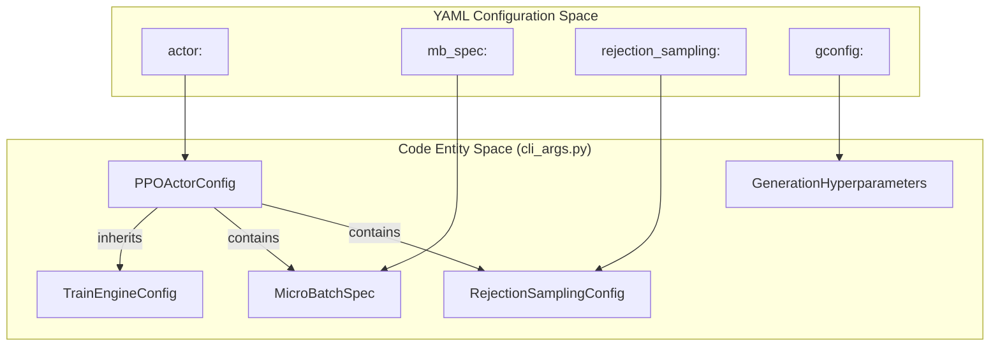
Sources: [[areal/api/cli_args.py:99-139]](), [[areal/api/cli_args.py:163-228]](), [[areal/api/cli_args.py:465-492]](), [[areal/api/cli_args.py:643-730]]().

---

## Key Dataclasses

### TrainEngineConfig
The base configuration for any training backend. It specifies the model path, data types, and core engine settings.
*   **`path`**: HF model path or local directory [[areal/api/cli_args.py:469]]().
*   **`dtype`**: Computation precision (e.g., `bfloat16`, `float32`) [[areal/api/cli_args.py:476]]().
*   **`backend`**: The engine to use (e.g., `fsdp`, `megatron`, `archon`) [[areal/api/cli_args.py:467]]().

### PPOActorConfig
Extends `TrainEngineConfig` with RL-specific parameters for the Policy model.
*   **`kl_ctl`**: Coefficient for KL divergence penalty [[areal/api/cli_args.py:683]]().
*   **`eps_clip`**: PPO clipping parameter [[areal/api/cli_args.py:676]]().
*   **`recompute_logprob`**: Enables recomputing log probabilities during the update to save memory [[areal/api/cli_args.py:700]]().

### MicroBatchSpec
Controls how training batches are partitioned to fit into GPU memory.
*   **`max_tokens_per_mb`**: Limits the number of tokens in a single forward/backward pass [[areal/api/cli_args.py:114]]().
*   **`packing_algorithm`**: Selection between `ffd` (First Fit Decreasing) and `kk` (Karmarkar-Karp) for balancing sequence lengths across ranks [[areal/api/cli_args.py:126-138]]().

### RejectionSamplingConfig
Used in algorithms like GRPO or PPO with rejection to filter trajectories.
*   **`metric`**: The metric used for filtering (e.g., `reward`, `ratio`) [[areal/api/cli_args.py:440]]().
*   **`upper` / `lower`**: Bounds for the acceptance threshold [[areal/api/cli_args.py:444-447]]().

Sources: [[areal/api/cli_args.py:99-139]](), [[areal/api/cli_args.py:433-462]](), [[areal/api/cli_args.py:465-515]](), [[areal/api/cli_args.py:643-730]]().

---

## Allocation DSL (The 'backend' String)

AReaL uses a Domain Specific Language (DSL) within the `backend` field to define parallelism strategies. This allows users to specify complex distributed setups in a single string (e.g., `fsdp:d4t2`).

### Syntax Components
The string follows the pattern `engine:strategy`.

| Symbol | Parallelism Dimension | Description |
| :--- | :--- | :--- |
| `d` | Data Parallel (DP) | Number of model replicas. |
| `t` | Tensor Parallel (TP) | Number of shards for individual tensors. |
| `p` | Pipeline Parallel (PP) | Number of stages across layers. |
| `c` | Context Parallel (CP) | Sequence length sharding for long-context. |
| `e` | Expert Parallel (EP) | Sharding of MoE experts. |

### DSL Parsing and Logic
The `ParallelStrategy` class in `areal/api/alloc_mode.py` parses these strings into integer dimensions used to initialize `DeviceMesh` and `ProcessGroup` [[areal/api/alloc_mode.py:33-60]]().

**Allocation Strategy Flow**
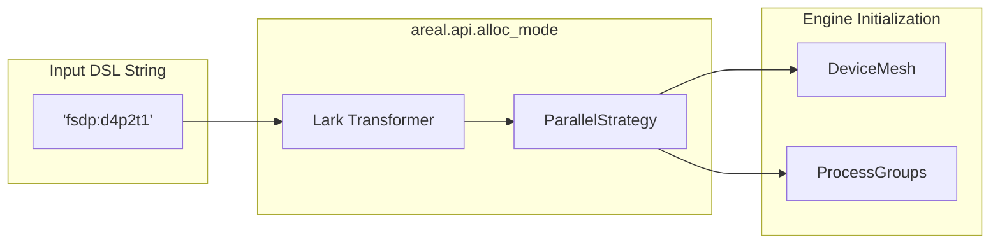
Sources: [[areal/api/alloc_mode.py:33-161]](), [[areal/engine/fsdp_engine.py:87]](), [[areal/engine/megatron_engine.py:91]]().

---

## Implementation Details

### Validation Logic
Dataclasses implement `__post_init__` to perform runtime validation. For example, `NormConfig` ensures that `group_size` is positive if group-level normalization is selected [[areal/api/cli_args.py:79-96]](). `MicroBatchSpec` validates that the chosen `packing_algorithm` exists in the `PACKING_ALGORITHMS` registry [[areal/api/cli_args.py:140-146]]().

### Tree Training Support
The configuration includes `enable_tree_training`, which triggers the construction of `TrieNode` structures and specialized attention kernels to share prefix computations across multiple samples in a group [[areal/api/cli_args.py:488]](), [[areal/engine/fsdp_engine.py:103-107]]().

Sources: [[areal/api/cli_args.py:79-96]](), [[areal/api/cli_args.py:140-146]](), [[areal/api/cli_args.py:488]](), [[areal/engine/fsdp_engine.py:103-107]]().

---

# Page: Distributed Infrastructure (Scheduler & RPC)

# Distributed Infrastructure (Scheduler & RPC)

<details>
<summary>Relevant source files</summary>

The following files were used as context for generating this wiki page:

- [areal/api/scheduler_api.py](areal/api/scheduler_api.py)
- [areal/infra/__init__.py](areal/infra/__init__.py)
- [areal/infra/launcher/__init__.py](areal/infra/launcher/__init__.py)
- [areal/infra/launcher/local.py](areal/infra/launcher/local.py)
- [areal/infra/launcher/ray.py](areal/infra/launcher/ray.py)
- [areal/infra/launcher/slurm.py](areal/infra/launcher/slurm.py)
- [areal/infra/launcher/vllm_server.py](areal/infra/launcher/vllm_server.py)
- [areal/infra/rpc/ray_rpc_server.py](areal/infra/rpc/ray_rpc_server.py)
- [areal/infra/rpc/rpc_server.py](areal/infra/rpc/rpc_server.py)
- [areal/infra/rpc/serialization.py](areal/infra/rpc/serialization.py)
- [areal/infra/scheduler/local.py](areal/infra/scheduler/local.py)
- [areal/infra/scheduler/ray.py](areal/infra/scheduler/ray.py)
- [areal/infra/scheduler/slurm.py](areal/infra/scheduler/slurm.py)
- [areal/infra/utils/ray.py](areal/infra/utils/ray.py)
- [areal/utils/network.py](areal/utils/network.py)
- [tests/test_local_scheduler.py](tests/test_local_scheduler.py)
- [tests/test_rollout_controller.py](tests/test_rollout_controller.py)
- [tests/test_serialization.py](tests/test_serialization.py)
- [tests/test_train_controller.py](tests/test_train_controller.py)

</details>


AReaL utilizes a modular distributed infrastructure to manage worker lifecycles, resource allocation, and remote procedure calls (RPC). This system abstracts the underlying cluster manager (Local, Ray, or Slurm) through a unified `Scheduler` interface, allowing the same RL training code to run seamlessly across different environments.

## Scheduler Abstraction

The `Scheduler` class [areal/api/scheduler_api.py:43-49]() is an abstract base class that defines how AReaL interacts with compute resources. It manages `Worker` objects, which represent individual processes with associated IP addresses and ports [areal/api/scheduler_api.py:14-33]().

### Key Scheduler Implementations

| Implementation | Class | Description |
| :--- | :--- | :--- |
| **Local** | `LocalScheduler` | Spawns subprocesses on a single machine using `subprocess.Popen` [areal/infra/scheduler/local.py:92-98](). |
| **Ray** | `RayScheduler` | Orchestrates `RayRPCServer` actors across a Ray cluster [areal/infra/scheduler/ray.py:58-76](). |
| **Slurm** | `SlurmScheduler` | Submits `sbatch` jobs or runs `srun` commands for multi-node HPC environments [areal/infra/scheduler/slurm.py:72-90](). |

### Worker Lifecycle and Management
Schedulers handle the following lifecycle stages:
1.  **Creation**: `create_workers(job)` starts the physical processes based on a `Job` spec [areal/api/scheduler_api.py:57-82]().
2.  **Discovery**: `get_workers(role)` blocks until workers are ready and returns their network metadata [areal/api/scheduler_api.py:84-112]().
3.  **Engine Instantiation**: `create_engine` dynamically imports and initializes a `TrainEngine` or `InferenceEngine` on the remote worker [areal/api/scheduler_api.py:181-210]().
4.  **Cleanup**: `delete_workers` ensures graceful termination of process trees [areal/api/scheduler_api.py:114-142]().

**Sources:** [areal/api/scheduler_api.py:43-210](), [areal/infra/scheduler/local.py:92-183](), [areal/infra/scheduler/ray.py:58-80](), [areal/infra/scheduler/slurm.py:72-159]()

---

## RPC Infrastructure

AReaL uses a two-tier RPC system: a **Guard Server** (Flask/Werkzeug-based) for Local/Slurm and **Ray Actors** for Ray-based deployments.

### RPC Guard Server
The `SyncRPCServer` [areal/infra/rpc/rpc_server.py:33-66]() is the standard entry point for non-Ray workers. It composes several Blueprints:
*   **Engine Blueprint**: Handles `create_engine` and `call` routes to invoke methods on initialized engines [areal/infra/rpc/rpc_server.py:27-27]().
*   **Data Blueprint**: Manages state and data transfer hooks [areal/infra/rpc/rpc_server.py:26-26]().

### Ray RPC Server
The `RayRPCServer` [areal/infra/rpc/ray_rpc_server.py:23-35]() performs the same role as the Guard Server but within the Ray ecosystem. It manages multiple named engines for colocation and handles `RTensor` localization before calling engine methods [areal/infra/rpc/ray_rpc_server.py:141-156]().

### Code-to-Entity Mapping: RPC Flow
The following diagram illustrates how high-level controller calls translate to low-level RPC server executions.

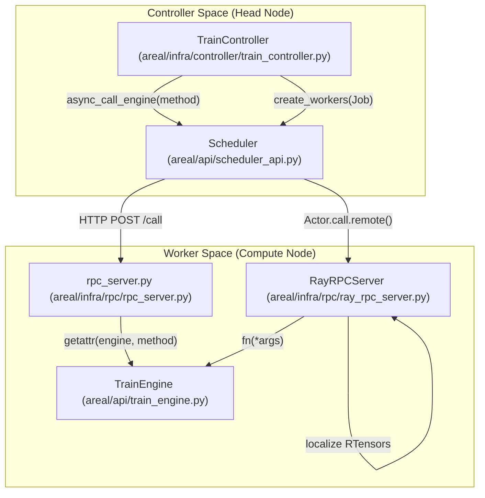
**Sources:** [areal/infra/rpc/rpc_server.py:33-62](), [areal/infra/rpc/ray_rpc_server.py:23-156](), [areal/infra/controller/train_controller.py:76-98]()

---

## Resource & Port Management

Distributed training requires precise coordination of network ports for NCCL, HTTP RPC, and data services.

### Port Allocation Strategy
Schedulers use `find_free_ports` [areal/utils/network.py:114-176]() to identify available ports in the range (10000, 32767) [areal/utils/network.py:138-138]().
*   **Worker Ports**: Used for the RPC Guard server communication.
*   **Engine Ports**: Reserved for backend-specific communication (e.g., NCCL `MASTER_PORT`).

### Colocation and Forking
AReaL supports **Colocation** where multiple engines (e.g., an Actor and a Critic) share the same physical worker process to save memory and reduce communication overhead.
*   **Forking**: `fork_workers` [areal/api/scheduler_api.py:145-180]() allows creating new roles (like a proxy) on the same nodes as existing workers.
*   **Ray Placement Groups**: `RayScheduler` uses `PlacementGroup` [areal/infra/scheduler/ray.py:179-185]() to ensure workers are physically colocated on the same node when required by the `SchedulingStrategy` [areal/api/scheduler_api.py:40-40]().

**Sources:** [areal/utils/network.py:114-176](), [areal/api/scheduler_api.py:14-40](), [areal/infra/scheduler/ray.py:170-190]()

---

## Serialization (RTensor & Dataclasses)

To move complex Python objects across the network, AReaL provides a robust serialization layer in `areal.infra.rpc.serialization`.

### Supported Types
| Type | Serialization Mechanism |
| :--- | :--- |
| **PyTorch Tensor** | Converted to Base64 with metadata (shape, dtype) [areal/infra/rpc/serialization.py:69-111](). |
| **NumPy Array** | Base64 encoding of contiguous buffers [areal/infra/rpc/serialization.py:198-209](). |
| **Dataclass** | Recursively serialized into dictionaries preserving class paths [areal/infra/rpc/serialization.py:25-26](). |
| **PIL Image** | Serialized for VLM rollout tasks [areal/infra/rpc/serialization.py:221-228](). |

### Serialization Architecture
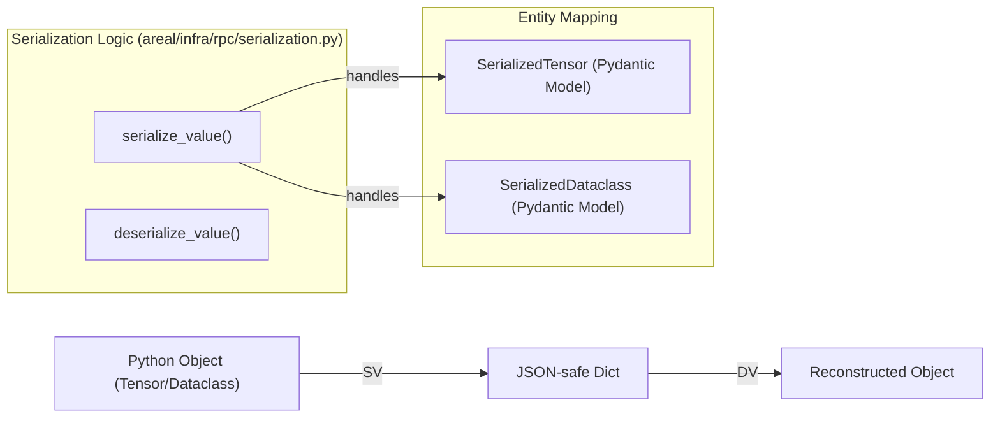
**Sources:** [areal/infra/rpc/serialization.py:49-228](), [tests/test_serialization.py:25-179]()

---

## Name Resolution

Distributed components find each other using the `name_resolve` utility [areal/utils/name_resolve.py]().
*   **NFS Backend**: Writes JSON files to a shared filesystem (e.g., `/tmp/areal/name_resolve`) to store worker IPs and ports [areal/infra/scheduler/local.py:130-134]().
*   **Etcd Backend**: (Optional) Uses `etcd3` for high-availability name resolution in large clusters [areal/infra/scheduler/slurm.py:112-116]().

When a `LocalScheduler` or `SlurmScheduler` initializes, it clears the `trial_root` to ensure stale worker addresses from previous runs are removed [areal/infra/scheduler/local.py:147-151](), [areal/infra/scheduler/slurm.py:129-133]().

**Sources:** [areal/infra/scheduler/local.py:130-151](), [areal/infra/scheduler/slurm.py:112-133]()

---

# Page: RTensor & Data Service

# RTensor & Data Service

<details>
<summary>Relevant source files</summary>

The following files were used as context for generating this wiki page:

- [areal/infra/controller/train_controller.py](areal/infra/controller/train_controller.py)
- [areal/infra/data_service/controller/config.py](areal/infra/data_service/controller/config.py)
- [areal/infra/data_service/controller/controller.py](areal/infra/data_service/controller/controller.py)
- [areal/infra/data_service/gateway/app.py](areal/infra/data_service/gateway/app.py)
- [areal/infra/data_service/rdataset.py](areal/infra/data_service/rdataset.py)
- [areal/infra/data_service/router/app.py](areal/infra/data_service/router/app.py)
- [areal/infra/data_service/types.py](areal/infra/data_service/types.py)
- [areal/infra/data_service/worker/__main__.py](areal/infra/data_service/worker/__main__.py)
- [areal/infra/data_service/worker/app.py](areal/infra/data_service/worker/app.py)
- [areal/infra/data_service/worker/config.py](areal/infra/data_service/worker/config.py)
- [areal/infra/rpc/guard/data_blueprint.py](areal/infra/rpc/guard/data_blueprint.py)
- [areal/infra/rpc/guard/engine_blueprint.py](areal/infra/rpc/guard/engine_blueprint.py)
- [areal/infra/rpc/rtensor.py](areal/infra/rpc/rtensor.py)
- [areal/trainer/dpo_trainer.py](areal/trainer/dpo_trainer.py)
- [areal/trainer/rl_trainer.py](areal/trainer/rl_trainer.py)
- [areal/trainer/rw_trainer.py](areal/trainer/rw_trainer.py)
- [areal/trainer/sft_trainer.py](areal/trainer/sft_trainer.py)
- [tests/experimental/inference_service/test_data_proxy_rtensor.py](tests/experimental/inference_service/test_data_proxy_rtensor.py)
- [tests/infra/data_service/test_worker.py](tests/infra/data_service/test_worker.py)
- [tests/infra/rpc/__init__.py](tests/infra/rpc/__init__.py)
- [tests/infra/rpc/test_engine_validation.py](tests/infra/rpc/test_engine_validation.py)
- [tests/test_inference_engines.py](tests/test_inference_engines.py)
- [tests/test_rtensor.py](tests/test_rtensor.py)
- [tests/test_train_engine.py](tests/test_train_engine.py)

</details>


The **Data Service** is AReaL's distributed infrastructure for moving tensors and dataset samples across heterogeneous process groups. It centers around the **RTensor (Remote Tensor)** abstraction, which allows processes to exchange metadata about tensors without immediately transferring the underlying data, and a tiered microservice architecture for scalable data loading.

## RTensor: Remote Tensor Abstraction

An `RTensor` is a handle to a tensor stored on a remote node. It contains the tensor's metadata (shape, dtype) and a `TensorShardInfo` object that points to its physical location [areal/infra/rpc/rtensor.py:70-82]().

### Core Components
*   **RTensor**: The user-facing class that mimics `torch.Tensor` properties but delegates data retrieval to a backend [areal/infra/rpc/rtensor.py:321-325]().
*   **RTensorBackend**: A protocol defining `fetch`, `store`, and `delete` operations [areal/infra/rpc/rtensor.py:25-67]().
*   **HttpRTensorBackend**: The default implementation using asynchronous HTTP calls to move tensors between nodes [areal/infra/rpc/rtensor.py:88-92]().

### Data Flow: Remotize and Localize
Tensors are moved through a "Remotize-Localize" roundtrip:
1.  **Remotize**: A local tensor is stored in a local memory cache (the `RTensorStorage`), and an `RTensor` handle is created with the local node's address [areal/infra/rpc/rtensor.py:461-482]().
2.  **Transmission**: The `RTensor` handle (a small JSON-serializable object) is sent via RPC to a remote worker.
3.  **Localize**: The remote worker calls `to_local()`, which triggers the `RTensorBackend` to fetch the actual bytes via HTTP from the source node [areal/infra/rpc/rtensor.py:414-428]().

**RTensor Lifecycle Diagram**
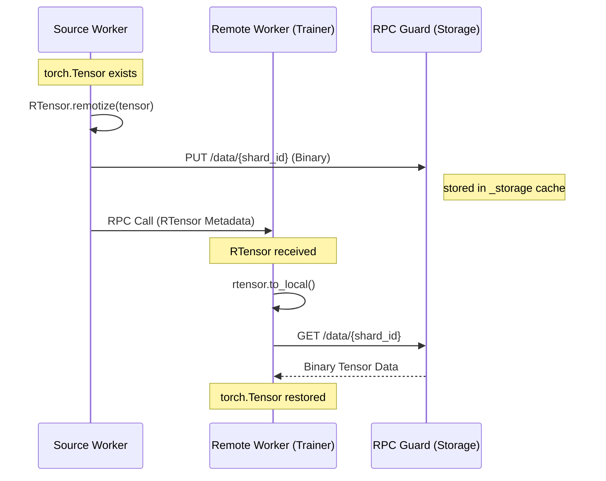
Sources: `[areal/infra/rpc/rtensor.py:414-482]()`, `[areal/infra/rpc/guard/data_blueprint.py:58-105]()`

---

## Distributed Data Service

The Data Service provides a scalable alternative to local `DataLoader` instances, especially useful when the trainer and the data source (e.g., Rollout Workers) are on different clusters or when the dataset is too large for a single node.

### Architecture
The service consists of four main components orchestrated by the `DataController` [areal/infra/data_service/controller/controller.py:35-40]():

| Component | Role | Code Entity |
| :--- | :--- | :--- |
| **Controller** | Orchestrates lifecycle; forks workers and routers. | `DataController` |
| **Gateway** | Entry point for clients; provides unified API. | `DataGateway` |
| **Router** | Routes requests to specific DataWorkers based on dataset ID. | `DataRouter` |
| **Worker** | Manages actual `torch.utils.data.DataLoader` instances. | `DataWorker` |

### System Mapping: Code Entities to Roles
The following diagram maps the logical data flow to specific classes and API routes.

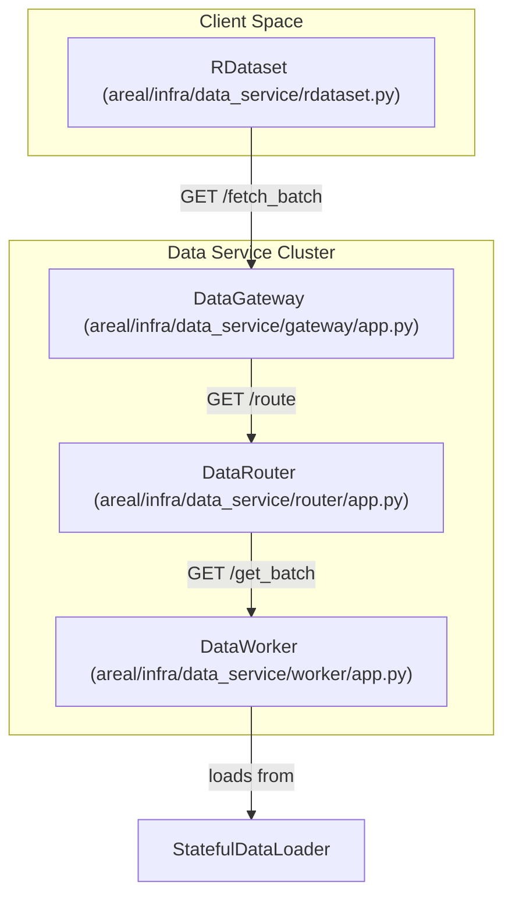
Sources: `[areal/infra/data_service/controller/controller.py:197-230]()`, `[areal/infra/data_service/rdataset.py:31-50]()`

---

## RDataset Interface

`RDataset` is a proxy class that implements the standard dataset interface but fetches samples from the distributed Data Service instead of local disk [areal/infra/data_service/rdataset.py:31-40]().

### Connection and Loading
When a trainer (e.g., `PPOTrainer` or `SFTTrainer`) detects an `RDataset`, it initializes a `DataController` to launch the backend services [areal/trainer/sft_trainer.py:82-97](). The `RDataset` then "connects" to the gateway.

```python
# Example of RDataset usage in Trainer
if isinstance(train_dataset, RDataset):
    controller = DataController(ds_cfg, self.scheduler)
    controller.initialize(role="data", num_dataset_workers=ds_cfg.num_workers)
    
    train_dataset.connect(
        controller,
        dataset_id="experiment_train",
        tokenizer_or_processor_path=config.tokenizer_path
    )
```
Sources: `[areal/trainer/sft_trainer.py:82-97]()`, `[areal/infra/data_service/rdataset.py:82-105]()`

### Pipelined Initialization
The `DataController` uses a tiered forking strategy to ensure the service is ready before training starts:
1.  **RPC Guards**: Launched via the `Scheduler` [areal/infra/data_service/controller/controller.py:170-181]().
2.  **Workers & Router**: Forked as sub-processes on the Guards [areal/infra/data_service/controller/controller.py:197-216]().
3.  **Gateway**: Forked last once workers are healthy [areal/infra/data_service/controller/controller.py:218-230]().

---

## Data Transfer Implementation (RPC Guard)

The `RPC Guard` is the underlying host for these services. It provides two critical Flask Blueprints for tensor movement:

### Data Blueprint (`/data/*`)
Handles the physical storage of tensors in memory.
*   `PUT /data/<shard_id>`: Serializes and stores a tensor [areal/infra/rpc/guard/data_blueprint.py:58-71]().
*   `GET /data/<shard_id>`: Retrieves a tensor [areal/infra/rpc/guard/data_blueprint.py:78-100]().
*   `POST /data/batch`: Retrieves multiple shards in one roundtrip to minimize latency [areal/infra/rpc/guard/data_blueprint.py:107-130]().

### Engine Blueprint (`/call`)
Used to invoke methods on remote engines (like `train_batch` or `generate`). It handles the deserialization of `RTensor` arguments automatically before the engine sees them [areal/infra/rpc/guard/engine_blueprint.py:63-68]().

**Entity Association Diagram**
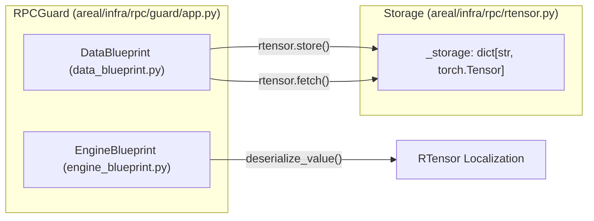
Sources: `[areal/infra/rpc/guard/data_blueprint.py:68-84]()`, `[areal/infra/rpc/guard/engine_blueprint.py:136-143]()`

---
**Sources:**
*   `areal/infra/rpc/rtensor.py`
*   `areal/infra/data_service/controller/controller.py`
*   `areal/infra/data_service/rdataset.py`
*   `areal/infra/rpc/guard/data_blueprint.py`
*   `areal/infra/rpc/guard/engine_blueprint.py`
*   `areal/trainer/sft_trainer.py`
*   `areal/trainer/rl_trainer.py`

---

# Page: Training Engines

# Training Engines

<details>
<summary>Relevant source files</summary>

The following files were used as context for generating this wiki page:

- [.github/workflows/pre-commit.yml](.github/workflows/pre-commit.yml)
- [AGENTS.md](AGENTS.md)
- [CLAUDE.md](CLAUDE.md)
- [CONTRIBUTING.md](CONTRIBUTING.md)
- [README.md](README.md)
- [ROADMAP.md](ROADMAP.md)
- [areal/api/cli_args.py](areal/api/cli_args.py)
- [areal/engine/fsdp_engine.py](areal/engine/fsdp_engine.py)
- [areal/engine/megatron_engine.py](areal/engine/megatron_engine.py)
- [areal/experimental/engine/archon_engine.py](areal/experimental/engine/archon_engine.py)
- [blog/AReaL_v0_2.md](blog/AReaL_v0_2.md)
- [docs/en/cli_reference.md](docs/en/cli_reference.md)
- [docs/zh/cli_reference.md](docs/zh/cli_reference.md)

</details>


AReaL supports multiple training backends designed to scale reinforcement learning for large-scale reasoning and agentic models. All training backends implement the `TrainEngine` interface [areal/api/contracts.py](), providing a unified contract for model initialization, forward/backward passes, optimizer steps, and weight synchronization.

The system selects a training engine based on the `backend` field in the `TrainEngineConfig` [areal/api/cli_args.py:220-221]().

## TrainEngine Interface

The `TrainEngine` abstract base class [areal/api/contracts.py]() defines the lifecycle and capabilities required for any training backend in AReaL. Key responsibilities include:

*   **Parallelism Setup**: Initializing process groups and device meshes (e.g., DP, TP, PP, CP).
*   **Model Management**: Loading weights from HuggingFace or distributed checkpoints and applying sharding strategies.
*   **Execution**: Handling micro-batching, gradient accumulation, and loss computation.
*   **Weight Sync**: Synchronizing weights with remote inference engines (e.g., SGLang, vLLM) for asynchronous RL.

### Engine Relationship Diagram

The following diagram illustrates how the different engine implementations relate to the core system and the `TrainEngine` interface.

**Training Engine Hierarchy**
```mermaid
graph TD
    subgraph "Interface Layer"
        TE["TrainEngine (Abstract Base Class)"]
    end

    subgraph "Implementation Layer"
        FSDP["FSDPEngine"]
        MC["MegatronEngine"]
        ARCH["ArchonEngine"]
    end

    subgraph "Core Components"
        DRC["DistRolloutCoordinator"]
        DCP["DCPState / MegatronCheckpointManager"]
        TMS["torch_memory_saver (TMS)"]
    end

    TE <|-- FSDP
    TE <|-- MC
    TE <|-- ARCH

    FSDP -.-> DRC
    FSDP -.-> TMS
    MC -.-> DRC
    ARCH -.-> DRC
    
    FSDP -.-> DCP
    MC -.-> DCP
```
Sources: [areal/api/contracts.py](), [areal/engine/fsdp_engine.py:219](), [areal/engine/megatron_engine.py:168](), [areal/experimental/engine/archon_engine.py:147]()

## Available Engines

### FSDP2 Engine
The `FSDPEngine` is the primary backend for standard Transformer models. It leverages PyTorch's **FSDP2 (Fully Sharded Data Parallel)** for memory-efficient sharding and supports **Ulysses sequence parallelism** for long-context training. It is tightly integrated with AReaL's custom memory optimizations like per-layer optimizer streaming.

For details, see [FSDP2 Engine](#3.1).

### Megatron-Core Engine
The `MegatronEngine` provides a backend based on NVIDIA's **Megatron-Core (MCore)**. It is designed for massive scale, supporting 3D parallelism (Tensor, Pipeline, and Data Parallelism). It includes specialized logic for bridging HuggingFace weights to MCore structures and supports FP8 training for increased throughput.

For details, see [Megatron-Core Engine](#3.2).

### Archon Engine (Experimental)
The `ArchonEngine` is AReaL's native, torch-native training backend. It is designed for high-performance **MoE (Mixture-of-Experts)** training and implements a 5D parallelism strategy (DP/TP/CP/EP/ETP). It uses a specialized `ModelSpec` to define architectures and supports advanced pipeline schedules like Zero-Bubble.

For details, see [Archon Engine (Experimental)](#3.3).

## Data Flow and Packing

All engines utilize AReaL's sequence packing to eliminate padding waste. Data is moved from the `DataController` to the engines as `MicroBatchList` objects [areal/utils/data.py](), which are then processed according to the engine's specific parallelism strategy.

**Engine Data Interaction**
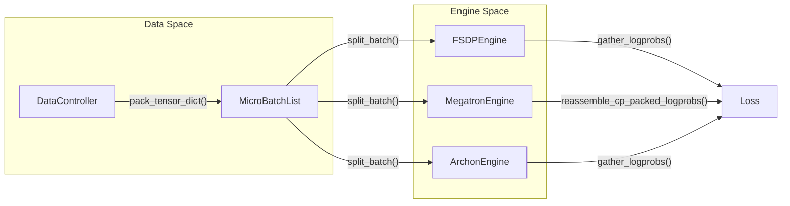
Sources: [areal/utils/data.py](), [areal/engine/fsdp_engine.py:118-128](), [areal/engine/megatron_engine.py:108-119](), [areal/engine/megatron_utils/packed_context_parallel.py:78]()

## Memory Management

AReaL training engines are optimized for memory efficiency through several techniques:
*   **Per-Layer Optimizer**: Pipelining optimizer updates with the backward pass to reduce peak memory [areal/engine/fsdp_utils/optimizer.py:86]().
*   **CPU Offload**: Using `CPUOffloadPolicy` and `torch_memory_saver` (TMS) to offload model states and gradients [areal/engine/fsdp_engine.py:32, 132]().
*   **Activation Checkpointing**: Recomputing activations during the backward pass to save memory at the cost of compute [areal/experimental/models/archon/activation_checkpoint.py:77]().

Sources: [areal/api/cli_args.py:41-78](), [areal/engine/fsdp_engine.py:219-250](), [areal/engine/megatron_engine.py:168-200](), [areal/experimental/engine/archon_engine.py:147-200]()

---

# Page: FSDP2 Engine

# FSDP2 Engine

<details>
<summary>Relevant source files</summary>

The following files were used as context for generating this wiki page:

- [areal/api/cli_args.py](areal/api/cli_args.py)
- [areal/engine/fsdp_engine.py](areal/engine/fsdp_engine.py)
- [areal/engine/fsdp_utils/__init__.py](areal/engine/fsdp_utils/__init__.py)
- [areal/engine/fsdp_utils/attn_impl.py](areal/engine/fsdp_utils/attn_impl.py)
- [areal/engine/fsdp_utils/grad.py](areal/engine/fsdp_utils/grad.py)
- [areal/engine/fsdp_utils/optimizer.py](areal/engine/fsdp_utils/optimizer.py)
- [areal/engine/megatron_engine.py](areal/engine/megatron_engine.py)
- [areal/experimental/engine/archon_engine.py](areal/experimental/engine/archon_engine.py)
- [areal/experimental/models/archon/moe_weight_converter.py](areal/experimental/models/archon/moe_weight_converter.py)
- [areal/models/transformers/qwen3_vl.py](areal/models/transformers/qwen3_vl.py)
- [areal/models/transformers/ulyssess_patch.py](areal/models/transformers/ulyssess_patch.py)
- [areal/tools/profile_archon.py](areal/tools/profile_archon.py)
- [areal/tools/profile_engines.py](areal/tools/profile_engines.py)
- [areal/tools/profile_fsdp.py](areal/tools/profile_fsdp.py)
- [areal/utils/data.py](areal/utils/data.py)
- [areal/utils/recover.py](areal/utils/recover.py)
- [areal/utils/saver.py](areal/utils/saver.py)
- [docs/en/best_practices/handling_oom.md](docs/en/best_practices/handling_oom.md)
- [docs/en/cli_reference.md](docs/en/cli_reference.md)
- [docs/zh/best_practices/handling_oom.md](docs/zh/best_practices/handling_oom.md)
- [docs/zh/cli_reference.md](docs/zh/cli_reference.md)
- [tests/experimental/archon/torchrun/run_ep_tests.py](tests/experimental/archon/torchrun/run_ep_tests.py)
- [tests/test_fsdp_grad.py](tests/test_fsdp_grad.py)
- [tests/test_per_layer_optim_step.py](tests/test_per_layer_optim_step.py)

</details>


The `FSDPEngine` is a high-performance training backend built on PyTorch's **FSDP2** (`fully_shard` API) [areal/engine/fsdp_utils/__init__.py:25-29](). It is designed for large-scale RL training, supporting advanced memory optimizations like per-layer optimizer streaming, CPU offloading, and Ulysses sequence parallelism.

## Architecture Overview

`FSDPEngine` implements the `TrainEngine` interface [areal/engine/fsdp_engine.py:219-220](). It manages the lifecycle of the model, optimizer, and distributed state. The engine is responsible for sharding the model across a `DeviceMesh`, handling sequence packing, and executing the forward/backward pipeline.

### Component Interaction Diagram
This diagram illustrates how the `FSDPEngine` coordinates internal components during a training iteration.

Title: FSDPEngine Internal Data Flow
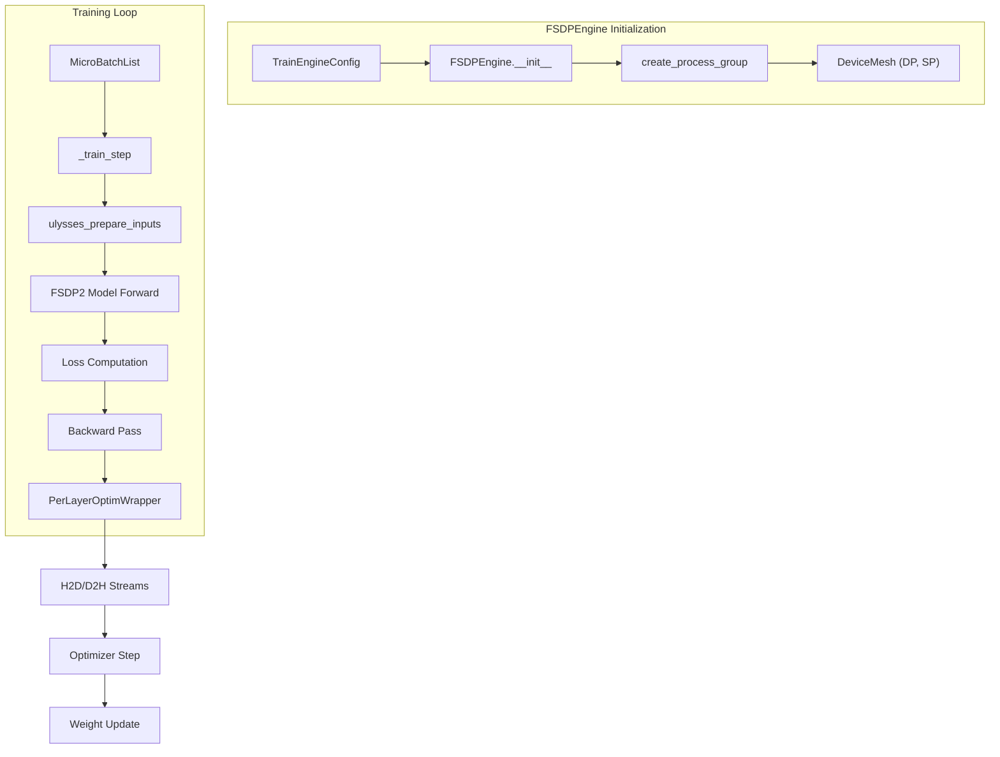
Sources: [areal/engine/fsdp_engine.py:220-240](), [areal/engine/fsdp_engine.py:1015-1050](), [areal/engine/fsdp_utils/optimizer.py:19-40]()

## Parallelism & DeviceMesh

`FSDPEngine` uses a 2D `DeviceMesh` to combine Data Parallelism (FSDP) and Sequence Parallelism (Ulysses) [areal/engine/fsdp_engine.py:440-455]().

*   **FSDP2 Sharding**: Parameters, gradients, and optimizer states are sharded across the `dp` (data parallel) mesh dimension using `fully_shard` [areal/engine/fsdp_utils/__init__.py:62-106]().
*   **Ulysses Sequence Parallelism**: For long-context training, the `sp` (sequence parallel) dimension enables splitting sequences across GPUs. The engine patches HuggingFace models via `apply_monkey_patch` to insert Ulysses `AllToAll` collectives [areal/models/transformers/ulyssess_patch.py:149-154]().

### Parallel Strategy Entity Mapping
Title: Parallel Strategy Code Entities
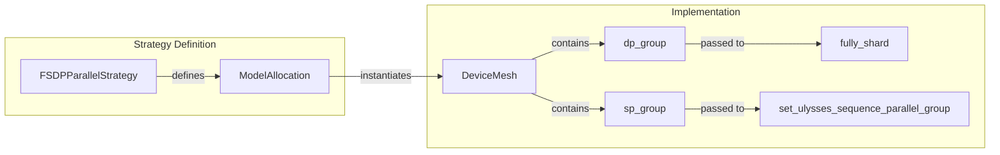
Sources: [areal/engine/fsdp_engine.py:440-470](), [areal/models/fsdp/ulysses.py:91-95](), [areal/engine/fsdp_utils/__init__.py:100-105]()

## Memory Optimizations

### Per-Layer Optimizer & CPU Offload
To minimize GPU memory footprint, `FSDPEngine` supports the `PerLayerOptimWrapper` [areal/engine/fsdp_utils/optimizer.py:19-20](). 
1.  **Optimizer Streaming**: Optimizer states are kept on CPU. During the backward pass, as each layer's gradients are produced, they are streamed to CPU (D2H), updated, and streamed back to GPU (H2D) [areal/engine/fsdp_utils/optimizer.py:81-85]().
2.  **AnyPrecisionAdamW**: A specialized optimizer that allows momentum and variance to be stored in `bfloat16` with Kahan summation to maintain `float32` precision updates [areal/engine/fsdp_utils/optimizer.py:44-55]().

### Activation Checkpointing
The engine supports granular activation checkpointing through `wrap_policy` [areal/engine/fsdp_utils/__init__.py:62-83](). This recomputes forward activations during the backward pass to save memory at the cost of computation.

## Tree Training Support

For RL algorithms like GRPO that share common prompt prefixes across multiple samples, `FSDPEngine` supports **Tree Attention**.
*   **Trie Construction**: Samples are organized into a `TrieNode` structure [areal/engine/fsdp_engine.py:107-110]().
*   **Tree Attention Kernels**: The engine uses specialized Triton kernels to compute attention on the tree structure, avoiding redundant computation of shared prefixes [areal/models/tree_attn/functional.py:98-102]().
*   **FSDP Patching**: `patch_fsdp_for_tree_training` is used to ensure FSDP correctly handles the non-standard batch dimensions used in tree training [areal/models/tree_attn/module.py:103-106]().

## Key Functions & Classes

| Entity | Description |
| :--- | :--- |
| `FSDPEngine` | Main entry point; manages model sharding and training loop [areal/engine/fsdp_engine.py:219](). |
| `apply_fsdp2` | Applies `fully_shard` to transformer layers based on `wrap_policy` [areal/engine/fsdp_utils/__init__.py:62](). |
| `ulysses_prepare_inputs` | Handles sequence slicing and padding for Ulysses parallelism [areal/models/fsdp/ulysses.py:94](). |
| `AnyPrecisionAdamW` | Memory-efficient AdamW implementation with Kahan summation [areal/engine/fsdp_utils/optimizer.py:44](). |
| `DCPState` | Manages Distributed Checkpoint (DCP) loading and saving [areal/engine/fsdp_utils/checkpoint.py:84](). |

## Checkpointing and Recovery

`FSDPEngine` utilizes `torch.distributed.checkpoint` (DCP) for efficient, parallelized saving of sharded model states [areal/engine/fsdp_engine.py:19]().
*   **Saving**: `get_model_state_dict` extracts the sharded state, which is then saved via `dcp.save` [areal/engine/fsdp_engine.py:27-30]().
*   **Recovery**: The `RecoverHandler` uses `RecoverInfo` to locate the latest DCP checkpoint and restore the `TrainEngine` state, including optimizer steps and dataloader positions [areal/utils/recover.py:151-160]().

Sources: [areal/engine/fsdp_engine.py:1130-1160](), [areal/utils/recover.py:41-51](), [areal/utils/saver.py:23-33]()

---

# Page: Megatron-Core Engine

# Megatron-Core Engine

<details>
<summary>Relevant source files</summary>

The following files were used as context for generating this wiki page:

- [areal/api/cli_args.py](areal/api/cli_args.py)
- [areal/engine/core/model.py](areal/engine/core/model.py)
- [areal/engine/fsdp_engine.py](areal/engine/fsdp_engine.py)
- [areal/engine/megatron_engine.py](areal/engine/megatron_engine.py)
- [areal/engine/megatron_utils/megatron.py](areal/engine/megatron_utils/megatron.py)
- [areal/engine/megatron_utils/megatron_lora.py](areal/engine/megatron_utils/megatron_lora.py)
- [areal/engine/megatron_utils/packed_context_parallel.py](areal/engine/megatron_utils/packed_context_parallel.py)
- [areal/engine/vllm_ext/vllm_worker_extension.py](areal/engine/vllm_ext/vllm_worker_extension.py)
- [areal/experimental/engine/archon_engine.py](areal/experimental/engine/archon_engine.py)
- [areal/models/mcore/bailing_moe.py](areal/models/mcore/bailing_moe.py)
- [areal/models/mcore/bailing_moe_bridge.py](areal/models/mcore/bailing_moe_bridge.py)
- [areal/models/mcore/hf_load.py](areal/models/mcore/hf_load.py)
- [areal/models/mcore/hf_save.py](areal/models/mcore/hf_save.py)
- [areal/models/mcore/lightning_attention.py](areal/models/mcore/lightning_attention.py)
- [areal/models/mcore/registry.py](areal/models/mcore/registry.py)
- [areal/trainer/sft/lm_engine.py](areal/trainer/sft/lm_engine.py)
- [areal/utils/stats_logger.py](areal/utils/stats_logger.py)
- [areal/utils/testing_utils.py](areal/utils/testing_utils.py)
- [docs/en/cli_reference.md](docs/en/cli_reference.md)
- [docs/en/reference/lora.md](docs/en/reference/lora.md)
- [docs/zh/cli_reference.md](docs/zh/cli_reference.md)
- [docs/zh/reference/lora.md](docs/zh/reference/lora.md)
- [examples/math/gsm8k_grpo_megatron_lora_moe.yaml](examples/math/gsm8k_grpo_megatron_lora_moe.yaml)
- [tests/test_megatron_engine_distributed.py](tests/test_megatron_engine_distributed.py)
- [tests/test_megatron_engine_vlm.py](tests/test_megatron_engine_vlm.py)
- [tests/test_megatron_engine_vlm_distributed.py](tests/test_megatron_engine_vlm_distributed.py)
- [tests/test_reassemble_cp_logprobs.py](tests/test_reassemble_cp_logprobs.py)
- [tests/torchrun/run_megatron_engine_distributed.py](tests/torchrun/run_megatron_engine_distributed.py)
- [tests/torchrun/run_megatron_engine_vlm_distributed.py](tests/torchrun/run_megatron_engine_vlm_distributed.py)

</details>


The `MegatronEngine` is a high-performance training backend for AReaL that leverages NVIDIA's Megatron-Core (MCore) library. It provides advanced 3D parallelism (Tensor, Pipeline, and Data Parallelism), native FP8 training support, and specialized integration for Vision-Language Models (VLM) and Mixture-of-Experts (MoE) architectures.

## Architecture Overview

`MegatronEngine` implements the `TrainEngine` interface [areal/engine/megatron_engine.py:168-168](). It manages the lifecycle of Megatron-Core models, from process group initialization to weight synchronization with HuggingFace formats.

### Data Flow and Parallelism
The engine supports complex parallelism strategies defined via `MegatronParallelStrategy` [areal/api/cli_args.py:440-458](), including:
*   **Tensor Parallelism (TP):** Intra-layer sharding.
*   **Pipeline Parallelism (PP):** Inter-layer sharding across stages.
*   **Context Parallelism (CP):** Sequence-dimension sharding for long-context training [areal/engine/megatron_utils/packed_context_parallel.py:14-71]().
*   **Expert Parallelism (EP):** Sharding of MoE experts [areal/models/mcore/hf_load.py:173-181]().

### Code Entity Map: Engine Initialization
The following diagram illustrates how the `MegatronEngine` initializes the distributed environment and the model.

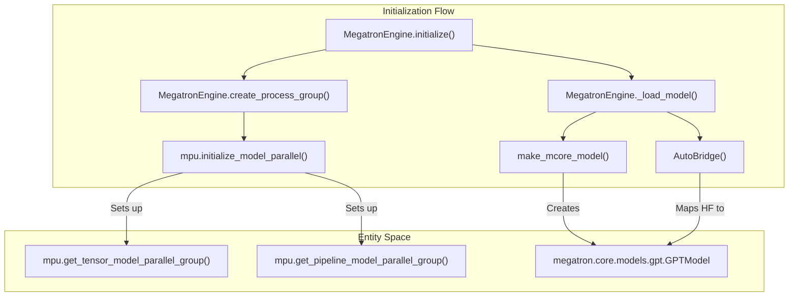
**Sources:** [areal/engine/megatron_engine.py:223-286](), [areal/models/mcore/registry.py:1-100](), [areal/engine/megatron_engine.py:348-430]()

---

## HuggingFace-to-MCore Bridging

A core feature of `MegatronEngine` is the ability to load standard HuggingFace (HF) weights into sharded Megatron-Core models and save them back to HF format without requiring manual conversion scripts.

### Weight Loading (`hf_load`)
The `load_weights_from_hf_with_mbridge_fast` function [areal/models/mcore/hf_load.py:86-86]() uses `mbridge` to perform "just-in-time" sharding.
*   **Fused Layers:** Interleaves QKV weights from HF's concatenated format `[Q, K, V]` to MCore's interleaved format `[H, 3, D]` [areal/models/mcore/hf_load.py:77-140]().
*   **MoE Experts:** Dynamically slices global expert weights based on `ep_rank` and `tp_rank` [areal/models/mcore/hf_load.py:159-210]().

### Weight Saving (`hf_save`)
Saving involves all-gathering sharded parameters across TP and PP ranks to reconstruct the full HF-compatible tensors.
*   **De-interleaving:** Reverses the interleaved QKV format during `all_gather_param` [areal/engine/megatron_utils/megatron.py:126-197]().
*   **Stacked Experts:** Detects if the bridge uses stacked tensors (e.g., Qwen3-VL-MoE) to correctly group experts back into single tensors [areal/models/mcore/hf_save.py:184-210]().

**Sources:** [areal/models/mcore/hf_load.py:1-210](), [areal/models/mcore/hf_save.py:1-210](), [areal/engine/megatron_utils/megatron.py:33-83]()

---

## Pipeline Parallel Schedules

`MegatronEngine` supports sophisticated pipeline schedules to minimize bubbles. It utilizes `get_forward_backward_func` [areal/engine/megatron_engine.py:29-29]() from MCore.

| Schedule Type | Description | Key Function |
| :--- | :--- | :--- |
| **Simple** | Standard non-interleaved PP. | `forward_backward_pipelining_without_interleaving` |
| **Interleaved** | Reduces bubble size by splitting layers into chunks. | `forward_backward_pipelining_with_interleaving` |

The engine configures layer splits via `configure_pipeline_layer_splits` [areal/engine/megatron_utils/pipeline_parallel.py:81-83](), which calculates how many layers each PP stage should hold based on the total layers and stage count.

**Sources:** [areal/engine/megatron_engine.py:794-843](), [areal/engine/megatron_utils/pipeline_parallel.py:1-83]()

---

## FP8 Training and LoRA

### FP8 Training
`MegatronEngine` supports blockwise FP8 training via Transformer Engine (TE).
*   **Dequantization:** The `FP8BlockwiseTensorHelper` [areal/engine/megatron_utils/fp8.py:16-22]() manages rowwise data and scale inverses.
*   **Conversion:** Tensors are converted between TE FP8 and PyTorch-native FP8 formats during checkpointing to ensure compatibility with inference engines like vLLM [areal/models/mcore/hf_save.py:74-116]().

### LoRA Support
LoRA is implemented by patching the MCore model using `MegatronBridgeLoRA` [areal/engine/megatron_engine.py:21-21]().
*   **Target Modules:** Automatically identifies target modules (e.g., `q_proj`, `v_proj`) compatible with vLLM [areal/engine/megatron_utils/megatron_lora.py:73-73]().
*   **Weight Sync:** Supports synchronizing LoRA weights to remote inference workers via the `areal_update_weights_lora` protocol [areal/engine/vllm_ext/vllm_worker_extension.py:58-87]().

**Sources:** [areal/engine/megatron_utils/fp8.py:1-50](), [areal/engine/megatron_utils/megatron_lora.py:1-80](), [areal/engine/vllm_ext/vllm_worker_extension.py:103-131]()

---

## VLM and Context Parallelism

For Vision-Language Models, `MegatronEngine` handles multi-modal data through specialized sequence packing.

### Context Parallel (CP) Packing
When `cp_size > 1`, sequences are split into interleaved chunks to balance load during causal masking [areal/engine/megatron_utils/packed_context_parallel.py:14-37]().

```mermaid
graph LR
    subgraph "Data Preparation"
        MB["MicroBatch"] --> SPLIT["split_packed_seqs_for_context_parallel"]
        SPLIT --> CP_LOCAL["CP-Local Tensor"]
    end

    subgraph "Forward/Backward"
        CP_LOCAL --> MCORE_FW["TransformerLayer Forward"]
        MCORE_FW --> LOGPROBS["Local Logprobs"]
    end

    subgraph "Reassembly"
        LOGPROBS --> REASS["reassemble_cp_packed_logprobs"]
        REASS --> FULL_SEQ["Full Sequence Logprobs"]
    end
```

The `reassemble_cp_packed_logprobs` function [areal/engine/megatron_utils/packed_context_parallel.py:148-180]() performs a differentiable all-gather followed by a permutation to restore the original sequence order for loss computation.

**Sources:** [areal/engine/megatron_utils/packed_context_parallel.py:1-180](), [areal/engine/megatron_engine.py:74-80]()

---

# Page: Archon Engine (Experimental)

# Archon Engine (Experimental)

<details>
<summary>Relevant source files</summary>

The following files were used as context for generating this wiki page:

- [.claude/agents/planner.md](.claude/agents/planner.md)
- [areal/api/cli_args.py](areal/api/cli_args.py)
- [areal/engine/core/train_engine.py](areal/engine/core/train_engine.py)
- [areal/engine/fsdp_engine.py](areal/engine/fsdp_engine.py)
- [areal/engine/fsdp_utils/__init__.py](areal/engine/fsdp_utils/__init__.py)
- [areal/engine/fsdp_utils/optimizer.py](areal/engine/fsdp_utils/optimizer.py)
- [areal/engine/megatron_engine.py](areal/engine/megatron_engine.py)
- [areal/experimental/engine/archon_checkpoint.py](areal/experimental/engine/archon_checkpoint.py)
- [areal/experimental/engine/archon_engine.py](areal/experimental/engine/archon_engine.py)
- [areal/experimental/engine/archon_runner.py](areal/experimental/engine/archon_runner.py)
- [areal/experimental/engine/archon_utils.py](areal/experimental/engine/archon_utils.py)
- [areal/experimental/models/archon/activation_checkpoint.py](areal/experimental/models/archon/activation_checkpoint.py)
- [areal/experimental/models/archon/base.py](areal/experimental/models/archon/base.py)
- [areal/experimental/models/archon/compile.py](areal/experimental/models/archon/compile.py)
- [areal/experimental/models/archon/expert_parallel.py](areal/experimental/models/archon/expert_parallel.py)
- [areal/experimental/models/archon/fp8.py](areal/experimental/models/archon/fp8.py)
- [areal/experimental/models/archon/fp8_checkpoint.py](areal/experimental/models/archon/fp8_checkpoint.py)
- [areal/experimental/models/archon/model_spec.py](areal/experimental/models/archon/model_spec.py)
- [areal/experimental/models/archon/moe/__init__.py](areal/experimental/models/archon/moe/__init__.py)
- [areal/experimental/models/archon/moe/args.py](areal/experimental/models/archon/moe/args.py)
- [areal/experimental/models/archon/moe/grouped_experts.py](areal/experimental/models/archon/moe/grouped_experts.py)
- [areal/experimental/models/archon/moe/moe.py](areal/experimental/models/archon/moe/moe.py)
- [areal/experimental/models/archon/moe/router.py](areal/experimental/models/archon/moe/router.py)
- [areal/experimental/models/archon/moe/utils.py](areal/experimental/models/archon/moe/utils.py)
- [areal/experimental/models/archon/moe_weight_converter.py](areal/experimental/models/archon/moe_weight_converter.py)
- [areal/experimental/models/archon/parallel_dims.py](areal/experimental/models/archon/parallel_dims.py)
- [areal/experimental/models/archon/qwen2/infra/parallelize.py](areal/experimental/models/archon/qwen2/infra/parallelize.py)
- [areal/experimental/models/archon/qwen2/model/args.py](areal/experimental/models/archon/qwen2/model/args.py)
- [areal/experimental/models/archon/qwen2/model/model.py](areal/experimental/models/archon/qwen2/model/model.py)
- [areal/experimental/models/archon/qwen3/infra/parallelize.py](areal/experimental/models/archon/qwen3/infra/parallelize.py)
- [areal/experimental/models/archon/qwen3/model/args.py](areal/experimental/models/archon/qwen3/model/args.py)
- [areal/experimental/models/archon/qwen3/model/model.py](areal/experimental/models/archon/qwen3/model/model.py)
- [areal/experimental/models/archon/qwen3_5/model/state_dict_adapter.py](areal/experimental/models/archon/qwen3_5/model/state_dict_adapter.py)
- [areal/trainer/rw/rw_engine.py](areal/trainer/rw/rw_engine.py)
- [areal/utils/data.py](areal/utils/data.py)
- [areal/utils/recover.py](areal/utils/recover.py)
- [areal/utils/saver.py](areal/utils/saver.py)
- [docs/en/best_practices/handling_oom.md](docs/en/best_practices/handling_oom.md)
- [docs/en/cli_reference.md](docs/en/cli_reference.md)
- [docs/zh/best_practices/handling_oom.md](docs/zh/best_practices/handling_oom.md)
- [docs/zh/cli_reference.md](docs/zh/cli_reference.md)
- [examples/math/gsm8k_sft_archon_fp8.yaml](examples/math/gsm8k_sft_archon_fp8.yaml)
- [tests/experimental/archon/conftest.py](tests/experimental/archon/conftest.py)
- [tests/experimental/archon/test_moe_common.py](tests/experimental/archon/test_moe_common.py)
- [tests/experimental/archon/torchrun/run_ep_tests.py](tests/experimental/archon/torchrun/run_ep_tests.py)
- [tests/test_eval_dispatch.py](tests/test_eval_dispatch.py)
- [tests/test_packed_vs_padded_consistency.py](tests/test_packed_vs_padded_consistency.py)
- [tests/test_per_layer_optim_step.py](tests/test_per_layer_optim_step.py)

</details>


The **Archon Engine** is AReaL's native, torch-native training backend designed for high-performance large model training. Unlike the FSDP2 or Megatron backends which rely on specific external frameworks, Archon is built directly on PyTorch's `distributed.tensor` (DTensor) and `distributed.pipelining` abstractions to provide a flexible "5D" parallelism stack.

## System Architecture

The Archon Engine implements the `TrainEngine` interface [areal/experimental/engine/archon_engine.py:147-148](). It orchestrates model parallelization, distributed checkpointing, and high-performance execution through specialized "Runners".

### Core Engine Components
*   **ArchonEngine**: The primary entry point that manages the lifecycle of the model, optimizer, and scheduler [areal/experimental/engine/archon_engine.py:147-200]().
*   **ModelSpec**: A registry system that defines how different model architectures (e.g., Qwen2, Qwen3) map to parallelization strategies [areal/experimental/models/archon/archon_engine.py:163-166]().
*   **ForwardBackwardRunner**: An abstraction that encapsulates the execution logic for either sequential (non-pipelined) or pipelined training [areal/experimental/engine/archon_runner.py:30-53]().

### Data Flow and Parallelism
The engine uses a 5D parallelism strategy, combining Data Parallelism (DP), Tensor Parallelism (TP), Context Parallelism (CP/Ulysses), Expert Parallelism (EP), and Expert Tensor Parallelism (ETP) [areal/experimental/models/archon/qwen3/infra/parallelize.py:97-133]().

#### Engine Initialization Flow
Title: Archon Engine Initialization and Parallelization
```mermaid
graph TD
    subgraph "Engine Setup"
        Init["ArchonEngine.__init__"] --> Spec["get_model_spec"]
        Spec --> PG["create_process_group"]
    end

    subgraph "Parallelization (5D Stack)"
        PG --> Mesh["ArchonParallelDims (DeviceMesh)"]
        Mesh --> TP["apply_non_moe_tp"]
        TP --> ETP["apply_moe_ep_tp (EP+TP)"]
        ETP --> CP["apply_cp (Ulysses SP)"]
        CP --> AC["apply_ac (Activation Checkpointing)"]
        AC --> FSDP["Apply FSDP Sharding"]
    end

    subgraph "Execution"
        FSDP --> Runner["create_runner"]
        Runner --> Seq["SequentialRunner"]
        Runner --> Pipe["PipelinedRunner"]
    end

    style Init stroke-width:2px
    style Runner stroke-width:2px
```
Sources: [areal/experimental/engine/archon_engine.py:147-200](), [areal/experimental/models/archon/qwen3/infra/parallelize.py:86-176](), [areal/experimental/engine/archon_runner.py:56-124]()

## 5D Parallelism Implementation

Archon's parallelization logic is centralized in model-specific `parallelize` modules.

### Parallel Dimensions
The engine utilizes `ArchonParallelDims` to manage the multi-dimensional `DeviceMesh`. This allows for fine-grained control over how parameters and activations are sharded across the cluster [areal/experimental/models/archon/qwen3/infra/parallelize.py:88-112]().

| Parallelism Type | Implementation Detail | Code Reference |
| :--- | :--- | :--- |
| **Tensor (TP)** | Column/Row-wise sharding for dense layers. | [areal/experimental/models/archon/qwen3/infra/parallelize.py:135-137]() |
| **Expert (EP)** | All-to-All token dispatching for MoE layers. | [areal/experimental/models/archon/qwen3/infra/parallelize.py:141-150]() |
| **Context (CP)** | Ulysses Sequence Parallelism using All-to-All. | [areal/experimental/models/archon/qwen3/infra/parallelize.py:153-155]() |
| **Pipeline (PP)** | Torch-native `PipelineStage` with ZBV/DualPipe schedules. | [areal/experimental/engine/archon_engine.py:18-22]() |
| **Data (FSDP)** | `fully_shard` API for parameter sharding. | [areal/experimental/models/archon/qwen3/infra/parallelize.py:171-176]() |

Sources: [areal/experimental/models/archon/qwen3/infra/parallelize.py:86-176](), [areal/experimental/engine/archon_engine.py:18-22]()

## Execution Strategies (Runners)

Archon separates the training loop from the model architecture via `ForwardBackwardRunner` [areal/experimental/engine/archon_runner.py:30]().

### SequentialRunner
Used when pipeline parallelism is disabled (`pp=1`). It processes micro-batches one by one, supporting tree-structured attention for shared-prefix RL training [areal/experimental/engine/archon_runner.py:56-121]().

### PipelinedRunner
Orchestrates pipeline stages using PyTorch's native schedules (e.g., `ScheduleZBVZeroBubble`, `ScheduleDualPipeV`). It manages `PipelineStage` objects and handles the communication between ranks in the pipeline [areal/experimental/engine/archon_runner.py:124-199]().

Title: Forward/Backward Execution Flow
```mermaid
graph LR
    subgraph "Data Input"
        MB["MicroBatchList"]
    end

    subgraph "Runner Logic"
        MB --> RunnerChoice{"PP Degree > 1?"}
        RunnerChoice -- "No" --> Seq["SequentialRunner.run"]
        RunnerChoice -- "Yes" --> Pipe["PipelinedRunner.run"]
    end

    subgraph "Model Interaction"
        Seq --> Tree["TreeAttentionMeta (if enabled)"]
        Tree --> Fwd["model.forward"]
        Pipe --> Schedule["_PipelineSchedule.step"]
    end

    subgraph "Output"
        Fwd --> Loss["process_output_fn"]
        Schedule --> Loss
    end
```
Sources: [areal/experimental/engine/archon_runner.py:30-200](), [areal/experimental/engine/archon_engine.py:18-22]()

## Checkpoint Management

Archon uses **Distributed Checkpoint (DCP)** as its primary format, wrapped in the `DCPState` class [areal/experimental/engine/archon_checkpoint.py:86]().

### Key Features
*   **Flattened Optimizer States**: Uses `flatten_optimizer_state_dict=True` to prevent index collisions across pipeline stages by using parameter FQNs as keys [areal/experimental/engine/archon_checkpoint.py:90-92]().
*   **HuggingFace Integration**: Supports converting native DCP shards to standard HuggingFace `safetensors` format using `save_model_to_hf` [areal/experimental/engine/archon_checkpoint.py:52]().
*   **MoE Weight Conversion**: Includes specialized utilities for handling MoE expert weights during state dict loading/saving [areal/experimental/engine/archon_checkpoint.py:135-143]().

Sources: [areal/experimental/engine/archon_checkpoint.py:86-165]()

## FP8 Support and MoE

The engine provides experimental support for FP8 training and advanced Mixture-of-Experts (MoE) configurations.

### FP8 Support
FP8 is integrated via `ArchonFP8Config`, allowing for reduced memory footprint and faster computation on supported hardware (e.g., NVIDIA H100). This is managed during the model parallelization phase [areal/api/cli_args.py:11384-11389]().

### MoE Architectures
Archon supports advanced MoE features including:
*   **Grouped Experts**: Grouping experts to optimize communication in EP [areal/experimental/models/archon/qwen3/infra/parallelize.py:36]().
*   **Expert Tensor Parallelism (ETP)**: Applying TP inside individual experts to handle extremely large expert layers [areal/experimental/models/archon/qwen3/infra/parallelize.py:142-150]().

Sources: [areal/api/cli_args.py:11384-11389](), [areal/experimental/models/archon/qwen3/infra/parallelize.py:141-150]()

---

# Page: Inference Engines & Rollout

# Inference Engines & Rollout

<details>
<summary>Relevant source files</summary>

The following files were used as context for generating this wiki page:

- [.github/workflows/pre-commit.yml](.github/workflows/pre-commit.yml)
- [AGENTS.md](AGENTS.md)
- [CLAUDE.md](CLAUDE.md)
- [CONTRIBUTING.md](CONTRIBUTING.md)
- [README.md](README.md)
- [ROADMAP.md](ROADMAP.md)
- [areal/api/engine_api.py](areal/api/engine_api.py)
- [areal/api/io_struct.py](areal/api/io_struct.py)
- [areal/api/workflow_api.py](areal/api/workflow_api.py)
- [areal/engine/sglang_remote.py](areal/engine/sglang_remote.py)
- [areal/engine/vllm_remote.py](areal/engine/vllm_remote.py)
- [blog/AReaL_v0_2.md](blog/AReaL_v0_2.md)
- [examples/math/gsm8k_grpo_lora.yaml](examples/math/gsm8k_grpo_lora.yaml)

</details>


AReaL is designed around a **fully asynchronous RL training paradigm** [README.md:19-21](). This architecture decouples the training loop from the rollout generation process, allowing high-throughput inference backends like **SGLang** and **vLLM** to run in parallel with training engines.

The inference subsystem is responsible for generating trajectories (rollouts) based on the current policy weights. This involves orchestrating remote inference servers, managing weight synchronization to ensure rollouts are not too "stale," and providing a unified interface for complex agentic workflows.

## Inference Backends: SGLang & vLLM

AReaL leverages industry-standard inference engines as its remote backends. These are wrapped by the `InferenceEngine` API [areal/api/engine_api.py:15-24](), which provides a consistent interface for the rest of the system regardless of the underlying server.

*   **SGLang Backend**: Optimized for scenarios where multiple responses are sampled from the same prompt using its Radix Attention mechanism [blog/AReaL_v0_2.md:62-67](). It supports weight updates via disk or distributed NCCL (XCCL) [areal/engine/sglang_remote.py:129-187]().
*   **vLLM Backend**: Provides a robust alternative with a flat payload structure and specialized support for Vision-Language Models (VLM) via chat completion endpoints [areal/engine/vllm_remote.py:44-96]().

For details on configuration, weight update modes, and LoRA versioning, see **[SGLang & vLLM Remote Engines](#4.1)**.

### Inference Entity Mapping

The following diagram shows how high-level inference requests are mapped to specific code entities and backend implementations.

**Diagram: Inference Request Flow**
```mermaid
graph TD
    subgraph "Natural Language Space (Workflow)"
        A["RolloutWorkflow.arun_episode"] 
    end

    subgraph "Code Entity Space (AReaL Infra)"
        B["ModelRequest"]
        C["RemoteInfEngine"]
        D["SGLangBackend"]
        E["VLLMBackend"]
    end

    subgraph "Service Space (Remote)"
        F["SGLang Server /generate"]
        G["vLLM Server /v1/completions"]
    end

    A -- "constructs" --> B
    A -- "calls" --> C
    C -- "delegates to" --> D
    C -- "delegates to" --> E
    D -- "HTTP POST" --> F
    E -- "HTTP POST" --> G
```
**Sources:** [areal/api/workflow_api.py:16-18](), [areal/api/io_struct.py:28-44](), [areal/engine/sglang_remote.py:43-89](), [areal/engine/vllm_remote.py:44-96]()

---

## Rollout Orchestration & Staleness

The `RolloutController` (and its high-performance successor `RolloutControllerV2`) is the brain of the rollout subsystem. It manages a pool of inference workers and ensures that the data being generated is "on-policy" enough for the trainer.

Key responsibilities include:
*   **Weight Synchronization**: Coordinating with the `TrainEngine` to push new weights to inference servers using the **AWEX** protocol or disk-based updates [areal/api/io_struct.py:183-202]().
*   **Staleness Management**: Tracking the `max_head_offpolicyness` to pause rollouts if the inference policy lags too far behind the trainer's current version.
*   **Workflow Execution**: Managing the lifecycle of `WorkflowExecutor` instances that run the actual RL logic (e.g., RLVR, multi-turn reasoning) [areal/api/workflow_api.py:14-39]().

For details on task queuing and weight versioning, see **[Rollout Controller & Staleness Management](#4.2)**.

---

## Experimental Inference Service

For massive scale (e.g., 1000+ GPU clusters), AReaL provides an experimental three-tier microservice stack. This moves rollout orchestration into a distributed service architecture.

| Component | Role | Code Reference |
| :--- | :--- | :--- |
| **InferenceGateway** | Entry point for requests; handles session pinning. | [areal/experimental/inference/gateway.py]() |
| **InferenceRouter** | Balances load across multiple inference backends. | [areal/experimental/inference/router.py]() |
| **InferenceDataProxy** | Buffers trajectories and exports them as `RTensor` batches. | [areal/experimental/inference/data_proxy.py]() |

This stack enables "Online RL" where the trainer connects to a persistent proxy server, allowing for elastic scaling of inference resources.

For details on the InfBridge abstraction and trajectory buffering, see **[Experimental Inference Service (Gateway/Router/DataProxy)](#4.3)**.

### Component Relationship

The following diagram illustrates how the different controllers and engines interact to produce training data.

**Diagram: Rollout Subsystem Architecture**
```mermaid
graph LR
    subgraph "Control Plane"
        RC["RolloutController"]
        WE["WorkflowExecutor"]
    end

    subgraph "Data Plane"
        IE["InferenceEngine (SGLang/vLLM)"]
        RT["RTensor Stream"]
    end

    subgraph "Training Plane"
        TE["TrainEngine (FSDP/Megatron)"]
    end

    RC -- "spawns" --> WE
    WE -- "requests tokens" --> IE
    IE -- "returns tokens" --> WE
    WE -- "packages" --> RT
    RT -- "feeds" --> TE
    TE -- "WeightUpdateMeta" --> RC
    RC -- "updates" --> IE
```
**Sources:** [areal/api/engine_api.py:175-183](), [areal/api/io_struct.py:183-214](), [areal/api/workflow_api.py:16-18](), [README.md:19-21]()

---

## Child Pages
*   **[SGLang & vLLM Remote Engines](#4.1)**: Implementation details of the `SGLangBackend` and `VLLMBackend`.
*   **[Rollout Controller & Staleness Management](#4.2)**: Logic for `max_head_offpolicyness` and the `RolloutController` loop.
*   **[Experimental Inference Service (Gateway/Router/DataProxy)](#4.3)**: Deep dive into the `InferenceGateway`, `Router`, and `DataProxy` microservices.

---

# Page: SGLang & vLLM Remote Engines

# SGLang & vLLM Remote Engines

<details>
<summary>Relevant source files</summary>

The following files were used as context for generating this wiki page:

- [.agents/skills/upgrade-deps/checklists/sglang.md](.agents/skills/upgrade-deps/checklists/sglang.md)
- [areal/api/engine_api.py](areal/api/engine_api.py)
- [areal/api/io_struct.py](areal/api/io_struct.py)
- [areal/api/workflow_api.py](areal/api/workflow_api.py)
- [areal/engine/megatron_utils/megatron_lora.py](areal/engine/megatron_utils/megatron_lora.py)
- [areal/engine/sglang_remote.py](areal/engine/sglang_remote.py)
- [areal/engine/vllm_ext/areal_vllm_server.py](areal/engine/vllm_ext/areal_vllm_server.py)
- [areal/engine/vllm_ext/vllm_worker_extension.py](areal/engine/vllm_ext/vllm_worker_extension.py)
- [areal/engine/vllm_remote.py](areal/engine/vllm_remote.py)
- [areal/experimental/weight_update/awex/fsdp_adapter.py](areal/experimental/weight_update/awex/fsdp_adapter.py)
- [areal/experimental/weight_update/awex/megatron_adapter.py](areal/experimental/weight_update/awex/megatron_adapter.py)
- [areal/experimental/weight_update/awex/sglang_adapter.py](areal/experimental/weight_update/awex/sglang_adapter.py)
- [areal/experimental/weight_update/inference_adapter.py](areal/experimental/weight_update/inference_adapter.py)
- [areal/experimental/weight_update/training_adapter.py](areal/experimental/weight_update/training_adapter.py)
- [areal/tools/validate_docker_installation.py](areal/tools/validate_docker_installation.py)
- [areal/tools/validation_base.py](areal/tools/validation_base.py)
- [areal/utils/stats_logger.py](areal/utils/stats_logger.py)
- [docs/en/reference/lora.md](docs/en/reference/lora.md)
- [docs/zh/reference/lora.md](docs/zh/reference/lora.md)
- [examples/math/gsm8k_grpo_lora.yaml](examples/math/gsm8k_grpo_lora.yaml)
- [examples/math/gsm8k_grpo_megatron_lora_moe.yaml](examples/math/gsm8k_grpo_megatron_lora_moe.yaml)
- [tests/experimental/weight_update/test_nccl_integration.py](tests/experimental/weight_update/test_nccl_integration.py)
- [tests/test_sglang_pp_distributed.py](tests/test_sglang_pp_distributed.py)

</details>


AReaL utilizes high-performance inference frameworks, specifically **SGLang** and **vLLM**, to perform rollout generation. These are wrapped as remote engines that communicate with the training cluster via HTTP and specialized weight-update protocols. This design allows for physical decoupling between training and inference resources, enabling asynchronous RL where inference can run on separate nodes or even different GPU architectures.

### Remote Engine Architecture

The core of the remote inference system is the `RemoteInfEngine`, which implements the `InferenceEngine` API [areal/api/engine_api.py:321-325](). It manages a pool of remote server instances, handling request dispatching, response parsing, and health monitoring.

#### Backend Implementations
Each framework is supported through a specific backend class that maps AReaL's internal `ModelRequest` and `ModelResponse` structures to the framework's native HTTP API:

*   **`SGLangBackend`**: Handles communication with the SGLang Runtime [areal/engine/sglang_remote.py:40-41]().
*   **`VLLMBackend`**: Handles communication with the vLLM engine [areal/engine/vllm_remote.py:41-42]().

#### Data Flow: Natural Language to Code Entities

The following diagram illustrates how a rollout request moves from the training logic into the remote inference infrastructure.

**Rollout Request Execution Flow**
```mermaid
graph TD
    subgraph "Natural Language Space"
        A["Prompt / Task Data"]
    end

    subgraph "Code Entity Space: Training Side"
        B["RolloutController"] --> C["WorkflowExecutor"]
        C -- "arun_episode()" --> D["Workflow (e.g., RLVRWorkflow)"]
        D -- "engine.generate()" --> E["RemoteInfEngine"]
        E -- "build_generation_request()" --> F["Backend (SGLang/vLLM)"]
    end

    subgraph "Code Entity Space: Remote Side"
        F -- "HTTP POST" --> G["Remote Server Endpoint"]
        G -- "generate()" --> H["Inference Engine Runtime"]
    end

    A --> B
```
Sources: [areal/infra/rollout_controller.py](), [areal/api/workflow_api.py:14-18](), [areal/engine/sglang_remote.py:43-45](), [areal/engine/vllm_remote.py:44-46]()

---

### Weight Update Modes

A critical requirement for RL is the ability to update the inference model weights as the training model evolves. AReaL supports three primary modes for this synchronization, defined in `WeightUpdateMeta` [areal/api/io_struct.py:183-184]().

| Mode | Description | Key Functions |
| :--- | :--- | :--- |
| **Disk** | The trainer saves weights to a shared filesystem; the remote engine reloads from that path. | `build_disk_weight_update_requests` [areal/engine/sglang_remote.py:129-131]() |
| **XCCL** | Weights are broadcast directly from the trainer's GPU to the inference GPU via NCCL/HCCL. | `areal_update_weight_xccl` [areal/engine/vllm_ext/vllm_worker_extension.py:133-134]() |
| **AWEX** | An experimental high-performance protocol for cross-cluster weight transfer. | `AwexTrainingAdapter` [areal/experimental/weight_update/training_adapter.py]() |

#### LoRA Versioning
For Parameter-Efficient Fine-Tuning (PEFT), AReaL uses a versioning system to manage multiple LoRA adapters. Each update increments a version number, and the engine generates a versioned name (e.g., `lora-v1`, `lora-v2`) to ensure the correct adapter is used for specific rollout requests [areal/api/io_struct.py:161-163]().

Sources: [areal/api/io_struct.py:183-211](), [areal/engine/sglang_remote.py:129-160](), [areal/engine/vllm_remote.py:129-148]()

---

### Implementation Details: SGLang

The `SGLangBackend` translates AReaL `ModelRequest` objects into the SGLang `/generate` endpoint payload [areal/engine/sglang_remote.py:89]().

*   **Generation**: Supports `top_p`, `top_k`, `temperature`, and `stop_token_ids` [areal/engine/sglang_remote.py:56-65]().
*   **MoE Support**: Can extract routed expert information if `return_routed_experts` is enabled in metadata [areal/engine/sglang_remote.py:78-79](). It parses the base64-encoded expert indices from the response `meta_info` [areal/engine/sglang_remote.py:101-110]().
*   **Weight Updates**: Uses `/update_weights_from_disk` for full models and `/load_lora_adapter` for LoRA [areal/engine/sglang_remote.py:140-159]().

Sources: [areal/engine/sglang_remote.py:40-127]()

---

### Implementation Details: vLLM

The `VLLMBackend` interacts with a customized vLLM server (`areal_vllm_server.py`) that includes additional endpoints for weight management.

*   **API Mapping**: Uses `/v1/completions` for text and `/v1/chat/completions` for vision-language models [areal/engine/vllm_remote.py:93-96]().
*   **Server Extensions**: The AReaL-specific vLLM server provides endpoints like `/areal_update_weights` and `/areal_update_weights_xccl` [areal/engine/vllm_ext/areal_vllm_server.py:164-207]().
*   **Worker Extension**: The `VLLMWorkerExtension` class is injected into vLLM workers to handle the low-level weight loading into the GPU memory [areal/engine/vllm_ext/vllm_worker_extension.py:30-39]().

**vLLM Weight Update Lifecycle**
```mermaid
graph LR
    subgraph "Training Process"
        T["Trainer"] -- "WeightUpdateMeta" --> G["InferenceGateway"]
    end

    subgraph "vLLM API Server"
        G -- "POST /areal_update_weights_xccl" --> AS["areal_vllm_server.py"]
        AS -- "pause_generation()" --> EC["EngineClient"]
    end

    subgraph "vLLM Worker"
        EC -- "collective_rpc()" --> WE["VLLMWorkerExtension"]
        WE -- "broadcast()" --> NCCL["NCCL Group"]
        NCCL -- "load_weights()" --> M["Model Weights"]
    end
```
Sources: [areal/engine/vllm_ext/areal_vllm_server.py:164-207](), [areal/engine/vllm_ext/vllm_worker_extension.py:133-165]()

---

### WorkflowExecutor Lifecycle

The `WorkflowExecutor` is the runtime component that executes `RolloutWorkflow` instances [areal/api/workflow_api.py:14-18](). It manages the lifecycle of an episode:

1.  **Initialization**: Loads the specified workflow class.
2.  **Execution**: Calls `arun_episode()`, passing the `InferenceEngine` instance [areal/api/workflow_api.py:16-17]().
3.  **Request Handling**: The workflow uses the engine's `generate()` method, which the `RemoteInfEngine` routes to the remote backends.
4.  **Completion**: Collects the generated tokens, logprobs, and metadata into a `ModelResponse` [areal/api/io_struct.py:63-81]().

Sources: [areal/api/workflow_api.py:14-39](), [areal/infra/rollout_controller.py]()

---

# Page: Rollout Controller & Staleness Management

# Rollout Controller & Staleness Management

<details>
<summary>Relevant source files</summary>

The following files were used as context for generating this wiki page:

- [.github/ISSUE_TEMPLATE/config.yml](.github/ISSUE_TEMPLATE/config.yml)
- [areal/api/alloc_mode.py](areal/api/alloc_mode.py)
- [areal/experimental/engine/archon_weight_sync.py](areal/experimental/engine/archon_weight_sync.py)
- [areal/experimental/inference_service/controller/controller.py](areal/experimental/inference_service/controller/controller.py)
- [areal/experimental/inference_service/sglang/launch_server.py](areal/experimental/inference_service/sglang/launch_server.py)
- [areal/experimental/inference_service/sglang/pp_bridge.py](areal/experimental/inference_service/sglang/pp_bridge.py)
- [areal/experimental/inference_service/sglang/scheduler.py](areal/experimental/inference_service/sglang/scheduler.py)
- [areal/experimental/training_service/controller/controller.py](areal/experimental/training_service/controller/controller.py)
- [areal/experimental/weight_update/controller/config.py](areal/experimental/weight_update/controller/config.py)
- [areal/experimental/weight_update/controller/controller.py](areal/experimental/weight_update/controller/controller.py)
- [areal/experimental/weight_update/gateway/app.py](areal/experimental/weight_update/gateway/app.py)
- [areal/experimental/weight_update/gateway/config.py](areal/experimental/weight_update/gateway/config.py)
- [areal/infra/controller/rollout_controller.py](areal/infra/controller/rollout_controller.py)
- [areal/infra/launcher/sglang_server.py](areal/infra/launcher/sglang_server.py)
- [areal/infra/remote_inf_engine.py](areal/infra/remote_inf_engine.py)
- [areal/infra/utils/concurrent.py](areal/infra/utils/concurrent.py)
- [blog/AReaL_v0_3.md](blog/AReaL_v0_3.md)
- [docs/en/version_history.md](docs/en/version_history.md)
- [docs/zh/version_history.md](docs/zh/version_history.md)
- [examples/countdown/README.md](examples/countdown/README.md)
- [examples/tau2/README.md](examples/tau2/README.md)
- [tests/experimental/inference_service/test_controller.py](tests/experimental/inference_service/test_controller.py)
- [tests/experimental/inference_service/test_controller_version.py](tests/experimental/inference_service/test_controller_version.py)
- [tests/experimental/inference_service/test_external_model.py](tests/experimental/inference_service/test_external_model.py)
- [tests/experimental/inference_service/test_external_model_integration.py](tests/experimental/inference_service/test_external_model_integration.py)
- [tests/experimental/inference_service/test_online_stack.py](tests/experimental/inference_service/test_online_stack.py)
- [tests/experimental/training_service/test_controller_integration.py](tests/experimental/training_service/test_controller_integration.py)
- [tests/experimental/training_service/test_controller_unit.py](tests/experimental/training_service/test_controller_unit.py)
- [tests/experimental/weight_update/test_disk_integration.py](tests/experimental/weight_update/test_disk_integration.py)
- [tests/experimental/weight_update/test_wu_controller.py](tests/experimental/weight_update/test_wu_controller.py)
- [tests/test_sglang_pp_unit.py](tests/test_sglang_pp_unit.py)

</details>


The `RolloutController` is the central orchestration component of AReaL's asynchronous RL pipeline. It bridges the gap between the Training Engines and the Inference Workers, managing the lifecycle of rollout generation, trajectory buffering, and weight synchronization. Its primary goal is to maximize hardware utilization by allowing training and inference to proceed on separate GPU clusters with minimal synchronization overhead.

## 1. Rollout Controller Architecture

AReaL provides two implementations of the controller: the standard `RolloutController` and the enhanced `RolloutControllerV2`. Both are designed to be duck-type compatible from the perspective of the Trainer [areal/experimental/inference_service/controller/controller.py:68-70]().

### RolloutController (Standard)
The standard controller manages a pool of `Worker` objects launched via the `Scheduler` [areal/infra/controller/rollout_controller.py:87-89](). It uses an internal `BatchTaskDispatcher` to route `ModelRequest` tasks to remote inference engines [areal/infra/controller/rollout_controller.py:105-107]().

### RolloutControllerV2 (Service-Oriented)
`RolloutControllerV2` is a parallel implementation that routes all traffic through a multi-tier HTTP stack: **Gateway → Router → Data Proxy → Inference Backend** [areal/experimental/inference_service/controller/controller.py:3-6](). This version is optimized for high-throughput online scenarios and external API integration.

### Entity Mapping: Natural Language to Code
The following diagram maps high-level system concepts to the specific code entities implementing them.

**System Entity Mapping**
```mermaid
graph TD
    subgraph "Natural Language Space"
        A["Rollout Orchestrator"]
        B["Task Queue"]
        C["Staleness Logic"]
        D["Worker Registry"]
    end

    subgraph "Code Entity Space"
        A1["RolloutControllerV2"]
        B1["BatchTaskDispatcher"]
        C1["StalenessManager"]
        D1["LocalInfServerInfo"]
    end

    A -- "implements" --> A1
    B -- "manages" --> B1
    C -- "encapsulates" --> C1
    D -- "tracks" --> D1

    style A1 font-family:monospace
    style B1 font-family:monospace
    style C1 font-family:monospace
    style D1 font-family:monospace
```
Sources: [areal/experimental/inference_service/controller/controller.py:65-150](), [areal/infra/controller/rollout_controller.py:72-134](), [areal/infra/staleness_manager.py]()

---

## 2. Staleness Management

In asynchronous RL, "staleness" refers to the difference between the model version used to generate a rollout and the current version of the model being trained. If the rollout policy is too far "off-policy," training stability can degrade.

### max_head_offpolicyness
The controller uses a `StalenessManager` to track the version of every rollout task. The key configuration parameter is `max_head_offpolicyness` [areal/api/cli_args.py:38](). 
- If the difference between the current training version and the oldest active rollout version exceeds this limit, the controller throttles new rollout requests [areal/infra/controller/rollout_controller.py:206-210]().
- This ensures that the replay buffer does not become saturated with obsolete data.

### Implementation Flow
The `StalenessManager` maintains a count of active rollouts per version. When the trainer increments the global model version via `update_weights()`, the manager checks if the system can accept more tasks based on the `max_head_offpolicyness` constraint.

Sources: [areal/api/cli_args.py:38](), [areal/infra/controller/rollout_controller.py:206-210](), [areal/experimental/inference_service/controller/controller.py:148-149]()

---

## 3. Weight Update Protocol (AWEX & XCCL)

The controller orchestrates the synchronization of weights from the Trainer (e.g., `ArchonEngine`) to the Inference Workers. This is handled via the `WeightUpdateMeta` structure [areal/api/io_struct.py]().

### AWEX (Asynchronous Weight Exchange)
AWEX is the protocol for updating weights without stopping the inference service. The process follows these steps:
1.  **Trainer** completes a gradient step and triggers `update_weights`.
2.  **Controller** receives the new `WeightUpdateMeta` (containing the new version number and weight location).
3.  **Controller** calls `init_weights_update_group` on the inference workers [areal/infra/remote_inf_engine.py:215-218]().
4.  **Inference Workers** join a temporary NCCL/XCCL group to pull weights directly from the trainer's GPU memory or from disk [areal/experimental/engine/archon_weight_sync.py:62-92]().

### Pipeline Parallel (PP) Synchronization
When the inference engine uses pipeline parallelism (`pp_size > 1`), the controller and engine must coordinate per-PP-rank groups. Each training PP-stage head creates its own `update_weight_group_{pp_rank}`, which is joined only by the corresponding inference workers for that stage [areal/experimental/engine/archon_weight_sync.py:142-160]().

**Weight Update Sequence**
```mermaid
sequenceDiagram
    participant T as Trainer (ArchonEngine)
    participant C as RolloutController
    participant W as Inference Worker (SGLang)

    T->>T: Complete Training Step
    T->>C: update_weights(meta)
    C->>W: POST /init_weights_update_group
    W->>W: Join NCCL Group (XCCL)
    T->>W: Broadcast Weights (GPU-to-GPU)
    W->>C: Ack Update
    C->>C: Increment Version
```
Sources: [areal/experimental/engine/archon_weight_sync.py:62-134](), [areal/infra/remote_inf_engine.py:194-218](), [areal/infra/controller/rollout_controller.py:95-96]()

---

## 4. Task Queuing and Workflow Execution

The controller manages the execution of `RolloutWorkflow` objects. A workflow defines the logic for a single episode (e.g., multi-turn reasoning or tool use).

### Workflow Resolution
The controller resolves workflows from strings or classes. In `RolloutControllerV2`, if a custom agent class is provided, it is wrapped in an `InferenceServiceWorkflow` [areal/experimental/inference_service/controller/controller.py:534-550]().

### Batch Dispatching
The `BatchTaskDispatcher` (used in the standard controller) aggregates individual prompt requests into batches to maximize the efficiency of the remote `InferenceEngine` [areal/infra/controller/rollout_controller.py:105-107](). It handles:
- **Task ID Generation**: Every rollout is assigned a unique `task_id` for tracking [areal/infra/controller/rollout_controller.py:98]().
- **Result Callbacks**: Workers return results via an HTTP callback server hosted by the controller [areal/infra/controller/rollout_controller.py:109-116]().

### Online Callback Server
The controller runs a background thread with a Flask or FastAPI app to receive completed trajectories from workers [areal/experimental/inference_service/controller/controller.py:157-163](). This allows the system to be truly asynchronous: the controller "fires and forgets" the request and processes the result only when the worker pushes it back.

Sources: [areal/experimental/inference_service/controller/controller.py:534-550](), [areal/infra/controller/rollout_controller.py:98-116](), [areal/infra/remote_inf_engine.py:70-85]()

---

# Page: Experimental Inference Service (Gateway/Router/DataProxy)

# Experimental Inference Service (Gateway/Router/DataProxy)

<details>
<summary>Relevant source files</summary>

The following files were used as context for generating this wiki page:

- [areal/experimental/inference_service/backend.py](areal/experimental/inference_service/backend.py)
- [areal/experimental/inference_service/controller/controller.py](areal/experimental/inference_service/controller/controller.py)
- [areal/experimental/inference_service/controller/workflow.py](areal/experimental/inference_service/controller/workflow.py)
- [areal/experimental/inference_service/data_proxy/__main__.py](areal/experimental/inference_service/data_proxy/__main__.py)
- [areal/experimental/inference_service/data_proxy/app.py](areal/experimental/inference_service/data_proxy/app.py)
- [areal/experimental/inference_service/data_proxy/config.py](areal/experimental/inference_service/data_proxy/config.py)
- [areal/experimental/inference_service/data_proxy/pause.py](areal/experimental/inference_service/data_proxy/pause.py)
- [areal/experimental/inference_service/gateway/app.py](areal/experimental/inference_service/gateway/app.py)
- [areal/experimental/inference_service/gateway/streaming.py](areal/experimental/inference_service/gateway/streaming.py)
- [areal/experimental/inference_service/inf_bridge.py](areal/experimental/inference_service/inf_bridge.py)
- [areal/experimental/inference_service/router/app.py](areal/experimental/inference_service/router/app.py)
- [areal/experimental/inference_service/router/state.py](areal/experimental/inference_service/router/state.py)
- [areal/experimental/inference_service/sglang/__init__.py](areal/experimental/inference_service/sglang/__init__.py)
- [areal/experimental/inference_service/sglang/bridge.py](areal/experimental/inference_service/sglang/bridge.py)
- [areal/experimental/inference_service/vllm/__init__.py](areal/experimental/inference_service/vllm/__init__.py)
- [areal/experimental/inference_service/vllm/bridge.py](areal/experimental/inference_service/vllm/bridge.py)
- [tests/experimental/inference_service/test_controller.py](tests/experimental/inference_service/test_controller.py)
- [tests/experimental/inference_service/test_controller_integration.py](tests/experimental/inference_service/test_controller_integration.py)
- [tests/experimental/inference_service/test_controller_version.py](tests/experimental/inference_service/test_controller_version.py)
- [tests/experimental/inference_service/test_data_proxy_chat.py](tests/experimental/inference_service/test_data_proxy_chat.py)
- [tests/experimental/inference_service/test_data_proxy_integration.py](tests/experimental/inference_service/test_data_proxy_integration.py)
- [tests/experimental/inference_service/test_data_proxy_pause.py](tests/experimental/inference_service/test_data_proxy_pause.py)
- [tests/experimental/inference_service/test_data_proxy_standalone.py](tests/experimental/inference_service/test_data_proxy_standalone.py)
- [tests/experimental/inference_service/test_data_proxy_version.py](tests/experimental/inference_service/test_data_proxy_version.py)
- [tests/experimental/inference_service/test_external_model.py](tests/experimental/inference_service/test_external_model.py)
- [tests/experimental/inference_service/test_external_model_integration.py](tests/experimental/inference_service/test_external_model_integration.py)
- [tests/experimental/inference_service/test_gateway.py](tests/experimental/inference_service/test_gateway.py)
- [tests/experimental/inference_service/test_gateway_integration.py](tests/experimental/inference_service/test_gateway_integration.py)
- [tests/experimental/inference_service/test_image_input.py](tests/experimental/inference_service/test_image_input.py)
- [tests/experimental/inference_service/test_inf_bridge.py](tests/experimental/inference_service/test_inf_bridge.py)
- [tests/experimental/inference_service/test_online_stack.py](tests/experimental/inference_service/test_online_stack.py)
- [tests/experimental/inference_service/test_router.py](tests/experimental/inference_service/test_router.py)
- [tests/test_sglang_pp_unit.py](tests/test_sglang_pp_unit.py)

</details>


The Experimental Inference Service is a three-tier microservice stack designed to provide scalable, stateful, and asynchronous inference for Reinforcement Learning (RL) workflows. Unlike the standard `RolloutController`, this stack decouples the inference backend (SGLang/vLLM) from the training loop using an HTTP-based proxy architecture that supports session pinning, trajectory buffering, and model versioning [areal/experimental/inference_service/controller/controller.py:3-9]().

## System Architecture

The service consists of three primary components orchestrated by `RolloutControllerV2`:

1.  **InferenceGateway**: A thin, stateless entry point that handles authentication and forwards requests based on routing logic [areal/experimental/inference_service/gateway/app.py:3-7]().
2.  **InferenceRouter**: The control plane that maintains worker health, manages session-to-worker mappings (pinning), and implements routing strategies [areal/experimental/inference_service/router/app.py:3-7]().
3.  **InferenceDataProxy**: A stateful sidecar that sits in front of the inference engine (e.g., SGLang). It buffers trajectories, handles session lifecycle, and manages the `InfBridge` for backend communication [areal/experimental/inference_service/data_proxy/app.py:22-32]().

### Data Flow and Entity Mapping

The following diagram bridges the high-level request flow to the specific code entities involved in the transaction.

**Figure 1: Request Routing and Execution Flow**
```mermaid
sequenceDiagram
    participant C as Client (RolloutWorkflow)
    participant G as InferenceGateway
    participant R as InferenceRouter
    participant DP as InferenceDataProxy
    participant B as InferenceBackend (SGLang/vLLM)

    C->>G: POST /chat/completions (Bearer SessionKey)
    G->>R: query_router(api_key, path)
    R->>R: SessionRegistry.lookup_by_key()
    R-->>G: return worker_addr (DataProxy IP)
    G->>DP: forward_request()
    DP->>DP: _resolve_session_from_token()
    DP->>B: InfBridge.generate()
    B-->>DP: Return Tensors/Text
    DP->>DP: SessionData.append_interaction()
    DP-->>G: HTTP Response
    G-->>C: OpenAI Compatible Response
```
Sources: [areal/experimental/inference_service/gateway/app.py:125-176](), [areal/experimental/inference_service/gateway/streaming.py:48-84](), [areal/experimental/inference_service/router/state.py:116-119](), [areal/experimental/inference_service/data_proxy/app.py:138-154]()

## Component Deep Dive

### 1. InferenceRouter
The Router acts as the "brain" of the stack. It does not proxy data traffic but provides the `worker_addr` for any given request [areal/experimental/inference_service/router/app.py:7-12]().

*   **WorkerRegistry**: Tracks active `InferenceDataProxy` instances and their health status via background polling [areal/experimental/inference_service/router/state.py:27-33]().
*   **SessionRegistry**: Maintains the mapping between `session_id` (or `session_api_key`) and a specific `worker_addr` to ensure multi-turn conversations stay on the same backend instance [areal/experimental/inference_service/router/state.py:93-99]().
*   **Routing Strategies**: Supports `round_robin`, `least_request`, and `random` strategies via `get_strategy()` [areal/experimental/inference_service/router/strategies.py:31]().

### 2. InferenceDataProxy
The Data Proxy is the most complex tier, providing the interface between RL logic and standard LLM serving.

*   **Session Management**: Every RL episode is a `SessionData` object. It stores `interactions` (prompt/completion pairs) and associated metadata like `logprobs` and `rewards` [areal/experimental/inference_service/data_proxy/session.py:22-32]().
*   **Trajectory Buffering**: Instead of returning all RL-specific tensors (like logprobs for every token) in the `chat/completions` response, the proxy buffers them in memory.
*   **Trajectory Export**: When an episode ends, the controller calls `/export_trajectories`. The proxy then serializes the buffered `SessionData` into `RTensor` compatible formats for the trainer [areal/experimental/inference_service/controller/workflow.py:102-123]().

### 3. InfBridge Abstraction
The `InfBridge` class provides a unified interface to different inference backends. It wraps backend-specific logic (e.g., `SGLangBridgeBackend` or `VLLMBridgeBackend`) and handles generation pausing/resuming [areal/experimental/inference_service/inf_bridge.py:182-190]().

**Figure 2: InfBridge Backend Integration**
```mermaid
classDiagram
    class InfBridge {
        +backend: BridgeBackend
        +pause_state: PauseState
        +generate(request)
    }
    class BridgeBackend {
        <<interface>>
        +generate()
        +get_model_info()
    }
    class SGLangBridgeBackend {
        +generate() via /generate
    }
    class VLLMBridgeBackend {
        +generate() via /v1/chat/completions
    }
    InfBridge --> BridgeBackend
    BridgeBackend <|-- SGLangBridgeBackend
    BridgeBackend <|-- VLLMBridgeBackend
```
Sources: [areal/experimental/inference_service/inf_bridge.py:36-45](), [areal/experimental/inference_service/sglang/bridge.py:37](), [areal/experimental/inference_service/vllm/bridge.py:38]()

## RolloutControllerV2 Lifecycle

`RolloutControllerV2` manages the deployment and health of the entire stack.

| Phase | Action | Code Reference |
| :--- | :--- | :--- |
| **Initialization** | Resolves worker addresses and launches microservices via `Scheduler`. | [areal/experimental/inference_service/controller/controller.py:193-200]() |
| **Worker Setup** | Forks inference engines (SGLang/vLLM) and DataProxies on NPU/GPU nodes. | [areal/experimental/inference_service/controller/controller.py:7-9]() |
| **Registration** | DataProxies register themselves with the Router. | [areal/experimental/inference_service/router/app.py:66-73]() |
| **Execution** | Orchestrates `InferenceServiceWorkflow` to run episodes. | [areal/experimental/inference_service/controller/workflow.py:44-55]() |
| **Teardown** | Kills forked processes and unregisters workers. | [areal/experimental/inference_service/controller/controller.py:168-171]() |

### Session Pinning and Multi-Turn
When a new session starts via `POST /rl/start_session` at the Gateway, the Router assigns a worker and pins that `session_id` to the worker's address [areal/experimental/inference_service/gateway/app.py:236-240](). Subsequent requests using the same `session_api_key` are guaranteed to be routed to the same `InferenceDataProxy`, allowing for stateful multi-turn interactions and consistent trajectory buffering [areal/experimental/inference_service/router/state.py:107-110]().

### Health Polling
The Router runs a background task `_poll_workers()` that periodically sends GET requests to the `/health` endpoint of all registered `worker_addr` [areal/experimental/inference_service/router/app.py:190-205](). If a worker fails to respond, it is marked unhealthy and excluded from the `get_healthy_workers()` list used by routing strategies [areal/experimental/inference_service/router/state.py:77-81]().

Sources:
- `areal/experimental/inference_service/controller/controller.py`
- `areal/experimental/inference_service/controller/workflow.py`
- `areal/experimental/inference_service/gateway/app.py`
- `areal/experimental/inference_service/gateway/streaming.py`
- `areal/experimental/inference_service/router/app.py`
- `areal/experimental/inference_service/router/state.py`
- `areal/experimental/inference_service/data_proxy/app.py`
- `areal/experimental/inference_service/inf_bridge.py`

---

# Page: RL Algorithms & Trainers

# RL Algorithms & Trainers

<details>
<summary>Relevant source files</summary>

The following files were used as context for generating this wiki page:

- [.github/workflows/pre-commit.yml](.github/workflows/pre-commit.yml)
- [AGENTS.md](AGENTS.md)
- [CLAUDE.md](CLAUDE.md)
- [CONTRIBUTING.md](CONTRIBUTING.md)
- [README.md](README.md)
- [ROADMAP.md](ROADMAP.md)
- [areal/infra/controller/train_controller.py](areal/infra/controller/train_controller.py)
- [areal/infra/rpc/rtensor.py](areal/infra/rpc/rtensor.py)
- [areal/trainer/dpo_trainer.py](areal/trainer/dpo_trainer.py)
- [areal/trainer/rl_trainer.py](areal/trainer/rl_trainer.py)
- [areal/trainer/rw_trainer.py](areal/trainer/rw_trainer.py)
- [areal/trainer/sft_trainer.py](areal/trainer/sft_trainer.py)
- [blog/AReaL_v0_2.md](blog/AReaL_v0_2.md)
- [tests/test_rtensor.py](tests/test_rtensor.py)

</details>


This section provides an overview of the Reinforcement Learning (RL) training algorithms and the orchestration classes (Trainers) supported by AReaL. AReaL is designed around a **fully asynchronous RL training paradigm**, optimized for high-throughput alignment of large-scale reasoning and agentic models [README.md:15-21]().

The system decouples the generation of experience (rollout) from the model optimization (training), allowing multiple engines to work in parallel. High-level orchestration is handled by specialized `Trainer` classes that manage the lifecycle of models, data distribution, and synchronization.

### System Orchestration Overview

The training process in AReaL is managed by a `TrainController` which coordinates distributed workers and engines [areal/infra/controller/train_controller.py:174-187](). The high-level logic for specific RL or supervised routines is encapsulated in Trainer classes.

| Trainer Class | Purpose | Primary Components |
| :--- | :--- | :--- |
| `PPOTrainer` | Distributed PPO/RLOO/GRPO orchestration | Actor, Critic, Reference, Teacher models [areal/trainer/rl_trainer.py:105-189]() |
| `SFTTrainer` | Supervised Fine-Tuning | Actor (LM) engine [areal/trainer/sft_trainer.py:54-80]() |
| `DPOTrainer` | Direct Preference Optimization | Actor and Reference models |
| `RWTrainer` | Reward Model training | Actor (RM) engine [areal/trainer/rw_trainer.py:76-105]() |

#### Trainer-Engine Relationship
The following diagram illustrates how the `PPOTrainer` bridges high-level configuration to distributed execution via the `TrainController`.

**Trainer to Controller Mapping**
```mermaid
graph TD
    subgraph "Natural Language Space"
        A["PPOTrainer"]
        B["TrainController"]
        C["TrainEngine"]
    end

    subgraph "Code Entity Space"
        A_class["areal.trainer.rl_trainer.PPOTrainer"]
        B_class["areal.infra.controller.train_controller.TrainController"]
        C_api["areal.api.TrainEngine"]
        
        A_class -- "instantiates" --> B_class
        B_class -- "manages" --> C_api
        A_class -- "configures" --> D_cfg["areal.api.cli_args.PPOConfig"]
    end

    A --- A_class
    B --- B_class
    C --- C_api
```
Sources: [areal/trainer/rl_trainer.py:105-132](), [areal/infra/controller/train_controller.py:189-198]()

---

### PPO Trainer & Actor/Critic
The `PPOTrainer` is the most complex orchestrator in AReaL. It manages up to four distinct model roles: **Actor** (the policy being trained), **Critic** (value function), **Reference** (frozen policy for KL divergence), and **Teacher** (for distillation) [areal/trainer/rl_trainer.py:170-189]().

Key features include:
- **Decoupled Logic**: Support for running rollout and training on different backend engines or offloading them to CPU to save VRAM [areal/trainer/rl_trainer.py:136-146]().
- **Advantage Estimation**: Implementation of Generalized Advantage Estimation (GAE).
- **Online Mode**: Support for agentic RL where data is streamed from live environments [areal/trainer/rl_trainer.py:153-162]().

For details, see [PPO Trainer & Actor/Critic](#5.1).

### SFT, DPO & Reward Model Trainers
While AReaL is RL-centric, it provides robust trainers for the prerequisite stages of the alignment pipeline:
- **SFTTrainer**: Standard cross-entropy training on prompt-completion pairs [areal/trainer/sft_trainer.py:148-191]().
- **DPOTrainer**: Preference-based optimization without a separate reward model.
- **RWTrainer**: Training reward models using a pairwise ranking loss [areal/trainer/rw_trainer.py:54-73]().

These trainers utilize the same `DataController` and `TrainEngine` abstractions as the RL trainers, ensuring consistency in performance and memory optimizations like sequence packing.

For details, see [SFT, DPO & Reward Model Trainers](#5.2).

### Supported RL Algorithms
AReaL supports a wide array of RL algorithms beyond standard PPO, often selected via configuration keys in `PPOConfig` or specific algorithm implementations:
- **GRPO**: Group Relative Policy Optimization, widely used for reasoning models (e.g., DeepSeek-R1) to eliminate the need for a separate Critic model [blog/AReaL_v0_2.md:125-130]().
- **RLOO**: REINFORCE Leave-One-Out for low-variance policy gradients.
- **DAPO/GSPO**: Specialized preference-based and sequence-level optimization algorithms.

The following diagram shows how algorithm-specific logic interacts with the distributed `RTensor` system for experience replay.

**Experience Flow and Algorithms**
```mermaid
graph LR
    subgraph "Code Entities"
        RW["areal.api.RolloutWorkflow"]
        RT["areal.infra.rpc.rtensor.RTensor"]
        PPO["areal.trainer.rl_trainer.PPOTrainer"]
    end

    RW -- "generates" --> RT
    RT -- "async fetch" --> PPO
    PPO -- "compute loss" --> Alg["GRPO / PPO / RLOO"]
```
Sources: [areal/infra/rpc/rtensor.py:25-39](), [areal/trainer/rl_trainer.py:105-111](), [blog/AReaL_v0_2.md:125-137]()

For details, see [Supported RL Algorithms](#5.3).

---
**Child Pages:**
- [PPO Trainer & Actor/Critic](#5.1)
- [SFT, DPO & Reward Model Trainers](#5.2)
- [Supported RL Algorithms](#5.3)

---

# Page: PPO Trainer & Actor/Critic

# PPO Trainer & Actor/Critic

<details>
<summary>Relevant source files</summary>

The following files were used as context for generating this wiki page:

- [areal/api/cli_args.py](areal/api/cli_args.py)
- [areal/engine/fsdp_engine.py](areal/engine/fsdp_engine.py)
- [areal/engine/megatron_engine.py](areal/engine/megatron_engine.py)
- [areal/experimental/engine/archon_engine.py](areal/experimental/engine/archon_engine.py)
- [areal/infra/controller/train_controller.py](areal/infra/controller/train_controller.py)
- [areal/infra/rpc/rtensor.py](areal/infra/rpc/rtensor.py)
- [areal/trainer/dpo_trainer.py](areal/trainer/dpo_trainer.py)
- [areal/trainer/ppo/actor.py](areal/trainer/ppo/actor.py)
- [areal/trainer/ppo/critic.py](areal/trainer/ppo/critic.py)
- [areal/trainer/ppo/stats.py](areal/trainer/ppo/stats.py)
- [areal/trainer/rl_trainer.py](areal/trainer/rl_trainer.py)
- [areal/trainer/rw_trainer.py](areal/trainer/rw_trainer.py)
- [areal/trainer/sft_trainer.py](areal/trainer/sft_trainer.py)
- [docs/en/algorithms/distillation.md](docs/en/algorithms/distillation.md)
- [docs/en/cli_reference.md](docs/en/cli_reference.md)
- [docs/zh/cli_reference.md](docs/zh/cli_reference.md)
- [examples/countdown/train_config.yaml](examples/countdown/train_config.yaml)
- [examples/distillation/gsm8k_grpo_distill.yaml](examples/distillation/gsm8k_grpo_distill.yaml)
- [examples/math/gsm8k_grpo.yaml](examples/math/gsm8k_grpo.yaml)
- [examples/math/gsm8k_rloo.yaml](examples/math/gsm8k_rloo.yaml)
- [examples/math/gsm8k_sft.yaml](examples/math/gsm8k_sft.yaml)
- [examples/tir/tir_math_config.yaml](examples/tir/tir_math_config.yaml)
- [examples/vlm/clevr_count_70k_grpo.yaml](examples/vlm/clevr_count_70k_grpo.yaml)
- [examples/vlm/clevr_count_70k_sft.yaml](examples/vlm/clevr_count_70k_sft.yaml)
- [tests/test_ppo_stats.py](tests/test_ppo_stats.py)
- [tests/test_rtensor.py](tests/test_rtensor.py)

</details>


The PPO (Proximal Policy Optimization) implementation in AReaL is centered around the `PPOTrainer` class, which orchestrates a distributed, asynchronous reinforcement learning loop. It manages the lifecycle and interaction of four primary model roles: the **Actor** (policy), the **Critic** (value function), the **Reference** model (KL divergence anchor), and an optional **Teacher** model (for distillation).

## PPOTrainer Orchestration

The `PPOTrainer` [areal/trainer/rl_trainer.py:105-105]() acts as the central controller. It initializes the training engines, manages the data flow between rollout workers and training workers, and handles the high-level training loop.

### Component Management
The trainer instantiates specific controllers for each model role based on the configuration:
*   **Actor**: Managed via `PPOActorController` [areal/trainer/rl_trainer.py:72-72]().
*   **Critic**: Managed via `PPOCriticController` [areal/trainer/rl_trainer.py:73-73]().
*   **Reference/Teacher**: Initialized as standard `TrainEngine` instances but typically set to evaluation mode [areal/trainer/rl_trainer.py:178-188]().

### Data Flow and Parallelism
Data is moved across the distributed system using the `RTensor` (Remote Tensor) abstraction [areal/infra/rpc/rtensor.py:16-16](). Trajectories generated by remote inference engines (like SGLang or vLLM) are stored in an RPC-based data service and fetched by the trainer as needed.

**System Entity Mapping: PPO Training Loop**

```mermaid
graph TD
    subgraph "Control Plane (PPOTrainer)"
        A["PPOTrainer"] -- "orchestrates" --> B["PPOActorController"]
        A -- "orchestrates" --> C["PPOCriticController"]
        A -- "manages" --> D["RolloutController"]
    end

    subgraph "Training Engines (Data Parallel)"
        B -- "calls train_step" --> E["FSDPEngine / MegatronEngine"]
        C -- "calls train_step" --> F["FSDPEngine / MegatronEngine"]
    end

    subgraph "Inference Service"
        D -- "requests rollouts" --> G["InferenceEngine (SGLang/vLLM)"]
        G -- "stores trajectories" --> H["RPC Server (RTensor)"]
    end

    H -- "fetched by" --> E
    H -- "fetched by" --> F
```

**Sources:** [areal/trainer/rl_trainer.py:105-171](), [areal/infra/controller/train_controller.py:174-202](), [areal/infra/rpc/rtensor.py:16-16]().

---

## Actor and Critic Implementation

The Actor and Critic are implemented using the `TrainEngine` interface, allowing them to run on different backends such as `FSDPEngine` [areal/engine/fsdp_engine.py:219-219]() or `MegatronEngine` [areal/engine/megatron_engine.py:168-168]().

### Advantage Estimation
Advantages are calculated to guide the Actor's policy updates. The system supports various normalization levels (batch or group) via `NormConfig` [areal/api/cli_args.py:41-41]().
*   **Group Normalization**: Specifically used for algorithms like GRPO, where advantages are normalized within a group of samples generated from the same prompt [areal/api/cli_args.py:75-77]().
*   **Advantage Clipping**: Controlled by `eps_clip` in the `PPOActorConfig` [examples/math/gsm8k_grpo.yaml:64-64]().

### Decoupled PPO Loss
The trainer supports a decoupled PPO loss [examples/math/gsm8k_grpo.yaml:71-71](), allowing the Actor and Critic to be updated with different frequencies or micro-batch configurations. This is facilitated by `MicroBatchSpec` [areal/api/cli_args.py:98-98](), which handles sequence packing and splitting to maximize throughput.

**Code Entity Relationship: Actor/Critic Interaction**

```mermaid
classDiagram
    class PPOTrainer {
        +actor: PPOActorController
        +critic: PPOCriticController
        +train()
    }
    class PPOActorController {
        +engine: TrainEngine
        +train_step(batch)
    }
    class PPOCriticController {
        +engine: TrainEngine
        +train_step(batch)
    }
    class FSDPEngine {
        +model: nn.Module
        +optimizer: Optimizer
        +forward_backward()
    }
    PPOTrainer --> PPOActorController
    PPOTrainer --> PPOCriticController
    PPOActorController --> FSDPEngine
    PPOCriticController --> FSDPEngine
```

**Sources:** [areal/trainer/rl_trainer.py:171-177](), [areal/engine/fsdp_engine.py:219-225](), [areal/api/cli_args.py:41-78]().

---

## Advanced Training Features

### Rejection Sampling
To improve sample efficiency, AReaL implements rejection sampling [areal/api/cli_args.py:82-82](). This is configured via `RejectionSamplingConfig`, which allows filtering trajectories based on metrics like the importance sampling ratio [examples/math/gsm8k_grpo.yaml:72-74]().

### Model Offloading
To save VRAM, AReaL supports aggressive model offloading. The `PPOTrainer` determines offloading needs based on whether the Actor and Rollout engines are co-located [areal/trainer/rl_trainer.py:136-146]().
*   **CPU Offload**: Managed via `CPUOffloadPolicy` in FSDP [areal/engine/fsdp_engine.py:32-32]().
*   **Activation Checkpointing**: Enabled to trade computation for memory [areal/engine/fsdp_engine.py:112-112]().

### Weight Synchronization
As an asynchronous RL framework, AReaL must synchronize weights between the Training workers (Actor) and Inference workers (Rollout).
*   **XCCL/AWEX**: The system uses high-performance protocols like `xccl` for weight updates [examples/math/gsm8k_grpo.yaml:82-82]().
*   **Version Tracking**: The `RolloutController` tracks the `max_head_offpolicyness` to ensure inference does not drift too far from the current training weights [examples/math/gsm8k_grpo.yaml:28-28]().

| Feature | Configuration Key | Implementation Detail |
| :--- | :--- | :--- |
| **KL Control** | `actor.kl_ctl` | Penalizes divergence from `ref` model [examples/math/gsm8k_grpo.yaml:68-68](). |
| **Logprob Recomputation** | `actor.recompute_logprob` | Re-runs forward pass during PPO steps to save memory [examples/math/gsm8k_grpo.yaml:70-70](). |
| **Sequence Packing** | `mb_spec.packing_algorithm` | Uses `ffd` (First Fit Decreasing) or `kk` to pack variable length sequences [areal/api/cli_args.py:126-138](). |

**Sources:** [areal/trainer/rl_trainer.py:136-146](), [areal/api/cli_args.py:126-138](), [examples/math/gsm8k_grpo.yaml:21-82]().

---

# Page: SFT, DPO & Reward Model Trainers

# SFT, DPO & Reward Model Trainers

<details>
<summary>Relevant source files</summary>

The following files were used as context for generating this wiki page:

- [areal/engine/megatron_utils/packed_context_parallel.py](areal/engine/megatron_utils/packed_context_parallel.py)
- [areal/infra/controller/train_controller.py](areal/infra/controller/train_controller.py)
- [areal/infra/rpc/rtensor.py](areal/infra/rpc/rtensor.py)
- [areal/trainer/dpo_trainer.py](areal/trainer/dpo_trainer.py)
- [areal/trainer/rl_trainer.py](areal/trainer/rl_trainer.py)
- [areal/trainer/rw_trainer.py](areal/trainer/rw_trainer.py)
- [areal/trainer/sft/lm_engine.py](areal/trainer/sft/lm_engine.py)
- [areal/trainer/sft_trainer.py](areal/trainer/sft_trainer.py)
- [examples/countdown/train.py](examples/countdown/train.py)
- [examples/math/boba_grpo.py](examples/math/boba_grpo.py)
- [examples/math/gsm8k_sft.py](examples/math/gsm8k_sft.py)
- [examples/tir/train_tir.py](examples/tir/train_tir.py)
- [examples/vlm/clevr_count_70k_grpo.py](examples/vlm/clevr_count_70k_grpo.py)
- [examples/vlm/clevr_count_70k_sft.py](examples/vlm/clevr_count_70k_sft.py)
- [tests/test_reassemble_cp_logprobs.py](tests/test_reassemble_cp_logprobs.py)
- [tests/test_rtensor.py](tests/test_rtensor.py)

</details>


This page describes the implementation of Supervised Fine-Tuning (`SFTTrainer`), Direct Preference Optimization (`DPOTrainer`), and Reward Model training (`RWTrainer`) in AReaL. These trainers manage the training lifecycle for their respective tasks, including data collation, distributed engine management, and evaluation loops.

## Trainer Architecture Overview

The trainers in AReaL serve as high-level orchestrators that bridge the gap between datasets and the underlying training engines (FSDP2, Megatron, or Archon). Each trainer follows a similar pattern: initializing a `Scheduler`, setting up `DataController` for distributed data loading, and managing a `TrainController` that executes operations across worker processes.

### Component Relationship

The following diagram illustrates how the `SFTTrainer` (as a representative example) interacts with the core infrastructure and training engines.

**SFT Training Flow and Entity Mapping**
```mermaid
graph TD
    subgraph "Natural Language Space (User/Config)"
        A["SFTConfig"] --> B["SFTTrainer"]
        C["TrainDataset"] --> B
    end

    subgraph "Code Entity Space (Implementation)"
        B --> D["LMController"]
        D -- "RPC / Local" --> E["Worker Processes"]
        E --> F["LMEngine Wrapper"]
        F --> G["TrainEngine (FSDP/Megatron)"]
        
        B --> H["DataController"]
        H --> I["RDataset / DataWorker"]
    end

    subgraph "Data Flow"
        I -- "RTensor" --> E
        G -- "Loss/Stats" --> J["StatsTracker"]
    end
```
**Sources:** [areal/trainer/sft_trainer.py:54-113](), [areal/trainer/sft/lm_engine.py:52-64](), [areal/infra/controller/train_controller.py:189-205]()

---

## Supervised Fine-Tuning (SFT)

The `SFTTrainer` implements standard language modeling training. It uses the `LMEngine` wrapper to execute training steps and calculate the SFT loss.

### Data Collation and Flow
For SFT, the trainer expects a dataset where each item contains `input_ids` and a `loss_mask`. The `loss_mask` is typically used to ignore prompt tokens during loss calculation.
- **Shift Logic:** The `LMEngine` automatically performs a `torch.roll` on the `loss_mask` with `shifts=-1` to align the mask with the next-token prediction targets [areal/trainer/sft/lm_engine.py:29-29]().
- **Packed Loss:** The `compute_packed_sft_loss` function handles 1D packed sequences, using `cu_seqlens` to separate individual sequences within a batch and calculating per-sequence perplexity (PPL) for logging [areal/trainer/sft/lm_engine.py:81-131]().

### SFT Training Loop
The main loop in `SFTTrainer.train()` handles:
1.  **Data Loading:** Fetching batches via `cycle_dataloader` and broadcasting them across the DP group [areal/trainer/sft_trainer.py:161-179]().
2.  **Execution:** Calling `self.actor.train_lm(batch)`, which triggers the `LMController` to dispatch the task to workers [areal/trainer/sft_trainer.py:194-194]().
3.  **Checkpointing:** Managing periodic saves via the `Saver` and `RecoverHandler` [areal/trainer/sft_trainer.py:202-211]().

**Sources:** [areal/trainer/sft_trainer.py:148-220](), [areal/trainer/sft/lm_engine.py:18-36]()

---

## Reward Model Training (RW)

The `RWTrainer` is designed for training Bradley-Terry reward models using preference pairs (chosen vs. rejected).

### RW Data Collation
Reward modeling requires a specific collation strategy implemented in `rw_modeling_collate_fn`.
- It transforms each dataset item into two distinct entries: one for the `chosen_ids` and one for the `rejected_ids` [areal/trainer/rw_trainer.py:54-73]().
- These pairs are kept together during dispatch to ensure they land on the same training rank for the contrastive loss calculation.

### RW Dispatch Strategy
The `TrainController` uses a `group_size` parameter during data dispatch. For reward modeling, `group_size=2` ensures that the chosen and rejected samples of a pair are never split across different Data Parallel (DP) ranks [areal/infra/controller/train_controller.py:76-122]().

**RW Data Dispatch Diagram**
```mermaid
graph LR
    subgraph "RWTrainer (Controller)"
        DS["Dataset Samples"] --> Col["rw_modeling_collate_fn"]
        Col --> Pair["[Chosen, Rejected] Pairs"]
        Pair --> TC["TrainController._dispatch_tensors"]
    end

    subgraph "Worker Groups (DP Ranks)"
        TC -- "group_size=2" --> W1["DP Rank 0: [C0, R0, C1, R1]"]
        TC -- "group_size=2" --> W2["DP Rank 1: [C2, R2, C3, R3]"]
    end
```
**Sources:** [areal/trainer/rw_trainer.py:54-73](), [areal/infra/controller/train_controller.py:81-101]()

---

## Direct Preference Optimization (DPO)

The `DPOTrainer` manages the DPO algorithm, which requires an Actor (Policy) model and a Reference model.

### Engine Management
- **Actor:** The model being optimized.
- **Reference:** A frozen copy of the model used to calculate the log-probability ratio.
- **Offloading:** The trainer supports offloading the reference model to CPU to save GPU memory, managed via the `ref.offload` configuration [areal/trainer/rl_trainer.py:143-143]().

### DPO Training Loop
Similar to PPO, DPO involves calculating log-probabilities for both chosen and rejected completions under both the actor and reference models. The `DPOTrainer` coordinates these forward passes across the distributed engine and computes the DPO loss (typically the sigmoid of the log-ratio difference).

---

## Shared Infrastructure

All three trainers leverage common AReaL utilities for distributed orchestration and memory management.

### Engine Initialization
Trainers use `_create_actor` (or similar methods) to instantiate a `TrainController`. This controller:
- Finds free ports for distributed communication [areal/infra/controller/train_controller.py:27-27]().
- Spawns worker processes using the configured `Scheduler` (Local, Ray, or Slurm) [areal/infra/controller/train_controller.py:193-197]().
- Initializes the specific backend (e.g., `FSDPEngine`) on each worker [areal/infra/controller/train_controller.py:202-205]().

### Memory & Performance Tracking
- **Memory Profiling:** Trainers can trigger memory snapshots at specific steps using `actor.start_memory_profile()` [areal/trainer/sft_trainer.py:187-187]().
- **PerfTracer:** Execution spans are wrapped in `perf_tracer.trace_scope` to provide detailed timelines of IO (data loading), compute (forward/backward), and communication [areal/trainer/sft_trainer.py:173-177]().

### Stats Logging
Metrics are aggregated via `stats_tracker`. For example, in SFT, `compute_packed_sft_loss` logs:
- `ppl` (Perplexity) [areal/trainer/sft/lm_engine.py:121-121]().
- `loss` [areal/trainer/sft/lm_engine.py:122-122]().
- Token statistics (`n_valid_tokens`, `prompt_tokens`) [areal/trainer/sft/lm_engine.py:115-120]().

**Sources:** [areal/trainer/sft_trainer.py:146-147](), [areal/trainer/rw_trainer.py:179-180](), [areal/trainer/sft/lm_engine.py:114-129](), [areal/infra/controller/train_controller.py:189-210]()

---

# Page: Supported RL Algorithms

# Supported RL Algorithms

<details>
<summary>Relevant source files</summary>

The following files were used as context for generating this wiki page:

- [.claude/commands/translate-doc-zh.md](.claude/commands/translate-doc-zh.md)
- [areal/models/transformers/vision_sp_shard.py](areal/models/transformers/vision_sp_shard.py)
- [areal/trainer/ppo/actor.py](areal/trainer/ppo/actor.py)
- [areal/trainer/ppo/critic.py](areal/trainer/ppo/critic.py)
- [areal/trainer/ppo/stats.py](areal/trainer/ppo/stats.py)
- [docs/build_all.sh](docs/build_all.sh)
- [docs/en/algorithms/distillation.md](docs/en/algorithms/distillation.md)
- [docs/en/algorithms/grpo_series.md](docs/en/algorithms/grpo_series.md)
- [docs/en/algorithms/m2po.md](docs/en/algorithms/m2po.md)
- [docs/zh/algorithms/grpo_series.md](docs/zh/algorithms/grpo_series.md)
- [docs/zh/algorithms/m2po.md](docs/zh/algorithms/m2po.md)
- [examples/camel/config.yaml](examples/camel/config.yaml)
- [examples/camel/train.py](examples/camel/train.py)
- [examples/countdown/train_config.yaml](examples/countdown/train_config.yaml)
- [examples/distillation/gsm8k_grpo_distill.yaml](examples/distillation/gsm8k_grpo_distill.yaml)
- [examples/math/gsm8k_dapo_dynamic_bs.yaml](examples/math/gsm8k_dapo_dynamic_bs.yaml)
- [examples/math/gsm8k_drgrpo.yaml](examples/math/gsm8k_drgrpo.yaml)
- [examples/math/gsm8k_grpo.yaml](examples/math/gsm8k_grpo.yaml)
- [examples/math/gsm8k_gspo.yaml](examples/math/gsm8k_gspo.yaml)
- [examples/math/gsm8k_liteppo.yaml](examples/math/gsm8k_liteppo.yaml)
- [examples/math/gsm8k_m2po.yaml](examples/math/gsm8k_m2po.yaml)
- [examples/math/gsm8k_ppo.yaml](examples/math/gsm8k_ppo.yaml)
- [examples/math/gsm8k_reinforce.yaml](examples/math/gsm8k_reinforce.yaml)
- [examples/math/gsm8k_reinforce_baseline.yaml](examples/math/gsm8k_reinforce_baseline.yaml)
- [examples/math/gsm8k_rloo.yaml](examples/math/gsm8k_rloo.yaml)
- [examples/math/gsm8k_sft.yaml](examples/math/gsm8k_sft.yaml)
- [examples/skypilot/gsm8k_grpo_ray.yaml](examples/skypilot/gsm8k_grpo_ray.yaml)
- [examples/tir/tir_math_config.yaml](examples/tir/tir_math_config.yaml)
- [examples/vlm/clevr_count_70k_grpo.yaml](examples/vlm/clevr_count_70k_grpo.yaml)
- [examples/vlm/clevr_count_70k_sft.yaml](examples/vlm/clevr_count_70k_sft.yaml)
- [tests/test_ppo_stats.py](tests/test_ppo_stats.py)
- [tests/test_vision_sp_shard.py](tests/test_vision_sp_shard.py)

</details>


This page serves as a technical reference for the Reinforcement Learning (RL) algorithms supported in AReaL. AReaL provides a unified framework for executing various policy gradient and preference optimization algorithms, primarily orchestrated through the `PPOTrainer` [areal/trainer/ppo/trainer.py:46-50]().

## Algorithm Overview

AReaL supports a wide range of algorithms by modularizing the advantage estimation and loss computation within the `PPOActor` [areal/trainer/ppo/actor.py:43-45]() and `PPOCritic` [areal/trainer/ppo/critic.py:28-30]() classes.

| Algorithm | Primary Mechanism | Key YAML Configuration |
| :--- | :--- | :--- |
| **PPO** | Actor-Critic with Clipped Objective | `critic` block enabled; `kl_ctl > 0` |
| **GRPO** | Group Relative Policy Optimization | `reward_norm: {mean_level: group, std_level: group}` |
| **RLOO** | REINFORCE Leave-One-Out | `reward_norm: {mean_leave1out: true}` |
| **REINFORCE**| Vanilla Policy Gradient | `critic: null`, `kl_ctl: 0.0` |
| **M2PO** | Margin-Maximized Policy Optimization | `m2_threshold: <float>`, `eps_clip: 0.0` |
| **GSPO** | Group-based Soft Policy Optimization | `reward_norm: {mean_level: group}`, `kl_ctl > 0` |
| **DAPO** | Dynamic Batch-size Policy Optimization | `actor: {dynamic_bs: true}` |
| **LitePPO** | Memory-efficient PPO | Optimized `mb_spec` and `offload` |
| **Distillation**| Knowledge Distillation via RL | `teacher` config block |

Sources: [areal/trainer/ppo/actor.py:43-128](), [examples/math/gsm8k_grpo.yaml:75-81](), [examples/math/gsm8k_m2po.yaml:82-82]()

---

## Implementation Logic

The `PPOActor` class is the central entity for computing rewards, advantages, and losses. It handles the transition between standard on-policy PPO and decoupled off-policy PPO [areal/trainer/ppo/actor.py:80-91]().

### Advantage Estimation Data Flow

The following diagram illustrates how raw rewards from the `RolloutWorkflow` are transformed into advantages based on the selected algorithm.

**Advantage Computation Workflow**
```mermaid
graph TD
    subgraph "Natural Language Space"
        R["Raw Rewards"]
        A["Advantages"]
    end

    subgraph "Code Entity Space (PPOActor)"
        RF["gsm8k_reward_fn"] -->|AsyncRewardWrapper| RW["data['rewards']"]
        RW --> SC["_compute_advantages()"]
        SC -->|Scaling/Bias| SB["reward_score"]
        
        SB -->|if reward_norm| RN["Normalization(config.reward_norm)"]
        RN -->|Group Mean/Std| GRPO["GRPO Advantages"]
        RN -->|Leave-One-Out| RLOO["RLOO Advantages"]
        
        SC -->|if critic| GAE["compute_gae_advantages()"]
        GAE --> PPO["PPO Advantages"]
    end

    R -.-> RF
    GRPO -.-> A
    RLOO -.-> A
    PPO -.-> A
```
Sources: [areal/trainer/ppo/actor.py:145-180](), [examples/camel/train.py:27-33](), [areal/utils/data.py:29-32]()

---

## Detailed Algorithm Reference

### 1. GRPO (Group Relative Policy Optimization)
GRPO eliminates the need for a critic model by normalizing rewards within a group of samples generated from the same prompt [examples/math/gsm8k_grpo.yaml:75-78]().

*   **Config Key**: `reward_norm`
*   **Mechanism**: Uses `mean_level: group` and `std_level: group`. The `group_size` must match `n_samples` in `gconfig` [examples/math/gsm8k_grpo.yaml:76-78]().
*   **Implementation**: `Normalization` class in `areal/utils/data.py` computes the mean and standard deviation across the `n_samples` dimension.

### 2. RLOO (REINFORCE Leave-One-Out)
RLOO is a variation of REINFORCE that uses the average of other samples in the same group as a baseline to reduce variance [examples/math/gsm8k_rloo.yaml:74-78]().

*   **Config Key**: `mean_leave1out: true`
*   **Implementation**: In `_compute_advantages`, the reward for sample $i$ is baselined against $\frac{1}{N-1} \sum_{j \neq i} R_j$ [areal/trainer/ppo/actor.py:172-174]().

### 3. M2PO (Margin-Maximized Policy Optimization)
M2PO focuses on maximizing the margin between correct and incorrect responses [examples/math/gsm8k_m2po.yaml:82-82]().

*   **Config Key**: `m2_threshold`
*   **Mechanism**: Replaces the standard PPO clip with a margin-based threshold. It typically sets `eps_clip: 0.0` to disable standard clipping [examples/math/gsm8k_m2po.yaml:63-82]().

### 4. PPO (Proximal Policy Optimization)
The standard actor-critic implementation. Requires a `critic` configuration block [examples/math/gsm8k_ppo.yaml:86-103]().

*   **Logic**: `PPOActor` computes log-probabilities and the `PPOCritic` computes state values.
*   **Advantage**: Uses Generalized Advantage Estimation (GAE) [areal/trainer/ppo/actor.py:61-62]().

---

## Training Configuration Mapping

The algorithms are configured via the `PPOActorConfig` dataclass, which is populated from the YAML `actor` block [areal/api/cli_args.py:9-12]().

**Configuration to Code Mapping**
```mermaid
graph LR
    subgraph "YAML Config (actor:)"
        C1["kl_ctl: 0.05"]
        C2["eps_clip: 0.2"]
        C3["use_decoupled_loss: true"]
        C4["rejection_sampling: ..."]
    end

    subgraph "PPOActor Class Entities"
        E1["self.kl_ctl"]
        E2["self.config.eps_clip"]
        E3["ppo_actor_loss_fn()"]
        E4["RejectionSamplingConfig"]
    end

    C1 --> E1
    C2 --> E2
    C3 --> E3
    C4 --> E4
```
Sources: [areal/trainer/ppo/actor.py:43-65](), [areal/utils/functional.py:33-37](), [examples/math/gsm8k_grpo.yaml:63-74]()

### Rejection Sampling
AReaL supports rejection sampling during the training phase (off-policy PPO). This is configured via the `rejection_sampling` key [areal/trainer/ppo/actor.py:105-112]().

*   **Metric**: Can be `ratio` (importance weight) or `kl` [examples/math/gsm8k_grpo.yaml:73-73]().
*   **Action**: Defines what to do with samples exceeding the `upper` bound (e.g., clipping or dropping).

### Decoupled PPO
Decoupled PPO allows the training to be off-policy relative to the behavior policy used during rollout [areal/trainer/ppo/actor.py:89-91]().

*   **`use_decoupled_loss: true`**: Enables importance sampling between the current policy $\pi_\theta$ and the behavior policy $\pi_{behave}$ [areal/trainer/ppo/actor.py:90-91]().
*   **`prox_logp_method`**: Determines how the proximal policy is calculated (e.g., `recompute` via a forward pass or `loglinear` approximation) [areal/trainer/ppo/actor.py:93-101]().

Sources: [areal/trainer/ppo/actor.py:71-128](), [areal/utils/constants.py:17-26](), [examples/math/gsm8k_grpo.yaml:70-74]()

---

# Page: Rollout Workflows

# Rollout Workflows

<details>
<summary>Relevant source files</summary>

The following files were used as context for generating this wiki page:

- [areal/experimental/inference_service/data_proxy/tokenizer_proxy.py](areal/experimental/inference_service/data_proxy/tokenizer_proxy.py)
- [areal/utils/hf_utils.py](areal/utils/hf_utils.py)
- [areal/workflow/multi_turn.py](areal/workflow/multi_turn.py)
- [areal/workflow/rlvr.py](areal/workflow/rlvr.py)
- [areal/workflow/vision_rlvr.py](areal/workflow/vision_rlvr.py)
- [examples/scaffolding/search_scaffolding.py](examples/scaffolding/search_scaffolding.py)
- [examples/scaffolding/tests/test_worker.py](examples/scaffolding/tests/test_worker.py)
- [examples/scaffolding/workflow.py](examples/scaffolding/workflow.py)
- [examples/tir/tir_workflow.py](examples/tir/tir_workflow.py)

</details>


Rollout Workflows in AReaL define the lifecycle of an RL episode, bridging the gap between raw data samples and the tensors required for training. They encapsulate the logic for prompt construction, model inference, reward computation, and trajectory post-processing. All workflows implement the `RolloutWorkflow` interface, which is primarily driven by the `arun_episode` asynchronous method [areal/api/workflow_api.py:16-17]().

### Workflow Abstraction

The `RolloutWorkflow` serves as a strategy pattern for different RL tasks. It receives an `InferenceEngine` and a data dictionary, then returns a dictionary of PyTorch tensors formatted for the `PPOTrainer`.

| Component | Responsibility |
| :--- | :--- |
| **Input Processing** | Applying chat templates and tokenizing input messages [areal/workflow/rlvr.py:31-42](). |
| **Inference Orchestration** | Calling `engine.agenerate` with specific `ModelRequest` parameters [areal/workflow/rlvr.py:130-132](). |
| **Reward Computation** | Executing verifiable or model-based reward functions [areal/workflow/rlvr.py:84-109](). |
| **Tensor Preparation** | Packing sequences, masks, logprobs, and rewards into training-ready tensors [areal/workflow/rlvr.py:165-178](). |

### Workflow Execution Flow

The following diagram illustrates how the `RolloutWorkflow` interacts with system components to transform a dataset sample into a training trajectory.

**Workflow Interaction Sequence**
```mermaid
sequenceDiagram
    participant D as DataWorker
    participant W as RolloutWorkflow
    participant E as InferenceEngine
    participant R as AsyncRewardWrapper

    D->>W: arun_episode(engine, data)
    W->>W: apply_chat_template()
    W->>E: agenerate(ModelRequest)
    E-->>W: ModelResponse (tokens, logprobs)
    W->>R: __call__(prompt, completion)
    R-->>W: float (reward)
    W->>W: build_tensor_dict()
    W-->>D: dict[str, torch.Tensor]
```
Sources: [areal/workflow/rlvr.py:139-178](), [areal/api/workflow_api.py:16-17]()

---

## RLVR & Vision Workflows

The **RLVR (Reinforcement Learning from Verifiable Rewards)** workflow is the standard implementation for reasoning tasks. It focuses on single-turn interactions where the model's output can be verified by a deterministic function (e.g., a math checker).

The **Vision RLVR** extension adds support for multi-modal inputs. It utilizes a `transformers.AutoProcessor` to handle image tokenization and ensures that `mm_token_type_ids` and `pixel_values` are correctly aligned in the resulting tensors for training VLMs.

For details, see [RLVR & Vision Workflows](#6.1).

Sources: [areal/workflow/rlvr.py:49-62](), [areal/workflow/vision_rlvr.py:26-43]()

---

## Multi-Turn & Agentic Workflows

AReaL supports complex episode structures beyond single-turn completion. 

*   **Multi-Turn Workflow**: Implements retry loops where the model is prompted to correct its own mistakes if the initial reward is zero, applying a `turn_discount` to subsequent attempts [areal/workflow/multi_turn.py:19-39]().
*   **TIR (Tool-Integrated Reasoning)**: Manages episodes where the model can call external tools (like a Python interpreter). It handles the state transition between generation and tool execution [examples/tir/tir_workflow.py:47-80]().
*   **Scaffolding**: A modular framework that uses a `TrajectoryMaker` to orchestrate multiple LLM calls within a single episode, often used for search agents or multi-step reasoning [examples/scaffolding/workflow.py:42-63]().

For details, see [Multi-Turn & Agentic Workflows](#6.2).

Sources: [areal/workflow/multi_turn.py:76-118](), [examples/tir/tir_workflow.py:171-200](), [examples/scaffolding/workflow.py:146-152]()

---

## Agent Service (Experimental)

The **Agent Service** is a microservice-based architecture designed for high-scale, stateful agentic RL. Unlike the standard in-process workflows, the Agent Service decouples the agent logic from the rollout worker. It uses a `Gateway` and `Router` to manage long-running sessions, allowing for asynchronous tool execution and persistent state management across turns.

For details, see [Agent Service (Experimental)](#6.3).

Sources: [areal/experimental/inference_service/data_proxy/tokenizer_proxy.py:10-16]()

---

## System Mapping: Logic to Entities

This diagram bridges the conceptual "Rollout" phase to the specific classes and files that implement them in the AReaL codebase.

**Code Entity Mapping**
```mermaid
graph TD
    subgraph "Logic Space"
        A["Episode Orchestration"]
        B["Input Tokenization"]
        C["Reward Handling"]
        D["Multi-Modal Processing"]
    end

    subgraph "Code Entity Space"
        A1["RolloutWorkflow (areal/api/workflow_api.py)"]
        B1["apply_chat_template (areal/utils/hf_utils.py)"]
        C1["AsyncRewardWrapper (areal/api/reward_api.py)"]
        D1["VisionRLVRWorkflow (areal/workflow/vision_rlvr.py)"]
    end

    A --- A1
    B --- B1
    C --- C1
    D --- D1
```
Sources: [areal/api/workflow_api.py:16-17](), [areal/utils/hf_utils.py:36-47](), [areal/workflow/vision_rlvr.py:26-43]()

---

# Page: RLVR & Vision Workflows

# RLVR & Vision Workflows

<details>
<summary>Relevant source files</summary>

The following files were used as context for generating this wiki page:

- [areal/api/reward_api.py](areal/api/reward_api.py)
- [areal/dataset/clevr_count_70k.py](areal/dataset/clevr_count_70k.py)
- [areal/dataset/geometry3k.py](areal/dataset/geometry3k.py)
- [areal/dataset/gsm8k.py](areal/dataset/gsm8k.py)
- [areal/dataset/torl_data.py](areal/dataset/torl_data.py)
- [areal/experimental/inference_service/data_proxy/tokenizer_proxy.py](areal/experimental/inference_service/data_proxy/tokenizer_proxy.py)
- [areal/utils/hf_utils.py](areal/utils/hf_utils.py)
- [areal/workflow/multi_turn.py](areal/workflow/multi_turn.py)
- [areal/workflow/rlvr.py](areal/workflow/rlvr.py)
- [areal/workflow/vision_rlvr.py](areal/workflow/vision_rlvr.py)
- [examples/scaffolding/search_scaffolding.py](examples/scaffolding/search_scaffolding.py)
- [examples/scaffolding/tests/test_worker.py](examples/scaffolding/tests/test_worker.py)
- [examples/scaffolding/workflow.py](examples/scaffolding/workflow.py)
- [examples/tir/README_zh.md](examples/tir/README_zh.md)
- [examples/tir/figures/task_reward.png](examples/tir/figures/task_reward.png)
- [examples/tir/figures/tool_call_count.png](examples/tir/figures/tool_call_count.png)
- [examples/tir/prompts.py](examples/tir/prompts.py)
- [examples/tir/tests/data/sample_math.jsonl](examples/tir/tests/data/sample_math.jsonl)
- [examples/tir/tir_workflow.py](examples/tir/tir_workflow.py)

</details>


This section details the standard Reinforcement Learning from Verifiable Rewards (RLVR) workflow and its extension for Vision-Language Models (VLM). These workflows govern the episode lifecycle—from prompt tokenization and multi-modal data processing to inference generation and verifiable reward computation—culminating in the preparation of packed tensors for PPO training.

## RLVR Workflow Overview

The `RLVRWorkflow` is a single-turn reward learning workflow designed for reasoning tasks where the model's output can be verified against a ground truth (e.g., math problems). It supports optional "thinking" tokens to encourage chain-of-thought reasoning before the final answer [areal/workflow/rlvr.py:50-57]().

### Episode Lifecycle
1.  **Prompt Preparation**: The workflow extracts the prompt from the dataset and applies a chat template using `apply_chat_template` [areal/workflow/rlvr.py:147-151]().
2.  **Inference**: It constructs a `ModelRequest` and calls `engine.agenerate` to obtain the model's response [areal/workflow/rlvr.py:152-162]().
3.  **Reward Computation**: The completion is decoded, and a verifiable reward function (wrapped in `AsyncRewardWrapper`) is called to score the response [areal/workflow/rlvr.py:84-109]().
4.  **Tensor Preparation**: The input tokens, output tokens, logprobs, and rewards are converted into a dictionary of `torch.Tensor` objects with a batch dimension of 1, ready for the PPO trainer [areal/workflow/rlvr.py:165-178]().

### Reward Verification System
Rewards in RLVR are typically computed by external functions that compare the model's output to a reference solution. AReaL uses an `AsyncRewardWrapper` to manage these computations:
*   **Process Isolation**: Executes reward functions in a `ProcessPoolExecutor` to prevent blocking the main event loop and isolate potentially unsafe evaluation code [areal/api/reward_api.py:63-73]().
*   **Timeout & Retries**: Includes built-in timeout handling and automatic recovery from broken process pools [areal/api/reward_api.py:138-183]().
*   **Heuristic Scaling**: Automatically determines the number of workers based on CPU core count and available accelerators [areal/api/reward_api.py:83-88]().

**Sources:** [areal/workflow/rlvr.py:1-178](), [areal/api/reward_api.py:1-183]()

---

## Vision RLVR Workflow

The `VisionRLVRWorkflow` extends the standard RLVR logic to handle multi-modal inputs, specifically for Vision-Language Models (VLMs). It integrates with HuggingFace `AutoProcessor` to handle image tokenization and feature extraction [areal/workflow/vision_rlvr.py:26-43]().

### Multi-Modal Data Flow
Unlike text-only workflows, the Vision workflow must synchronize text tokens with image embeddings and special vision tokens (e.g., `<|image_pad|>`, `<|vision_start|>`).

| Component | Responsibility | Code Reference |
| :--- | :--- | :--- |
| **Processor** | Encodes images into `pixel_values` and text into `input_ids`. | [areal/workflow/vision_rlvr.py:112-117]() |
| **Image Conversion** | Converts PIL images to base64 for transmission to remote engines. | [areal/workflow/vision_rlvr.py:122]() |
| **Token Mapping** | Aligns `mm_token_type_ids` with generated output tokens. | [areal/workflow/vision_rlvr.py:141-142]() |
| **Tensor Assembly** | Packs `pixel_values` and `image_grid_thw` into the final result. | [areal/workflow/vision_rlvr.py:148-167]() |

### Implementation of Vision RLVR
The `arun_episode` method in `VisionRLVRWorkflow` manages the coordination between the inference engine and the multi-modal data structures.

**Workflow Data Flow: Natural Language to Code Entities**
The following diagram maps the logical flow of a Vision RLVR episode to the specific code entities in `areal/workflow/vision_rlvr.py`.

```mermaid
graph TD
    subgraph "Natural Language Space"
        A["User Query + Images"] --> B["Model Reasoning"]
        B --> C["Final Answer"]
        C --> D["Verifiable Score"]
    end

    subgraph "Code Entity Space"
        E["data['messages'] + data['images']"] --> F["processor_callable()"]
        F --> G["ModelRequest"]
        G --> H["engine.agenerate()"]
        H --> I["ModelResponse"]
        I --> J["_compute_rewards()"]
        J --> K["AsyncRewardWrapper"]
        K --> L["Tensor Dict (input_ids, pixel_values, etc.)"]
    end

    E -.->|"maps to"| A
    H -.->|"implements"| B
    I -.->|"contains"| C
    L -.->|"represents"| D
```
**Sources:** [areal/workflow/vision_rlvr.py:103-167](), [areal/dataset/geometry3k.py:131-186]()

---

## Specialized Workflow Variants

AReaL provides several specialized workflows that build upon the RLVR base to handle complex interaction patterns.

### Multi-Turn Retry Workflow
The `MultiTurnWorkflow` implements a "retry-until-correct" logic. If the model produces an incorrect answer (reward = 0), the workflow appends a feedback prompt and allows the model to try again, up to a defined `max_turns` [areal/workflow/multi_turn.py:19-29]().
*   **Turn Discounting**: Rewards are multiplied by a `turn_discount` (e.g., 0.9) for every additional turn taken [areal/workflow/multi_turn.py:73-120]().
*   **Prompt Amending**: Automatically constructs correction prompts like "Your answer is either wrong or not parsable..." to guide the model [areal/workflow/multi_turn.py:44-56]().

### Tool-Integrated Reasoning (TIR)
The `TIRWorkflow` enables models to interact with external tools (e.g., a Python interpreter) during the reasoning process [examples/tir/tir_workflow.py:47-57]().
*   **Tool Manager**: Orchestrates the execution of tool calls and formats the results (e.g., ````output\n...````) back into the conversation [examples/tir/tir_workflow.py:72-100]().
*   **Stateful Trajectories**: Manages a loop of generation, tool detection (via markers like `<tool_call>`), execution, and re-injection of results into the model's context [examples/tir/tir_workflow.py:158-203]().

**Sources:** [areal/workflow/multi_turn.py:1-135](), [examples/tir/tir_workflow.py:1-203]()

---

## Tensor Preparation for PPO

After the rollout is completed by the workflow, the data is converted into a structured tensor dictionary. This format is critical for the `PPOTrainer` to calculate advantages and perform updates.

### Tensor Mapping Table
| Tensor Key | Shape | Description | Source |
| :--- | :--- | :--- | :--- |
| `input_ids` | `(1, SeqLen)` | Combined prompt and completion tokens. | [areal/workflow/rlvr.py:171]() |
| `logprobs` | `(1, SeqLen)` | Log probabilities for generated tokens (0.0 for prompt). | [areal/workflow/rlvr.py:173]() |
| `loss_mask` | `(1, SeqLen)` | Binary mask (1 for completion tokens, 0 for prompt). | [areal/workflow/rlvr.py:172]() |
| `rewards` | `(1,)` | The scalar reward value from the verification function. | [areal/workflow/rlvr.py:176]() |
| `multi_modal_input` | `List[Dict]` | Vision-specific features (pixel values, grids). | [areal/workflow/vision_rlvr.py:163]() |
| `versions` | `(1, SeqLen)` | Tracking for staleness management/weight versions. | [areal/workflow/rlvr.py:174]() |

**Workflow to Trainer Interaction Diagram**
This diagram shows how the `RolloutWorkflow` entities interact with the `InferenceEngine` and `PPOTrainer`.

```mermaid
sequenceDiagram
    participant D as DataWorker
    participant W as VisionRLVRWorkflow
    participant E as InferenceEngine (SGLang/vLLM)
    participant R as AsyncRewardWrapper
    participant T as PPOTrainer

    D->>W: arun_episode(data)
    W->>E: agenerate(ModelRequest)
    E-->>W: ModelResponse (tokens, logprobs)
    W->>R: __call__(completion_str)
    R-->>W: float (reward)
    W->>W: Build Tensor Dict (batch_dim=1)
    W-->>T: Return Tensors for PPO Buffer
```

**Sources:** [areal/workflow/vision_rlvr.py:156-167](), [areal/workflow/rlvr.py:170-178](), [areal/api/reward_api.py:138-158]()

---

# Page: Multi-Turn & Agentic Workflows

# Multi-Turn & Agentic Workflows

<details>
<summary>Relevant source files</summary>

The following files were used as context for generating this wiki page:

- [areal/experimental/inference_service/data_proxy/tokenizer_proxy.py](areal/experimental/inference_service/data_proxy/tokenizer_proxy.py)
- [areal/experimental/openai/__init__.py](areal/experimental/openai/__init__.py)
- [areal/experimental/openai/cache.py](areal/experimental/openai/cache.py)
- [areal/experimental/openai/client.py](areal/experimental/openai/client.py)
- [areal/experimental/openai/proxy/server.py](areal/experimental/openai/proxy/server.py)
- [areal/experimental/openai/tool_call_parser.py](areal/experimental/openai/tool_call_parser.py)
- [areal/experimental/openai/types.py](areal/experimental/openai/types.py)
- [areal/experimental/workflow/multi_turn_v2.py](areal/experimental/workflow/multi_turn_v2.py)
- [areal/utils/hf_utils.py](areal/utils/hf_utils.py)
- [areal/workflow/anthropic/math_agent.py](areal/workflow/anthropic/math_agent.py)
- [areal/workflow/langchain/math_agent.py](areal/workflow/langchain/math_agent.py)
- [areal/workflow/multi_turn.py](areal/workflow/multi_turn.py)
- [areal/workflow/openai/math_agent.py](areal/workflow/openai/math_agent.py)
- [areal/workflow/rlvr.py](areal/workflow/rlvr.py)
- [areal/workflow/vision_rlvr.py](areal/workflow/vision_rlvr.py)
- [docs/en/tutorial/agentic_rl.md](docs/en/tutorial/agentic_rl.md)
- [docs/en/tutorial/online_proxy.md](docs/en/tutorial/online_proxy.md)
- [docs/zh/tutorial/online_proxy.md](docs/zh/tutorial/online_proxy.md)
- [examples/countdown/reward_score.py](examples/countdown/reward_score.py)
- [examples/docs/debug/cmp_rollout.py](examples/docs/debug/cmp_rollout.py)
- [examples/experimental/inference_service/README.md](examples/experimental/inference_service/README.md)
- [examples/openclaw/README.md](examples/openclaw/README.md)
- [examples/scaffolding/search_scaffolding.py](examples/scaffolding/search_scaffolding.py)
- [examples/scaffolding/tests/test_worker.py](examples/scaffolding/tests/test_worker.py)
- [examples/scaffolding/workflow.py](examples/scaffolding/workflow.py)
- [examples/tir/README.md](examples/tir/README.md)
- [examples/tir/tests/test_tir.py](examples/tir/tests/test_tir.py)
- [examples/tir/tir_workflow.py](examples/tir/tir_workflow.py)
- [examples/tir/tool_manager.py](examples/tir/tool_manager.py)
- [examples/tir/tools/__init__.py](examples/tir/tools/__init__.py)
- [examples/tir/tools/base.py](examples/tir/tools/base.py)
- [examples/tir/tools/calculator_tool.py](examples/tir/tools/calculator_tool.py)
- [examples/tir/tools/python_tool.py](examples/tir/tools/python_tool.py)
- [tests/test_examples.py](tests/test_examples.py)

</details>


This page details AReaL's support for complex, non-linear rollout structures, including multi-turn retry loops, Tool-Integrated Reasoning (TIR), and the experimental agentic RL infrastructure that enables training on external interactions via an OpenAI-compatible gateway.

## Multi-Turn Workflows & Retry Loops

The `MultiTurnWorkflow` class implements a "retry until correct" strategy. It is designed for tasks where a verifiable reward function can provide immediate feedback on correctness, allowing the model to correct its own errors within a single episode.

### Implementation Details
The workflow manages a loop that continues until either a positive reward is achieved or the `max_turns` limit is reached [areal/workflow/multi_turn.py:76-76]().

*   **Turn Discounting**: To encourage efficiency, rewards are decayed by a `turn_discount` factor (geometric discount) for every additional turn required to reach the correct answer [areal/workflow/multi_turn.py:118-120]().
*   **Prompt Amendment**: If a turn results in an incorrect answer (reward == 0), the workflow appends a correction prompt to the conversation history. This prompt instructs the model to re-read the question and check for errors [areal/workflow/multi_turn.py:46-56]().
*   **Data Aggregation**: All turns are concatenated into a single trajectory. Input tokens from subsequent turns are masked in the `loss_mask` to ensure the trainer only calculates gradients for the model's generated responses [areal/workflow/multi_turn.py:103-106]().

### Workflow State Transition
The following diagram illustrates the transition from the logical multi-turn loop to the specific code entities in `MultiTurnWorkflow`.

**Diagram: Multi-Turn Loop to Code Entity Mapping**
```mermaid
graph TD
    subgraph "Natural Language Space (Logic)"
        A["Start Episode"] --> B["Generate Response"]
        B --> C{"Is Correct?"}
        C -- "No & Turns < Max" --> D["Append Retry Prompt"]
        D --> B
        C -- "Yes" --> E["Apply Discounted Reward"]
        C -- "No & Turns == Max" --> F["Final Reward 0"]
    end

    subgraph "Code Entity Space (areal/workflow/multi_turn.py)"
        B_code["engine.agenerate(req)"]
        C_code["self.async_reward_fn(...)"]
        D_code["self.multi_turn_prompt_ids"]
        E_code["reward * (turn_discount ** t)"]
    end

    B -.-> B_code
    C -.-> C_code
    D -.-> D_code
    E -.-> E_code
```
Sources: [areal/workflow/multi_turn.py:58-135]()

---

## Tool-Integrated Reasoning (TIR)

The `TIRWorkflow` enables models to interact with external tools (e.g., Python interpreters, calculators) during the reasoning process. This is often used for "Reasoning-Action" (ReAct) style trajectories.

### Key Components
1.  **ToolManager**: Manages the lifecycle of tools, including initialization, execution, and cleanup [examples/tir/tir_workflow.py:72-74](). It supports remote sandboxes (e.g., via Daytona) to ensure isolated execution [examples/tir/tir_workflow.py:110-112]().
2.  **State Machine**: The workflow tracks whether it is `waiting_for_tool_start`. It uses regex or token matching to detect tool call markers (e.g., `\n```python`) in the model's output [examples/tir/tir_workflow.py:159-161]().
3.  **Output Injection**: When a tool call is completed, the result is formatted (e.g., inside an `output` markdown block) and appended to the context for the next generation turn [examples/tir/tir_workflow.py:92-99]().

### Multi-Round Execution
The `_multi_round_response` method handles the iterative generation and tool execution loop [examples/tir/tir_workflow.py:147-171](). It continues until:
*   The model generates a final answer marker [examples/tir/tir_workflow.py:198-199]().
*   The `max_turns` limit is reached [examples/tir/tir_workflow.py:171-171]().
*   The maximum sequence length is exceeded [examples/tir/tir_workflow.py:172-173]().

Sources: [examples/tir/tir_workflow.py:47-205]()

---

## Agentic RL & ArealOpenAI Client

For complex agentic scenarios where the agent logic resides outside the AReaL process (e.g., a Discord bot or a legacy agent framework), AReaL provides an "online" mode. This exposes a **Proxy Gateway** that speaks the OpenAI Chat Completions protocol.

### Interaction Management
The `ArealOpenAI` client (and the underlying `InteractionCache`) is used to bridge external API calls to AReaL's internal rollout workers.

*   **InteractionCache**: A specialized `OrderedDict` that stores `InteractionWithTokenLogpReward` objects [areal/experimental/openai/cache.py:13-13](). It automatically reconstructs parent-child relationships between turns by matching message prefixes [areal/experimental/openai/cache.py:112-162]().
*   **Reward Propagation**: The `apply_reward_discount` method propagates a single terminal reward backward through all turns in a session [areal/experimental/openai/cache.py:55-84]().
*   **Token-Level Tracking**: Unlike standard OpenAI clients, this infrastructure captures `logprobs` and `input_tokens` for every turn, which are required for PPO/GRPO training [areal/experimental/openai/types.py:143-163]().

### Online Mode Data Flow
The following diagram maps the HTTP communication to the internal code components.

**Diagram: Online Proxy Gateway to Code Entity Mapping**
```mermaid
graph LR
    subgraph "External Agent (e.g. ZeroClaw)"
        A["POST /chat/completions"]
        B["POST /rl/set_reward"]
    end

    subgraph "AReaL Proxy Service (areal/experimental/openai/)"
        C["ProxyGateway"]
        D["InteractionCache"]
        E["InteractionWithTokenLogpReward"]
    end

    subgraph "Rollout Engine"
        F["InferenceEngine (SGLang/vLLM)"]
    end

    A -- "api_key=sk-sess-..." --> C
    C --> D
    D --> F
    F -- "ModelResponse" --> E
    E --> D
    B --> D
    D -- "to_tensor_dict()" --> G["Trainer (PPOTrainer)"]
```

### Key Classes in Agentic RL
| Class | File | Responsibility |
| :--- | :--- | :--- |
| `InteractionCache` | [areal/experimental/openai/cache.py:13]() | Manages session history and parent-child turn resolution. |
| `InteractionWithTokenLogpReward` | [areal/experimental/openai/types.py:36]() | Dataclass holding OpenAI-style messages alongside RL-required tensors. |
| `apply_reward_discount` | [areal/experimental/openai/cache.py:55]() | Implements backward reward propagation across turns. |
| `process_tool_calls` | [areal/experimental/openai/tool_call_parser.py:221]() | Parses model strings into OpenAI tool call objects for the proxy. |

Sources: [areal/experimental/openai/cache.py:1-106](), [areal/experimental/openai/types.py:1-193](), [docs/en/tutorial/online_proxy.md:27-63]()

---

# Page: Agent Service (Experimental)

# Agent Service (Experimental)

<details>
<summary>Relevant source files</summary>

The following files were used as context for generating this wiki page:

- [areal/experimental/agent_service/README.md](areal/experimental/agent_service/README.md)
- [areal/experimental/agent_service/__init__.py](areal/experimental/agent_service/__init__.py)
- [areal/experimental/agent_service/controller/__init__.py](areal/experimental/agent_service/controller/__init__.py)
- [areal/experimental/agent_service/controller/controller.py](areal/experimental/agent_service/controller/controller.py)
- [areal/experimental/agent_service/data_proxy/__main__.py](areal/experimental/agent_service/data_proxy/__main__.py)
- [areal/experimental/agent_service/gateway/__main__.py](areal/experimental/agent_service/gateway/__main__.py)
- [areal/experimental/agent_service/router/__main__.py](areal/experimental/agent_service/router/__main__.py)
- [areal/experimental/agent_service/worker/__main__.py](areal/experimental/agent_service/worker/__main__.py)
- [areal/experimental/inference_service/gateway/__main__.py](areal/experimental/inference_service/gateway/__main__.py)
- [areal/experimental/inference_service/router/__main__.py](areal/experimental/inference_service/router/__main__.py)
- [areal/experimental/openai/proxy/proxy_rollout_server.py](areal/experimental/openai/proxy/proxy_rollout_server.py)
- [areal/experimental/openai/proxy/workflow.py](areal/experimental/openai/proxy/workflow.py)
- [areal/experimental/training_service/data_proxy/__main__.py](areal/experimental/training_service/data_proxy/__main__.py)
- [areal/experimental/training_service/gateway/__main__.py](areal/experimental/training_service/gateway/__main__.py)
- [areal/experimental/training_service/router/__main__.py](areal/experimental/training_service/router/__main__.py)
- [areal/experimental/training_service/worker/__main__.py](areal/experimental/training_service/worker/__main__.py)
- [areal/infra/utils/http.py](areal/infra/utils/http.py)
- [areal/utils/logging.py](areal/utils/logging.py)
- [docs/en/tutorial/agentic_rl.md](docs/en/tutorial/agentic_rl.md)
- [docs/en/tutorial/online_proxy.md](docs/en/tutorial/online_proxy.md)
- [docs/zh/tutorial/online_proxy.md](docs/zh/tutorial/online_proxy.md)
- [examples/agent_service/README.md](examples/agent_service/README.md)
- [examples/agent_service/run_agent_service.py](examples/agent_service/run_agent_service.py)
- [examples/experimental/inference_service/README.md](examples/experimental/inference_service/README.md)
- [examples/openclaw/README.md](examples/openclaw/README.md)
- [tests/experimental/agent_service/test_guard.py](tests/experimental/agent_service/test_guard.py)
- [tests/experimental/openai/test_streaming_chat_completions.py](tests/experimental/openai/test_streaming_chat_completions.py)

</details>


The **Agent Service** is an experimental microservice-based architecture designed to host stateful, multi-turn agent sessions. It allows external agent runtimes (e.g., ZeroClaw, CAMEL-AI, or custom scripts) to interact with models hosted by AReaL via OpenAI-compatible APIs while automatically capturing token-level data and log-probabilities required for Reinforcement Learning (RL) training [docs/en/tutorial/online_proxy.md:1-7]().

## Overview and Scope

Unlike the standard `inline` or `subproc` rollout modes where the agent logic runs within the AReaL process tree, the `online` mode decouples the agent execution from the RL infrastructure [docs/en/tutorial/online_proxy.md:13-20](). This is achieved through a three-tier proxy stack that bridges the gap between high-level Chat Completion APIs and the low-level requirements of RL algorithms like PPO [docs/en/tutorial/online_proxy.md:27-63]().

### Key Capabilities
- **Stateful Session Management**: Tracks multi-turn interactions across multiple HTTP requests [areal/experimental/openai/proxy/proxy_rollout_server.py:98-109]().
- **Token-Level Tracking**: Captures log-probabilities and token IDs during inference for precise advantage estimation [docs/en/tutorial/online_proxy.md:70-72]().
- **Tool-Use Support**: Transparently handles tool-calling sequences within the proxy layer [docs/en/tutorial/agentic_rl.md:30-33]().
- **Dynamic Reward Assignment**: Allows external systems to post rewards to specific sessions or individual interactions [areal/experimental/openai/proxy/proxy_rollout_server.py:48-55]().

Sources: [docs/en/tutorial/online_proxy.md:1-74](), [areal/experimental/openai/proxy/proxy_rollout_server.py:40-109](), [docs/en/tutorial/agentic_rl.md:11-44]()

---

## System Architecture

The Agent Service stack consists of four primary components: the **Gateway**, **Router**, **DataProxy**, and **Worker**. These components interact to provide a scalable, authenticated entry point for external agents.

### Logical Data Flow
The following diagram illustrates how an external request (e.g., from `ZeroClaw`) traverses the service stack to the underlying `InferenceEngine` (SGLang/vLLM) and back.

**Diagram: Agent Service Component Interaction**
```mermaid
graph TD
    subgraph "External Space"
        Agent["External Agent (e.g. ZeroClaw)"]
    end

    subgraph "Agent Service Stack"
        Gateway["AgentGateway (FastAPI)"]
        Router["AgentRouter"]
        
        subgraph "Node N"
            DataProxy["AgentDataProxy"]
            Worker["AgentWorker"]
            InfEngine["InferenceEngine (SGLang/vLLM)"]
        end
    end

    Agent -- "POST /chat/completions (with Session Key)" --> Gateway
    Gateway -- "Route Request" --> Router
    Router -- "Forward to Node" --> DataProxy
    DataProxy -- "Process Trajectory" --> Worker
    Worker -- "Execute Inference" --> InfEngine
    
    InfEngine -- "Tokens + Logprobs" --> Worker
    Worker -- "Update SessionData" --> DataProxy
    DataProxy -- "HTTP Response" --> Gateway
    Gateway -- "OpenAI Response" --> Agent
```
Sources: [docs/en/tutorial/online_proxy.md:27-63](), [areal/experimental/agent_service/gateway/__main__.py:10-12](), [areal/experimental/agent_service/worker/__main__.py:5-11]()

---

## Component Implementation

### 1. Agent Gateway
The `AgentGateway` is a stateless FastAPI application that acts as the entry point. It handles two-tier authentication:
- **Admin API Key**: Configured via `rollout.agent.admin_api_key` for management tasks like `/rl/start_session` [areal/experimental/openai/proxy/proxy_rollout_server.py:176-184]().
- **Session API Key**: Dynamically generated per session to isolate trajectories [areal/experimental/openai/proxy/proxy_rollout_server.py:187-196]().

Key routes include:
- `POST /chat/completions`: Standard OpenAI interface [areal/experimental/openai/proxy/proxy_rollout_server.py:42]().
- `POST /rl/start_session`: Initializes a new `SessionData` object [areal/experimental/openai/proxy/proxy_rollout_server.py:49]().
- `POST /rl/set_reward`: Assigns a scalar reward to the current session [areal/experimental/openai/proxy/proxy_rollout_server.py:48]().

### 2. Agent Worker & DataProxy
The `AgentWorker` (implemented in `areal/experimental/agent_service/worker/app.py`) manages the lifecycle of an agent instance [areal/experimental/agent_service/worker/__main__.py:17-30](). It interacts with the `AgentDataProxy`, which buffers `InteractionWithTokenLogpReward` objects until the session is closed and ready for export to the `PPOTrainer` [areal/experimental/openai/proxy/workflow.py:180-195]().

### 3. Proxy Rollout Server
The `ProxyRolloutServer` is the core implementation that bridges HTTP requests to the `InferenceEngine`. It maintains a `_session_cache` of `SessionData` and handles the mapping between API keys and session IDs [areal/experimental/openai/proxy/proxy_rollout_server.py:95-109]().

**Diagram: Code Entity Mapping (Request Handling)**
```mermaid
graph LR
    subgraph "HTTP Layer"
        R1["/chat/completions"]
        R2["/rl/set_reward"]
    end

    subgraph "Logic Layer (proxy_rollout_server.py)"
        V1["validate_json_request"]
        A1["_require_session_key"]
        C1["_session_cache: dict[str, SessionData]"]
        H1["_call_client_create"]
    end

    subgraph "Engine Layer"
        E1["InferenceEngine"]
    end

    R1 --> V1
    V1 --> A1
    A1 --> C1
    C1 --> H1
    H1 --> E1
```
Sources: [areal/experimental/openai/proxy/proxy_rollout_server.py:135-150](), [areal/experimental/openai/proxy/proxy_rollout_server.py:187-196](), [areal/experimental/openai/proxy/proxy_rollout_server.py:95-109]()

---

## Integration with RL Training Loop

The Agent Service integrates with the `PPOTrainer` via the `OpenAIProxyWorkflow`.

### Workflow Lifecycle (`OpenAIProxyWorkflow`)
1. **Capacity Granting**: The workflow calls `_grant_capacity` to notify the gateway that the system is ready to accept new agent sessions [areal/experimental/openai/proxy/workflow.py:156-162]().
2. **Session Monitoring**: In `online` mode, the workflow waits for an external user to complete a session [areal/experimental/openai/proxy/workflow.py:180-185]().
3. **Trajectory Export**: Once a session ends (via `/rl/end_session` or timeout), the gateway triggers an export. The `OpenAIProxyWorkflow` collects these trajectories and converts them into the format required for the PPO actor/critic update [areal/experimental/openai/proxy/workflow.py:197-205]().

### Staleness Control
The service utilizes AReaL's staleness management. Requests are only permitted if the rollout is within the allowed `max_head_offpolicyness` window [areal/experimental/openai/proxy/workflow.py:172-177](). If the training process falls behind, the gateway will return HTTP 429 (Too Many Requests) to the external agent runtimes [docs/en/tutorial/online_proxy.md:206-208]().

Sources: [areal/experimental/openai/proxy/workflow.py:72-205](), [docs/en/tutorial/online_proxy.md:183-208]()

---

## Configuration

To enable the Agent Service, the `rollout.agent.mode` must be set to `online` in the experiment configuration [docs/en/tutorial/online_proxy.md:79-88]().

| Key | Type | Description |
| :--- | :--- | :--- |
| `mode` | `str` | Must be set to `online`. |
| `admin_api_key` | `str` | Secret key for management endpoints. |
| `session_timeout_seconds` | `int` | Maximum duration before an idle session is discarded. |
| `proxy_gateway_addr` | `str` | The HTTP address where the gateway is reachable. |

Example YAML snippet:
```yaml
rollout:
  agent:
    mode: online
    admin_api_key: "my-secret-admin-key"
    session_timeout_seconds: 3600
```
Sources: [docs/en/tutorial/online_proxy.md:79-88](), [areal/experimental/openai/proxy/workflow.py:84-97]()

---

# Page: Datasets & Rewards

# Datasets & Rewards

<details>
<summary>Relevant source files</summary>

The following files were used as context for generating this wiki page:

- [areal/api/reward_api.py](areal/api/reward_api.py)
- [areal/dataset/__init__.py](areal/dataset/__init__.py)
- [examples/alignment/README.md](examples/alignment/README.md)

</details>


AReaL provides a flexible subsystem for managing training data and evaluating model outputs through verifiable rewards. This system bridges the gap between raw data on disk (Natural Language Space) and the tensors required by the training engines (Code Entity Space). The architecture supports both standard HuggingFace-style datasets and a distributed `RDataset` abstraction for large-scale training.

### Dataset Architecture
The dataset subsystem is centered around the `get_custom_dataset` factory function [areal/dataset/__init__.py:165-206](), which resolves dataset configurations into either local HuggingFace `Dataset` objects or remote `RDataset` instances [areal/dataset/__init__.py:181-187](). AReaL includes specialized loaders for reasoning (GSM8K, NuminaMath), vision (CLEVR-Count, Geometry3K), and preference alignment (HHRLHF).

For details, see [Built-in Datasets](#7.1).

### Reward System
Rewards in AReaL are primarily "verifiable," meaning they are computed programmatically (e.g., checking a math answer or executing code) rather than relying solely on a learned Reward Model. The `reward_fn` interface [areal/api/reward_api.py:41-60]() provides a standardized signature for these functions. To prevent slow reward scripts from blocking the RL pipeline, AReaL uses the `AsyncRewardWrapper` [areal/api/reward_api.py:63-138](), which executes reward logic in a managed `ProcessPoolExecutor` with timeout and retry logic [areal/api/reward_api.py:150-185]().

For details, see [Reward Functions](#7.2).

### System Mapping: Data to Code

The following diagram illustrates how dataset configurations in YAML map to specific code entities and data flows within the system.

**Data Configuration to Implementation Mapping**
```mermaid
graph TD
    subgraph "Natural Language Space (Config)"
        A["dataset_config.path"]
        B["dataset_config.type ('rl', 'sft', 'dpo')"]
    end

    subgraph "Code Entity Space (Implementation)"
        C["get_custom_dataset()"]
        D["_get_custom_dataset()"]
        E["RDataset (Distributed)"]
        F["HuggingFace Dataset (Local)"]
        
        subgraph "Specialized Loaders"
            G["get_gsm8k_rl_dataset"]
            H["get_clevr_count_70k_rl_dataset"]
            I["get_hhrlhf_dpo_dataset"]
        end
    end

    A --> C
    B --> C
    C -->|"if scheduling_spec"| E
    C -->|"default"| D
    D -->|"gsm8k"| G
    D -->|"clevr"| H
    D -->|"hh-rlhf"| I
    D -->|"fallback"| F
```
Sources: [areal/dataset/__init__.py:27-162](), [areal/dataset/__init__.py:165-206]()

### Reward Execution Flow

The following diagram shows how a raw model completion is processed by the reward subsystem to produce a scalar signal for the trainer.

**Reward Processing Pipeline**
```mermaid
graph LR
    subgraph "Input Trajectory"
        P["Prompt String"]
        C["Completion String"]
    end

    subgraph "AsyncRewardWrapper"
        W["ProcessPoolExecutor"]
        T["Timeout/Retry Logic"]
    end

    subgraph "Reward Implementations"
        R1["GSM8K (Regex Match)"]
        R2["CLEVR (Visual Count)"]
        R3["Custom reward_fn"]
    end

    P & C --> W
    W --> T
    T --> R1 & R2 & R3
    R1 & R2 & R3 --> S["Scalar Reward (float)"]
```
Sources: [areal/api/reward_api.py:41-60](), [areal/api/reward_api.py:63-138](), [areal/api/reward_api.py:150-185]()

### Key Components

| Component | Code Entity | Role |
| :--- | :--- | :--- |
| **Dataset Factory** | `get_custom_dataset` | Entry point for creating datasets from `_DatasetConfig` [areal/dataset/__init__.py:165](). |
| **Reward Interface** | `reward_fn` | Standardized signature for computing rewards from text/ids [areal/api/reward_api.py:41](). |
| **Async Executor** | `AsyncRewardWrapper` | Manages a `ProcessPoolExecutor` to run rewards asynchronously [areal/api/reward_api.py:63](). |
| **Distributed Data** | `RDataset` | Handles data loading across distributed `DataWorker` nodes [areal/dataset/__init__.py:181](). |

### Supported Tasks & Datasets
AReaL supports a wide range of training tasks out-of-the-box:

*   **Reasoning & Math:** GSM8K [areal/dataset/__init__.py:36-55](), NuminaMath, and ToRL [areal/dataset/__init__.py:126-135]().
*   **Vision-Language:** CLEVR-Count-70K [areal/dataset/__init__.py:56-75](), Geometry3K [areal/dataset/__init__.py:76-95](), and VIRL39K [areal/dataset/__init__.py:96-105]().
*   **Alignment:** Anthropic HH-RLHF for Reward Modeling (`rw`) and DPO [areal/dataset/__init__.py:106-125]().

Sources: [areal/dataset/__init__.py:15-22](), [examples/alignment/README.md:1-11]()

---

# Page: Built-in Datasets

# Built-in Datasets

<details>
<summary>Relevant source files</summary>

The following files were used as context for generating this wiki page:

- [areal/dataset/__init__.py](areal/dataset/__init__.py)
- [areal/dataset/clevr_count_70k.py](areal/dataset/clevr_count_70k.py)
- [areal/dataset/geometry3k.py](areal/dataset/geometry3k.py)
- [areal/dataset/gsm8k.py](areal/dataset/gsm8k.py)
- [areal/dataset/torl_data.py](areal/dataset/torl_data.py)
- [areal/infra/dist_rollout.py](areal/infra/dist_rollout.py)
- [areal/utils/dataloader.py](areal/utils/dataloader.py)
- [areal/utils/evaluator.py](areal/utils/evaluator.py)
- [areal/utils/lock.py](areal/utils/lock.py)
- [areal/utils/printing.py](areal/utils/printing.py)
- [areal/utils/save_load.py](areal/utils/save_load.py)
- [areal/utils/seqpack.py](areal/utils/seqpack.py)
- [areal/utils/timeutil.py](areal/utils/timeutil.py)
- [docs/en/algorithms/sequence_packing.md](docs/en/algorithms/sequence_packing.md)
- [docs/en/reference/metrics_tracking.md](docs/en/reference/metrics_tracking.md)
- [docs/zh/algorithms/sequence_packing.md](docs/zh/algorithms/sequence_packing.md)
- [docs/zh/reference/metrics_tracking.md](docs/zh/reference/metrics_tracking.md)
- [examples/alignment/README.md](examples/alignment/README.md)
- [examples/tir/README_zh.md](examples/tir/README_zh.md)
- [examples/tir/figures/task_reward.png](examples/tir/figures/task_reward.png)
- [examples/tir/figures/tool_call_count.png](examples/tir/figures/tool_call_count.png)
- [examples/tir/prompts.py](examples/tir/prompts.py)
- [examples/tir/tests/data/sample_math.jsonl](examples/tir/tests/data/sample_math.jsonl)
- [tests/test_kk_allocate.py](tests/test_kk_allocate.py)

</details>


The AReaL framework provides a robust data pipeline designed for distributed Reinforcement Learning (RL) and Supervised Fine-Tuning (SFT). This system is centered around the `StatefulDataLoader` and a suite of pre-implemented datasets that support multi-modal inputs, reasoning tasks, and preference alignment.

## StatefulDataLoader and Distributed Sampling

AReaL utilizes the `torchdata.stateful_dataloader.StatefulDataLoader` to ensure training can be resumed precisely from the last checkpointed state [areal/utils/dataloader.py:8-9](). The data pipeline is designed to handle distributed environments by sharding data across ranks while avoiding common evaluation biases.

### Key Components

| Class | Description |
| :--- | :--- |
| `create_dataloader` | The primary entry point for instantiating a `StatefulDataLoader`. It automatically selects the appropriate sampler based on whether the task is training or validation [areal/utils/dataloader.py:13-19](). |
| `EvalDistributedSampler` | A specialized sampler for evaluation that **does not pad** the dataset. It ensures every sample is evaluated exactly once across the cluster, even if the dataset size is not divisible by the world size [areal/utils/dataloader.py:65-82](). |
| `_PrefetchAwareSampler` | Used with `RDataset` to trigger data prefetching, optimizing throughput for remote datasets [areal/utils/dataloader.py:43-43](). |

### Data Loading Flow

The following diagram illustrates how a dataset configuration is transformed into a functional distributed dataloader.

**Dataloader Initialization Logic**
```mermaid
graph TD
    subgraph "Natural Language Space"
        A["YAML Config"] --> B["_DatasetConfig"]
    end

    subgraph "Code Entity Space"
        B --> C["create_dataloader()"]
        C --> D{Is ValidDatasetConfig?}
        D -- "Yes (Eval)" --> E["EvalDistributedSampler"]
        D -- "No (Train)" --> F["DistributedSampler"]
        
        E --> G["StatefulDataLoader"]
        F --> G
        
        G --> H["RDataset (Remote)"]
        G --> I["HF Dataset (Local)"]
    end
```
Sources: [areal/utils/dataloader.py:13-62](), [areal/api/cli_args.py:10-11]()

---

## Built-in Dataset Implementations

AReaL includes optimized loaders for several benchmark datasets. These are registered in `areal/dataset/__init__.py` and can be invoked via the `get_custom_dataset` function [areal/dataset/__init__.py:165-171]().

### 1. GSM8K (Math Reasoning)
Used for training reasoning models. It supports both SFT and RL formats. The RL version typically appends instruction-following prompts to encourage chain-of-thought reasoning [areal/dataset/__init__.py:36-55]().

### 2. NuminaMath (TIR/Reasoning)
Integrated via the `torl_data` module, specifically for Tool-Integrated Reasoning (TIR) tasks [areal/dataset/__init__.py:126-135]().

### 3. CLEVR-Count-70K (Vision)
A vision-language dataset focused on counting objects.
*   **SFT Mode**: Pre-processes images to a fixed size (336x336) and generates `loss_mask` for the answer tokens [areal/dataset/clevr_count_70k.py:38-50]().
*   **RL Mode**: Formats the prompt to request the answer in a specific `[ ]` format and includes system prompts for counting tasks [areal/dataset/clevr_count_70k.py:183-188]().

### 4. Geometry3K (Vision Reasoning)
A geometry problem-solving dataset.
*   **Processing**: Images are padded to square or center-cropped to 512x512 for SFT [areal/dataset/geometry3k.py:44-76]().
*   **RL Prompting**: Appends internal monologue instructions (e.g., `<think>` tags) and requires the final answer in a `\boxed{}` [areal/dataset/geometry3k.py:144-148]().

### 5. HHRLHF (Alignment)
Supports preference alignment via Reward Model (RM) training and Direct Preference Optimization (DPO) [areal/dataset/__init__.py:106-125]().
*   **RW Type**: Formats chosen/rejected pairs for Bradley-Terry loss [examples/alignment/README.md:23-25]().
*   **DPO Type**: Used for direct policy alignment without a separate RM [examples/alignment/README.md:49-60]().

### 6. VIRL39K & ToRL
Specialized datasets for vision-RL and tool-use RL workflows [areal/dataset/__init__.py:96-105](), [areal/dataset/__init__.py:126-135]().

---

## Custom Dataset Registration

To add a new dataset to AReaL, follow this registration pattern:

1.  **Implement the Loader**: Create a file in `areal/dataset/` (e.g., `my_dataset.py`) containing `get_my_dataset_sft_dataset` and `get_my_dataset_rl_dataset`.
2.  **Register in Init**: Update `areal/dataset/__init__.py`.

**Dataset Registration Mapping**
```mermaid
graph LR
    subgraph "Natural Language Space"
        Config["dataset_config.path"]
    end

    subgraph "Code Entity Space"
        Config --> Match{"_get_custom_dataset()"}
        Match -- "'gsm8k' in path" --> GSM["gsm8k.py"]
        Match -- "'geometry3k' in path" --> GEO["geometry3k.py"]
        Match -- "'hh-rlhf' in path" --> HH["hhrlhf.py"]
        Match -- "Default" --> HF["load_from_disk()"]
    end
```
Sources: [areal/dataset/__init__.py:27-162]()

### Fallback Mechanism
If a dataset path is not explicitly recognized in the `_get_custom_dataset` logic, AReaL attempts to load it as a generic HuggingFace dataset from disk using `load_from_disk(path)` [areal/dataset/__init__.py:137-142]().

---

## Data Flow in Distributed Rollout

In RL workflows, data is not just loaded; it is generated (rollouts) and then redistributed across the training ranks to ensure load balancing.

**Redistribution Mechanism**
*   **Redistribution**: Trajectories are gathered from all ranks and re-allocated using algorithms like **FFD** (First Fit Decreasing) or **KK** (Karmarkar-Karp) based on their sequence lengths [areal/infra/dist_rollout.py:29-33](), [areal/infra/dist_rollout.py:79-84]().
*   **Broadcasting**: Once balanced, data is broadcast to the context and model parallel groups to ensure all workers have the necessary tensors for the backward pass [areal/infra/dist_rollout.py:141-145]().

Sources: [areal/infra/dist_rollout.py:29-94](), [areal/utils/seqpack.py:161-187]()

---

# Page: Reward Functions

# Reward Functions

<details>
<summary>Relevant source files</summary>

The following files were used as context for generating this wiki page:

- [areal/api/reward_api.py](areal/api/reward_api.py)
- [areal/experimental/inference_service/data_proxy/tokenizer_proxy.py](areal/experimental/inference_service/data_proxy/tokenizer_proxy.py)
- [areal/reward/__init__.py](areal/reward/__init__.py)
- [areal/reward/clevr_count_70k.py](areal/reward/clevr_count_70k.py)
- [areal/reward/geometry3k.py](areal/reward/geometry3k.py)
- [areal/utils/hf_utils.py](areal/utils/hf_utils.py)
- [areal/workflow/multi_turn.py](areal/workflow/multi_turn.py)
- [areal/workflow/rlvr.py](areal/workflow/rlvr.py)
- [areal/workflow/vision_rlvr.py](areal/workflow/vision_rlvr.py)
- [examples/scaffolding/search_scaffolding.py](examples/scaffolding/search_scaffolding.py)
- [examples/scaffolding/tests/test_worker.py](examples/scaffolding/tests/test_worker.py)
- [examples/scaffolding/workflow.py](examples/scaffolding/workflow.py)
- [examples/tir/tir_workflow.py](examples/tir/tir_workflow.py)

</details>


Reward functions in AReaL are responsible for evaluating model completions against ground truth data or specific constraints. The system is designed for **Reinforcement Learning from Verifiable Rewards (RLVR)**, where rewards are typically binary (0 or 1) or scalar values derived from objective correctness (e.g., math verification, program execution, or tool-call status).

## Reward Interface and Execution

The primary interface for reward computation is defined in `areal.api.reward_api`. A standard reward function follows a specific signature that allows it to be integrated into various rollout workflows.

### The `reward_fn` Signature
A standard reward function expects the following arguments:
- `prompt`: The task string.
- `completions`: The model-generated response string.
- `prompt_ids`: Token IDs of the prompt.
- `completion_ids`: Token IDs of the completion.
- `**kwargs`: Additional task data (e.g., `answer`, `solution`, `images`).

[areal/api/reward_api.py:41-60]()

### AsyncRewardWrapper
To prevent reward computation (which may involve complex parsing or external execution) from blocking the asynchronous rollout loop, AReaL uses the `AsyncRewardWrapper`. This wrapper manages a `ProcessPoolExecutor` to run reward functions in parallel across multiple CPU cores.

Key features include:
- **Automatic Scaling**: Heuristically calculates `max_workers` based on CPU and GPU counts to avoid oversubscription [areal/api/reward_api.py:83-89]().
- **Timeout Handling**: Enforces a `timeout_seconds` (default 15s) to prevent hung processes from stalling training [areal/api/reward_api.py:154-157]().
- **Fault Tolerance**: Automatically detects and recreates `BrokenProcessPool` instances [areal/api/reward_api.py:119-136]().
- **Instance Management**: Uses a shared executor pool across instances with reference counting for clean shutdown [areal/api/reward_api.py:70-72]().

### Reward Data Flow
The following diagram illustrates how rewards are triggered within a `RolloutWorkflow`.

**Reward Execution Sequence**
```mermaid
sequenceDiagram
    participant W as RLVRWorkflow
    participant E as InferenceEngine
    participant ARW as AsyncRewardWrapper
    participant PPE as ProcessPoolExecutor

    W->>E: agenerate(ModelRequest)
    E-->>W: ModelResponse
    W->>W: _compute_rewards(resp, prompt_str, task_data)
    W->>ARW: __call__(prompt, completions, ...)
    ARW->>PPE: run_in_executor(reward_fn, ...)
    Note over PPE: Synchronous Reward Calculation
    PPE-->>ARW: float result
    ARW-->>W: float result
    W->>W: stats_tracker.scalar(reward=...)
```
Sources: [areal/workflow/rlvr.py:83-137](), [areal/api/reward_api.py:138-170]()

---

## Built-in Reward Implementations

AReaL provides several built-in reward functions for common reasoning and vision tasks. These are lazily imported via `areal.reward` [areal/reward/__init__.py:133-148]().

| Reward Function | Dataset Target | Logic |
| :--- | :--- | :--- |
| `gsm8k_reward_fn` | GSM8K | Math expression extraction and verification. |
| `geometry3k_reward_fn` | Geometry3K | Multi-choice or numeric geometry answer verification. |
| `clevr_count_70k_reward_fn` | CLEVR-Count | Regex extraction of bracketed numbers `[x]` for visual counting. |

### Math Verification System
For mathematical reasoning, AReaL utilizes the `MathVerifyWorker`. It wraps the `math_verify` library to provide thread-safe parsing and comparison of LaTeX and numeric expressions [areal/reward/__init__.py:31-50]().

- **Precision Control**: Configurable significant digits for floating point comparisons [areal/reward/__init__.py:55]().
- **Anchor Handling**: Can be configured to extract any number or only those following anchors like "The answer is" [areal/reward/__init__.py:59-65]().
- **Timeout Protection**: Uses a `ThreadPoolExecutor` to wrap the underlying library calls, protecting against infinite loops in complex parsers [areal/reward/__init__.py:91-97]().

---

## Workflow Integration

Rewards are invoked differently depending on the complexity of the task (e.g., single-turn vs. multi-turn tool use).

### Standard RLVR Workflow
In `RLVRWorkflow` and `VisionRLVRWorkflow`, rewards are computed immediately after the inference engine returns the completion. The result is stored in a `rewards` tensor and sent to the trainer [areal/workflow/rlvr.py:162-177]().

### Multi-Turn and Tool-Integrated Reasoning (TIR)
In multi-turn scenarios, rewards can serve as termination signals or feedback:
- **Retry Logic**: In `MultiTurnWorkflow`, a 0.0 reward triggers a retry loop where the model is prompted to "check previous errors" [areal/workflow/multi_turn.py:76-118]().
- **Discounting**: Multi-turn rewards are often multiplied by a `turn_discount` to encourage faster solving [areal/workflow/multi_turn.py:120]().
- **Tool Rewards**: In `TIRWorkflow`, rewards are computed after the final turn or when an `<answer>` tag is detected [examples/tir/tir_workflow.py:198-210]().

---

## Implementing Custom Rewards

To implement a custom verifiable reward, create a function that adheres to the `reward_fn` signature and register it or import it dynamically.

### Implementation Example: CLEVR-Count
The following logic demonstrates a simple verifiable reward using regex:

```python
def clevr_count_70k_reward_fn(completions, answer, **kwargs) -> float:
    # 1. Extract the predicted answer from completion string
    match = re.findall(r"\[([0-9\.]+)\]", completions)
    sol = match[-1] if match else None
    
    # 2. Compare against ground truth 'answer' from dataset
    if sol and sol.strip() == answer.strip():
        return 1.0
    return 0.0
```
Sources: [areal/reward/clevr_count_70k.py:10-32]()

### Dynamic Loading
Workflows support loading reward functions via string paths (e.g., `my_module.my_reward_fn`). The `RolloutWorkflow` uses `import_from_string` to resolve these at runtime [areal/workflow/rlvr.py:143-145]().

**Reward Logic to Code Mapping**
```mermaid
graph TD
    subgraph "Natural Language / Task Space"
        Task["Task: 'What is 2+2?'"]
        ModelOut["Model: 'The answer is 4'"]
        Truth["Truth: '4'"]
    end

    subgraph "Code Entity Space (areal/reward/)"
        RF["reward_fn(completions, answer, ...)"]
        MVW["MathVerifyWorker.verify()"]
        EXT["extract_answer()"]
    end

    Task --> RF
    ModelOut --> RF
    Truth --> RF
    RF --> EXT
    EXT --> MVW
    MVW --> FinalReward["float: 1.0"]

    style RF stroke-width:2px
    style MVW stroke-width:2px
```
Sources: [areal/reward/__init__.py:91-110](), [areal/reward/clevr_count_70k.py:18-32]()

### Scaffolding Reward Controllers
For complex agentic tasks, AReaL uses a `RewardController` within the scaffolding framework. The `RLVRRewardController` acts as a bridge between the agent's interaction trace and the standard reward functions [examples/scaffolding/workflow.py:145](). In advanced cases, like `SearchScaffoldingWorkflow`, an `LLMJudgeController` can be used to evaluate answers using a separate LLM call instead of deterministic logic [examples/scaffolding/search_scaffolding.py:162-164]().

Sources: [examples/scaffolding/workflow.py:142-152](), [examples/scaffolding/search_scaffolding.py:159-176]()

---

# Page: Memory Optimization & Data Pipeline

# Memory Optimization & Data Pipeline

<details>
<summary>Relevant source files</summary>

The following files were used as context for generating this wiki page:

- [.github/workflows/pre-commit.yml](.github/workflows/pre-commit.yml)
- [AGENTS.md](AGENTS.md)
- [CLAUDE.md](CLAUDE.md)
- [CONTRIBUTING.md](CONTRIBUTING.md)
- [README.md](README.md)
- [ROADMAP.md](ROADMAP.md)
- [areal/engine/fsdp_utils/__init__.py](areal/engine/fsdp_utils/__init__.py)
- [areal/engine/fsdp_utils/optimizer.py](areal/engine/fsdp_utils/optimizer.py)
- [areal/experimental/models/archon/moe_weight_converter.py](areal/experimental/models/archon/moe_weight_converter.py)
- [areal/utils/data.py](areal/utils/data.py)
- [areal/utils/recover.py](areal/utils/recover.py)
- [areal/utils/saver.py](areal/utils/saver.py)
- [blog/AReaL_v0_2.md](blog/AReaL_v0_2.md)
- [docs/en/best_practices/handling_oom.md](docs/en/best_practices/handling_oom.md)
- [docs/zh/best_practices/handling_oom.md](docs/zh/best_practices/handling_oom.md)
- [tests/experimental/archon/torchrun/run_ep_tests.py](tests/experimental/archon/torchrun/run_ep_tests.py)
- [tests/test_per_layer_optim_step.py](tests/test_per_layer_optim_step.py)

</details>


AReaL is engineered to handle large-scale Reinforcement Learning (RL) training by maximizing hardware utilization and minimizing memory overhead. This is achieved through a combination of variable-length sequence packing, advanced optimizer memory management, and high-performance checkpointing systems. These techniques allow AReaL to scale to 1000+ GPU clusters while maintaining high throughput for reasoning and agentic models [[README.md:77-84](), [blog/AReaL_v0_2.md:77-84]()].

## Sequence Packing & Micro-Batch Allocation

Traditional padding in variable-length sequence training leads to significant computational waste. AReaL eliminates this by packing sequences into 1D tensors and utilizing a dynamic allocation algorithm to balance micro-batch sizes [[blog/AReaL_v0_2.md:69-75]()].

- **1D Packing**: Sequences are concatenated into a single dimension, with `cu_seqlens` (cumulative sequence lengths) tracking boundaries [[areal/utils/data.py:35-37](), [areal/utils/data.py:183-195]()].
- **Dynamic Allocation**: AReaL uses algorithms like First-Fit Decreasing (FFD) or Karmarkar-Karp (KK) to distribute sequences across GPUs based on a maximum token budget, maximizing memory utilization [[areal/utils/data.py:22-22](), [blog/AReaL_v0_2.md:72-74]()].
- **Micro-Batch Specification**: The `MicroBatchSpec` and `MicroBatchList` classes manage how these packed sequences are sliced and fed into the training engines [[areal/utils/data.py:18-20]()].

For details, see [Sequence Packing & Micro-Batch Allocation](#8.1).

## Per-Layer Optimizer & CPU Offload

To reduce the memory footprint of optimizer states (which often exceed model parameter size), AReaL implements a per-layer optimization strategy and flexible offloading policies [[areal/engine/fsdp_utils/optimizer.py:44-56]()].

- **PerLayerOptimWrapper**: This wrapper enables a pipelined execution where gradients are reduced and optimizer steps are performed layer-by-layer, allowing memory for optimizer states to be recycled or offloaded [[areal/engine/fsdp_utils/__init__.py:16-20]()].
- **AnyPrecisionAdamW**: A specialized optimizer that supports Kahan summation and flexible dtypes (e.g., `bfloat16` for momentum and variance) to maintain numerical stability while saving 50% of optimizer state memory [[areal/engine/fsdp_utils/optimizer.py:44-101]()].
- **CPU Offload**: Integration with `CPUOffloadPolicy` and `torch_memory_saver` (TMS) allows for aggressive offloading of weights and states to host memory [[areal/engine/fsdp_utils/__init__.py:10-13](), [areal/engine/fsdp_utils/__init__.py:110-115]()].

For details, see [Per-Layer Optimizer & CPU Offload](#8.2).

## Checkpointing & Recovery

AReaL provides a robust system for saving model states and resuming interrupted training runs, supporting both synchronous and asynchronous modes [[areal/utils/saver.py:23-33]()].

- **AsyncCheckpointManager**: Primarily used with the Archon engine, this allows for non-blocking checkpointing by staging data to CPU memory before writing to disk, minimizing training stalls [[areal/utils/saver.py:170-180](), [areal/utils/saver.py:105-120]()].
- **RecoverHandler**: Manages the `RecoverInfo` manifest, which tracks `StepInfo` (epoch, step, global step) and the states of the dataloader, evaluator, and stats logger [[areal/utils/recover.py:41-51](), [areal/utils/recover.py:151-165]()].
- **Format Support**: Supports both HuggingFace (HF) and Distributed Checkpoint (DCP) formats for broad compatibility [[areal/utils/saver.py:150-157]()].

For details, see [Checkpointing & Recovery](#8.3).

## Data Flow Overview

The following diagram illustrates how data moves from raw samples to optimized training batches.

### Diagram: Data Preparation Pipeline
```mermaid
graph TD
    subgraph "Natural Language Space"
        S1["Raw Dataset Sample"]
        S2["Raw Dataset Sample"]
    end

    subgraph "areal/utils/data.py"
        COLLATE["collate_samples_to_list()"]
        PACK["seqpack.get_allocate_fn()"]
        UNPAD["unpad_input()"]
    end

    subgraph "Code Entity Space"
        MBS["MicroBatchSpec"]
        MBL["MicroBatchList"]
        CU["cu_seqlens Tensor"]
    end

    S1 --> COLLATE
    S2 --> COLLATE
    COLLATE --> PACK
    PACK --> MBS
    MBS --> MBL
    MBL --> UNPAD
    UNPAD --> CU
```
Sources: [areal/utils/data.py:148-180](), [areal/utils/data.py:22-22](), [areal/utils/data.py:183-195]()

## Memory Management Architecture

The relationship between the training engines and the memory optimization wrappers is shown below.

### Diagram: Engine & Optimizer Integration
```mermaid
graph LR
    subgraph "areal/engine/fsdp_utils/"
        WRAP["apply_fsdp2()"]
        PLOW["PerLayerOptimWrapper"]
        APAW["AnyPrecisionAdamW"]
    end

    subgraph "areal/utils/"
        SAVER["Saver"]
        ACM["AsyncCheckpointManager"]
    end

    subgraph "Code Entity Space"
        FSDP["FSDPEngine"]
        ARCHON["ArchonEngine"]
    end

    FSDP --> WRAP
    FSDP --> PLOW
    PLOW --> APAW
    ARCHON --> SAVER
    SAVER --> ACM
```
Sources: [areal/engine/fsdp_utils/__init__.py:62-67](), [areal/engine/fsdp_utils/optimizer.py:44-56](), [areal/utils/saver.py:23-33](), [areal/utils/saver.py:170-180]()

| Feature | Primary Code Entities | Key Benefit |
| :--- | :--- | :--- |
| **Sequence Packing** | `areal.utils.seqpack`, `cu_seqlens` | Eliminates padding waste; ~1.5x throughput [[blog/AReaL_v0_2.md:13-15]()] |
| **Mixed Precision** | `AnyPrecisionAdamW`, `KahanSum` | Reduces memory for optimizer states by 50% [[areal/engine/fsdp_utils/optimizer.py:58-63]()] |
| **Async Saving** | `AsyncCheckpointManager`, `Saver` | Overlaps I/O with computation [[areal/utils/saver.py:105-120]()] |
| **State Recovery** | `RecoverHandler`, `RecoverInfo` | Guarantees exact resumption of training [[areal/utils/recover.py:151-165]()] |

Sources: [areal/engine/fsdp_utils/optimizer.py:44-101](), [areal/utils/data.py:183-195](), [areal/utils/saver.py:23-33](), [areal/utils/recover.py:41-51](), [blog/AReaL_v0_2.md:13-15]()

---

# Page: Sequence Packing & Micro-Batch Allocation

# Sequence Packing & Micro-Batch Allocation

<details>
<summary>Relevant source files</summary>

The following files were used as context for generating this wiki page:

- [areal/engine/fsdp_utils/__init__.py](areal/engine/fsdp_utils/__init__.py)
- [areal/engine/fsdp_utils/optimizer.py](areal/engine/fsdp_utils/optimizer.py)
- [areal/experimental/models/archon/moe_weight_converter.py](areal/experimental/models/archon/moe_weight_converter.py)
- [areal/infra/dist_rollout.py](areal/infra/dist_rollout.py)
- [areal/utils/data.py](areal/utils/data.py)
- [areal/utils/recover.py](areal/utils/recover.py)
- [areal/utils/saver.py](areal/utils/saver.py)
- [areal/utils/seqpack.py](areal/utils/seqpack.py)
- [docs/en/algorithms/sequence_packing.md](docs/en/algorithms/sequence_packing.md)
- [docs/en/best_practices/handling_oom.md](docs/en/best_practices/handling_oom.md)
- [docs/en/reference/alloc_mode.md](docs/en/reference/alloc_mode.md)
- [docs/zh/algorithms/sequence_packing.md](docs/zh/algorithms/sequence_packing.md)
- [docs/zh/best_practices/handling_oom.md](docs/zh/best_practices/handling_oom.md)
- [docs/zh/reference/alloc_mode.md](docs/zh/reference/alloc_mode.md)
- [tests/experimental/archon/torchrun/run_ep_tests.py](tests/experimental/archon/torchrun/run_ep_tests.py)
- [tests/test_kk_allocate.py](tests/test_kk_allocate.py)
- [tests/test_kk_e2e.py](tests/test_kk_e2e.py)
- [tests/test_per_layer_optim_step.py](tests/test_per_layer_optim_step.py)

</details>


In Reinforcement Learning from Human Feedback (RLHF) and other large-scale RL training, sequence lengths often vary significantly due to open-ended generation. Standard padding to a fixed maximum length results in massive computational waste. AReaL eliminates this waste using **1D Sequence Packing**, where multiple variable-length sequences are concatenated into a single flat buffer, and **Load-Balanced Micro-Batch Allocation**, which ensures that computational work is distributed evenly across Data Parallel (DP) ranks.

## 1D Sequence Packing & cu_seqlens

AReaL utilizes "packed" sequences where padding is removed, and sequences are concatenated along the sequence dimension [areal/utils/data.py:183-195](). To allow the model (especially Flash Attention) to distinguish between individual sequences within the packed buffer, AReaL maintains a `cu_seqlens` (cumulative sequence lengths) tensor [areal/utils/data.py:35-37]().

### Data Flow: From Padded to Packed
1.  **Rollout Generation**: Inference engines often return padded tensors [areal/utils/data.py:105-145]().
2.  **Unpadding**: The `unpad_input` function uses the `attention_mask` to extract non-pad indices and compute `cu_seqlens` [areal/utils/data.py:183-195]().
3.  **Redistribution**: Trajectories are gathered and redistributed across the DP group to balance the token count [areal/infra/dist_rollout.py:29-94]().

### Natural Language to Code Entity Space: Sequence Handling
The following diagram maps the conceptual sequence transformation to the specific functions in the `DataUtils` and `DistRollout` modules.

Title: Sequence Packing Data Flow
```mermaid
graph TD
    subgraph "Natural Language Space"
        A["Variable Length Trajectories"]
        B["Padding Waste"]
        C["Balanced Workload"]
    end

    subgraph "Code Entity Space"
        A --> D["collate_samples_to_list()"]
        D --> E["unpad_input()"]
        E --> F["redistribute_trajectories()"]
        F --> G["get_allocate_fn()"]
        G --> H["ffd_allocate / kk_allocate"]
    end

    subgraph "Data Structures"
        E -.-> I["cu_seqlens"]
        F -.-> J["RedistributedData"]
    end
```
Sources: [areal/utils/data.py:148-195](), [areal/infra/dist_rollout.py:29-94](), [areal/utils/seqpack.py:167-188]()

## Micro-Batch Specification (`MicroBatchSpec`)

The `MicroBatchSpec` dataclass defines the constraints for the allocation algorithms [areal/api/cli_args.py](). It determines how many micro-batches are created and how they are sized.

| Parameter | Description |
| :--- | :--- |
| `max_tokens_per_mb` | The hard limit of tokens allowed in a single micro-batch. |
| `n_mbs` | The number of micro-batches to generate. |
| `n_mbs_divisor` | Ensures the total number of micro-batches is a multiple of this value (useful for pipeline parallelism). |
| `packing_algorithm` | Choice between `ffd` (First Fit Decreasing) and `kk` (Karmarkar-Karp). |

Sources: [areal/api/cli_args.py](), [docs/en/algorithms/sequence_packing.md:16-32]()

## Allocation Algorithms: FFD vs. KK

AReaL supports two primary algorithms for partitioning sequences into micro-batches [areal/utils/seqpack.py:157-164]().

### 1. First Fit Decreasing (FFD)
FFD is a greedy bin-packing heuristic. It sorts sequences by length in descending order and assigns each to the first micro-batch (bin) that has sufficient remaining capacity [areal/utils/seqpack.py:196-203]().
*   **Pros**: Fast, simple.
*   **Cons**: Can result in "tail" imbalance where the last few ranks have significantly fewer tokens.

### 2. Karmarkar-Karp (KK)
KK (also known as the Largest Differencing Method) is a more sophisticated partitioning algorithm. It iteratively merges the two most imbalanced partial partitions using a max-heap to produce near-optimal balance [areal/utils/seqpack.py:236-245]().
*   **Pros**: Significantly reduces the "spread" (max tokens - min tokens) across DP ranks, minimizing synchronization wait time [tests/test_kk_e2e.py:101-112]().
*   **Cons**: Slightly higher computational complexity (O(n log n · k)).

### Comparison of Balance Quality
In distributed training, the slowest rank (the one with the most tokens) determines the step time. KK aims to minimize this bottleneck.

Title: Allocation Strategy Comparison
```mermaid
graph LR
    subgraph "Allocation Logic"
        direction TB
        SEQ["Input Sequences"] --> SORT["Sort Descending"]
        SORT --> FFD["FFD Algorithm"]
        SORT --> KK["KK Algorithm"]
    end

    subgraph "Implementation"
        FFD --> FFD_FN["_ffd_allocate()"]
        KK --> KK_FN["_kk_allocate()"]
    end

    subgraph "Output"
        FFD_FN --> BAL1["Good Balance"]
        KK_FN --> BAL2["Excellent Balance (Low Spread)"]
    end
```
Sources: [areal/utils/seqpack.py:196-245](), [tests/test_kk_e2e.py:101-112](), [docs/en/algorithms/sequence_packing.md:8-14]()

## Implementation Details

### `MicroBatchList` and `pad_mb_list`
After sequences are allocated to micro-batches, they are often padded slightly to meet hardware alignment requirements. The `N_TOKENS_PER_PAGE` alignment (typically 128 or 256) ensures that the total token count in a micro-batch is compatible with optimized attention kernels like Flash Attention or Triton-based implementations [areal/utils/math.py:21]().

### Data Redistribution
The `redistribute_trajectories` function is the core of the distributed load-balancing logic [areal/infra/dist_rollout.py:29-33]().
1.  It performs an `all_gather` of trajectories from all DP ranks [areal/infra/dist_rollout.py:60]().
2.  It extracts the sequence lengths from `attention_mask` [areal/infra/dist_rollout.py:68]().
3.  It calls the selected allocation function (`ffd_allocate` or `kk_allocate`) to determine which trajectory indices belong to which rank [areal/infra/dist_rollout.py:79-84]().
4.  Each rank then slices the global list to get its local work batch [areal/infra/dist_rollout.py:88]().

### Token Alignment
To maximize hardware utilization, AReaL aligns micro-batch sizes.
*   **`align(n, alignment)`**: Rounds the token count up to the nearest multiple of `N_TOKENS_PER_PAGE` [areal/utils/math.py:21]().
*   **Padding**: If a micro-batch is slightly under the alignment boundary, minimal padding is added to the end of the packed sequence to satisfy kernel requirements without significant waste.

Sources: [areal/infra/dist_rollout.py:29-94](), [areal/utils/data.py:21-22](), [areal/utils/seqpack.py:167-188]()

---

# Page: Per-Layer Optimizer & CPU Offload

# Per-Layer Optimizer & CPU Offload

<details>
<summary>Relevant source files</summary>

The following files were used as context for generating this wiki page:

- [areal/api/cli_args.py](areal/api/cli_args.py)
- [areal/engine/fsdp_engine.py](areal/engine/fsdp_engine.py)
- [areal/engine/fsdp_utils/__init__.py](areal/engine/fsdp_utils/__init__.py)
- [areal/engine/fsdp_utils/optimizer.py](areal/engine/fsdp_utils/optimizer.py)
- [areal/engine/megatron_engine.py](areal/engine/megatron_engine.py)
- [areal/experimental/engine/archon_engine.py](areal/experimental/engine/archon_engine.py)
- [areal/experimental/models/archon/moe_weight_converter.py](areal/experimental/models/archon/moe_weight_converter.py)
- [areal/utils/data.py](areal/utils/data.py)
- [areal/utils/recover.py](areal/utils/recover.py)
- [areal/utils/saver.py](areal/utils/saver.py)
- [docs/en/_toc.yml](docs/en/_toc.yml)
- [docs/en/best_practices/handling_oom.md](docs/en/best_practices/handling_oom.md)
- [docs/en/cli_reference.md](docs/en/cli_reference.md)
- [docs/en/reference/tree_training.md](docs/en/reference/tree_training.md)
- [docs/en/tutorial/archon.md](docs/en/tutorial/archon.md)
- [docs/en/tutorial/megatron.md](docs/en/tutorial/megatron.md)
- [docs/zh/_toc.yml](docs/zh/_toc.yml)
- [docs/zh/best_practices/handling_oom.md](docs/zh/best_practices/handling_oom.md)
- [docs/zh/cli_reference.md](docs/zh/cli_reference.md)
- [docs/zh/reference/tree_training.md](docs/zh/reference/tree_training.md)
- [docs/zh/tutorial/archon.md](docs/zh/tutorial/archon.md)
- [docs/zh/tutorial/megatron.md](docs/zh/tutorial/megatron.md)
- [tests/experimental/archon/torchrun/run_ep_tests.py](tests/experimental/archon/torchrun/run_ep_tests.py)
- [tests/test_per_layer_optim_step.py](tests/test_per_layer_optim_step.py)

</details>


AReaL implements several memory-efficient training techniques designed to scale Large Language Model (LLM) training on memory-constrained hardware. These techniques center around overlapping computation with communication and offloading optimizer states and parameters to CPU memory without sacrificing training throughput.

## Per-Layer Optimizer Wrapper

The `PerLayerOptimWrapper` is a specialized optimizer wrapper used primarily in the `FSDPEngine` and `ArchonEngine`. It implements a pipelined approach to optimizer updates by wrapping individual layers (or FSDP units) rather than applying a global optimizer step after the full backward pass [areal/engine/fsdp_utils/optimizer.py:341-355]().

### Pipelined Data Flow
When using `PerLayerOptimWrapper`, the optimizer step for a layer is triggered immediately after its gradients are computed during the backward pass. This allows for:
1.  **H2D/D2H Streaming**: Moving optimizer states between CPU and GPU via dedicated CUDA streams, overlapping with the backward pass of subsequent layers [areal/engine/fsdp_utils/optimizer.py:448-460]().
2.  **Reduced Peak Memory**: Gradients can be released or moved to CPU immediately after the local optimizer update, preventing the accumulation of gradients for all layers simultaneously [areal/engine/fsdp_utils/optimizer.py:475-485]().

### Optimizer Pipelining Logic
The following diagram illustrates how `PerLayerOptimWrapper` intercepts the training loop to overlap optimizer updates with backward computation.

**Diagram: Per-Layer Optimizer Execution Flow**
```mermaid
sequenceDiagram
    participant B as Backward Pass
    participant O as PerLayerOptimWrapper
    participant S as H2D/D2H Streams
    participant G as GPU Memory

    B->>O: gradient_ready(layer_i)
    Note over O: Triggered by Hook
    O->>S: Stream States from CPU
    S-->>G: Prefetch States for layer_i
    G->>O: step(layer_i)
    Note over O: Update Parameters
    O->>S: Stream States to CPU
    S-->>O: Free GPU Gradient/States
    B->>O: gradient_ready(layer_{i-1})
    Note over B: Continue Backward
```
Sources: [areal/engine/fsdp_utils/optimizer.py:341-510](), [areal/engine/fsdp_engine.py:286-300]()

## AnyPrecisionAdamW & Kahan Summation

To support high-precision training with lower-precision storage (e.g., BF16), AReaL provides `AnyPrecisionAdamW`. This optimizer can maintain master weights and optimizer states in various precisions [areal/engine/fsdp_utils/optimizer.py:118-135]().

### Kahan Summation
To mitigate rounding errors when using 16-bit floating point formats for weights, `AnyPrecisionAdamW` implements **Kahan Summation**. It maintains a "compensation" term to track small increments that would otherwise be lost during the addition of small updates to large parameter values [areal/engine/fsdp_utils/optimizer.py:165-180]().

| Feature | Implementation |
| :--- | :--- |
| **Optimizer Class** | `AnyPrecisionAdamW` [areal/engine/fsdp_utils/optimizer.py:118]() |
| **Summation Logic** | Kahan Summation for precision [areal/engine/fsdp_utils/optimizer.py:165-180]() |
| **Weight Decay** | Decoupled AdamW style [areal/engine/fsdp_utils/optimizer.py:155-160]() |
| **State Precisions** | Supports `torch.bfloat16`, `torch.float16`, `torch.float32` [areal/engine/fsdp_utils/optimizer.py:130-140]() |

Sources: [areal/engine/fsdp_utils/optimizer.py:118-200]()

## CPU Offload Policies

AReaL utilizes standard and custom CPU offload policies to manage the memory footprint of large models.

### FSDP2 CPU Offload
In the `FSDPEngine`, AReaL leverages PyTorch's `CPUOffloadPolicy`. When enabled via `TrainEngineConfig.enable_offload`, parameters and gradients are moved to CPU memory when not actively involved in computation [areal/engine/fsdp_engine.py:220-240](), [areal/api/cli_args.py:104-107]().

### torch_memory_saver (TMS) Integration
AReaL integrates with `torch_memory_saver` (TMS), an external utility that provides advanced memory management for PyTorch. It is enabled through the `enable_offload` flag in the experiment configuration [areal/api/cli_args.py:104-107]().

**Entity Mapping: Memory Optimization Components**
```mermaid
graph TD
    subgraph "Code Entities"
        TEConfig["TrainEngineConfig"]
        FSDPE["FSDPEngine"]
        PLOW["PerLayerOptimWrapper"]
        APAW["AnyPrecisionAdamW"]
        TMS["torch_memory_saver"]
    end

    subgraph "System Roles"
        Config["Configuration (enable_offload)"]
        Exec["Execution Engine"]
        Optim["Pipelined Optimizer"]
        Prec["Numerical Precision"]
        Offload["External Offload Utility"]
    end

    TEConfig -- "configures" --> FSDPE
    FSDPE -- "uses" --> PLOW
    PLOW -- "wraps" --> APAW
    FSDPE -- "integrates" --> TMS
    Config -.-> TEConfig
    Exec -.-> FSDPE
    Optim -.-> PLOW
    Prec -.-> APAW
    Offload -.-> TMS
```
Sources: [areal/api/cli_args.py:104-107](), [areal/engine/fsdp_engine.py:220-250](), [areal/utils/offload.py:132-133]()

## Implementation Details

### Configuration
CPU offloading and per-layer optimization are configured via the `OptimizerConfig` and `TrainEngineConfig` dataclasses:
*   `enable_offload`: Boolean flag to toggle TMS and general offloading [areal/api/cli_args.py:104-107]().
*   `optimizer.name`: Set to `"AnyPrecisionAdamW"` to enable the high-precision optimizer [areal/api/cli_args.py:330-340]().

### Data Flow in FSDPEngine
1.  **Initialization**: `FSDPEngine` initializes the model and applies FSDP2 sharding [areal/engine/fsdp_engine.py:220-240]().
2.  **Optimizer Wrapping**: If `PerLayerOptimWrapper` is used, the engine wraps the FSDP-sharded modules [areal/engine/fsdp_engine.py:286-300]().
3.  **Forward/Backward**: During the backward pass, `PerLayerOptimWrapper` hooks into the gradient synchronization points to perform local updates [areal/engine/fsdp_utils/optimizer.py:440-450]().
4.  **Offloading**: If `CPUOffloadPolicy` is active, FSDP handles the movement of parameters to CPU [areal/engine/fsdp_utils/__init__.py:10-15]().

Sources: [areal/engine/fsdp_engine.py:220-300](), [areal/api/cli_args.py:100-400](), [areal/engine/fsdp_utils/optimizer.py:341-510]()

---

# Page: Checkpointing & Recovery

# Checkpointing & Recovery

<details>
<summary>Relevant source files</summary>

The following files were used as context for generating this wiki page:

- [areal/engine/fsdp_utils/__init__.py](areal/engine/fsdp_utils/__init__.py)
- [areal/engine/fsdp_utils/optimizer.py](areal/engine/fsdp_utils/optimizer.py)
- [areal/experimental/models/archon/moe_weight_converter.py](areal/experimental/models/archon/moe_weight_converter.py)
- [areal/utils/data.py](areal/utils/data.py)
- [areal/utils/dataloader.py](areal/utils/dataloader.py)
- [areal/utils/evaluator.py](areal/utils/evaluator.py)
- [areal/utils/lock.py](areal/utils/lock.py)
- [areal/utils/printing.py](areal/utils/printing.py)
- [areal/utils/recover.py](areal/utils/recover.py)
- [areal/utils/save_load.py](areal/utils/save_load.py)
- [areal/utils/saver.py](areal/utils/saver.py)
- [areal/utils/timeutil.py](areal/utils/timeutil.py)
- [docs/_config.yml.backup](docs/_config.yml.backup)
- [docs/en/_config.yml](docs/en/_config.yml)
- [docs/en/best_practices/handling_oom.md](docs/en/best_practices/handling_oom.md)
- [docs/en/customization/dataset.md](docs/en/customization/dataset.md)
- [docs/en/reference/ai_assisted_dev.md](docs/en/reference/ai_assisted_dev.md)
- [docs/en/reference/checkpointing.md](docs/en/reference/checkpointing.md)
- [docs/en/reference/metrics_tracking.md](docs/en/reference/metrics_tracking.md)
- [docs/en/tutorial/eval.md](docs/en/tutorial/eval.md)
- [docs/en/tutorial/gsm8k_grpo.md](docs/en/tutorial/gsm8k_grpo.md)
- [docs/zh/best_practices/handling_oom.md](docs/zh/best_practices/handling_oom.md)
- [docs/zh/reference/ai_assisted_dev.md](docs/zh/reference/ai_assisted_dev.md)
- [docs/zh/reference/metrics_tracking.md](docs/zh/reference/metrics_tracking.md)
- [docs/zh/tutorial/eval.md](docs/zh/tutorial/eval.md)
- [tests/experimental/archon/torchrun/run_ep_tests.py](tests/experimental/archon/torchrun/run_ep_tests.py)
- [tests/test_per_layer_optim_step.py](tests/test_per_layer_optim_step.py)

</details>


AReaL provides a robust checkpointing and recovery system designed for distributed RL training. The system is centered around the `Saver` and `RecoverHandler` classes, supporting both synchronous and asynchronous checkpointing, multiple weight formats (HuggingFace and Distributed Checkpoint/DCP), and comprehensive state restoration for interrupted runs.

## Saver System

The `Saver` class manages the logic for persisting model weights and training states based on configured frequencies.

### Configuration and Frequency Control
The `Saver` uses `EpochStepTimeFreqCtl` [areal/utils/timeutil.py:145-182]() to determine when to trigger a save operation based on epochs, steps, or elapsed time [areal/utils/saver.py:27-31]().

### Save Paths and Hierarchy
AReaL organizes checkpoints in a structured directory hierarchy:
*   **Root Path**: `checkpoints/<user>/<experiment_name>/<trial_name>` [areal/utils/saver.py:36-45]()
*   **Model Path**: Subdirectories named by engine/component (e.g., "default", "actor") [areal/utils/saver.py:48-59]()
*   **Step Path**: Specific folders for steps: `epoch{e}epochstep{s}globalstep{g}` [areal/utils/saver.py:62-76]()

### Checkpoint Formats
The system supports two primary formats defined in `SaveLoadMeta` [areal/api/__init__.py]():
1.  **HF (HuggingFace)**: Standard format for interoperability.
2.  **DCP (Distributed Checkpoint)**: Optimized for large-scale distributed training using `torch.distributed.checkpoint`.

Sources: [areal/utils/saver.py:23-145](), [areal/utils/timeutil.py:145-182]()

---

## Asynchronous Checkpointing

To minimize training downtime, AReaL implements an asynchronous checkpointing mechanism via the `AsyncCheckpointManager`.

### Implementation Details
Asynchronous saving is currently supported for the `ArchonEngine` [areal/utils/saver.py:107-120](). It works by "staging" the model weights to a temporary buffer (often on CPU or a dedicated staging area) before performing the I/O operation in a background thread.

### Workflow
1.  **Trigger**: `Saver.save` is called.
2.  **Staging**: If `AsyncMode.ASYNC` is active, the engine stages weights.
3.  **Background I/O**: The `AsyncCheckpointManager` handles the actual disk write [areal/utils/saver.py:160-180]().
4.  **Synchronization**: The `maybe_wait_for_staging` method ensures that staging is complete before the next PPO update begins to prevent data corruption [areal/utils/saver.py:182-185]().

### Saver/Engine Interaction Diagram
This diagram shows how the `Saver` interacts with training engines and the `AsyncCheckpointManager`.

Title: Saver and Async Execution Flow
```mermaid
sequenceDiagram
    participant T as PPOTrainer
    participant S as Saver
    participant E as ArchonEngine
    participant ACM as AsyncCheckpointManager
    participant D as Disk

    T->>S: save(engine, step_info)
    S->>S: check_frequency()
    alt Frequency Met
        S->>E: save(SaveLoadMeta)
        alt is_async
            E->>ACM: stage_weights()
            ACM-->>E: staging_complete
            Note over ACM, D: Background Thread starts
            ACM->>D: write_to_disk()
        else sync
            E->>D: write_to_disk()
        end
    end
    T->>S: maybe_wait_for_staging()
    S->>ACM: wait()
```
Sources: [areal/utils/saver.py:160-192](), [areal/utils/async_checkpoint.py:1-50]()

---

## Recovery and Manifest System

Recovery is managed by the `RecoverHandler`, which utilizes a manifest-like object called `RecoverInfo` to reconstruct the exact state of a training run.

### RecoverInfo Manifest
The `RecoverInfo` dataclass [areal/utils/recover.py:41-50]() aggregates metadata from all critical subsystems:
*   `last_step_info`: The `StepInfo` of the last successful checkpoint [areal/utils/recover.py:44]().
*   `saver_info` / `evaluator_info`: State of frequency controllers [areal/utils/recover.py:46-47]().
*   `dataloader_info`: The state of the `StatefulDataLoader` [areal/utils/recover.py:49]().
*   `checkpoint_info`: Metadata about the saved weights [areal/utils/recover.py:50]().

### Manifest Persistence
*   **Dumping**: When saving, `RecoverInfo.dump()` writes JSON and PKL files into a `recover_info` directory [areal/utils/recover.py:52-94]().
*   **Distributed Handling**: For dataloaders, the state is gathered from all ranks via `dist.all_gather_object` and stored as a list [areal/utils/recover.py:57-68]().

### The Recovery Process
When a run is resumed, the `RecoverHandler` performs the following steps:
1.  **Locate Manifest**: Finds the `recover_info` directory in the checkpoint root [areal/utils/recover.py:168-176]().
2.  **Load State**: `RecoverInfo.load()` reads the metadata and distributes dataloader shards to the correct ranks [areal/utils/recover.py:96-145]().
3.  **Engine Restore**: The training engine loads model weights and optimizer states using the path provided in the manifest.
4.  **Step Resumption**: Training resumes from `last_step_info.next()`.

### Recovery Data Flow Diagram
This diagram maps the `RecoverInfo` manifest to the code entities it restores.

Title: Recovery Manifest Mapping
```mermaid
graph TD
    subgraph "Manifest: RecoverInfo"
        RI_STEP["last_step_info"]
        RI_DL["dataloader_info"]
        RI_SAV["saver_info"]
        RI_EVAL["evaluator_info"]
    end

    subgraph "Code Entities"
        TR_LOOP["PPOTrainer Loop"]
        SDL["StatefulDataLoader"]
        SAVER["Saver.freq_ctl"]
        EVAL["Evaluator.freq_ctl"]
    end

    RI_STEP -->|restores step/epoch| TR_LOOP
    RI_DL -->|load_state_dict| SDL
    RI_SAV -->|load_state_dict| SAVER
    RI_EVAL -->|load_state_dict| EVAL
```
Sources: [areal/utils/recover.py:41-149](), [areal/utils/dataloader.py:8-16](), [areal/utils/evaluator.py:10-25]()

---

## Distributed State Management

In a distributed environment, ensuring all ranks are synchronized during checkpointing is critical.

### Stateful Dataloader
AReaL uses `StatefulDataLoader` [areal/utils/dataloader.py:8]() to ensure that the dataset position is preserved across restarts. The `RecoverHandler` gathers these states into a list [areal/utils/recover.py:61]() and, upon recovery, slices the list using `dist.get_rank()` to restore the local shard's position [areal/utils/recover.py:136]().

### FSDP2 State Loading
For models sharded via FSDP2, AReaL provides `fsdp2_load_full_state_dict` [areal/engine/fsdp_utils/__init__.py:110](). This function handles:
*   Materializing meta-tensors on device [areal/engine/fsdp_utils/__init__.py:136-137]().
*   Broadcasting weights from Rank 0 to all other ranks [areal/engine/fsdp_utils/__init__.py:143]().
*   Synchronizing non-sharded buffers like `rotary_emb` [areal/engine/fsdp_utils/__init__.py:153-154]().

Sources: [areal/utils/recover.py:57-68](), [areal/utils/dataloader.py:49-62](), [areal/engine/fsdp_utils/__init__.py:110-161]()

---

# Page: Model Architectures

# Model Architectures

<details>
<summary>Relevant source files</summary>

The following files were used as context for generating this wiki page:

- [areal/experimental/models/archon/activation_checkpoint.py](areal/experimental/models/archon/activation_checkpoint.py)
- [areal/experimental/models/archon/compile.py](areal/experimental/models/archon/compile.py)
- [areal/experimental/models/archon/model_spec.py](areal/experimental/models/archon/model_spec.py)
- [areal/experimental/models/archon/moe/args.py](areal/experimental/models/archon/moe/args.py)
- [areal/experimental/models/archon/moe/moe.py](areal/experimental/models/archon/moe/moe.py)
- [areal/experimental/models/archon/parallel_dims.py](areal/experimental/models/archon/parallel_dims.py)
- [areal/experimental/models/archon/qwen2/infra/parallelize.py](areal/experimental/models/archon/qwen2/infra/parallelize.py)
- [areal/experimental/models/archon/qwen2/model/model.py](areal/experimental/models/archon/qwen2/model/model.py)
- [areal/experimental/models/archon/qwen3/infra/parallelize.py](areal/experimental/models/archon/qwen3/infra/parallelize.py)
- [areal/experimental/models/archon/qwen3/model/model.py](areal/experimental/models/archon/qwen3/model/model.py)
- [areal/models/tree_attn/constants.py](areal/models/tree_attn/constants.py)
- [areal/models/tree_attn/functional.py](areal/models/tree_attn/functional.py)
- [areal/models/tree_attn/module.py](areal/models/tree_attn/module.py)
- [areal/models/tree_attn/module_fsdp.py](areal/models/tree_attn/module_fsdp.py)
- [areal/models/tree_attn/module_megatron.py](areal/models/tree_attn/module_megatron.py)
- [areal/models/tree_attn/tree.py](areal/models/tree_attn/tree.py)
- [areal/models/tree_attn/triton_kernel.py](areal/models/tree_attn/triton_kernel.py)

</details>


AReaL provides optimized model implementations designed for high-throughput RL training. The architecture is split into two primary tracks: **Tree Attention**, which optimizes training for shared-prefix sequences (common in RL rollout-training loops), and the **Archon Model Family**, which provides native, highly parallelized implementations of popular architectures like Qwen2 and Qwen3.

## Tree Attention

Tree Attention is a specialized attention mechanism designed to eliminate redundant computation when multiple sequences share a common prefix (e.g., multiple completions generated from the same prompt). Instead of processing each sequence independently, AReaL constructs a `TrieNode` structure [areal/models/tree_attn/tree.py:41-78]() to represent the shared prefix tree.

This mechanism integrates with major training backends:
- **FSDP**: Uses `patch_fsdp_for_tree_training` [areal/models/tree_attn/module_fsdp.py:6-7]() to handle tree-structured masks.
- **Megatron-Core**: Uses `patch_bridge_for_tree_training` [areal/models/tree_attn/module_megatron.py:171-189]() to inject tree attention into the `LLMBridge`.
- **Triton**: Provides optimized kernels for tree-structured attention [areal/models/tree_attn/triton_kernel.py:23-27]().

### Tree Construction Workflow

The following diagram illustrates how raw sequences are converted into a trie and then into hardware-efficient attention masks.

**Trie to Mask Transformation**
```mermaid
graph TD
    subgraph "Natural Language Space"
        S1["Sequence 1 (Prompt + Resp A)"]
        S2["Sequence 2 (Prompt + Resp B)"]
    end

    subgraph "Code Entity Space"
        TN["TrieNode (tree.py)"]
        BM["BlockMask (flex_attention)"]
        TAD["TreeAttentionData (triton_kernel.py)"]
        TK["tree_attention (triton_kernel.py)"]
    end

    S1 --> TN
    S2 --> TN
    TN -- "build_block_mask_from_trie" --> BM
    TN -- "precompute_tree_attention_data" --> TAD
    TAD --> TK
    BM --> TK
```
Sources: [areal/models/tree_attn/tree.py:41-78](), [areal/models/tree_attn/triton_kernel.py:23-27](), [areal/models/tree_attn/module.py:9-14]()

For details on trie construction and Triton kernels, see [Tree Attention](#9.1).

---

## Archon Model Family

The Archon family consists of native PyTorch implementations of the Qwen2 and Qwen3 architectures. These models are designed for "5D Parallelism" (DP, TP, CP, EP, PP) and are optimized for the AReaL training engines.

Key features include:
- **Architecture Support**: Native implementations for Qwen2 [areal/experimental/models/archon/qwen2/model/model.py:32]() and Qwen3 [areal/experimental/models/archon/qwen3/model/model.py:75]().
- **Mixture of Experts (MoE)**: Support for `GroupedExperts` [areal/experimental/models/archon/moe/moe.py:88]() and `TokenChoiceTopKRouter` [areal/experimental/models/archon/moe/moe.py:74]().
- **Parallelization Protocols**: Models implement `ParallelizeFn` and `PipeliningFn` [areal/experimental/models/archon/model_spec.py:26-83]() to standardize how distributed strategies are applied.

### Parallelization Strategy

Archon uses a structured approach to apply various parallelism dimensions via `ArchonParallelDims` [areal/experimental/models/archon/parallel_dims.py:27-124]().

**Archon Parallelization Flow**
```mermaid
graph TD
    subgraph "Model Specification"
        MS["ModelSpec (model_spec.py)"]
        QA["Qwen3ModelArgs (qwen3/model/args.py)"]
    end

    subgraph "Parallelization Logic"
        PFN["parallelize_qwen3 (qwen3/infra/parallelize.py)"]
        TP["apply_non_moe_tp"]
        EP["apply_moe_ep_tp"]
        CP["apply_cp (Ulysses SP)"]
        AC["apply_ac (activation_checkpoint.py)"]
        FSDP["apply_fsdp"]
    end

    MS --> PFN
    QA --> PFN
    PFN --> TP
    PFN --> EP
    PFN --> CP
    PFN --> AC
    PFN --> FSDP
```
Sources: [areal/experimental/models/archon/qwen3/infra/parallelize.py:86-110](), [areal/experimental/models/archon/model_spec.py:86-96](), [areal/experimental/models/archon/parallel_dims.py:48-57]()

### Component Overview

| Component | Description | File |
| :--- | :--- | :--- |
| `ArchonParallelDims` | Manages mesh dimensions for TP, CP, EP, PP, and FSDP. | [areal/experimental/models/archon/parallel_dims.py:27-124]() |
| `MoE` | Mixture of Experts layer with router and grouped expert support. | [areal/experimental/models/archon/moe/moe.py:40-61]() |
| `ActivationCheckpointConfig` | Configures selective or full activation checkpointing. | [areal/experimental/models/archon/activation_checkpoint.py:37-68]() |
| `RMSNorm` | Root Mean Square Layer Normalization used in Qwen blocks. | [areal/experimental/models/archon/qwen3/model/model.py:75-96]() |

For details on specific model configurations and MoE routing, see [Archon Model Family (Qwen2/Qwen3/MoE)](#9.2).

---

# Page: Tree Attention

# Tree Attention

<details>
<summary>Relevant source files</summary>

The following files were used as context for generating this wiki page:

- [areal/api/cli_args.py](areal/api/cli_args.py)
- [areal/engine/fsdp_engine.py](areal/engine/fsdp_engine.py)
- [areal/engine/megatron_engine.py](areal/engine/megatron_engine.py)
- [areal/experimental/engine/archon_engine.py](areal/experimental/engine/archon_engine.py)
- [areal/models/tree_attn/constants.py](areal/models/tree_attn/constants.py)
- [areal/models/tree_attn/functional.py](areal/models/tree_attn/functional.py)
- [areal/models/tree_attn/module.py](areal/models/tree_attn/module.py)
- [areal/models/tree_attn/module_fsdp.py](areal/models/tree_attn/module_fsdp.py)
- [areal/models/tree_attn/module_megatron.py](areal/models/tree_attn/module_megatron.py)
- [areal/models/tree_attn/tree.py](areal/models/tree_attn/tree.py)
- [areal/models/tree_attn/triton_kernel.py](areal/models/tree_attn/triton_kernel.py)
- [docs/en/_toc.yml](docs/en/_toc.yml)
- [docs/en/cli_reference.md](docs/en/cli_reference.md)
- [docs/en/reference/tree_training.md](docs/en/reference/tree_training.md)
- [docs/en/tutorial/archon.md](docs/en/tutorial/archon.md)
- [docs/en/tutorial/megatron.md](docs/en/tutorial/megatron.md)
- [docs/zh/_toc.yml](docs/zh/_toc.yml)
- [docs/zh/cli_reference.md](docs/zh/cli_reference.md)
- [docs/zh/reference/tree_training.md](docs/zh/reference/tree_training.md)
- [docs/zh/tutorial/archon.md](docs/zh/tutorial/archon.md)
- [docs/zh/tutorial/megatron.md](docs/zh/tutorial/megatron.md)

</details>


Tree Attention is a specialized attention mechanism designed for efficient training on sequences that share common prefixes (e.g., multiple samples generated from the same prompt in RLVR or PPO). By structuring these sequences into a **Trie** (prefix tree), AReaL avoids redundant computation of shared prefix hidden states, significantly increasing throughput during the training of multi-sample reinforcement learning algorithms.

## Overview and Purpose

In standard sequence packing, shared prefixes are re-computed for every sample in a batch. Tree Attention eliminates this redundancy by:
1.  **Trie Construction**: Compressing a batch of sequences into a tree where common prefixes are represented by shared nodes.
2.  **Tree-Structured Attention**: Using specialized attention masks or kernels to ensure tokens only attend to their ancestors in the tree.
3.  **Logprob Reconstruction**: Gathering log-probabilities from the tree structure back into individual sequence trajectories for RL loss computation.

Tree training is particularly effective when the number of samples per prompt ($G$) is large (e.g., $G \ge 8$), as it reduces the effective sequence length processed by the Transformer.

Sources: `areal/models/tree_attn/tree.py:3-8`(), `areal/api/cli_args.py:1143-1150`()

---

## Data Structures and Trie Construction

The core of the tree attention system is the `TrieNode`. During the data preparation phase, individual sequences are inserted into a temporary trie and then compressed into a contiguous representation.

### TrieNode Specification
A `TrieNode` represents a contiguous run of tokens shared by a specific set of sequence IDs.

| Attribute | Description |
| :--- | :--- |
| `tokens` | List of token IDs stored in this node. |
| `start_idx` / `end_idx` | Indices in the flattened tree tensor. |
| `sequence_ids` | The set of sequences that pass through this node. |
| `children` | Diverging paths where sequences differ. |

Sources: `areal/models/tree_attn/tree.py:41-77`()

### Construction Flow
The construction process involves building a raw trie and then compressing linear chains (nodes with only one child) into single `TrieNode` instances to minimize the number of nodes.

```mermaid
graph TD
    subgraph "Natural Language Space"
        S1["Prompt A + Response 1"]
        S2["Prompt A + Response 2"]
    end

    subgraph "Code Entity Space"
        BN["_BuildNode (Temporary)"]
        TN["TrieNode (Compressed)"]
        BTB["build_packed_tree_batch"]
    end

    S1 & S2 --> BTB
    BTB --> BN
    BN -- "_compress_trie" --> TN
    TN -- "Flattening" --> TreeInput["Packed Tree Tensors"]
```
Sources: `areal/models/tree_attn/tree.py:127-140`(), `areal/models/tree_attn/tree.py:171-204`(), `areal/models/tree_attn/tree.py:438-460`()

---

## Attention Implementation

AReaL supports three primary methods for executing tree-structured attention, depending on the training engine and hardware capabilities.

### 1. BlockMask (FlexAttention)
For engines using PyTorch `flex_attention`, AReaL generates a `BlockMask` that encodes the tree structure. A token at position $i$ can attend to position $j$ if and only if $j$ is an ancestor of $i$ in the trie.

### 2. Triton Tree Attention Kernel
For maximum performance, a custom Triton kernel is provided. This kernel uses precomputed KV-indices and offsets to perform sparse attention directly on the packed tree structure.
*   **Key Function**: `tree_attention` in `areal/models/tree_attn/triton_kernel.py`.
*   **Data Prep**: `precompute_tree_attention_data` computes the sparse indexing metadata required by the kernel.

### 3. Dense Masking (Fallback)
A standard 2D attention mask can be generated from the trie, though this is less memory-efficient than the sparse approaches.

Sources: `areal/models/tree_attn/tree.py:307-330`(), `areal/models/tree_attn/triton_kernel.py:23-27`(), `areal/models/tree_attn/module_megatron.py:85-118`()

---

## Engine Integration

Tree Attention is integrated into AReaL's major training backends via monkey-patching and specialized forward/backward hooks.

### FSDP2 Integration
The `FSDPEngine` uses `patch_fsdp_for_tree_training` to modify the model's attention layers. It prepares a `FSDPTrainContext` containing the `TrieNode` structure to guide the forward pass.

### Megatron-Core Integration
The `MegatronEngine` utilizes `patch_bridge_for_tree_training` to wrap the standard `SelfAttention` with `PytorchFlexAttention`. This allows Megatron-Core models to consume the tree-structured `BlockMask` or `TreeAttentionData`.

```mermaid
graph LR
    subgraph "Engine Space"
        FSDP["FSDPEngine"]
        MCORE["MegatronEngine"]
    end

    subgraph "Tree Logic"
        PFT["patch_fsdp_for_tree_training"]
        PBT["patch_bridge_for_tree_training"]
        BTA["build_tree_attn_kwargs"]
    end

    FSDP --> PFT
    MCORE --> PBT
    PFT & PBT --> BTA
    BTA --> Attn["Attention Forward Pass"]
```
Sources: `areal/engine/fsdp_engine.py:103-107`(), `areal/models/tree_attn/module_megatron.py:171-198`(), `areal/models/tree_attn/module_fsdp.py:145-160`()

---

## Logprob and Entropy Computation

Because the model forward pass happens on a compressed tree, the resulting logits must be mapped back to the original sequence trajectories to compute RL losses (e.g., PPO clip loss).

1.  **Internal Node Logprobs**: Logprobs for tokens within a single `TrieNode` are computed normally using `gather_logprobs`.
2.  **Transition Logprobs**: Logprobs for the first token of a child node (predicted by the last token of the parent node) are computed as transitions.
3.  **Merging**: The `merge_packed_tree_results` function reconstructs the full logprob and entropy tensors for each sequence ID in the batch.

Sources: `areal/models/tree_attn/functional.py:26-34`(), `areal/models/tree_attn/functional.py:130-137`(), `areal/models/tree_attn/functional.py:321-340`()

---

## Configuration and Usage

Tree training is enabled via the `TrainEngineConfig`. It is highly recommended for GRPO or PPO workflows where `n_samples` per prompt is high.

### CLI Parameters
| Parameter | Description |
| :--- | :--- |
| `enable_tree_training` | Global toggle to enable tree-structured training. |
| `attn_impl` | Set to `flex_attention` or `triton` for optimal tree performance. |

Example configuration:
```yaml
actor:
  enable_tree_training: True
  attn_impl: "flex_attention"
```

Sources: `areal/api/cli_args.py:1143-1150`(), `areal/api/cli_args.py:1174-1185`()

---

# Page: Archon Model Family (Qwen2/Qwen3/MoE)

# Archon Model Family (Qwen2/Qwen3/MoE)

<details>
<summary>Relevant source files</summary>

The following files were used as context for generating this wiki page:

- [areal/engine/fsdp_utils/__init__.py](areal/engine/fsdp_utils/__init__.py)
- [areal/engine/fsdp_utils/optimizer.py](areal/engine/fsdp_utils/optimizer.py)
- [areal/experimental/engine/archon_checkpoint.py](areal/experimental/engine/archon_checkpoint.py)
- [areal/experimental/engine/archon_utils.py](areal/experimental/engine/archon_utils.py)
- [areal/experimental/models/archon/activation_checkpoint.py](areal/experimental/models/archon/activation_checkpoint.py)
- [areal/experimental/models/archon/base.py](areal/experimental/models/archon/base.py)
- [areal/experimental/models/archon/compile.py](areal/experimental/models/archon/compile.py)
- [areal/experimental/models/archon/expert_parallel.py](areal/experimental/models/archon/expert_parallel.py)
- [areal/experimental/models/archon/fp8.py](areal/experimental/models/archon/fp8.py)
- [areal/experimental/models/archon/fp8_checkpoint.py](areal/experimental/models/archon/fp8_checkpoint.py)
- [areal/experimental/models/archon/model_spec.py](areal/experimental/models/archon/model_spec.py)
- [areal/experimental/models/archon/moe/__init__.py](areal/experimental/models/archon/moe/__init__.py)
- [areal/experimental/models/archon/moe/args.py](areal/experimental/models/archon/moe/args.py)
- [areal/experimental/models/archon/moe/grouped_experts.py](areal/experimental/models/archon/moe/grouped_experts.py)
- [areal/experimental/models/archon/moe/moe.py](areal/experimental/models/archon/moe/moe.py)
- [areal/experimental/models/archon/moe/router.py](areal/experimental/models/archon/moe/router.py)
- [areal/experimental/models/archon/moe/utils.py](areal/experimental/models/archon/moe/utils.py)
- [areal/experimental/models/archon/moe_weight_converter.py](areal/experimental/models/archon/moe_weight_converter.py)
- [areal/experimental/models/archon/parallel_dims.py](areal/experimental/models/archon/parallel_dims.py)
- [areal/experimental/models/archon/qwen2/infra/parallelize.py](areal/experimental/models/archon/qwen2/infra/parallelize.py)
- [areal/experimental/models/archon/qwen2/model/args.py](areal/experimental/models/archon/qwen2/model/args.py)
- [areal/experimental/models/archon/qwen2/model/model.py](areal/experimental/models/archon/qwen2/model/model.py)
- [areal/experimental/models/archon/qwen3/infra/parallelize.py](areal/experimental/models/archon/qwen3/infra/parallelize.py)
- [areal/experimental/models/archon/qwen3/model/args.py](areal/experimental/models/archon/qwen3/model/args.py)
- [areal/experimental/models/archon/qwen3/model/model.py](areal/experimental/models/archon/qwen3/model/model.py)
- [areal/experimental/models/archon/qwen3_5/model/state_dict_adapter.py](areal/experimental/models/archon/qwen3_5/model/state_dict_adapter.py)
- [areal/utils/data.py](areal/utils/data.py)
- [areal/utils/recover.py](areal/utils/recover.py)
- [areal/utils/saver.py](areal/utils/saver.py)
- [docs/en/best_practices/handling_oom.md](docs/en/best_practices/handling_oom.md)
- [docs/zh/best_practices/handling_oom.md](docs/zh/best_practices/handling_oom.md)
- [examples/math/gsm8k_sft_archon_fp8.yaml](examples/math/gsm8k_sft_archon_fp8.yaml)
- [tests/experimental/archon/conftest.py](tests/experimental/archon/conftest.py)
- [tests/experimental/archon/test_moe_common.py](tests/experimental/archon/test_moe_common.py)
- [tests/experimental/archon/torchrun/run_ep_tests.py](tests/experimental/archon/torchrun/run_ep_tests.py)
- [tests/test_packed_vs_padded_consistency.py](tests/test_packed_vs_padded_consistency.py)
- [tests/test_per_layer_optim_step.py](tests/test_per_layer_optim_step.py)

</details>


The Archon model family represents AReaL's native, high-performance implementation of modern Transformer architectures, specifically optimized for distributed Reinforcement Learning workloads. Unlike generic wrappers, Archon provides deep integration with 5D parallelism (DP/TP/CP/EP/PP) and FP8 training, specifically targeting the Qwen2 and Qwen3 (including Qwen3.5) model lineages in both dense and Mixture-of-Experts (MoE) configurations.

## Architecture Overview

The Archon system is built around the `ModelSpec` abstraction, which decouples model definitions from their distributed execution strategies. This allows the same model logic to be used across different sharding and pipelining configurations.

### Model Specification and Registration
Each model in the family is defined by a `ModelSpec` that binds the core `nn.Module` with its specific configuration logic and parallelization protocols.

*   **`ModelSpec`**: A dataclass that holds the model class, its arguments class, state dict adapter, and the functions required for parallelization and pipelining [areal/experimental/models/archon/model_spec.py:86-96]().
*   **`ParallelizeFn`**: A protocol defining how to apply TP, CP, EP, and FSDP to a model instance [areal/experimental/models/archon/model_spec.py:26-52]().
*   **`PipeliningFn`**: A protocol for splitting the model into stages for Pipeline Parallelism [areal/experimental/models/archon/model_spec.py:55-82]().

### Data Flow: From HF to Archon
The following diagram illustrates how a HuggingFace model is transformed into a distributed Archon instance.

**Model Initialization and Parallelization Flow**
```mermaid
graph TD
    HF["HuggingFace Config/Weights"] --> Args["BaseModelArgs.from_hf_config()"]
    Args --> Init["BaseArchonModel Instance"]
    Init --> Spec["ModelSpec.parallelize_fn()"]
    
    subgraph Parallelization_Logic ["parallelize_qwen3 / parallelize_qwen2"]
        TP["Apply Tensor Parallel (TP)"] --> EP["Apply Expert Parallel (EP)"]
        EP --> CP["Apply Context Parallel (CP/Ulysses)"]
        CP --> AC["Apply Activation Checkpointing (AC)"]
        AC --> FSDP["Apply FSDP2 Sharding"]
    end
    
    Spec --> Parallelization_Logic
    Parallelization_Logic --> Ready["Parallelized nn.Module"]
```
Sources: [areal/experimental/models/archon/model_spec.py:86-110](), [areal/experimental/models/archon/qwen3/infra/parallelize.py:86-110](), [areal/experimental/models/archon/base.py:47-54]()

---

## Mixture-of-Experts (MoE) Implementation

Archon provides a highly optimized MoE implementation supporting massive expert counts through Expert Parallelism (EP).

### MoE Routing and Gating
The routing mechanism determines token-to-expert assignment. Archon implements `TokenChoiceTopKRouter` which supports:
*   **Standard Top-K**: Tokens are routed to the $k$ experts with the highest scores [areal/experimental/models/archon/moe/router.py:109-122]().
*   **Node-Limited Routing**: Experts are grouped, and tokens are restricted to a subset of groups to reduce inter-node communication [areal/experimental/models/archon/moe/router.py:181-200]().
*   **Higher Precision Gating**: The `RouterGateLinear` can perform GEMM in `float32` for numerical stability while keeping activations in `bfloat16` [areal/experimental/models/archon/moe/router.py:76-88]().

### Expert Parallelism (EP)
Archon uses `All-to-All` communication primitives to distribute experts across the `ep` dimension of the `DeviceMesh`.
*   **`GroupedExperts`**: Efficiently manages multiple experts on a single rank by stacking their weights [areal/experimental/models/archon/moe/grouped_experts.py]().
*   **`ExpertParallel`**: A style that wraps MoE layers to handle the dispatch and combine operations via `torch.distributed` [areal/experimental/models/archon/expert_parallel.py]().

**MoE Data Flow**
```mermaid
graph LR
    Input["Input Tokens"] --> Gate["RouterGateLinear"]
    Gate --> TopK["TokenChoiceTopKRouter"]
    TopK --> Dispatch["All-to-All Dispatch"]
    
    subgraph Experts ["Expert Parallel Mesh"]
        E1["Rank 0 Experts"]
        E2["Rank 1 Experts"]
    end
    
    Dispatch --> E1
    Dispatch --> E2
    E1 --> Combine["All-to-All Combine"]
    E2 --> Combine
    Combine --> Output["FFN Output"]
```
Sources: [areal/experimental/models/archon/moe/router.py:109-158](), [areal/experimental/models/archon/qwen3/infra/parallelize.py:139-151]()

---

## Parallelization Protocols

Archon implements a "Parallelize Function" for each model family (e.g., `parallelize_qwen3`). The order of operations is critical for correctness.

| Strategy | Implementation Detail | Source |
| :--- | :--- | :--- |
| **Tensor Parallel (TP)** | Column/Row-wise sharding of attention and dense FFN layers. | [areal/experimental/models/archon/qwen3/infra/parallelize.py:135-137]() |
| **Expert Parallel (EP)** | Sharding MoE experts across the `ep` mesh dimension. | [areal/experimental/models/archon/qwen3/infra/parallelize.py:139-151]() |
| **Context Parallel (CP)** | Ulysses Sequence Parallelism using All-to-All to split heads. | [areal/experimental/models/archon/qwen3/infra/parallelize.py:153-155]() |
| **Activation Checkpoint** | Selective AC applied after TP/CP but before FSDP. | [areal/experimental/models/archon/qwen3/infra/parallelize.py:157-164]() |
| **FSDP2** | Final sharding of remaining parameters and gradients. | [areal/experimental/models/archon/qwen3/infra/parallelize.py:171-180]() |

### Context Parallelism (Ulysses SP)
Unlike Ring Attention, Archon's `Attention` module uses Ulysses SP. It performs `gather_heads_scatter_seq` and `gather_seq_scatter_heads` around the attention core to ensure that while sequence parts are distributed, each attention head sees the full context assigned to it [areal/experimental/models/archon/qwen3/model/model.py:103-109](), [areal/experimental/models/archon/qwen3/model/model.py:220-235]().

---

## State Dict Adapters and Checkpointing

Archon uses `BaseStateDictAdapter` to bridge the gap between HuggingFace's naming conventions and Archon's internal structure.

### Conversion Logic
*   **`from_hf`**: Converts a flat HF state dict into the format expected by Archon's sharded modules [areal/experimental/models/archon/base.py:132-133]().
*   **`to_hf`**: Reverses the process for saving compatible checkpoints [areal/experimental/models/archon/base.py:135-136]().
*   **`fqn_to_index_mapping`**: Supports multi-file HF checkpoints by parsing `model.safetensors.index.json` [areal/experimental/models/archon/base.py:81-103]().

### Distributed Checkpoint (DCP)
For large-scale training, Archon utilizes `DCPState` to handle asynchronous and sharded checkpointing.
*   **`DCPState`**: A wrapper that manages model parts and optimizer states, ensuring that in Pipeline Parallel (PP) mode, only the relevant keys for each stage are loaded [areal/experimental/engine/archon_checkpoint.py:86-115]().
*   **Asynchronous Staging**: Uses `AsyncCheckpointManager` to stage weights to CPU/pinned memory before writing to disk, minimizing training downtime [areal/utils/saver.py:160-180]().

---

## FP8 Support

Archon includes experimental support for FP8 training via `areal/experimental/models/archon/fp8.py`.
*   **Scaling Factors**: Automatically manages scaling factors for activations and weights to maintain precision in FP8 [areal/experimental/models/archon/fp8.py]().
*   **Checkpoints**: Special handling in `fp8_checkpoint.py` ensures that scaling metadata is preserved during save/load cycles [areal/experimental/models/archon/fp8_checkpoint.py]().

Sources:
*   `areal/experimental/models/archon/model_spec.py`
*   `areal/experimental/models/archon/qwen3/infra/parallelize.py`
*   `areal/experimental/models/archon/moe/router.py`
*   `areal/experimental/models/archon/qwen3/model/model.py`
*   `areal/experimental/engine/archon_checkpoint.py`
*   `areal/experimental/models/archon/base.py`
*   `areal/utils/saver.py`

---

# Page: Observability & Tooling

# Observability & Tooling

<details>
<summary>Relevant source files</summary>

The following files were used as context for generating this wiki page:

- [areal/engine/megatron_utils/megatron_lora.py](areal/engine/megatron_utils/megatron_lora.py)
- [areal/engine/vllm_ext/vllm_worker_extension.py](areal/engine/vllm_ext/vllm_worker_extension.py)
- [areal/tools/perf_trace_converter.py](areal/tools/perf_trace_converter.py)
- [areal/tools/plot_session_trace.py](areal/tools/plot_session_trace.py)
- [areal/utils/perf_tracer.py](areal/utils/perf_tracer.py)
- [areal/utils/stats_logger.py](areal/utils/stats_logger.py)
- [docs/en/reference/lora.md](docs/en/reference/lora.md)
- [docs/zh/reference/lora.md](docs/zh/reference/lora.md)
- [examples/math/gsm8k_grpo_megatron_lora_moe.yaml](examples/math/gsm8k_grpo_megatron_lora_moe.yaml)

</details>


AReaL provides a robust observability stack designed for distributed asynchronous reinforcement learning. This system covers high-level experiment metrics, granular performance profiling, and specialized session tracing for rollout workflows. The tooling is built to handle the complexity of multi-process environments where trainers, rollout workers, and reward services operate concurrently.

## Metrics & Stats Logging

The `StatsLogger` is the primary interface for recording experiment progress and model performance. It serves as a unified wrapper for multiple backends, ensuring that metrics are consistent across different logging platforms.

*   **Supported Backends**: Integrates with Weights & Biases (WandB), SwanLab, TrackIO, TensorBoard, and standard console output [areal/utils/stats_logger.py:41-113]().
*   **Commit Lifecycle**: Metrics are aggregated and "committed" at specific intervals (steps/epochs). The system automatically handles rank-0 filtering to prevent redundant logging in distributed setups [areal/utils/stats_logger.py:135-160]().
*   **Metadata Tracking**: Automatically logs environment details, including git commit IDs, branch names, and full experiment configurations [areal/utils/stats_logger.py:55-73]().

For details on configuration and the `StatsTracker` aggregation system, see **[Metrics & Stats Logging (#10.1)]**.

**Sources:**
- `StatsLogger` class definition: [areal/utils/stats_logger.py:23-33]()
- Backend initialization logic: [areal/utils/stats_logger.py:41-113]()
- Metric commit process: [areal/utils/stats_logger.py:135-160]()

## Performance Tracing

The `PerfTracer` system provides deep visibility into the execution timeline of AReaL's distributed components. It allows developers to identify bottlenecks in computation, communication, or I/O.

*   **Trace Categories**: Events are classified into standard categories such as `COMPUTE`, `COMM` (communication), `IO`, `SYNC`, and `SCHEDULER` [areal/utils/perf_tracer.py:62-94]().
*   **Instrumentation**: Developers can use `@trace_perf` decorators or `trace_scope` context managers to instrument code without manual timestamping [areal/utils/perf_tracer.py:121-139]().
*   **Visualization**: Traces are saved in JSONL format and can be converted to Chrome Tracing (Perfetto) format using the `perf_trace_converter` tool [areal/tools/perf_trace_converter.py:121-130]().

For details on using the profiler and interpreting timelines, see **[Performance Tracing (#10.2)]**.

**Sources:**
- `PerfTraceCategory` enum: [areal/utils/perf_tracer.py:62-94]()
- `perf_trace_converter` utility: [areal/tools/perf_trace_converter.py:1-27]()

## Session & Rollout Tracing

Specific to RL workflows, AReaL includes a "Session Tracer" that tracks the lifecycle of individual rollout episodes. This is critical for debugging staleness and understanding the latency distribution of generation vs. reward calculation.

*   **Lifecycle Tracking**: Records timestamps for submission, generation start/end, and reward finalization [areal/tools/plot_session_trace.py:20-29]().
*   **Visualization**: The `plot_session_trace.py` tool generates interactive Plotly Gantt charts and histograms to visualize rollout throughput and "idle" periods where workers are waiting for tasks [areal/tools/plot_session_trace.py:37-60]().

**Sources:**
- Session column definitions: [areal/tools/plot_session_trace.py:20-29]()
- Visualization styles: [areal/tools/plot_session_trace.py:31-42]()

## Observability Architecture

The following diagram illustrates how the observability components bridge the high-level "Natural Language Space" (concepts like "Training Progress") to the "Code Entity Space" (specific classes and files).

### Observability Data Flow
```mermaid
graph TD
    subgraph "Natural Language Space"
        A["Experiment Metrics"]
        B["System Performance"]
        C["Rollout Lifecycle"]
    end

    subgraph "Code Entity Space"
        A --> SL["StatsLogger [areal/utils/stats_logger.py]"]
        B --> PT["PerfTracer [areal/utils/perf_tracer.py]"]
        C --> ST["SessionTracer [areal/utils/perf_tracer.py]"]

        SL --> W["wandb.log()"]
        SL --> S["swanlab.log()"]
        
        PT --> PC["perf_trace_converter.py"]
        ST --> PS["plot_session_trace.py"]
    end
```
**Sources:** [areal/utils/stats_logger.py:23](), [areal/utils/perf_tracer.py:117](), [areal/tools/perf_trace_converter.py:1](), [areal/tools/plot_session_trace.py:1]()

### Distributed Tracing Context
This diagram shows how tracing metadata (like `rank` and `role`) is propagated from the distributed infrastructure into the observability tools.

```mermaid
graph LR
    subgraph "Distributed Infrastructure"
        W["Worker Process"]
        R["rank / role"]
    end

    subgraph "Tracing Tools"
        PTC["perf_trace_converter.py"]
        EP["_extract_rank() [areal/tools/perf_trace_converter.py:30]"]
        ER["_extract_role() [areal/tools/perf_trace_converter.py:57]"]
    end

    W -- "JSONL Event" --> PTC
    PTC --> EP
    PTC --> ER
    EP -- "Metadata" --> PJ["Chrome Trace JSON"]
```
**Sources:** [areal/tools/perf_trace_converter.py:30-67]()

---

# Page: Metrics & Stats Logging

# Metrics & Stats Logging

<details>
<summary>Relevant source files</summary>

The following files were used as context for generating this wiki page:

- [areal/engine/megatron_utils/megatron_lora.py](areal/engine/megatron_utils/megatron_lora.py)
- [areal/engine/vllm_ext/vllm_worker_extension.py](areal/engine/vllm_ext/vllm_worker_extension.py)
- [areal/utils/dataloader.py](areal/utils/dataloader.py)
- [areal/utils/evaluator.py](areal/utils/evaluator.py)
- [areal/utils/lock.py](areal/utils/lock.py)
- [areal/utils/printing.py](areal/utils/printing.py)
- [areal/utils/save_load.py](areal/utils/save_load.py)
- [areal/utils/stats_logger.py](areal/utils/stats_logger.py)
- [areal/utils/stats_tracker.py](areal/utils/stats_tracker.py)
- [areal/utils/timeutil.py](areal/utils/timeutil.py)
- [docs/en/reference/lora.md](docs/en/reference/lora.md)
- [docs/en/reference/metrics_tracking.md](docs/en/reference/metrics_tracking.md)
- [docs/zh/reference/lora.md](docs/zh/reference/lora.md)
- [docs/zh/reference/metrics_tracking.md](docs/zh/reference/metrics_tracking.md)
- [examples/math/gsm8k_grpo_megatron_lora_moe.yaml](examples/math/gsm8k_grpo_megatron_lora_moe.yaml)

</details>


The AReaL observability system provides a unified framework for collecting, aggregating, and reporting performance metrics and training statistics across distributed processes. It is designed to handle the distinct requirements of asynchronous rollout generation and synchronous distributed training.

## StatsLogger System

The `StatsLogger` class serves as the centralized interface for exporting metrics to external experiment tracking backends [areal/utils/stats_logger.py:23-24](). It manages the lifecycle of logging sessions, including initialization, credential management, and periodic data "commits."

### Supported Backends
The system supports multiple backends simultaneously, configured via `StatsLoggerConfig` [areal/utils/stats_logger.py:15-16]():
*   **Weights & Biases (WandB):** Primary backend for experiment tracking and visualization [areal/utils/stats_logger.py:48-78]().
*   **SwanLab:** Alternative cloud-based tracking backend [areal/utils/stats_logger.py:80-95]().
*   **TrackIO:** Internal or specialized tracking service [areal/utils/stats_logger.py:100-107]().
*   **TensorBoard:** Local logging via `SummaryWriter` [areal/utils/stats_logger.py:110-112]().

### Commit Lifecycle
Logging is restricted to Rank 0 in distributed environments to prevent duplicate entries [areal/utils/stats_logger.py:38-39](). The `commit` method is called at the end of training steps to push aggregated data [areal/utils/stats_logger.py:135-137]().

1.  **Filtering:** Internal counter keys (ending in `__count`) used for averaging are stripped before export [areal/utils/stats_logger.py:147-148]().
2.  **Console Output:** Statistics are formatted into tables using `tabulate_stats` and printed to system logs [areal/utils/stats_logger.py:161-162]().
3.  **Backend Dispatch:** The data is forwarded to all enabled backends with the current `global_step` [areal/utils/stats_logger.py:152-158]().

### Log Path Conventions
Log files and local metadata are stored using a structured directory hierarchy to ensure experiment isolation:
`{fileroot}/logs/{user}/{experiment_name}/{trial_name}` [areal/utils/stats_logger.py:179-181]().

**Sources:** [areal/utils/stats_logger.py:1-182](), [docs/en/reference/metrics_tracking.md:237-250]()

---

## StatsTracker: In-Process Aggregation

The `DistributedStatsTracker` (aliased as `stats_tracker`) is the core engine for collecting raw data points within a process. It supports two primary logging paradigms [docs/en/reference/metrics_tracking.md:27-28]().

### 1. Streaming Metrics (Rollout)
Used by rollout workers where tasks complete asynchronously. Each worker logs individual scalars (e.g., rewards) as they are generated [docs/en/reference/metrics_tracking.md:29-38]().
*   **Mechanism:** `stats_tracker.scalar(**kwargs)` [areal/utils/stats_tracker.py:109-114]().
*   **Aggregation:** Data is accumulated locally as a list of values. Weighted averages are computed during the `export_stats` call by the `RolloutController` [docs/en/reference/metrics_tracking.md:65-85]().

### 2. Batch Metrics (Training)
Used by training engines where data is processed in synchronized batches across Data Parallel (DP) ranks [docs/en/reference/metrics_tracking.md:88-99]().
*   **Mechanism:** `stats_tracker.stat(denominator, **kwargs)` [areal/utils/stats_tracker.py:116-121]().
*   **Denominators:** Users define boolean masks (e.g., `loss_mask`) using `stats_tracker.denominator()` to provide the basis for weighted reductions [areal/utils/stats_tracker.py:96-107]().
*   **Reduction Types:** Supports `AVG_MIN_MAX` (default), `AVG`, `SUM`, `MIN`, and `MAX` [areal/utils/stats_tracker.py:19-25]().

### Hierarchical Scoping
Metrics can be organized into namespaces using the `scope` context manager or decorator [areal/utils/stats_tracker.py:42-57](). This prepends the scope name to the metric keys (e.g., `ppo_actor/update/loss`) [docs/en/reference/metrics_tracking.md:170-178]().

### Data Flow Diagram: Collection to Export
The following diagram illustrates how metrics move from different worker types to the final logging backend.

| Entity in Diagram | Code Entity |
| :--- | :--- |
| `RolloutWorker` | `areal.workflow.rlvr.RLVRWorkflow` |
| `TrainerWorker` | `areal.trainer.ppo.actor.PPOActor` |
| `StatsTracker` | `areal.utils.stats_tracker.DistributedStatsTracker` |
| `StatsLogger` | `areal.utils.stats_logger.StatsLogger` |

**Metric Data Flow**
```mermaid
graph TD
    subgraph "Rollout Workers (Async)"
        RW["RLVRWorkflow._collect_samples"] -- "scalar(reward=r)" --> RT["stats_tracker (Named: 'rollout')"]
    end

    subgraph "Trainer Workers (Sync)"
        TW["PPOActor.ppo_update"] -- "stat(loss=l, denom='mask')" --> TT["stats_tracker (Default)"]
    end

    RT -- "export_stats()" --> RC["RolloutController"]
    TT -- "export_all(reduce_group=dp_group)" --> FE["FSDPEngine/MegatronEngine"]
    
    RC -- "Weighted Average" --> PT["PPOTrainer"]
    FE -- "All-Reduce Result" --> PT
    
    PT -- "commit(stats)" --> SL["StatsLogger (Rank 0)"]
    
    SL --> WB["WandB / SwanLab"]
    SL --> TB["TensorBoard"]
```

**Sources:** [areal/utils/stats_tracker.py:1-200](), [docs/en/reference/metrics_tracking.md:1-235]()

---

## Evaluator Interface

The `Evaluator` class manages the frequency and execution of evaluation tasks during the training loop [areal/utils/evaluator.py:10-11]().

### Frequency Control
It utilizes `EpochStepTimeFreqCtl` to determine if an evaluation should trigger based on [areal/utils/evaluator.py:14-19]():
*   **Epoch Frequency:** `freq_epochs`
*   **Step Frequency:** `freq_steps`
*   **Time Frequency:** `freq_secs` (seconds)
*   **Pre-train Eval:** `eval_before_train` (executes at step 0) [areal/utils/evaluator.py:18]().

### Execution
The `evaluate` method takes an `evaluate_fn` callback. It checks the frequency conditions and, if met, executes the evaluation logic [areal/utils/evaluator.py:27-38](). During evaluation, the `stats_tracker` typically switches to a specific evaluation scope (e.g., `eval-rollout`) to isolate validation metrics from training metrics [docs/en/reference/metrics_tracking.md:190-203]().

**Sources:** [areal/utils/evaluator.py:1-39](), [areal/utils/timeutil.py:144-182]()

---

## Performance Timing

The system includes a specialized utility for measuring execution latency called `record_timing` [areal/utils/stats_tracker.py:85]().

*   **Implementation:** A context manager that records the `perf_counter` delta [areal/utils/stats_tracker.py:86-94]().
*   **Namespace:** All timing metrics are automatically prefixed with the `timeperf/` scope [areal/utils/stats_tracker.py:92]().
*   **Example:**
    ```python
    with stats_tracker.record_timing("forward_pass"):
        output = model(input)
    # Results in metric: timeperf/forward_pass
    ```

**Sources:** [areal/utils/stats_tracker.py:85-95](), [docs/en/reference/metrics_tracking.md:180-188]()

---

## Distributed Synchronization Entities

The logging system relies on several low-level utilities to maintain consistency across the cluster.

### FrequencyControl
A thread-safe utility used to track intervals between events [areal/utils/timeutil.py:17-52](). In distributed settings, it uses `dist.all_reduce` with `ReduceOp.MAX` to synchronize time-based triggers across processes, ensuring all ranks trigger evaluation or logging simultaneously [areal/utils/timeutil.py:118-125]().

### DistributedLock
A lock implementation using the `torch.distributed` store [areal/utils/lock.py:10-15](). It is used to prevent race conditions when multiple processes attempt to access shared resources (like local log files or checkpoint directories) [areal/utils/lock.py:28-51]().

**Sources:** [areal/utils/timeutil.py:17-143](), [areal/utils/lock.py:1-103]()

---

# Page: Performance Tracing

# Performance Tracing

<details>
<summary>Relevant source files</summary>

The following files were used as context for generating this wiki page:

- [areal/experimental/openai/proxy/proxy_rollout_server.py](areal/experimental/openai/proxy/proxy_rollout_server.py)
- [areal/experimental/openai/proxy/workflow.py](areal/experimental/openai/proxy/workflow.py)
- [areal/infra/utils/http.py](areal/infra/utils/http.py)
- [areal/tools/perf_trace_converter.py](areal/tools/perf_trace_converter.py)
- [areal/tools/plot_session_trace.py](areal/tools/plot_session_trace.py)
- [areal/utils/logging.py](areal/utils/logging.py)
- [areal/utils/perf_tracer.py](areal/utils/perf_tracer.py)
- [tests/experimental/openai/test_streaming_chat_completions.py](tests/experimental/openai/test_streaming_chat_completions.py)

</details>


The `PerfTracer` system provides a distributed, session-aware instrumentation framework for AReaL. It is designed to capture high-resolution timing data across asynchronous RL components (Rollout Workers, Trainers, and Reward Services) and organize them into meaningful execution timelines. The system supports both low-level performance profiling (compute/comm/IO) and high-level session tracking for agentic workflows.

## Core System Architecture

The tracing infrastructure is built around a centralized `PerfTracer` utility that manages trace event collection, serialization, and persistence. It utilizes Python `ContextVar` and `threading.local` to maintain state across asynchronous tasks and threads.

### Trace Categories
Events are classified using `PerfTraceCategory` to facilitate filtering in visualization tools [areal/utils/perf_tracer.py:62-93]():
*   `COMPUTE`: CPU/GPU computation (forward/backward passes).
*   `COMM`: Distributed communication (all-reduce, broadcast).
*   `IO`: Disk operations (checkpointing, data loading).
*   `SYNC`: Synchronization barriers and locks.
*   `SCHEDULER`: Task scheduling and queue management.
*   `INSTR`: Instrumentation and profiling overhead.

### Data Flow and Lifecycle
1.  **Instrumentation**: Code is instrumented using `trace_scope` (context manager) or `@trace_perf` (decorator) [areal/utils/perf_tracer.py:614-686]().
2.  **Buffering**: Events are buffered in memory to minimize I/O overhead. The buffer size and flush intervals are configurable via `PerfTracerConfig` [areal/api/cli_args.py:25]().
3.  **Serialization**: Events are serialized to JSONL format using `orjson` for high performance [areal/utils/perf_tracer.py:22]().
4.  **Persistence**: Traces are written to rank-qualified files (e.g., `traces-r0.jsonl`) within the experiment directory [areal/utils/perf_tracer.py:142-144]().
5.  **Conversion**: The `perf_trace_converter` tool merges per-rank JSONL files into a single Chrome Tracing compatible JSON file [areal/tools/perf_trace_converter.py:121-127]().

### NL to Code Entity Mapping: Instrumentation
This diagram maps logical tracing concepts to the specific code entities used to implement them.

| Concept | Code Entity | File |
| :--- | :--- | :--- |
| **Trace Decorator** | `@trace_perf` | [areal/utils/perf_tracer.py:651]() |
| **Async Decorator** | `@atrace_perf` | [areal/utils/perf_tracer.py:672]() |
| **Context Manager** | `trace_scope` | [areal/utils/perf_tracer.py:614]() |
| **Async Context** | `atrace_scope` | [areal/utils/perf_tracer.py:633]() |
| **Global State** | `_THREAD_LOCAL` | [areal/utils/perf_tracer.py:59]() |

```mermaid
graph TD
    subgraph "Natural Language Space"
        A["Record Function Timing"]
        B["Categorize Events"]
        C["Handle Async Tasks"]
    end

    subgraph "Code Entity Space"
        A --> D["@trace_perf / @atrace_perf"]
        B --> E["PerfTraceCategory (Enum)"]
        C --> F["ContextVar (_current_task_id)"]
    end

    D --> G["areal/utils/perf_tracer.py"]
    E --> G
    F --> G
```
Sources: [areal/utils/perf_tracer.py:31-93](), [areal/utils/perf_tracer.py:651-672]()

## Session-Level Tracing

For complex agentic or multi-turn workflows, `PerfTracer` provides "Session Tracing." This tracks the end-to-end lifecycle of a single request (session) as it moves through different phases like generation, tool calling, and reward calculation.

### Session Lifecycle Management
*   **`session_context`**: An async context manager that initializes a new `session_id` and tracks the total duration of an episode [areal/utils/perf_tracer.py:726-764]().
*   **`trace_session`**: A decorator used to mark specific phases within a session (e.g., `_run_agent` in `OpenAIProxyWorkflow`) [areal/experimental/openai/proxy/workflow.py:121]().
*   **`SessionRecord`**: A dataclass that aggregates all metadata, timestamps, and phase-specific durations for a session [areal/utils/perf_tracer.py:355-400]().

### Data Persistence
Session traces are stored in `sessions.jsonl`. Each record contains:
*   `session_id` and `task_id`.
*   `submit_ts` and `finalized_ts`.
*   A `phases` dictionary mapping phase names to lists of `start_ts` and `end_ts` [areal/utils/perf_tracer.py:383-390]().

Sources: [areal/utils/perf_tracer.py:355-400](), [areal/experimental/openai/proxy/workflow.py:163-183]()

## Visualization Tools

AReaL provides two primary tools for analyzing performance data: `perf_trace_converter` and `plot_session_trace`.

### perf_trace_converter
This tool processes low-level performance traces. It performs PID/TID remapping to ensure that distributed ranks appear as distinct "processes" in visualization tools like `chrome://tracing` or Perfetto [areal/tools/perf_trace_converter.py:121-132]().

*   **Rank Extraction**: It identifies the rank from event arguments to organize the timeline [areal/tools/perf_trace_converter.py:30-54]().
*   **Metadata Generation**: It injects `process_name` and `thread_name` metadata events to label the UI [areal/tools/perf_trace_converter.py:216-235]().

### plot_session_trace
This tool generates interactive Plotly visualizations for high-level session data [areal/tools/plot_session_trace.py:16-18]().

*   **Timeline View**: Displays a Gantt-like chart of sessions, showing `generate`, `reward`, and `toolcall` phases [areal/tools/plot_session_trace.py:30-42]().
*   **Statistics**: Computes histograms for total duration and phase-specific latencies [areal/tools/plot_session_trace.py:55-60]().
*   **Status Mapping**: Colors segments based on session outcome (e.g., `accepted`, `rejected`, `failed`) [areal/tools/plot_session_trace.py:31-36]().

### NL to Code Entity Mapping: Visualization
```mermaid
graph LR
    subgraph "User Input"
        J["JSONL Trace Files"]
        K["Session Records"]
    end

    subgraph "Processing Logic"
        L["perf_trace_converter.py"]
        M["plot_session_trace.py"]
    end

    subgraph "Output Formats"
        N["Chrome Tracing JSON"]
        O["Plotly HTML (Gantt/Hist)"]
    end

    J --> L
    K --> M
    L --> N
    M --> O

    L -- "uses" --> P["_remap_process_and_thread_ids"]
    M -- "uses" --> Q["_extract_phase_timestamps"]
```
Sources: [areal/tools/perf_trace_converter.py:121-132](), [areal/tools/plot_session_trace.py:196-215]()

## Implementation Details

### Performance Trace Decorator Implementation
The `@trace_perf` decorator captures the start time, executes the function, and records the event upon completion. It automatically handles `rank` and `role` propagation from the tracer's global state [areal/utils/perf_tracer.py:651-670]().

### Context Propagation
The system uses `ContextVar` to ensure that `task_id` and `session_id` are preserved across `await` points in asynchronous workflows, such as the `OpenAIProxyWorkflow` [areal/utils/perf_tracer.py:31-34]().

| Variable | Role |
| :--- | :--- |
| `_current_task_id` | Tracks the specific RL task being executed. |
| `_current_session_id` | Tracks the unique ID of an inference/agent session. |
| `_profiler_active` | Prevents recursive profiling overhead. |

Sources: [areal/utils/perf_tracer.py:31-40](), [areal/utils/perf_tracer.py:651-686]()

---

# Page: Examples & Use Cases

# Examples & Use Cases

<details>
<summary>Relevant source files</summary>

The following files were used as context for generating this wiki page:

- [examples/countdown/train.py](examples/countdown/train.py)
- [examples/countdown/train_config.yaml](examples/countdown/train_config.yaml)
- [examples/math/boba_grpo.py](examples/math/boba_grpo.py)
- [examples/math/gsm8k_grpo.yaml](examples/math/gsm8k_grpo.yaml)
- [examples/math/gsm8k_rloo.yaml](examples/math/gsm8k_rloo.yaml)
- [examples/math/gsm8k_sft.py](examples/math/gsm8k_sft.py)
- [examples/math/gsm8k_sft.yaml](examples/math/gsm8k_sft.yaml)
- [examples/tir/tir_math_config.yaml](examples/tir/tir_math_config.yaml)
- [examples/tir/train_tir.py](examples/tir/train_tir.py)
- [examples/vlm/clevr_count_70k_grpo.py](examples/vlm/clevr_count_70k_grpo.py)
- [examples/vlm/clevr_count_70k_grpo.yaml](examples/vlm/clevr_count_70k_grpo.yaml)
- [examples/vlm/clevr_count_70k_sft.py](examples/vlm/clevr_count_70k_sft.py)
- [examples/vlm/clevr_count_70k_sft.yaml](examples/vlm/clevr_count_70k_sft.yaml)

</details>


This page provides a high-level overview of the example training scripts and use cases bundled with AReaL. These examples demonstrate how to configure and execute Reinforcement Learning (RL) and Supervised Fine-Tuning (SFT) workflows across diverse domains, including mathematical reasoning, computer vision, and agentic tool-use.

The examples serve as templates for defining `RolloutWorkflow` logic, custom `reward_fn` implementations, and YAML-based experiment configurations.

## Core Example Components

The AReaL example suite bridges the gap between high-level task definitions and the underlying distributed infrastructure.

### Example Execution Flow
The following diagram illustrates how an example script (e.g., `examples/math/boba_grpo.py`) interacts with the core system entities to initiate training.

**Example-to-Code Mapping**
```mermaid
graph TD
    subgraph "Natural Language Space (Task)"
        Task["Mathematical Reasoning / VLM Task"]
    end

    subgraph "Code Entity Space (AReaL)"
        Script["Example Script (e.g. boba_grpo.py)"]
        Config["YAML Config (GRPOConfig/SFTConfig)"]
        Trainer["PPOTrainer / SFTTrainer"]
        Workflow["RolloutWorkflow (RLVR/Vision/TIR)"]
        Reward["Reward Function (reward_fn)"]
    end

    Task --> Script
    Script -->|calls| Config
    Script -->|instantiates| Trainer
    Trainer -->|executes| Workflow
    Workflow -->|evaluates via| Reward
```
**Sources:** [examples/math/boba_grpo.py:63-87](), [examples/vlm/clevr_count_70k_grpo.py:32-70]()

### Workflow and Trainer Association
Each use case typically involves a specific combination of a `Trainer` class and a `RolloutWorkflow` implementation.

| Use Case | Trainer Class | Workflow Class | Example Script |
| :--- | :--- | :--- | :--- |
| **Math (GRPO)** | `PPOTrainer` | `RLVRWorkflow` | [examples/math/boba_grpo.py:78-84]() |
| **Vision (GRPO)** | `PPOTrainer` | `VisionRLVRWorkflow` | [examples/vlm/clevr_count_70k_grpo.py:60-66]() |
| **Agentic (TIR)** | `PPOTrainer` | `TIRWorkflow` | [examples/tir/train_tir.py:55-58]() |
| **SFT** | `SFTTrainer` | N/A (Engine Internal) | [examples/math/gsm8k_sft.py:25-28]() |

---

## Math & Reasoning Examples

AReaL provides extensive support for reasoning tasks using verifiable rewards. These examples focus on algorithms like **GRPO** (Group Relative Policy Optimization) and **RLOO** (Reinforce Leave-One-Out) to train models on datasets such as GSM8K and NuminaMath.

*   **Verifiable Rewards:** Uses `get_math_verify_worker` to programmatically check mathematical correctness.
*   **Thinking Templates:** Supports "Chain of Thought" via `enable_thinking` flags in the chat template.
*   **Custom Reward Logic:** Demonstrates how to wrap verification logic into a `reward_fn` that the `PPOTrainer` can consume.

For details on running these scripts and configuring reward workers, see [Math & Reasoning Examples](#11.1).

**Sources:** [examples/math/boba_grpo.py:45-60](), [examples/math/gsm8k_grpo.yaml:1-83](), [examples/math/gsm8k_rloo.yaml:71-78]()

---

## Vision & VLM Examples

The Vision-Language Model (VLM) examples demonstrate AReaL's ability to handle multi-modal inputs, such as images and text, within an RL loop. 

*   **CLEVR-Count-70K:** A task requiring models to count objects in images, trained using `VisionRLVRWorkflow`.
*   **Processor Integration:** Uses `load_hf_processor_and_tokenizer` to handle image feature extraction alongside text tokenization.
*   **Multi-modal Rollout:** Configures `sglang` with `enable_multimodal: true` to serve VLM inference during the rollout phase.

For details on VLM sequence packing and image-based reward functions, see [Vision & VLM Examples](#11.2).

**Sources:** [examples/vlm/clevr_count_70k_grpo.py:34-41](), [examples/vlm/clevr_count_70k_grpo.yaml:107-116]()

---

## Agentic RL Examples

Agentic RL examples cover scenarios where the model interacts with external environments or tools over multiple turns.

*   **Tool-Integrated Reasoning (TIR):** Models can call tools like a `calculator` or `python` interpreter to solve complex problems.
*   **Multi-Turn Logic:** The `TIRWorkflow` manages the loop of generation, tool execution, and observation feedback.
*   **Scaffolding:** Examples show how to define `max_turns` and `tool_timeout` within the `TIRGRPOConfig`.

For details on agentic workflows and tool-use orchestration, see [Agentic RL Examples](#11.3).

**Sources:** [examples/tir/train_tir.py:44-50](), [examples/tir/tir_math_config.yaml:122-128]()

---

## Configuration Patterns

All examples share a common configuration pattern using YAML files that map to `GRPOConfig` or `SFTConfig` dataclasses.

**Configuration Entity Mapping**
```mermaid
graph LR
    subgraph "YAML Configuration"
        Y_Actor["actor: backend: 'fsdp:...'"]
        Y_Rollout["rollout: backend: 'sglang:...'"]
        Y_Dataset["train_dataset: path: '...'"]
    end

    subgraph "Code Dataclasses"
        D_Actor["PPOActorConfig"]
        D_Rollout["RolloutConfig"]
        D_Dataset["DatasetConfig"]
    end

    Y_Actor --> D_Actor
    Y_Rollout --> D_Rollout
    Y_Dataset --> D_Dataset

    D_Actor -.->|injected into| Trainer["PPOTrainer"]
```
**Sources:** [examples/math/gsm8k_grpo.yaml:42-83](), [examples/countdown/train_config.yaml:21-33]()

### Key Configuration Keys
*   **`backend`**: Specifies the training or inference engine (e.g., `fsdp:d4p1t1` for FSDP2 with 4 GPUs).
*   **`mb_spec`**: Defines `max_tokens_per_mb` and sequence packing algorithms like `ffd`.
*   **`gconfig`**: Sets generation hyperparameters like `n_samples` (crucial for group-based algorithms like GRPO).

**Sources:** [examples/math/gsm8k_grpo.yaml:35-40](), [examples/math/gsm8k_grpo.yaml:51-53]()

---

# Page: Math & Reasoning Examples

# Math & Reasoning Examples

<details>
<summary>Relevant source files</summary>

The following files were used as context for generating this wiki page:

- [examples/camel/config.yaml](examples/camel/config.yaml)
- [examples/camel/train.py](examples/camel/train.py)
- [examples/countdown/train.py](examples/countdown/train.py)
- [examples/countdown/train_config.yaml](examples/countdown/train_config.yaml)
- [examples/math/boba_grpo.py](examples/math/boba_grpo.py)
- [examples/math/boba_grpo.yaml](examples/math/boba_grpo.yaml)
- [examples/math/gsm8k_eval.py](examples/math/gsm8k_eval.py)
- [examples/math/gsm8k_grpo.yaml](examples/math/gsm8k_grpo.yaml)
- [examples/math/gsm8k_grpo_megatron.yaml](examples/math/gsm8k_grpo_megatron.yaml)
- [examples/math/gsm8k_m2po.yaml](examples/math/gsm8k_m2po.yaml)
- [examples/math/gsm8k_ppo.yaml](examples/math/gsm8k_ppo.yaml)
- [examples/math/gsm8k_ppo_megatron.yaml](examples/math/gsm8k_ppo_megatron.yaml)
- [examples/math/gsm8k_reinforce.yaml](examples/math/gsm8k_reinforce.yaml)
- [examples/math/gsm8k_reinforce_baseline.yaml](examples/math/gsm8k_reinforce_baseline.yaml)
- [examples/math/gsm8k_rloo.yaml](examples/math/gsm8k_rloo.yaml)
- [examples/math/gsm8k_sft.py](examples/math/gsm8k_sft.py)
- [examples/math/gsm8k_sft.yaml](examples/math/gsm8k_sft.yaml)
- [examples/skypilot/gsm8k_grpo_ray.yaml](examples/skypilot/gsm8k_grpo_ray.yaml)
- [examples/tir/tir_math_config.yaml](examples/tir/tir_math_config.yaml)
- [examples/tir/train_tir.py](examples/tir/train_tir.py)
- [examples/vlm/clevr_count_70k_grpo.py](examples/vlm/clevr_count_70k_grpo.py)
- [examples/vlm/clevr_count_70k_grpo.yaml](examples/vlm/clevr_count_70k_grpo.yaml)
- [examples/vlm/clevr_count_70k_sft.py](examples/vlm/clevr_count_70k_sft.py)
- [examples/vlm/clevr_count_70k_sft.yaml](examples/vlm/clevr_count_70k_sft.yaml)
- [notebook/math_reflection_en.ipynb](notebook/math_reflection_en.ipynb)
- [notebook/math_reflection_zh.ipynb](notebook/math_reflection_zh.ipynb)
- [notebook/search_agent_zh.ipynb](notebook/search_agent_zh.ipynb)

</details>


This page provides a technical guide to running math and reasoning reinforcement learning (RL) tasks within the AReaL framework. It covers the implementation of verifiable rewards, training scripts for standard benchmarks like GSM8K and NuminaMath (BOBA), and advanced reasoning tasks including Countdown and Tool-Integrated Reasoning (TIR).

## Overview of Reasoning Workflows

Reasoning tasks in AReaL typically leverage the **RLVR (Reinforcement Learning from Verifiable Rewards)** workflow. This approach relies on rule-based or symbolic verification (e.g., mathematical equivalence, code execution) rather than a neural reward model.

### Core Components for Reasoning
*   **Trainer**: Usually `PPOTrainer` [areal/trainer/ppo_trainer.py:54-82](), which orchestrates the Actor, Reference, and optional Critic models.
*   **Workflow**: `RLVRWorkflow` [areal/workflow/rlvr.py:1-20]() handles the generation of trajectories and computation of rewards.
*   **Reward Function**: A verifiable function that compares the model's completion against a ground-truth solution.

### Data Flow for Math RL
The following diagram illustrates the interaction between the training script, the AReaL trainer, and the verifiable reward system.

**Math RL Data Flow**
```mermaid
graph TD
    subgraph "Training Script (e.g., boba_grpo.py)"
        DS["get_boba_math_dataset"]
        RF["boba_reward_fn"]
    end

    subgraph "AReaL Core"
        TR["PPOTrainer"]
        WF["RLVRWorkflow"]
        IE["InferenceEngine (SGLang/vLLM)"]
    end

    subgraph "Verification"
        MW["MathVerifyWorker"]
    end

    DS --> TR
    TR --> WF
    WF --> IE
    IE -- "Completions" --> WF
    WF -- "Verify(Completion, Solution)" --> RF
    RF -- "get_math_verify_worker()" --> MW
    MW -- "Score (0/1)" --> RF
    RF -- "Reward" --> WF
    WF -- "Experience Tensors" --> TR
```
Sources: [examples/math/boba_grpo.py:35-87](), [examples/math/boba_grpo.py:45-60]()

## Benchmark Examples

### GSM8K (GRPO/PPO)
GSM8K is the standard benchmark for mathematical reasoning. AReaL supports multiple RL algorithms on this dataset, configured via YAML.

*   **GRPO Config**: [examples/math/gsm8k_grpo.yaml:1-184]() uses group-based relative advantage estimation. It sets `reward_norm.mean_level: group` [examples/math/gsm8k_grpo.yaml:76]() and `group_size` equal to the number of samples per prompt [examples/math/gsm8k_grpo.yaml:78]().
*   **PPO Config**: [examples/math/gsm8k_ppo.yaml:1-196]() includes a separate `critic` section [examples/math/gsm8k_ppo.yaml:86-103]() for value function estimation.

### NuminaMath (BOBA)
The BOBA example demonstrates training on the NuminaMath dataset using GRPO. It includes custom logic for handling "thinking" tokens.

*   **Thinking Process**: The `get_input_ids_fn` [examples/math/boba_grpo.py:11-28]() manages the insertion of `<think>` tokens to encourage chain-of-thought reasoning.
*   **Multi-Solution Verification**: The `boba_reward_fn` [examples/math/boba_grpo.py:45-60]() iterates through multiple possible solutions, returning a 1.0 score if any solution is verified by the `MathVerifyWorker`.

Sources: [examples/math/boba_grpo.py:11-87](), [examples/math/gsm8k_grpo.yaml:1-184]()

## Specialized Reasoning Tasks

### Countdown Task
The Countdown task requires the model to reach a target number using a set of provided integers and basic arithmetic operators.

*   **Workflow Implementation**: Unlike standard math, Countdown uses a custom `CountDownWorkflow` [examples/countdown/train.py:20-67]().
*   **Episode Logic**: The `arun_episode` method [examples/countdown/train.py:33-67]() decodes the model output and calls `compute_score` [examples/countdown/train.py:50-53]() to validate the arithmetic expression.

### Tool-Integrated Reasoning (TIR)
TIR involves the model using external tools (like a Python interpreter) to solve complex math problems.

*   **TIR Workflow**: Uses `TIRWorkflow` [examples/tir/train_tir.py:58]().
*   **Reward Scaling**: Reward functions for TIR often include small bonuses for successful tool calls in addition to the final answer correctness [examples/tir/train_tir.py:15-23]().

Sources: [examples/countdown/train.py:20-101](), [examples/tir/train_tir.py:15-62]()

## Implementation Detail: Reward Verification

AReaL provides a centralized `MathVerifyWorker` to ensure consistent evaluation across different math formats (LaTeX, plain text, etc.).

| Function | File Path | Role |
| :--- | :--- | :--- |
| `get_math_verify_worker` | [areal/reward/__init__.py]() | Singleton factory for the verification worker. |
| `worker.verify(pred, gold)` | [examples/math/boba_grpo.py:52]() | Compares model prediction against gold solution. |
| `AsyncRewardWrapper` | [areal/api/io_struct.py]() | Wraps synchronous reward functions for use in async workflows. |

**Code Entity Mapping: Reward System**
```mermaid
graph LR
    subgraph "User Space"
        URF["math_reward_fn"]
    end

    subgraph "areal.reward"
        MW["MathVerifyWorker"]
        AW["AsyncRewardWrapper"]
    end

    subgraph "areal.workflow"
        RLVR["RLVRWorkflow"]
    end

    URF -- "Calls" --> MW
    RLVR -- "Awaits" --> AW
    AW -- "Executes" --> URF
```
Sources: [examples/math/boba_grpo.py:45-60](), [examples/camel/train.py:45-65]()

## Running the Examples

### 1. SFT (Supervised Fine-Tuning)
Before RL, models are often fine-tuned on reasoning traces.
```bash
python3 examples/math/gsm8k_sft.py --config examples/math/gsm8k_sft.yaml
```
Sources: [examples/math/gsm8k_sft.py:9-32]()

### 2. RL (GRPO/PPO)
Run the RL training script with the corresponding YAML configuration.
```bash
python3 examples/math/boba_grpo.py --config examples/math/boba_grpo.yaml
```
Sources: [examples/math/boba_grpo.py:63-91]()

### 3. Agentic RL (CAMEL/TIR)
For agentic workflows, the `RolloutWorkflow` manages multi-turn interactions.
```bash
python3 examples/camel/train.py --config examples/camel/config.yaml
```
Sources: [examples/camel/train.py:106-135]()

---

# Page: Vision & VLM Examples

# Vision & VLM Examples

<details>
<summary>Relevant source files</summary>

The following files were used as context for generating this wiki page:

- [areal/dataset/clevr_count_70k.py](areal/dataset/clevr_count_70k.py)
- [areal/dataset/geometry3k.py](areal/dataset/geometry3k.py)
- [areal/dataset/gsm8k.py](areal/dataset/gsm8k.py)
- [areal/dataset/torl_data.py](areal/dataset/torl_data.py)
- [areal/dataset/virl39k.py](areal/dataset/virl39k.py)
- [areal/experimental/inference_service/data_proxy/tokenizer_proxy.py](areal/experimental/inference_service/data_proxy/tokenizer_proxy.py)
- [areal/utils/hf_utils.py](areal/utils/hf_utils.py)
- [areal/workflow/multi_turn.py](areal/workflow/multi_turn.py)
- [areal/workflow/rlvr.py](areal/workflow/rlvr.py)
- [areal/workflow/vision_rlvr.py](areal/workflow/vision_rlvr.py)
- [examples/scaffolding/search_scaffolding.py](examples/scaffolding/search_scaffolding.py)
- [examples/scaffolding/tests/test_worker.py](examples/scaffolding/tests/test_worker.py)
- [examples/scaffolding/workflow.py](examples/scaffolding/workflow.py)
- [examples/tir/README_zh.md](examples/tir/README_zh.md)
- [examples/tir/figures/task_reward.png](examples/tir/figures/task_reward.png)
- [examples/tir/figures/tool_call_count.png](examples/tir/figures/tool_call_count.png)
- [examples/tir/prompts.py](examples/tir/prompts.py)
- [examples/tir/tests/data/sample_math.jsonl](examples/tir/tests/data/sample_math.jsonl)
- [examples/tir/tir_workflow.py](examples/tir/tir_workflow.py)
- [examples/vlm_npu/README.md](examples/vlm_npu/README.md)
- [examples/vlm_npu/geometry3k_grpo.py](examples/vlm_npu/geometry3k_grpo.py)
- [examples/vlm_npu/qwen2_5_vl_3b_geometry3k_grpo.sh](examples/vlm_npu/qwen2_5_vl_3b_geometry3k_grpo.sh)
- [examples/vlm_npu/qwen2_5_vl_3b_geometry3k_grpo.yaml](examples/vlm_npu/qwen2_5_vl_3b_geometry3k_grpo.yaml)
- [examples/vlm_npu/qwen2_5_vl_3b_virl39k_grpo_multinode.sh](examples/vlm_npu/qwen2_5_vl_3b_virl39k_grpo_multinode.sh)
- [examples/vlm_npu/qwen3_vl_2b_geometry3k_grpo.sh](examples/vlm_npu/qwen3_vl_2b_geometry3k_grpo.sh)
- [examples/vlm_npu/qwen3_vl_2b_geometry3k_grpo.yaml](examples/vlm_npu/qwen3_vl_2b_geometry3k_grpo.yaml)
- [examples/vlm_npu/virl39k_grpo.py](examples/vlm_npu/virl39k_grpo.py)

</details>


AReaL supports Reinforcement Learning from Verifiable Rewards (RLVR) for Vision-Language Models (VLMs). This includes specialized data pipelines for multi-modal sequence packing, support for NPU (Ascend) acceleration, and integrated workflows for benchmarks like CLEVR-Count-70K, Geometry3K, and VIRL39K.

## Vision RLVR Workflow

The `VisionRLVRWorkflow` extends the standard RLVR (Reinforcement Learning from Verifiable Rewards) logic to handle multi-modal inputs. It manages the synchronization between text tokens and vision features (pixel values) across distributed inference and training stages [areal/workflow/vision_rlvr.py:26-43]().

### Data Flow and Execution

The workflow orchestrates the following lifecycle for a multi-modal episode:
1.  **Preprocessing**: Uses `AutoProcessor` to convert raw images and chat messages into `input_ids`, `pixel_values`, and `mm_token_type_ids` [areal/workflow/vision_rlvr.py:111-121]().
2.  **Generation**: Sends a `ModelRequest` containing base64-encoded images to the `InferenceEngine` [areal/workflow/vision_rlvr.py:122-138]().
3.  **Reward Computation**: Decodes the model response and applies the verifiable reward function [areal/workflow/vision_rlvr.py:64-73]().
4.  **Tensor Preparation**: Packs the multi-modal features into a dictionary of tensors, including `multi_modal_input` (containing `pixel_values` and `image_grid_thw`) for the training engine [areal/workflow/vision_rlvr.py:148-167]().

### Natural Language to Code Entity Space: Vision Workflow

The following diagram maps the logical multi-modal RL components to their specific code implementations.

**Multi-modal Interaction Mapping**
```mermaid
graph TD
    subgraph "Natural Language Space"
        UserQuery["'How many circles are in the image?'"]
        ImageInput["Image (JPEG/PNG)"]
        Response["' [5]'"]
    end

    subgraph "Code Entity Space (areal/workflow/vision_rlvr.py)"
        Workflow["VisionRLVRWorkflow"]
        Proc["AutoProcessor (Transformers)"]
        Req["ModelRequest"]
        RewardFn["async_reward_fn"]
    end

    UserQuery --> Proc
    ImageInput --> Proc
    Proc -->|input_ids| Workflow
    Proc -->|pixel_values| Workflow
    Workflow -->|image2base64| Req
    Req -->|agenerate| InfEngine["InferenceEngine"]
    InfEngine -->|ModelResponse| Workflow
    Workflow -->|completions_str| RewardFn
    RewardFn -->|float| RewardValue["reward tensor"]
```
Sources: `[areal/workflow/vision_rlvr.py:26-167]()`, `[areal/utils/image.py:15-15]()`.

---

## Multi-Modal Datasets

AReaL provides built-in support for several vision-reasoning datasets. These implementations handle the conversion of HuggingFace dataset formats into the multi-modal tensors required by the training engines.

| Dataset | Key Characteristics | Implementation |
| :--- | :--- | :--- |
| **Geometry3K** | Geometric problem solving with images. Uses center cropping (512x512) and instruction following templates. | `[areal/dataset/geometry3k.py:44-187]()` |
| **CLEVR-Count-70K** | Object counting in synthetic scenes. Resizes images to fit 336x336 pixels. | `[areal/dataset/clevr_count_70k.py:38-150]()` |
| **ViRL39K** | Large-scale vision-reasoning. Used for multi-node NPU benchmarking. | `[areal/dataset/virl39k.py:1-20]()` |

### Multi-modal Sequence Packing

To maximize throughput, AReaL implements multi-modal sequence packing. In `VisionRLVRWorkflow`, the `mm_token_type_ids` are generated to distinguish between vision tokens and text tokens, ensuring that the training engine can correctly apply vision encoders [areal/workflow/vision_rlvr.py:119-121]().

**Data Processing Flow**
```mermaid
graph LR
    Raw["Raw Dataset Sample"] -->|Map| Process["process_example"]
    Process -->|Images| Conv["convert_image (PIL/Torchvision)"]
    Process -->|Text| Chat["apply_chat_template"]
    Conv -->|Bytes| Out["ModelRequest.image_data"]
    Chat -->|IDs| Out
    Out -->|PPO Training| Pack["Multi-modal Sequence Packing"]
```
Sources: `[areal/dataset/geometry3k.py:61-80]()`, `[areal/dataset/clevr_count_70k.py:63-90]()`.

---

## Training VLMs on NPU (Ascend)

AReaL is optimized for training vision-language models on Ascend NPU hardware. This includes support for models like Qwen2.5-VL and Qwen3-VL.

### Performance Benchmarks
On Ascend NPU hardware (16x NPU per node), AReaL demonstrates significant efficiency gains over synchronous frameworks like `verl` for large-scale GRPO training [examples/vlm_npu/README.md:43-54]().

| Metric | AReaL (Asynchronous) | verl (Synchronous) |
| :--- | :--- | :--- |
| **Epochs/Time** | 2 Epochs in 4.3 hrs | 1 Epoch in 6.8 hrs |
| **Avg Accuracy (OOD)** | 27.0 (at Epoch 3) | 26.5 (at Epoch 1) |
| **Hardware** | 3 Nodes (48 NPUs) | 3 Nodes (48 NPUs) |

Sources: `[examples/vlm_npu/README.md:99-112]()`.

### Configuration Examples
Training scripts and YAML configurations are provided for various VLM scales:
*   **Qwen2.5-VL-3B**: `examples/vlm_npu/qwen2_5_vl_3b_geometry3k_grpo.sh` [examples/vlm_npu/README.md:18-21]()
*   **Qwen3-VL-2B**: `examples/vlm_npu/qwen3_vl_2b_geometry3k_grpo.sh` [examples/vlm_npu/README.md:30-33]()
*   **Multi-node ViRL39K**: `examples/vlm_npu/qwen2_5_vl_3b_virl39k_grpo_multinode.sh` [examples/vlm_npu/README.md:24-27]()

---

## Tool-Integrated Reasoning (TIR) for Vision

The TIR workflow (`TIRWorkflow`) allows models to use tools (e.g., Python, calculators) during vision-reasoning tasks. This is particularly useful for complex geometric or mathematical problems where the model may need to perform calculations based on visual data [examples/tir/tir_workflow.py:47-57]().

### TIR Execution Loop
1.  **System Prompting**: Injects tool descriptions into the conversation [examples/tir/tir_workflow.py:116-123]().
2.  **Multi-round Response**: The `_multi_round_response` method detects tool start/end markers (e.g., `<tool_call>`) in the model output [examples/tir/tir_workflow.py:147-204]().
3.  **Tool Execution**: The `ToolManager` executes the requested code in a sandbox and returns the result to the model as a `<tool_response>` [examples/tir/tir_workflow.py:72-83]().

**TIR System Entity Space**
```mermaid
graph TD
    subgraph "areal/workflow/tir_workflow.py"
        TIRW["TIRWorkflow"]
        MRR["_multi_round_response"]
        Gen["_generate_response"]
    end

    subgraph "tool_manager.py"
        TM["ToolManager"]
        Exec["execute_tool"]
    end

    subgraph "Inference Space"
        Engine["InferenceEngine (SGLang/vLLM)"]
    end

    TIRW --> MRR
    MRR --> Gen
    Gen -->|agenerate| Engine
    MRR -->|detect marker| TM
    TM --> Exec
    Exec -->|output| MRR
    MRR -->|append context| Gen
```
Sources: `[examples/tir/tir_workflow.py:147-204]()`, `[examples/tir/tir_workflow.py:72-89]()`.

---

## Key Implementation Classes

| Class | File | Responsibility |
| :--- | :--- | :--- |
| `VisionRLVRWorkflow` | `areal/workflow/vision_rlvr.py` | Orchestrates multi-modal inference, reward, and training tensor preparation. |
| `RLVRWorkflow` | `areal/workflow/rlvr.py` | Base class for single-turn reward learning workflows. |
| `TIRWorkflow` | `examples/tir/tir_workflow.py` | Implements multi-turn tool-calling loops for reasoning. |
| `ToolManager` | `examples/tir/tool_manager.py` | Manages tool execution environments and sandboxes. |

Sources: `[areal/workflow/vision_rlvr.py:26-26]()`, `[areal/workflow/rlvr.py:49-49]()`, `[examples/tir/tir_workflow.py:47-47]()`.

---

# Page: Agentic RL Examples

# Agentic RL Examples

<details>
<summary>Relevant source files</summary>

The following files were used as context for generating this wiki page:

- [areal/experimental/openai/__init__.py](areal/experimental/openai/__init__.py)
- [areal/experimental/openai/cache.py](areal/experimental/openai/cache.py)
- [areal/experimental/openai/client.py](areal/experimental/openai/client.py)
- [areal/experimental/openai/proxy/server.py](areal/experimental/openai/proxy/server.py)
- [areal/experimental/openai/tool_call_parser.py](areal/experimental/openai/tool_call_parser.py)
- [areal/experimental/openai/types.py](areal/experimental/openai/types.py)
- [areal/experimental/workflow/multi_turn_v2.py](areal/experimental/workflow/multi_turn_v2.py)
- [docs/en/tutorial/agentic_rl.md](docs/en/tutorial/agentic_rl.md)
- [docs/en/tutorial/online_proxy.md](docs/en/tutorial/online_proxy.md)
- [docs/zh/tutorial/online_proxy.md](docs/zh/tutorial/online_proxy.md)
- [examples/agent_workflow/README.md](examples/agent_workflow/README.md)
- [examples/agent_workflow/config.yaml](examples/agent_workflow/config.yaml)
- [examples/agent_workflow/config_claude.yaml](examples/agent_workflow/config_claude.yaml)
- [examples/agent_workflow/configs.py](examples/agent_workflow/configs.py)
- [examples/agent_workflow/train.py](examples/agent_workflow/train.py)
- [examples/countdown/reward_score.py](examples/countdown/reward_score.py)
- [examples/docs/debug/cmp_rollout.py](examples/docs/debug/cmp_rollout.py)
- [examples/experimental/inference_service/README.md](examples/experimental/inference_service/README.md)
- [examples/openclaw/README.md](examples/openclaw/README.md)
- [examples/openclaw/config.yaml](examples/openclaw/config.yaml)
- [examples/tau2/config_1.7b_airline.yaml](examples/tau2/config_1.7b_airline.yaml)
- [examples/tau2/config_235b_moe_airline.yaml](examples/tau2/config_235b_moe_airline.yaml)
- [examples/tau2/config_30b_moe_airline.yaml](examples/tau2/config_30b_moe_airline.yaml)
- [examples/tau2/config_8b_airline.yaml](examples/tau2/config_8b_airline.yaml)
- [examples/tau2/reward_moe.png](examples/tau2/reward_moe.png)
- [examples/terminal_bench/README.md](examples/terminal_bench/README.md)
- [examples/terminal_bench/__init__.py](examples/terminal_bench/__init__.py)
- [examples/terminal_bench/agent/__init__.py](examples/terminal_bench/agent/__init__.py)
- [examples/terminal_bench/agent/camel_terminal_agent.py](examples/terminal_bench/agent/camel_terminal_agent.py)
- [examples/terminal_bench/agent/chat_agent_trace.py](examples/terminal_bench/agent/chat_agent_trace.py)
- [examples/terminal_bench/agent/prompts.py](examples/terminal_bench/agent/prompts.py)
- [examples/terminal_bench/agent_rl_config.py](examples/terminal_bench/agent_rl_config.py)
- [examples/terminal_bench/config_tb_sglang.yaml](examples/terminal_bench/config_tb_sglang.yaml)
- [examples/terminal_bench/config_tb_vllm_npu.yaml](examples/terminal_bench/config_tb_vllm_npu.yaml)
- [examples/terminal_bench/pyproject.toml](examples/terminal_bench/pyproject.toml)
- [examples/terminal_bench/reward.png](examples/terminal_bench/reward.png)
- [examples/tir/README.md](examples/tir/README.md)
- [examples/tir/tests/test_tir.py](examples/tir/tests/test_tir.py)
- [examples/tir/tool_manager.py](examples/tir/tool_manager.py)
- [examples/tir/tools/__init__.py](examples/tir/tools/__init__.py)
- [examples/tir/tools/base.py](examples/tir/tools/base.py)
- [examples/tir/tools/calculator_tool.py](examples/tir/tools/calculator_tool.py)
- [examples/tir/tools/python_tool.py](examples/tir/tools/python_tool.py)
- [tests/test_examples.py](tests/test_examples.py)

</details>


AReaL provides end-to-end support for training agentic models through multi-turn interactions, tool use, and external environment feedback. This page covers the implementation details of agentic RL workflows, including Tool-Integrated Reasoning (TIR), the experimental OpenAI-compatible proxy for external agents (e.g., ZeroClaw), and specialized benchmarks like TerminalBench.

## Architecture of Agentic RL

Agentic RL in AReaL differs from standard RLVR by introducing stateful sessions and multi-turn interaction loops. The system supports three execution modes for agents: `inline` (in-process), `subproc` (subprocess pool), and `online` (external HTTP interaction) [docs/en/tutorial/online_proxy.md:15-20]().

### OpenAI-Compatible Client (`ArealOpenAI`)
To facilitate agentic workflows, AReaL provides `ArealOpenAI`, a wrapper around the OpenAI SDK that intercepts calls to track token-level data (log-probabilities and IDs) required for RL training [areal/experimental/openai/client.py:66-77]().

### Interaction Tracking
Interactions are stored in an `InteractionCache`, which manages parent-child relationships between turns using a longest-prefix rule to identify which messages belong to which trajectory [areal/experimental/openai/cache.py:13-34, 146-162]().

**Entity Mapping: Agentic Space to Code Entities**

| Agentic Concept | Code Entity | File Path |
| :--- | :--- | :--- |
| Interaction Session | `SessionData` | [areal/experimental/openai/proxy/server.py:66]() |
| Trajectory Cache | `InteractionCache` | [areal/experimental/openai/cache.py:13]() |
| RL Client | `ArealOpenAI` | [areal/experimental/openai/client.py:12]() |
| Interaction Record | `InteractionWithTokenLogpReward` | [areal/experimental/openai/types.py:36]() |
| Tool Parser | `process_tool_calls` | [areal/experimental/openai/tool_call_parser.py:57]() |

Sources: [areal/experimental/openai/client.py:12-77](), [areal/experimental/openai/cache.py:13-162](), [areal/experimental/openai/types.py:36-60](), [docs/en/tutorial/online_proxy.md:15-20]().

---

## Tool-Integrated Reasoning (TIR)

TIR examples demonstrate how models can be trained to use Python executors or calculators to solve complex reasoning tasks.

### Python Tool Implementation
The `PythonExecutor` (adapted from Qwen-Agent) allows models to execute code blocks. It extracts code from markdown triple backticks or `<python>` tags and executes it in a separate process pool to prevent the main training process from hanging [examples/tir/tools/python_tool.py:26-65, 168-175]().

### Multi-Turn Workflow
The `MultiTurnWorkflow` manages the loop of generation, tool execution, and reflection. If a model's answer is incorrect or unparsable, the workflow appends a reflection message and retries until `max_turns` is reached [areal/experimental/workflow/multi_turn_v2.py:17-52]().

**TIR Data Flow**
1. **Rollout**: `arun_episode` starts.
2. **Generation**: `ArealOpenAI.chat.completions.create` generates a response [areal/experimental/workflow/multi_turn_v2.py:54-62]().
3. **Parsing**: `process_tool_calls` identifies tool calls based on the configured `tool_call_parser` (e.g., `qwen3_xml`) [areal/experimental/openai/tool_call_parser.py:61-72]().
4. **Execution**: The selected tool (e.g., `PythonExecutor`) runs the code [examples/tir/tools/python_tool.py:95-112]().
5. **Reward**: `AsyncRewardWrapper` computes the final scalar reward, which is then discounted based on the number of turns taken [areal/experimental/workflow/multi_turn_v2.py:66-88]().

Sources: [examples/tir/tools/python_tool.py:26-175](), [areal/experimental/workflow/multi_turn_v2.py:17-96](), [areal/experimental/openai/tool_call_parser.py:61-72]().

---

## Online Agentic RL (ZeroClaw / OpenClaw)

The `online` mode allows external agent runtimes (like ZeroClaw) to connect to AReaL via a Proxy Gateway. This is used when the agent logic is too complex to run inside the rollout worker or requires a specific environment [examples/openclaw/README.md:3-6, 195-205]().

### Proxy Architecture
The architecture consists of a `ProxyGateway` that routes requests to `ProxyWorkers` colocated with inference engines [docs/en/tutorial/online_proxy.md:29-63]().

**Online Interaction Diagram**
```mermaid
sequenceDiagram
    participant Agent as External Agent (ZeroClaw)
    participant Gateway as ProxyGateway (FastAPI)
    participant Worker as ProxyWorker
    participant Engine as SGLang/vLLM

    Agent->>Gateway: POST /rl/start_session (Admin Key)
    Gateway-->>Agent: session_id, sk-sess-xxxx
    Agent->>Gateway: POST /chat/completions (Bearer: sk-sess-xxxx)
    Gateway->>Worker: Route to session owner
    Worker->>Engine: Generate tokens
    Engine-->>Worker: logprobs, token_ids
    Worker-->>Gateway: Response + Metadata
    Gateway-->>Agent: ChatCompletion
    Agent->>Gateway: POST /rl/set_reward (Reward Value)
    Gateway->>Worker: Update InteractionCache
    Agent->>Gateway: POST /rl/end_session
    Worker->>Worker: export_interactions() to Trainer
```
Sources: [docs/en/tutorial/online_proxy.md:29-63](), [areal/experimental/openai/proxy/server.py:179-206](), [examples/openclaw/README.md:195-205]().

### Session Management
*   **Authentication**: Uses a two-tier system: an `admin_api_key` for session management and a `session_api_key` (prefixed with `sk-sess-`) for actual model interactions [docs/en/tutorial/online_proxy.md:203-212]().
*   **Reward Discounting**: Rewards are propagated backward through the interaction chain using `apply_reward_discount` in the `InteractionCache` [areal/experimental/openai/cache.py:55-84]().

---

## Specialized Agent Benchmarks

### TerminalBench
TerminalBench examples focus on agents operating in a CLI environment. The `CamelTerminalAgent` uses specialized prompts and trace tracking to solve tasks involving terminal commands [examples/terminal_bench/agent/camel_terminal_agent.py](). It integrates with the `online` mode to collect trajectories for RL tuning.

### Tau2 Customer Service
The Tau2 examples (e.g., `config_8b_airline.yaml`) demonstrate high-throughput agentic RL for customer service scenarios. These configurations typically use:
*   **Backends**: `sglang` for inference and `fsdp` for training [examples/tau2/config_8b_airline.yaml]().
*   **Reasoning**: Configured with `reasoning_parser: qwen3` to handle complex multi-turn logic [examples/openclaw/config.yaml:37]().

### Search Scaffolding
AReaL supports "search scaffolding" where the model is trained to explore multiple reasoning paths. This is implemented via `GroupedRolloutWorkflow`, which manages multiple `n_samples` per prompt and aggregates rewards across branches [areal/experimental/workflow/multi_turn_v2.py:27-30]().

Sources: [examples/terminal_bench/agent/camel_terminal_agent.py](), [examples/openclaw/config.yaml:21-41](), [areal/experimental/workflow/multi_turn_v2.py:17-30]().

---

# Page: CI/CD & Development

# CI/CD & Development

<details>
<summary>Relevant source files</summary>

The following files were used as context for generating this wiki page:

- [.github/CODEOWNERS](.github/CODEOWNERS)
- [.github/PULL_REQUEST_TEMPLATE.md](.github/PULL_REQUEST_TEMPLATE.md)
- [.github/ruleset.json](.github/ruleset.json)
- [.github/workflows/bake-gcp-image.yml](.github/workflows/bake-gcp-image.yml)
- [.github/workflows/build-docker-image.yml](.github/workflows/build-docker-image.yml)
- [.github/workflows/deploy-docs.yml](.github/workflows/deploy-docs.yml)
- [.github/workflows/install-test.yml](.github/workflows/install-test.yml)
- [.github/workflows/runner-heartbeat.yml](.github/workflows/runner-heartbeat.yml)
- [.github/workflows/stale-issues.yml](.github/workflows/stale-issues.yml)
- [.github/workflows/test-areal.yml](.github/workflows/test-areal.yml)
- [.pre-commit-config.yaml](.pre-commit-config.yaml)
- [CODE_OF_CONDUCT.md](CODE_OF_CONDUCT.md)
- [GOVERNANCE.md](GOVERNANCE.md)
- [areal/tools/format_codeowners.py](areal/tools/format_codeowners.py)
- [areal/version.py](areal/version.py)
- [examples/countdown/countdown.py](examples/countdown/countdown.py)

</details>


This section provides an overview of the infrastructure and protocols that support AReaL's development lifecycle. It covers the automated pipelines for testing and deployment, as well as the governance and contribution standards for the project.

## Infrastructure Overview

AReaL utilizes a sophisticated CI/CD stack primarily hosted on GitHub Actions, integrated with Google Cloud Platform (GCP) for high-performance GPU testing. The development environment is standardized using `uv` for dependency management and Docker for runtime consistency.

### System Infrastructure Mapping
The following diagram illustrates how the CI/CD components interact with the cloud environment and the repository structure.

**Diagram: CI/CD System Architecture**
```mermaid
graph TD
    subgraph "GitHub Actions Space"
        W1["test-areal.yml"]
        W2["build-docker-image.yml"]
        W3["bake-gcp-image.yml"]
        W4["deploy-docs.yml"]
    end

    subgraph "GCP Infrastructure"
        R1["gcp-a2-highgpu-2g"]
        B1["areal-docker-builder"]
        I1["GCP OS Image (areal-cicd-test-*)"]
    end

    subgraph "Code Entity Space"
        V["areal/version.py"]
        P["pyproject.toml"]
        L["uv.lock"]
    end

    W2 -->|Triggers| B1
    B1 -->|Pushes| GHCR["ghcr.io/areal-project/areal-runtime"]
    W3 -->|Pulls| GHCR
    W3 -->|Updates| I1
    W1 -->|Provisions| R1
    R1 -->|Uses| I1
    V -->|Reads| P
```
**Sources:** [.github/workflows/test-areal.yml:40-44](), [.github/workflows/build-docker-image.yml:18-29](), [.github/workflows/bake-gcp-image.yml:37-40](), [areal/version.py:9-15]()

---

## CI/CD Pipelines

AReaL's automation ensures that every change is validated across multiple dimensions: installation, unit testing on GPUs, and documentation integrity.

*   **Docker & Image Baking**: To minimize test latency, AReaL uses an "image baking" strategy where Docker images (variants for `sglang` and `vllm`) are pre-pulled into a custom GCP OS image [.github/workflows/bake-gcp-image.yml:108-113]().
*   **Ephemeral GPU Runners**: Pull requests labeled `safe-to-test` trigger the provisioning of ephemeral GCP A100/H100 instances that join the GitHub Actions runner pool temporarily [.github/workflows/test-areal.yml:62-66]().
*   **Installation Validation**: Tests verify that the package can be installed via `uv sync` on Linux and macOS, and that core modules like `TrainController` and `RolloutController` are importable [.github/workflows/install-test.yml:29-73]().
*   **Documentation**: The Jupyter Book documentation is automatically built and deployed to GitHub Pages upon pushes to the `main` branch [.github/workflows/deploy-docs.yml:4-5]().

For deep technical details on pipeline triggers and GCP integration, see **[CI/CD Pipelines](#12.1)**.

---

## Contributing & Governance

The project maintains high code quality through strict linting, formatting, and a structured governance model.

### Development Workflow Mapping
The following diagram maps the contribution process to the specific tools and files that enforce project standards.

**Diagram: Contribution Flow & Enforcement**
```mermaid
graph LR
    subgraph "Developer Environment"
        PC["pre-commit hooks"]
        RU["ruff"]
        CF["clang-format"]
    end

    subgraph "Repository Enforcement"
        CO[".github/CODEOWNERS"]
        RS[".github/ruleset.json"]
        GV["GOVERNANCE.md"]
    end

    PC -->|Enforces| RU
    PC -->|Enforces| CF
    CO -->|Defines| Approvers
    RS -->|Requires| Approvers
    GV -->|Defines| Roles["BDFL / Maintainers"]
```
**Sources:** [.pre-commit-config.yaml:5-58](), [GOVERNANCE.md:13-44](), [.github/CODEOWNERS:1-4]()

### Standards and Rules
*   **Pre-commit Hooks**: Mandatory checks for Python (`ruff`), C++/CUDA (`clang-format`), and Markdown (`mdformat`) [.pre-commit-config.yaml:6-58]().
*   **Commit Messages**: The project enforces Conventional Commits (e.g., `feat:`, `fix:`, `perf:`) [.pre-commit-config.yaml:125-144]().
*   **Governance**: AReaL follows a BDFL (Benevolent Dictator For Life) model led by Wei Fu, with a team of Maintainers from various organizations (Ant Group, Huawei, ByteDance, etc.) [GOVERNANCE.md:20-38]().
*   **Code Ownership**: Specific subsystems (e.g., `/areal/engine/`, `/areal/models/`) have designated owners whose approval is required for merges [.github/CODEOWNERS:6-15]().

For detailed contribution guidelines and the full Code of Conduct, see **[Contributing & Governance](#12.2)**.

---
**Sources:** [.github/workflows/test-areal.yml](), [.github/workflows/build-docker-image.yml](), [.github/workflows/install-test.yml](), [.pre-commit-config.yaml](), [GOVERNANCE.md](), [areal/version.py](), [.github/CODEOWNERS]()

---

# Page: CI/CD Pipelines

# CI/CD Pipelines

<details>
<summary>Relevant source files</summary>

The following files were used as context for generating this wiki page:

- [.github/PULL_REQUEST_TEMPLATE.md](.github/PULL_REQUEST_TEMPLATE.md)
- [.github/workflows/bake-gcp-image.yml](.github/workflows/bake-gcp-image.yml)
- [.github/workflows/build-docker-image.yml](.github/workflows/build-docker-image.yml)
- [.github/workflows/deploy-docs.yml](.github/workflows/deploy-docs.yml)
- [.github/workflows/install-test.yml](.github/workflows/install-test.yml)
- [.github/workflows/nightly.yml](.github/workflows/nightly.yml)
- [.github/workflows/runner-heartbeat.yml](.github/workflows/runner-heartbeat.yml)
- [.github/workflows/stale-issues.yml](.github/workflows/stale-issues.yml)
- [.github/workflows/tag-release-image.yml](.github/workflows/tag-release-image.yml)
- [.github/workflows/test-areal.yml](.github/workflows/test-areal.yml)
- [Dockerfile](Dockerfile)
- [areal/tools/check_pyproject_consistency.py](areal/tools/check_pyproject_consistency.py)
- [areal/version.py](areal/version.py)
- [docs/en/tutorial/installation.md](docs/en/tutorial/installation.md)
- [docs/zh/tutorial/installation.md](docs/zh/tutorial/installation.md)
- [examples/countdown/countdown.py](examples/countdown/countdown.py)
- [examples/skypilot/README.md](examples/skypilot/README.md)
- [examples/skypilot/ray_cluster.sky.yaml](examples/skypilot/ray_cluster.sky.yaml)
- [examples/skypilot/single_node.sky.yaml](examples/skypilot/single_node.sky.yaml)
- [pyproject.toml](pyproject.toml)
- [pyproject.vllm.toml](pyproject.vllm.toml)
- [scripts/uv_lock.sh](scripts/uv_lock.sh)
- [uv.lock](uv.lock)
- [uv.vllm.lock](uv.vllm.lock)

</details>


The AReaL project utilizes GitHub Actions to manage a sophisticated CI/CD infrastructure designed for high-performance distributed RL. This includes ephemeral GPU runner provisioning on Google Cloud Platform (GCP), automated Docker image construction for multiple inference backends, and nightly validation of training workflows.

## GCP Ephemeral Runner Provisioning

To support hardware-accelerated testing without maintaining permanent infrastructure, AReaL uses a "provision-on-demand" strategy for GCP instances.

### Lifecycle of a Test Runner
The workflow `test-areal.yml` orchestrates the creation of GCP instances that register as self-hosted GitHub runners, execute tests, and then terminate.

1.  **Trigger**: Triggered by `workflow_dispatch`, `workflow_call`, or a `safe-to-test` label on pull requests [.github/workflows/test-areal.yml:3-35]().
2.  **Authentication**: Uses `google-github-actions/auth` with a service account key [.github/workflows/test-areal.yml:84-87]().
3.  **Token Generation**: Dynamically fetches a registration token via the GitHub API to allow the instance to join the runner pool [.github/workflows/test-areal.yml:92-117]().
4.  **Instance Creation**: Provisions `a2-highgpu-2g` instances (NVIDIA A100 GPUs) using `gcloud compute instances create` [.github/workflows/test-areal.yml:195-230]().
5.  **Startup & Containerization**: The instance executes a startup script that launches the `areal-runtime` Docker container with NVIDIA runtime support and starts the GitHub runner agent inside that container [.github/workflows/test-areal.yml:123-188]().
6.  **Cleanup**: The `cleanup-runner` job ensures the GCP instance is deleted regardless of test success or failure [.github/workflows/test-areal.yml:310-335]().

### Runner Provisioning Logic
The following diagram illustrates the interaction between GitHub Actions and the GCP Compute Engine API.

**GCP Runner Provisioning Flow**
```mermaid
sequenceDiagram
    participant GHA as "GitHub Actions (test-areal.yml)"
    participant GAPI as "GitHub API"
    participant GCP as "GCP Compute Engine"
    participant VM as "Ephemeral VM (A100 GPU)"

    GHA->>GAPI: createRegistrationTokenForRepo()
    GAPI-->>GHA: runner_token
    GHA->>GCP: gcloud compute instances create --metadata runner_token
    GCP->>VM: Boot OS Image (areal-cicd-test-*)
    VM->>VM: startup-script.sh
    Note over VM: docker run areal-runtime
    VM->>GAPI: Runner Registration (using token)
    GHA->>VM: Execute Pytest Jobs
    GHA->>GCP: gcloud compute instances delete
```
Sources: [.github/workflows/test-areal.yml:62-230](), [.github/workflows/test-areal.yml:310-335]()

## Docker Image Build & Promotion

AReaL maintains two primary Docker image variants to support different inference backends: `sglang` and `vllm`. These are managed through `Dockerfile` and several workflows.

### Image Variants
The build process uses the `VARIANT` build argument to select the appropriate dependency stack [.Dockerfile:14-15]().
*   **sglang variant**: Pins `torch==2.9.1` [.Dockerfile:62-64]().
*   **vllm variant**: Pins `torch==2.10.0` [.Dockerfile:62-64]().

### Promotion Pipeline
*   **Build & Push**: The `tag-release-image.yml` workflow automates the creation of release images. It uses a dedicated `areal-docker-builder` instance [.github/workflows/tag-release-image.yml:26-33]().
*   **Version Sourcing**: The image tag is derived from the `version` field in `pyproject.toml` [.github/workflows/tag-release-image.yml:136-137]().
*   **Registry**: Images are pushed to GitHub Container Registry (`ghcr.io/areal-project/areal-runtime`) [.github/workflows/tag-release-image.yml:23]().

### Image Baking
To reduce CI startup latency, the `bake-gcp-image.yml` workflow "bakes" a new GCP OS image. It pre-pulls the latest `areal-runtime` Docker images onto a VM's disk and then saves that disk as a new GCP image [.github/workflows/bake-gcp-image.yml:108-113](). This prevents large image downloads during every CI run.

**Image Construction & Baking Data Flow**
```mermaid
graph TD
    subgraph "Build Space"
        PY[pyproject.toml] -->|version| TAG[Image Tag]
        DF[Dockerfile] -->|VARIANT=sglang| ISG[areal-runtime:tag-sglang]
        DF -->|VARIANT=vllm| IVL[areal-runtime:tag-vllm]
    end

    subgraph "Registry Space"
        ISG --> GHCR[ghcr.io/areal-project/areal-runtime]
        IVL --> GHCR
    end

    subgraph "Cloud Space"
        GHCR -->|Pre-pull| BAKE[bake-gcp-image.yml]
        BAKE -->|gcloud compute images create| GIMG[GCP OS Image]
        GIMG -->|Boot Disk| RUNNER[test-areal.yml Runner]
    end
```
Sources: [.github/workflows/tag-release-image.yml:133-182](), [.github/workflows/bake-gcp-image.yml:69-132](), [.Dockerfile:1-15]()

## Dependency & Consistency Management

AReaL uses `uv` for lightning-fast dependency resolution and maintains separate lock files for the incompatible `sglang` and `vllm` environments.

| File | Purpose | Key Dependencies |
| :--- | :--- | :--- |
| `pyproject.toml` | Default configuration (SGLang) | `sglang`, `torch==2.9.1` |
| `pyproject.vllm.toml` | vLLM variant configuration | `vllm`, `torch==2.10.0` |
| `uv.lock` | Frozen SGLang dependencies | See `[manifest]` in `uv.lock` |
| `uv.vllm.lock` | Frozen vLLM dependencies | See `[manifest]` in `uv.vllm.lock` |

Consistency between these files is enforced via `areal/tools/check_pyproject_consistency.py`.

Sources: [pyproject.toml:148-154](), [pyproject.vllm.toml:161-166](), [uv.lock:21-37](), [uv.vllm.lock:21-33]()

## Automated Testing & Validation

The system runs several tiers of automated checks:

1.  **Install Validation**: `install-test.yml` verifies that the package can be installed via `pip` and `uv` across different platforms (Linux, macOS) [pyproject.toml:220-228]().
2.  **Unit & Integration Tests**: `test-areal.yml` executes the `pytest` suite on the GCP runners, covering core components like `RTensor` and `Scheduler` [.github/workflows/test-areal.yml:256-300]().
3.  **Nightly Workflows**: `nightly.yml` runs more intensive training benchmarks (e.g., GRPO on GSM8K) to detect performance regressions.
4.  **Documentation Deployment**: `deploy-docs.yml` builds the Sphinx/Jupyter-Book documentation and deploys it to GitHub Pages [.github/workflows/deploy-docs.yml]().

## Versioning System

The project's versioning is centralized in `areal/version.py`. The `VersionInfo` class provides metadata about the current build, including the git commit hash and "dirty" status if there are uncommitted changes.

*   **`_get_package_version()`**: Retrieves the version from installed metadata [.areal/version.py:9-15]().
*   **`_populate_version_info()`**: Uses `subprocess` to call `git rev-parse` and `git branch` to enrich version data [.areal/version.py:60-88]().

Sources: [areal/version.py:18-58](), [areal/version.py:91-97]()

---

# Page: Contributing & Governance

# Contributing & Governance

<details>
<summary>Relevant source files</summary>

The following files were used as context for generating this wiki page:

- [.agents/skills/commit-conventions/SKILL.md](.agents/skills/commit-conventions/SKILL.md)
- [.agents/skills/review-pr/MIGRATION.md](.agents/skills/review-pr/MIGRATION.md)
- [.agents/skills/review-pr/SKILL.md](.agents/skills/review-pr/SKILL.md)
- [.agents/skills/review-pr/references/review-pr-domains-and-signals.md](.agents/skills/review-pr/references/review-pr-domains-and-signals.md)
- [.agents/skills/review-pr/references/review-pr-templates.md](.agents/skills/review-pr/references/review-pr-templates.md)
- [.agents/skills/review-pr/sync_review_pr_refs.py](.agents/skills/review-pr/sync_review_pr_refs.py)
- [.claude/commands/create-pr.md](.claude/commands/create-pr.md)
- [.claude/commands/gen-commit-msg.md](.claude/commands/gen-commit-msg.md)
- [.claude/data/review-pr-domains-and-signals.md](.claude/data/review-pr-domains-and-signals.md)
- [.claude/skills/commit-conventions/SKILL.md](.claude/skills/commit-conventions/SKILL.md)
- [.github/CODEOWNERS](.github/CODEOWNERS)
- [.github/DISCUSSION_TEMPLATE/ideas.yml](.github/DISCUSSION_TEMPLATE/ideas.yml)
- [.github/DISCUSSION_TEMPLATE/show-and-tell.yml](.github/DISCUSSION_TEMPLATE/show-and-tell.yml)
- [.github/ISSUE_TEMPLATE/bug.md](.github/ISSUE_TEMPLATE/bug.md)
- [.github/ISSUE_TEMPLATE/feature.md](.github/ISSUE_TEMPLATE/feature.md)
- [.github/ISSUE_TEMPLATE/refactor.md](.github/ISSUE_TEMPLATE/refactor.md)
- [.github/ruleset.json](.github/ruleset.json)
- [.opencode/skills/commit-conventions/SKILL.md](.opencode/skills/commit-conventions/SKILL.md)
- [.pre-commit-config.yaml](.pre-commit-config.yaml)
- [CODE_OF_CONDUCT.md](CODE_OF_CONDUCT.md)
- [GOVERNANCE.md](GOVERNANCE.md)
- [areal/tools/format_codeowners.py](areal/tools/format_codeowners.py)

</details>


This page details the technical standards, contribution workflows, and organizational structure of the AReaL project. It covers the automated enforcement of code quality through pre-commit hooks, the "Conventional Commits" standard for version control, and the multi-tier governance model that manages the repository.

## 1. Governance & Roles

AReaL follows a multi-tiered governance structure designed to balance community contributions with stable technical leadership.

### 1.1 Project Roles
The project defines four primary roles for participants:
*   **Contributors:** Anyone who participates via issues, PRs, or discussions. They must adhere to the [CODE_OF_CONDUCT.md:1-13]().
*   **Maintainers:** Individuals with write access responsible for PR reviews and technical guidance. Merging a PR requires at least **two maintainer approvals** [GOVERNANCE.md:13-18]().
*   **Lead Maintainer (BDFL):** Wei Fu (@garrett4wade) serves as the BDFL. The Lead Maintainer has final authority on technical deadlocks and holds administrator privileges to bypass approval requirements for trivial changes (e.g., typos, dependency bumps) [GOVERNANCE.md:36-44]().
*   **Community Moderators:** The maintainers serve as moderators for enforcing the Code of Conduct [GOVERNANCE.md:46-50]().

### 1.2 Decision-Making & PR Policy
The project operates on a consensus-seeking model. Mechanical enforcement of these rules is handled via GitHub branch protection and rulesets.

| Rule Type | Requirement | Implementation |
| :--- | :--- | :--- |
| **Approvals** | 2 Maintainers | `required_approving_review_count: 2` in `ruleset.json` [/.github/ruleset.json:25]() |
| **Code Ownership** | 1 Code Owner | `require_code_owner_review: true` in `ruleset.json` [/.github/ruleset.json:27]() |
| **Linear History** | No merge commits | `required_linear_history` in `ruleset.json` [/.github/ruleset.json:21]() |
| **Status Checks** | `pre-commit` must pass | `required_status_checks` in `ruleset.json` [/.github/ruleset.json:33-40]() |

**Sources:** [GOVERNANCE.md:52-68](), [/.github/ruleset.json:1-43]()

---

## 2. Contribution Workflow

AReaL enforces a strict "Fork and Pull Request" workflow.

### 2.1 Code Ownership (CODEOWNERS)
The project uses a `.github/CODEOWNERS` file to automatically assign reviewers based on the modified file paths. A custom tool, `areal/tools/format_codeowners.py`, lints this file to ensure every path has at least two owners to avoid single points of failure [areal/tools/format_codeowners.py:105-110]().

**Entity Mapping: Path to Owner**
```mermaid
graph TD
    subgraph "Natural Language Space (Repository Areas)"
        Core["Core Engine/API"]
        Experimental["Experimental Services"]
        Infra["Distributed Infra"]
        Models["Model Architectures"]
    end

    subgraph "Code Entity Space (CODEOWNERS)"
        PathAPI["/areal/api/"]
        PathEngine["/areal/engine/"]
        PathExp["/areal/experimental/"]
        PathInfra["/areal/infra/"]
        PathModels["/areal/models/"]
    end

    Core --> PathAPI
    Core --> PathEngine
    Experimental --> PathExp
    Infra --> PathInfra
    Models --> PathModels

    PathAPI --- Owner1["@garrett4wade"]
    PathEngine --- Owner2["@rchardx"]
    PathExp --- Owner3["@nuzant"]
    PathInfra --- Owner4["@HwVanICI"]
```
**Sources:** [/.github/CODEOWNERS:1-35](), [areal/tools/format_codeowners.py:4-21]()

### 2.2 Conventional Commits
All commits must follow the [Conventional Commits](https://www.conventionalcommits.org/) specification. This is enforced by the `conventional-pre-commit` hook [/.pre-commit-config.yaml:126-143]().

The format is: `<type>(<scope>): <subject>`

**Scope Inference Rules:**
Scopes are strictly mapped to directory structures to maintain consistency:
*   `areal/engine/` -> `engine`
*   `areal/trainer/` -> `trainer`
*   `areal/infra/` -> `infra`
*   `areal/models/` -> `models`
*   `areal/experimental/` -> `archon`

**Sources:** [.agents/skills/commit-conventions/SKILL.md:19-71](), [.claude/commands/create-pr.md:222-253]()

---

## 3. Pre-commit Hooks & Standards

AReaL utilizes `pre-commit` to run a suite of linters and formatters locally before any code is committed.

### 3.1 Toolchain Configuration
The configuration in `.pre-commit-config.yaml` defines the following primary checks:

| Tool | ID | Purpose | Target Files |
| :--- | :--- | :--- | :--- |
| **Ruff** | `ruff` | Python linting and auto-fix | `.py`, `.ipynb` |
| **Ruff Format** | `ruff-format` | Python code formatting | `.py`, `.ipynb` |
| **Clang Format** | `clang-format` | C++/CUDA formatting (Google style) | `.cpp`, `.cu`, `.h` |
| **Mdformat** | `mdformat` | Markdown formatting (GFM) | `.md` |
| **Custom** | `check-license-header` | Ensures SPDX license headers | `areal/*.py` |
| **Custom** | `uv-lock` | Regenerates lockfiles on `pyproject` change | `pyproject.toml` |

### 3.2 Implementation Logic
The pre-commit hooks are categorized into standard mirrors and local scripts. Local scripts located in `areal/tools/` perform project-specific validation.

**Data Flow: Commit Validation**
```mermaid
graph LR
    User["Developer Action: git commit"] --> HookMgr["pre-commit manager"]
    
    subgraph "External Linters"
        HookMgr --> Ruff["Ruff (Python)"]
        HookMgr --> Clang["Clang-Format (C++/CUDA)"]
        HookMgr --> MD["Mdformat (Markdown)"]
    end

    subgraph "AReaL Local Tools"
        HookMgr --> Lic["check_license_header.py"]
        HookMgr --> Proj["check_pyproject_consistency.py"]
        HookMgr --> CO["format_codeowners.py"]
    end

    Ruff & Clang & MD & Lic & Proj & CO --> Result{All Pass?}
    Result -- Yes --> FinalCommit["Commit Success"]
    Result -- No --> Block["Commit Blocked (Fix & Re-stage)"]
```
**Sources:** [/.pre-commit-config.yaml:5-124](), [areal/tools/check_license_header.py:108-111]()

---

## 4. Code of Conduct

The project adopts the **Contributor Covenant 3.0**.

### 4.1 Enforcement Ladder
Moderators use a graduated enforcement system to address violations:
1.  **Warning:** Private written warning for single incidents [CODE_OF_CONDUCT.md:90-94]().
2.  **Temporarily Limited Activities:** Cooldown period and restricted communication [CODE_OF_CONDUCT.md:95-105]().
3.  **Temporary Suspension:** Conditions-based return from suspension [CODE_OF_CONDUCT.md:106-114]().
4.  **Permanent Ban:** Removal from all community spaces for repeated or severe violations [CODE_OF_CONDUCT.md:115-124]().

### 4.2 Reporting
Violations should be reported to the project maintainer at `fuwth17@gmail.com` [CODE_OF_CONDUCT.md:70-71]().

**Sources:** [CODE_OF_CONDUCT.md:1-132](), [GOVERNANCE.md:76-79]()

---

# Page: Glossary

# Glossary

<details>
<summary>Relevant source files</summary>

The following files were used as context for generating this wiki page:

- [.github/ISSUE_TEMPLATE/config.yml](.github/ISSUE_TEMPLATE/config.yml)
- [.github/workflows/pre-commit.yml](.github/workflows/pre-commit.yml)
- [AGENTS.md](AGENTS.md)
- [CLAUDE.md](CLAUDE.md)
- [CONTRIBUTING.md](CONTRIBUTING.md)
- [README.md](README.md)
- [ROADMAP.md](ROADMAP.md)
- [areal/api/alloc_mode.py](areal/api/alloc_mode.py)
- [areal/api/cli_args.py](areal/api/cli_args.py)
- [areal/api/engine_api.py](areal/api/engine_api.py)
- [areal/api/io_struct.py](areal/api/io_struct.py)
- [areal/api/scheduler_api.py](areal/api/scheduler_api.py)
- [areal/api/workflow_api.py](areal/api/workflow_api.py)
- [areal/engine/fsdp_engine.py](areal/engine/fsdp_engine.py)
- [areal/engine/fsdp_utils/__init__.py](areal/engine/fsdp_utils/__init__.py)
- [areal/engine/fsdp_utils/optimizer.py](areal/engine/fsdp_utils/optimizer.py)
- [areal/engine/megatron_engine.py](areal/engine/megatron_engine.py)
- [areal/engine/sglang_remote.py](areal/engine/sglang_remote.py)
- [areal/engine/vllm_remote.py](areal/engine/vllm_remote.py)
- [areal/experimental/engine/archon_engine.py](areal/experimental/engine/archon_engine.py)
- [areal/experimental/inference_service/controller/workflow.py](areal/experimental/inference_service/controller/workflow.py)
- [areal/experimental/inference_service/data_proxy/app.py](areal/experimental/inference_service/data_proxy/app.py)
- [areal/experimental/inference_service/gateway/app.py](areal/experimental/inference_service/gateway/app.py)
- [areal/experimental/inference_service/gateway/streaming.py](areal/experimental/inference_service/gateway/streaming.py)
- [areal/experimental/inference_service/router/app.py](areal/experimental/inference_service/router/app.py)
- [areal/experimental/inference_service/router/state.py](areal/experimental/inference_service/router/state.py)
- [areal/experimental/models/archon/activation_checkpoint.py](areal/experimental/models/archon/activation_checkpoint.py)
- [areal/experimental/models/archon/compile.py](areal/experimental/models/archon/compile.py)
- [areal/experimental/models/archon/model_spec.py](areal/experimental/models/archon/model_spec.py)
- [areal/experimental/models/archon/moe/args.py](areal/experimental/models/archon/moe/args.py)
- [areal/experimental/models/archon/moe/moe.py](areal/experimental/models/archon/moe/moe.py)
- [areal/experimental/models/archon/moe_weight_converter.py](areal/experimental/models/archon/moe_weight_converter.py)
- [areal/experimental/models/archon/parallel_dims.py](areal/experimental/models/archon/parallel_dims.py)
- [areal/experimental/models/archon/qwen2/infra/parallelize.py](areal/experimental/models/archon/qwen2/infra/parallelize.py)
- [areal/experimental/models/archon/qwen2/model/model.py](areal/experimental/models/archon/qwen2/model/model.py)
- [areal/experimental/models/archon/qwen3/infra/parallelize.py](areal/experimental/models/archon/qwen3/infra/parallelize.py)
- [areal/experimental/models/archon/qwen3/model/model.py](areal/experimental/models/archon/qwen3/model/model.py)
- [areal/infra/controller/train_controller.py](areal/infra/controller/train_controller.py)
- [areal/infra/rpc/rpc_server.py](areal/infra/rpc/rpc_server.py)
- [areal/infra/rpc/rtensor.py](areal/infra/rpc/rtensor.py)
- [areal/infra/scheduler/local.py](areal/infra/scheduler/local.py)
- [areal/infra/scheduler/ray.py](areal/infra/scheduler/ray.py)
- [areal/infra/scheduler/slurm.py](areal/infra/scheduler/slurm.py)
- [areal/models/tree_attn/constants.py](areal/models/tree_attn/constants.py)
- [areal/models/tree_attn/functional.py](areal/models/tree_attn/functional.py)
- [areal/models/tree_attn/module.py](areal/models/tree_attn/module.py)
- [areal/models/tree_attn/module_fsdp.py](areal/models/tree_attn/module_fsdp.py)
- [areal/models/tree_attn/module_megatron.py](areal/models/tree_attn/module_megatron.py)
- [areal/models/tree_attn/tree.py](areal/models/tree_attn/tree.py)
- [areal/models/tree_attn/triton_kernel.py](areal/models/tree_attn/triton_kernel.py)
- [areal/trainer/dpo_trainer.py](areal/trainer/dpo_trainer.py)
- [areal/trainer/rl_trainer.py](areal/trainer/rl_trainer.py)
- [areal/trainer/rw_trainer.py](areal/trainer/rw_trainer.py)
- [areal/trainer/sft_trainer.py](areal/trainer/sft_trainer.py)
- [areal/utils/data.py](areal/utils/data.py)
- [areal/utils/recover.py](areal/utils/recover.py)
- [areal/utils/saver.py](areal/utils/saver.py)
- [blog/AReaL_v0_2.md](blog/AReaL_v0_2.md)
- [blog/AReaL_v0_3.md](blog/AReaL_v0_3.md)
- [docs/en/best_practices/handling_oom.md](docs/en/best_practices/handling_oom.md)
- [docs/en/cli_reference.md](docs/en/cli_reference.md)
- [docs/en/version_history.md](docs/en/version_history.md)
- [docs/zh/best_practices/handling_oom.md](docs/zh/best_practices/handling_oom.md)
- [docs/zh/cli_reference.md](docs/zh/cli_reference.md)
- [docs/zh/version_history.md](docs/zh/version_history.md)
- [examples/countdown/README.md](examples/countdown/README.md)
- [examples/math/gsm8k_grpo_lora.yaml](examples/math/gsm8k_grpo_lora.yaml)
- [examples/tau2/README.md](examples/tau2/README.md)
- [tests/experimental/archon/torchrun/run_ep_tests.py](tests/experimental/archon/torchrun/run_ep_tests.py)
- [tests/experimental/inference_service/test_gateway.py](tests/experimental/inference_service/test_gateway.py)
- [tests/experimental/inference_service/test_router.py](tests/experimental/inference_service/test_router.py)
- [tests/test_local_scheduler.py](tests/test_local_scheduler.py)
- [tests/test_per_layer_optim_step.py](tests/test_per_layer_optim_step.py)
- [tests/test_rollout_controller.py](tests/test_rollout_controller.py)
- [tests/test_rtensor.py](tests/test_rtensor.py)
- [tests/test_train_controller.py](tests/test_train_controller.py)

</details>


This page provides definitions for codebase-specific terms, abbreviations, and domain concepts used throughout the AReaL system. It serves as a technical reference for understanding the relationship between high-level RL concepts and their specific implementations in the code.

## Core System Terms

### Asynchronous RL
The primary execution paradigm of AReaL where Rollout Workers and Training Workers operate in parallel without blocking each other. This is managed by the `RolloutController` which tracks model versions and handles weight synchronization.
*   **Implementation**: `RolloutController` in `areal/infra/dist_rollout.py` (v1) and `RolloutControllerV2` (v2).
*   **Key Logic**: Uses `max_head_offpolicyness` to control the version gap between rollout data and current training weights.

### Weight Synchronization (WeightSync)
The process of pushing updated model parameters from the `TrainEngine` to the `InferenceEngine`. AReaL supports three modes:
1.  **Disk**: Weights are saved to a shared filesystem and loaded by the inference server [areal/api/io_struct.py:184-185]().
2.  **XCCL (NCCL/XCCL)**: Direct GPU-to-GPU transfer using collective communication [areal/api/io_struct.py:184-190]().
3.  **AWEX**: An optimized asynchronous weight exchange protocol.

### RTensor (Remote Tensor)
A lightweight handle for tensors that reside in remote process memory. It allows passing data between distributed components (e.g., from an Inference Worker to a Trainer) without immediate serialization, only fetching data when needed.
*   **Implementation**: `areal/infra/rpc/rtensor.py`.

### Sequence Packing
A technique to eliminate padding waste in Transformer training by concatenating multiple variable-length sequences into a single 1D buffer.
*   **Key Components**: `cu_seqlens` (cumulative sequence lengths) and `indices` [areal/utils/data.py:183-195]().
*   **Algorithms**: `ffd` (First Fit Decreasing) and `kk` (Karmarkar-Karp) [areal/api/cli_args.py:126-138]().

---

## Code Entity Mapping

The following diagram bridges the gap between natural language system components and their specific class implementations.

**System to Code Mapping: Training & Rollout Infrastructure**
```mermaid
graph TD
    subgraph "Natural Language Concept"
        A["Training Backend"]
        B["Inference Server"]
        C["Rollout Orchestrator"]
        D["Configuration"]
    end

    subgraph "Code Entity Space"
        A1["TrainEngine (Abstract)"]
        A2["FSDPEngine"]
        A3["MegatronEngine"]
        A4["ArchonEngine"]
        
        B1["InferenceEngine (Abstract)"]
        B2["SGLangBackend"]
        B3["VLLMBackend"]
        
        C1["RolloutController"]
        C2["WorkflowExecutor"]
        
        D1["TrainEngineConfig"]
        D2["ParallelStrategy"]
    end

    A --- A1
    A1 --> A2 & A3 & A4
    B --- B1
    B1 --> B2 & B3
    C --- C1
    C1 --> C2
    D --- D1
    D1 --> D2
```
**Sources**: [areal/api/engine_api.py:32-219](), [areal/engine/fsdp_engine.py:219-221](), [areal/engine/megatron_engine.py:168-170](), [areal/engine/sglang_remote.py:40-41](), [areal/engine/vllm_remote.py:41-42]().

---

## Domain Concepts & Definitions

### Micro-Batch Specification (`MicroBatchSpec`)
Defines how a global batch is partitioned for distributed execution.
*   `n_mbs`: Number of micro-batches [areal/api/cli_args.py:102-107]().
*   `max_tokens_per_mb`: A dynamic threshold to prevent OOM by limiting token counts per forward pass [areal/api/cli_args.py:114-119]().
*   `packing_algorithm`: Strategy for grouping sequences (e.g., `ffd` or `kk`) [areal/api/cli_args.py:126-138]().

### Tree Attention (Tree Training)
An optimization for RL training where multiple completions share the same prompt prefix. Instead of re-computing the prompt for every sample, AReaL constructs a Trie and uses a specialized attention mask to compute log-probabilities in a single pass.
*   **Implementation**: `TrieNode` [areal/models/tree_attn/tree.py]() and `build_tree_attn_kwargs` [areal/models/tree_attn/module.py:103-106]().
*   **Functions**: `_gather_packed_tree_logprobs` [areal/models/tree_attn/functional.py:98-99]().

### Parallel Strategy Allocation
The DSL used to define GPU sharding.
*   **Format**: `fsdp:d4t2` where `d` stands for Data Parallel and `t` for Tensor/Context Parallel [areal/api/cli_args.py:102-104]().
*   **Class**: `ParallelStrategy` [areal/api/alloc_mode.py:52]().

---

## Data Flow: Model Request to Response

The following diagram traces the data structure transformations during a remote inference call.

**Data Structure Lifecycle**
```mermaid
sequenceDiagram
    participant App as "Trainer/Workflow"
    participant Controller as "RolloutController"
    participant Engine as "InferenceEngine (SGLang/vLLM)"
    
    Note over App: Create ModelRequest
    App->>Controller: rollout_batch(data, workflow)
    Note over Controller: Wraps data in ModelRequest [areal/api/io_struct.py:28]
    
    Controller->>Engine: build_generation_request(req)
    Note over Engine: Converts to HttpRequest [areal/api/io_struct.py:29]
    
    Engine-->>Controller: HttpResponse (JSON)
    Note over Controller: parse_generation_response()
    
    Controller->>App: return ModelResponse [areal/api/io_struct.py:63]
    Note over App: Extract output_tokens & logprobs
```
**Sources**: [areal/api/io_struct.py:28-130](), [areal/api/engine_api.py:197-229](), [areal/engine/sglang_remote.py:43-127]().

---

## Table of Abbreviations

| Abbreviation | Full Term | Context in AReaL |
| :--- | :--- | :--- |
| **FSDP** | Fully Sharded Data Parallel | PyTorch-native sharding backend used in `FSDPEngine`. |
| **MCore** | Megatron-Core | NVIDIA's library for large-scale training used in `MegatronEngine`. |
| **PP** | Pipeline Parallelism | Splitting model layers across multiple GPU stages. |
| **TP** | Tensor Parallelism | Splitting individual layers (e.g., Attention/MLP) across GPUs. |
| **CP** | Context Parallelism | Splitting the sequence dimension across GPUs. |
| **RLVR** | RL from Verifiable Rewards | Training paradigm using ground-truth verifiers (e.g., math/code). |
| **TIR** | Tool-Integrated Reasoning | RL workflows involving external tool calls (e.g., Python). |
| **TMS** | Torch Memory Saver | External utility for CPU offloading of activations/optimizer states. |

**Sources**: [areal/api/cli_args.py](), [areal/engine/fsdp_engine.py](), [areal/engine/megatron_engine.py](), [areal/experimental/engine/archon_engine.py]().