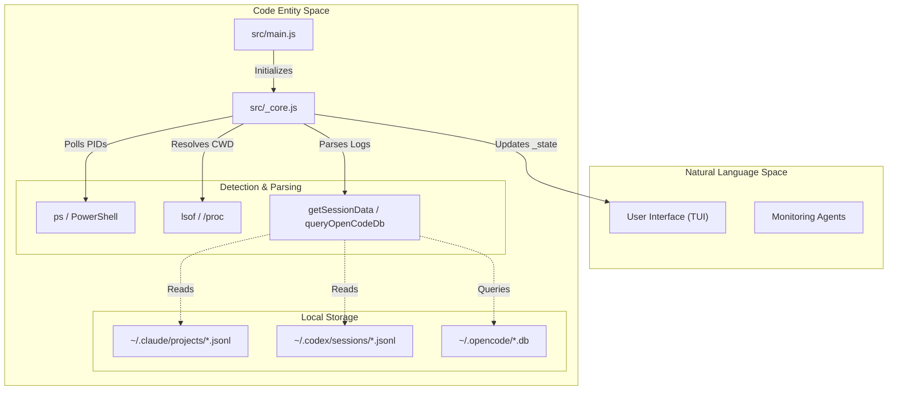
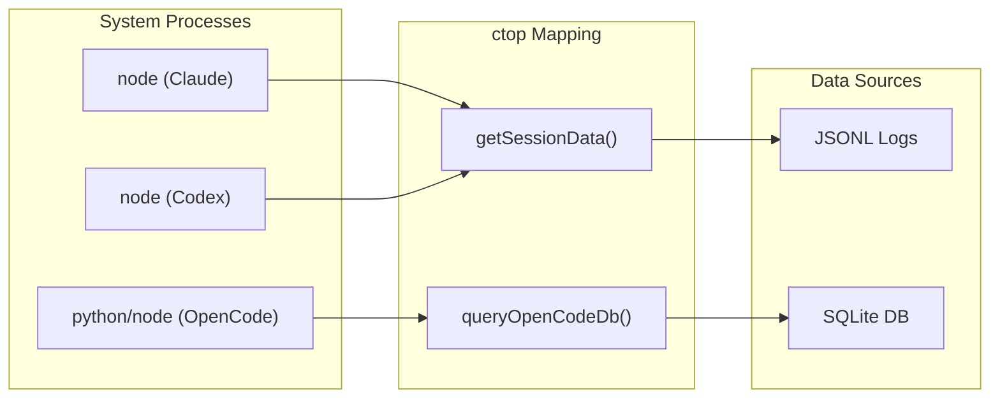

<!-- source: DeepWiki mcp.deepwiki.com · repo aakashadesara/ctop · page 1 Overview · fetched 2026-10-27 -->

# Overview

<details>
<summary>Relevant source files</summary>

The following files were used as context for generating this wiki page:

- [README.md](README.md)
- [docs/index.html](docs/index.html)
- [package.json](package.json)

</details>


`ctop` is a zero-dependency, real-time terminal operations panel designed for monitoring and managing AI coding agents. Often described as "`htop` for AI agents," it provides a unified interface to track CPU usage, memory consumption, token counts, context window utilization, and API costs across multiple concurrent agent sessions.

### Who it is for
`ctop` is built for developers and researchers who frequently run local AI agents—specifically **Claude Code**, **Codex CLI**, and **OpenCode**—and need a high-level view of their resource consumption and conversation state without switching between multiple terminal tabs or log files.

---

## System Workflow

The system operates on a "Poll-Enrich-Render" pipeline. It discovers active processes, maps them to local session data (JSONL or SQLite), and projects that data into a custom TUI.

### Data Flow Diagram

The following diagram illustrates how `ctop` bridges system-level process information with agent-specific session data.

"CTOP Data Flow"

Sources: [src/main.js:1-15](), [src/_core.js:1080-1110](), [README.md:108-111]()

---

## Core Capabilities

`ctop` provides a rich set of features for real-time agent management:

| Feature | Description |
| :--- | :--- |
| **Multi-Agent Support** | Monitors Claude Code, Codex CLI, and OpenCode simultaneously [README.md:14-14](). |
| **Context Tracking** | Visualizes input, cache, and output tokens within the context window [README.md:15-15](). |
| **Cost Estimation** | Calculates real-time API costs based on current model pricing [README.md:16-16](). |
| **Process Control** | Supports graceful (SIGTERM) or forced (SIGKILL) termination of agents [README.md:70-71](). |
| **TUI Modes** | Toggle between a dense List view and a card-based Pane view [README.md:18-18](). |

---

## Getting Started

`ctop` is a zero-dependency Node.js application that can be installed via npm or Homebrew. It requires Node.js 18+ and supports macOS, Linux, and Windows.

```bash
# Quick start with npx
npx ctop-claude
```

Upon startup, `ctop` initializes its state, checks for the presence of supported agents, and enters its main refresh loop. If no agents are detected, it displays an empty state until an agent process is started.

For detailed installation instructions and first-run configuration, see **[Getting Started](#1.1)**.

Sources: [package.json:1-10](), [README.md:32-52]()

---

## Supported AI Agents

`ctop` does not use network APIs to monitor agents. Instead, it inspects local system state and files to reconstruct the session history.

### Agent Detection Mapping

"Agent Detection & Data Mapping"


The application specifically targets:
*   **Claude Code**: Parsed from `~/.claude/projects/` using a dual-buffer JSONL parser [src/_core.js:520-550]().
*   **Codex CLI**: Monitored via `~/.codex/sessions/` [README.md:110-110]().
*   **OpenCode**: Monitored via local SQLite databases [README.md:110-110]().

For details on how each agent is detected and parsed, see **[Supported AI Agents](#1.2)**.

Sources: [src/_core.js:480-500](), [README.md:108-111]()

---

