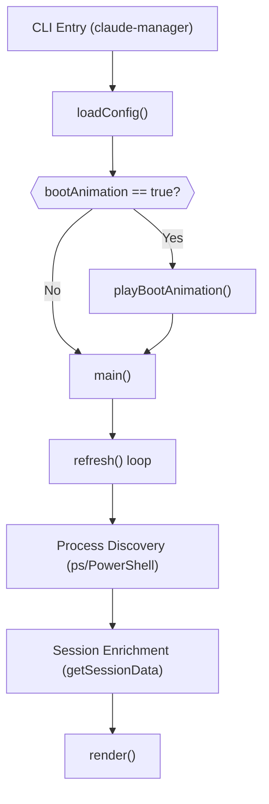
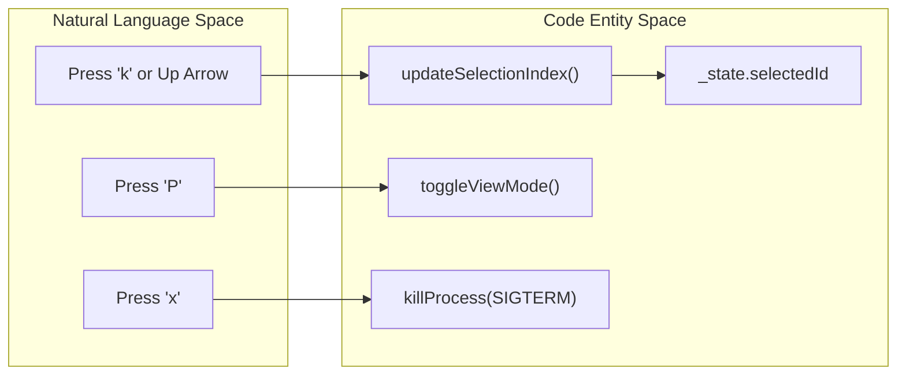

<!-- source: DeepWiki mcp.deepwiki.com · repo aakashadesara/ctop · page 1.1 Getting Started · fetched 2026-10-27 -->

# Getting Started

<details>
<summary>Relevant source files</summary>

The following files were used as context for generating this wiki page:

- [README.md](README.md)
- [package.json](package.json)
- [test/boot.test.js](test/boot.test.js)
- [test/config.test.js](test/config.test.js)
- [test/session.test.js](test/session.test.js)

</details>


`ctop` is a terminal operations panel designed to monitor and manage AI coding agent sessions including Claude Code, Codex CLI, and OpenCode [README.md:1-10](). It functions similarly to `htop`, providing real-time visibility into CPU usage, memory consumption, token counts, and API costs [README.md:8-21]().

## Installation

`ctop` is distributed via npm and Homebrew, and requires **Node.js 18+** [README.md:32-43, 133-134]().

### via npm
```bash
# Global installation
npm install -g ctop-claude

# Run without installing
npx ctop-claude
```
Sources: [README.md:38-43](), [package.json:2-8]()

### via Homebrew
```bash
brew tap aakashadesara/ctop && brew install ctop-claude
```
Sources: [README.md:35-36]()

### From Source
```bash
git clone https://github.com/aakashadesara/ctop.git
chmod +x ctop/claude-manager
ln -s "$(pwd)/ctop/claude-manager" /usr/local/bin/ctop
```
Sources: [README.md:44-48]()

## First Run and Boot Sequence

When `ctop` is executed via the `claude-manager` entry point, it initializes the configuration and checks for the `bootAnimation` setting [claude-manager:1-10 (implied)]().

1.  **Boot Animation**: By default, `ctop` plays a terminal animation. This can be bypassed using the `--no-animation` flag or by setting `bootAnimation: false` in the configuration [test/boot.test.js:7-18, 55-68]().
2.  **Process Discovery**: The engine scans for active agent processes. If no agents are running, the TUI displays an empty state until a session is detected [README.md:50-51]().
3.  **Default View**: The application starts in **List View** unless configured otherwise via `--pane` or the `defaultView` config key [README.md:85-89, 97]().

### CLI Entry and Initialization Flow
The following diagram illustrates the boot sequence from the CLI to the main loop.

**Title: ctop Boot Sequence**

Sources: [claude-manager:1-50 (implied)](), [test/boot.test.js:71-87](), [README.md:108-111]()

## CLI Flags

Command-line flags provide immediate overrides for the session behavior.

| Flag | Description | Default |
| :--- | :--- | :--- |
| `--refresh <seconds>` | Sets the interval for UI updates. | `5` |
| `--context-limit <n>` | Sets the total token context window size. | `1,000,000` |
| `--pane` | Starts the TUI in Pane (Card) view mode. | `list` |
| `--no-animation` | Disables the startup boot animation. | `false` |

Sources: [README.md:83-89](), [test/boot.test.js:55-68](), [test/config.test.js:13-19]()

## Configuration File (`~/.ctoprc`)

Persistent settings are stored in a JSON file located at `~/.ctoprc`. This file is loaded during the `loadConfig()` phase [test/config.test.js:8-12]().

### Supported Configuration Keys
- `refreshInterval`: Integer (milliseconds) [test/config.test.js:53-58]().
- `contextLimit`: Integer (total tokens) [test/config.test.js:60-65]().
- `defaultView`: String (`"list"` or `"pane"`) [test/config.test.js:67-72]().
- `theme`: String (`"default"`, `"minimal"`, `"dracula"`, `"solarized"`, `"monokai"`) [test/config.test.js:74-79]().
- `bootAnimation`: Boolean [test/boot.test.js:40-45]().
- `notifications`: Object containing `enabled` (bool) and `minDuration` (int) [README.md:100]().

### Example `.ctoprc`
```json
{
  "refreshInterval": 5000,
  "contextLimit": 200000,
  "defaultView": "list",
  "theme": "dracula",
  "bootAnimation": true
}
```
Sources: [README.md:91-102](), [test/config.test.js:30-94]()

## Basic Navigation and Controls

The TUI responds to the following primary keyboard shortcuts for navigation and view management:

- **Navigation**: Use `j`/`k` (or arrow keys) to move the selection. In Pane mode, `h`/`l` allow horizontal navigation [README.md:58-59]().
- **View Toggles**: 
    - `P`: Switch between List and Pane view [README.md:61]().
    - `L`: Toggle the log pane for the selected session [README.md:66]().
    - `d`: Show/hide the aggregate Dashboard [README.md:65]().
- **Sorting/Filtering**:
    - `s` / `S`: Cycle through sort modes (CPU, Mem, Context, etc.) [README.md:62]().
    - `/`: Open the filter prompt [README.md:63]().
- **Process Management**:
    - `x`: Gracefully kill (SIGTERM) the selected agent [README.md:70]().
    - `X`: Force kill (SIGKILL) the selected agent [README.md:70]().

### Navigation Mapping
The following diagram maps physical user interactions to the internal state updates.

**Title: User Interaction to Code Entity Mapping**

Sources: [README.md:54-76](), [package.json:4-7]()

## Data Flow: First Refresh

Upon the first refresh cycle, `ctop` executes the following logic:
1.  **Process Scan**: Calls platform-specific commands (`ps aux` on Unix, `Get-Process` on Windows) [README.md:108-111, 134]().
2.  **CWD Resolution**: Resolves the Current Working Directory (CWD) of the process to identify the project [README.md:110]().
3.  **Session Mapping**: Matches the CWD or PID to session files (e.g., `~/.claude/projects/` JSONL files) [README.md:110]().
4.  **Parsing**: Invokes `getSessionData()` to extract the session title, model, and token usage from the JSONL logs [test/session.test.js:8-35]().
5.  **Rendering**: The `render()` function calculates the layout and draws the ANSI interface to the terminal [README.md:18-21]().

Sources: [README.md:108-111](), [test/session.test.js:6-7]()

---

