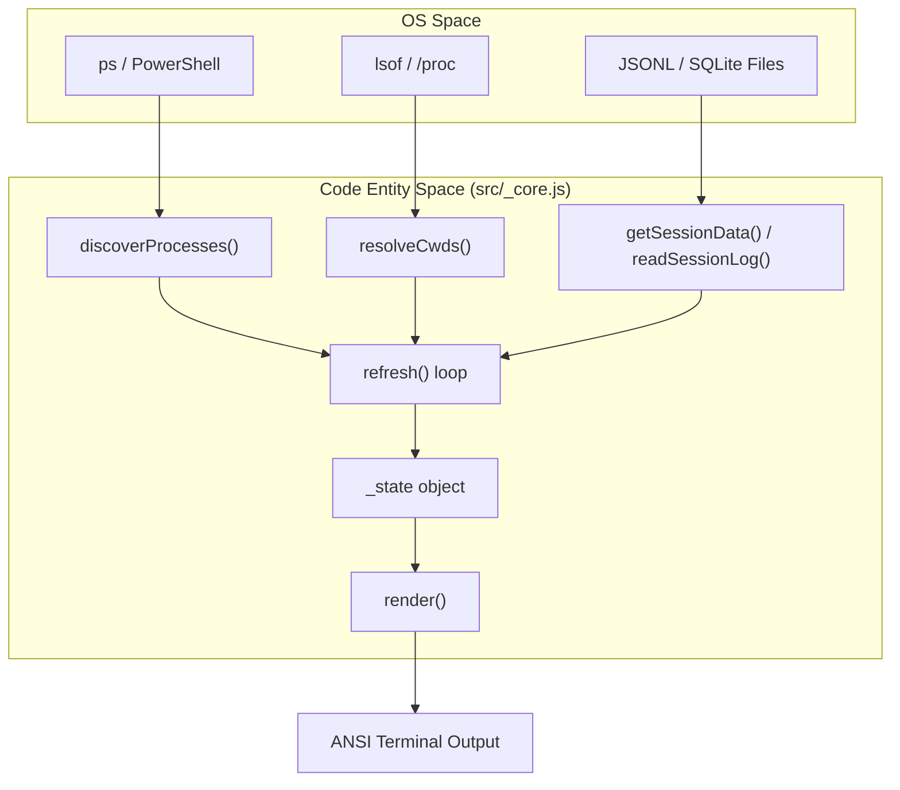
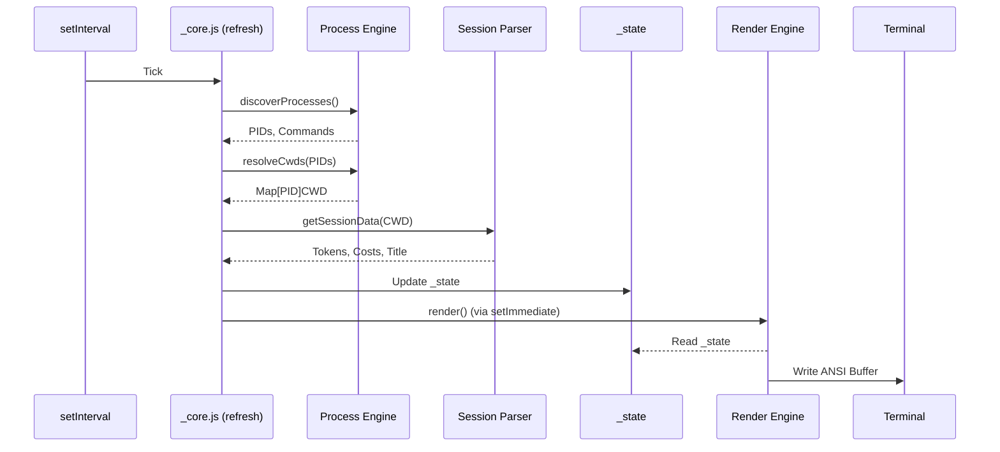

<!-- source: DeepWiki mcp.deepwiki.com · repo aakashadesara/ctop · page 2 Core Architecture · fetched 2026-10-27 -->

# Core Architecture

Relevant source files

The following files were used as context for generating this wiki page:

- [src/_core.js](src/_core.js)
- [src/main.js](src/main.js)
- [src/process.js](src/process.js)
- [src/session.js](src/session.js)
- [src/state.js](src/state.js)
- [test/animations.test.js](test/animations.test.js)
- [test/caching.test.js](test/caching.test.js)

The `ctop` architecture is built around a centralized **Poll-Enrich-Render** pipeline. It operates as a high-performance monitor that observes external AI agent processes (Claude Code, Codex, OpenCode), correlates them with their respective local session storage (JSONL or SQLite), and projects a real-time TUI dashboard.

## Module Layout and Single Source of Truth

The codebase follows a "monolithic core, thin facade" pattern. The primary logic resides in `src/_core.js`, which contains the state, business logic, and rendering engine. Other files in `src/` act as categorized re-exports to provide a cleaner API for testing and external integration.

| File | Role |
| :--- | :--- |
| `src/_core.js` | **Single Source of Truth**. Contains all logic from process detection to ANSI rendering. |
| `src/main.js` | Main entry point; re-exports the entire core. [src/main.js:1-5]() |
| `src/process.js` | Facade for platform detection and process management utilities. [src/process.js:1-12]() |
| `src/session.js` | Facade for session parsing, log tailing, and file discovery. [src/session.js:1-11]() |
| `src/state.js` | Provides access to the global `_state` and `_notif` objects. [src/state.js:1-8]() |

**Sources:** [src/_core.js:1-2](), [src/main.js:1-5](), [src/process.js:1-12]()

---

## The Poll-Enrich-Render Pipeline

`ctop` operates on a non-blocking interval defined by `config.refreshInterval` [src/_core.js:147](). Each tick executes a three-stage pipeline to transform raw OS process data into a rich visual state.

### 1. Poll (Discovery)
The system identifies active agent processes by scanning the process table. On Unix-like systems, it filters `ps` output; on Windows, it utilizes `Get-Process` via PowerShell. This stage populates the initial list of PIDs and their associated commands.
*   **For details, see [Process Detection Engine](#2.1).**

### 2. Enrich (Data Correlation)
For every detected PID, the engine resolves the Current Working Directory (CWD). This CWD is used as a key to locate session files:
*   **Claude Code:** Searches `~/.claude/projects/` for JSONL logs.
*   **Codex CLI:** Searches `.codex/sessions/` within the project root.
*   **OpenCode:** Queries a local SQLite database.
Metrics like token usage and costs are calculated during this phase.
*   **For details, see [Session Data Parsing](#2.2) and [Metrics and Cost Engine](#5).**

### 3. Render (Visual Output)
The enriched data is passed to the rendering engine. `ctop` does not use a TUI library like `blessed`; instead, it manually constructs ANSI buffers. To maintain performance, rendering is coalesced using `setImmediate` to prevent redundant draws if multiple state changes occur in a single event loop tick.
*   **For details, see [TUI Rendering System](#3).**

### Architecture Flow Diagram

**Sources:** [src/_core.js:147-155](), [test/caching.test.js:8-44]()

---

## Subsystem Overviews

### Process Detection Engine
Discovers AI agent processes across platforms. It manages a `pidCwdCache` to avoid expensive `lsof` calls on every tick and handles platform-specific path normalization (e.g., converting Windows paths to project identifiers).
*   **Key Entities:** `IS_MAC`, `IS_LINUX`, `IS_WIN`, `resolveCwds`, `pidCwdCache`.
*   **Details:** [Process Detection Engine](#2.1)

### Session Data Parsing
A multi-format parser that handles Claude's JSONL dual-buffer logs, Codex session metadata, and OpenCode SQLite queries. It includes a caching layer that checks `mtime` and `size` before re-parsing files.
*   **Key Entities:** `getSessionData`, `getCodexSessionData`, `queryOpenCodeDb`, `readSessionLog`.
*   **Details:** [Session Data Parsing](#2.2)

### State Management
A centralized `_state` object tracks the currently selected process, view modes (List vs. Pane), and historical token data. It includes a `tokenHistory` Map for calculating per-second throughput and a `refresh` re-entry guard.
*   **Key Entities:** `_state`, `_notif`, `tokenHistory`, `SNAPSHOT_INTERVAL`.
*   **Details:** [State Management](#2.3)

### Configuration System
Manages the hierarchy of settings, merging hardcoded defaults with `~/.ctoprc` and CLI flags. It validates themes and refresh intervals during initialization.
*   **Key Entities:** `DEFAULT_CONFIG`, `loadConfig`, `THEMES`.
*   **Details:** [Configuration System](#2.4)

### Component Interaction Diagram

**Sources:** [src/_core.js:147-182](), [test/animations.test.js:10-11]()

---

