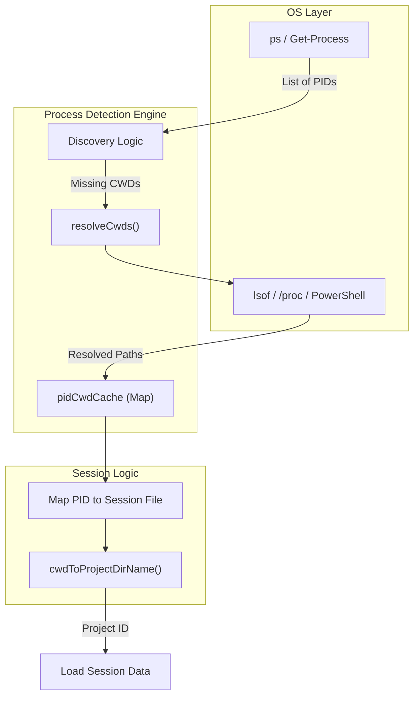
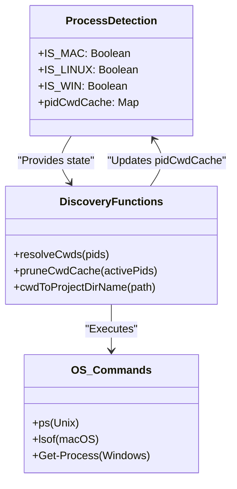

<!-- source: DeepWiki mcp.deepwiki.com · repo aakashadesara/ctop · page 2.1 Process Detection Engine · fetched 2026-10-27 -->

# Process Detection Engine

Relevant source files

The following files were used as context for generating this wiki page:

- [src/_core.js](src/_core.js)
- [src/process.js](src/process.js)
- [test/animations.test.js](test/animations.test.js)
- [test/caching.test.js](test/caching.test.js)
- [test/heatmap.test.js](test/heatmap.test.js)
- [test/quick-jump.test.js](test/quick-jump.test.js)
- [test/windows.test.js](test/windows.test.js)

The **Process Detection Engine** is the subsystem responsible for the discovery and identification of active AI agent processes. It bridges the gap between the operating system's process table and `ctop`'s internal session state by resolving process IDs (PIDs) to their respective working directories (CWDs) and agent-specific metadata.

## Overview

The engine operates on a poll-based cycle, triggered by the `refreshInterval` defined in the configuration [src/_core.js:147-147](). It uses platform-specific commands to scan the system for processes matching the signatures of supported agents (Claude Code, Codex CLI, and OpenCode).

### Key Responsibilities
1.  **Process Discovery**: Identifying PIDs associated with agent binaries across macOS, Linux, and Windows.
2.  **CWD Resolution**: Determining the directory where the agent is running to locate its session logs.
3.  **Caching**: Minimizing system overhead by persisting PID-to-CWD mappings to avoid expensive `lsof` or PowerShell calls.

## Platform-Specific Discovery

Process detection logic branches based on the host operating system using the `IS_MAC`, `IS_LINUX`, and `IS_WIN` flags [src/_core.js:11-13]().

### Unix-like Systems (macOS & Linux)
On macOS and Linux, `ctop` executes the `ps` command to retrieve a list of running processes. It filters for specific agent signatures:
*   **Claude Code**: Processes matching `claude` or `claude-code`.
*   **Codex CLI**: Processes matching `codex`.
*   **OpenCode**: Processes matching `opencode`.

### Windows
On Windows, the engine utilizes PowerShell's `Get-Process` via `execSync` to retrieve process information. It specifically looks for `node` processes and inspects their command lines to identify agent invocations [src/_core.js:13-13]().

## CWD Resolution and `resolveCwds`

The most expensive part of process detection is resolving the Current Working Directory (CWD) for a PID. `ctop` implements a batched resolution strategy to optimize performance.

### Implementation Details
The `resolveCwds` function handles the resolution of directories for a list of PIDs.
*   **macOS**: Uses `lsof -p <PID> -a -d cwd -Fn` in a batched manner to find the `n` (name) field for the `cwd` file descriptor.
*   **Linux**: Directly reads the `/proc/<PID>/cwd` symbolic link using `fs.readlinkSync`.
*   **Windows**: Queries the `Path` property of the process object via PowerShell.

### Data Flow: Process to Session Mapping

The following diagram illustrates how a raw system PID is enriched with CWD data and mapped to a session file.

**Title: PID to Session Resolution Pipeline**

Sources: [src/_core.js:10-13](), [src/process.js:1-11]()

## Caching Strategy

To maintain a high UI refresh rate without saturating CPU, `ctop` employs the `pidCwdCache`.

### `pidCwdCache`
This is a module-level `Map` that stores `PID -> CWD` mappings. 
*   **Lookup**: Before calling `resolveCwds`, the engine checks if the PID is already in the cache.
*   **Pruning**: The `pruneCwdCache` function is called during every refresh cycle. It compares the PIDs currently found in the system against the cache and removes entries for PIDs that no longer exist [src/_core.js:1-2]().

### Project Directory Normalization
Once a CWD is resolved, it must be converted into a format suitable for finding session files (e.g., Claude Code uses a slugified path). The `cwdToProjectDirName` function handles this transformation by replacing path separators with dashes and removing drive letters on Windows [src/process.js:10-10]().

| Platform | Input Path | Output Slug (`cwdToProjectDirName`) |
| :--- | :--- | :--- |
| **macOS/Linux** | `/Users/dev/project` | `-Users-dev-project` |
| **Windows** | `C:\Users\dev\project` | `C-Users-dev-project` |

Sources: [test/windows.test.js:80-104](), [src/process.js:10-10]()

## Implementation Mapping

The following diagram bridges the natural language concepts of "Process Detection" to the specific entities in the `src/_core.js` and `src/process.js` files.

**Title: Detection Engine Code Entities**

Sources: [src/_core.js:10-13](), [src/process.js:1-11](), [test/windows.test.js:16-35]()

## Key Functions

### `resolveCwds(pids)`
The core logic for extracting directory information from the OS. It includes platform-specific optimizations, such as using `lsof`'s batch mode on macOS to resolve multiple PIDs in a single process spawn.

### `pruneCwdCache(activePids)`
Ensures memory stability by clearing stale PID entries. If a process terminates, its entry is removed from the `pidCwdCache` to prevent collisions if the OS reuses the PID later.

### `buildKillCommand(pid, force)`
Constructs the appropriate command to terminate a detected process.
*   **Unix**: Returns `kill -15 <pid>` (graceful) or `kill -9 <pid>` (force) [test/windows.test.js:73-77]().
*   **Windows**: Returns `taskkill /PID <pid>` or `taskkill /F /PID <pid>` [test/windows.test.js:63-71]().

Sources: [src/process.js:9-9](), [test/windows.test.js:37-78]()

---

