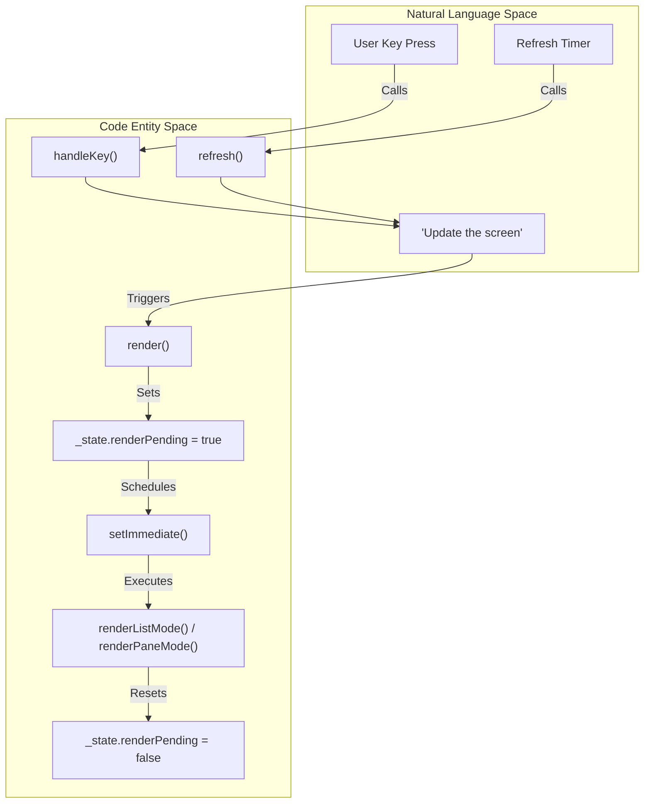
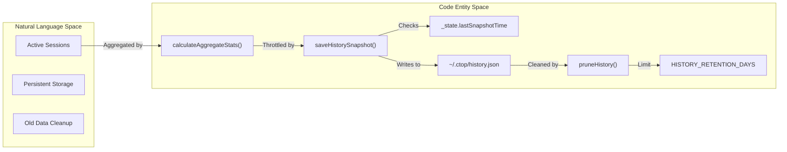

<!-- source: DeepWiki mcp.deepwiki.com · repo aakashadesara/ctop · page 2.3 State Management · fetched 2026-10-27 -->

# State Management

Relevant source files

The following files were used as context for generating this wiki page:

- [claude-manager](claude-manager)
- [src/_core.js](src/_core.js)
- [src/state.js](src/state.js)
- [test/animations.test.js](test/animations.test.js)
- [test/caching.test.js](test/caching.test.js)
- [test/history.test.js](test/history.test.js)
- [test/search.test.js](test/search.test.js)
- [test/themes.test.js](test/themes.test.js)

The `ctop` TUI maintains a centralized global state to manage process data, UI transitions, notifications, and historical metrics. This state is updated through a throttled refresh cycle that coordinates data polling, token tracking, and screen rendering.

## The Global State Objects

The system relies on two primary state containers defined in `src/_core.js` and re-exported via `src/state.js` for modular access [src/state.js:1-8]().

### `_state` Object
The `_state` object is the single source of truth for the application's runtime data. It tracks everything from the current list of active processes to TUI animation frames.

| Key | Description |
| :--- | :--- |
| `procs` | Array of enriched process objects representing AI agent sessions [src/_core.js:197-197](). |
| `selectedIndex` | The index of the currently highlighted row in the list or pane view [src/_core.js:198-198](). |
| `scrollOffset` | Vertical scroll position for the list view [src/_core.js:199-199](). |
| `tokenHistory` | A `Map` storing historical token rates for sparkline visualizations [src/_core.js:203-203](). |
| `isRefreshing` | Re-entry guard flag to prevent overlapping poll cycles [src/_core.js:207-207](). |
| `renderPending` | Flag for coalescing multiple render requests into a single `setImmediate` call [src/_core.js:208-208](). |
| `lastSnapshotTime` | Timestamp of the last history persistence event [src/_core.js:205-205](). |

### `_notif` Object
A specialized state object for the TUI notification system. It manages the message queue and the visual "toast" duration [src/_core.js:213-217]().

### `tokenHistory` Map
This `Map` uses PIDs as keys and stores arrays of recent token usage samples. It is used to calculate the deltas for token rates (e.g., tokens/sec) and to populate the `renderWaveformSparkline` component [src/_core.js:203-203]().

**Sources:** [src/_core.js:195-217](), [src/state.js:1-8]()

## The Refresh Cycle and Re-entry Guard

The application state is updated via the `refresh()` function, which is typically invoked by a `setInterval` based on the `refreshInterval` configuration [src/_core.js:147-147](). To prevent performance degradation or race conditions when polling takes longer than the interval (e.g., slow `lsof` calls), `ctop` implements a re-entry guard.

### Refresh Flow
1. **Guard Check**: The function checks `_state.isRefreshing`. If `true`, the cycle is skipped [src/_core.js:2460-2461]().
2. **Poll & Enrich**: It triggers `scanForProcesses()` to find agent PIDs and `getSessionData()` to parse logs [src/_core.js:2463-2465]().
3. **State Update**: New process data is merged into `_state.procs`.
4. **History Persistence**: It calls `saveHistorySnapshot()` to potentially write to disk [src/_core.js:2475-2475]().
5. **Render Trigger**: It calls `render()` to update the TUI [src/_core.js:2477-2477]().

**Sources:** [src/_core.js:2458-2481]()

## Render Coalescing via `setImmediate`

To ensure the UI remains responsive and avoids "flicker" during rapid state changes (like keyboard input or simultaneous process updates), `ctop` uses a coalescing pattern in the `render()` function.

Instead of drawing to the terminal immediately, the `render()` function sets a `renderPending` flag and schedules the actual drawing logic using `setImmediate()` [src/_core.js:2445-2453](). This ensures that if multiple state updates occur within the same event loop tick, only one expensive terminal write is performed.

### Natural Language to Code: Render Logic

**Sources:** [src/_core.js:2444-2456](), [test/animations.test.js:108-119]()

## History Persistence and `SNAPSHOT_INTERVAL`

While `tokenHistory` tracks short-term volatility for animations, long-term metrics are managed by the history snapshot system. This system persists aggregate stats to `~/.ctop/history.json` [test/history.test.js:21-22]().

### Throttling Snapshots
To minimize disk I/O, `saveHistorySnapshot()` is throttled by `SNAPSHOT_INTERVAL` (defaulting to 60,000ms).
- The function compares `Date.now()` against `_state.lastSnapshotTime` [test/history.test.js:103-115]().
- If the interval has passed, it aggregates current `_state.procs` data and appends a new entry to the history file [test/history.test.js:121-134]().
- It then calls `pruneHistory()` to remove entries older than `HISTORY_RETENTION_DAYS` (7 days) [test/history.test.js:36-52]().

### Natural Language to Code: History Flow

**Sources:** [test/history.test.js:7-18](), [test/history.test.js:36-52](), [test/history.test.js:103-134]()

---

