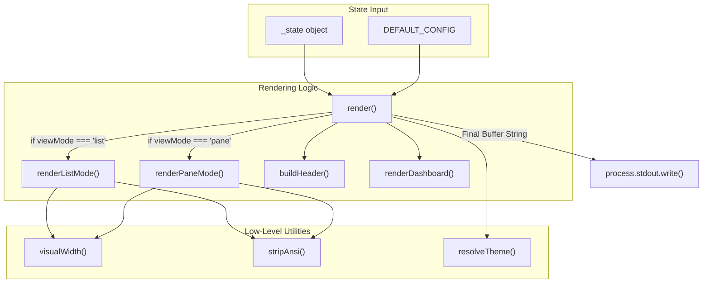
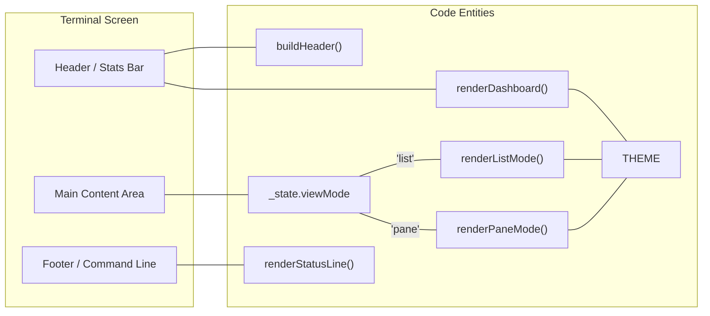

<!-- source: DeepWiki mcp.deepwiki.com · repo aakashadesara/ctop · page 3 TUI Rendering System · fetched 2026-10-27 -->

# TUI Rendering System

Relevant source files

The following files were used as context for generating this wiki page:

- [docs/index.html](docs/index.html)
- [src/_core.js](src/_core.js)
- [src/render.js](src/render.js)
- [test/animations.test.js](test/animations.test.js)
- [test/caching.test.js](test/caching.test.js)

The `ctop` terminal user interface is built using a custom rendering engine that constructs the UI by manually building ANSI escape sequences into a string buffer. Unlike traditional TUI applications that rely on high-level libraries like `blessed` or `ink`, `ctop` operates directly on the terminal's raw output stream, calculating layouts and widths manually to ensure maximum performance and minimal dependencies.

## Manual Buffer Construction

The core of the rendering system is the `render()` function, which orchestrates the construction of the entire screen. It utilizes standard ANSI escape codes for screen management and styling.

| Escape Code | Code Entity | Purpose |
|:---|:---|:---|
| `\x1b[2J\x1b[H` | `CLEAR` | Clears the entire terminal and homes the cursor. |
| `\x1b[H` | `HOME` | Moves the cursor to the top-left (0,0) without clearing. |
| `\x1b[K` | `CLR_LINE` | Clears from the cursor position to the end of the line. |
| `\x1b[?25l` | `HIDE_CURSOR` | Prevents the terminal cursor from flickering during redraws. |

Sources: [`src/_core.js:15-22`]()

## Layout and Visual Width

Because `ctop` supports Unicode characters, emojis, and Braille patterns, it cannot rely on simple string length for layout. It uses a custom `visualWidth` utility powered by `Intl.Segmenter` to calculate the actual horizontal space occupied by characters in the terminal.

- **`visualWidth(str)`**: Calculates the true width of a string, accounting for wide characters (CJK) and emojis [`src/_core.js:122-127`]().
- **`visualTruncate(str, maxWidth)`**: Safely clips strings that exceed column widths without breaking multi-byte characters [`src/_core.js:129-138`]().
- **`visualPadEnd(str, width)`**: Ensures consistent column alignment regardless of character width [`src/_core.js:140-143`]().

Sources: [`src/_core.js:88-143`]()

## Primary View Modes

The system supports two distinct layout engines, toggled by the user via keyboard shortcuts or configuration.

### List View
The `renderListMode` function builds a traditional tabular interface. It calculates column widths dynamically, including any third-party columns loaded via the [Plugin System](#6.1). It uses `fmtRow` to assemble individual process data into a single line of styled text.

### Pane View
The `renderPaneMode` function implements a card-grid layout. It uses `getCardsPerRow` to determine how many cards can fit horizontally based on the current terminal width (`process.stdout.columns`). Each card displays high-density metrics and a small waveform visualization.

For details on these layouts, see [List View and Pane View](#3.1).

## Rendering Pipeline

The following diagram illustrates how the `render` function transforms the global state into a final ANSI string buffer.

### TUI Assembly Flow

Sources: [`src/_core.js:1440-1480`](), [`src/_core.js:75-83`](), [`src/_core.js:122-127`]()

## Subsystems

The rendering engine is divided into three specialized subsystems:

### [List View and Pane View](#3.1)
Covers the implementation of the main data displays. Includes logic for the "Dashboard" (the global stats bar), the `buildHeader` logic for columns, and the responsive card-grid used in Pane mode.

### [Visualizations: Braille Bars, Sparklines, and Waveforms](#3.2)
Details the high-density graphical components. `ctop` uses Braille patterns (`renderBrailleBar`) to represent memory/context usage and custom ASCII/Unicode waveforms (`renderMessageWaveform`) to show session activity over time.

### [Animation and Theming](#3.3)
Explains the 30 FPS animation loop (`scheduleAnimationFrame`) used for smooth transitions of context bars and the selection cursor. It also covers the theme engine which maps logical UI keys (like `ctxLow`, `active`, `border`) to specific ANSI color sequences across five built-in themes.

## Rendering Entity Map

This diagram maps the conceptual TUI regions to the specific functions and variables in the codebase.

Sources: [`src/_core.js:1440-1550`](), [`src/_core.js:85-87`]()

---

