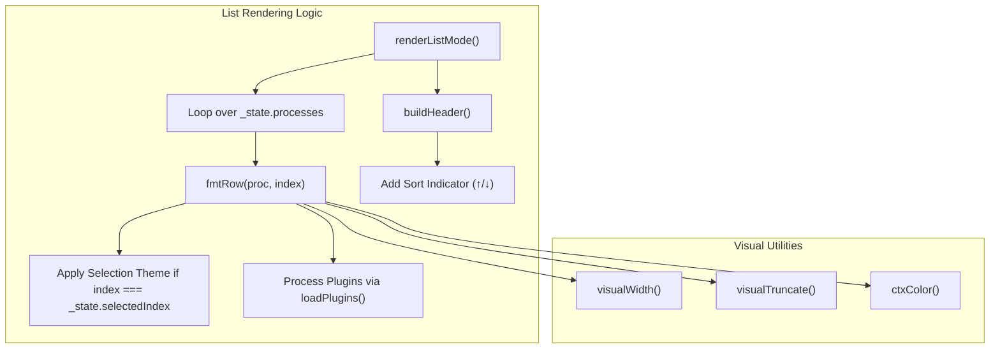
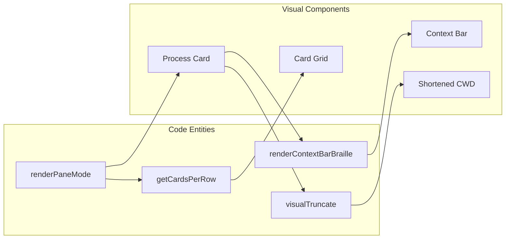

<!-- source: DeepWiki mcp.deepwiki.com · repo aakashadesara/ctop · page 3.1 List View and Pane View · fetched 2026-10-27 -->

# List View and Pane View

Relevant source files

The following files were used as context for generating this wiki page:

- [src/_core.js](src/_core.js)
- [src/render.js](src/render.js)
- [test/animations.test.js](test/animations.test.js)
- [test/caching.test.js](test/caching.test.js)
- [test/dashboard.test.js](test/dashboard.test.js)
- [test/filter-sort.test.js](test/filter-sort.test.js)
- [test/format.test.js](test/format.test.js)
- [test/status-bar.test.js](test/status-bar.test.js)

The TUI rendering system in `ctop` provides two primary visualization modes for monitoring AI agent processes: **List View** and **Pane View**. Both modes utilize a manual ANSI buffer construction approach to achieve high-performance updates without the overhead of heavy terminal libraries.

## Rendering Pipeline

The rendering process is triggered by a coalesced `render()` call, which determines the current view mode from the global `_state.viewMode` [src/_core.js:2031-2035](). Both modes share a common structure: a top-level Dashboard stats bar, a main content area (List or Pane), and a bottom-level footer/notification area.

### Visual Width and Formatting
To ensure consistent alignment across different terminal emulators and character sets (including CJK and Emojis), `ctop` implements a custom visual width engine:
*   **`visualWidth(str)`**: Calculates the true terminal cell width using `Intl.Segmenter` [src/_core.js:122-127]().
*   **`visualTruncate(str, maxWidth)`**: Safely clips strings that exceed column bounds [src/_core.js:129-138]().
*   **`visualPadEnd(str, width)`**: Adds spaces based on visual width rather than string length [src/_core.js:140-143]().

### The Dashboard Stats Bar
The `renderStatsBar` function generates the top status line, providing an aggregate overview of the system state [src/_core.js:1545-1610]().

| Metric | Implementation Detail |
| :--- | :--- |
| **Process Counts** | Shows "X active" and "Y dead" pills using theme-aware colors [src/_core.js:1554-1558](). |
| **Total Cost** | Aggregates `cost` from all tracked processes and displays it via `formatCost` [src/_core.js:1561-1563](). |
| **Cost Gauge** | A 8-character bar (`buildCostGauge`) visualizing total cost against a cap [test/status-bar.test.js:12-45](). |
| **Context Health** | Displays a status (ok/warn/crit) based on the lowest `contextPct` among active agents [test/status-bar.test.js:47-114](). |

**Sources:** [src/_core.js:122-143](), [src/_core.js:1545-1610](), [test/status-bar.test.js:12-114]()

---

## List View (`renderListMode`)

The List View provides a dense, tabular representation of all discovered processes. It is optimized for monitoring a large number of concurrent sessions.

### Implementation Flow
1.  **Header Construction**: `buildHeader()` generates the column titles with appropriate padding and sort indicators [src/_core.js:1613-1644]().
2.  **Row Formatting**: `fmtRow()` iterates through defined columns (including plugins), applying ANSI styles for the selected row [src/_core.js:1646-1678]().
3.  **Buffer Assembly**: Rows are joined with newlines and written to the terminal buffer.

### Column Layout
Columns are defined with fixed or relative widths. If the terminal width is insufficient, `ctop` prioritizes essential columns (PID, Title, Context) and truncates or hides others.

### List View Architecture

**Sources:** [src/_core.js:1613-1678](), [src/_core.js:1680-1725](), [test/filter-sort.test.js:108-186]()

---

## Pane View (`renderPaneMode`)

The Pane View (or Card View) provides a more visual, grid-based layout. Each process is represented as a "card" containing sparklines and detailed metrics.

### Card-Grid Layout
The layout is dynamic, calculating how many cards can fit horizontally based on the terminal width via `getCardsPerRow()` [src/_core.js:1807-1811]().

*   **Calculation**: `Math.floor(terminalWidth / cardWidth)`.
*   **Selection**: The selected card is highlighted using the `selection` color from the current theme [src/_core.js:1754-1756]().

### Card Content
Each card includes:
1.  **Status Pill**: A colored block indicating if the process is active, stopped, or a zombie [src/_core.js:1745-1750]().
2.  **Visualizations**: Sparklines for CPU/Memory and a Braille-based context bar [src/_core.js:1770-1785]().
3.  **Session Info**: The CWD (shortened), current Git branch, and AI model name [src/_core.js:1758-1768]().

### Pane View Entity Mapping

**Sources:** [src/_core.js:1727-1805](), [src/_core.js:1807-1811](), [src/render.js:8-12]()

---

## Technical Details

### Fixed-Width String Formatting
To maintain the grid, `ctop` uses `fmtRow` to ensure every column occupies its exact allotted width. If a value like a CWD is too long, `shortenCwd` is used to preserve the project directory name while eliding parent paths [src/_core.js:1440-1455]().

### ANSI Styling
Styles are applied by wrapping strings in escape codes defined in the `THEMES` object [src/_core.js:39-70]().
*   **`RESET`**: Always appended after a styled segment to prevent color bleed [src/_core.js:25]().
*   **`HIDE_CURSOR` / `SHOW_CURSOR`**: Used during the render cycle to prevent flickering [src/_core.js:21-22]().

### Selection Animation
When navigating between rows or cards, `_state.prevSelectedIndex` and `_state.selectionAnimFrame` are used to provide a subtle visual transition, though the core rendering remains immediate for responsiveness [test/animations.test.js:122-141]().

**Sources:** [src/_core.js:21-70](), [src/_core.js:1440-1455](), [test/animations.test.js:122-141]()

---

