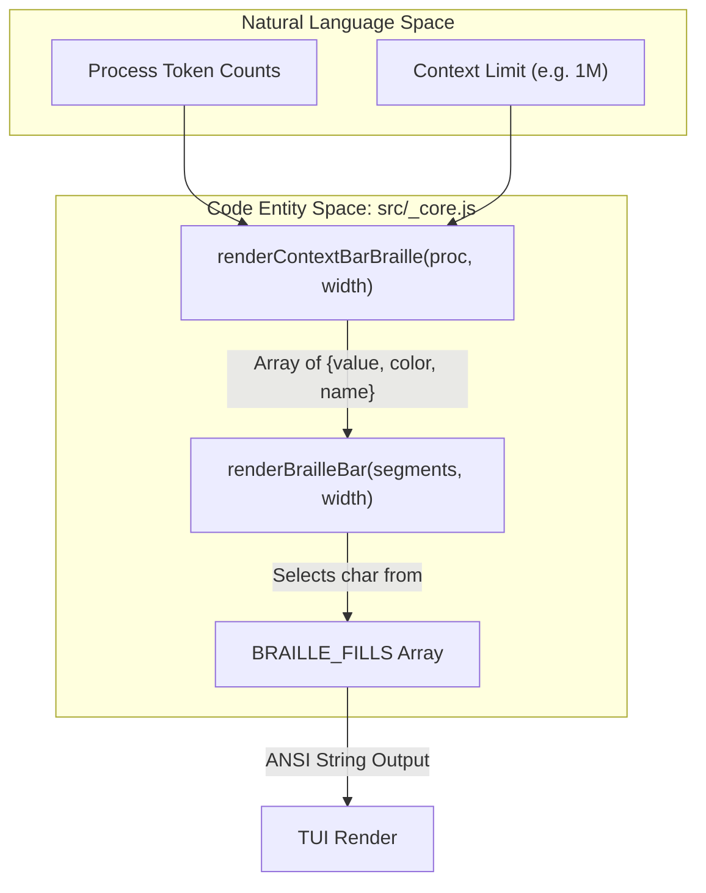
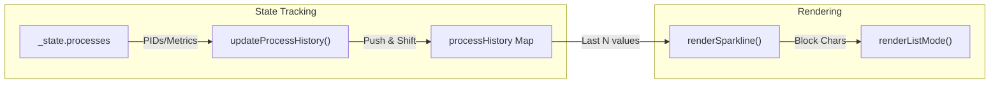

<!-- source: DeepWiki mcp.deepwiki.com · repo aakashadesara/ctop · page 3.2 Visualizations: Braille Bars, Sparklines, and Waveforms · fetched 2026-10-27 -->

# Visualizations: Braille Bars, Sparklines, and Waveforms

Relevant source files

The following files were used as context for generating this wiki page:

- [src/_core.js](src/_core.js)
- [src/render.js](src/render.js)
- [test/animations.test.js](test/animations.test.js)
- [test/braille.test.js](test/braille.test.js)
- [test/caching.test.js](test/caching.test.js)
- [test/sparkline.test.js](test/sparkline.test.js)

This page details the high-density visualization components used in `ctop` to represent complex metrics like context window usage, historical resource consumption, and message activity within a constrained terminal environment.

## Braille-Based Visualizations

`ctop` utilizes Unicode Braille characters (U+2800 to U+28FF) to achieve sub-character resolution. A single terminal cell can represent a 2×4 grid of dots, allowing for significantly higher data density than standard block characters.

### Braille Fill Mechanics
The system defines a scale of 9 characters representing levels of "fill" within a single cell.
- `BRAILLE_FILLS[0]` is the empty pattern (`\u2800`).
- `BRAILLE_FILLS[8]` is the fully filled pattern (`\u28FF`).

[src/_core.js:2031-2032]()

### Context Bar Rendering
The `renderContextBarBraille` function calculates the distribution of the AI context window across five segments: `input`, `cache_write` (cache creation), `cache_read`, `output`, and `free`.

1.  **Normalization**: Token counts are divided by the `contextLimit` (default 1,000,000) to get percentage values [src/_core.js:2076-2085]().
2.  **Segment Mapping**: Each segment is assigned a color from the active theme (e.g., `GREEN` for input, `BLUE` for cache) [src/_core.js:2087-2092]().
3.  **Braille Construction**: The `renderBrailleBar` helper iterates through the requested width, calculating which segment "owns" each of the 8 dots within a Braille character based on the cumulative percentages [src/_core.js:2042-2065]().

### Visual Data Flow: Token Metrics to Braille Bar
The following diagram illustrates how raw process token counts are transformed into the segmented Braille visualization.

**Diagram: Token-to-Braille Transformation**

Sources: [src/_core.js:2031-2103](), [test/braille.test.js:104-131]()

## Sparklines and History

Sparklines provide a compact view of CPU and Memory trends for individual processes, while the History Chart provides a 24-hour aggregate view of token usage.

### Sparkline Implementation
Sparklines are rendered using the `SPARKLINE_BLOCKS` set (`  ▂▃▄▅▆▇█`).
- **Function**: `renderSparkline(values, width)` [src/_core.js:1995-2007]().
- **Data Source**: `processHistory` Map, which stores up to `SPARKLINE_MAX_POINTS` (default 20) for each PID [src/_core.js:2010-2027]().
- **Scaling**: Values are clamped between 0 and 100, then mapped to one of the 8 block heights [src/_core.js:2001-2003]().

### 24-Hour History Chart
The `renderHistoryChart` function generates a full-width visualization of token activity over the last day.
- **Aggregation**: Data is pulled from the `history` object, which persists snapshots to `~/.ctop/history.json` [src/_core.js:2134-2140]().
- **Layout**: It calculates the max value across the history to scale the Y-axis and uses `formatHourLabel` to place time markers along the X-axis [src/_core.js:2145-2160]().

**Diagram: Sparkline State Management**

Sources: [src/_core.js:1995-2029](), [test/sparkline.test.js:69-116]()

## Message Waveforms

Waveforms provide a visual representation of the conversation density and structure within a session.

### Implementation Details
- **`renderMessageWaveform`**: Used in Pane View to show the "shape" of the current session log. It differentiates between `USER` and `ASSISTANT` messages using distinct colors [src/_core.js:2106-2122]().
- **`renderWaveformSparkline`**: A variant used for high-density summaries, often representing message length or frequency over time.

### Component Summary Table

| Component | Function Name | Character Set | Data Source |
| :--- | :--- | :--- | :--- |
| **Context Bar** | `renderContextBarBraille` | Braille (2x4) | `proc.inputTokens`, `proc.outputTokens`, etc. |
| **Resource Trend** | `renderSparkline` | Blocks (▂▃▄▅) | `processHistory` Map (CPU/Mem) |
| **Session Shape** | `renderMessageWaveform` | Mixed Blocks | `readSessionLog` (Message array) |
| **Daily Activity**| `renderHistoryChart` | Mixed Blocks | `~/.ctop/history.json` snapshots |

Sources: [src/_core.js:1995-2165](), [src/render.js:5-12]()

---

