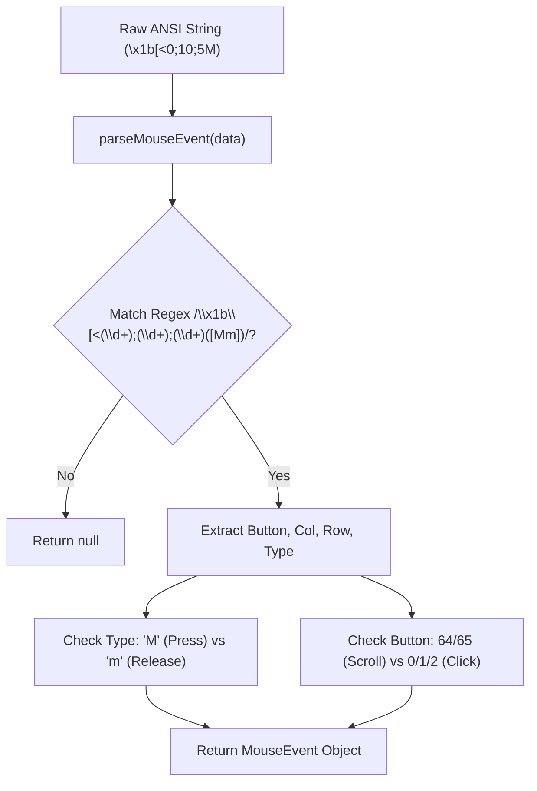
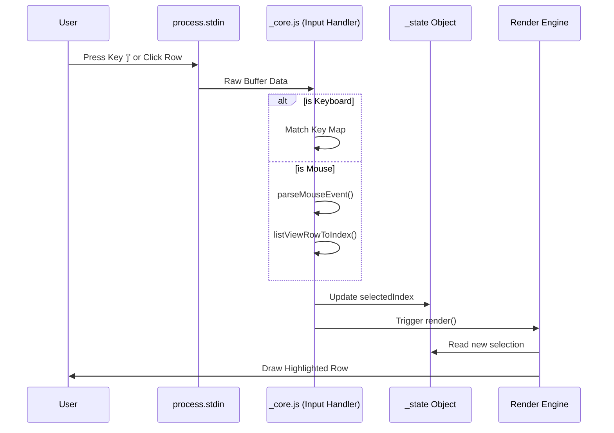

<!-- source: DeepWiki mcp.deepwiki.com · repo aakashadesara/ctop · page 4.1 Keyboard Commands and Mouse Support · fetched 2026-10-27 -->

# Keyboard Commands and Mouse Support

Relevant source files

The following files were used as context for generating this wiki page:

- [README.md](README.md)
- [docs/index.html](docs/index.html)
- [src/input.js](src/input.js)
- [test/mouse.test.js](test/mouse.test.js)

`ctop` implements a custom input handling system that processes raw ANSI escape sequences for both keyboard and mouse interactions. Unlike many terminal applications that rely on high-level libraries like `blessed` or `ink`, `ctop` parses input buffers manually to maintain a zero-dependency architecture and high performance.

## Keyboard Command Reference

Keyboard interactions are managed within the main input loop, which maps key codes to state mutations and function calls.

### Navigation and Selection
| Key | Action | Implementation Detail |
|:---|:---|:---|
| `j` / `↓` | Move Down | Increments `_state.selectedIndex` [src/_core.js:463-465]() |
| `k` / `↑` | Move Up | Decrements `_state.selectedIndex` [src/_core.js:459-461]() |
| `h` / `←` | Move Left | Used in Pane View to navigate cards [src/_core.js:467-469]() |
| `l` / `→` | Move Right | Used in Pane View to navigate cards [src/_core.js:471-473]() |
| `g` | Jump to Top | Sets `_state.selectedIndex = 0` [src/_core.js:475-477]() |
| `G` | Jump to Bottom | Sets `_state.selectedIndex` to last index [src/_core.js:479-481]() |

### View and UI Toggles
| Key | Action | Implementation Detail |
|:---|:---|:---|
| `P` | Toggle View Mode | Switches between `list` and `pane` (grid) modes [src/_core.js:487-489]() |
| `L` | Toggle Log Pane | Shows/hides the side log tailing panel [src/_core.js:495-497]() |
| `d` | Toggle Dashboard | Toggles the aggregate stats header [src/_core.js:503-505]() |
| `H` | Toggle History | Shows the 24-hour token/cost history chart [src/_core.js:507-509]() |
| `W` | Toggle Timeline | Shows the session event timeline [src/_core.js:511-513]() |
| `T` | Cycle Theme | Calls `cycleTheme()` to rotate visual styles [src/_core.js:519-521]() |
| `?` | Help Menu | Toggles the help overlay [src/_core.js:531-533]() |

### Sorting, Filtering, and Search
| Key | Action | Implementation Detail |
|:---|:---|:---|
| `s` | Cycle Sort | Rotates through `SORT_MODES` (cpu, mem, tokens, etc.) [src/_core.js:491-493]() |
| `S` | Reverse Sort | Toggles `_state.sortDesc` boolean [src/_core.js:491-493]() |
| `/` | Filter | Opens input prompt to filter by process name/CWD [src/_core.js:523-525]() |
| `F` | Full-text Search | Searches through session conversation logs [src/_core.js:527-529]() |

### Process Control and Quick-Jump
| Key | Action | Implementation Detail |
|:---|:---|:---|
| `x` | Kill (SIGTERM) | Sends graceful termination signal to selected agent [src/_core.js:543-545]() |
| `X` | Kill (SIGKILL) | Sends immediate force-kill signal [src/_core.js:547-549]() |
| `K` | Kill All | Terminates every monitored agent process [src/_core.js:551-553]() |
| `o` | Open in Finder | Calls `openDirectory(proc, 'finder')` [src/_core.js:535-537]() |
| `e` | Open in Editor | Calls `openDirectory(proc, 'editor')` [src/_core.js:537-539]() |
| `t` | Open in Terminal | Calls `openDirectory(proc, 'terminal')` [src/_core.js:539-541]() |

**Sources:** [src/_core.js:450-560](), [README.md:54-75]()

---

## Mouse Support Implementation

`ctop` supports mouse interactions via XTerm SGR mode (`\x1b[<...M`). This allows users to select rows, scroll through lists, and click cards in pane view.

### Mouse Event Parsing
The `parseMouseEvent(data)` function decodes the ANSI sequence into a structured object.

**Logic Flow: Input to Mouse Event**

**Sources:** [src/_core.js:3380-3405](), [test/mouse.test.js:5-15]()

### Coordinate Mapping
Since the TUI is a text grid, mouse coordinates must be mapped to data indices. This is handled by two primary functions:

1.  **`listViewRowToIndex(row)`**:
    *   Subtracts the header height (which varies based on whether the Dashboard is visible).
    *   Adjusts for the current scroll position (`_state.selectedIndex` offset).
    *   Returns `-1` if the click lands on a header or border [src/_core.js:3407-3420]().
2.  **`paneViewClickToIndex(col, row)`**:
    *   Calculates card position based on `getCardsPerRow()` and terminal width.
    *   Maps the X/Y coordinate to the specific process card index in the grid [src/_core.js:3422-3440]().

**Sources:** [src/_core.js:3407-3440](), [test/mouse.test.js:62-104]()

---

## Technical Data Flow: Interaction to Render

The following diagram illustrates how a user interaction (keyboard or mouse) flows through the system to trigger a UI update.

**Interaction Lifecycle**

**Sources:** [src/_core.js:450-560](), [src/_core.js:3380-3440](), [src/input.js:1-11]()

## Key Functions and Classes

| Entity | File | Role |
|:---|:---|:---|
| `parseMouseEvent` | [src/_core.js:3380]() | Decodes SGR mouse escape sequences into button/col/row/type. |
| `listViewRowToIndex` | [src/_core.js:3407]() | Maps a terminal row coordinate to a process index in List View. |
| `paneViewClickToIndex` | [src/_core.js:3422]() | Maps a terminal (col, row) coordinate to a process index in Pane View. |
| `openDirectory` | [src/_core.js:3340]() | Handles the `o/e/t` keys by spawning platform-specific child processes. |
| `cycleTheme` | [src/_core.js:2950]() | Rotates the `_state.config.theme` and re-resolves theme colors. |

**Sources:** [src/_core.js:3340-3440](), [src/input.js:1-11]()

---

