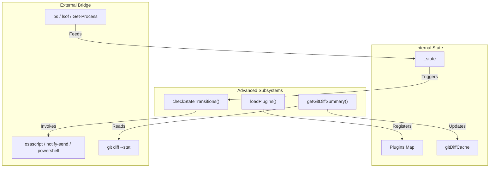
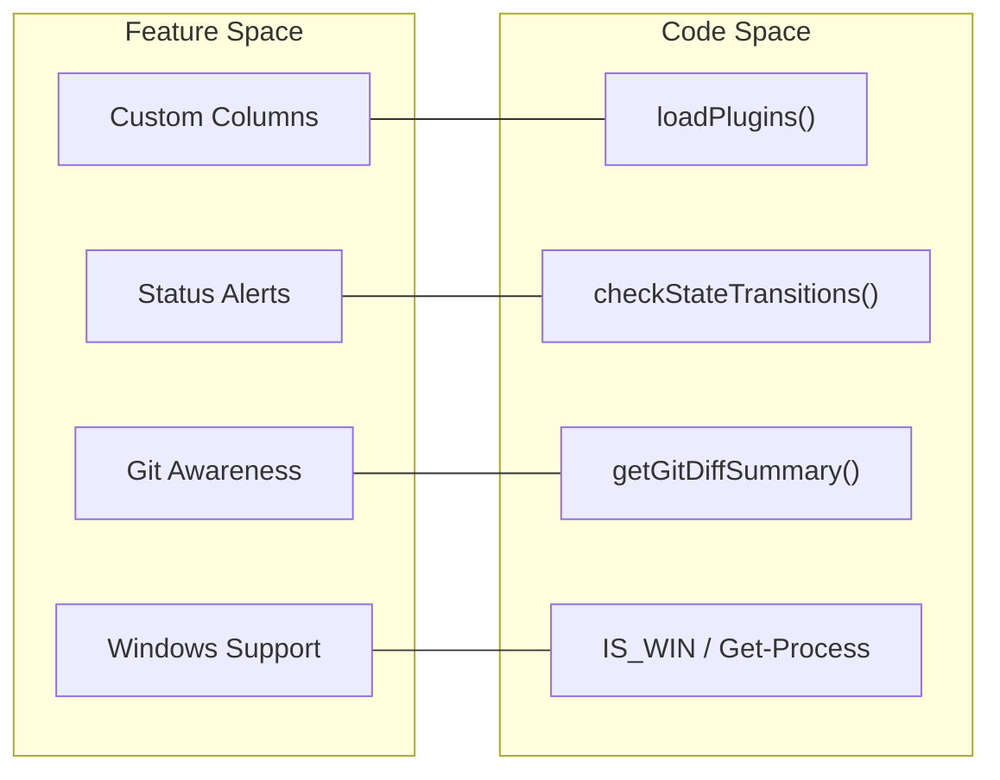

<!-- source: DeepWiki mcp.deepwiki.com · repo aakashadesara/ctop · page 6 Advanced Features · fetched 2026-10-27 -->

# Advanced Features

Relevant source files

The following files were used as context for generating this wiki page:

- [README.md](README.md)
- [src/_core.js](src/_core.js)
- [test/animations.test.js](test/animations.test.js)
- [test/caching.test.js](test/caching.test.js)

`ctop` extends beyond simple process monitoring by providing a suite of advanced capabilities designed for power users and cross-platform environments. These features allow for deep extensibility via plugins, proactive monitoring through desktop notifications, and seamless integration with development workflows like Git.

### Feature Overview

The advanced feature set is built upon the core polling and enrichment pipeline, utilizing platform-specific bridges and local filesystem hooks to provide a comprehensive operations panel.

#### System Interoperability Diagram
This diagram illustrates how the advanced feature modules interact with the core `_state` and the host operating system.

**Advanced Feature Interaction**

Sources: [src/_core.js:1411-1430](), [src/_core.js:1540-1560](), [src/_core.js:1210-1235]()

---

### Plugin System
`ctop` features a zero-dependency plugin architecture that allows users to inject custom columns into the TUI. Plugins are standalone JavaScript modules placed in `~/.ctop/plugins/`. The system uses `loadPlugins()` to dynamically import these modules and append them to the rendering pipeline.

*   **Contract**: A plugin must export an object containing a `name` and a `column` definition (header, width, and a `getValue` function).
*   **Execution**: The `getValue` function receives the enriched process object, allowing plugins to display any data derived from the session or environment.

For implementation details and example code, see **[Plugin System](#6.1)**.

Sources: [src/_core.js:1411-1430](), [README.md:112-127]()

---

### Notifications and Git Integration
To support long-running AI agent tasks, `ctop` includes a cross-platform notification bridge and deep Git awareness.

*   **State Transitions**: The `checkStateTransitions` function monitors the status of agents (e.g., from `active` to `stopped`) and triggers a system notification if the session duration exceeds the `minDuration` threshold defined in `DEFAULT_CONFIG`.
*   **Git Diff Tracking**: The system tracks the "blast radius" of AI changes using `getGitDiffSummary`. It parses `git diff --stat` output via `parseDiffStat` and caches the results in `gitDiffCache` to prevent performance degradation.

For details on notification thresholds and Git parsing, see **[Notifications and Git Integration](#6.2)**.

Sources: [src/_core.js:1540-1560](), [src/_core.js:1210-1235](), [src/_core.js:146-155]()

---

### Cross-Platform Support
`ctop` is designed to run natively on macOS, Linux, and Windows. It achieves this through a series of platform detection constants (`IS_MAC`, `IS_LINUX`, `IS_WIN`) and specialized command builders.

*   **Process Discovery**: While Unix systems use `ps` and `lsof`, Windows support is implemented via PowerShell's `Get-Process`.
*   **Process Control**: The `buildKillCommand` abstracts the differences between Unix `kill` signals and Windows `taskkill /F`.
*   **Path Normalization**: Functions like `cwdToProjectDirName` ensure that session files are correctly mapped regardless of the OS path separators.

For a deep dive into platform-specific implementations, see **[Cross-Platform Support](#6.3)**.

Sources: [src/_core.js:9-13](), [src/_core.js:1490-1510](), [src/_core.js:1580-1600]()

---

### Advanced Logic Mapping
This diagram maps the high-level advanced features to the specific code entities that implement them.

**Code Entity Mapping**

Sources: [src/_core.js:1411-1430](), [src/_core.js:1540-1560](), [src/_core.js:1210-1235](), [src/_core.js:13-13]()

---

