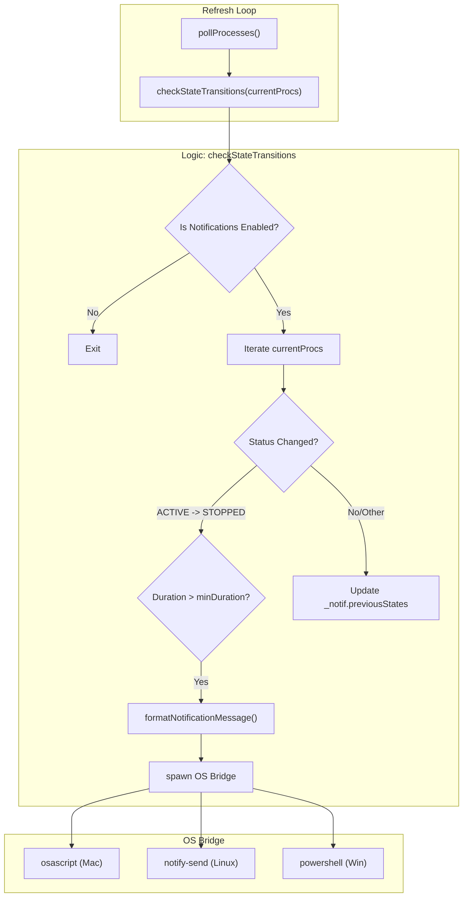

<!-- source: DeepWiki mcp.deepwiki.com · repo aakashadesara/ctop · page 6.2 Notifications and Git Integration · fetched 2026-10-27 -->

# Notifications and Git Integration

<details>
<summary>Relevant source files</summary>

The following files were used as context for generating this wiki page:

- [src/_core.js](src/_core.js)
- [test/animations.test.js](test/animations.test.js)
- [test/caching.test.js](test/caching.test.js)
- [test/git-diff.test.js](test/git-diff.test.js)
- [test/notifications.test.js](test/notifications.test.js)

</details>


This page details the implementation of ctop's desktop notification system and its integration with Git to provide context-aware summaries of project changes. These features bridge the gap between background process monitoring and the developer's active workspace.

## Desktop Notifications

ctop includes a cross-platform notification bridge that alerts users when an AI agent completes a task (transitions from `ACTIVE` to `STOPPED` or `ZOMBIE`) or when a process disappears unexpectedly.

### Key Components

*   **`checkStateTransitions(processes)`**: The primary logic gate for notifications. It compares the current list of processes against `_notif.previousStates` to detect transitions [src/_core.js:1255-1310]().
*   **`formatNotificationMessage(proc)`**: Constructs the user-facing string, prioritizing the project `slug` or `title`, and including the model name and total active duration [src/_core.js:1240-1253]().
*   **`formatDuration(ms)`**: A utility that converts milliseconds into human-readable strings like `1h 2m` or `45s` [src/_core.js:1225-1238]().

### Notification Logic and Thresholds

To prevent "notification fatigue" from short-lived or transient processes, ctop implements several filters:
1.  **`minDuration`**: Defined in `DEFAULT_CONFIG.notifications.minDuration` (default 30s), notifications only trigger if the process was active longer than this threshold [src/_core.js:152-152](), [src/_core.js:1278-1278]().
2.  **State Tracking**: The `_notif` object maintains `previousStates` (PID → status) and `processStartTimes` (PID → timestamp) [src/_core.js:1220-1223]().
3.  **Cleanup**: When a process is no longer detected, its entry is removed from the tracking maps to prevent memory leaks [src/_core.js:1304-1308]().

### Platform Implementation

The system uses `child_process.spawn` to invoke native OS notification utilities [src/_core.js:1312-1327]():

| Platform | Command | Implementation Detail |
| :--- | :--- | :--- |
| **macOS** | `osascript` | Uses AppleScript `display notification` with `with title "ctop"` [src/_core.js:1315-1317](). |
| **Linux** | `notify-send` | Standard Freedesktop notification [src/_core.js:1319-1319](). |
| **Windows** | `powershell` | Uses `New-BurntToastNotification` if available, or fallback [src/_core.js:1321-1324](). |

### State Transition Data Flow

The following diagram illustrates how a process status change results in a desktop notification.

**Process State to Notification Flow**

**Sources:** [src/_core.js:1255-1327](), [test/notifications.test.js:87-107]()

## Git Integration

ctop provides real-time Git status summaries for the project associated with each AI session. This is displayed in the TUI to show how much "work" (insertions/deletions) the agent has performed in the current branch.

### Git Diff Pipeline

1.  **`getGitDiffSummary(cwd)`**: The entry point. It checks the `gitDiffCache` first. If missing or expired (TTL), it executes `git diff --shortstat` [src/_core.js:1164-1188]().
2.  **`parseDiffStat(unstaged, staged, untrackedCount)`**: A regex-based parser that extracts file counts, insertions, and deletions from Git's human-readable output [src/_core.js:1190-1218]().
3.  **Caching**: To avoid excessive shell execution, results are cached in `gitDiffCache` with a TTL defined by `GIT_DIFF_CACHE_TTL` (default 5000ms) [src/_core.js:1161-1162]().

### Data Structures

The `parseDiffStat` function returns a structured object used by the TUI renderers:
```javascript
{
  unstaged: { files: 0, insertions: 0, deletions: 0 },
  staged: { files: 0, insertions: 0, deletions: 0 },
  untracked: 0
}
```
**Sources:** [src/_core.js:1190-1218](), [test/git-diff.test.js:7-15]()

### Git Entity Mapping

This diagram maps the TUI Git display requirements to the underlying shell commands and parsing logic.

**Git Context Resolution**
```mermaid
graph LR
    subgraph "Natural Language Space"
        "Project Directory" -- "is a" --> "Git Repository"
        "AI Agent Activity" -- "creates" --> "Code Changes"
    end

    subgraph "Code Entity Space"
        DIR["proc.cwd"] --> CMD1["git diff --shortstat"]
        DIR --> CMD2["git diff --cached --shortstat"]
        DIR --> CMD3["git ls-files --others --exclude-standard"]
        
        CMD1 --> PARSE["parseDiffStat()"]
        CMD2 --> PARSE
        CMD3 --> PARSE
        
        PARSE --> CACHE["gitDiffCache"]
        CACHE --> RENDER["renderPaneMode() / renderListMode()"]
    end
```
**Sources:** [src/_core.js:1164-1188](), [src/_core.js:1190-1218](), [test/git-diff.test.js:95-121]()

## Configuration and Tuning

Notification and Git behaviors can be tuned via `~/.ctoprc` or CLI flags.

| Key | Type | Description |
| :--- | :--- | :--- |
| `notifications.enabled` | Boolean | Global toggle for desktop alerts [src/_core.js:152-152](). |
| `notifications.minDuration` | Number | Minimum active seconds required to trigger an alert [src/_core.js:152-152](). |
| `GIT_DIFF_CACHE_TTL` | Constant | 5000ms. Frequency of Git status updates [src/_core.js:1161-1161](). |

**Sources:** [src/_core.js:146-155](), [src/_core.js:1161-1162]()

---

