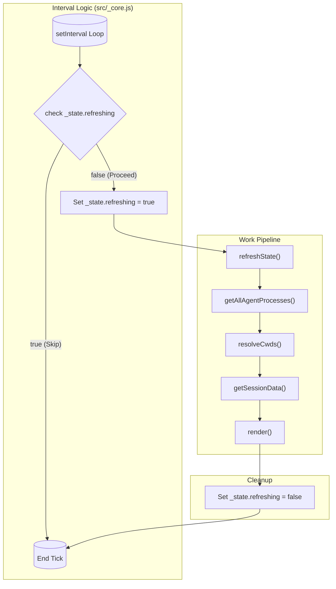

<!-- source: DeepWiki mcp.deepwiki.com · repo aakashadesara/ctop · page 7.2 Render Coalescing and Refresh Guard · fetched 2026-10-27 -->

# Render Coalescing and Refresh Guard

<details>
<summary>Relevant source files</summary>

The following files were used as context for generating this wiki page:

- [docs/designs/2026-05-10-perf-many-sessions.md](docs/designs/2026-05-10-perf-many-sessions.md)
- [src/_core.js](src/_core.js)
- [src/render.js](src/render.js)
- [test/animations.test.js](test/animations.test.js)
- [test/caching.test.js](test/caching.test.js)

</details>


To maintain a responsive Terminal User Interface (TUI) while monitoring dozens of active AI agent sessions, `ctop` implements a performance architecture designed to prevent event-loop starvation. The two primary mechanisms for this are **Render Coalescing** and the **Refresh Re-entry Guard**.

Without these guards, high-frequency events (like mashing navigation keys) or long-running synchronous tasks (like parsing large JSONL logs) could cause "lag," where the TUI stops responding to input because the Node.js event loop is saturated with redundant or overlapping work [docs/designs/2026-05-10-perf-many-sessions.md:5-10]().

## Render Coalescing

`ctop` uses a coalescing wrapper around the core `render()` function. Instead of immediately writing to `stdout` every time the state changes, the system schedules a render for the "next tick" of the event loop.

### Implementation Details
The coalescing logic is governed by a module-level flag, `renderPending`.

1.  **Requesting a Redraw**: When a function calls `render()`, it first checks if `renderPending` is true [src/_core.js:3272-3274]().
2.  **Scheduling**: If no render is pending, `renderPending` is set to `true`, and `setImmediate()` is used to schedule the actual ANSI buffer construction and output [src/_core.js:3275-3277]().
3.  **Execution**: When the scheduled block executes, it immediately resets `renderPending` to `false` before performing the heavy lifting of `renderListMode` or `renderPaneMode` [src/_core.js:3278-3280]().

This ensures that if 50 keystrokes are processed in a single event loop tick, the terminal is only updated once, significantly reducing CPU usage and terminal flicker [docs/designs/2026-05-10-perf-many-sessions.md:34-35]().

### Render Coalescing Data Flow
The following diagram illustrates how multiple state-changing events are collapsed into a single UI update.

**Diagram: Render Coalescing Flow**
```mermaid
sequenceDiagram
    participant K as Keypress_Handler
    participant R as render_Wrapper
    participant L as Event_Loop
    participant A as renderInternal

    K->>R: call render()
    Note over R: renderPending = false
    R->>L: setImmediate(renderInternal)
    Note over R: renderPending = true
    
    K->>R: call render() (Burst)
    Note over R: renderPending is true; RETURN
    
    K->>R: call render() (Burst)
    Note over R: renderPending is true; RETURN

    L->>A: Execute Scheduled Task
    A->>A: renderPending = false
    A->>A: build ANSI Buffer
    A->>A: process.stdout.write()
```
Sources: [src/_core.js:3272-3285](), [docs/designs/2026-05-10-perf-many-sessions.md:62-63]()

---

## Refresh Re-entry Guard

The background refresh cycle, which polls the process list and parses session files, is managed by a `setInterval` based on the `refreshInterval` config (default 5 seconds) [src/_core.js:147-147](), [src/_core.js:5115-5125]().

### The Problem: Overlapping Ticks
On systems with many active sessions (e.g., 70+ agents), the work required to batch `lsof` calls and parse JSONL logs might exceed the refresh interval. Without a guard, new refresh ticks would "stack up," leading to a spiral of increasing latency and eventual process unresponsiveness [docs/designs/2026-05-10-perf-many-sessions.md:59-61]().

### The Solution: `refreshing` Flag
`ctop` uses a re-entry guard within the `setInterval` callback:

*   **Flag Check**: At the start of the interval, the code checks `if (_state.refreshing) return;` [src/_core.js:5116-5116]().
*   **Locking**: If not refreshing, it sets `_state.refreshing = true` [src/_core.js:5117-5117]().
*   **Execution**: It then calls `refreshState()`, which performs the Poll-Enrich-Render pipeline [src/_core.js:5118-5118]().
*   **Unlocking**: Once the work is complete (or if an error occurs), the flag is reset to `false` [src/_core.js:5122-5122]().

This ensures that only one refresh operation is active at any given time, regardless of how long it takes to complete.

### Code Entity Mapping: Refresh Cycle
This diagram maps the natural language "Refresh Cycle" to the specific variables and functions in `src/_core.js`.

**Diagram: Refresh Guard Mechanism**

Sources: [src/_core.js:5115-5125](), [docs/designs/2026-05-10-perf-many-sessions.md:32-33]()

---

## Combined System Impact

Together, these two mechanisms transform `ctop` from a synchronous, blocking application into a "throttle-aware" monitoring tool.

| Mechanism | Targeted Problem | Implementation Entity |
| :--- | :--- | :--- |
| **Render Coalescing** | Redundant UI writes during high-frequency input (scrolling, filtering). | `renderPending` flag + `setImmediate` [src/_core.js:3272-3285]() |
| **Refresh Guard** | Event-loop blocking from overlapping data-gathering cycles. | `_state.refreshing` flag in `setInterval` [src/_core.js:5115-5125]() |
| **History Throttle** | Excessive disk I/O from saving history snapshots. | `SNAPSHOT_INTERVAL` (60s) check in `saveHistorySnapshot` [src/_core.js:2550-2555]() |

### Event Loop Starvation Prevention
By decoupling the frequency of data updates from the frequency of UI renders, `ctop` maintains a consistent frame rate for animations (managed separately via `scheduleAnimationFrame` at 30 FPS) even when the underlying data source is slow or the user is providing rapid input [test/animations.test.js:14-20]().

Sources: [src/_core.js:3272-3285](), [src/_core.js:5115-5125](), [docs/designs/2026-05-10-perf-many-sessions.md:1-43]()

---

