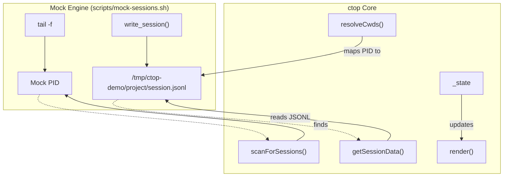
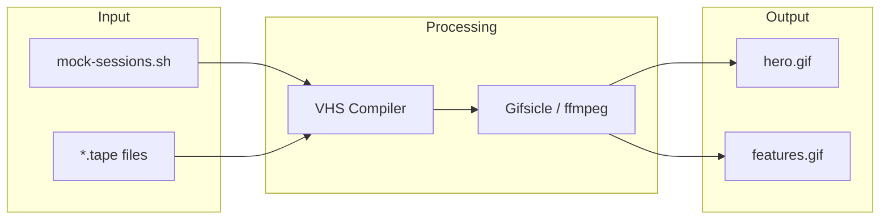

<!-- source: DeepWiki mcp.deepwiki.com · repo aakashadesara/ctop · page 8.2 Demo Recording and Documentation Assets · fetched 2026-10-27 -->

# Demo Recording and Documentation Assets

Relevant source files

The following files were used as context for generating this wiki page:

- [.github/workflows/static.yml](.github/workflows/static.yml)
- [assets/features.gif](assets/features.gif)
- [assets/features.tape](assets/features.tape)
- [assets/hero.gif](assets/hero.gif)
- [assets/hero.tape](assets/hero.tape)
- [docs/index.html](docs/index.html)
- [scripts/mock-sessions.sh](scripts/mock-sessions.sh)

This page details the infrastructure used to generate high-quality documentation assets for `ctop`, including the mock session engine for realistic TUI behavior, automated GIF recording via VHS, and the deployment pipeline for the project's landing page.

## Mock Session Engine

To record demos without exposing private development data, `ctop` includes a `mock-sessions.sh` script. This script simulates a multi-agent environment by spawning background processes that mimic the behavior of Claude Code and Codex CLI.

### Implementation Details
The script performs the following operations:
1.  **Environment Setup**: It creates a temporary directory structure at `/tmp/ctop-demo` to act as the project root [scripts/mock-sessions.sh:9-13]().
2.  **Session Generation**: It iterates through a predefined list of projects, branches, and models (e.g., `claude-opus-4-6`, `claude-sonnet-4-6`) [scripts/mock-sessions.sh:33-71]().
3.  **Data Simulation**: For each mock process, it writes a `session.jsonl` file containing realistic conversation history, tool use logs, and token usage metrics [scripts/mock-sessions.sh:82-101]().
4.  **Process Spawning**: It starts a background `tail -f` process on each generated log file. This ensures that `ctop` detects active PIDs and associates them with the mock session files [scripts/mock-sessions.sh:185-195]().
5.  **Cleanup**: A `cleanup` flag allows for the termination of all mock PIDs and removal of temporary session data [scripts/mock-sessions.sh:15-27]().

### Data Flow: Mock to TUI
The following diagram illustrates how the mock script feeds the core `ctop` engine during a demo recording.

**Mock Session Data Flow**

Sources: [scripts/mock-sessions.sh:82-101](), [scripts/mock-sessions.sh:185-195]().

---

## VHS Tape Recordings

`ctop` uses [VHS](https://github.com/charmbracelet/vhs) to generate consistent, high-resolution GIFs for the README. These recordings are driven by `.tape` files located in the `assets/` directory.

### hero.tape
The `hero.tape` file is designed to showcase the "first-run" experience and primary navigation.
-   **Boot Animation**: Records the initial ASCII sequence [assets/hero.tape:17-20]().
-   **Navigation**: Simulates `j`/`k` movement and `g` (jump to top) [assets/hero.tape:24-33]().
-   **View Toggles**: Demonstrates switching to Pane View (`P`), Log Pane (`L`), and Timeline (`W`) [assets/hero.tape:36-49]().

### features.tape
The `features.tape` file focuses on utility and customization.
-   **Filtering**: Shows the fuzzy search filter (`/`) isolating specific models [assets/features.tape:27-30]().
-   **Theming**: Cycles through built-in themes (Default, Minimal, Dracula) using the `T` key [assets/features.tape:37-48]().
-   **Help Overlay**: Displays the command reference via `?` [assets/features.tape:51-52]().

### Asset Optimization
After recording, GIFs are typically optimized to reduce file size while maintaining the 15 FPS framerate defined in the tapes [assets/hero.tape:14]().

**Documentation Asset Pipeline**

Sources: [assets/hero.tape:1-15](), [assets/features.tape:1-15]().

---

## GitHub Pages Deployment

The `ctop` landing page (hosted at `aakashadesara.github.io/ctop`) is a static site defined in `docs/index.html`. It uses a custom terminal-themed CSS layout to mirror the TUI's aesthetic.

### Landing Page Implementation
-   **Visuals**: Uses a custom CSS grid and "glow" animations to simulate a high-end terminal environment [docs/index.html:24-30]().
-   **TUI Simulation**: The page includes a `.terminal` container that uses CSS animations to mimic the list and pane views of the real application [docs/index.html:51-66]().
-   **Responsive Design**: Employs `clamp()` for fluid typography and a mobile-friendly grid for agent badges [docs/index.html:34-45]().

### CI/CD Workflow
The deployment is automated via a GitHub Action (`.github/workflows/static.yml`).
1.  **Trigger**: Runs on every push to the `main` branch [ .github/workflows/static.yml:4-7]().
2.  **Permissions**: Requires `pages: write` and `id-token: write` to interact with GitHub Pages [ .github/workflows/static.yml:13-16]().
3.  **Deployment**: Uploads the contents of the `docs/` directory as a static artifact [ .github/workflows/static.yml:36-39]().

| Step | Action | Description |
| :--- | :--- | :--- |
| **Checkout** | `actions/checkout@v4` | Pulls the repository content [ .github/workflows/static.yml:32-33]() |
| **Setup** | `actions/configure-pages@v5` | Configures the environment for Pages [ .github/workflows/static.yml:34-35]() |
| **Upload** | `actions/upload-pages-artifact@v3` | Packages the `docs/` folder [ .github/workflows/static.yml:36-39]() |
| **Deploy** | `actions/deploy-pages@v5` | Publishes to the live URL [ .github/workflows/static.yml:40-42]() |

Sources: [docs/index.html:1-66](), [.github/workflows/static.yml:1-43]().

---

