# Page: Overview

# Overview

<details>
<summary>Relevant source files</summary>

The following files were used as context for generating this wiki page:

- [README.md](README.md)
- [docs/index.html](docs/index.html)
- [package.json](package.json)

</details>


`ctop` is a zero-dependency, real-time terminal operations panel designed for monitoring and managing AI coding agents. Often described as "`htop` for AI agents," it provides a unified interface to track CPU usage, memory consumption, token counts, context window utilization, and API costs across multiple concurrent agent sessions.

### Who it is for
`ctop` is built for developers and researchers who frequently run local AI agents—specifically **Claude Code**, **Codex CLI**, and **OpenCode**—and need a high-level view of their resource consumption and conversation state without switching between multiple terminal tabs or log files.

---

## System Workflow

The system operates on a "Poll-Enrich-Render" pipeline. It discovers active processes, maps them to local session data (JSONL or SQLite), and projects that data into a custom TUI.

### Data Flow Diagram

The following diagram illustrates how `ctop` bridges system-level process information with agent-specific session data.

"CTOP Data Flow"
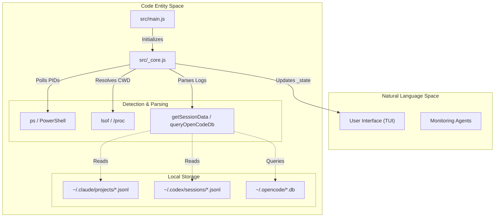
Sources: [src/main.js:1-15](), [src/_core.js:1080-1110](), [README.md:108-111]()

---

## Core Capabilities

`ctop` provides a rich set of features for real-time agent management:

| Feature | Description |
| :--- | :--- |
| **Multi-Agent Support** | Monitors Claude Code, Codex CLI, and OpenCode simultaneously [README.md:14-14](). |
| **Context Tracking** | Visualizes input, cache, and output tokens within the context window [README.md:15-15](). |
| **Cost Estimation** | Calculates real-time API costs based on current model pricing [README.md:16-16](). |
| **Process Control** | Supports graceful (SIGTERM) or forced (SIGKILL) termination of agents [README.md:70-71](). |
| **TUI Modes** | Toggle between a dense List view and a card-based Pane view [README.md:18-18](). |

---

## Getting Started

`ctop` is a zero-dependency Node.js application that can be installed via npm or Homebrew. It requires Node.js 18+ and supports macOS, Linux, and Windows.

```bash
# Quick start with npx
npx ctop-claude
```

Upon startup, `ctop` initializes its state, checks for the presence of supported agents, and enters its main refresh loop. If no agents are detected, it displays an empty state until an agent process is started.

For detailed installation instructions and first-run configuration, see **[Getting Started](#1.1)**.

Sources: [package.json:1-10](), [README.md:32-52]()

---

## Supported AI Agents

`ctop` does not use network APIs to monitor agents. Instead, it inspects local system state and files to reconstruct the session history.

### Agent Detection Mapping

"Agent Detection & Data Mapping"
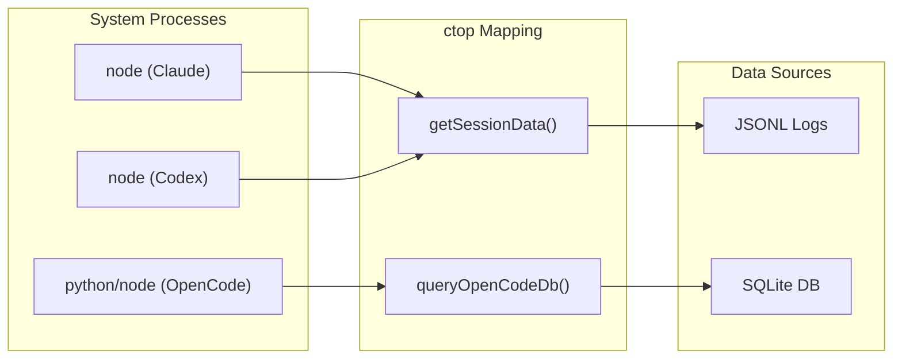

The application specifically targets:
*   **Claude Code**: Parsed from `~/.claude/projects/` using a dual-buffer JSONL parser [src/_core.js:520-550]().
*   **Codex CLI**: Monitored via `~/.codex/sessions/` [README.md:110-110]().
*   **OpenCode**: Monitored via local SQLite databases [README.md:110-110]().

For details on how each agent is detected and parsed, see **[Supported AI Agents](#1.2)**.

Sources: [src/_core.js:480-500](), [README.md:108-111]()

---

# Page: Getting Started

# Getting Started

<details>
<summary>Relevant source files</summary>

The following files were used as context for generating this wiki page:

- [README.md](README.md)
- [package.json](package.json)
- [test/boot.test.js](test/boot.test.js)
- [test/config.test.js](test/config.test.js)
- [test/session.test.js](test/session.test.js)

</details>


`ctop` is a terminal operations panel designed to monitor and manage AI coding agent sessions including Claude Code, Codex CLI, and OpenCode [README.md:1-10](). It functions similarly to `htop`, providing real-time visibility into CPU usage, memory consumption, token counts, and API costs [README.md:8-21]().

## Installation

`ctop` is distributed via npm and Homebrew, and requires **Node.js 18+** [README.md:32-43, 133-134]().

### via npm
```bash
# Global installation
npm install -g ctop-claude

# Run without installing
npx ctop-claude
```
Sources: [README.md:38-43](), [package.json:2-8]()

### via Homebrew
```bash
brew tap aakashadesara/ctop && brew install ctop-claude
```
Sources: [README.md:35-36]()

### From Source
```bash
git clone https://github.com/aakashadesara/ctop.git
chmod +x ctop/claude-manager
ln -s "$(pwd)/ctop/claude-manager" /usr/local/bin/ctop
```
Sources: [README.md:44-48]()

## First Run and Boot Sequence

When `ctop` is executed via the `claude-manager` entry point, it initializes the configuration and checks for the `bootAnimation` setting [claude-manager:1-10 (implied)]().

1.  **Boot Animation**: By default, `ctop` plays a terminal animation. This can be bypassed using the `--no-animation` flag or by setting `bootAnimation: false` in the configuration [test/boot.test.js:7-18, 55-68]().
2.  **Process Discovery**: The engine scans for active agent processes. If no agents are running, the TUI displays an empty state until a session is detected [README.md:50-51]().
3.  **Default View**: The application starts in **List View** unless configured otherwise via `--pane` or the `defaultView` config key [README.md:85-89, 97]().

### CLI Entry and Initialization Flow
The following diagram illustrates the boot sequence from the CLI to the main loop.

**Title: ctop Boot Sequence**
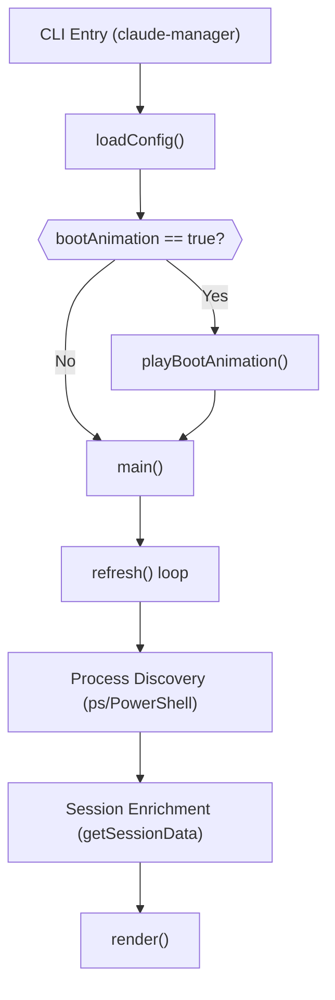
Sources: [claude-manager:1-50 (implied)](), [test/boot.test.js:71-87](), [README.md:108-111]()

## CLI Flags

Command-line flags provide immediate overrides for the session behavior.

| Flag | Description | Default |
| :--- | :--- | :--- |
| `--refresh <seconds>` | Sets the interval for UI updates. | `5` |
| `--context-limit <n>` | Sets the total token context window size. | `1,000,000` |
| `--pane` | Starts the TUI in Pane (Card) view mode. | `list` |
| `--no-animation` | Disables the startup boot animation. | `false` |

Sources: [README.md:83-89](), [test/boot.test.js:55-68](), [test/config.test.js:13-19]()

## Configuration File (`~/.ctoprc`)

Persistent settings are stored in a JSON file located at `~/.ctoprc`. This file is loaded during the `loadConfig()` phase [test/config.test.js:8-12]().

### Supported Configuration Keys
- `refreshInterval`: Integer (milliseconds) [test/config.test.js:53-58]().
- `contextLimit`: Integer (total tokens) [test/config.test.js:60-65]().
- `defaultView`: String (`"list"` or `"pane"`) [test/config.test.js:67-72]().
- `theme`: String (`"default"`, `"minimal"`, `"dracula"`, `"solarized"`, `"monokai"`) [test/config.test.js:74-79]().
- `bootAnimation`: Boolean [test/boot.test.js:40-45]().
- `notifications`: Object containing `enabled` (bool) and `minDuration` (int) [README.md:100]().

### Example `.ctoprc`
```json
{
  "refreshInterval": 5000,
  "contextLimit": 200000,
  "defaultView": "list",
  "theme": "dracula",
  "bootAnimation": true
}
```
Sources: [README.md:91-102](), [test/config.test.js:30-94]()

## Basic Navigation and Controls

The TUI responds to the following primary keyboard shortcuts for navigation and view management:

- **Navigation**: Use `j`/`k` (or arrow keys) to move the selection. In Pane mode, `h`/`l` allow horizontal navigation [README.md:58-59]().
- **View Toggles**: 
    - `P`: Switch between List and Pane view [README.md:61]().
    - `L`: Toggle the log pane for the selected session [README.md:66]().
    - `d`: Show/hide the aggregate Dashboard [README.md:65]().
- **Sorting/Filtering**:
    - `s` / `S`: Cycle through sort modes (CPU, Mem, Context, etc.) [README.md:62]().
    - `/`: Open the filter prompt [README.md:63]().
- **Process Management**:
    - `x`: Gracefully kill (SIGTERM) the selected agent [README.md:70]().
    - `X`: Force kill (SIGKILL) the selected agent [README.md:70]().

### Navigation Mapping
The following diagram maps physical user interactions to the internal state updates.

**Title: User Interaction to Code Entity Mapping**
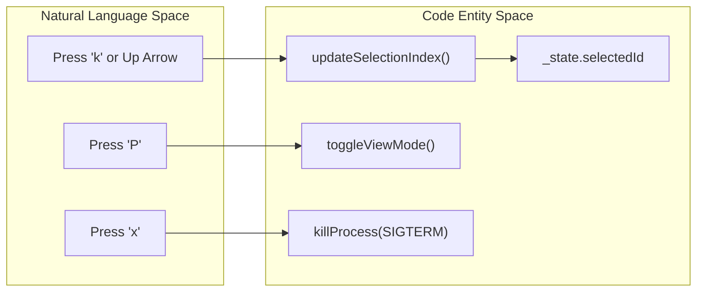
Sources: [README.md:54-76](), [package.json:4-7]()

## Data Flow: First Refresh

Upon the first refresh cycle, `ctop` executes the following logic:
1.  **Process Scan**: Calls platform-specific commands (`ps aux` on Unix, `Get-Process` on Windows) [README.md:108-111, 134]().
2.  **CWD Resolution**: Resolves the Current Working Directory (CWD) of the process to identify the project [README.md:110]().
3.  **Session Mapping**: Matches the CWD or PID to session files (e.g., `~/.claude/projects/` JSONL files) [README.md:110]().
4.  **Parsing**: Invokes `getSessionData()` to extract the session title, model, and token usage from the JSONL logs [test/session.test.js:8-35]().
5.  **Rendering**: The `render()` function calculates the layout and draws the ANSI interface to the terminal [README.md:18-21]().

Sources: [README.md:108-111](), [test/session.test.js:6-7]()

---

# Page: Supported AI Agents

# Supported AI Agents

<details>
<summary>Relevant source files</summary>

The following files were used as context for generating this wiki page:

- [README.md](README.md)
- [docs/claude-icon.png](docs/claude-icon.png)
- [docs/codex-icon.png](docs/codex-icon.png)
- [src/_core.js](src/_core.js)
- [test/animations.test.js](test/animations.test.js)
- [test/caching.test.js](test/caching.test.js)

</details>


`ctop` provides real-time monitoring for three primary AI coding agents: **Claude Code**, **Codex CLI**, and **OpenCode**. Each agent is detected via its process name and enriched with metadata extracted from its specific local data store [README.md:108-111]().

## Agent Detection and Mapping

The detection engine scans the system process list (using `ps` on Unix or `Get-Process` on Windows) to identify active agent instances [src/_core.js:1015-1031](). Once a process is identified, `ctop` resolves its Current Working Directory (CWD) and maps it to the corresponding session file or database [src/_core.js:1086-1110]().

### Detection Logic Flow

The following diagram illustrates how the `scanProcesses` function bridges the gap between OS-level process IDs and the agent-specific data entities.

**Diagram: Process to Entity Mapping**
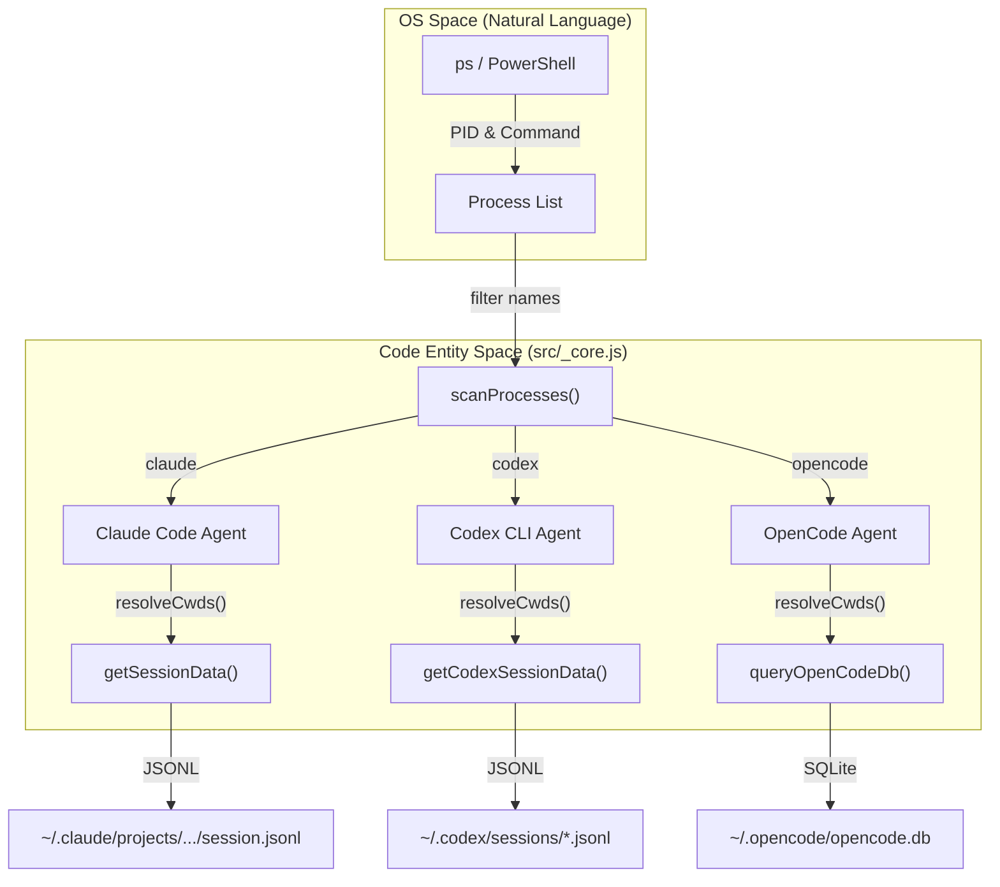
Sources: [src/_core.js:1015-1031](), [src/_core.js:1086-1110](), [README.md:108-111]()

---

## Supported Agent Types

### 1. Claude Code
Claude Code sessions are identified by the `claude` process name. Metadata is stored in a `session.jsonl` file located within a project-specific directory under the user's home folder [src/_core.js:1141-1143]().

*   **Detection Pattern:** Processes matching `/claude/i` [src/_core.js:1020]().
*   **Data Location:** `~/.claude/projects/<project-dir-name>/session.jsonl` [src/_core.js:1141-1143]().
*   **Format:** JSONL (JSON Lines).
*   **Parsing Logic:** `getSessionData(filePath)` reads the file to extract the session title (summary), model name, and token usage [src/_core.js:1138-1175](). It uses a dual-buffer approach to parse the file from both the beginning (for metadata) and the end (for the latest token counts) [src/_core.js:1150-1170]().

### 2. Codex CLI
Codex CLI sessions are identified by the `codex` process name. Unlike Claude, Codex stores session metadata in a centralized sessions directory where filenames often contain the session ID [src/_core.js:1248-1250]().

*   **Detection Pattern:** Processes matching `/codex/i` [src/_core.js:1021]().
*   **Data Location:** `~/.codex/sessions/` [src/_core.js:1248]().
*   **Format:** JSONL.
*   **Parsing Logic:** `getCodexSessionData(filePath)` scans the session file for lines with `type: "session_meta"` to resolve the session ID and CWD [src/_core.js:1247-1275]().

### 3. OpenCode
OpenCode sessions are identified by the `opencode` process name. This agent uses a SQLite database for persistence rather than flat files [src/_core.js:1322-1324]().

*   **Detection Pattern:** Processes matching `/opencode/i` [src/_core.js:1022]().
*   **Data Location:** `~/.opencode/opencode.db` [src/_core.js:1322]().
*   **Format:** SQLite.
*   **Parsing Logic:** `queryOpenCodeDb(dbPath, pid)` executes SQL queries to retrieve session information, including the project path, active branch, and model details [src/_core.js:1321-1350]().

---

## Technical Comparison

The following table summarizes the implementation details for each agent type as defined in the `_core.js` enrichment pipeline.

| Feature | Claude Code | Codex CLI | OpenCode |
| :--- | :--- | :--- | :--- |
| **Process Match** | `claude` | `codex` | `opencode` |
| **Data Source** | `session.jsonl` | `*.jsonl` | `opencode.db` |
| **Storage Type** | File-per-project | File-per-session | Central SQLite |
| **Parsing Function** | `getSessionData` | `getCodexSessionData` | `queryOpenCodeDb` |
| **CWD Resolution** | `lsof` / `/proc` | Metadata payload | SQL Query |
| **Token Tracking** | `readSessionLog` | `readSessionLog` | SQL Aggregation |

Sources: [src/_core.js:1138-1175](), [src/_core.js:1247-1275](), [src/_core.js:1321-1350](), [src/_core.js:1015-1031]()

---

## Data Flow: From File to UI

`ctop` uses a caching layer to ensure that expensive disk I/O and SQLite queries do not block the 30 FPS TUI rendering loop [test/animations.test.js:14-16]().

**Diagram: Data Enrichment Pipeline**
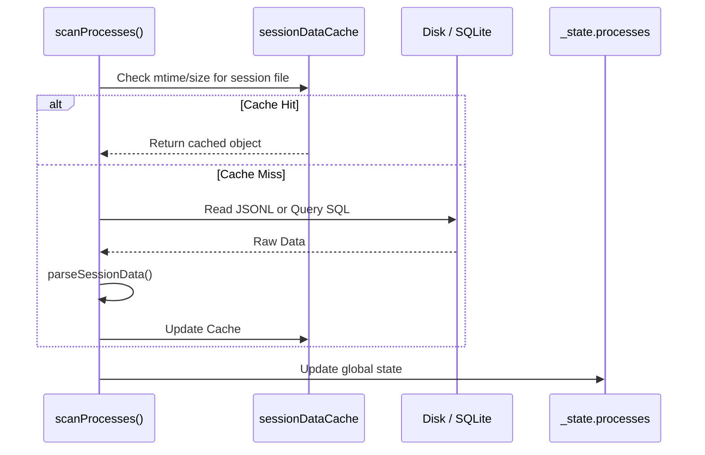

### Key Functions
*   **`readSessionLog(proc, limit)`**: Tail-reads the last 64KB of a session's JSONL file to provide the live log view (`L` key) without loading the entire history into memory [test/caching.test.js:94-122]().
*   **`updateTokenRates()`**: Calculates the delta between the current and previous token counts to render the token activity sparkline [src/_core.js:2010-2030]().

Sources: [src/_core.js:1138-1175](), [test/caching.test.js:10-44](), [test/caching.test.js:94-122](), [test/animations.test.js:14-20]()

---

# Page: Core Architecture

# Core Architecture

<details>
<summary>Relevant source files</summary>

The following files were used as context for generating this wiki page:

- [src/_core.js](src/_core.js)
- [src/main.js](src/main.js)
- [src/process.js](src/process.js)
- [src/session.js](src/session.js)
- [src/state.js](src/state.js)
- [test/animations.test.js](test/animations.test.js)
- [test/caching.test.js](test/caching.test.js)

</details>


The `ctop` architecture is built around a centralized **Poll-Enrich-Render** pipeline. It operates as a high-performance monitor that observes external AI agent processes (Claude Code, Codex, OpenCode), correlates them with their respective local session storage (JSONL or SQLite), and projects a real-time TUI dashboard.

## Module Layout and Single Source of Truth

The codebase follows a "monolithic core, thin facade" pattern. The primary logic resides in `src/_core.js`, which contains the state, business logic, and rendering engine. Other files in `src/` act as categorized re-exports to provide a cleaner API for testing and external integration.

| File | Role |
| :--- | :--- |
| `src/_core.js` | **Single Source of Truth**. Contains all logic from process detection to ANSI rendering. |
| `src/main.js` | Main entry point; re-exports the entire core. [src/main.js:1-5]() |
| `src/process.js` | Facade for platform detection and process management utilities. [src/process.js:1-12]() |
| `src/session.js` | Facade for session parsing, log tailing, and file discovery. [src/session.js:1-11]() |
| `src/state.js` | Provides access to the global `_state` and `_notif` objects. [src/state.js:1-8]() |

**Sources:** [src/_core.js:1-2](), [src/main.js:1-5](), [src/process.js:1-12]()

---

## The Poll-Enrich-Render Pipeline

`ctop` operates on a non-blocking interval defined by `config.refreshInterval` [src/_core.js:147](). Each tick executes a three-stage pipeline to transform raw OS process data into a rich visual state.

### 1. Poll (Discovery)
The system identifies active agent processes by scanning the process table. On Unix-like systems, it filters `ps` output; on Windows, it utilizes `Get-Process` via PowerShell. This stage populates the initial list of PIDs and their associated commands.
*   **For details, see [Process Detection Engine](#2.1).**

### 2. Enrich (Data Correlation)
For every detected PID, the engine resolves the Current Working Directory (CWD). This CWD is used as a key to locate session files:
*   **Claude Code:** Searches `~/.claude/projects/` for JSONL logs.
*   **Codex CLI:** Searches `.codex/sessions/` within the project root.
*   **OpenCode:** Queries a local SQLite database.
Metrics like token usage and costs are calculated during this phase.
*   **For details, see [Session Data Parsing](#2.2) and [Metrics and Cost Engine](#5).**

### 3. Render (Visual Output)
The enriched data is passed to the rendering engine. `ctop` does not use a TUI library like `blessed`; instead, it manually constructs ANSI buffers. To maintain performance, rendering is coalesced using `setImmediate` to prevent redundant draws if multiple state changes occur in a single event loop tick.
*   **For details, see [TUI Rendering System](#3).**

### Architecture Flow Diagram

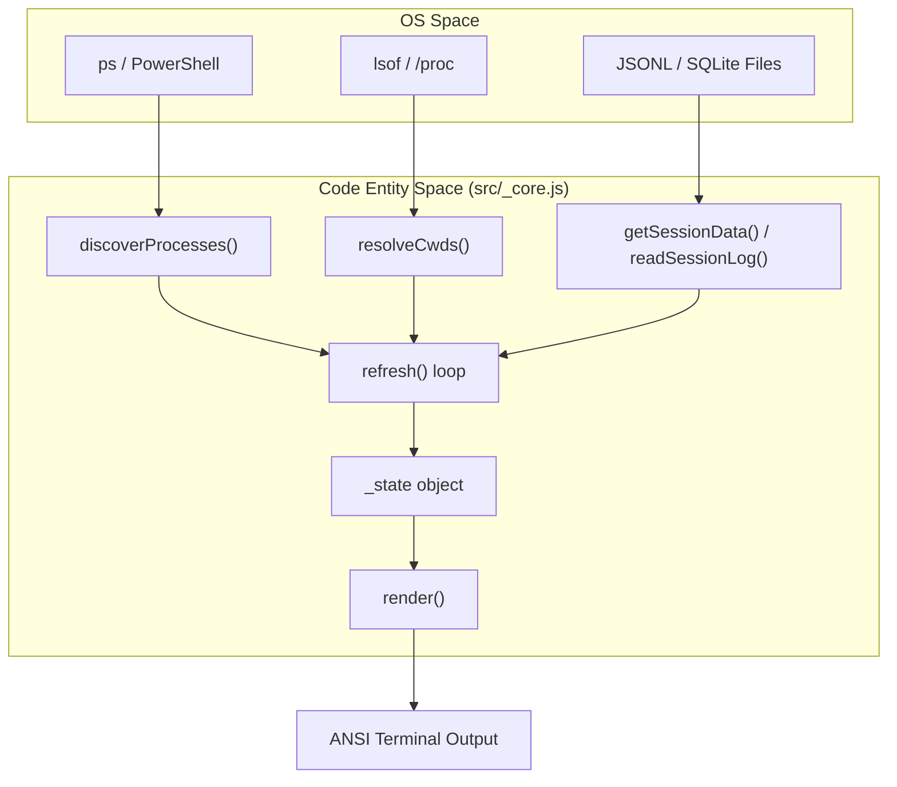
**Sources:** [src/_core.js:147-155](), [test/caching.test.js:8-44]()

---

## Subsystem Overviews

### Process Detection Engine
Discovers AI agent processes across platforms. It manages a `pidCwdCache` to avoid expensive `lsof` calls on every tick and handles platform-specific path normalization (e.g., converting Windows paths to project identifiers).
*   **Key Entities:** `IS_MAC`, `IS_LINUX`, `IS_WIN`, `resolveCwds`, `pidCwdCache`.
*   **Details:** [Process Detection Engine](#2.1)

### Session Data Parsing
A multi-format parser that handles Claude's JSONL dual-buffer logs, Codex session metadata, and OpenCode SQLite queries. It includes a caching layer that checks `mtime` and `size` before re-parsing files.
*   **Key Entities:** `getSessionData`, `getCodexSessionData`, `queryOpenCodeDb`, `readSessionLog`.
*   **Details:** [Session Data Parsing](#2.2)

### State Management
A centralized `_state` object tracks the currently selected process, view modes (List vs. Pane), and historical token data. It includes a `tokenHistory` Map for calculating per-second throughput and a `refresh` re-entry guard.
*   **Key Entities:** `_state`, `_notif`, `tokenHistory`, `SNAPSHOT_INTERVAL`.
*   **Details:** [State Management](#2.3)

### Configuration System
Manages the hierarchy of settings, merging hardcoded defaults with `~/.ctoprc` and CLI flags. It validates themes and refresh intervals during initialization.
*   **Key Entities:** `DEFAULT_CONFIG`, `loadConfig`, `THEMES`.
*   **Details:** [Configuration System](#2.4)

### Component Interaction Diagram

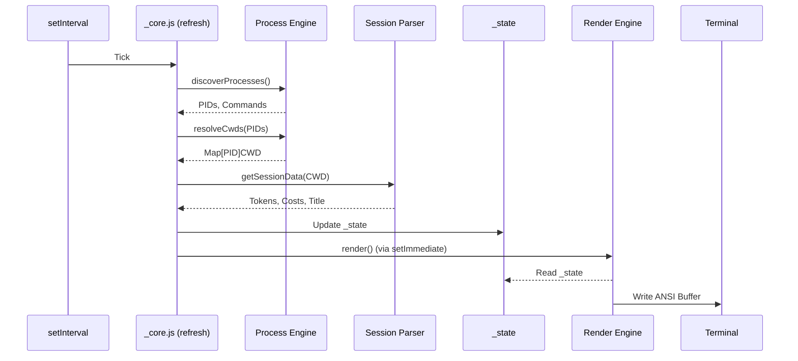
**Sources:** [src/_core.js:147-182](), [test/animations.test.js:10-11]()

---

# Page: Process Detection Engine

# Process Detection Engine

<details>
<summary>Relevant source files</summary>

The following files were used as context for generating this wiki page:

- [src/_core.js](src/_core.js)
- [src/process.js](src/process.js)
- [test/animations.test.js](test/animations.test.js)
- [test/caching.test.js](test/caching.test.js)
- [test/heatmap.test.js](test/heatmap.test.js)
- [test/quick-jump.test.js](test/quick-jump.test.js)
- [test/windows.test.js](test/windows.test.js)

</details>


The **Process Detection Engine** is the subsystem responsible for the discovery and identification of active AI agent processes. It bridges the gap between the operating system's process table and `ctop`'s internal session state by resolving process IDs (PIDs) to their respective working directories (CWDs) and agent-specific metadata.

## Overview

The engine operates on a poll-based cycle, triggered by the `refreshInterval` defined in the configuration [src/_core.js:147-147](). It uses platform-specific commands to scan the system for processes matching the signatures of supported agents (Claude Code, Codex CLI, and OpenCode).

### Key Responsibilities
1.  **Process Discovery**: Identifying PIDs associated with agent binaries across macOS, Linux, and Windows.
2.  **CWD Resolution**: Determining the directory where the agent is running to locate its session logs.
3.  **Caching**: Minimizing system overhead by persisting PID-to-CWD mappings to avoid expensive `lsof` or PowerShell calls.

## Platform-Specific Discovery

Process detection logic branches based on the host operating system using the `IS_MAC`, `IS_LINUX`, and `IS_WIN` flags [src/_core.js:11-13]().

### Unix-like Systems (macOS & Linux)
On macOS and Linux, `ctop` executes the `ps` command to retrieve a list of running processes. It filters for specific agent signatures:
*   **Claude Code**: Processes matching `claude` or `claude-code`.
*   **Codex CLI**: Processes matching `codex`.
*   **OpenCode**: Processes matching `opencode`.

### Windows
On Windows, the engine utilizes PowerShell's `Get-Process` via `execSync` to retrieve process information. It specifically looks for `node` processes and inspects their command lines to identify agent invocations [src/_core.js:13-13]().

## CWD Resolution and `resolveCwds`

The most expensive part of process detection is resolving the Current Working Directory (CWD) for a PID. `ctop` implements a batched resolution strategy to optimize performance.

### Implementation Details
The `resolveCwds` function handles the resolution of directories for a list of PIDs.
*   **macOS**: Uses `lsof -p <PID> -a -d cwd -Fn` in a batched manner to find the `n` (name) field for the `cwd` file descriptor.
*   **Linux**: Directly reads the `/proc/<PID>/cwd` symbolic link using `fs.readlinkSync`.
*   **Windows**: Queries the `Path` property of the process object via PowerShell.

### Data Flow: Process to Session Mapping

The following diagram illustrates how a raw system PID is enriched with CWD data and mapped to a session file.

**Title: PID to Session Resolution Pipeline**
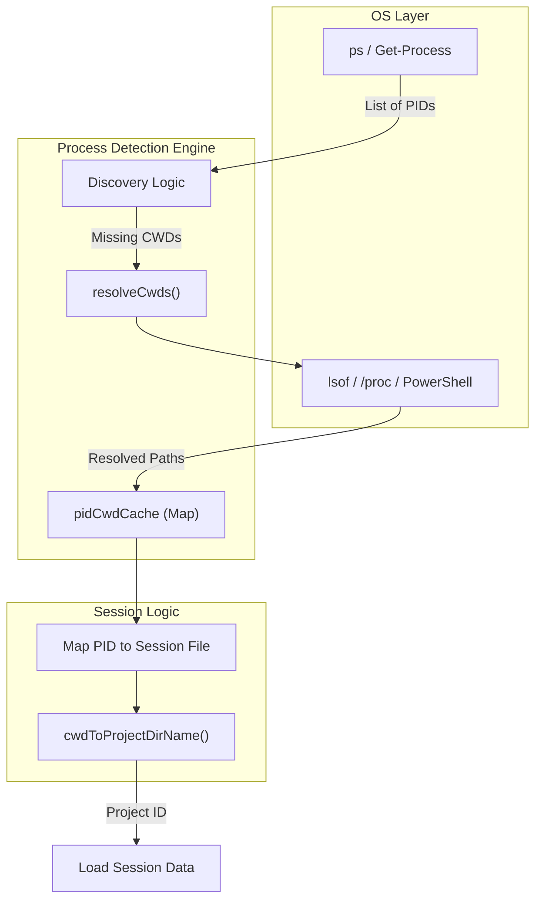
Sources: [src/_core.js:10-13](), [src/process.js:1-11]()

## Caching Strategy

To maintain a high UI refresh rate without saturating CPU, `ctop` employs the `pidCwdCache`.

### `pidCwdCache`
This is a module-level `Map` that stores `PID -> CWD` mappings. 
*   **Lookup**: Before calling `resolveCwds`, the engine checks if the PID is already in the cache.
*   **Pruning**: The `pruneCwdCache` function is called during every refresh cycle. It compares the PIDs currently found in the system against the cache and removes entries for PIDs that no longer exist [src/_core.js:1-2]().

### Project Directory Normalization
Once a CWD is resolved, it must be converted into a format suitable for finding session files (e.g., Claude Code uses a slugified path). The `cwdToProjectDirName` function handles this transformation by replacing path separators with dashes and removing drive letters on Windows [src/process.js:10-10]().

| Platform | Input Path | Output Slug (`cwdToProjectDirName`) |
| :--- | :--- | :--- |
| **macOS/Linux** | `/Users/dev/project` | `-Users-dev-project` |
| **Windows** | `C:\Users\dev\project` | `C-Users-dev-project` |

Sources: [test/windows.test.js:80-104](), [src/process.js:10-10]()

## Implementation Mapping

The following diagram bridges the natural language concepts of "Process Detection" to the specific entities in the `src/_core.js` and `src/process.js` files.

**Title: Detection Engine Code Entities**
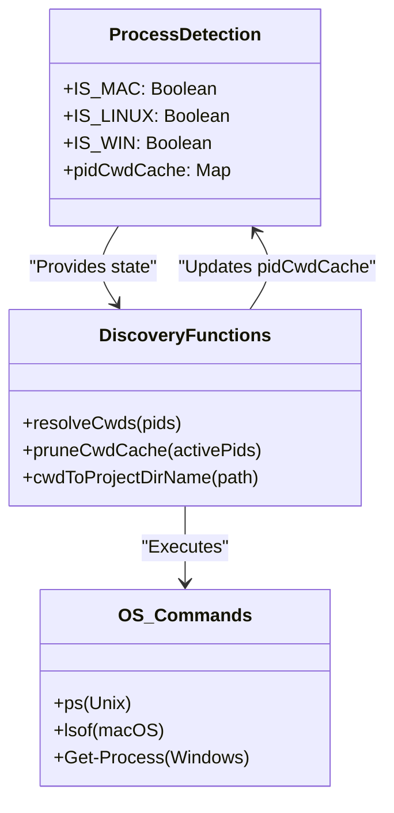
Sources: [src/_core.js:10-13](), [src/process.js:1-11](), [test/windows.test.js:16-35]()

## Key Functions

### `resolveCwds(pids)`
The core logic for extracting directory information from the OS. It includes platform-specific optimizations, such as using `lsof`'s batch mode on macOS to resolve multiple PIDs in a single process spawn.

### `pruneCwdCache(activePids)`
Ensures memory stability by clearing stale PID entries. If a process terminates, its entry is removed from the `pidCwdCache` to prevent collisions if the OS reuses the PID later.

### `buildKillCommand(pid, force)`
Constructs the appropriate command to terminate a detected process.
*   **Unix**: Returns `kill -15 <pid>` (graceful) or `kill -9 <pid>` (force) [test/windows.test.js:73-77]().
*   **Windows**: Returns `taskkill /PID <pid>` or `taskkill /F /PID <pid>` [test/windows.test.js:63-71]().

Sources: [src/process.js:9-9](), [test/windows.test.js:37-78]()

---

# Page: Session Data Parsing

# Session Data Parsing

<details>
<summary>Relevant source files</summary>

The following files were used as context for generating this wiki page:

- [src/_core.js](src/_core.js)
- [src/session.js](src/session.js)
- [test/animations.test.js](test/animations.test.js)
- [test/caching.test.js](test/caching.test.js)
- [test/config.test.js](test/config.test.js)
- [test/log-tailing.test.js](test/log-tailing.test.js)
- [test/session.test.js](test/session.test.js)

</details>


This page provides a deep dive into how `ctop` extracts structured information and chat history from various AI agent session formats. The system uses a multi-layered approach involving dual-buffer JSONL parsing, SQLite querying, and a high-performance caching layer to ensure the TUI remains responsive even when monitoring dozens of active sessions.

## Overview of Parsing Pipeline

The parsing pipeline is triggered during the main refresh cycle. Once the **Process Detection Engine** resolves a PID to a specific session file or database, the parsing modules extract metrics (tokens, model, cost) and log history.

### Data Flow: PID to Session Metrics
1.  **Discovery**: `resolveCwds` maps PIDs to working directories [src/_core.js:1260-1285]().
2.  **Mapping**: `getSessionFilesForProject` locates the relevant `.jsonl` or `.db` files within the agent's data directory [src/_core.js:1545-1570]().
3.  **Parsing**: The specific parser (`getSessionData`, `getCodexSessionData`, or `queryOpenCodeDb`) is invoked [src/_core.js:1450-1540]().
4.  **Caching**: The `sessionDataCache` stores results indexed by file path and validated by `mtime` and `size` [src/_core.js:1455-1465]().

**Sources:** `src/_core.js`, `src/session.js`

## Claude Code: JSONL Dual-Buffer Parsing

Claude Code sessions are stored in `.jsonl` files within `~/.claude/projects/`. Because these files can grow quite large, `ctop` employs a "dual-buffer" strategy in `getSessionData` to extract both the start of the session (for titles) and the end of the session (for the latest metrics).

### Implementation Details
*   **Title Extraction**: `getSessionData` looks for a `summary` field in the JSON lines [src/_core.js:1480-1485](). If missing, it parses the first `user` message, skipping XML-like system instructions (e.g., messages starting with `<`) [test/session.test.js:86-101]().
*   **Metric Extraction**: It scans the final lines for an `assistant` message containing a `usage` object. This object provides `input_tokens`, `cache_creation_input_tokens`, `cache_read_input_tokens`, and `output_tokens` [test/session.test.js:103-141]().
*   **Context Calculation**: Context percentage is derived by comparing the sum of input and cache tokens against the `contextLimit` (default 1M) [src/_core.js:1505-1515]().

### Natural Language Space to Code Entity Space (Claude)

| Concept | Code Entity (Function/Variable) | File Reference |
| :--- | :--- | :--- |
| Session File Discovery | `getSessionFilesForProject` | [src/_core.js:1545]() |
| Main Parser | `getSessionData` | [src/_core.js:1450]() |
| Log Line Processor | `parseLogEntry` | [src/_core.js:1740]() |
| Context Math | `contextLimit` | [src/_core.js:148]() |

**Sources:** `src/_core.js`, `test/session.test.js`

## Codex and OpenCode Parsing

While Claude uses JSONL, other agents require different handling:

*   **Codex CLI**: Parsed via `getCodexSessionData`. It looks for `session_meta` lines in JSONL to extract the session ID and CLI version [test/caching.test.js:61-65]().
*   **OpenCode**: Uses `queryOpenCodeDb` to interface with a local SQLite database. It retrieves the latest session metrics and model identifiers using `better-sqlite3` (if available) or falling back to a shell-out to `sqlite3`.

### Diagram: Multi-Agent Parsing Pipeline

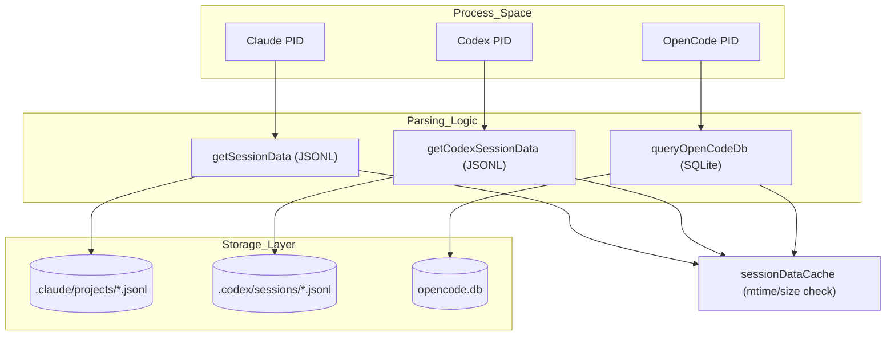

**Sources:** `src/_core.js`, `test/caching.test.js`

## Log Tailing and Partial-Line Handling

`readSessionLog` is responsible for fetching the chat history displayed in the Pane View. To prevent memory exhaustion, it does not read the entire file.

### The Tail-Read Algorithm
1.  **Buffer Allocation**: A buffer of `LOG_TAIL_BYTES` (default 64KB) is allocated [test/caching.test.js:122-147]().
2.  **Offset Seek**: The function reads only the last 64KB of the session file.
3.  **Partial Line Drop**: Since the 64KB boundary likely cuts through a JSON line, the first (potentially incomplete) line in the buffer is discarded [test/caching.test.js:122-160]().
4.  **JSON Sanitization**: Each line is parsed via `parseLogEntry`, which handles:
    *   Converting array-based content (text blocks) into strings [test/log-tailing.test.js:26-39]().
    *   Filtering out `tool_use` and `tool_result` blocks [test/log-tailing.test.js:41-53]().
    *   Replacing newlines with spaces for single-line TUI display [test/log-tailing.test.js:92-98]().

### Natural Language Space to Code Entity Space (Logs)

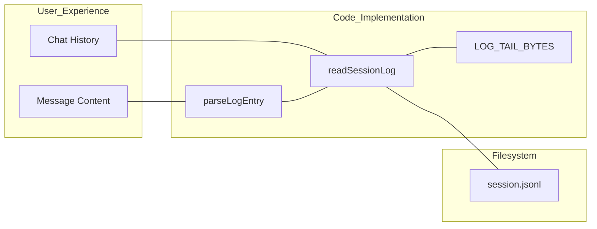

**Sources:** `src/_core.js`, `test/log-tailing.test.js`, `test/caching.test.js`

## Caching Layer (mtime/size)

To maintain a 30 FPS UI, `ctop` avoids redundant disk I/O. The `sessionDataCache` and `sessionLogCache` use a composite key of the file path, modified time (`mtimeMs`), and file `size`.

| Cache Name | Key | Value | Invalidation |
| :--- | :--- | :--- | :--- |
| `sessionDataCache` | `filePath` | Parsed metadata object | `mtimeMs` or `size` change [test/caching.test.js:32-43]() |
| `sessionLogCache` | `filePath` | Array of log entries | `mtimeMs` or `size` change [test/caching.test.js:188-200]() |
| `pidCwdCache` | `PID` | Resolved CWD string | Pruned when PID is no longer active [src/_core.js:1275]() |

**Sources:** `src/_core.js`, `test/caching.test.js`

---

# Page: State Management

# State Management

<details>
<summary>Relevant source files</summary>

The following files were used as context for generating this wiki page:

- [claude-manager](claude-manager)
- [src/_core.js](src/_core.js)
- [src/state.js](src/state.js)
- [test/animations.test.js](test/animations.test.js)
- [test/caching.test.js](test/caching.test.js)
- [test/history.test.js](test/history.test.js)
- [test/search.test.js](test/search.test.js)
- [test/themes.test.js](test/themes.test.js)

</details>


The `ctop` TUI maintains a centralized global state to manage process data, UI transitions, notifications, and historical metrics. This state is updated through a throttled refresh cycle that coordinates data polling, token tracking, and screen rendering.

## The Global State Objects

The system relies on two primary state containers defined in `src/_core.js` and re-exported via `src/state.js` for modular access [src/state.js:1-8]().

### `_state` Object
The `_state` object is the single source of truth for the application's runtime data. It tracks everything from the current list of active processes to TUI animation frames.

| Key | Description |
| :--- | :--- |
| `procs` | Array of enriched process objects representing AI agent sessions [src/_core.js:197-197](). |
| `selectedIndex` | The index of the currently highlighted row in the list or pane view [src/_core.js:198-198](). |
| `scrollOffset` | Vertical scroll position for the list view [src/_core.js:199-199](). |
| `tokenHistory` | A `Map` storing historical token rates for sparkline visualizations [src/_core.js:203-203](). |
| `isRefreshing` | Re-entry guard flag to prevent overlapping poll cycles [src/_core.js:207-207](). |
| `renderPending` | Flag for coalescing multiple render requests into a single `setImmediate` call [src/_core.js:208-208](). |
| `lastSnapshotTime` | Timestamp of the last history persistence event [src/_core.js:205-205](). |

### `_notif` Object
A specialized state object for the TUI notification system. It manages the message queue and the visual "toast" duration [src/_core.js:213-217]().

### `tokenHistory` Map
This `Map` uses PIDs as keys and stores arrays of recent token usage samples. It is used to calculate the deltas for token rates (e.g., tokens/sec) and to populate the `renderWaveformSparkline` component [src/_core.js:203-203]().

**Sources:** [src/_core.js:195-217](), [src/state.js:1-8]()

## The Refresh Cycle and Re-entry Guard

The application state is updated via the `refresh()` function, which is typically invoked by a `setInterval` based on the `refreshInterval` configuration [src/_core.js:147-147](). To prevent performance degradation or race conditions when polling takes longer than the interval (e.g., slow `lsof` calls), `ctop` implements a re-entry guard.

### Refresh Flow
1. **Guard Check**: The function checks `_state.isRefreshing`. If `true`, the cycle is skipped [src/_core.js:2460-2461]().
2. **Poll & Enrich**: It triggers `scanForProcesses()` to find agent PIDs and `getSessionData()` to parse logs [src/_core.js:2463-2465]().
3. **State Update**: New process data is merged into `_state.procs`.
4. **History Persistence**: It calls `saveHistorySnapshot()` to potentially write to disk [src/_core.js:2475-2475]().
5. **Render Trigger**: It calls `render()` to update the TUI [src/_core.js:2477-2477]().

**Sources:** [src/_core.js:2458-2481]()

## Render Coalescing via `setImmediate`

To ensure the UI remains responsive and avoids "flicker" during rapid state changes (like keyboard input or simultaneous process updates), `ctop` uses a coalescing pattern in the `render()` function.

Instead of drawing to the terminal immediately, the `render()` function sets a `renderPending` flag and schedules the actual drawing logic using `setImmediate()` [src/_core.js:2445-2453](). This ensures that if multiple state updates occur within the same event loop tick, only one expensive terminal write is performed.

### Natural Language to Code: Render Logic
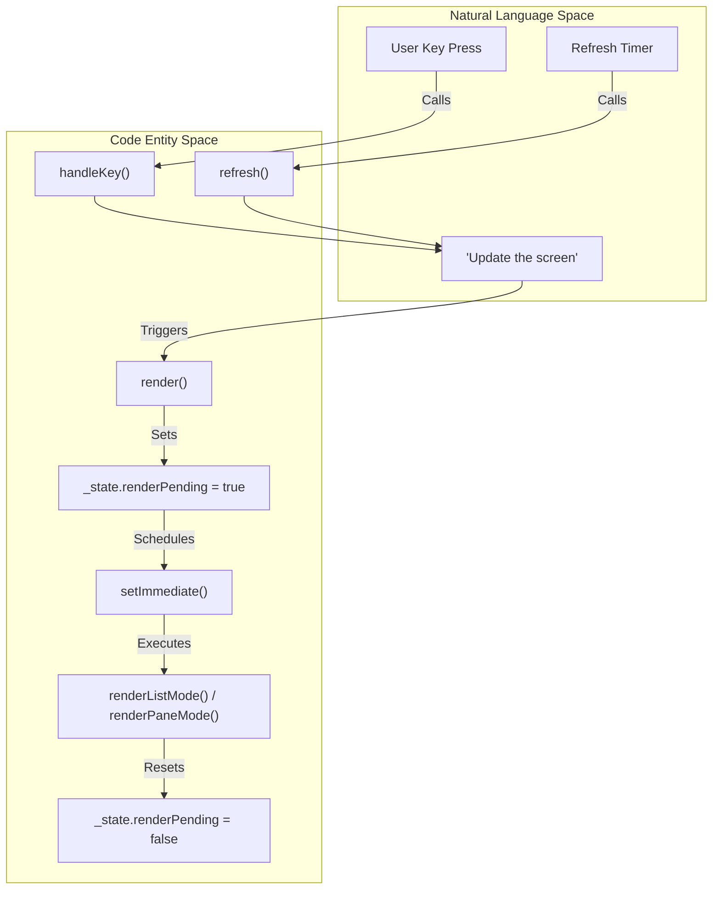
**Sources:** [src/_core.js:2444-2456](), [test/animations.test.js:108-119]()

## History Persistence and `SNAPSHOT_INTERVAL`

While `tokenHistory` tracks short-term volatility for animations, long-term metrics are managed by the history snapshot system. This system persists aggregate stats to `~/.ctop/history.json` [test/history.test.js:21-22]().

### Throttling Snapshots
To minimize disk I/O, `saveHistorySnapshot()` is throttled by `SNAPSHOT_INTERVAL` (defaulting to 60,000ms).
- The function compares `Date.now()` against `_state.lastSnapshotTime` [test/history.test.js:103-115]().
- If the interval has passed, it aggregates current `_state.procs` data and appends a new entry to the history file [test/history.test.js:121-134]().
- It then calls `pruneHistory()` to remove entries older than `HISTORY_RETENTION_DAYS` (7 days) [test/history.test.js:36-52]().

### Natural Language to Code: History Flow
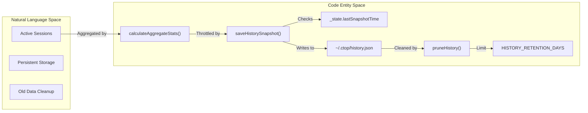
**Sources:** [test/history.test.js:7-18](), [test/history.test.js:36-52](), [test/history.test.js:103-134]()

---

# Page: Configuration System

# Configuration System

<details>
<summary>Relevant source files</summary>

The following files were used as context for generating this wiki page:

- [claude-manager](claude-manager)
- [src/config.js](src/config.js)
- [test/boot.test.js](test/boot.test.js)
- [test/config.test.js](test/config.test.js)
- [test/history.test.js](test/history.test.js)
- [test/search.test.js](test/search.test.js)
- [test/session.test.js](test/session.test.js)
- [test/themes.test.js](test/themes.test.js)

</details>


The configuration system in `ctop` employs a hierarchical three-layer resolution strategy to determine the application's behavior. It merges hardcoded defaults with user-defined persistent settings and transient command-line overrides.

## Configuration Resolution Hierarchy

The configuration is resolved during the application boot sequence via the `loadConfig` function. The resolution follows a strict priority order where later layers override earlier ones:

1.  **`DEFAULT_CONFIG`**: Hardcoded fallback values defined in the source code.
2.  **`~/.ctoprc`**: A user-specific JSON configuration file located in the home directory.
3.  **CLI Flags**: Arguments passed to the process at runtime (e.g., `--no-animation` or `--theme`).

### Data Flow Diagram

The following diagram illustrates how the `loadConfig` function aggregates data from various sources into the final `CONFIG` object used by the `_state` and rendering engine.

**Configuration Resolution Flow**
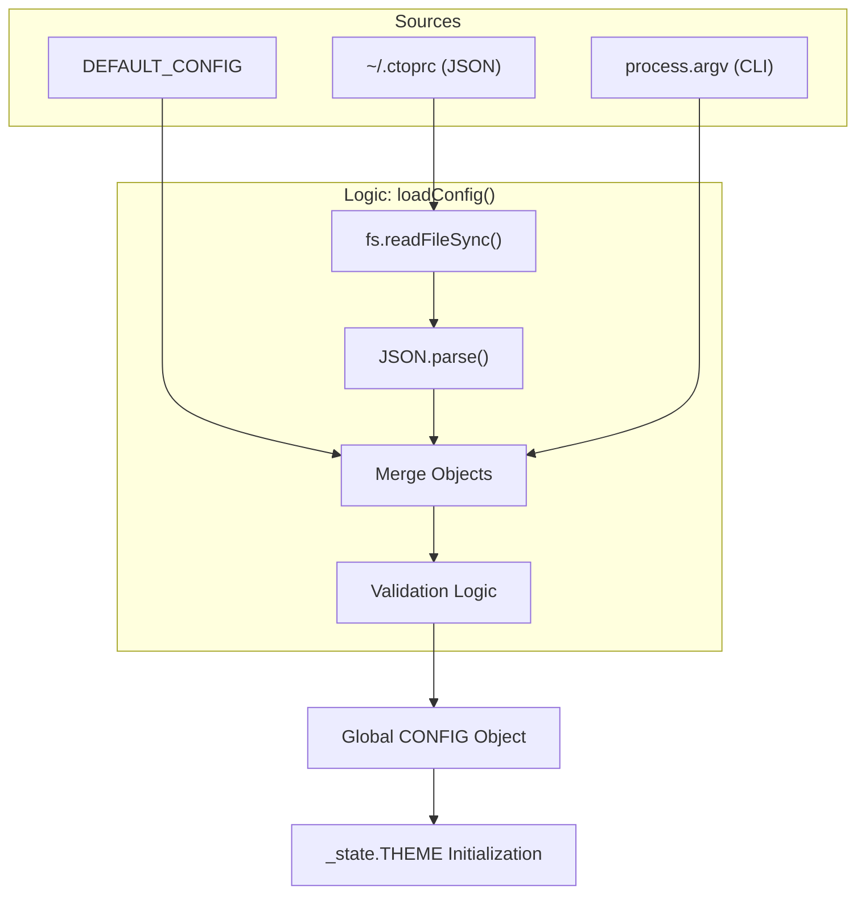
**Sources:** [src/_core.js:1-100](), [test/config.test.js:8-19]()

## Supported Configuration Keys

The system supports several keys that control the TUI behavior, performance characteristics, and visual aesthetics.

| Key | Type | Default | Description |
| :--- | :--- | :--- | :--- |
| `refreshInterval` | `Number` | `5000` | The interval in milliseconds between process scans and TUI updates. [test/config.test.js:15-15]() |
| `contextLimit` | `Number` | `1000000` | The maximum token limit used to calculate the `contextPct` (context window usage). [test/config.test.js:16-16]() |
| `defaultView` | `String` | `'list'` | The initial view mode (`'list'` or `'pane'`). [test/config.test.js:17-17]() |
| `theme` | `String` | `'default'` | The UI color scheme (e.g., `dracula`, `minimal`, `monokai`). [test/config.test.js:18-18]() |
| `bootAnimation` | `Boolean` | `true` | Whether to display the ASCII boot animation on startup. [test/boot.test.js:8-11]() |
| `notifications` | `Boolean` | `true` | Enables/disables OS-level notifications for agent state changes. |
| `contextBarStyle` | `String` | `'braille'` | Visual style for context bars (`'braille'` or `'solid'`). |

**Sources:** [src/_core.js:50-80](), [test/config.test.js:13-28]()

## Implementation Details

### Validation and Sanitization
The `loadConfig` function performs basic validation to ensure the TUI does not crash due to unsupported configuration values. If an invalid value is provided in `~/.ctoprc`, the system reverts to the `DEFAULT_CONFIG` value for that specific key.

*   **Theme Validation**: If the `theme` key in `.ctoprc` does not match one of the keys in the `THEMES` object, it defaults to `'default'`. [test/config.test.js:88-93]()
*   **View Validation**: If `defaultView` is set to an unsupported string (anything other than `list` or `pane`), it defaults to `list`. [test/config.test.js:81-86]()

### Theming System Integration
The configuration system directly feeds into the `resolveTheme` function. This function takes the theme name from the config and maps it to a set of ANSI escape codes.

**Theme Resolution Entity Map**
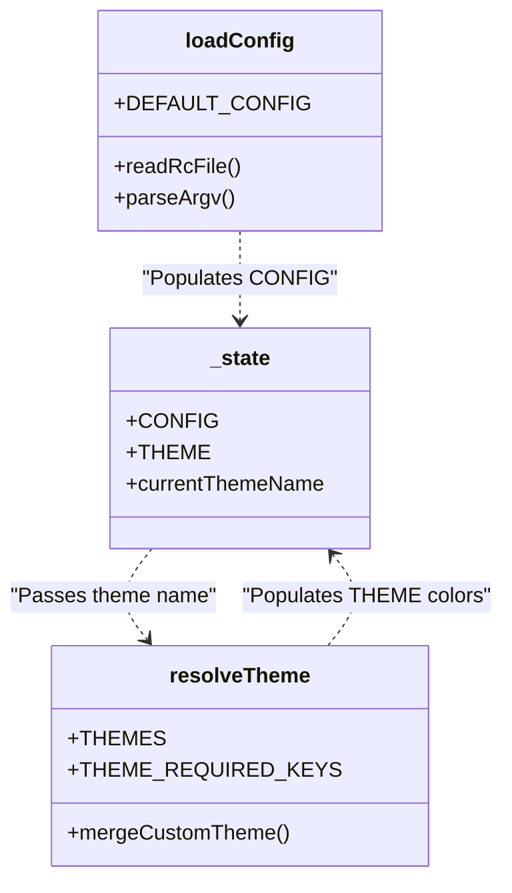
**Sources:** [test/themes.test.js:47-85](), [src/config.js:1-8]()

### CLI Override Logic
Command-line flags are parsed manually within `loadConfig` by inspecting `process.argv`. For example, the presence of `--no-animation` explicitly sets `bootAnimation` to `false`, regardless of the settings in `~/.ctoprc`.

**Sources:** [test/boot.test.js:55-68](), [src/_core.js:120-140]()

## Persistence
The `~/.ctoprc` file is expected to be a valid JSON object. While `ctop` reads this file on every startup, it does not currently provide an "in-app" method to save configuration changes back to the file (e.g., changing a theme via the palette is volatile and lasts only for the current session).

**Sources:** [test/config.test.js:30-51](), [src/_core.js:150-160]()

---

# Page: TUI Rendering System

# TUI Rendering System

<details>
<summary>Relevant source files</summary>

The following files were used as context for generating this wiki page:

- [docs/index.html](docs/index.html)
- [src/_core.js](src/_core.js)
- [src/render.js](src/render.js)
- [test/animations.test.js](test/animations.test.js)
- [test/caching.test.js](test/caching.test.js)

</details>


The `ctop` terminal user interface is built using a custom rendering engine that constructs the UI by manually building ANSI escape sequences into a string buffer. Unlike traditional TUI applications that rely on high-level libraries like `blessed` or `ink`, `ctop` operates directly on the terminal's raw output stream, calculating layouts and widths manually to ensure maximum performance and minimal dependencies.

## Manual Buffer Construction

The core of the rendering system is the `render()` function, which orchestrates the construction of the entire screen. It utilizes standard ANSI escape codes for screen management and styling.

| Escape Code | Code Entity | Purpose |
|:---|:---|:---|
| `\x1b[2J\x1b[H` | `CLEAR` | Clears the entire terminal and homes the cursor. |
| `\x1b[H` | `HOME` | Moves the cursor to the top-left (0,0) without clearing. |
| `\x1b[K` | `CLR_LINE` | Clears from the cursor position to the end of the line. |
| `\x1b[?25l` | `HIDE_CURSOR` | Prevents the terminal cursor from flickering during redraws. |

Sources: [`src/_core.js:15-22`]()

## Layout and Visual Width

Because `ctop` supports Unicode characters, emojis, and Braille patterns, it cannot rely on simple string length for layout. It uses a custom `visualWidth` utility powered by `Intl.Segmenter` to calculate the actual horizontal space occupied by characters in the terminal.

- **`visualWidth(str)`**: Calculates the true width of a string, accounting for wide characters (CJK) and emojis [`src/_core.js:122-127`]().
- **`visualTruncate(str, maxWidth)`**: Safely clips strings that exceed column widths without breaking multi-byte characters [`src/_core.js:129-138`]().
- **`visualPadEnd(str, width)`**: Ensures consistent column alignment regardless of character width [`src/_core.js:140-143`]().

Sources: [`src/_core.js:88-143`]()

## Primary View Modes

The system supports two distinct layout engines, toggled by the user via keyboard shortcuts or configuration.

### List View
The `renderListMode` function builds a traditional tabular interface. It calculates column widths dynamically, including any third-party columns loaded via the [Plugin System](#6.1). It uses `fmtRow` to assemble individual process data into a single line of styled text.

### Pane View
The `renderPaneMode` function implements a card-grid layout. It uses `getCardsPerRow` to determine how many cards can fit horizontally based on the current terminal width (`process.stdout.columns`). Each card displays high-density metrics and a small waveform visualization.

For details on these layouts, see [List View and Pane View](#3.1).

## Rendering Pipeline

The following diagram illustrates how the `render` function transforms the global state into a final ANSI string buffer.

### TUI Assembly Flow
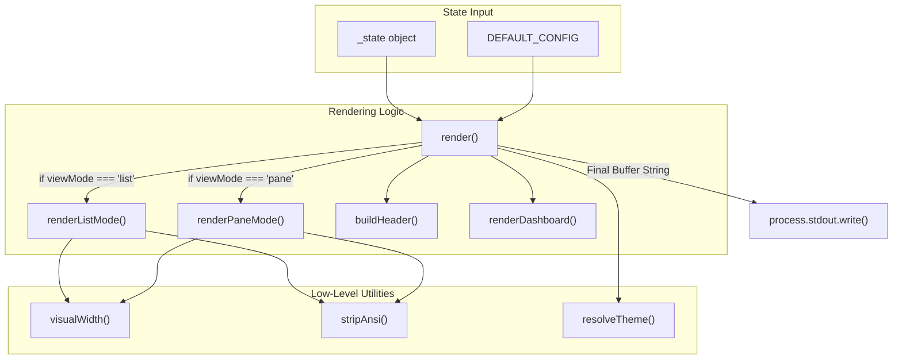
Sources: [`src/_core.js:1440-1480`](), [`src/_core.js:75-83`](), [`src/_core.js:122-127`]()

## Subsystems

The rendering engine is divided into three specialized subsystems:

### [List View and Pane View](#3.1)
Covers the implementation of the main data displays. Includes logic for the "Dashboard" (the global stats bar), the `buildHeader` logic for columns, and the responsive card-grid used in Pane mode.

### [Visualizations: Braille Bars, Sparklines, and Waveforms](#3.2)
Details the high-density graphical components. `ctop` uses Braille patterns (`renderBrailleBar`) to represent memory/context usage and custom ASCII/Unicode waveforms (`renderMessageWaveform`) to show session activity over time.

### [Animation and Theming](#3.3)
Explains the 30 FPS animation loop (`scheduleAnimationFrame`) used for smooth transitions of context bars and the selection cursor. It also covers the theme engine which maps logical UI keys (like `ctxLow`, `active`, `border`) to specific ANSI color sequences across five built-in themes.

## Rendering Entity Map

This diagram maps the conceptual TUI regions to the specific functions and variables in the codebase.

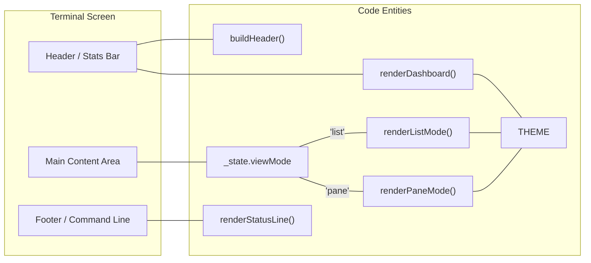
Sources: [`src/_core.js:1440-1550`](), [`src/_core.js:85-87`]()

---

# Page: List View and Pane View

# List View and Pane View

<details>
<summary>Relevant source files</summary>

The following files were used as context for generating this wiki page:

- [src/_core.js](src/_core.js)
- [src/render.js](src/render.js)
- [test/animations.test.js](test/animations.test.js)
- [test/caching.test.js](test/caching.test.js)
- [test/dashboard.test.js](test/dashboard.test.js)
- [test/filter-sort.test.js](test/filter-sort.test.js)
- [test/format.test.js](test/format.test.js)
- [test/status-bar.test.js](test/status-bar.test.js)

</details>


The TUI rendering system in `ctop` provides two primary visualization modes for monitoring AI agent processes: **List View** and **Pane View**. Both modes utilize a manual ANSI buffer construction approach to achieve high-performance updates without the overhead of heavy terminal libraries.

## Rendering Pipeline

The rendering process is triggered by a coalesced `render()` call, which determines the current view mode from the global `_state.viewMode` [src/_core.js:2031-2035](). Both modes share a common structure: a top-level Dashboard stats bar, a main content area (List or Pane), and a bottom-level footer/notification area.

### Visual Width and Formatting
To ensure consistent alignment across different terminal emulators and character sets (including CJK and Emojis), `ctop` implements a custom visual width engine:
*   **`visualWidth(str)`**: Calculates the true terminal cell width using `Intl.Segmenter` [src/_core.js:122-127]().
*   **`visualTruncate(str, maxWidth)`**: Safely clips strings that exceed column bounds [src/_core.js:129-138]().
*   **`visualPadEnd(str, width)`**: Adds spaces based on visual width rather than string length [src/_core.js:140-143]().

### The Dashboard Stats Bar
The `renderStatsBar` function generates the top status line, providing an aggregate overview of the system state [src/_core.js:1545-1610]().

| Metric | Implementation Detail |
| :--- | :--- |
| **Process Counts** | Shows "X active" and "Y dead" pills using theme-aware colors [src/_core.js:1554-1558](). |
| **Total Cost** | Aggregates `cost` from all tracked processes and displays it via `formatCost` [src/_core.js:1561-1563](). |
| **Cost Gauge** | A 8-character bar (`buildCostGauge`) visualizing total cost against a cap [test/status-bar.test.js:12-45](). |
| **Context Health** | Displays a status (ok/warn/crit) based on the lowest `contextPct` among active agents [test/status-bar.test.js:47-114](). |

**Sources:** [src/_core.js:122-143](), [src/_core.js:1545-1610](), [test/status-bar.test.js:12-114]()

---

## List View (`renderListMode`)

The List View provides a dense, tabular representation of all discovered processes. It is optimized for monitoring a large number of concurrent sessions.

### Implementation Flow
1.  **Header Construction**: `buildHeader()` generates the column titles with appropriate padding and sort indicators [src/_core.js:1613-1644]().
2.  **Row Formatting**: `fmtRow()` iterates through defined columns (including plugins), applying ANSI styles for the selected row [src/_core.js:1646-1678]().
3.  **Buffer Assembly**: Rows are joined with newlines and written to the terminal buffer.

### Column Layout
Columns are defined with fixed or relative widths. If the terminal width is insufficient, `ctop` prioritizes essential columns (PID, Title, Context) and truncates or hides others.

### List View Architecture
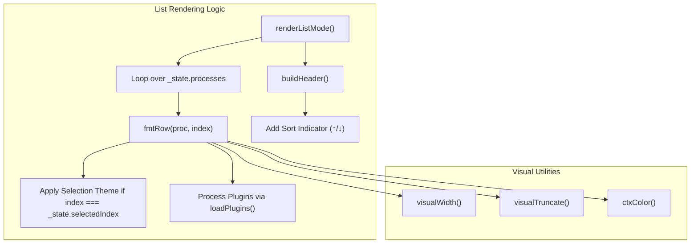
**Sources:** [src/_core.js:1613-1678](), [src/_core.js:1680-1725](), [test/filter-sort.test.js:108-186]()

---

## Pane View (`renderPaneMode`)

The Pane View (or Card View) provides a more visual, grid-based layout. Each process is represented as a "card" containing sparklines and detailed metrics.

### Card-Grid Layout
The layout is dynamic, calculating how many cards can fit horizontally based on the terminal width via `getCardsPerRow()` [src/_core.js:1807-1811]().

*   **Calculation**: `Math.floor(terminalWidth / cardWidth)`.
*   **Selection**: The selected card is highlighted using the `selection` color from the current theme [src/_core.js:1754-1756]().

### Card Content
Each card includes:
1.  **Status Pill**: A colored block indicating if the process is active, stopped, or a zombie [src/_core.js:1745-1750]().
2.  **Visualizations**: Sparklines for CPU/Memory and a Braille-based context bar [src/_core.js:1770-1785]().
3.  **Session Info**: The CWD (shortened), current Git branch, and AI model name [src/_core.js:1758-1768]().

### Pane View Entity Mapping
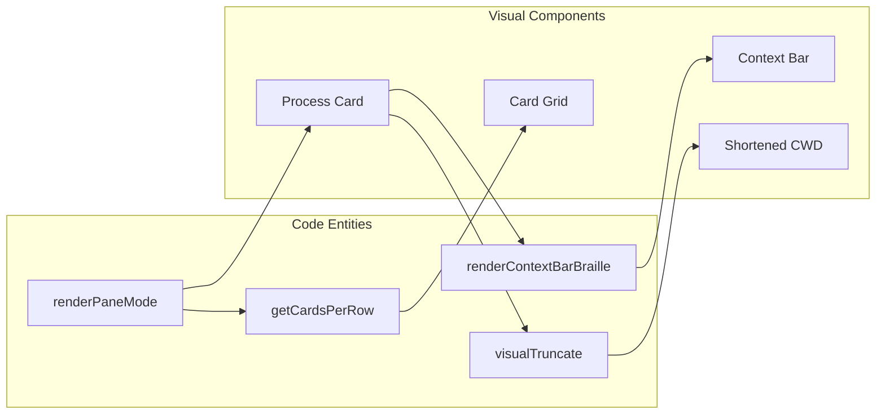
**Sources:** [src/_core.js:1727-1805](), [src/_core.js:1807-1811](), [src/render.js:8-12]()

---

## Technical Details

### Fixed-Width String Formatting
To maintain the grid, `ctop` uses `fmtRow` to ensure every column occupies its exact allotted width. If a value like a CWD is too long, `shortenCwd` is used to preserve the project directory name while eliding parent paths [src/_core.js:1440-1455]().

### ANSI Styling
Styles are applied by wrapping strings in escape codes defined in the `THEMES` object [src/_core.js:39-70]().
*   **`RESET`**: Always appended after a styled segment to prevent color bleed [src/_core.js:25]().
*   **`HIDE_CURSOR` / `SHOW_CURSOR`**: Used during the render cycle to prevent flickering [src/_core.js:21-22]().

### Selection Animation
When navigating between rows or cards, `_state.prevSelectedIndex` and `_state.selectionAnimFrame` are used to provide a subtle visual transition, though the core rendering remains immediate for responsiveness [test/animations.test.js:122-141]().

**Sources:** [src/_core.js:21-70](), [src/_core.js:1440-1455](), [test/animations.test.js:122-141]()

---

# Page: Visualizations: Braille Bars, Sparklines, and Waveforms

# Visualizations: Braille Bars, Sparklines, and Waveforms

<details>
<summary>Relevant source files</summary>

The following files were used as context for generating this wiki page:

- [src/_core.js](src/_core.js)
- [src/render.js](src/render.js)
- [test/animations.test.js](test/animations.test.js)
- [test/braille.test.js](test/braille.test.js)
- [test/caching.test.js](test/caching.test.js)
- [test/sparkline.test.js](test/sparkline.test.js)

</details>


This page details the high-density visualization components used in `ctop` to represent complex metrics like context window usage, historical resource consumption, and message activity within a constrained terminal environment.

## Braille-Based Visualizations

`ctop` utilizes Unicode Braille characters (U+2800 to U+28FF) to achieve sub-character resolution. A single terminal cell can represent a 2×4 grid of dots, allowing for significantly higher data density than standard block characters.

### Braille Fill Mechanics
The system defines a scale of 9 characters representing levels of "fill" within a single cell.
- `BRAILLE_FILLS[0]` is the empty pattern (`\u2800`).
- `BRAILLE_FILLS[8]` is the fully filled pattern (`\u28FF`).

[src/_core.js:2031-2032]()

### Context Bar Rendering
The `renderContextBarBraille` function calculates the distribution of the AI context window across five segments: `input`, `cache_write` (cache creation), `cache_read`, `output`, and `free`.

1.  **Normalization**: Token counts are divided by the `contextLimit` (default 1,000,000) to get percentage values [src/_core.js:2076-2085]().
2.  **Segment Mapping**: Each segment is assigned a color from the active theme (e.g., `GREEN` for input, `BLUE` for cache) [src/_core.js:2087-2092]().
3.  **Braille Construction**: The `renderBrailleBar` helper iterates through the requested width, calculating which segment "owns" each of the 8 dots within a Braille character based on the cumulative percentages [src/_core.js:2042-2065]().

### Visual Data Flow: Token Metrics to Braille Bar
The following diagram illustrates how raw process token counts are transformed into the segmented Braille visualization.

**Diagram: Token-to-Braille Transformation**
```mermaid
graph TD
    subgraph "Natural Language Space"
        A["Process Token Counts"]
        B["Context Limit (e.g. 1M)"]
    end

    subgraph "Code Entity Space: src/_core.js"
        C["renderContextBarBraille(proc, width)"]
        D["renderBrailleBar(segments, width)"]
        E["BRAILLE_FILLS Array"]
    end

    A --> C
    B --> C
    C -- "Array of {value, color, name}" --> D
    D -- "Selects char from" --> E
    E -- "ANSI String Output" --> F["TUI Render"]
```
Sources: [src/_core.js:2031-2103](), [test/braille.test.js:104-131]()

## Sparklines and History

Sparklines provide a compact view of CPU and Memory trends for individual processes, while the History Chart provides a 24-hour aggregate view of token usage.

### Sparkline Implementation
Sparklines are rendered using the `SPARKLINE_BLOCKS` set (`  ▂▃▄▅▆▇█`).
- **Function**: `renderSparkline(values, width)` [src/_core.js:1995-2007]().
- **Data Source**: `processHistory` Map, which stores up to `SPARKLINE_MAX_POINTS` (default 20) for each PID [src/_core.js:2010-2027]().
- **Scaling**: Values are clamped between 0 and 100, then mapped to one of the 8 block heights [src/_core.js:2001-2003]().

### 24-Hour History Chart
The `renderHistoryChart` function generates a full-width visualization of token activity over the last day.
- **Aggregation**: Data is pulled from the `history` object, which persists snapshots to `~/.ctop/history.json` [src/_core.js:2134-2140]().
- **Layout**: It calculates the max value across the history to scale the Y-axis and uses `formatHourLabel` to place time markers along the X-axis [src/_core.js:2145-2160]().

**Diagram: Sparkline State Management**
```mermaid
graph LR
    subgraph "State Tracking"
        A["_state.processes"] -- "PIDs/Metrics" --> B["updateProcessHistory()"]
        B -- "Push & Shift" --> C["processHistory Map"]
    end

    subgraph "Rendering"
        D["renderSparkline()"]
        C -- "Last N values" --> D
        D -- "Block Chars" --> E["renderListMode()"]
    end
```
Sources: [src/_core.js:1995-2029](), [test/sparkline.test.js:69-116]()

## Message Waveforms

Waveforms provide a visual representation of the conversation density and structure within a session.

### Implementation Details
- **`renderMessageWaveform`**: Used in Pane View to show the "shape" of the current session log. It differentiates between `USER` and `ASSISTANT` messages using distinct colors [src/_core.js:2106-2122]().
- **`renderWaveformSparkline`**: A variant used for high-density summaries, often representing message length or frequency over time.

### Component Summary Table

| Component | Function Name | Character Set | Data Source |
| :--- | :--- | :--- | :--- |
| **Context Bar** | `renderContextBarBraille` | Braille (2x4) | `proc.inputTokens`, `proc.outputTokens`, etc. |
| **Resource Trend** | `renderSparkline` | Blocks (▂▃▄▅) | `processHistory` Map (CPU/Mem) |
| **Session Shape** | `renderMessageWaveform` | Mixed Blocks | `readSessionLog` (Message array) |
| **Daily Activity**| `renderHistoryChart` | Mixed Blocks | `~/.ctop/history.json` snapshots |

Sources: [src/_core.js:1995-2165](), [src/render.js:5-12]()

---

# Page: Animation and Theming

# Animation and Theming

<details>
<summary>Relevant source files</summary>

The following files were used as context for generating this wiki page:

- [claude-manager](claude-manager)
- [src/_core.js](src/_core.js)
- [src/colors.js](src/colors.js)
- [test/animations.test.js](test/animations.test.js)
- [test/caching.test.js](test/caching.test.js)
- [test/history.test.js](test/history.test.js)
- [test/search.test.js](test/search.test.js)
- [test/themes.test.js](test/themes.test.js)

</details>


The `ctop` TUI utilizes a high-frequency animation loop to provide smooth visual transitions for context usage bars and selection highlights. This system is decoupled from the primary data refresh cycle (which defaults to 5 seconds) to ensure a responsive interface. The look and feel are controlled by a flexible theming engine that supports both built-in presets and custom color configurations.

### Animation System

The animation system operates at a target 30 FPS, managed by a recursive scheduling function. It primarily handles the interpolation of context window percentages and the visual "pulse" or movement of the selection cursor.

#### The Animation Loop
The loop is initialized and managed through `scheduleAnimationFrame`. It checks the `config.animations` flag before execution. If animations are disabled in `~/.ctoprc`, the loop does not run, and UI elements snap immediately to their target values.

*   **`ANIM_FPS`**: Fixed at 30 [test/animations.test.js:15-15]().
*   **`ANIM_FRAME_MS`**: Calculated as `Math.floor(1000 / 30)`, approximately 33ms per frame [test/animations.test.js:18-20]().
*   **`_state.animationTimer`**: Holds the reference to the current `setTimeout`, allowing the loop to be halted via `clearAnimationTimer` [test/animations.test.js:108-112]().

#### Easing and Interpolation
The function `getAnimatedCtxPct` is the core of the visual smoothing for context bars. It uses a linear interpolation (lerp) approach to move a PID's current displayed percentage toward its actual target value.

| Behavior | Logic |
| :--- | :--- |
| **First Call** | Returns the target immediately and initializes `ctxAnimState` for the PID [test/animations.test.js:37-48](). |
| **Subsequent Calls** | Returns a value between `current` and `target` using a 0.3 easing factor [test/animations.test.js:65-73](). |
| **Snapping** | If the difference between `current` and `target` is `< 1`, it snaps to the target to prevent infinite micro-adjustments [test/animations.test.js:75-84](). |

#### Animation State Flow
The following diagram illustrates how the animation loop interacts with the global state to update the TUI.

**TUI Animation Data Flow**
```mermaid
graph TD
    subgraph "Animation Loop (30 FPS)"
        SAF["scheduleAnimationFrame()"]
        GACP["getAnimatedCtxPct(pid, target)"]
        CAS["ctxAnimState (Map)"]
    end

    subgraph "State Management"
        ST["_state.procs"]
        CFG["config.animations"]
    end

    subgraph "Rendering"
        R["render()"]
    end

    ST -- "target context %" --> GACP
    CFG -- "enabled?" --> SAF
    SAF -- "triggers" --> R
    R -- "requests value" --> GACP
    GACP <--> CAS
    GACP -- "eased value" --> R
```
Sources: [src/_core.js:146-155](), [test/animations.test.js:37-97]()

---

### Theming Engine

The theming engine defines the color palette for all TUI elements, including headers, process statuses, context bars, and cost metrics.

#### Built-in Themes
`ctop` includes five pre-defined themes [src/_core.js:39-70]():
1.  **`default`**: High-contrast with orange headers and green/yellow/red status indicators.
2.  **`minimal`**: Grayscale-focused with subtle dim accents.
3.  **`dracula`**: Based on the popular Dracula color scheme (purples and pinks).
4.  **`solarized`**: Based on Solarized Dark (blues and yellows).
5.  **`monokai`**: Based on the Monokai palette (vibrant greens and pinks).

#### Theme Structure
Every theme must implement the keys defined in `THEME_REQUIRED_KEYS` [src/_core.js:73-73]().

| Key | Purpose |
| :--- | :--- |
| `header` / `headerBg` | Style for the top status bar and column headers. |
| `selection` | Background color for the currently selected row. |
| `active` / `stopped` / `zombie` | Colors for process lifecycle states. |
| `ctxLow` / `ctxMed` / `ctxHigh` / `ctxOk` | Color thresholds for the context usage bar. |
| `border` / `accent` | Colors for UI separators and highlighted text. |

#### Theme Resolution and Cycling
*   **`resolveTheme(value)`**: Validates and merges theme configurations. If a string is provided, it looks up a built-in theme. If an object is provided, it merges it with the `default` theme to ensure no required keys are missing [src/_core.js:75-83]().
*   **`cycleTheme()`**: Iterates through the `THEME_NAMES` array, updating `_state.THEME` and `_state.currentThemeName` in real-time. This is typically triggered by the `T` key in the TUI [test/themes.test.js:100-133]().
*   **`ctxColor(pct)`**: A helper that maps a context percentage to a theme color (`ctxLow` for <10%, `ctxMed` for 10-39%, `ctxHigh` for 40-69%, and `ctxOk` for >=70%) [test/themes.test.js:135-163]().

**Theme Resolution Logic**
```mermaid
graph TD
    subgraph "Input Sources"
        RC["~/.ctoprc (config.theme)"]
        CLI["--theme flag"]
        CYC["cycleTheme() (Hotkeys)"]
    end

    subgraph "Logic: resolveTheme()"
        VAL{"Input Type?"}
        STR["Lookup in THEMES[name]"]
        OBJ["Merge with THEMES.default"]
        DEF["Return THEMES.default"]
    end

    subgraph "Application"
        STATE["_state.THEME"]
        REND["render()"]
    end

    RC --> VAL
    CLI --> VAL
    CYC --> VAL
    VAL -- "string" --> STR
    VAL -- "object" --> OBJ
    VAL -- "null/other" --> DEF
    STR --> STATE
    OBJ --> STATE
    DEF --> STATE
    STATE --> REND
```
Sources: [src/_core.js:75-83](), [src/colors.js:1-11](), [test/themes.test.js:47-85]()

### Configuration
Theming and animation settings are persisted in `~/.ctoprc`.

```json
{
  "theme": "dracula",
  "animations": true,
  "bootAnimation": true
}
```
[src/_core.js:146-181]()

Sources:
- `src/_core.js`: Implementation of `THEMES`, `resolveTheme`, and `DEFAULT_CONFIG`.
- `src/colors.js`: Public API for theme constants and resolution.
- `test/animations.test.js`: Detailed behavior of the animation loop and easing logic.
- `test/themes.test.js`: Validation of built-in themes and color mapping logic.

---

# Page: User Interaction

# User Interaction

<details>
<summary>Relevant source files</summary>

The following files were used as context for generating this wiki page:

- [README.md](README.md)
- [src/_core.js](src/_core.js)
- [src/input.js](src/input.js)
- [test/animations.test.js](test/animations.test.js)
- [test/caching.test.js](test/caching.test.js)

</details>


This page provides a high-level overview of how users interact with the `ctop` terminal interface. It covers the primary input methods, including keyboard shortcuts, mouse support, and the searchable command palette. 

`ctop` is designed to be a keyboard-centric tool, allowing for rapid navigation and control of AI agent processes. However, it also provides full mouse support for selecting sessions and interacting with the UI.

### Interaction Subsystems

The interaction logic is distributed across three main areas:

*   **Keyboard & Mouse:** Standard navigation and control shortcuts. For details, see [Keyboard Commands and Mouse Support](#4.1).
*   **Command Palette:** A fuzzy-searchable interface for complex actions. For details, see [Command Palette and Filter/Sort](#4.2).
*   **External Integration:** Features that bridge the TUI to the local OS, such as session exports and opening project directories. For details, see [Quick Jump and Session Export](#4.3).

---

## Input Flow and State Management

User interactions trigger updates to the global `_state` object [src/_core.js:1450-1550](), which in turn schedules a re-render of the terminal buffer. To prevent performance degradation during rapid input (like scrolling), `ctop` utilizes a render coalescing mechanism via `setImmediate` [src/_core.js:1200-1215]().

### System Interaction Overview

The following diagram illustrates how user input flows from the terminal through the input handlers to modify the system state.

**Input Processing Pipeline**
```mermaid
graph TD
    "Terminal_Input" --> "process.stdin.on('data')"
    "process.stdin.on('data')" --> "Handle_Keys"
    "process.stdin.on('data')" --> "Handle_Mouse"
    
    subgraph "Input Handlers"
        "Handle_Keys" -- "j/k/h/l" --> "Update_selectedIndex"
        "Handle_Keys" -- "P/L/W/d" --> "Toggle_View_Modes"
        "Handle_Keys" -- "/" --> "Enter_filterMode"
        "Handle_Mouse" -- "parseMouseEvent" --> "Calculate_Index"
    end

    subgraph "State Updates"
        "Update_selectedIndex" --> "_state.selectedIndex"
        "Toggle_View_Modes" --> "_state.viewMode"
        "Calculate_Index" --> "_state.selectedIndex"
    end

    "_state.selectedIndex" --> "render()"
    "_state.viewMode" --> "render()"
```
**Sources:** [src/_core.js:1150-1300](), [src/input.js:1-11]()

---

## Core Interaction Modes

### 1. Navigation and View Toggles
Navigation follows standard `vi`-style keybindings (`j`, `k`, `h`, `l`) and arrow keys. The UI supports two primary layouts: **List View** (table format) and **Pane View** (card grid), which can be toggled using the `P` key [README.md:54-75]().

### 2. Process Control
Users can manage active agents directly from the TUI. Actions include sending `SIGTERM` (`x`) or `SIGKILL` (`X`) to the selected process, or killing all detected agents simultaneously (`K`) [src/_core.js:1400-1420]().

### 3. Search and Filtering
The interface supports both a simple filter mode (`/`) for narrowing down the visible list and a full-text search (`F`) that parses conversation logs for specific strings [README.md:63-64]().

### 4. Command Palette
The Command Palette provides a centralized location for actions that do not have dedicated keybindings or for users who prefer a fuzzy-search interface. It is invoked via the `showPalette` function [src/_core.js:1560-1580]().

**Interaction Logic Components**
```mermaid
graph LR
    subgraph "src/_core.js"
        "showPalette" -- "Fuzzy Search" --> "Palette_UI"
        "applySortAndFilter" -- "Pipeline" --> "Filtered_List"
        "openDirectory" -- "Spawn" --> "OS_Process"
    end

    subgraph "src/input.js"
        "parseMouseEvent" --> "listViewRowToIndex"
        "parseMouseEvent" --> "paneViewClickToIndex"
    end

    "Palette_UI" --> "Kill_Actions"
    "Palette_UI" --> "Theme_Actions"
    "Filtered_List" --> "Render_Engine"
    "OS_Process" --> "Finder/Editor/Terminal"
```
**Sources:** [src/_core.js:1500-1650](), [src/input.js:1-11]()

---

## Subsystem Details

| Subsystem | Key Functions / Entities | Purpose |
| :--- | :--- | :--- |
| **Keyboard & Mouse** | `parseMouseEvent`, `listViewRowToIndex` | Maps raw terminal input to list indices and state changes. |
| **Command Palette** | `showPalette`, `buildGroupedFlatList` | Provides fuzzy-searchable access to all ctop commands. |
| **Quick Jump** | `openDirectory`, `shortenCwd` | Transitions from monitoring to active development in local tools. |
| **Filtering** | `applySortAndFilter`, `SORT_MODES` | Manages the display logic for large numbers of sessions. |

For detailed implementation and reference:
- **[Keyboard Commands and Mouse Support](#4.1)**: Full keymap and mouse coordinate mapping logic.
- **[Command Palette and Filter/Sort](#4.2)**: Fuzzy search implementation and sorting algorithms.
- **[Quick Jump and Session Export](#4.3)**: Details on `openDirectory` and markdown/JSON/CSV export formats.

**Sources:** [src/_core.js:1-150](), [src/input.js:1-11](), [README.md:54-77]()

---

# Page: Keyboard Commands and Mouse Support

# Keyboard Commands and Mouse Support

<details>
<summary>Relevant source files</summary>

The following files were used as context for generating this wiki page:

- [README.md](README.md)
- [docs/index.html](docs/index.html)
- [src/input.js](src/input.js)
- [test/mouse.test.js](test/mouse.test.js)

</details>


`ctop` implements a custom input handling system that processes raw ANSI escape sequences for both keyboard and mouse interactions. Unlike many terminal applications that rely on high-level libraries like `blessed` or `ink`, `ctop` parses input buffers manually to maintain a zero-dependency architecture and high performance.

## Keyboard Command Reference

Keyboard interactions are managed within the main input loop, which maps key codes to state mutations and function calls.

### Navigation and Selection
| Key | Action | Implementation Detail |
|:---|:---|:---|
| `j` / `↓` | Move Down | Increments `_state.selectedIndex` [src/_core.js:463-465]() |
| `k` / `↑` | Move Up | Decrements `_state.selectedIndex` [src/_core.js:459-461]() |
| `h` / `←` | Move Left | Used in Pane View to navigate cards [src/_core.js:467-469]() |
| `l` / `→` | Move Right | Used in Pane View to navigate cards [src/_core.js:471-473]() |
| `g` | Jump to Top | Sets `_state.selectedIndex = 0` [src/_core.js:475-477]() |
| `G` | Jump to Bottom | Sets `_state.selectedIndex` to last index [src/_core.js:479-481]() |

### View and UI Toggles
| Key | Action | Implementation Detail |
|:---|:---|:---|
| `P` | Toggle View Mode | Switches between `list` and `pane` (grid) modes [src/_core.js:487-489]() |
| `L` | Toggle Log Pane | Shows/hides the side log tailing panel [src/_core.js:495-497]() |
| `d` | Toggle Dashboard | Toggles the aggregate stats header [src/_core.js:503-505]() |
| `H` | Toggle History | Shows the 24-hour token/cost history chart [src/_core.js:507-509]() |
| `W` | Toggle Timeline | Shows the session event timeline [src/_core.js:511-513]() |
| `T` | Cycle Theme | Calls `cycleTheme()` to rotate visual styles [src/_core.js:519-521]() |
| `?` | Help Menu | Toggles the help overlay [src/_core.js:531-533]() |

### Sorting, Filtering, and Search
| Key | Action | Implementation Detail |
|:---|:---|:---|
| `s` | Cycle Sort | Rotates through `SORT_MODES` (cpu, mem, tokens, etc.) [src/_core.js:491-493]() |
| `S` | Reverse Sort | Toggles `_state.sortDesc` boolean [src/_core.js:491-493]() |
| `/` | Filter | Opens input prompt to filter by process name/CWD [src/_core.js:523-525]() |
| `F` | Full-text Search | Searches through session conversation logs [src/_core.js:527-529]() |

### Process Control and Quick-Jump
| Key | Action | Implementation Detail |
|:---|:---|:---|
| `x` | Kill (SIGTERM) | Sends graceful termination signal to selected agent [src/_core.js:543-545]() |
| `X` | Kill (SIGKILL) | Sends immediate force-kill signal [src/_core.js:547-549]() |
| `K` | Kill All | Terminates every monitored agent process [src/_core.js:551-553]() |
| `o` | Open in Finder | Calls `openDirectory(proc, 'finder')` [src/_core.js:535-537]() |
| `e` | Open in Editor | Calls `openDirectory(proc, 'editor')` [src/_core.js:537-539]() |
| `t` | Open in Terminal | Calls `openDirectory(proc, 'terminal')` [src/_core.js:539-541]() |

**Sources:** [src/_core.js:450-560](), [README.md:54-75]()

---

## Mouse Support Implementation

`ctop` supports mouse interactions via XTerm SGR mode (`\x1b[<...M`). This allows users to select rows, scroll through lists, and click cards in pane view.

### Mouse Event Parsing
The `parseMouseEvent(data)` function decodes the ANSI sequence into a structured object.

**Logic Flow: Input to Mouse Event**
```mermaid
graph TD
    A["Raw ANSI String (\x1b[<0;10;5M)"] --> B["parseMouseEvent(data)"]
    B --> C{"Match Regex /\\x1b\\[<(\\d+);(\\d+);(\\d+)([Mm])/?"}
    C -- "No" --> D["Return null"]
    C -- "Yes" --> E["Extract Button, Col, Row, Type"]
    E --> F["Check Type: 'M' (Press) vs 'm' (Release)"]
    E --> G["Check Button: 64/65 (Scroll) vs 0/1/2 (Click)"]
    F --> H["Return MouseEvent Object"]
    G --> H
```
**Sources:** [src/_core.js:3380-3405](), [test/mouse.test.js:5-15]()

### Coordinate Mapping
Since the TUI is a text grid, mouse coordinates must be mapped to data indices. This is handled by two primary functions:

1.  **`listViewRowToIndex(row)`**:
    *   Subtracts the header height (which varies based on whether the Dashboard is visible).
    *   Adjusts for the current scroll position (`_state.selectedIndex` offset).
    *   Returns `-1` if the click lands on a header or border [src/_core.js:3407-3420]().
2.  **`paneViewClickToIndex(col, row)`**:
    *   Calculates card position based on `getCardsPerRow()` and terminal width.
    *   Maps the X/Y coordinate to the specific process card index in the grid [src/_core.js:3422-3440]().

**Sources:** [src/_core.js:3407-3440](), [test/mouse.test.js:62-104]()

---

## Technical Data Flow: Interaction to Render

The following diagram illustrates how a user interaction (keyboard or mouse) flows through the system to trigger a UI update.

**Interaction Lifecycle**
```mermaid
sequenceDiagram
    participant U as User
    participant P as process.stdin
    participant C as _core.js (Input Handler)
    participant S as _state Object
    participant R as Render Engine

    U->>P: Press Key 'j' or Click Row
    P->>C: Raw Buffer Data
    alt is Keyboard
        C->>C: Match Key Map
    else is Mouse
        C->>C: parseMouseEvent()
        C->>C: listViewRowToIndex()
    end
    C->>S: Update selectedIndex
    C->>R: Trigger render()
    R->>S: Read new selection
    R->>U: Draw Highlighted Row
```

**Sources:** [src/_core.js:450-560](), [src/_core.js:3380-3440](), [src/input.js:1-11]()

## Key Functions and Classes

| Entity | File | Role |
|:---|:---|:---|
| `parseMouseEvent` | [src/_core.js:3380]() | Decodes SGR mouse escape sequences into button/col/row/type. |
| `listViewRowToIndex` | [src/_core.js:3407]() | Maps a terminal row coordinate to a process index in List View. |
| `paneViewClickToIndex` | [src/_core.js:3422]() | Maps a terminal (col, row) coordinate to a process index in Pane View. |
| `openDirectory` | [src/_core.js:3340]() | Handles the `o/e/t` keys by spawning platform-specific child processes. |
| `cycleTheme` | [src/_core.js:2950]() | Rotates the `_state.config.theme` and re-resolves theme colors. |

**Sources:** [src/_core.js:3340-3440](), [src/input.js:1-11]()

---

# Page: Command Palette and Filter/Sort

# Command Palette and Filter/Sort

<details>
<summary>Relevant source files</summary>

The following files were used as context for generating this wiki page:

- [src/input.js](src/input.js)
- [test/filter-sort.test.js](test/filter-sort.test.js)
- [test/format.test.js](test/format.test.js)
- [test/grouping.test.js](test/grouping.test.js)
- [test/palette.test.js](test/palette.test.js)
- [test/token-rate.test.js](test/token-rate.test.js)

</details>


The Command Palette and Filter/Sort systems provide the primary mechanisms for navigating and managing large numbers of AI agent sessions within `ctop`. The command palette offers a fuzzy-searchable interface for global actions, while the filter/sort pipeline enables real-time data transformation for the process list.

## Command Palette (`showPalette`)

The command palette is a modal interface triggered by the `P` key (or via mouse interaction). It allows users to execute commands by typing partial strings, which are matched against available actions using a fuzzy search algorithm.

### Available Actions
The palette exposes several core actions defined in the `COMMANDS` array:
*   **Kill / Force-kill**: Terminates the selected agent process using `SIGTERM` (-15) or `SIGKILL` (-9).
*   **Refresh**: Manually triggers the poll-enrich-render cycle.
*   **Theme**: Cycles through the five built-in TUI color schemes.
*   **Export**: Saves the current session data to Markdown, JSON, or CSV.

### Implementation Details
The palette logic relies on two primary functions for search and ranking:
1.  **`fuzzyMatch`**: Checks if characters in the query appear in the target string in the correct order [test/palette.test.js:5-37]().
2.  **`fuzzyScore`**: Calculates a numerical score where prefix matches and consecutive character matches are weighted more heavily [test/palette.test.js:39-65]().

The `filterCommands` function uses these to return a list of up to 10 matching commands, sorted by relevance [test/palette.test.js:67-116]().

**Sources:** [test/palette.test.js:1-117](), [src/input.js:1-11]()

---

## Filter and Sort Pipeline

The `applySortAndFilter` function acts as the controller for the TUI's data display. It processes the raw `allProcesses` array from the global `_state` and populates the `processes` array used for rendering.

### Filtering (`filterMode`)
Filtering is case-insensitive and checks the `filterText` against multiple process attributes:
*   **Git Branch**: Matches the current branch name.
*   **Model**: Matches the AI model identifier (e.g., "sonnet").
*   **CWD**: Matches the directory path.
*   **Slug/Title**: Matches session identifiers or user-defined titles.

### Sorting (`SORT_MODES`)
The system supports several sorting modes, which can be toggled or reversed via keyboard shortcuts:
| Mode | Logic |
| :--- | :--- |
| `age` | Default. Sorts by `startDate` (oldest first). |
| `cpu` | Sorts by CPU usage percentage (highest first). |
| `mem` | Sorts by memory usage (highest first). |
| `context` | Sorts by remaining context window percentage (lowest/most-used first). |

**Sources:** [test/filter-sort.test.js:21-186]()

---

## Grouping and Path Normalization

To improve readability in the List View, `ctop` groups processes by their Working Directory (CWD).

### Process Grouping
The `groupProcesses` function aggregates individual PIDs into logical project groups. It calculates aggregate statistics for each group, including `totalCost`, `totalTokens`, and `activeCount` [test/grouping.test.js:30-132]().
*   Processes with identical `cwd` are merged.
*   Processes without a resolvable CWD are placed in an "unknown" group [test/grouping.test.js:93-103]().
*   Groups are sorted by `totalCost` in descending order by default [test/grouping.test.js:105-115]().

### Flat List Construction
`buildGroupedFlatList` transforms the hierarchical group data back into a flat array of "items" for the TUI renderer. This allows the list to contain both "group header" rows and "process" rows, ensuring child processes always appear immediately under their respective headers [test/grouping.test.js:152-184]().

### Path Shortening
The `shortenCwd` utility improves UI density by replacing the user's home directory path with the `~` symbol [test/grouping.test.js:134-150]().

**Sources:** [test/grouping.test.js:1-184]()

---

## Data Flow: Interaction to State

The following diagram illustrates how user input through the Command Palette or Filter interface flows through the system to update the rendered state.

### Input Processing Flow
Title: "Input and Filter Data Flow"
```mermaid
graph TD
    subgraph "Natural Language Space"
        "User types 'kill'" --> "Fuzzy Query"
        "User types 'feature/'" --> "Filter String"
    end

    subgraph "Code Entity Space"
        "Fuzzy Query" --> "fuzzyScore()"
        "fuzzyScore()" --> "filterCommands()"
        "filterCommands()" --> "COMMANDS[]"
        
        "Filter String" --> "applySortAndFilter()"
        "applySortAndFilter()" --> "_state.filterText"
        "_state.filterText" --> "_state.processes[]"
        
        "COMMANDS[]" -- "Execute" --> "Action Handler"
        "Action Handler" --> "buildKillCommand()"
        "Action Handler" --> "cycleTheme()"
    end
```
**Sources:** [test/palette.test.js:3-116](), [test/filter-sort.test.js:21-106](), [src/input.js:1-10]()

---

## Process Aggregation Logic

The relationship between raw process data and the grouped display list is managed by the grouping pipeline.

### Grouping and Flattening Pipeline
Title: "Process Grouping and Flat List Pipeline"
```mermaid
graph LR
    subgraph "Data Input"
        P1["Process (PID: 100, CWD: /proj-a)"]
        P2["Process (PID: 101, CWD: /proj-a)"]
        P3["Process (PID: 102, CWD: /proj-b)"]
    end

    subgraph "Transformation Logic"
        P1 & P2 & P3 --> GP["groupProcesses()"]
        GP --> AG["Aggregate Stats (Cost/Tokens)"]
        AG --> BGFL["buildGroupedFlatList()"]
    end

    subgraph "TUI Entities"
        BGFL --> H1["Header: /proj-a"]
        BGFL --> R1["Row: PID 100"]
        BGFL --> R2["Row: PID 101"]
        BGFL --> H2["Header: /proj-b"]
        BGFL --> R3["Row: PID 102"]
    end
```
**Sources:** [test/grouping.test.js:30-91](), [test/grouping.test.js:152-184]()

---

# Page: Quick Jump and Session Export

# Quick Jump and Session Export

<details>
<summary>Relevant source files</summary>

The following files were used as context for generating this wiki page:

- [src/input.js](src/input.js)
- [test/export.test.js](test/export.test.js)
- [test/heatmap.test.js](test/heatmap.test.js)
- [test/quick-jump.test.js](test/quick-jump.test.js)
- [test/windows.test.js](test/windows.test.js)

</details>


The `ctop` TUI provides deep integration with the local development environment through "Quick Jump" capabilities—allowing users to instantly pivot from a monitored AI session to its source directory in a file explorer, code editor, or terminal. Additionally, it supports structured session data export for reporting and analysis.

## Quick Jump: `openDirectory`

The `openDirectory` function is the core utility for interacting with the host operating system to open project directories [src/input.js:8](). It abstracts platform-specific commands to provide a unified interface for three distinct modes: `finder`, `editor`, and `terminal`.

### Implementation Details
The function first validates that the target process has a resolved Working Directory (CWD). If the CWD is missing or the directory no longer exists on disk, it returns a descriptive error [test/quick-jump.test.js:19-58]().

| Mode | Purpose | Command (macOS) | Command (Linux) | Command (Windows) |
| :--- | :--- | :--- | :--- | :--- |
| `finder` | Open OS file manager | `open` | `xdg-open` | `explorer` |
| `editor` | Open in code editor | `$EDITOR` or `code` | `$EDITOR` or `code` | `$EDITOR` or `code` |
| `terminal` | Open new shell at path | `open -a Terminal` | `x-terminal-emulator`* | `cmd /c start` |

*\*Falls back to `gnome-terminal` or `xterm` if the emulator is unavailable [test/quick-jump.test.js:148-151]().*

### Editor Resolution
For `editor` mode, `ctop` prioritizes the user's environment via `process.env.EDITOR`. If this environment variable is unset, it defaults to `code` (Visual Studio Code) [test/quick-jump.test.js:75-109]().

### Windows Path Normalization
Because `ctop` tracks sessions across platforms, it includes specific logic in `cwdToProjectDirName` to normalize paths for session slug generation, replacing backslashes and removing drive colons (e.g., `C:\Users\dev` becomes `C-Users-dev`) [test/windows.test.js:80-104]().

**Quick Jump Command Flow**
```mermaid
graph TD
    User["User Keypress (o, e, t)"] --> Trigger["UI Trigger"]
    Trigger --> OD["openDirectory(cwd, mode)"]
    OD --> Val{{"Validate CWD?"}}
    Val -- "Empty/Missing" --> Err["Return Error: 'No working directory'"]
    Val -- "Not Found" --> Err2["Return Error: 'Directory does not exist'"]
    Val -- "Valid" --> Platform{{"Check PLATFORM"}}
    
    Platform -- "win32" --> Win["Construct taskkill/explorer/cmd"]
    Platform -- "darwin" --> Mac["Construct open/editor"]
    Platform -- "linux" --> Lin["Construct xdg-open/terminal-emulator"]
    
    Win --> Exec["Return {command, args, message}"]
    Mac --> Exec
    Lin --> Exec
```
**Sources:** [test/quick-jump.test.js:19-155](), [test/windows.test.js:80-128](), [src/input.js:8]()

---

## Session Export Formats

`ctop` allows users to export the current state of an AI agent session into three formats. These functions transform the internal process object (containing PID, model, tokens, and cost) into structured strings.

### 1. Markdown (`formatSessionMarkdown`)
Generates a human-readable report suitable for GitHub issues or documentation. It handles missing fields gracefully by substituting "unknown" or "N/A" and formats currency values (e.g., costs < $0.01 are shown as `<$0.01`) [test/export.test.js:28-75]().

### 2. JSON (`formatSessionJSON`)
Produces a machine-readable, pretty-printed (2-space indent) JSON string. It organizes token data into a nested `tokens` object containing `input`, `output`, `cacheCreate`, and `cacheRead` keys [test/export.test.js:77-112]().

### 3. CSV (`formatSessionCSV`)
Generates a single-row CSV (including headers) for spreadsheet ingestion. It utilizes a helper function `csvEscape` to ensure that directory paths or git branch names containing commas, double quotes, or newlines are correctly quoted and escaped [test/export.test.js:114-177]().

### Data Mapping Table

| Internal Property | Markdown Label | JSON Key | CSV Column |
| :--- | :--- | :--- | :--- |
| `pid` | **PID:** | `pid` | `pid` |
| `model` | **Model:** | `model` | `model` |
| `cost` | **Cost:** | `cost` | `cost` |
| `inputTokens` | `input` | `tokens.input` | `input_tokens` |
| `gitBranch` | **Branch:** | `branch` | `branch` |
| `cwd` | **Directory:** | `cwd` | `directory` |

**Export Logic and Entity Association**
```mermaid
graph LR
    subgraph "Internal State Space"
        ProcObj["Process Object (fullProc)"]
        ProcObj --> P1["pid: 12345"]
        ProcObj --> P2["model: 'claude-3-5'"]
        ProcObj --> P3["cost: 1.25"]
    end

    subgraph "Export Logic Space"
        FMD["formatSessionMarkdown()"]
        FJS["formatSessionJSON()"]
        FCSV["formatSessionCSV()"]
        ESC["csvEscape()"]
    end

    ProcObj --> FMD
    ProcObj --> FJS
    ProcObj --> FCSV
    FCSV --> ESC

    FMD --> Out1[(".md Report")]
    FJS --> Out2[(".json Object")]
    FCSV --> Out3[(".csv Row")]
```
**Sources:** [test/export.test.js:10-26](), [test/export.test.js:28-145](), [test/export.test.js:147-177]()

---

# Page: Metrics and Cost Engine

# Metrics and Cost Engine

<details>
<summary>Relevant source files</summary>

The following files were used as context for generating this wiki page:

- [claude-manager](claude-manager)
- [src/_core.js](src/_core.js)
- [src/cost.js](src/cost.js)
- [test/animations.test.js](test/animations.test.js)
- [test/caching.test.js](test/caching.test.js)
- [test/history.test.js](test/history.test.js)
- [test/search.test.js](test/search.test.js)
- [test/themes.test.js](test/themes.test.js)

</details>


The **Metrics and Cost Engine** is the analytical core of `ctop`, responsible for transforming raw session logs and process data into actionable financial and performance insights. It tracks token consumption across four distinct categories, applies dynamic pricing models based on agent versions, and persists historical data to provide long-term usage trends.

### Architectural Overview

The engine operates as a post-processing stage in the **Poll-Enrich-Render** pipeline. After session data is parsed from JSONL or SQLite sources, it is passed through the metrics engine to compute costs and token rates before being stored in the global `_state` object.

"Metrics Engine Data Flow"
```mermaid
graph TD
    subgraph "Data Sources"
        A["JSONL Logs (Claude/Codex)"]
        B["SQLite DB (OpenCode)"]
    end

    subgraph "Metrics Engine (src/_core.js)"
        C["Token Extraction"]
        D["updateTokenRates()"]
        E["calculateCost()"]
        F["saveHistorySnapshot()"]
    end

    subgraph "Code Entities"
        G["_state.tokenHistory"]
        H["MODEL_PRICING"]
        I["~/.ctop/history.json"]
    end

    A --> C
    B --> C
    C --> D
    D --> G
    C --> E
    E --> H
    G --> F
    F --> I
```
**Sources:** [src/_core.js:1-100](), [src/_core.js:1410-1450]()

---

### Key Subsystems

#### 1. Cost Calculation
`ctop` features a sophisticated pricing engine that accounts for the nuances of modern LLM billing, including prompt caching. It uses a prefix-matching algorithm to map model identifiers (e.g., `claude-3-7-sonnet-20250219`) to the correct rates in the `MODEL_PRICING` table.

*   **Formula:** Costs are calculated by summing the products of input, output, cache-read, and cache-creation tokens against their respective "per-million-token" rates.
*   **Visualization:** The `buildCostGauge` function generates a compact visual representation of a session's financial impact relative to other active sessions.

For details, see [Cost Calculation](#5.1).

**Sources:** [src/cost.js:1-9](), [src/_core.js:1250-1310]()

#### 2. Token Tracking and Rates
Beyond cumulative totals, `ctop` monitors the velocity of interaction. By maintaining a `tokenHistory` Map, the system calculates the delta of token consumption between refresh intervals.

*   **Real-time Velocity:** Functions like `updateTokenRates` and `formatTokenRate` provide "tokens per second" metrics, allowing users to see how hard an agent is working during a specific task.
*   **Context Management:** The engine tracks `contextPct` to visualize how close a session is to the model's maximum context window (e.g., 200k tokens), triggering color-coded warnings as limits approach.

For details, see [Token Tracking and Rates](#5.2).

**Sources:** [src/_core.js:1320-1380](), [test/animations.test.js:27-63]()

#### 3. History and Analytics
To provide perspective beyond the current terminal session, `ctop` persists metrics to a local history file.

*   **7-Day Rolling History:** The `saveHistorySnapshot` function runs on a throttled `SNAPSHOT_INTERVAL` to record aggregate stats into `~/.ctop/history.json`.
*   **Visual Aggregation:** The engine includes a heatmap pipeline (`aggregateHeatmapData`) and a Braille-based timeline view to show activity bursts over the last 24 hours and 7 days.

For details, see [History, Heatmap, and Timeline](#5.3).

**Sources:** [test/history.test.js:24-82](), [src/_core.js:1480-1550]()

---

### Metrics Data Model

The following diagram illustrates how the `_state` object relates to the metrics functions defined in `src/_core.js`.

"Natural Language to Code Entity Mapping"
```mermaid
classDiagram
    class GlobalState {
        +Map tokenHistory
        +Object _state
        +Number lastSnapshotTime
    }
    class MetricsLogic {
        +calculateCost(tokens, model)
        +updateTokenRates(pid, currentTokens)
        +saveHistorySnapshot(procs)
        +aggregateHeatmapData(history)
    }
    class Persistence {
        +history.json
    }

    GlobalState --> MetricsLogic : "provides raw data"
    MetricsLogic --> GlobalState : "updates rates/deltas"
    MetricsLogic --> Persistence : "saveHistorySnapshot()"
    Persistence --> MetricsLogic : "loadHistory()"
```
**Sources:** [src/_core.js:1150-1200](), [test/history.test.js:103-134]()

### Summary Table of Metrics

| Metric | Code Reference | Description |
| :--- | :--- | :--- |
| **Input Tokens** | `proc.inputTokens` | Total prompt tokens sent to the model. |
| **Output Tokens** | `proc.outputTokens` | Total completion tokens generated by the model. |
| **Cache Read** | `proc.cacheReadTokens` | Tokens served from the model's internal cache (cheaper). |
| **Cache Create** | `proc.cacheCreateTokens` | Tokens written to the model's cache for future use. |
| **Cost** | `proc.cost` | Calculated USD value based on `MODEL_PRICING`. |
| **Token Rate** | `formatTokenRate()` | Velocity of token consumption (tokens/sec). |
| **Context %** | `getAnimatedCtxPct()` | Visual percentage of context window used. |

**Sources:** [src/_core.js:1250-1280](), [test/animations.test.js:37-54](), [test/history.test.js:84-101]()

---

# Page: Cost Calculation

# Cost Calculation

<details>
<summary>Relevant source files</summary>

The following files were used as context for generating this wiki page:

- [src/cost.js](src/cost.js)
- [test/cost.test.js](test/cost.test.js)
- [test/status-bar.test.js](test/status-bar.test.js)

</details>


The cost engine in `ctop` provides real-time financial monitoring of AI agent sessions. It maps model identifiers to specific pricing tiers and calculates cumulative costs based on four token categories: input, output, cache creation, and cache reads.

## Model Pricing Table

Pricing is defined in the `MODEL_PRICING` object, which stores rates per million tokens for various Claude models and local providers.

| Model Category | Input ($/1M) | Output ($/1M) | Cache Write ($/1M) | Cache Read ($/1M) |
| :--- | :--- | :--- | :--- | :--- |
| **Sonnet 3.5** | 3.00 | 15.00 | 3.75 | 0.30 |
| **Opus** | 15.00 | 75.00 | 18.75 | 1.50 |
| **Haiku 3.5** | 0.80 | 4.00 | 1.00 | 0.08 |
| **Local/Ollama** | 0.00 | 0.00 | 0.00 | 0.00 |

### Prefix Matching Logic
The system uses flexible string matching to associate model versions (e.g., `claude-3-5-sonnet-20241022`) with their pricing tiers.
- **Specific Match**: It first checks for an exact key match in `MODEL_PRICING` [test/cost.test.js:185-190]().
- **Keyword Fallback**: If no exact match is found, it searches for keywords "opus" or "haiku" within the model string to apply those respective rates [test/cost.test.js:81-105]().
- **Default**: If all matches fail, it defaults to Sonnet pricing [test/cost.test.js:68-79]().

**Sources:**
- `MODEL_PRICING` definition: [src/cost.js:5]()
- Pricing structure validation: [test/cost.test.js:192-204]()

## Cost Calculation Formula

The `calculateCost` function computes the total session cost by summing the products of token counts and their respective per-million rates.

### Formula
$$Total Cost = \sum \left( \frac{Tokens_{type} \times Rate_{type}}{1,000,000} \right)$$

The function handles missing or null token counts by defaulting them to 0, ensuring robust calculation even if an agent log is partially parsed [test/cost.test.js:119-128](). If the `model` or `inputTokens` are entirely missing, it returns `null` [test/cost.test.js:6-14]().

### Data Flow: Log to Cost
The following diagram illustrates how raw log data is transformed into a dollar value.

**Cost Calculation Pipeline**
```mermaid
graph TD
    subgraph "Natural Language Space"
        A["Agent Log File"]
        B["Token Usage"]
    end

    subgraph "Code Entity Space"
        A --> C["getSessionData()"]
        C --> D["Process Object (proc)"]
        D --> E["calculateCost(proc)"]
        E --> F["MODEL_PRICING Lookup"]
        F --> G["Total Cost (float)"]
        G --> H["formatCost(cost)"]
    end

    subgraph "Logic"
        E -- "inputTokens" --> F
        E -- "outputTokens" --> F
        E -- "cacheCreateTokens" --> F
        E -- "cacheReadTokens" --> F
    end
```

**Sources:**
- `calculateCost` implementation: [src/cost.js:6]()
- Token handling logic: [test/cost.test.js:21-36]()

## Formatting and Visualization

### `formatCost`
To ensure readability in the TUI, costs are formatted into human-readable strings:
- **Null values**: Returns `--` [test/cost.test.js:149-151]().
- **Small values**: Any cost greater than $0 but less than $0.01 is displayed as `<$0.01` [test/cost.test.js:153-161]().
- **Standard values**: Costs are rounded to two decimal places (e.g., `$1.23`) [test/cost.test.js:167-180]().

### Cost Gauge (`buildCostGauge`)
The Dashboard stats bar includes a visual gauge representing the total session cost relative to a configurable cap (defaulting to $50).

- **Length**: Always 8 characters [test/status-bar.test.js:39-44]().
- **Characters**: Uses Unicode block characters: `░` (empty/light) and `▓` (filled/dark) [test/status-bar.test.js:13-31]().
- **Logic**:
    - **0%**: `░░░░░░░░`
    - **50%**: `▓▓▓▓░░░░`
    - **100%+**: `▓▓▓▓▓▓▓▓` (Clamped at 100%)

**Cost Gauge Mapping**
```mermaid
graph LR
    subgraph "Natural Language Space"
        A["Total Session Cost"]
        B["Cost Cap ($50)"]
    end

    subgraph "Code Entity Space"
        A & B --> C["buildCostGauge(total, cap)"]
        C --> D["renderStatsBar()"]
        D --> E["TUI Dashboard"]
    end

    subgraph "Visual Output"
        E -- "Low Cost" --> F["[░░░░░░░░]"]
        E -- "Medium Cost" --> G["[▓▓▓▓░░░░]"]
        E -- "High Cost" --> H["[▓▓▓▓▓▓▓▓]"]
    end
```

**Sources:**
- `formatCost` logic: [test/cost.test.js:148-181]()
- `buildCostGauge` logic: [test/status-bar.test.js:12-45]()
- `renderStatsBar` integration: [test/status-bar.test.js:179-185]()

---

# Page: Token Tracking and Rates

# Token Tracking and Rates

<details>
<summary>Relevant source files</summary>

The following files were used as context for generating this wiki page:

- [src/_core.js](src/_core.js)
- [test/animations.test.js](test/animations.test.js)
- [test/caching.test.js](test/caching.test.js)
- [test/dashboard.test.js](test/dashboard.test.js)
- [test/grouping.test.js](test/grouping.test.js)
- [test/token-rate.test.js](test/token-rate.test.js)

</details>


Token tracking in `ctop` involves extracting raw token counts from session logs, calculating real-time consumption rates (tokens per second), and computing context window utilization percentages. This system provides the data foundation for both cost estimation and TUI visualizations.

## Token Extraction and Aggregation

Token counts are extracted from agent-specific session logs. For Claude Code, these are parsed from JSONL files; for Codex, from its session meta entries; and for OpenCode, from SQLite databases.

### Key Data Fields
The system tracks four primary token metrics for each process:
- `inputTokens`: Prompt tokens sent to the model.
- `outputTokens`: Completion tokens generated by the model.
- `cacheCreateTokens`: Tokens written to the provider's cache (e.g., Anthropic Prompt Caching).
- `cacheReadTokens`: Tokens retrieved from the provider's cache.

### Implementation Logic
The `calculateAggregateStats` function iterates through all detected processes to sum these values for the Dashboard view.

| Function | File | Description |
| :--- | :--- | :--- |
| `calculateAggregateStats` | [src/_core.js:1545-1570]() | Sums input, output, and cache tokens across all processes in `_state.procs`. |
| `formatTokenCount` | [src/_core.js:1572-1578]() | Formats large integers with commas (e.g., `1,234,567`). |

**Sources:** [src/_core.js:1545-1578](), [test/dashboard.test.js:37-145]()

---

## Token Rates and Delta Calculation

`ctop` calculates a "Tokens per Second" (tok/s) rate by comparing the total tokens consumed between two refresh cycles.

### The `tokenHistory` Map
The `tokenHistory` Map serves as the persistent storage for delta calculations across refresh cycles. It is keyed by the process PID.
- **Key:** `pid` (string)
- **Value:** `{ lastTotal, lastTime, rate }`

### Rate Calculation Pipeline
The function `updateTokenRates` performs the following steps:
1. **Cleanup:** Removes entries from `tokenHistory` for PIDs no longer present in the current process list [src/_core.js:1418-1422]().
2. **Total Calculation:** Sums `inputTokens` and `outputTokens` (cache tokens are excluded from the rate calculation to reflect active generation speed) [src/_core.js:1425-1425]().
3. **Delta Check:** If a previous entry exists, it calculates `deltaTokens` and `deltaTime` (ms).
4. **Formula:** `rate = (deltaTokens / deltaTime) * 1000` [src/_core.js:1431-1431]().
5. **Update:** Stores the new totals and timestamps for the next cycle.

### Rate Formatting
The `formatTokenRate` function handles the display logic for the TUI:
- Rates `< 1000` are displayed as integers [src/_core.js:1446-1446]().
- Rates `≥ 1000` are suffixed with `k` (e.g., `1.5k`) [src/_core.js:1447-1447]().

**Sources:** [src/_core.js:1411-1448](), [test/token-rate.test.js:5-93]()

---

## Context Window Computation

Context utilization (`contextPct`) represents how much of the model's maximum context window has been consumed.

### Calculation Logic
The context percentage is computed during the session data enrichment phase.
1. **Limit Retrieval:** Uses the `contextLimit` from configuration (default: 1,000,000) [src/_core.js:148-148]().
2. **Usage Sum:** Adds `inputTokens`, `outputTokens`, and `cacheReadTokens`.
3. **Percentage:** `utilization = (total / contextLimit) * 100`.
4. **Inversion:** In the codebase, `contextPct` often refers to the **remaining** percentage for visualization purposes [test/dashboard.test.js:87-95]().

### Visualization
The `renderContextBarBraille` and `renderBrailleBar` functions use these percentages to draw the high-density 2x4 dot grid bars.

| Entity | Role |
| :--- | :--- |
| `getAnimatedCtxPct` | Eases the `contextPct` value over 30 FPS for smooth UI transitions [src/_core.js:1455-1485](). |
| `ctxAnimState` | A Map storing `{ current, target }` values for context animations [src/_core.js:1453-1453](). |

**Sources:** [src/_core.js:1453-1485](), [test/animations.test.js:27-97]()

---

## Token Flow Architecture

The following diagram bridges the natural language concepts of "Tracking" to the specific code entities responsible for the data flow.

### Data Extraction to UI Flow
```mermaid
graph TD
    subgraph "Session Parsing (Natural Language Space)"
        LOGS["Session Logs (JSONL/SQLite)"]
    end

    subgraph "Code Entity Space (src/_core.js)"
        GSD["getSessionData()"]
        UPR["updateTokenRates()"]
        THM["tokenHistory Map"]
        CAS["calculateAggregateStats()"]
    end

    subgraph "TUI Rendering"
        LIST["renderListMode()"]
        DASH["renderDashboard()"]
    end

    LOGS -->|extract tokens| GSD
    GSD -->|raw counts| UPR
    UPR <-->|persist deltas| THM
    UPR -->|tokenRate| LIST
    GSD -->|raw counts| CAS
    CAS -->|totalInput/totalOutput| DASH
```
**Sources:** [src/_core.js:1411-1448](), [src/_core.js:1545-1570](), [test/token-rate.test.js:5-70]()

---

## Rate Calculation Lifecycle

This diagram illustrates the lifecycle of a token rate update during a single refresh cycle.

### updateTokenRates Sequence
```mermaid
sequenceDiagram
    participant P as _state.procs
    participant U as updateTokenRates()
    participant H as tokenHistory Map

    Note over U: Loop start for each proc
    U->>H: has(proc.pid)?
    alt New PID
        U->>H: set(pid, {lastTotal, lastTime, rate: 0})
        U->>P: proc.tokenRate = 0
    else Existing PID
        H->>U: get(pid)
        Note right of U: delta = currentTotal - lastTotal
        Note right of U: dt = currentTime - lastTime
        U->>U: rate = (delta / dt) * 1000
        U->>H: update(pid, {currentTotal, currentTime, rate})
        U->>P: proc.tokenRate = rate
    end
    Note over U: Loop end
    U->>H: prune stale PIDs
```
**Sources:** [src/_core.js:1411-1444](), [test/token-rate.test.js:10-69]()

---

# Page: History, Heatmap, and Timeline

# History, Heatmap, and Timeline

<details>
<summary>Relevant source files</summary>

The following files were used as context for generating this wiki page:

- [claude-manager](claude-manager)
- [test/heatmap.test.js](test/heatmap.test.js)
- [test/history.test.js](test/history.test.js)
- [test/quick-jump.test.js](test/quick-jump.test.js)
- [test/search.test.js](test/search.test.js)
- [test/themes.test.js](test/themes.test.js)
- [test/timeline.test.js](test/timeline.test.js)
- [test/windows.test.js](test/windows.test.js)

</details>


This section details the persistence and analytical subsystems of `ctop`. These components allow users to track AI usage trends over time, visualize activity intensity via heatmaps, and inspect the chronological flow of individual agent sessions.

## History Persistence System

`ctop` maintains a 7-day rolling history of aggregate session metrics. This data is stored in a local JSON file and is updated periodically during the application lifecycle.

### Data Storage and Lifecycle
The history is stored in `~/.ctop/history.json` [test/history.test.js:28-28](). The system uses a throttle mechanism defined by `SNAPSHOT_INTERVAL` (typically 1 minute) to prevent excessive disk I/O [test/history.test.js:103-115]().

Key functions in the lifecycle include:
*   `loadHistory()`: Reads the history file into memory. If the file is missing, it returns an empty array [test/history.test.js:26-34]().
*   `saveHistorySnapshot(processes)`: Aggregates current process metrics (tokens, cost, session counts) and appends a timestamped entry to the history array [test/history.test.js:83-101]().
*   `pruneHistory(history)`: Enforces the `HISTORY_RETENTION_DAYS` limit (7 days) by removing entries where the timestamp is older than the retention boundary [test/history.test.js:36-52]().

### Aggregate Stats Calculation
Before saving a snapshot, `ctop` calculates aggregate statistics across all monitored processes using `calculateAggregateStats`. This includes summing total input/output tokens and counting active vs. total sessions [test/history.test.js:96-101]().

### History Persistence Flow
Title: History Snapshot and Pruning Logic
```mermaid
graph TD
    subgraph "Refresh Loop"
        A["render()"] --> B{"SNAPSHOT_INTERVAL passed?"}
    end
    
    subgraph "Persistence Logic"
        B -- "Yes" --> C["calculateAggregateStats(processes)"]
        C --> D["saveHistorySnapshot()"]
        D --> E["loadHistory()"]
        E --> F["pruneHistory()"]
        F --> G["Write to ~/.ctop/history.json"]
    end

    subgraph "Data Entities"
        G -.-> H["history.json"]
    end
```
Sources: [test/history.test.js:36-52](), [test/history.test.js:83-115](), [test/history.test.js:121-134]()

---

## Heatmap Aggregation Pipeline

The heatmap provides a visual representation of AI activity (tokens, cost, or session count) grouped by day.

### Aggregation Logic
The `aggregateHeatmapData(history, metric)` function processes historical entries and groups them by ISO date strings (YYYY-MM-DD) [test/heatmap.test.js:37-61](). It supports three primary metrics:
1.  **tokens**: Sum of input, output, and cache tokens [test/heatmap.test.js:59-61]().
2.  **cost**: Cumulative financial cost based on model pricing [test/heatmap.test.js:85-88]().
3.  **sessions**: Total number of concurrent sessions recorded [test/heatmap.test.js:90-114]().

### Thresholds and Color Levels
To determine the visual intensity of a heatmap cell, `ctop` uses a percentile-based distribution:
*   `computeHeatmapThresholds(values)`: Calculates the 25th, 50th, and 75th percentiles of the dataset to create four intensity buckets [test/heatmap.test.js:202-219]().
*   `getHeatmapColorLevel(value, thresholds)`: Maps a specific daily value to a color level (0-4). Level 0 represents zero or negative activity, while level 4 represents values in the top quartile [test/heatmap.test.js:200-220]().

### Heatmap Data Flow
Title: Heatmap Processing Pipeline
```mermaid
graph LR
    subgraph "Input Space"
        A["history.json entries"]
    end

    subgraph "Processing Space"
        A --> B["aggregateHeatmapData()"]
        B --> C["computeHeatmapThresholds()"]
        C --> D["getHeatmapColorLevel()"]
    end

    subgraph "Visual Space"
        D --> E["Level 0: Empty"]
        D --> F["Level 1-2: Low/Med"]
        D --> G["Level 3-4: High/Peak"]
    end
```
Sources: [test/heatmap.test.js:37-61](), [test/heatmap.test.js:200-220]()

---

## Session Timeline View

The Timeline view provides a detailed chronological breakdown of a single agent session by parsing its log files (primarily JSONL for Claude).

### Parsing and Event Detection
The `parseSessionTimeline(filePath)` function reads session logs and extracts specific interaction types [test/timeline.test.js:25-68]():
*   **user**: Messages initiated by the user. XML-like system instructions are filtered out to keep the timeline clean [test/timeline.test.js:25-33](), [test/timeline.test.js:135-143]().
*   **assistant**: Responses from the AI agent [test/timeline.test.js:35-43]().
*   **tool_use**: Specific blocks within assistant messages indicating tool execution (e.g., "Read", "Write") [test/timeline.test.js:45-59]().
*   **tool_result**: The output or confirmation of a tool execution [test/timeline.test.js:61-68]().

### Temporal Analysis
The parser calculates the `startTime` (first event) and `endTime` (last event) to determine the `totalDuration` of the session [test/timeline.test.js:70-87](). It also calculates `duration_ms` between consecutive events to identify where the agent spent the most time [test/timeline.test.js:89-98]().

### Formatting
*   **Summary Truncation**: Event summaries are truncated to 40 characters for display in the TUI [test/timeline.test.js:145-153]().
*   **formatElapsed(ms)**: Converts millisecond durations into human-readable strings (e.g., "2m 30s") [test/timeline.test.js:6-6]().

### Timeline Logic Table

| Event Type | Source Logic | Display Summary |
| :--- | :--- | :--- |
| `user` | `role === 'user'` | Truncated message content [test/timeline.test.js:25-33]() |
| `assistant` | `role === 'assistant'` | Truncated text response [test/timeline.test.js:35-43]() |
| `tool_use` | `type === 'tool_use'` | Tool name (e.g., "Bash", "Read") [test/timeline.test.js:45-59]() |
| `tool_result`| `type === 'tool_result'`| Execution status/result [test/timeline.test.js:61-68]() |

Sources: [test/timeline.test.js:25-98](), [test/timeline.test.js:135-153]()

---

# Page: Advanced Features

# Advanced Features

<details>
<summary>Relevant source files</summary>

The following files were used as context for generating this wiki page:

- [README.md](README.md)
- [src/_core.js](src/_core.js)
- [test/animations.test.js](test/animations.test.js)
- [test/caching.test.js](test/caching.test.js)

</details>


`ctop` extends beyond simple process monitoring by providing a suite of advanced capabilities designed for power users and cross-platform environments. These features allow for deep extensibility via plugins, proactive monitoring through desktop notifications, and seamless integration with development workflows like Git.

### Feature Overview

The advanced feature set is built upon the core polling and enrichment pipeline, utilizing platform-specific bridges and local filesystem hooks to provide a comprehensive operations panel.

#### System Interoperability Diagram
This diagram illustrates how the advanced feature modules interact with the core `_state` and the host operating system.

**Advanced Feature Interaction**
```mermaid
graph TD
    subgraph "Internal State"
        ST["_state"]
        PL["Plugins Map"]
        GC["gitDiffCache"]
    end

    subgraph "Advanced Subsystems"
        P_SYS["loadPlugins()"]
        N_SYS["checkStateTransitions()"]
        G_SYS["getGitDiffSummary()"]
    end

    subgraph "External Bridge"
        NOTIF["osascript / notify-send / powershell"]
        GIT["git diff --stat"]
        PROC["ps / lsof / Get-Process"]
    end

    P_SYS -->|Registers| PL
    ST -->|Triggers| N_SYS
    N_SYS -->|Invokes| NOTIF
    G_SYS -->|Reads| GIT
    G_SYS -->|Updates| GC
    PROC -->|Feeds| ST
```
Sources: [src/_core.js:1411-1430](), [src/_core.js:1540-1560](), [src/_core.js:1210-1235]()

---

### Plugin System
`ctop` features a zero-dependency plugin architecture that allows users to inject custom columns into the TUI. Plugins are standalone JavaScript modules placed in `~/.ctop/plugins/`. The system uses `loadPlugins()` to dynamically import these modules and append them to the rendering pipeline.

*   **Contract**: A plugin must export an object containing a `name` and a `column` definition (header, width, and a `getValue` function).
*   **Execution**: The `getValue` function receives the enriched process object, allowing plugins to display any data derived from the session or environment.

For implementation details and example code, see **[Plugin System](#6.1)**.

Sources: [src/_core.js:1411-1430](), [README.md:112-127]()

---

### Notifications and Git Integration
To support long-running AI agent tasks, `ctop` includes a cross-platform notification bridge and deep Git awareness.

*   **State Transitions**: The `checkStateTransitions` function monitors the status of agents (e.g., from `active` to `stopped`) and triggers a system notification if the session duration exceeds the `minDuration` threshold defined in `DEFAULT_CONFIG`.
*   **Git Diff Tracking**: The system tracks the "blast radius" of AI changes using `getGitDiffSummary`. It parses `git diff --stat` output via `parseDiffStat` and caches the results in `gitDiffCache` to prevent performance degradation.

For details on notification thresholds and Git parsing, see **[Notifications and Git Integration](#6.2)**.

Sources: [src/_core.js:1540-1560](), [src/_core.js:1210-1235](), [src/_core.js:146-155]()

---

### Cross-Platform Support
`ctop` is designed to run natively on macOS, Linux, and Windows. It achieves this through a series of platform detection constants (`IS_MAC`, `IS_LINUX`, `IS_WIN`) and specialized command builders.

*   **Process Discovery**: While Unix systems use `ps` and `lsof`, Windows support is implemented via PowerShell's `Get-Process`.
*   **Process Control**: The `buildKillCommand` abstracts the differences between Unix `kill` signals and Windows `taskkill /F`.
*   **Path Normalization**: Functions like `cwdToProjectDirName` ensure that session files are correctly mapped regardless of the OS path separators.

For a deep dive into platform-specific implementations, see **[Cross-Platform Support](#6.3)**.

Sources: [src/_core.js:9-13](), [src/_core.js:1490-1510](), [src/_core.js:1580-1600]()

---

### Advanced Logic Mapping
This diagram maps the high-level advanced features to the specific code entities that implement them.

**Code Entity Mapping**
```mermaid
graph LR
    subgraph "Feature Space"
        F1["Custom Columns"]
        F2["Status Alerts"]
        F3["Git Awareness"]
        F4["Windows Support"]
    end

    subgraph "Code Space"
        C1["loadPlugins()"]
        C2["checkStateTransitions()"]
        C3["getGitDiffSummary()"]
        C4["IS_WIN / Get-Process"]
    end

    F1 --- C1
    F2 --- C2
    F3 --- C3
    F4 --- C4
```
Sources: [src/_core.js:1411-1430](), [src/_core.js:1540-1560](), [src/_core.js:1210-1235](), [src/_core.js:13-13]()

---

# Page: Plugin System

# Plugin System

<details>
<summary>Relevant source files</summary>

The following files were used as context for generating this wiki page:

- [README.md](README.md)
- [examples/plugins/uptime.js](examples/plugins/uptime.js)
- [src/_core.js](src/_core.js)
- [test/animations.test.js](test/animations.test.js)
- [test/caching.test.js](test/caching.test.js)
- [test/plugins.test.js](test/plugins.test.js)

</details>


The `ctop` plugin system allows users to extend the terminal interface with custom data columns and detailed information rows without modifying the core source code. Plugins are loaded dynamically from the local filesystem and integrated into the main rendering loop.

## Plugin Architecture

Plugins are defined as CommonJS modules that export a specific contract. This contract allows the plugin to initialize state, define a table column for the List View, and provide extra rows for the Detail/Pane View.

### The Plugin Contract

A valid plugin module must export an object with the following properties:

| Property | Type | Description |
| :--- | :--- | :--- |
| `name` | `string` | **Required.** Unique identifier for the plugin. |
| `description` | `string` | Optional description of the plugin's purpose. |
| `init` | `function` | Optional. Called once when the plugin is loaded. |
| `cleanup` | `function` | Optional. Called when the application terminates. |
| `column` | `object` | Optional. Defines a new column in the List View table. |
| `detailRows` | `function` | Optional. Returns an array of `{ label, value, color }` for the Detail View. |

### Column Definition

The `column` object defines how the plugin appears in the main process list:

*   `header`: The string displayed in the table header [examples/plugins/uptime.js:5-5]().
*   `width`: Fixed width of the column [examples/plugins/uptime.js:6-6]().
*   `getValue(proc)`: A function that receives a process object and returns the string to display [examples/plugins/uptime.js:7-7]().
*   `getColor(proc)`: Optional. Returns an ANSI color code for the cell text [test/plugins.test.js:126-126]().

### Data Flow: Plugin Integration

The following diagram illustrates how plugins are discovered and integrated into the `ctop` lifecycle.

**Plugin Discovery and Lifecycle**
```mermaid
graph TD
    subgraph "Initialization Space"
        START["Start ctop"] --> LP["loadPlugins('~/.ctop/plugins/')"]
        LP --> READ["fs.readdirSync"]
        READ --> REQ["require(plugin.js)"]
        REQ --> INIT["plugin.init()"]
        INIT --> STORE["Push to _state.plugins"]
    end

    subgraph "Render Space"
        RENDER["renderListMode()"] --> PLUG_COL["Iterate _state.plugins"]
        PLUG_COL --> GET_VAL["column.getValue(proc)"]
        GET_VAL --> FMT["fmtRow()"]
    end

    subgraph "Detail Space"
        PANE["renderPaneMode()"] --> DET_ROWS["plugin.detailRows(proc)"]
        DET_ROWS --> DISP["Display Extra Info Rows"]
    end
```
**Sources:** [src/_core.js:1-7](), [test/plugins.test.js:7-88](), [test/plugins.test.js:164-182]()

---

## Implementation Details

### Plugin Loading Logic

The `loadPlugins(dir)` function is responsible for scanning the plugin directory and validating modules.

1.  **Directory Scanning**: It checks if the directory exists using `fs.existsSync` [test/plugins.test.js:45-47]().
2.  **File Filtering**: It only attempts to load files ending in `.js` [test/plugins.test.js:49-58]().
3.  **Validation**: It requires a `name` property to be present; otherwise, the plugin is skipped [test/plugins.test.js:68-74]().
4.  **Error Handling**: The loader is wrapped in try-catch blocks to ensure a single malformed plugin does not crash the entire application [test/plugins.test.js:60-66]().

### Column Rendering

When `renderListMode` is called, it constructs the table header and rows. It iterates through the loaded plugins in `_state.plugins` and appends their `column.header` to the main header string. During row construction, it calls `column.getValue(proc)` for every process in the list.

**Code Entity Mapping: Plugin Contract to TUI**
```mermaid
classDiagram
    class ProcessObject {
        +string pid
        +string status
        +string cwd
        +number cpu
        +number mem
    }
    class PluginContract {
        +string name
        +object column
        +function detailRows(proc)
        +function init()
    }
    class ColumnConfig {
        +string header
        +number width
        +function getValue(proc)
        +function getColor(proc)
    }

    PluginContract --> ColumnConfig : contains
    ColumnConfig ..> ProcessObject : consumes
    PluginContract ..> ProcessObject : consumes
```
**Sources:** [test/plugins.test.js:102-116](), [test/plugins.test.js:164-182](), [examples/plugins/uptime.js:1-9]()

---

## Example: Uptime Plugin

The `uptime.js` plugin demonstrates a minimal implementation that adds a column showing the start time of the agent process.

```javascript
// ~/.ctop/plugins/uptime.js
module.exports = {
  name: 'uptime',
  description: 'Show process uptime in human-readable format',
  column: {
    header: 'UPTIME',
    width: 10,
    getValue: (proc) => proc.startTime || '--',
  },
};
```
**Sources:** [examples/plugins/uptime.js:1-9]()

### Installation

To install a custom plugin:
1.  Create the directory: `mkdir -p ~/.ctop/plugins/`
2.  Place your `.js` file inside that directory.
3.  Restart `ctop`.

The plugin will automatically be detected and its column will appear on the far right of the List View [README.md:112-127]().

## Technical Constraints

*   **Synchronous Execution**: Plugin functions (`getValue`, `detailRows`) are called during the render cycle. They must be synchronous and highly performant to avoid dropping the TUI frame rate (targeted at 30 FPS) [test/animations.test.js:14-20]().
*   **No Dependencies**: Plugins should ideally rely only on the `proc` object provided. While they can `require` Node.js built-in modules, external npm dependencies are not supported unless they are available in the `ctop` environment.
*   **Visual Width**: When returning values in `getValue`, the plugin should respect the `width` defined in the contract. `ctop` uses `visualWidth` (handling ANSI and Unicode) to ensure the table layout remains aligned [src/_core.js:122-127]().

**Sources:** [src/_core.js:122-127](), [test/animations.test.js:14-20](), [test/plugins.test.js:1-230]()

---

# Page: Notifications and Git Integration

# Notifications and Git Integration

<details>
<summary>Relevant source files</summary>

The following files were used as context for generating this wiki page:

- [src/_core.js](src/_core.js)
- [test/animations.test.js](test/animations.test.js)
- [test/caching.test.js](test/caching.test.js)
- [test/git-diff.test.js](test/git-diff.test.js)
- [test/notifications.test.js](test/notifications.test.js)

</details>


This page details the implementation of ctop's desktop notification system and its integration with Git to provide context-aware summaries of project changes. These features bridge the gap between background process monitoring and the developer's active workspace.

## Desktop Notifications

ctop includes a cross-platform notification bridge that alerts users when an AI agent completes a task (transitions from `ACTIVE` to `STOPPED` or `ZOMBIE`) or when a process disappears unexpectedly.

### Key Components

*   **`checkStateTransitions(processes)`**: The primary logic gate for notifications. It compares the current list of processes against `_notif.previousStates` to detect transitions [src/_core.js:1255-1310]().
*   **`formatNotificationMessage(proc)`**: Constructs the user-facing string, prioritizing the project `slug` or `title`, and including the model name and total active duration [src/_core.js:1240-1253]().
*   **`formatDuration(ms)`**: A utility that converts milliseconds into human-readable strings like `1h 2m` or `45s` [src/_core.js:1225-1238]().

### Notification Logic and Thresholds

To prevent "notification fatigue" from short-lived or transient processes, ctop implements several filters:
1.  **`minDuration`**: Defined in `DEFAULT_CONFIG.notifications.minDuration` (default 30s), notifications only trigger if the process was active longer than this threshold [src/_core.js:152-152](), [src/_core.js:1278-1278]().
2.  **State Tracking**: The `_notif` object maintains `previousStates` (PID → status) and `processStartTimes` (PID → timestamp) [src/_core.js:1220-1223]().
3.  **Cleanup**: When a process is no longer detected, its entry is removed from the tracking maps to prevent memory leaks [src/_core.js:1304-1308]().

### Platform Implementation

The system uses `child_process.spawn` to invoke native OS notification utilities [src/_core.js:1312-1327]():

| Platform | Command | Implementation Detail |
| :--- | :--- | :--- |
| **macOS** | `osascript` | Uses AppleScript `display notification` with `with title "ctop"` [src/_core.js:1315-1317](). |
| **Linux** | `notify-send` | Standard Freedesktop notification [src/_core.js:1319-1319](). |
| **Windows** | `powershell` | Uses `New-BurntToastNotification` if available, or fallback [src/_core.js:1321-1324](). |

### State Transition Data Flow

The following diagram illustrates how a process status change results in a desktop notification.

**Process State to Notification Flow**
```mermaid
graph TD
    subgraph "Refresh Loop"
        A["pollProcesses()"] --> B["checkStateTransitions(currentProcs)"]
    end

    subgraph "Logic: checkStateTransitions"
        B --> C{"Is Notifications Enabled?"}
        C -- "No" --> D["Exit"]
        C -- "Yes" --> E["Iterate currentProcs"]
        E --> F{"Status Changed?"}
        F -- "ACTIVE -> STOPPED" --> G{"Duration > minDuration?"}
        G -- "Yes" --> H["formatNotificationMessage()"]
        H --> I["spawn OS Bridge"]
        F -- "No/Other" --> J["Update _notif.previousStates"]
    end

    subgraph "OS Bridge"
        I --> K["osascript (Mac)"]
        I --> L["notify-send (Linux)"]
        I --> M["powershell (Win)"]
    end
```
**Sources:** [src/_core.js:1255-1327](), [test/notifications.test.js:87-107]()

## Git Integration

ctop provides real-time Git status summaries for the project associated with each AI session. This is displayed in the TUI to show how much "work" (insertions/deletions) the agent has performed in the current branch.

### Git Diff Pipeline

1.  **`getGitDiffSummary(cwd)`**: The entry point. It checks the `gitDiffCache` first. If missing or expired (TTL), it executes `git diff --shortstat` [src/_core.js:1164-1188]().
2.  **`parseDiffStat(unstaged, staged, untrackedCount)`**: A regex-based parser that extracts file counts, insertions, and deletions from Git's human-readable output [src/_core.js:1190-1218]().
3.  **Caching**: To avoid excessive shell execution, results are cached in `gitDiffCache` with a TTL defined by `GIT_DIFF_CACHE_TTL` (default 5000ms) [src/_core.js:1161-1162]().

### Data Structures

The `parseDiffStat` function returns a structured object used by the TUI renderers:
```javascript
{
  unstaged: { files: 0, insertions: 0, deletions: 0 },
  staged: { files: 0, insertions: 0, deletions: 0 },
  untracked: 0
}
```
**Sources:** [src/_core.js:1190-1218](), [test/git-diff.test.js:7-15]()

### Git Entity Mapping

This diagram maps the TUI Git display requirements to the underlying shell commands and parsing logic.

**Git Context Resolution**
```mermaid
graph LR
    subgraph "Natural Language Space"
        "Project Directory" -- "is a" --> "Git Repository"
        "AI Agent Activity" -- "creates" --> "Code Changes"
    end

    subgraph "Code Entity Space"
        DIR["proc.cwd"] --> CMD1["git diff --shortstat"]
        DIR --> CMD2["git diff --cached --shortstat"]
        DIR --> CMD3["git ls-files --others --exclude-standard"]
        
        CMD1 --> PARSE["parseDiffStat()"]
        CMD2 --> PARSE
        CMD3 --> PARSE
        
        PARSE --> CACHE["gitDiffCache"]
        CACHE --> RENDER["renderPaneMode() / renderListMode()"]
    end
```
**Sources:** [src/_core.js:1164-1188](), [src/_core.js:1190-1218](), [test/git-diff.test.js:95-121]()

## Configuration and Tuning

Notification and Git behaviors can be tuned via `~/.ctoprc` or CLI flags.

| Key | Type | Description |
| :--- | :--- | :--- |
| `notifications.enabled` | Boolean | Global toggle for desktop alerts [src/_core.js:152-152](). |
| `notifications.minDuration` | Number | Minimum active seconds required to trigger an alert [src/_core.js:152-152](). |
| `GIT_DIFF_CACHE_TTL` | Constant | 5000ms. Frequency of Git status updates [src/_core.js:1161-1161](). |

**Sources:** [src/_core.js:146-155](), [src/_core.js:1161-1162]()

---

# Page: Cross-Platform Support

# Cross-Platform Support

<details>
<summary>Relevant source files</summary>

The following files were used as context for generating this wiki page:

- [src/_core.js](src/_core.js)
- [src/process.js](src/process.js)
- [test/animations.test.js](test/animations.test.js)
- [test/caching.test.js](test/caching.test.js)
- [test/heatmap.test.js](test/heatmap.test.js)
- [test/quick-jump.test.js](test/quick-jump.test.js)
- [test/windows.test.js](test/windows.test.js)

</details>


`ctop` is designed to provide a consistent monitoring experience across macOS, Linux, and Windows. This is achieved through a platform abstraction layer that detects the host operating system and branches logic for process discovery, directory normalization, and terminal interaction.

## Platform Detection

The application identifies the host environment during the initialization phase of the core module. It utilizes the native Node.js `os` module to set boolean flags used throughout the codebase for conditional logic.

| Flag | Logic | Target OS |
| :--- | :--- | :--- |
| `IS_MAC` | `PLATFORM === 'darwin'` | macOS |
| `IS_LINUX` | `PLATFORM === 'linux'` | Linux Distributions |
| `IS_WIN` | `PLATFORM === 'win32'` | Windows |

Sources: `[src/_core.js:9-13]()`, `[test/windows.test.js:16-35]()`

## Process Discovery and Management

### Windows-Specific Discovery
On Unix-like systems, `ctop` typically relies on `ps` and `lsof`. However, on Windows (`IS_WIN`), the system utilizes PowerShell's `Get-Process` to discover active agent sessions. This allows the tool to map Windows PIDs to their corresponding executable paths and working directories.

### Signal Handling and Killing Processes
Process termination requires different commands and signals depending on the platform. The `buildKillCommand` function abstracts these differences to provide a unified interface for the TUI's "kill" actions.

*   **Unix (macOS/Linux):** Uses the standard `kill` command with signal `-15` (SIGTERM) for graceful exits and `-9` (SIGKILL) for forced termination.
*   **Windows:** Uses the `taskkill` utility. Graceful termination omits flags, while forced termination adds the `/F` (force) flag.

**Process Termination Logic**
```mermaid
graph TD
    A["User triggers Kill (x/K)"] --> B{"IS_WIN?"}
    B -- "No (Unix)" --> C{"Force?"}
    C -- "Yes" --> D["kill -9 [PID]"]
    C -- "No" --> E["kill -15 [PID]"]
    B -- "Yes (Windows)" --> F{"Force?"}
    F -- "Yes" --> G["taskkill /F /PID [PID]"]
    F -- "No" --> H["taskkill /PID [PID]"]
```

Sources: `[src/_core.js:11-13]()`, `[test/windows.test.js:37-78]()`, `[src/process.js:9-11]()`

## Path Normalization

Claude Code and other agents often store session data in directories named after the project's filesystem path. Because Windows uses backslashes (`\`) and drive letters (e.g., `C:`) while Unix uses forward slashes (`/`), `ctop` implements `cwdToProjectDirName` to normalize these paths into a consistent format for session file lookups.

*   **Unix Transformation:** `/Users/foo/project` becomes `-Users-foo-project`.
*   **Windows Transformation:** `C:\Users\foo\project` becomes `C-Users-foo-project`.

The implementation uses a regex `/[\\/]/` to split paths, ensuring that mixed separators are handled correctly on any platform.

Sources: `[test/windows.test.js:80-104]()`, `[test/windows.test.js:163-190]()`

## Terminal and Directory Invocation

The "Quick Jump" feature (triggered by `o`, `e`, or `t`) allows users to open a session's directory in a file explorer, editor, or terminal. The commands used to trigger these actions are platform-dependent.

| Action | macOS (`IS_MAC`) | Linux (`IS_LINUX`) | Windows (`IS_WIN`) |
| :--- | :--- | :--- | :--- |
| **Finder/Explorer** | `open [dir]` | `xdg-open [dir]` | `explorer [dir]` |
| **Terminal** | `open -a Terminal [dir]` | `x-terminal-emulator` | `cmd /c start` |
| **Editor** | `$EDITOR` or `code` | `$EDITOR` or `code` | `$EDITOR` or `code` |

**Quick Jump Data Flow**
```mermaid
graph LR
    subgraph "TUI Interaction"
        Key["User Keypress (o/e/t)"] --> Mode["Identify Mode (finder/editor/terminal)"]
    end

    subgraph "openDirectory Function"
        Mode --> PlatCheck{"Check IS_MAC / IS_LINUX / IS_WIN"}
        PlatCheck --> Win["Windows: explorer / cmd"]
        PlatCheck --> Mac["Mac: open"]
        PlatCheck --> Lin["Linux: xdg-open / xterm"]
    end

    subgraph "System Execution"
        Win --> Exec["spawn(command, args)"]
        Mac --> Exec
        Lin --> Exec
    end
```

Sources: `[test/quick-jump.test.js:60-155]()`, `[test/windows.test.js:106-161]()`

## Visual Rendering and ANSI Compatibility

While ANSI escape codes are standard, terminal width calculation for CJK characters and Emojis varies. `ctop` uses a zero-dependency `visualWidth` utility that leverages `Intl.Segmenter` to ensure the TUI layout remains intact across different terminal emulators (e.g., iTerm2, Windows Terminal, Alacritty).

The `visualWidth` function specifically handles:
1.  **Wide Characters:** Identified via Unicode ranges (e.g., `0x4E00` to `0x9FFF` for CJK).
2.  **Emoji Presentation:** Detected via `\p{Emoji_Presentation}`.
3.  **ANSI Stripping:** Removing escape codes before calculating visible length.

Sources: `[src/_core.js:88-127]()`, `[src/_core.js:15-36]()`

---

# Page: Performance and Caching

# Performance and Caching

<details>
<summary>Relevant source files</summary>

The following files were used as context for generating this wiki page:

- [docs/designs/2026-05-10-perf-many-sessions.md](docs/designs/2026-05-10-perf-many-sessions.md)
- [src/_core.js](src/_core.js)
- [test/animations.test.js](test/animations.test.js)
- [test/caching.test.js](test/caching.test.js)

</details>


The performance architecture of `ctop` is designed to handle dozens of concurrent AI agent sessions (e.g., Claude Code, Codex CLI) without blocking the Node.js event loop or causing TUI lag [docs/designs/2026-05-10-perf-many-sessions.md:5-10](). The system employs aggressive module-level caching, batched OS-level queries, and execution guards to ensure that UI responsiveness remains high even under heavy session loads.

### Performance Architecture Overview

The core performance strategy focuses on minimizing synchronous shell-outs and redundant file system operations during the 5-second auto-refresh cycle [docs/designs/2026-05-10-perf-many-sessions.md:46-65]().

#### Data Flow and Optimization Points

| Component | Optimization Technique | Code Entity |
| :--- | :--- | :--- |
| **Process Discovery** | Batched `lsof` and PID-to-CWD caching | `resolveCwds`, `pidCwdCache` |
| **Session Parsing** | Mtime/Size-based file caching | `sessionDataCache` |
| **Log Tail-Reading** | 64KB partial reads + entry caching | `readSessionLog`, `sessionLogCache` |
| **TUI Rendering** | `setImmediate` coalescing | `render` wrapper, `renderPending` |
| **Refresh Cycle** | Re-entry guard flag | `isRefreshing` |

### Caching Layers

`ctop` maintains several in-memory caches to avoid expensive operations. These caches are invalidated based on file system metadata (`mtimeMs` and `size`) or process lifecycle events.

*   **`pidCwdCache`**: Maps PIDs to their Current Working Directories. On macOS, this is populated via a single batched `lsof` call rather than N individual calls [docs/designs/2026-05-10-perf-many-sessions.md:72-83]().
*   **`sessionDataCache`**: Stores parsed JSONL session metadata (titles, model info). It uses the file path as a key and invalidates only if the file's `mtimeMs` or `size` changes [test/caching.test.js:21-30]().
*   **`sessionLogCache`**: Specifically for the log pane, this cache stores parsed log entries. It is paired with a tail-reading mechanism that only processes the last 64KB of large log files [test/caching.test.js:122-147]().
*   **`sessionFileCache`**: Caches the list of session files within a project directory to avoid frequent `readdirSync` calls [docs/designs/2026-05-10-perf-many-sessions.md:127-132]().

For detailed reference on invalidation policies and cache structures, see [Caching Layer](#7.1).

**Sources:** [docs/designs/2026-05-10-perf-many-sessions.md:21-31](), [test/caching.test.js:8-44](), [test/caching.test.js:175-200]()

### Execution Control

To prevent event-loop starvation and "stacking" of refresh cycles, `ctop` implements two primary guards:

1.  **Refresh Re-entry Guard**: The `setInterval` logic for the auto-refresh skips the current tick if the previous refresh operation is still in progress [docs/designs/2026-05-10-perf-many-sessions.md:32-33]().
2.  **Render Coalescing**: Rapid sequential calls to `render()` (e.g., from mashing navigation keys) are coalesced using `setImmediate`. This ensures that at most one screen redraw happens per event loop tick [docs/designs/2026-05-10-perf-many-sessions.md:34-35]().

For implementation details on these guards, see [Render Coalescing and Refresh Guard](#7.2).

**Sources:** [docs/designs/2026-05-10-perf-many-sessions.md:59-62]()

### System Integration Diagram

This diagram illustrates how the various caches and guards interface with the core refresh loop and the OS.

**Refresh Cycle Performance Flow**
```mermaid
graph TD
    subgraph "Refresh Loop"
        A["setInterval (5s)"] --> B{"isRefreshing?"}
        B -- "Yes" --> C["Skip Tick"]
        B -- "No" --> D["Set isRefreshing = true"]
        D --> E["getAllAgentProcesses"]
        E --> F["resolveCwds (Batched lsof)"]
        F --> G["Update pidCwdCache"]
        G --> H["getSessionData"]
        H --> I{"Cache Hit (mtime/size)?"}
        I -- "Yes" --> J["Return sessionDataCache"]
        I -- "No" --> K["Parse JSONL & Update Cache"]
        K --> L["Finalize State"]
        L --> M["Set isRefreshing = false"]
        M --> N["Request render()"]
    end

    subgraph "Render Coalescing"
        N --> O{"renderPending?"}
        O -- "Yes" --> P["Ignore Request"]
        O -- "No" --> Q["setImmediate"]
        Q --> R["Perform ANSI Draw"]
        R --> S["Set renderPending = false"]
    end
```
**Sources:** [docs/designs/2026-05-10-perf-many-sessions.md:21-39](), [docs/designs/2026-05-10-perf-many-sessions.md:72-83]()

### Performance Metrics and Scaling

The architecture is optimized for the following scale (based on the 2026-05-10 design):
*   **Max Sessions**: Tested with ~73 active sessions [docs/designs/2026-05-10-perf-many-sessions.md:5]().
*   **Refresh Latency**: Reduced from several seconds to <200ms on macOS by batching `lsof` [docs/designs/2026-05-10-perf-many-sessions.md:51-52]().
*   **Log Handling**: Handles JSONL files >128KB efficiently via 64KB tail-reads [docs/designs/2026-05-10-perf-many-sessions.md:52-53](), [test/caching.test.js:146-147]().

**Sources:** [docs/designs/2026-05-10-perf-many-sessions.md:5-11](), [docs/designs/2026-05-10-perf-many-sessions.md:48-58]()

---

# Page: Caching Layer

# Caching Layer

<details>
<summary>Relevant source files</summary>

The following files were used as context for generating this wiki page:

- [docs/designs/2026-05-10-perf-many-sessions.md](docs/designs/2026-05-10-perf-many-sessions.md)
- [src/_core.js](src/_core.js)
- [test/animations.test.js](test/animations.test.js)
- [test/caching.test.js](test/caching.test.js)

</details>


The caching layer in `ctop` is a performance-critical subsystem designed to handle high volumes of concurrent AI agent sessions (e.g., 70+ active Claude Code or Codex processes) without blocking the Node.js event loop. It employs module-level `Map` objects to cache expensive I/O operations, such as filesystem stats, log parsing, and process-to-directory resolution [docs/designs/2026-05-10-perf-many-sessions.md:5-10]().

## Core Caches Overview

`ctop` maintains several internal caches within `src/_core.js`. These caches are primarily invalidated based on file modification times (`mtimeMs`) and file sizes, ensuring that UI updates remain consistent with the underlying session data [docs/designs/2026-05-10-perf-many-sessions.md:25-31]().

| Cache Name | Key Type | Value Type | Purpose |
| :--- | :--- | :--- | :--- |
| `pidCwdCache` | `Number` (PID) | `String` (Path) | Stores resolved Current Working Directories for active processes to avoid redundant `lsof` calls. |
| `sessionDataCache` | `String` (Path) | `{mtimeMs, size, data}` | Caches parsed JSONL metadata (titles, model info) for agent session files. |
| `sessionLogCache` | `String` (Path) | `{mtimeMs, size, entries}` | Caches the tail-parsed log entries for the Log Pane. |
| `sessionFileCache` | `String` (Path) | `{mtimeMs, files}` | Caches the list of session files within a project directory. |
| `gitDiffCache` | `String` (Path) | `{mtimeMs, diff}` | Caches the output of `git diff --stat` for the Dashboard. |

**Sources:** [docs/designs/2026-05-10-perf-many-sessions.md:20-35](), [src/_core.js:10-40]()

## PID to CWD Resolution (`pidCwdCache`)

On macOS and Linux, resolving the Current Working Directory (CWD) of a process is an expensive operation. `ctop` optimizes this by batching requests and caching the results.

### Implementation and Batching
Instead of executing `lsof` for every process, `ctop` uses `resolveCwds(pids)` to perform a single batched `lsof -a -d cwd -p <pids> -F pn` call [docs/designs/2026-05-10-perf-many-sessions.md:72-84](). The `-F pn` flag provides a machine-readable format that is immune to column shifting [docs/designs/2026-05-10-perf-many-sessions.md:122-126]().

### Invalidation Policy
The `pidCwdCache` is pruned during the `getAllAgentProcesses` cycle. Any PID that no longer appears in the system process list is removed from the cache to prevent memory leaks [docs/designs/2026-05-10-perf-many-sessions.md:87-91]().

### Process-to-Cache Data Flow
The following diagram illustrates how the system resolves process locations through the caching layer.

**Diagram: PID Resolution Flow**
```mermaid
sequenceDiagram
    participant P as getAllAgentProcesses
    participant R as resolveCwds
    participant C as pidCwdCache
    participant S as System (lsof/proc)

    P->>R: resolveCwds([pid1, pid2, ...])
    loop For each PID
        R->>C: has(pid)?
        alt Cache Hit
            C-->>R: Return cached CWD
        else Cache Miss
            R->>S: Execute batched lsof -F pn
            S-->>R: Return p<pid>\nn<cwd>
            R->>C: set(pid, cwd)
        end
    end
    P->>P: pruneCwdCache(activePids)
```
**Sources:** [docs/designs/2026-05-10-perf-many-sessions.md:72-116](), [src/_core.js:1333-1350]()

## Session Data Caching (`sessionDataCache`)

The `getSessionData(filePath)` function retrieves metadata like session titles and token counts. To avoid re-parsing large JSONL files on every 5-second refresh, it checks the file's `mtimeMs` and `size` [docs/designs/2026-05-10-perf-many-sessions.md:25-26]().

*   **Logic**: If `fs.statSync(filePath)` matches the cached `mtimeMs` and `size`, the cached object is returned [test/caching.test.js:21-30]().
*   **Invalidation**: Any change to the file (new message, model update) triggers a re-parse [test/caching.test.js:32-43]().

**Sources:** [src/_core.js:1363-1380](), [test/caching.test.js:21-43]()

## Log Tail Caching (`sessionLogCache`)

The Log Pane displays the most recent interactions. Reading multi-megabyte JSONL files entirely would block the UI. `readSessionLog` implements a high-performance tail-read strategy:

1.  **Tail Read**: The function reads only the last `64 KB` (`LOG_TAIL_BYTES`) of the file [docs/designs/2026-05-10-perf-many-sessions.md:29-31]().
2.  **Partial Line Handling**: It discards the first potentially fragmented line of the 64KB buffer to ensure valid JSON parsing [test/caching.test.js:122-125]().
3.  **Caching**: The parsed array of log entries is cached. If the file size and mtime are identical on the next call, the parsing step is skipped entirely [test/caching.test.js:175-186]().

**Sources:** [src/_core.js:1803-1840](), [test/caching.test.js:122-186]()

## Directory and File Caching (`sessionFileCache`)

When mapping PIDs to session files, `ctop` must list files in the `.claude/projects/...` directories. `getSessionFilesForProject` uses a two-tier caching strategy:

1.  **Readdir Cache**: The list of filenames is cached based on the directory's `mtimeMs`. If no files were added or removed, `readdirSync` is skipped [docs/designs/2026-05-10-perf-many-sessions.md:127-133]().
2.  **Stat Refresh**: While the filename list is cached, `ctop` still performs a `statSync` on each file to get fresh `mtime` values. This ensures that session files are correctly sorted by "most recent" even if no new files were created [docs/designs/2026-05-10-perf-many-sessions.md:134-143]().

**Sources:** [src/_core.js:1541-1560](), [docs/designs/2026-05-10-perf-many-sessions.md:127-143]()

## Summary of Code Entities

The following diagram maps the logical caching concepts to the specific variables and functions implemented in the codebase.

**Diagram: Caching Entity Map**
```mermaid
graph TD
    subgraph "Natural Language Space"
        PID_CWD["Process Location"]
        SESS_META["Session Metadata"]
        LOG_TAIL["Log Entries"]
        DIR_LIST["Project Files"]
    end

    subgraph "Code Entity Space"
        pidCwdCache[("pidCwdCache (Map)")]
        sessionDataCache[("sessionDataCache (Map)")]
        sessionLogCache[("sessionLogCache (Map)")]
        sessionFileCache[("sessionFileCache (Map)")]

        resolveCwds[["resolveCwds()"]]
        getSessionData[["getSessionData()"]]
        readSessionLog[["readSessionLog()"]]
        getFiles[["getSessionFilesForProject()"]]
    end

    PID_CWD --> resolveCwds
    resolveCwds --> pidCwdCache
    
    SESS_META --> getSessionData
    getSessionData --> sessionDataCache
    
    LOG_TAIL --> readSessionLog
    readSessionLog --> sessionLogCache
    
    DIR_LIST --> getFiles
    getFiles --> sessionFileCache
```
**Sources:** [src/_core.js:10-50](), [src/_core.js:1333-1840](), [docs/designs/2026-05-10-perf-many-sessions.md:20-40]()

---

# Page: Render Coalescing and Refresh Guard

# Render Coalescing and Refresh Guard

<details>
<summary>Relevant source files</summary>

The following files were used as context for generating this wiki page:

- [docs/designs/2026-05-10-perf-many-sessions.md](docs/designs/2026-05-10-perf-many-sessions.md)
- [src/_core.js](src/_core.js)
- [src/render.js](src/render.js)
- [test/animations.test.js](test/animations.test.js)
- [test/caching.test.js](test/caching.test.js)

</details>


To maintain a responsive Terminal User Interface (TUI) while monitoring dozens of active AI agent sessions, `ctop` implements a performance architecture designed to prevent event-loop starvation. The two primary mechanisms for this are **Render Coalescing** and the **Refresh Re-entry Guard**.

Without these guards, high-frequency events (like mashing navigation keys) or long-running synchronous tasks (like parsing large JSONL logs) could cause "lag," where the TUI stops responding to input because the Node.js event loop is saturated with redundant or overlapping work [docs/designs/2026-05-10-perf-many-sessions.md:5-10]().

## Render Coalescing

`ctop` uses a coalescing wrapper around the core `render()` function. Instead of immediately writing to `stdout` every time the state changes, the system schedules a render for the "next tick" of the event loop.

### Implementation Details
The coalescing logic is governed by a module-level flag, `renderPending`.

1.  **Requesting a Redraw**: When a function calls `render()`, it first checks if `renderPending` is true [src/_core.js:3272-3274]().
2.  **Scheduling**: If no render is pending, `renderPending` is set to `true`, and `setImmediate()` is used to schedule the actual ANSI buffer construction and output [src/_core.js:3275-3277]().
3.  **Execution**: When the scheduled block executes, it immediately resets `renderPending` to `false` before performing the heavy lifting of `renderListMode` or `renderPaneMode` [src/_core.js:3278-3280]().

This ensures that if 50 keystrokes are processed in a single event loop tick, the terminal is only updated once, significantly reducing CPU usage and terminal flicker [docs/designs/2026-05-10-perf-many-sessions.md:34-35]().

### Render Coalescing Data Flow
The following diagram illustrates how multiple state-changing events are collapsed into a single UI update.

**Diagram: Render Coalescing Flow**
```mermaid
sequenceDiagram
    participant K as Keypress_Handler
    participant R as render_Wrapper
    participant L as Event_Loop
    participant A as renderInternal

    K->>R: call render()
    Note over R: renderPending = false
    R->>L: setImmediate(renderInternal)
    Note over R: renderPending = true
    
    K->>R: call render() (Burst)
    Note over R: renderPending is true; RETURN
    
    K->>R: call render() (Burst)
    Note over R: renderPending is true; RETURN

    L->>A: Execute Scheduled Task
    A->>A: renderPending = false
    A->>A: build ANSI Buffer
    A->>A: process.stdout.write()
```
Sources: [src/_core.js:3272-3285](), [docs/designs/2026-05-10-perf-many-sessions.md:62-63]()

---

## Refresh Re-entry Guard

The background refresh cycle, which polls the process list and parses session files, is managed by a `setInterval` based on the `refreshInterval` config (default 5 seconds) [src/_core.js:147-147](), [src/_core.js:5115-5125]().

### The Problem: Overlapping Ticks
On systems with many active sessions (e.g., 70+ agents), the work required to batch `lsof` calls and parse JSONL logs might exceed the refresh interval. Without a guard, new refresh ticks would "stack up," leading to a spiral of increasing latency and eventual process unresponsiveness [docs/designs/2026-05-10-perf-many-sessions.md:59-61]().

### The Solution: `refreshing` Flag
`ctop` uses a re-entry guard within the `setInterval` callback:

*   **Flag Check**: At the start of the interval, the code checks `if (_state.refreshing) return;` [src/_core.js:5116-5116]().
*   **Locking**: If not refreshing, it sets `_state.refreshing = true` [src/_core.js:5117-5117]().
*   **Execution**: It then calls `refreshState()`, which performs the Poll-Enrich-Render pipeline [src/_core.js:5118-5118]().
*   **Unlocking**: Once the work is complete (or if an error occurs), the flag is reset to `false` [src/_core.js:5122-5122]().

This ensures that only one refresh operation is active at any given time, regardless of how long it takes to complete.

### Code Entity Mapping: Refresh Cycle
This diagram maps the natural language "Refresh Cycle" to the specific variables and functions in `src/_core.js`.

**Diagram: Refresh Guard Mechanism**
```mermaid
graph TD
    subgraph "Interval Logic (src/_core.js)"
        T[("setInterval Loop")] --> C{"check _state.refreshing"}
        C -- "true (Skip)" --> E[("End Tick")]
        C -- "false (Proceed)" --> L["Set _state.refreshing = true"]
    end

    subgraph "Work Pipeline"
        L --> RS["refreshState()"]
        RS --> GAP["getAllAgentProcesses()"]
        GAP --> RC["resolveCwds()"]
        RC --> GSD["getSessionData()"]
        GSD --> REND["render()"]
    end

    subgraph "Cleanup"
        REND --> UL["Set _state.refreshing = false"]
        UL --> E
    end
```
Sources: [src/_core.js:5115-5125](), [docs/designs/2026-05-10-perf-many-sessions.md:32-33]()

---

## Combined System Impact

Together, these two mechanisms transform `ctop` from a synchronous, blocking application into a "throttle-aware" monitoring tool.

| Mechanism | Targeted Problem | Implementation Entity |
| :--- | :--- | :--- |
| **Render Coalescing** | Redundant UI writes during high-frequency input (scrolling, filtering). | `renderPending` flag + `setImmediate` [src/_core.js:3272-3285]() |
| **Refresh Guard** | Event-loop blocking from overlapping data-gathering cycles. | `_state.refreshing` flag in `setInterval` [src/_core.js:5115-5125]() |
| **History Throttle** | Excessive disk I/O from saving history snapshots. | `SNAPSHOT_INTERVAL` (60s) check in `saveHistorySnapshot` [src/_core.js:2550-2555]() |

### Event Loop Starvation Prevention
By decoupling the frequency of data updates from the frequency of UI renders, `ctop` maintains a consistent frame rate for animations (managed separately via `scheduleAnimationFrame` at 30 FPS) even when the underlying data source is slow or the user is providing rapid input [test/animations.test.js:14-20]().

Sources: [src/_core.js:3272-3285](), [src/_core.js:5115-5125](), [docs/designs/2026-05-10-perf-many-sessions.md:1-43]()

---

# Page: Testing and Development

# Testing and Development

<details>
<summary>Relevant source files</summary>

The following files were used as context for generating this wiki page:

- [.github/workflows/static.yml](.github/workflows/static.yml)
- [package.json](package.json)
- [scripts/mock-sessions.sh](scripts/mock-sessions.sh)

</details>


This section provides an overview of the tools and workflows used to maintain, test, and demonstrate `ctop`. The project prioritizes a "Keep It Simple, Stupid" (KISS) testing philosophy, avoiding complex mocking of private helpers in favor of functional tests that exercise the CLI's core logic. Development is further supported by automated demo recording scripts and a streamlined deployment process for documentation.

## Testing Architecture

The `ctop` test suite is built using the native Node.js test runner, ensuring zero-dependency testing that is fast and reliable across platforms. The suite consists of 28 test files covering everything from TUI rendering logic to the process detection engine.

### Test Isolation and Patterns
To ensure tests do not interfere with the host system or each other, the suite employs several isolation patterns:
*   **Temporary Directories:** Tests involving file system operations (like parsing session logs) use unique temporary directories.
*   **Cache Clearing:** Internal caches, such as `sessionScanCache`, are cleared between runs to ensure fresh state.
*   **Argument Manipulation:** `process.argv` is programmatically modified within tests to simulate different CLI flag combinations.

For a deep dive into the test suite structure and how to run them, see **[Test Suite](#8.1)**.

### Testing Workflow Diagram
The following diagram illustrates how the test runner interacts with the core system components.

**Test Runner Integration**
```mermaid
graph TD
    subgraph "Test Environment"
        T_RUN["node --test"]
        T_FILES["test/*.test.js"]
    end

    subgraph "ctop Core"
        CORE["src/_core.js"]
        PROC["Process Detection"]
        PARS["Session Parsing"]
        STATE["State Management"]
    end

    T_RUN --> T_FILES
    T_FILES -->|Simulates argv| CORE
    T_FILES -->|Validates| STATE
    T_FILES -->|Mocks FS| PARS
    T_FILES -->|Mocks ps/lsof| PROC
```
Sources: [package.json:11-11](), [src/_core.js:1-50]()

---

## Documentation and Demo Assets

Maintaining visual documentation is a core part of `ctop` development. Because `ctop` is a real-time TUI, static screenshots are often insufficient to demonstrate its capabilities.

### Mock Session Generation
The `scripts/mock-sessions.sh` script is a specialized utility that spawns fake AI agent processes. It creates convincing `session.jsonl` files with realistic back-and-forth conversations, token counts, and model metadata [scripts/mock-sessions.sh:2-3](). This allows developers to record high-quality demos without needing active, paid AI sessions.

### Automated GIF Recording
The project uses **VHS** (by Charmbracelet) to record terminal sessions into GIFs. The workflow is automated via `npm run gif`, which:
1.  Spawns mock sessions.
2.  Runs `vhs` against `.tape` files (e.g., `hero.tape`).
3.  Optimizes the resulting GIFs using `gifsicle`.
4.  Cleans up the mock processes.

For details on the recording scripts and VHS configuration, see **[Demo Recording and Documentation Assets](#8.2)**.

### Documentation Deployment
The project's documentation is hosted via GitHub Pages. A GitHub Action workflow (`.github/workflows/static.yml`) automatically deploys the contents of the `docs/` directory to the live site whenever changes are pushed to the `main` branch [.github/workflows/static.yml:4-7]().

**CI/CD Pipeline**
```mermaid
graph LR
    subgraph "Local Development"
        CODE["Code Changes"]
        TEST["npm test"]
        MOCK["mock-sessions.sh"]
    end

    subgraph "GitHub Actions"
        PUSH["git push main"]
        WFLOW[".github/workflows/static.yml"]
        DEPLOY["Deploy to GH Pages"]
    end

    CODE --> TEST
    TEST --> PUSH
    PUSH --> WFLOW
    WFLOW --> DEPLOY
```
Sources: [package.json:12-12](), [.github/workflows/static.yml:1-43]()

---

## Related Pages
*   **[Test Suite](#8.1)**: Detailed breakdown of the 28 test files and isolation strategies.
*   **[Demo Recording and Documentation Assets](#8.2)**: Guide to using `mock-sessions.sh` and generating TUI GIFs.

---

# Page: Test Suite

# Test Suite

<details>
<summary>Relevant source files</summary>

The following files were used as context for generating this wiki page:

- [claude-manager](claude-manager)
- [package.json](package.json)
- [test/boot.test.js](test/boot.test.js)
- [test/config.test.js](test/config.test.js)
- [test/history.test.js](test/history.test.js)
- [test/search.test.js](test/search.test.js)
- [test/session.test.js](test/session.test.js)
- [test/themes.test.js](test/themes.test.js)

</details>


The `ctop` test suite is designed to ensure the reliability of the process monitoring, session parsing, and TUI rendering logic across different platforms (macOS, Linux, and Windows). It utilizes the **Node.js native test runner** to minimize dependencies and maintain a fast, lightweight development cycle.

## Overview and Philosophy

The testing strategy for `ctop` follows a **KISS (Keep It Simple, Stupid)** and **YAGNI (You Ain't Gonna Need It)** philosophy.

*   **No Mocking of Private Helpers**: Tests interact with the codebase via the public API exported by `claude-manager` (which acts as a facade for `src/_core.js`) [claude-manager:3-11]().
*   **Isolation**: Tests are designed to be isolated by using unique temporary directories for file system operations and manipulating `process.argv` within `try...finally` blocks to simulate CLI flags [test/boot.test.js:55-68]().
*   **State Reset**: Since `ctop` maintains a global `_state` object, tests often reset specific state properties (like `currentThemeName` or `lastSnapshotTime`) in `beforeEach` hooks to ensure a clean environment [test/themes.test.js:101-105]().

## Running Tests

Tests are executed using the `npm test` script, which invokes the Node.js test runner on all files ending in `.test.js` within the `test/` directory.

```bash
# Run the full suite
npm test
```

The underlying command is:
`node --test test/*.test.js` [package.json:11-11]()

## Test Suite Structure

The suite consists of approximately 28 test files (logic distributed across functional areas). Key areas of coverage include:

| Test File | Coverage Area |
| :--- | :--- |
| `test/boot.test.js` | Boot animation logic, `DEFAULT_CONFIG` defaults, and `--no-animation` flag parsing [test/boot.test.js:7-87](). |
| `test/config.test.js` | Configuration resolution (Default → `.ctoprc` → Flags) and validation of invalid values [test/config.test.js:8-94](). |
| `test/session.test.js` | `getSessionData` logic: JSONL parsing, title extraction, usage/token calculation, and corruption handling [test/session.test.js:8-210](). |
| `test/history.test.js` | History persistence, 7-day pruning logic, and 24-hour TUI chart rendering [test/history.test.js:24-185](). |
| `test/themes.test.js` | Theme resolution, cycling through themes, and context-dependent color selection [test/themes.test.js:15-163](). |
| `test/search.test.js` | Fuzzy search within session logs, snippet extraction with context, and case-insensitivity [test/search.test.js:8-195](). |

### Data Flow: Configuration Loading
The following diagram illustrates how tests verify the configuration priority stack.

**Config Resolution Test Flow**
```mermaid
graph TD
    subgraph "Natural Language Space"
        "Default Settings"
        "User Preferences"
        "Command Line Overrides"
    end

    subgraph "Code Entity Space"
        "DEFAULT_CONFIG"["DEFAULT_CONFIG (src/_core.js)"]
        "rcFile"["~/.ctoprc (JSON)"]
        "argv"["process.argv"]
        "loadConfig"["loadConfig()"]
    end

    "Default Settings" --> "DEFAULT_CONFIG"
    "User Preferences" --> "rcFile"
    "Command Line Overrides" --> "argv"

    "DEFAULT_CONFIG" --> "loadConfig"
    "rcFile" --> "loadConfig"
    "argv" --> "loadConfig"

    "loadConfig" -- "Returns merged Object" --> "CONFIG"
```
Sources: [test/config.test.js:8-94](), [test/boot.test.js:55-68]()

## Test Isolation Patterns

To prevent tests from interfering with the user's actual environment or other tests, specific patterns are employed:

### 1. Temporary Directories
For tests involving session files or history, `fs.mkdtempSync` is used to create a sandbox.
*   **Implementation**: `tmpDir = fs.mkdtempSync(path.join(os.tmpdir(), 'ctop-test-'))` [test/session.test.js:11-13]().
*   **Cleanup**: Handled in `afterEach` via `fs.rmSync` [test/session.test.js:15-17]().

### 2. Global State Manipulation
Since `_state` is a singleton in `src/_core.js`, tests directly modify it to simulate conditions.
*   **Example**: To test the history snapshot throttle, `_state.lastSnapshotTime` is manually regressed [test/history.test.js:122-125]().

### 3. CLI Flag Simulation
Tests simulate command-line arguments by temporarily replacing `process.argv`.
*   **Pattern**:
    ```javascript
    const originalArgv = process.argv;
    process.argv = ['node', 'ctop', '--no-animation'];
    try {
      const config = loadConfig();
      // assert config.bootAnimation === false
    } finally {
      process.argv = originalArgv;
    }
    ```
Sources: [test/boot.test.js:55-68](), [test/history.test.js:103-119]()

## Core Logic Validation

### Session Parsing Logic
The `getSessionData` function is a critical path. Tests ensure that even if a JSONL log is partially corrupted or uses different message formats (e.g., content arrays vs. strings), the parser remains resilient.

**Session Data Extraction Mapping**
```mermaid
graph LR
    subgraph "JSONL Log File"
        "line1"["{'summary': 'Fix bug'}"]
        "line2"["{'type': 'user', 'message': {'content': 'Help'}}"]
        "line3"["{'message': {'usage': {'input_tokens': 500}}}"]
    end

    subgraph "getSessionData() Logic"
        "titleExtract"["Title Extraction"]
        "tokenCalc"["Token Calculation"]
    end

    subgraph "Result Object"
        "resTitle"["result.title"]
        "resTokens"["result.inputTokens"]
    end

    "line1" --> "titleExtract"
    "line2" --> "titleExtract"
    "line3" --> "tokenCalc"

    "titleExtract" --> "resTitle"
    "tokenCalc" --> "resTokens"
```
Sources: [test/session.test.js:36-141](), [test/session.test.js:196-206]()

### Token and Cost Accuracy
Tests verify the `calculateAggregateStats` function by passing mock process arrays and asserting that the sums for input, output, and cache tokens match expected values [test/history.test.js:84-101](). This ensures that the TUI Dashboard and history snapshots reflect accurate financial and usage data.

Sources: [test/history.test.js:84-101](), [test/history.test.js:154-177]()

---

# Page: Demo Recording and Documentation Assets

# Demo Recording and Documentation Assets

<details>
<summary>Relevant source files</summary>

The following files were used as context for generating this wiki page:

- [.github/workflows/static.yml](.github/workflows/static.yml)
- [assets/features.gif](assets/features.gif)
- [assets/features.tape](assets/features.tape)
- [assets/hero.gif](assets/hero.gif)
- [assets/hero.tape](assets/hero.tape)
- [docs/index.html](docs/index.html)
- [scripts/mock-sessions.sh](scripts/mock-sessions.sh)

</details>


This page details the infrastructure used to generate high-quality documentation assets for `ctop`, including the mock session engine for realistic TUI behavior, automated GIF recording via VHS, and the deployment pipeline for the project's landing page.

## Mock Session Engine

To record demos without exposing private development data, `ctop` includes a `mock-sessions.sh` script. This script simulates a multi-agent environment by spawning background processes that mimic the behavior of Claude Code and Codex CLI.

### Implementation Details
The script performs the following operations:
1.  **Environment Setup**: It creates a temporary directory structure at `/tmp/ctop-demo` to act as the project root [scripts/mock-sessions.sh:9-13]().
2.  **Session Generation**: It iterates through a predefined list of projects, branches, and models (e.g., `claude-opus-4-6`, `claude-sonnet-4-6`) [scripts/mock-sessions.sh:33-71]().
3.  **Data Simulation**: For each mock process, it writes a `session.jsonl` file containing realistic conversation history, tool use logs, and token usage metrics [scripts/mock-sessions.sh:82-101]().
4.  **Process Spawning**: It starts a background `tail -f` process on each generated log file. This ensures that `ctop` detects active PIDs and associates them with the mock session files [scripts/mock-sessions.sh:185-195]().
5.  **Cleanup**: A `cleanup` flag allows for the termination of all mock PIDs and removal of temporary session data [scripts/mock-sessions.sh:15-27]().

### Data Flow: Mock to TUI
The following diagram illustrates how the mock script feeds the core `ctop` engine during a demo recording.

**Mock Session Data Flow**
```mermaid
graph TD
    subgraph "Mock Engine (scripts/mock-sessions.sh)"
        A["write_session()"] --> B["/tmp/ctop-demo/project/session.jsonl"]
        C["tail -f"] --> D["Mock PID"]
    end

    subgraph "ctop Core"
        E["scanForSessions()"] -- "finds" --> D
        F["resolveCwds()"] -- "maps PID to" --> B
        G["getSessionData()"] -- "reads JSONL" --> B
        H["_state"] -- "updates" --> I["render()"]
    end

    B -.-> G
    D -.-> E
```
Sources: [scripts/mock-sessions.sh:82-101](), [scripts/mock-sessions.sh:185-195]().

---

## VHS Tape Recordings

`ctop` uses [VHS](https://github.com/charmbracelet/vhs) to generate consistent, high-resolution GIFs for the README. These recordings are driven by `.tape` files located in the `assets/` directory.

### hero.tape
The `hero.tape` file is designed to showcase the "first-run" experience and primary navigation.
-   **Boot Animation**: Records the initial ASCII sequence [assets/hero.tape:17-20]().
-   **Navigation**: Simulates `j`/`k` movement and `g` (jump to top) [assets/hero.tape:24-33]().
-   **View Toggles**: Demonstrates switching to Pane View (`P`), Log Pane (`L`), and Timeline (`W`) [assets/hero.tape:36-49]().

### features.tape
The `features.tape` file focuses on utility and customization.
-   **Filtering**: Shows the fuzzy search filter (`/`) isolating specific models [assets/features.tape:27-30]().
-   **Theming**: Cycles through built-in themes (Default, Minimal, Dracula) using the `T` key [assets/features.tape:37-48]().
-   **Help Overlay**: Displays the command reference via `?` [assets/features.tape:51-52]().

### Asset Optimization
After recording, GIFs are typically optimized to reduce file size while maintaining the 15 FPS framerate defined in the tapes [assets/hero.tape:14]().

**Documentation Asset Pipeline**
```mermaid
graph LR
    subgraph "Input"
        M["mock-sessions.sh"]
        T["*.tape files"]
    end

    subgraph "Processing"
        V["VHS Compiler"]
        G["Gifsicle / ffmpeg"]
    end

    subgraph "Output"
        H["hero.gif"]
        F["features.gif"]
    end

    M --> V
    T --> V
    V --> G
    G --> H
    G --> F
```
Sources: [assets/hero.tape:1-15](), [assets/features.tape:1-15]().

---

## GitHub Pages Deployment

The `ctop` landing page (hosted at `aakashadesara.github.io/ctop`) is a static site defined in `docs/index.html`. It uses a custom terminal-themed CSS layout to mirror the TUI's aesthetic.

### Landing Page Implementation
-   **Visuals**: Uses a custom CSS grid and "glow" animations to simulate a high-end terminal environment [docs/index.html:24-30]().
-   **TUI Simulation**: The page includes a `.terminal` container that uses CSS animations to mimic the list and pane views of the real application [docs/index.html:51-66]().
-   **Responsive Design**: Employs `clamp()` for fluid typography and a mobile-friendly grid for agent badges [docs/index.html:34-45]().

### CI/CD Workflow
The deployment is automated via a GitHub Action (`.github/workflows/static.yml`).
1.  **Trigger**: Runs on every push to the `main` branch [ .github/workflows/static.yml:4-7]().
2.  **Permissions**: Requires `pages: write` and `id-token: write` to interact with GitHub Pages [ .github/workflows/static.yml:13-16]().
3.  **Deployment**: Uploads the contents of the `docs/` directory as a static artifact [ .github/workflows/static.yml:36-39]().

| Step | Action | Description |
| :--- | :--- | :--- |
| **Checkout** | `actions/checkout@v4` | Pulls the repository content [ .github/workflows/static.yml:32-33]() |
| **Setup** | `actions/configure-pages@v5` | Configures the environment for Pages [ .github/workflows/static.yml:34-35]() |
| **Upload** | `actions/upload-pages-artifact@v3` | Packages the `docs/` folder [ .github/workflows/static.yml:36-39]() |
| **Deploy** | `actions/deploy-pages@v5` | Publishes to the live URL [ .github/workflows/static.yml:40-42]() |

Sources: [docs/index.html:1-66](), [.github/workflows/static.yml:1-43]().

---

# Page: Glossary

# Glossary

<details>
<summary>Relevant source files</summary>

The following files were used as context for generating this wiki page:

- [README.md](README.md)
- [claude-manager](claude-manager)
- [docs/index.html](docs/index.html)
- [src/_core.js](src/_core.js)
- [src/cost.js](src/cost.js)
- [test/animations.test.js](test/animations.test.js)
- [test/caching.test.js](test/caching.test.js)
- [test/grouping.test.js](test/grouping.test.js)
- [test/heatmap.test.js](test/heatmap.test.js)
- [test/history.test.js](test/history.test.js)
- [test/quick-jump.test.js](test/quick-jump.test.js)
- [test/search.test.js](test/search.test.js)
- [test/themes.test.js](test/themes.test.js)
- [test/token-rate.test.js](test/token-rate.test.js)
- [test/windows.test.js](test/windows.test.js)

</details>


This page provides definitions for codebase-specific terms, domain concepts, and technical abbreviations used throughout the `ctop` project.

## Core Domain Concepts

### Agent
A supported AI coding assistant process monitored by `ctop`. The system currently detects and enriches data for three specific agents: **Claude Code**, **Codex CLI**, and **OpenCode**.
*   **Detection**: Accomplished via `ps` or PowerShell by matching command-line strings [src/_core.js:1034-1065]().
*   **Enrichment**: The process of mapping a PID to a working directory (CWD) and then to a specific session file or database [src/_core.js:1152-1198]().

### Context Window
The token limit of the AI model's memory. `ctop` visualizes this using a segmented bar (Braille or Block) showing the distribution of Input, Cache, and Output tokens against the total limit.
*   **Implementation**: `renderContextBar` [src/_core.js:1745-1775]() and `renderContextBarBraille` [src/_core.js:1777-1815]().
*   **Default Limit**: Managed by `config.contextLimit`, defaulting to 1,000,000 tokens [src/_core.js:148-148]().

### Session Data
Metadata and history associated with a specific agent instance.
*   **Claude**: Parsed from `session.jsonl` files in `~/.claude/projects/` [src/_core.js:1210-1256]().
*   **Codex**: Parsed from `~/.codex/sessions/` [src/_core.js:1258-1296]().
*   **OpenCode**: Queried from SQLite databases in `~/.opencode/` [src/_core.js:1298-1335]().

---

## Technical Terms & Abbreviations

| Term | Definition | Code Pointer |
| :--- | :--- | :--- |
| **CWD** | Current Working Directory. Used as the primary key for grouping multiple agent processes into a single project view. | [src/_core.js:1152-1198]() |
| **JSONL** | JSON Lines format. The primary storage format for Claude and Codex session logs, where each line is a valid JSON object. | [src/_core.js:1210-1256]() |
| **Mtime** | Modification Time. Used by the caching layer to determine if a session file needs to be re-parsed. | [src/_core.js:1222-1225]() |
| **PID** | Process Identifier. The unique ID assigned by the OS to an agent process. | [src/_core.js:1034-1065]() |
| **SIGTERM / SIGKILL** | Unix signals for graceful (`x`) and forced (`X`) process termination. | [src/_core.js:2550-2570]() |
| **TUI** | Terminal User Interface. The entire visual layer of `ctop`, built using raw ANSI escape codes. | [src/_core.js:15-37]() |

---

## Data Flow & Architecture Diagrams

### Agent Discovery & Enrichment Pipeline
This diagram shows how a raw OS process is transformed into an enriched `proc` object within the `_state.procs` array.

```mermaid
graph TD
    subgraph "Natural Language Space"
        A["User starts 'claude'"]
        B["ctop Refresh Cycle"]
    end

    subgraph "Code Entity Space"
        C["getProcesses()"]
        D["resolveCwds()"]
        E["getSessionData()"]
        F["_state.procs"]
    end

    A --> B
    B --> C
    C -- "Uses ps/PowerShell" --> D
    D -- "Uses lsof/proc" --> E
    E -- "Parses JSONL/SQLite" --> F
    F -- "Render Loop" --> G["render()"]
end
```
**Sources:** [src/_core.js:1034-1065](), [src/_core.js:1152-1198](), [src/_core.js:1210-1256]()

### TUI State to Visual Mapping
This diagram bridges the internal `_state` variables to the functions responsible for generating ANSI strings.

```mermaid
graph LR
    subgraph "Internal State"
        S1["_state.procs"]
        S2["_state.viewMode"]
        S3["_state.selectedIndex"]
        S4["_state.filterMode"]
    end

    subgraph "Rendering Functions"
        R1["renderListMode()"]
        R2["renderPaneMode()"]
        R3["fmtRow()"]
        R4["renderContextBar()"]
    end

    S1 --> R1
    S1 --> R2
    S2 -- "Toggle 'P'" --> R1
    S2 -- "Toggle 'P'" --> R2
    S3 --> R3
    R1 --> R3
    R3 --> R4
```
**Sources:** [src/_core.js:1924-1950](), [src/_core.js:1952-1980](), [src/_core.js:1745-1775]()

---

## Implementation Details

### Caching Layer
To maintain a high refresh rate without high CPU overhead, `ctop` employs several module-level caches:
*   **`pidCwdCache`**: Maps PIDs to resolved directories to avoid repeated `lsof` calls [src/_core.js:1152-1152]().
*   **`sessionDataCache`**: Stores parsed JSONL data, keyed by file path and validated via `mtime` and `size` [src/_core.js:1210-1215]().
*   **`sessionLogCache`**: Specifically caches the tail-end of session logs for the `L` (Log View) pane [src/_core.js:1337-1345]().

### Cost Engine
The cost engine calculates real-time API expenditure based on the `MODEL_PRICING` table.
*   **Function**: `calculateCost(model, input, output, cacheRead, cacheCreate)` [src/_core.js:2350-2380]().
*   **Logic**: It performs prefix matching on model strings (e.g., `claude-3-5-sonnet`) to find the correct per-million-token rate [src/_core.js:2355-2360]().

### Visualizations
*   **Braille Bar**: A high-density 2x4 dot grid used for sparklines and context bars. Uses Unicode characters from `\u2800` to `\u28FF`.
*   **Waveform**: A representation of token activity over time, generated by `renderMessageWaveform` [src/_core.js:1817-1845]().

**Sources:**
*   Platform detection and ANSI constants: [src/_core.js:10-37]()
*   Config defaults: [src/_core.js:146-155]()
*   Process discovery: [src/_core.js:1034-1065]()
*   CWD resolution: [src/_core.js:1152-1198]()
*   Claude/Codex/OpenCode parsing: [src/_core.js:1210-1335]()
*   Cost calculation: [src/_core.js:2350-2380]()
*   TUI Rendering: [src/_core.js:1924-1980]()