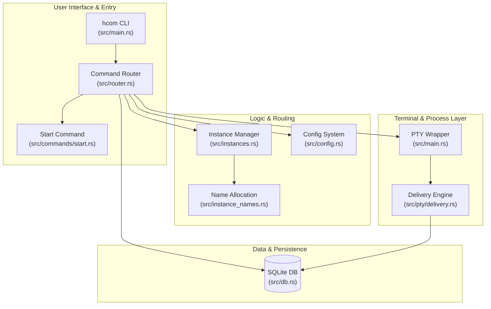
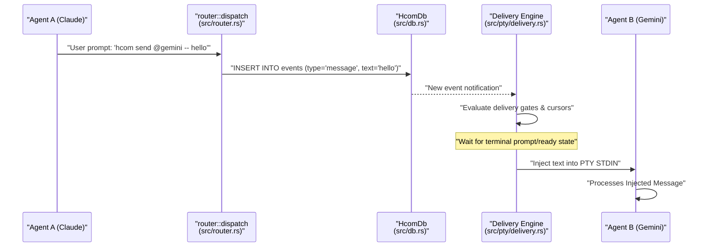

<!-- source: DeepWiki mcp.deepwiki.com · repo aannoo/hcom · page 1 Overview · fetched 2026-10-27 -->

# Overview

Relevant source files

The following files were used as context for generating this wiki page:

- [Cargo.lock](Cargo.lock)
- [Cargo.toml](Cargo.toml)
- [README.md](README.md)
- [pyproject.toml](pyproject.toml)
- [src/commands/start.rs](src/commands/start.rs)
- [src/instance_names.rs](src/instance_names.rs)
- [src/instances.rs](src/instances.rs)
- [src/main.rs](src/main.rs)

## Purpose and Scope

`hcom` is a multi-agent communication system designed to bridge isolation between AI agents running in separate terminal sessions [README.md:7-12](). Its core purpose is to enable AI tools—such as **Claude Code**, **Gemini CLI**, **Codex**, **OpenCode**, **Kilo Code**, **Pi**, **Oh My Pi**, **Antigravity**, **Cursor**, **Kimi**, and **Copilot**—to message, watch, and spawn each other across different terminals, turning standalone CLI tools into a collaborative network [README.md:9-12](), [Cargo.toml:6-6]().

The system provides a shared coordination layer implemented in Rust [Cargo.toml:1-15]() and distributed via Python wheels using `maturin` [pyproject.toml:1-8]() that allows agents to:
- **Exchange messages** with specific intents (`request`, `inform`, `ack`), threads, and `@mentions` for direct addressing [README.md:92-92]().
- **Monitor activity** including file edits, command history, and status states (`listening`, `active`, `blocked`) to prevent collisions [README.md:94-96]().
- **Orchestrate workflows** by spawning, forking, or resuming other agents in new terminal panes [README.md:98-98]().
- **Share context** via structured bundles containing transcripts and event history for seamless handoffs [README.md:94-98]().

Sources: [README.md:7-12](), [Cargo.toml:1-15](), [pyproject.toml:1-8]()

---

## System Architecture

`hcom` is structured around binary entry points [Cargo.toml:12-15](), command routers [src/main.rs:98-98](), instance lifecycles [src/instances.rs:1-52](), and pseudo-terminal (PTY) wrappers [src/main.rs:105-194](). It functions by wrapping AI tool processes and intercepting activity through a system of local hooks [README.md:102-110]().

### High-Level Entity Map
The following diagram maps the conceptual components of `hcom` to their specific implementations in the codebase, bridging natural concepts to code entities.

Title: High-Level Code Entity Architecture
Sources: [Cargo.toml:12-15](), [src/main.rs:47-194](), [src/commands/start.rs:32-44](), [src/instances.rs:1-19]()

---

## Core Mechanisms

### 1. Hook-Based Integration
`hcom` uses tool-specific hooks to record activity to a local SQLite database [README.md:102-105](). These hooks trigger on session events (such as tool execution or turns) [README.md:110-114](). This allows agents to receive messages mid-turn (injected between tool calls) or wake idle agents immediately [README.md:92-92]().

### 2. PTY Wrapping and Screen Capture
When an agent is launched via `hcom <tool>`, it runs inside a real pseudo-terminal managed via `nix` (on Unix) or `portable-pty` (on Windows), parsed via `vt100` [Cargo.toml:18-19](), [Cargo.toml:52-72](). This enables:
- **Live Screen Inspection:** Accessing terminal screen buffer state [README.md:94-94]().
- **Status Management:** Updating and displaying the agent's current state in terminal titles or logs [src/instances.rs:26-52]().
- **Input Injection:** Injecting text directly into the active agent PTY STDIN [README.md:92-98]().

### 3. SQLite Event Storage
The local database stores every status change, file edit, and message event [README.md:102-105](). This persistent log allows agents to subscribe to events, query transcripts, and detect file modification collisions [README.md:94-96]().

Sources: [README.md:102-114](), [Cargo.toml:18-72](), [src/instances.rs:26-52]()

---

## Data Flow: Message Delivery

The sequence diagram below illustrates the path of a message from one agent to another, bridging the "Natural Language Space" of user prompts to the "Code Entity Space" of delivery functions.

Title: Message Delivery Data Flow
Sources: [README.md:92-100](), [src/main.rs:47-99](), [Cargo.toml:18-19]()

---

## Key Components

| Component | File / Path | Description |
| :--- | :--- | :--- |
| **CLI Entry** | `src/main.rs` | Main binary entry point, panic handlers, and PTY runner dispatch [src/main.rs:47-194]() |
| **Command Start** | `src/commands/start.rs` | Handles session start, orphan recovery, and identity re-binding [src/commands/start.rs:32-151]() |
| **Instance Management** | `src/instances.rs` | Classification predicates (`is_subagent_instance`, `is_remote_instance`) and position updates [src/instances.rs:1-52]() |
| **Name Allocation** | `src/instance_names.rs` | 4-letter CVCV pattern generation, scoring, and duplicate avoidance [src/instance_names.rs:53-183]() |
| **Database** | `src/db.rs` | Manages `rusqlite` connections and SQL schema for events and instances [Cargo.toml:22-22]() |

Sources: [src/main.rs:47-194](), [src/commands/start.rs:32-151](), [src/instances.rs:1-52](), [src/instance_names.rs:53-183](), [Cargo.toml:22-22]()

---

## Multi-Agent Capabilities

`hcom` enables complex orchestration topologies beyond simple 1-to-1 chats:
- **Forking:** Cloning an existing agent's process/session state to explore parallel solution paths [README.md:98-98]().
- **Relay (Cross-Device):** Connecting agents across separate machines via end-to-end encrypted MQTT topics (`chacha20poly1305`) [README.md:131-160](), [Cargo.toml:44-44]().
- **TUI Dashboard:** A real-time terminal UI (`ratatui`) to monitor active agents, view transcripts, and inspect live statuses [README.md:82-86](), [Cargo.toml:28-32]().
- **Identity Management:** Every instance maintains a unique name generated via `allocate_name` [src/instance_names.rs:158-164](), session binding, and status managed via lifecycle hooks [src/commands/start.rs:175-177]().

Sources: [README.md:82-160](), [Cargo.toml:28-44](), [src/instance_names.rs:158-164](), [src/commands/start.rs:175-177]()

---

