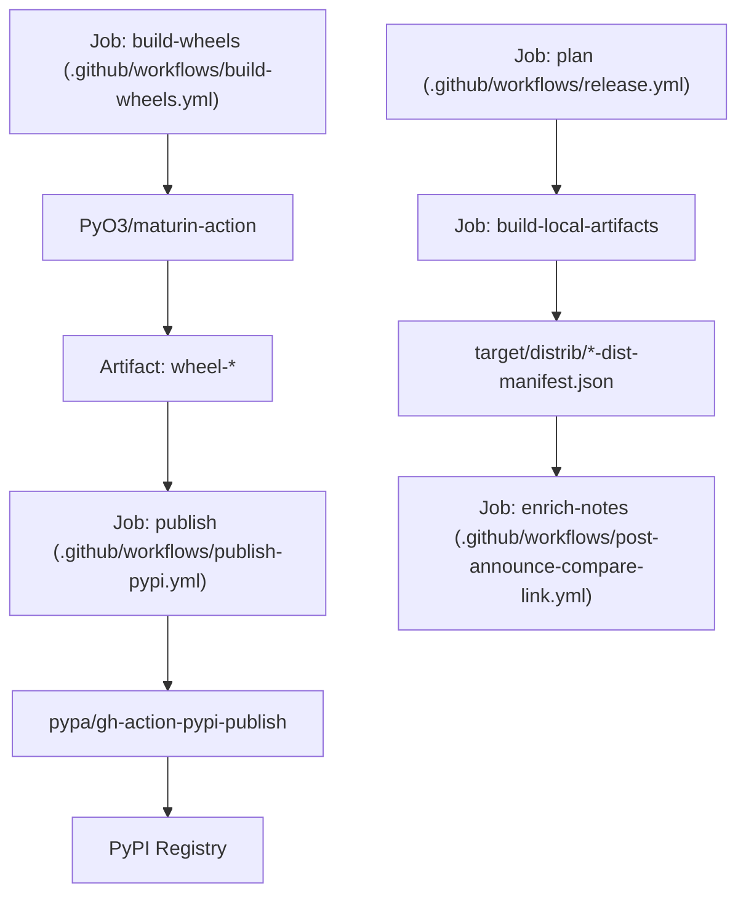
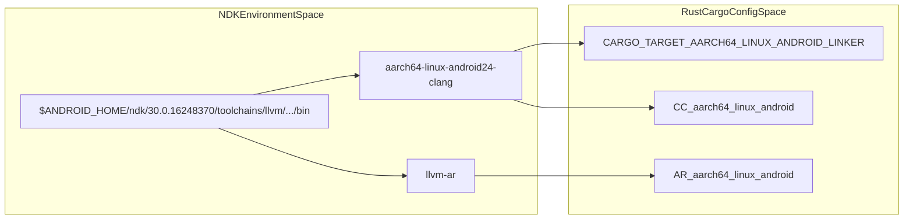

<!-- source: DeepWiki mcp.deepwiki.com · repo aannoo/hcom · page 10.1 Build System and CI/CD · fetched 2026-10-27 -->

# Build System and CI/CD

Relevant source files

The following files were used as context for generating this wiki page:

- [.github/build-setup.yml](.github/build-setup.yml)
- [.github/workflows/build-wheels.yml](.github/workflows/build-wheels.yml)
- [.github/workflows/lint-workflows.yml](.github/workflows/lint-workflows.yml)
- [.github/workflows/post-announce-compare-link.yml](.github/workflows/post-announce-compare-link.yml)
- [.github/workflows/publish-pypi.yml](.github/workflows/publish-pypi.yml)
- [.github/workflows/release.yml](.github/workflows/release.yml)
- [CHANGELOG.md](CHANGELOG.md)
- [dist-workspace.toml](dist-workspace.toml)
- [install.sh](install.sh)
- [rust-toolchain.toml](rust-toolchain.toml)
- [scripts/mock-tools.pins](scripts/mock-tools.pins)

The purpose and scope of this page is to detail the hybrid build system of `hcom`, which combines **Maturin** to package a high-performance Rust core within Python wheels and standalone binaries, alongside the multi-platform GitHub Actions workflows, workflow linting, and Android NDK toolchain configuration.

---

## Overview

`hcom` utilizes a hybrid build system centered around Maturin. The build architecture focuses on producing a standalone binary acting as the PTY wrapper and communication engine, while Python provides the distribution mechanism and CLI entry points.

**Key Build Characteristics:**
- **Maturin `bin` bindings:** Compiles Rust code into a standalone executable named `hcom`.
- **Multi-platform Matrix:** Automated GitHub Actions workflows build for wheel and binary targets [`.github/workflows/build-wheels.yml:14-37]().
- **Android NDK Integration:** Custom pipeline for `aarch64-linux-android` supporting Termux users via specialized wheel tagging and NDK linking [`.github/workflows/build-wheels.yml:72-83]().
- **Workflow Linting:** Dedicated linting workflow checking workflow syntax and expressions via `actionlint` [`.github/workflows/lint-workflows.yml:25-50]().

Sources: [._github/workflows/build-wheels.yml:1-93](), [._github/workflows/release.yml:1-46](), [._github/workflows/lint-workflows.yml:1-51]()

---

## Maturin and Wheel Configuration

The project uses Maturin to define build requirements. Unlike typical PyO3 projects creating `.so` or `.pyd` files, `hcom` focuses on binary distribution within wheels.

| Feature | Implementation | Purpose |
|:---|:---|:---|
| **Build Backend** | `maturin` | Handles Rust compilation and Python packaging via `PyO3/maturin-action` [._github/workflows/build-wheels.yml:45-51]() |
| **Targeting** | Multi-target Matrix | Supports `x86_64` and `aarch64` for Linux (GNU/MUSL), macOS, and Windows [._github/workflows/build-wheels.yml:14-37]() |
| **Optimization** | `--release` | Ensures high-performance PTY handling and message routing [._github/workflows/build-wheels.yml:48-49]() |
| **Linux Compatibility** | `manylinux` / `musllinux` | Ensures wheels run on various glibc and musl distributions [._github/workflows/build-wheels.yml:18-28]() |

Sources: [._github/workflows/build-wheels.yml:11-58]()

---

## GitHub Actions CI/CD Workflows

The repository contains a suite of workflows for release automation, wheel building, PyPI publishing, release note enrichment, and workflow validation.

### Workflow Architecture and Data Flow

The following diagram illustrates the workflow execution bridge from wheel building to PyPI publishing and release note processing.

Sources: [._github/workflows/build-wheels.yml:1-58](), [._github/workflows/publish-pypi.yml:1-34](), [._github/workflows/release.yml:47-115](), [._github/workflows/post-announce-compare-link.yml:1-74]()

---

## Wheel Build and PyPI Distribution

The wheel building process is decoupled into `build-wheels.yml` and `publish-pypi.yml`, coordinating multi-platform compilation and artifact publishing.

### Android/Termux Specialized Build
Android support requires a custom pipeline rather than the standard action to accommodate NDK specifics.
- **NDK Setup:** Uses Java 17 and SDK manager to install `ndk;30.0.16248370` [._github/workflows/build-wheels.yml:66-74]().
- **Build Execution:** Maturin is manually installed and invoked with the `aarch64-linux-android` target and LLVM linker flags [._github/workflows/build-wheels.yml:76-86]().
- **Artifact Handling:** The resulting wheel is uploaded as `wheel-aarch64-linux-android` [._github/workflows/build-wheels.yml:88-92]().

Sources: [._github/workflows/build-wheels.yml:59-93](), [._github/workflows/publish-pypi.yml:1-34]()

---

## Android NDK Setup

Supporting `hcom` on Android (via Termux) requires specific environment variables bridging the Rust compiler with the Android Native Development Kit (NDK).

### Toolchain Mapping
The build system maps Rust targets to NDK LLVM binaries.

Sources: [._github/build-setup.yml:1-22](), [._github/workflows/build-wheels.yml:80-85]()

---

## Workflow Linting

To prevent issues with GitHub Actions workflow syntax or logic, a dedicated workflow `lint-workflows.yml` is used [._github/workflows/lint-workflows.yml:1-2]().

### Purpose and Implementation
- **Trigger:** Runs on pushes and pull requests affecting `.github/workflows/` or via `workflow_dispatch` [._github/workflows/lint-workflows.yml:12-20]().
- **`actionlint` Installation:** Downloads a pinned version of `actionlint` and verifies it via SHA256 checksum [._github/workflows/lint-workflows.yml:35-40]().
- **Linting Execution:** Executes `actionlint` while ignoring specific `shellcheck` warnings (`SC2086`, `SC2129`, `SC2001`) that originate from `cargo-dist` generated artifacts [._github/workflows/lint-workflows.yml:45-51]().

Sources: [._github/workflows/lint-workflows.yml:1-51]()

---

