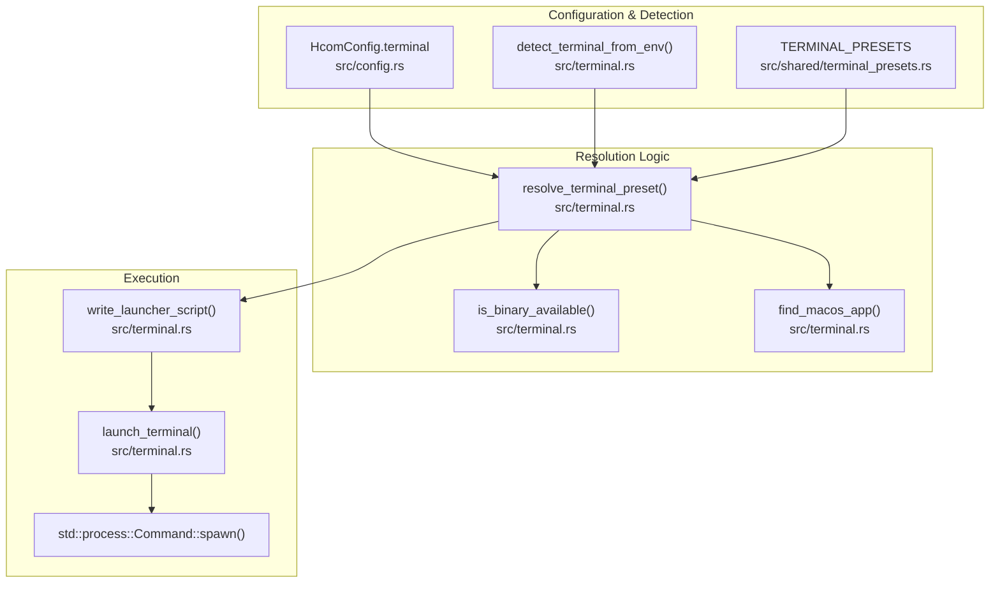
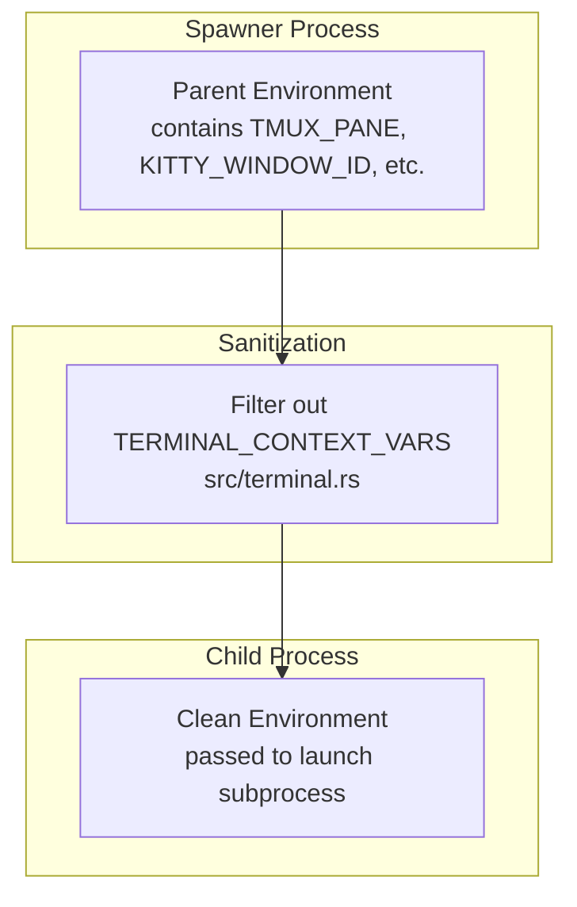
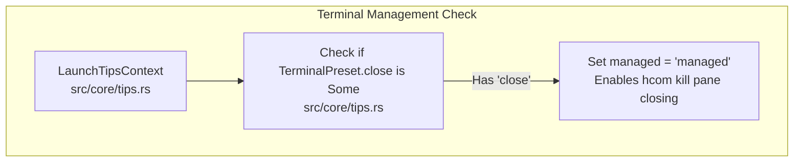

<!-- source: DeepWiki mcp.deepwiki.com · repo aannoo/hcom · page 12.3 Extending Terminal Support · fetched 2026-10-27 -->

# Extending Terminal Support

<details>
<summary>Relevant source files</summary>

The following files were used as context for generating this wiki page:

- [src/commands/kill.rs](src/commands/kill.rs)
- [src/core/tips.rs](src/core/tips.rs)
- [src/shared/platform.rs](src/shared/platform.rs)
- [src/shared/terminal_presets.rs](src/shared/terminal_presets.rs)
- [src/terminal.rs](src/terminal.rs)

</details>


This page provides a technical guide for extending `hcom`'s terminal integration. It covers adding new terminal presets, implementing custom open/close commands, extracting pane identifiers from the environment, and resolving binary paths across different platforms.

The terminal system is responsible for spawning new agent windows, managing their lifecycle (including clean termination and pane cleanup), and detecting the current terminal environment to enable features like "run-here" or automatic window closing.

---

## Terminal Integration Architecture

The terminal system is centered around the `TerminalPreset` struct and a centralized registry of supported terminal emulators in `src/shared/terminal_presets.rs`. When an agent is launched, `hcom` resolves the appropriate preset, generates a launcher script, and executes the terminal's spawn command.

### Data Flow: Launching a Terminal

The following diagram illustrates how `hcom` moves from user configuration to the actual spawning of a terminal process.

**Terminal Launch Process**


**Sources:** [src/terminal.rs:1-217](), [src/shared/terminal_presets.rs:1-213](), [src/commands/kill.rs:1-158]()

---

## Implementing Terminal Presets

Terminal presets are defined in `src/shared/terminal_presets.rs`. Each preset specifies how to open a new window, how to close it, and how to identify the specific pane or window within that terminal's ecosystem.

### The TerminalPreset Structure

The `TerminalPreset` struct defines the capabilities and commands for a specific terminal:

| Field | Type | Description |
|-------|------|-------------|
| `binary` | `Option<&'static str>` | The CLI binary name to check in `PATH` (e.g., `"kitty"`). [src/shared/terminal_presets.rs:41-41]() |
| `app_name` | `Option<&'static str>` | The macOS `.app` bundle name (e.g., `"WezTerm"`). [src/shared/terminal_presets.rs:43-43]() |
| `open` | `PlatformArgv` | Per-platform argv template to launch a new window. Uses `{script}` and `{process_id}` placeholders. [src/shared/terminal_presets.rs:45-45]() |
| `close` | `PlatformArgv` | Per-platform argv template to close a window/pane. Uses `{pane_id}` placeholder. [src/shared/terminal_presets.rs:48-48]() |
| `pane_id_env` | `Option<&'static str>` | The environment variable the terminal sets to identify the current pane (e.g., `TMUX_PANE`). [src/shared/terminal_presets.rs:50-50]() |
| `platforms` | `&'static [&'static str]` | List of supported OS platforms (e.g., `&["Darwin", "Linux"]`). [src/shared/terminal_presets.rs:52-52]() |

**Sources:** [src/shared/terminal_presets.rs:37-53]()

### Adding a New Preset

To add support for a new terminal, append a new entry to the `TERMINAL_PRESETS` vector in `src/shared/terminal_presets.rs`. Use the `p()` helper function for concise definition.

```rust
// Example entry in src/shared/terminal_presets.rs
(
    "myterm",
    p(
        Some("myterm-cli"),           // Binary check
        Some("MyTerminal"),           // macOS App check
        argv(&["myterm-cli", "--new-window", "--", "bash", "{script}"]), // Open
        argv(&["myterm-cli", "kill", "--id", "{pane_id}"]),              // Close
        Some("MYTERM_PANE_ID"),       // ID extraction env var
        &["Darwin", "Linux"],         // Platforms
    ),
),
```

**Sources:** [src/shared/terminal_presets.rs:115-213]()

---

## Command Templates and Placeholders

The `open` and `close` commands use `ArgvTemplate`, which is an array of strings where each element can contain placeholders.

### Open Command Placeholders
- `{script}`: The absolute path to the generated bash launcher script. [src/shared/terminal_presets.rs:7-8]()
- `{process_id}`: The unique HCOM process identifier used for session binding and socket naming (e.g., in kitty listen sockets). [src/terminal.rs:141-141]()

### Close Command Placeholders
- `{pane_id}`: The terminal-specific identifier (e.g., a window ID or pane index) extracted from the environment via the variable named in `pane_id_env`. [src/shared/terminal_presets.rs:46-48]()

**Sources:** [src/shared/terminal_presets.rs:5-10](), [src/terminal.rs:141-141]()

---

## Pane ID Extraction and Detection

`hcom` uses `pane_id` to perform "clean" exits (closing the terminal window via commands like `hcom kill` instead of just killing the shell process).

### Environment Detection Logic

The terminal presets map environment variables to pane identifiers using `pane_id_env`. When an agent runs inside a terminal, `hcom` inspects these variables during startup to bind the session.

### Terminal Context Stripping

When spawning a new terminal window from an existing one, `hcom` strips "terminal context" variables to prevent the new window from inheriting the identity of the parent terminal. This is managed by the `TERMINAL_CONTEXT_VARS` list in `src/terminal.rs`.

**Terminal Context Stripping Flow**


**Sources:** [src/terminal.rs:177-212]()

---

## Binary and App Path Resolution

`hcom` implements path resolution to handle cases where a terminal is installed but not in the user's `PATH`.

### macOS App Fallbacks

For cross-platform terminals like Kitty or WezTerm on macOS, if the binary is missing from `PATH`, `hcom` searches common application directories for the `.app` bundle using `MACOS_APP_FALLBACKS`.

```rust
// Example fallback template for kitty-window
const MACOS_APP_FALLBACKS: &[(&str, ArgvTemplate)] = &[
    (
        "kitty-window",
        &[
            "open", "-n", "-a", "kitty.app", "--args",
            "-o", "allow_remote_control=socket-only",
            "--listen-on", "unix:/tmp/hcom-kitty-{process_id}",
            "bash", "{script}",
        ],
    ),
];
```

**Sources:** [src/terminal.rs:127-175]()

---

## User-Defined Custom Presets and Managed Closing

Users can define custom terminal presets in their configuration files. `hcom` determines if a terminal is "managed" (supports programmatic window closing) by checking if the preset defines a `close` command. This logic drives user tips and cleanup behavior during `hcom kill`.

**Management State Detection**


**Sources:** [src/core/tips.rs:108-139](), [src/commands/kill.rs:130-158]()

---

## Troubleshooting and Debugging

### Terminal Debug Mode
To inspect the commands being generated and the environment variables being set, use the terminal debug command:
`hcom term debug`

### Log Inspection
The PTY wrapper and background processes log their activity. The `LaunchResult::Background` variant provides the log file path and PID for backgrounded instances.

**Sources:** [src/terminal.rs:117-125]()

---

