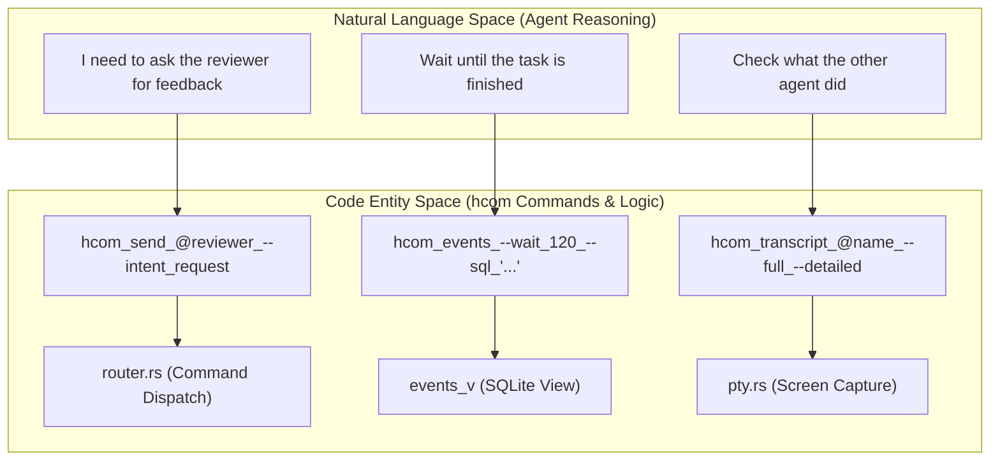
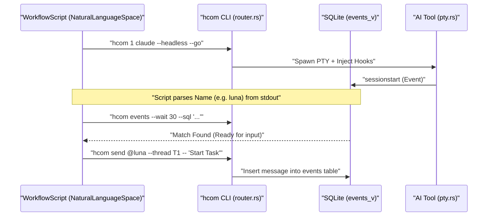

<!-- source: DeepWiki mcp.deepwiki.com · repo aannoo/hcom · page 13 Agent Skills and Workflow Patterns · fetched 2026-10-27 -->

# Agent Skills and Workflow Patterns

Relevant source files

The following files were used as context for generating this wiki page:

- [skills/hcom-agent-messaging/SKILL.md](skills/hcom-agent-messaging/SKILL.md)

The `skills/` directory contains pre-packaged knowledge bundles designed to teach AI agents how to interact with `hcom`. These skills provide the necessary context, CLI references, and behavioral guidelines for agents to transition from isolated entities into collaborative participants in a multi-agent ecosystem.

By loading these skills, agents learn to message peers, monitor event streams, and execute complex coordination scripts across different AI tools like Claude Code, Gemini CLI, Codex, OpenCode, Kilo Code, Cursor, and others [skills/hcom-agent-messaging/SKILL.md:2-6]().

## Overview of Agent Capabilities

When an agent is equipped with `hcom` skills, it gains the ability to break terminal isolation. The system bridges the gap between **Natural Language Space** (where the agent reasons) and **Code Entity Space** (where `hcom` commands and database events reside).

### Bridging Natural Language to Code Entities

The following diagram illustrates how an agent's high-level intent is translated into specific `hcom` code entities and actions.

**Diagram: Intent-to-Entity Mapping**

Sources: [skills/hcom-agent-messaging/SKILL.md:37-47](), [skills/hcom-agent-messaging/references/patterns.md:7-26]()

---

## Agent Messaging Skill

The `hcom-agent-messaging` skill is the primary entry point for teaching an agent how to communicate. It covers the fundamental mechanics of the `send` command, the intent system, and event subscription.

### Key Messaging Concepts
*   **Targeting:** Agents use `@name` (e.g., `@luna`) for individuals or `@tag-` (e.g., `@worker-`) for group routing based on functional roles [skills/hcom-agent-messaging/references/gotchas.md:112-124]().
*   **Intents:** Communication is governed by an intent system defined in `helpers.rs`: `request` (agent always responds), `inform` (responds only if useful), and `ack` (does not respond) [skills/hcom-agent-messaging/SKILL.md:113-119]().
*   **Context Sharing:** Agents can observe each other through transcripts, file edits, and terminal screens, enabling deep context handoffs without manual copy-pasting [skills/hcom-agent-messaging/SKILL.md:37-45]().

For detailed implementation patterns and cross-tool collaboration guides, see [Agent Messaging Skill](#13.1).

Sources: [skills/hcom-agent-messaging/SKILL.md:9-47](), [skills/hcom-agent-messaging/references/gotchas.md:112-146]()

---

## Workflow Scripting and hcom run

The workflow capabilities within the `hcom-agent-messaging` skill provide the framework for building automated, multi-agent pipelines. It moves beyond simple messaging into structured orchestration using the `hcom run` command to execute scripts located in `~/.hcom/scripts/` [skills/hcom-agent-messaging/SKILL.md:133-134](). The `hcom run` command discovers both bundled scripts (like `confess`, `debate`, `fatcow`, `onidle`) and user-defined scripts, with user scripts shadowing bundled ones [src/commands/run.rs:164-170](), [src/scripts.rs:2-7]().

### Workflow Topologies
`hcom` supports several tested agent arrangements [skills/hcom-agent-messaging/SKILL.md:143-152]():

| Topology | Agents | Tools | Use case | Core Command/Entity |
| :--- | :--- | :--- | :--- | :--- |
| **Worker-Reviewer** | 2 | Claude x2 | Simple task delegation | `hcom transcript` |
| **Pipeline** | N sequential | Claude x2 | Sequential plan-then-execute | `msg_thread` |
| **Ensemble** | N+1 (judge) | Claude x4 | Diverse perspectives, best answer | `hcom events --sql` |
| **Hub-Spoke** | 1+N | | Coordinator broadcasts tasks to `@tag-` groups. | `hcom send @tag-` |
| **Reactive** | N | | Actions triggered by file edits or status changes. | `hcom events sub` |

### Scripting Requirements
To ensure scripts run reliably in headless environments, agents follow strict rules [skills/hcom-agent-messaging/SKILL.md:133-142]():
*   **`--go`**: Skips confirmation prompts to prevent script hangs (e.g., `hcom 1 claude --go`) [skills/hcom-agent-messaging/references/gotchas.md:7-19]().
*   **`--headless`**: Runs the agent as a detached background process [skills/hcom-agent-messaging/references/script-template.md:67-68]().
*   **`--thread`**: Isolates messages to a specific workflow to prevent leakage [skills/hcom-agent-messaging/references/gotchas.md:41-54]().
*   **`hcom kill`**: Used for cleanup to ensure terminal panes are closed (replaces `stop`) [skills/hcom-agent-messaging/SKILL.md:139-140]().
*   **`trap cleanup ERR INT TERM`**: Ensures launched agents are killed on script failure or signal [skills/hcom-agent-messaging/references/script-template.md:42-42]().

### Script Templates and Reference
`hcom` provides a standardized template for both Bash and Python scripts, emphasizing proper cleanup via `trap` and identity propagation using the `--name` flag [skills/hcom-agent-messaging/references/script-template.md:21-128](). The `hcom run` command also includes bundled scripts like `onidle.sh` [src/scripts/bundled/onidle.sh:1-236]() which demonstrates advanced patterns like waiting for an agent to become idle before injecting text or launching a new agent [src/scripts/bundled/onidle.sh:5-14]().

For script templates and debugging references, see [Workflow Scripting and hcom run](#13.2).

Sources: [skills/hcom-agent-messaging/SKILL.md:129-152](), [skills/hcom-agent-messaging/references/patterns.md:1-108](), [skills/hcom-agent-messaging/references/gotchas.md:7-54](), [skills/hcom-agent-messaging/references/script-template.md:1-128](), [src/commands/run.rs:164-170](), [src/scripts.rs:2-7](), [src/scripts/bundled/onidle.sh:1-236]()

---

## Technical Integration Flow

The interaction between a script and the `hcom` core is managed through a lifecycle that ensures sessions are bound correctly before communication begins, bridging Natural Language intent and script automation with SQLite event views and PTY wrappers.

**Diagram: Script Execution and Session Binding**

Sources: [skills/hcom-agent-messaging/references/gotchas.md:83-111](), [skills/hcom-agent-messaging/references/patterns.md:13-26]()

### Timing and Tool-Specific Behavior
Script authors must account for tool-specific latencies and binding behaviors [skills/hcom-agent-messaging/references/cross-tool.md:11-68]():
*   **Claude Code:** Immediate session binding on `SessionStart` hook [skills/hcom-agent-messaging/references/cross-tool.md:17-17]().
*   **Codex:** Uses `-c developer_instructions` for bootstrap injection; binding occurs on `SessionStart` [skills/hcom-agent-messaging/references/cross-tool.md:26-29](). The approval gate for Codex is PTY-driven, where `hcom` scrapes the terminal for approval prompts and publishes `pty:approval` status events [tests/real_tool_codex.rs:38-55]().
*   **Gemini CLI:** Binds on `beforeagent` hook; uses a specific system prompt file `~/.hcom/system-prompts/gemini.md` [skills/hcom-agent-messaging/references/cross-tool.md:35-37]().
*   **OpenCode / Kilo:** Uses a TCP binding ceremony via a TypeScript plugin [skills/hcom-agent-messaging/references/cross-tool.md:44-52]().
*   **Cursor:** Detects interactive approval prompts via PTY screen scrape; status appears as `blocked: approval pending` [skills/hcom-agent-messaging/references/cross-tool.md:64-64]().

Sources: [skills/hcom-agent-messaging/references/cross-tool.md:1-71](), [tests/real_tool_codex.rs:38-55]()

---

