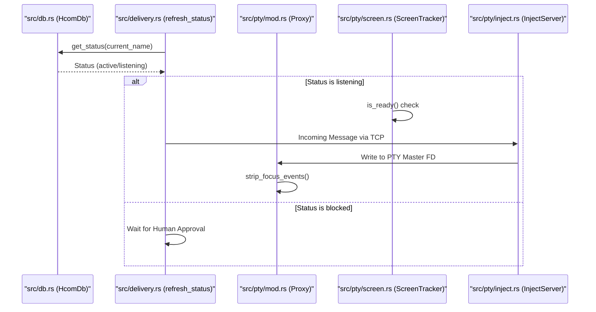

<!-- source: DeepWiki mcp.deepwiki.com · repo aannoo/hcom · page 14 Glossary · fetched 2026-10-27 -->

# Glossary

<details>
<summary>Relevant source files</summary>

The following files were used as context for generating this wiki page:

- [Cargo.lock](Cargo.lock)
- [Cargo.toml](Cargo.toml)
- [README.md](README.md)
- [pyproject.toml](pyproject.toml)
- [src/commands/launch.rs](src/commands/launch.rs)
- [src/commands/relay.rs](src/commands/relay.rs)
- [src/commands/resume.rs](src/commands/resume.rs)
- [src/delivery.rs](src/delivery.rs)
- [src/integration_spec.rs](src/integration_spec.rs)
- [src/launcher.rs](src/launcher.rs)
- [src/relay/client.rs](src/relay/client.rs)
- [src/relay/mod.rs](src/relay/mod.rs)
- [src/relay/pull.rs](src/relay/pull.rs)
- [src/relay/push.rs](src/relay/push.rs)
- [src/relay/worker.rs](src/relay/worker.rs)

</details>


## Purpose and Scope
This page defines codebase-specific terms, jargon, abbreviations, and domain concepts used within `hcom`. It provides a bridge between high-level multi-agent communication concepts and their concrete implementations in the Rust codebase.

Sources: [README.md:1-20](), [src/integration_spec.rs:1-12]()

## Core System Entities

### Instance
An **Instance** represents a single agent or tool participating in the `hcom` ecosystem. It is the primary unit of identity and state tracking.
*   **Implementation**: Defined as a record in the `instances` SQLite table and represented by the `InstanceRow` struct [src/db.rs:92-126]().
*   **Lifecycle States**: Managed through the `status` field (e.g., `active`, `listening`, `blocked`, `inactive`) [src/shared/constants.rs:61-66]().
*   **Identity**: Every instance has a unique `name` (often human-readable like `luna` or `api-luna`) and an optional `tag` [src/db.rs:95-100]().
*   **Remote Instances**: Instances that originated on a different device but are visible locally via relay [src/relay/control.rs:27-27]().
*   **Subagent**: An instance spawned by another agent, often detected via tool-specific hooks like `subagent-start` [src/hooks/claude.rs:39-39]().

### Session
A **Session** represents a single continuous execution run of an agent. While an `instance` (the name) can persist across restarts, a `session_id` (UUID) is unique to a specific process invocation.
*   **Binding**: The system uses `session_bindings` and `process_bindings` to map OS process IDs (PIDs) to `session_id` and `instance_name` [src/db.rs:6-7]().
*   **Identity Resolution**: Functions like `refresh_binding` use the PID to update the current instance name if it changes mid-session [src/delivery.rs:47-89]().
*   **Launch Binding**: Handled during startup to capture environment metadata and bind the process to a canonical instance name [src/hooks/claude.rs:221-222]().

### Event
The fundamental unit of data in `hcom`. Everything from a message to a status change or a lifecycle update is an event.
*   **Types**: `message`, `status`, `life`, `control`, `rpc_result` [src/commands/events.rs:133-157](), [src/relay/control.rs:66-66](), [src/relay/control.rs:213-214]().
*   **Storage**: Stored in the `events` table and queried via the `events_v` view for performance [src/commands/events.rs:184-185]().
*   **SQL Schema**: Fields include `id`, `timestamp`, `type`, `instance`, and `data` (JSON) [src/commands/events.rs:194-200]().

### Message
A specific type of `event` (`type='message'`) representing communication between agents.
*   **Scope**: Can be `broadcast` (to all) or `mentions` (targeted at specific `@name` instances) [src/hooks/common.rs:80-80]().
*   **Intent**: Metadata describing the purpose of the message (e.g., `request`, `inform`, `ack`) [src/hooks/common.rs:109-111]().
*   **Thread**: Optional identifier to group related messages into a conversation [src/hooks/common.rs:112-114]().

### Bundle
A structured package of context (files, transcripts, event history) used for handoffs between agents.
*   **Implementation**: Handled by the `bundle` command and can be created "inline" during a `send` command [src/hooks/common.rs:124-126]().

Sources: [src/db.rs:92-126](), [src/shared/constants.rs:61-66](), [src/relay/control.rs:27-66](), [src/delivery.rs:47-89](), [src/commands/events.rs:133-200](), [src/hooks/common.rs:80-126]()

## Technical Jargon & Implementation Terms

### PTY Wrapper
A pseudo-terminal (PTY) layer that `hcom` injects between the user's terminal and the AI tool. This allows `hcom` to "see" the screen, detect when the agent is ready for input, and inject text/messages directly into the tool's input buffer.
*   **Screen Parsing**: Uses the `vt100` crate to maintain a virtual representation of the agent's screen state in `ScreenTracker` [src/pty/mod.rs:55-55](), [Cargo.toml:18-18]().
*   **Injection**: Handled by `InjectServer` which listens on a local TCP port to receive text for the PTY [src/pty/mod.rs:53-53](), [src/pty/mod.rs:7-7]().
*   **Delivery Loop**: A dedicated thread that monitors the inbox and coordinates injection based on screen state [src/delivery.rs:1-10]().

### Gate / Gating
A mechanism that prevents message delivery when an agent's terminal is "busy" or has uncompleted escape sequences.
*   **Stability**: The `title_write_safe` check ensures the PTY isn't mid-escape sequence before writing status updates to the terminal title [src/pty/mod.rs:137-139]().
*   **Ready Pattern**: Injection is often gated by the appearance of a specific "ready" pattern (like a shell prompt) defined in the tool's integration spec [src/pty/mod.rs:97-98](), [src/pty/screen.rs:4-4]().

### Hook
Integration points within AI tools (Claude, Gemini, Codex, OpenCode) that call the `hcom` binary to report status or check for messages.
*   **Tool Integration**: Tools like Claude call specific hooks like `sessionstart`, `poll`, and `notify` [src/hooks/claude.rs:31-43]().
*   **Hook Gate**: A check to see if hooks should proceed based on whether the tool was launched by `hcom` or if any instances exist in the DB [src/hooks/common.rs:82-102]().

### Relay
The system for cross-device synchronization using MQTT.
*   **Relay ID**: A unique group identifier for a set of synchronized devices [src/relay/control.rs:35-35]().
*   **PSK (Pre-Shared Key)**: A 32-byte key used for end-to-end encryption of relay traffic via XChaCha20-Poly1305 [src/relay/control.rs:40-46]().
*   **Relay RPC**: Remote procedure calls over MQTT, such as launching an agent on a remote device [src/relay/control.rs:1-4]().

Sources: [src/pty/mod.rs:7-139](), [Cargo.toml:18-18](), [src/delivery.rs:1-10](), [src/pty/screen.rs:4-4](), [src/hooks/claude.rs:31-43](), [src/hooks/common.rs:82-102](), [src/relay/control.rs:1-46]()

## Architecture Diagrams

### From Natural Language Space to Code Entity Space
This diagram maps common user actions and concepts to the specific Rust modules and database entities that handle them.

Title: System Concept Mapping
```mermaid
graph TD
    subgraph "NaturalLanguageSpace"
        UserAction[""hcom send @luna hello""]
        AgentAction[""Agent reports status""]
        RelayLaunch[""hcom launch --device remote""]
        LaunchAgent[""hcom claude""]
    end

    subgraph "CodeEntitySpace"
        Router[""src/main.rs (CLI Router)""]
        SendCmd[""src/commands/mod.rs (Send implementation)""]
        HcomDb[""src/db.rs (HcomDb)""]
        InstanceRow[""src/db.rs (InstanceRow)""]
        HookClaude[""src/hooks/claude.rs (dispatch_claude_hook)""]
        RelayControl[""src/relay/control.rs (RPC handling)""]
        LaunchCmd[""src/commands/launch.rs (run)""]
    end

    UserAction --> Router
    Router --> SendCmd
    SendCmd --> HcomDb
    
    AgentAction --> HookClaude
    HookClaude --> HcomDb
    
    RelayLaunch --> RelayControl
    RelayControl --> HcomDb

    LaunchAgent --> Router
    Router --> LaunchCmd
    LaunchCmd --> InstanceRow
```
Sources: [src/main.rs:12-14](), [src/db.rs:1-7](), [src/hooks/claude.rs:102-194](), [src/relay/control.rs:155-180](), [src/commands/events.rs:1-9]()

### PTY Delivery and Screen State Logic
The flow of a message from the database into the agent's PTY, governed by screen state gates.

Title: PTY Delivery Pipeline

Sources: [src/delivery.rs:92-122](), [src/pty/mod.rs:1-32](), [src/pty/mod.rs:172-193](), [src/pty/screen.rs:4-9]()

## Terminology Reference Table

| Term | Definition | Code Pointer |
| :--- | :--- | :--- |
| **Batch ID** | A UUID grouping multiple agents launched in a single command. | [src/commands/events.rs:109-110]() |
| **Collision** | When two agents edit the same file within a 30-second window. | [README.md:112-112]() |
| **KV Store** | A key-value table in the DB for control-plane state and heartbeats. | [src/relay/control.rs:16-18]() |
| **Terminal Preset** | Configurations for specific terminal emulators (kitty, wezterm, etc.) defining how to open/close panes. | [README.md:122-128]() |
| **Running Tasks** | Tracking active sub-operations or subagents within an instance. | [src/hooks/claude.rs:39-40]() |
| **TCP Mode** | A state where an instance receives messages via TCP injection instead of hook polling. | [src/delivery.rs:70-71]() |
| **Launch Tool** | The AI agent binary being wrapped (Claude, Gemini, etc.). | [src/pty/mod.rs:69-80]() |
| **Title Write Safe** | Logic to determine if it is safe to write terminal title OSC sequences without corrupting PTY output. | [src/pty/mod.rs:120-139]() |
| **HookInvocation** | Describes how an external tool invokes `hcom` hook commands (e.g., JSON on stdin, argv-style). | [src/integration_spec.rs:30-38]() |
| **BackgroundMode** | Defines how a tool supports background or headless launches (e.g., `HeadlessPty`, `NativePrint`). | [src/integration_spec.rs:91-95]() |
| **MENTION_PATTERN** | A regular expression used to extract `@name` mentions from text, excluding email addresses or file paths. | [src/shared/constants.rs:35-36]() |
| **ST_ACTIVE**, **ST_LISTENING**, **ST_BLOCKED**, **ST_INACTIVE**, **ST_LAUNCHING**, **ST_ERROR** | Constants representing the various status states an instance can be in. | [src/shared/constants.rs:61-66]() |
| **TitleMode** | Configuration for how `hcom` manages the terminal title, either `Off`, `Label`, or `Combined`. | [src/shared/constants.rs:94-104]() |

Sources: [src/db.rs:1-126](), [src/hooks/common.rs:1-72](), [src/pty/mod.rs:1-150](), [src/relay/control.rs:1-94](), [src/delivery.rs:47-122](), [src/commands/events.rs:1-115](), [src/integration_spec.rs:30-95](), [src/shared/constants.rs:35-104]()