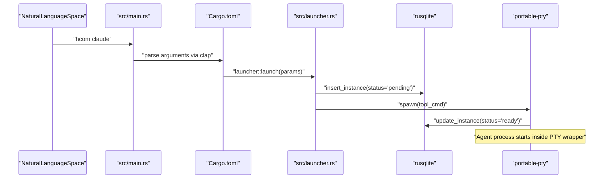
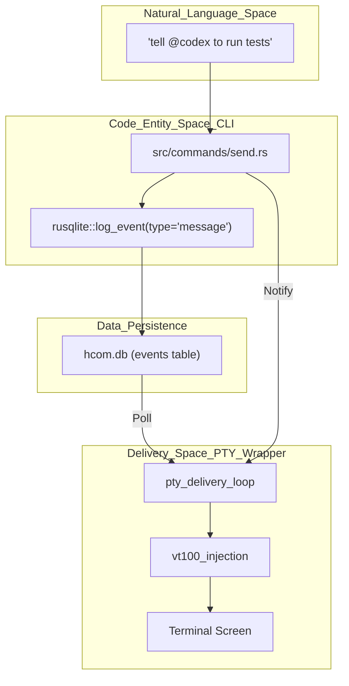

<!-- source: DeepWiki mcp.deepwiki.com · repo aannoo/hcom · page 2 Getting Started · fetched 2026-10-27 -->

# Getting Started

<details>
<summary>Relevant source files</summary>

The following files were used as context for generating this wiki page:

- [.github/build-setup.yml](.github/build-setup.yml)
- [.github/workflows/build-wheels.yml](.github/workflows/build-wheels.yml)
- [.github/workflows/publish-pypi.yml](.github/workflows/publish-pypi.yml)
- [.github/workflows/release.yml](.github/workflows/release.yml)
- [Cargo.lock](Cargo.lock)
- [Cargo.toml](Cargo.toml)
- [README.md](README.md)
- [install.sh](install.sh)
- [pyproject.toml](pyproject.toml)

</details>


This page guides you through installation methods and provides a quick start example for launching agents and sending messages. `hcom` is a single Rust binary [README.md:13-13]() that enables AI agents to message, watch, and spawn each other across terminal panes.

## Installation Methods

### Method 1: Curl Installer (Recommended)
The recommended way to install `hcom` on macOS, Linux, and WSL is via the shell installer script. This script handles platform detection, including specific logic for Android (Termux) environments.

```bash
# macOS, Linux, Android (Termux), and WSL
curl -fsSL https://github.com/aannoo/hcom/releases/latest/download/hcom-installer.sh | sh
```

For Windows users using PowerShell:
```powershell
# Windows (native, Powershell)
irm https://github.com/aannoo/hcom/releases/latest/download/hcom-installer.ps1 | iex
```

Sources: [README.md:41-49](), [install.sh:1-18]()

---

### Method 2: Python Package (pip / uv)
`hcom` is distributed as a Python package built with `maturin` [pyproject.toml:1-3](). This installs the Rust binary into your Python environment's script path.

```bash
uv tool install hcom  # or: pip install hcom
```

The package includes pre-built wheels for multiple targets, including `x86_64` and `aarch64` for Linux (GNU/musl), macOS, Windows, and Android [.github/workflows/build-wheels.yml:16-37](), [.github/workflows/build-wheels.yml:59-92]().

Sources: [README.md:27-31](), [pyproject.toml:1-3](), [.github/workflows/build-wheels.yml:16-92]()

---

### Method 3: Homebrew (macOS)
```bash
brew install aannoo/hcom/hcom
```

Sources: [README.md:33-37]()

---

### Method 4: From Source
Building from source requires the Rust toolchain (version 1.89+) [Cargo.toml:10-10]().

```bash
git clone https://github.com/aannoo/hcom.git
cd hcom
cargo build --release
```

The build process produces a single binary named `hcom` [Cargo.toml:12-14]().

Sources: [Cargo.toml:1-14]()

---

## Quick Start

To start a multi-agent session, launch two agents in separate terminals.

### 1. Launch Agents
In **Terminal 1**, launch Claude:
```bash
hcom claude
```

In **Terminal 2**, launch Codex:
```bash
hcom codex
```

The entry point and command router handle CLI arguments, resolve the tool configuration, and delegate to the launcher system [src/main.rs:1-14]() (referencing Cargo binary setup [Cargo.toml:12-14]()).

### 2. Send a Message
In a third terminal (or from within an agent's prompt), send a message:
```bash
hcom send @claude "What is the status of the refactor?" --intent "request-update"
```

### Agent Launch Flow (Natural Language to Code Entity Space)

The following diagram illustrates the sequence from the natural language intent through the CLI entry point to a running agent wrapped in a PTY session, mapping user actions to specific code entities.

Title: Agent Launch Execution Sequence

Sources: [Cargo.toml:12-17](), [.github/workflows/build-wheels.yml:16-52]()

---

## Messaging Architecture

`hcom` uses a local SQLite database to store events and messages [README.md:113-119](). Agents receive messages through "hooks" that poll the database and inject text into the agent's PTY [README.md:113-119]().

### Message Delivery Data Flow

This diagram shows how a message travels from the `hcom send` command to the target agent's terminal screen using the `vt100` parser for screen state management [Cargo.toml:18-18]().

Title: Message Delivery Pipeline from Natural Language to PTY Injection

Sources: [README.md:113-119](), [Cargo.toml:18-22]()

---

## Verification Commands

| Command | Purpose |
| :--- | :--- |
| `hcom list` | Show all active agent instances and their status [README.md:186-187] |
| `hcom` | Open the TUI dashboard to monitor agents [README.md:97-102] |
| `hcom config terminal --info` | View current configuration and terminal settings [README.md:163-166] |
| `hcom update` | Check for and install the latest version [README.md:51-53] |

Sources: [README.md:51-187]()

---

