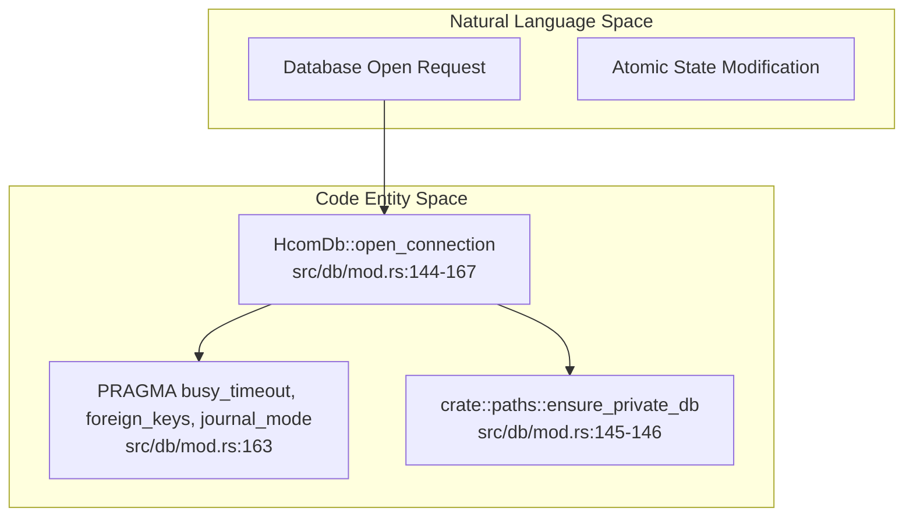
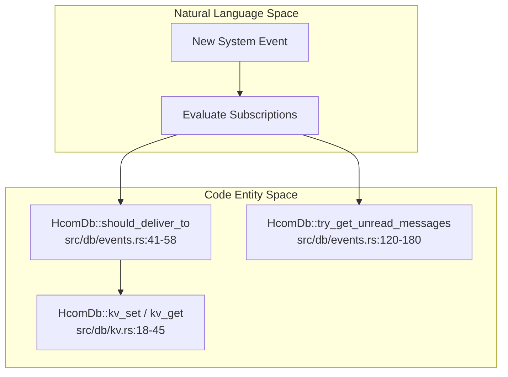

<!-- source: DeepWiki mcp.deepwiki.com · repo aannoo/hcom · page 4.2 Database and Event Storage · fetched 2026-10-27 -->

# Database and Event Storage

<details>
<summary>Relevant source files</summary>

The following files were used as context for generating this wiki page:

- [src/commands/list.rs](src/commands/list.rs)
- [src/commands/stop.rs](src/commands/stop.rs)
- [src/db/events.rs](src/db/events.rs)
- [src/db/kv.rs](src/db/kv.rs)
- [src/db/mod.rs](src/db/mod.rs)
- [src/db/sessions.rs](src/db/sessions.rs)
- [src/identity.rs](src/identity.rs)
- [src/paths.rs](src/paths.rs)
- [src/sys/fs.rs](src/sys/fs.rs)

</details>


## Purpose and Scope

This page details hcom's SQLite database schema, event storage architecture, and subscription system. It covers the core tables (`events`, `instances`, `kv`, `notify_endpoints`, `session_bindings`, `process_bindings`, `claude_actor_capabilities`), the event type system (message, status, life), subscription storage in `kv`, and how queries are structured against `events_v`.

For instance lifecycle management and heartbeat monitoring, see [4.3. Instance Lifecycle Management](). For message routing and delivery mechanics, see [4.4. Message Routing and Delivery]().

---

## Database Handle: `HcomDb` and Connection Management

The `HcomDb` struct defined in [src/db/mod.rs:102-106]() wraps a SQLite `Connection` and maintains database state, including the filesystem path and file inode for validation.

```rust
pub struct HcomDb {
    conn: Connection,
    db_path: std::path::PathBuf,
    db_inode: u64,
}
```

Database connections are opened via `open_connection` [src/db/mod.rs:144-167](), which enforces private file permissions via `crate::paths::ensure_private_db` [src/db/mod.rs:145-146](), configures a 5-second `busy_timeout`, enforces foreign key constraints (`PRAGMA foreign_keys=ON`), and enables Write-Ahead Logging (`PRAGMA journal_mode=WAL`) [src/db/mod.rs:163](). 

Sources: [src/db/mod.rs:102-167]()

**Diagram: Database Initialization and Connection Space**


Sources: [src/db/mod.rs:144-167]()

---

## Schema Overview and Versioning

The SQLite schema version is tracked via `SCHEMA_VERSION` (currently version **20**) [src/db/mod.rs:41](). Migrations are applied sequentially via the `MIGRATIONS` array [src/db/mod.rs:43-89]().

| Table / View | Purpose |
|--------------|---------|
| `events` | Append-only log of all system events (messages, status changes, lifecycle events) |
| `instances` | Active and historical instance records (`InstanceRow`) with status, session bindings, and metadata |
| `kv` | General key-value store for configuration, subscriptions (`events_sub:`), and relay state |
| `notify_endpoints` | TCP ports for PTY delivery, screen injection, and plugin listeners |
| `session_bindings` | Maps external `session_id` to canonical `instance_name` (hook-based tools) |
| `process_bindings` | Maps OS process IDs (`process_id`) to session and instance bindings |
| `claude_actor_capabilities` | Tracks scoped tool-use permissions and capabilities for Claude actors [src/db/mod.rs:55-65]() |
| `events_v` | Virtual view supporting JSON extraction and filtering |

Recent schema expansions include:
- **Version 17**: Added `terminal_preset_requested` and `terminal_preset_effective` columns to `instances` [src/db/mod.rs:45-51]().
- **Version 18**: Added `last_seen` column to `instances` and created `claude_actor_capabilities` with expiration and session indexes [src/db/mod.rs:53-69]().
- **Version 19**: Added `events_fts_delete` trigger for FTS cleanup [src/db/mod.rs:73-78]().
- **Version 20**: Updated `terminal_preset_effective` JSON property extraction [src/db/mod.rs:80-88]().

Sources: [src/db/mod.rs:41-89]()

---

## Events Table and Event Types

The `events` table provides an append-only sequence of records. Each entry includes:
- `id`: Monotonically increasing primary key (used for per-instance read cursors: `instances.last_event_id`).
- `timestamp`: Creation timestamp.
- `type`: Category (`message`, `status`, or `life`).
- `instance`: Originating instance name.
- `data`: JSON-encoded payload.

### Event Categories
1. **Message Events (`type = 'message'`)**: Represents inter-agent communication, handled via the `Message` struct [src/db/events.rs:9-21](). Fields include `from`, `text`, `intent`, `thread`, `delivered_to`, and `relay_ref` for relay synchronization [src/db/events.rs:10-20]().
2. **Status Events (`type = 'status'`)**: Tracks state transitions (e.g., `active`, `listening`, `blocked`, `launching`, `error`, `inactive`) with contextual tool metadata.
3. **Life Events (`type = 'life'`)**: Records high-level lifecycle milestones such as initialization and shutdown (`ready`, `stopped`, `started`).

Sources: [src/db/events.rs:9-21]()

---

## Events View (`events_v`) and Delivery Mechanics

The `events_v` database view simplifies complex message and event filtering by flattening JSON attributes into standard queryable columns. 

### Subscription Gating and Request Watches
Subscriptions are stored in the `kv` table under the `events_sub:` prefix [src/db/kv.rs:103](). Functions like `should_deliver_to` evaluate whether a message event matches a receiver's scope (`broadcast` vs `mentions`) [src/db/events.rs:41-58]().

**Diagram: Subscription and Event Flow Architecture**


Sources: [src/db/events.rs:41-58](), [src/db/events.rs:120-180](), [src/db/kv.rs:18-45]()

---

## Notify Endpoints

The `notify_endpoints` table associates instances with communication channels and local network ports:
- `pty`: Wakes the PTY delivery loop when unread events accumulate.
- `inject`: Bidirectional endpoint supporting PTY text injection and live screen captures.
- `plugin`: Tool-specific integration endpoints.

Endpoints support migration and re-binding via `migrate_notify_endpoints` during session resume and adoption workflows [src/db/sessions.rs:158-178]().

Sources: [src/db/sessions.rs:158-178]()

---

## Session and Process Bindings

To map underlying operating system processes and tool sessions to hcom instances, the database maintains two indexing tables:
1. `session_bindings`: Maps tool-provided `session_id` strings to canonical instance names.
2. `process_bindings`: Maps OS-level `process_id` values to sessions and instances [src/db/sessions.rs:119-134]().

Sources: [src/db/sessions.rs:119-134]()

---

## Key-Value (KV) Store

The `kv` table provides structured string-to-string persistence utilized for configuration properties, relay cursors, and subscription records [src/db/kv.rs:1-71](). 

Key retrieval and mutation methods include:
- `kv_get(&self, key: &str)`: Fetches optional string values [src/db/kv.rs:18-28]().
- `kv_set(&self, key: &str, value: Option<&str>)`: Inserts or deletes key records [src/db/kv.rs:31-45]().
- `kv_prefix(&self, prefix: &str)`: Queries matching keys with automatic escaping of SQL wildcard characters (`%` and `_`) to ensure literal prefix matching [src/db/kv.rs:48-60]().
- `kv_delete_prefix(&self, prefix: &str)`: Bulk-deletes keys sharing a given prefix [src/db/kv.rs:62-70]().

Sources: [src/db/kv.rs:1-71]()

---

