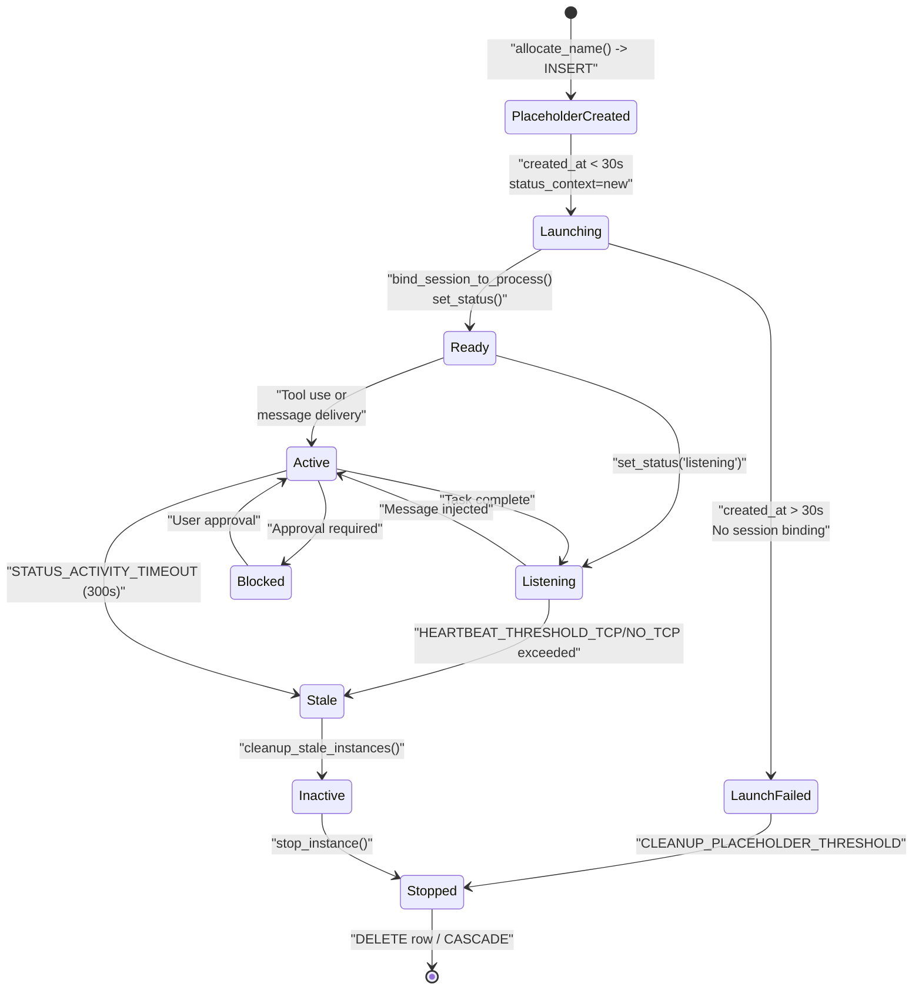
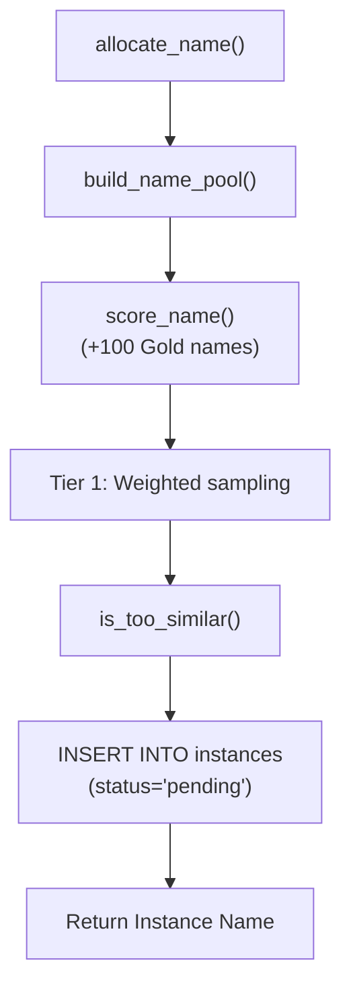

<!-- source: DeepWiki mcp.deepwiki.com · repo aannoo/hcom · page 4.3 Instance Lifecycle Management · fetched 2026-10-27 -->

# Instance Lifecycle Management

<details>
<summary>Relevant source files</summary>

The following files were used as context for generating this wiki page:

- [src/core/launch_status.rs](src/core/launch_status.rs)
- [src/db/instances.rs](src/db/instances.rs)
- [src/instance_binding.rs](src/instance_binding.rs)
- [src/instance_lifecycle.rs](src/instance_lifecycle.rs)
- [src/pidtrack.rs](src/pidtrack.rs)

</details>


## Purpose and Scope
This page details the implementation of instance lifecycle management in `hcom`. It covers instance state transitions, database state tracking via `InstanceRow` [src/db/instances.rs:20-52](), name allocation, launch context capture (`persist_terminal_launch_context`, `capture_and_store_launch_context`) [src/instance_binding.rs:25-94](), process tracking (`pidtrack`) [src/pidtrack.rs:13-44](), heartbeat monitoring, wake-grace detection (`is_in_wake_grace`) [src/instance_lifecycle.rs:107-109](), and cleanup logic.

---

## Instance States and Transitions

An instance progresses through distinct phases from creation to deletion. The database row in the `instances` table serves as the single source of truth. The `get_instance_status()` function computes the current status by analyzing stored fields and heartbeat timestamps [src/instance_lifecycle.rs:157-162]().

### State Machine Diagram (Natural Language to Code Entity Space)


Sources: [src/instance_lifecycle.rs:25-52](), [src/db/instances.rs:20-52]()

### State Definitions and Threshold Constants

| State | Condition / Constant | Heartbeat Check | Purpose |
|-------|----------------------|-----------------|----------|
| **Launching** | `LAUNCH_PLACEHOLDER_TIMEOUT` (30s) [src/instance_lifecycle.rs:25-25]() | None | Name allocated, waiting for session binding |
| **Launch Failed** | `created_at > 30s`, no session | None | Placeholder timed out before binding |
| **Active** | `ST_ACTIVE` (`active`) [src/shared/constants.rs] | Yes (`STATUS_ACTIVITY_TIMEOUT` 300s) [src/instance_lifecycle.rs:49-49]() | Currently processing task or tool |
| **Listening** | `ST_LISTENING` (`listening`) [src/shared/constants.rs] | Yes (`HEARTBEAT_THRESHOLD_TCP` 35s) [src/instance_lifecycle.rs:29-29]() | Waiting for messages/input |
| **Blocked** | `ST_BLOCKED` (`blocked`) [src/instance_lifecycle.rs:9-9]() | Yes (300s) | Awaiting approval or permission |
| **Inactive (Stale)** | Heartbeat timeout exceeded | No | Marked for cleanup |
| **Stopped** | Row deleted from table | No | Terminal state |

Sources: [src/instance_lifecycle.rs:25-52](), [src/db/instances.rs:20-52](), [src/shared/constants.rs]()

---

## Creation and Name Generation

Instance creation involves allocating a unique name via `allocate_name()` and initializing the database record. 

### Name Allocation Architecture


Sources: [src/instance_names.rs:8-206]()

*   **Placeholder Reservation:** Placeholders are created with `session_id = NULL` [src/db/instances.rs:20-24]().
*   **Timeout & Cleanup:** If session binding does not occur within `LAUNCH_PLACEHOLDER_TIMEOUT` (30s) [src/instance_lifecycle.rs:25-25](), the launch is marked failed. `CLEANUP_PLACEHOLDER_THRESHOLD` (120s) [src/instance_lifecycle.rs:52-52]() purges unbonded placeholders.

Sources: [src/instance_lifecycle.rs:25-52](), [src/db/instances.rs:20-24](), [src/instance_names.rs:8-206]()

---

## Registration, Binding, and Pidtracking

Registration connects a tool session to an `hcom` instance identity, while `pidtrack` coordinates OS process boundaries.

### Binding Flow and Pidtrack Data Structures

```mermaid
classDiagram
    class "InstanceRow" {
        +name: String
        +session_id: Option~String~
        +status: String
        +pid: Option~i64~
        +launch_context: Option~String~
    }
    class "PidEntry" {
        +tool: String
        +names: Vec~String~
        +launched_at: f64
        +process_id: String
        +terminal_preset: String
        +pane_id: String
        +notify_port: u16
        +inject_port: u16
    }
    class "instance_binding" {
        +persist_terminal_launch_context()
        +capture_and_store_launch_context()
    }
    "InstanceRow" --> "instance_binding" : "updated by"
    "PidEntry" --> "pidtrack" : "recorded in .tmp/launched_pids.json"
```
Sources: [src/db/instances.rs:20-52](), [src/instance_binding.rs:25-142](), [src/pidtrack.rs:13-44]()

*   `persist_terminal_launch_context`: Stores terminal launch metadata (`pane_id`, `terminal_id`, effective preset) in `launch_context` without overwriting concurrent writes [src/instance_binding.rs:25-88]().
*   `capture_and_store_launch_context`: Captures environment state (git branch, TTY, env vars) and merges it into `launch_context` [src/instance_binding.rs:93-142]().
*   `pidtrack::record_pid`: Persists launched process records to `.tmp/launched_pids.json` as `PidEntry` structs for orphan detection and process cleanup [src/pidtrack.rs:13-44](), [src/pidtrack.rs:189-211]().

Sources: [src/instance_binding.rs:25-142](), [src/pidtrack.rs:13-44](), [src/pidtrack.rs:189-211]()

---

## Heartbeat Monitoring and Staleness Detection

`hcom` monitors activity to identify unresponsive instances.

### Heartbeat Thresholds and Wake Grace
*   **TCP Listener Threshold (`HEARTBEAT_THRESHOLD_TCP`):** 35s (30s hook interval + 5s buffer) [src/instance_lifecycle.rs:27-29]().
*   **Adhoc Threshold (`HEARTBEAT_THRESHOLD_NO_TCP`):** 10s [src/instance_lifecycle.rs:32-32]().
*   **Active Heartbeat Grace (`ACTIVE_HEARTBEAT_GRACE`):** 120s (4x poll interval) for instances parked in non-listening states [src/instance_lifecycle.rs:34-43]().
*   **Activity Timeout (`STATUS_ACTIVITY_TIMEOUT`):** 300s without status update [src/instance_lifecycle.rs:48-49]().
*   **Wake Grace Period (`is_in_wake_grace`, `is_in_wake_grace_publishing`):** Detects wall-clock vs monotonic-clock drift during system sleep and suppresses stale cleanup for `WAKE_GRACE_PERIOD` (60.0s) [src/instance_lifecycle.rs:54-55](), [src/instance_lifecycle.rs:107-135]().

Sources: [src/instance_lifecycle.rs:25-55](), [src/instance_lifecycle.rs:107-135]()

---

## Cleanup and Termination

Cleanup routines reclaim resources and purge expired records.

*   **Termination:** `stop_instance()` logs a `life` event and removes or deactivates the database record.
*   **Stale Remote Devices:** Remote instances are marked stale after 90s (`REMOTE_DEVICE_STALE_THRESHOLD`) without updates [src/instance_lifecycle.rs:58-58]().
*   **Recently Stopped Window:** Stopped instances remain visible in listings for 10 minutes (`RECENTLY_STOPPED_WINDOW`) [src/instance_lifecycle.rs:60-60]().
*   **Placeholder Threshold:** Unbound placeholders are removed after `CLEANUP_PLACEHOLDER_THRESHOLD` (120s) [src/instance_lifecycle.rs:51-52]().

Sources: [src/instance_lifecycle.rs:47-62](), [src/commands/stop.rs]()

---

