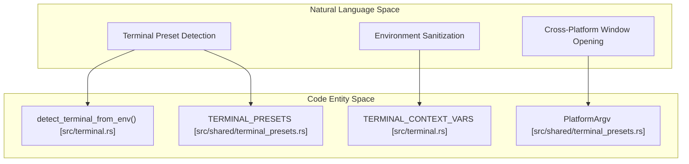
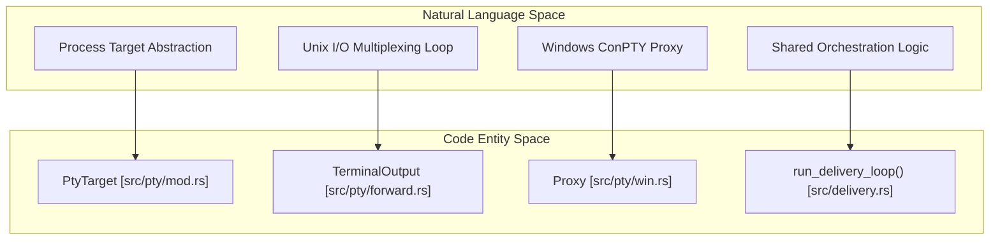
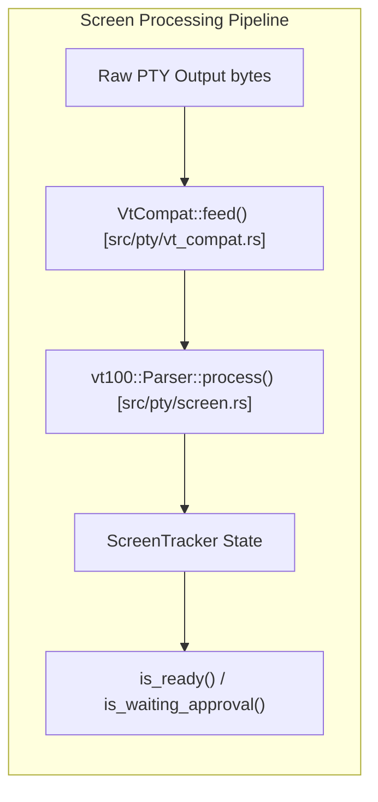

<!-- source: DeepWiki mcp.deepwiki.com · repo aannoo/hcom · page 4.5 Terminal Integration and PTY Wrapper · fetched 2026-10-27 -->

# Terminal Integration and PTY Wrapper

Relevant source files

The following files were used as context for generating this wiki page:

- [src/commands/kill.rs](src/commands/kill.rs)
- [src/core/tips.rs](src/core/tips.rs)
- [src/pty/forward.rs](src/pty/forward.rs)
- [src/pty/inject.rs](src/pty/inject.rs)
- [src/pty/mod.rs](src/pty/mod.rs)
- [src/pty/screen.rs](src/pty/screen.rs)
- [src/pty/shared.rs](src/pty/shared.rs)
- [src/pty/stdout_queue.rs](src/pty/stdout_queue.rs)
- [src/pty/vt_compat.rs](src/pty/vt_compat.rs)
- [src/pty/win.rs](src/pty/win.rs)
- [src/shared/terminal_presets.rs](src/shared/terminal_presets.rs)
- [src/terminal.rs](src/terminal.rs)
- [tests/pty_backpressure.rs](tests/pty_backpressure.rs)

## Purpose and Scope

The terminal integration system in `hcom` provides the bridge between the multi-agent messaging system and the interactive AI tools (Claude, Gemini, Codex, etc.) running inside terminal environments. It consists of a terminal preset system for launching terminal emulators and a native PTY wrapper (`src/pty/mod.rs`) that manages child processes, tracks screen state via `vt100` parsing, and handles message injection.

This page details the implementation of terminal presets (`src/shared/terminal_presets.rs`), environment sanitization (`src/terminal.rs`), the PTY wrapper architecture across Unix (`src/pty/forward.rs`, `src/pty/terminal.rs`) and Windows (`src/pty/win.rs`), screen compatibility rewriting (`src/pty/vt_compat.rs`), output queueing (`src/pty/stdout_queue.rs`), and the injection server (`src/pty/inject.rs`).

Sources: [src/terminal.rs:1-9](), [src/pty/mod.rs:1-9](), [src/shared/terminal_presets.rs:1-10]()

---

## Terminal Preset System and Environment Sanitization

The preset system enables `hcom` to support various terminal emulators and multiplexers (tmux, wezterm, kitty, cmux, etc.) by defining how to open windows/panes and how to close or identify them [src/shared/terminal_presets.rs:37-53]().

**Diagram: Natural Language to Code Entity: Terminal Presets** - Associates the high-level concepts of terminal preset configuration and sanitization with their respective Rust symbols.

Sources: [src/terminal.rs:174-212](), [src/shared/terminal_presets.rs:37-115]()

### Preset Resolution and Command Templates

`TERMINAL_PRESETS` maps string identifiers to `TerminalPreset` structures containing binary checks, app names for macOS bundles, and platform-specific `PlatformArgv` templates [src/shared/terminal_presets.rs:37-53](). Placeholders like `{script}`, `{process_id}`, and `{pane_id}` are substituted at runtime.

| Preset | Open Command Template | Pane ID Env | Close Command | Sources |
| :--- | :--- | :--- | :--- | :--- |
| `tmux` | `tmux split-window -h 'bash {script}'` | `TMUX_PANE` | `tmux kill-pane -t {pane_id}` | [src/shared/terminal_presets.rs:98-260]() |
| `wezterm` | `wezterm start -- bash {script}` | `WEZTERM_PANE` | `wezterm cli kill-pane --pane-id {pane_id}` | [src/shared/terminal_presets.rs:196-213]() |
| `kitty` | `kitty -o allow_remote_control=socket-only ...` | N/A | `kitten @ close-window --match id:{pane_id}` | [src/shared/terminal_presets.rs:173-194]() |
| `cmux` | `cmux new-workspace --command 'bash {script}'` | `CMUX_WORKSPACE_ID` | `cmux close-workspace --workspace {pane_id}` | [src/shared/terminal_presets.rs:160-171]() |

To prevent outer terminal identity leaks into newly launched panes, `TERMINAL_CONTEXT_VARS` strips multiplexer (`TMUX_PANE`, `ZELLIJ_PANE_ID`, `CMUX_WORKSPACE_ID`) and GPU terminal variables (`KITTY_WINDOW_ID`, `WEZTERM_PANE`) prior to launching terminal subprocesses [src/terminal.rs:177-212]().

Sources: [src/shared/terminal_presets.rs:37-115](), [src/terminal.rs:177-212]()

---

## PTY Wrapper Architecture

The PTY wrapper spawns the target AI tool within a pseudo-terminal. It is split between Unix-specific poll-driven handling and Windows ConPTY-backed proxying [src/pty/win.rs:1-11]().

**Diagram: Natural Language to Code Entity: PTY Architecture** - Maps architectural requirements to their implementing types and functions.

Sources: [src/pty/mod.rs:80-116](), [src/pty/forward.rs:97-180](), [src/pty/win.rs:45-98](), [src/delivery.rs:1-25]()

### Target Abstraction and Platform Execution

- **`PtyTarget`**: Distinguishes between a known `Tool` (Claude, Codex, Gemini, etc.) and an `AdhocCommand` [src/pty/mod.rs:80-84](). It provides delivery timeout configurations and console input parameters [src/pty/mod.rs:108-115]().
- **Unix I/O Forwarding (`src/pty/forward.rs`)**: Uses `nix::poll` to manage non-blocking reads/writes across stdin, the PTY master, and the injection server. `TerminalOutput` runs a dedicated thread to stream PTY output without blocking the proxy's control loops [src/pty/forward.rs:97-150]().
- **Windows ConPTY Proxy (`src/pty/win.rs`)**: Because Windows lacks `poll` for PTY handles, `Proxy` uses portable-pty with dedicated blocking threads for reading, writing, and injection, supported by an asynchronous `StdoutQueue` [src/pty/win.rs:1-11](), [src/pty/stdout_queue.rs:1-57]().

Sources: [src/pty/mod.rs:80-116](), [src/pty/forward.rs:97-180](), [src/pty/win.rs:1-11](), [src/pty/stdout_queue.rs:1-57]()

---

## Screen Capture and VT100 Parsing

To accurately monitor agent states and provide prompt readiness gates, `hcom` maintains a virtual screen buffer using the `vt100` crate [src/pty/screen.rs:1-9]().

### `ScreenTracker` and Compatibility Rewriting

- **`ScreenTracker` (`src/pty/screen.rs`)**: Processes raw PTY bytes to maintain a character grid, check ready patterns (`is_ready`), detect approval prompts (`is_waiting_approval`, `is_codex_approval_visible`), and capture tail output [src/pty/screen.rs:14-188]().
- **`VtCompat` (`src/pty/vt_compat.rs`)**: Certain tools (like Antigravity) emit CSI sequences (such as HPA `CSI n \`` or REP `CSI n b`) that standard `vt100` parsers ignore. `VtCompat` rewrites these sequences on the fly so the parser's internal cursor tracks the real terminal precisely [src/pty/vt_compat.rs:1-16]().

**Diagram: Screen Processing Pipeline** - Illustrates how raw escape sequences are normalized by `VtCompat` before reaching `vt100::Parser` inside `ScreenTracker`.

Sources: [src/pty/vt_compat.rs:47-76](), [src/pty/screen.rs:14-27]()

### Escape Sequence Safety and Title Filtering

To interleave terminal window title updates (OSC 1/2) without corrupting output streams, the proxy evaluates `title_write_safe` using `PendingEscape` state tracking [src/pty/mod.rs:118-156]().

| `PendingEscape` Variant | Sequence Trigger | Resolution | Sources |
| :--- | :--- | :--- | :--- |
| `PendingEscape::Csi` | `ESC [` | Final byte (`0x40`–`0x7E`) | [src/pty/mod.rs:122-125]() |
| `PendingEscape::StringSeq` | `OSC`, `DCS`, `PM`, `APC` | BEL (`0x07`) or ST (`ESC \`) | [src/pty/mod.rs:126-128]() |
| `PendingEscape::SingleShift` | `ESC N` or `ESC O` | Exactly one following byte | [src/pty/mod.rs:129-130]() |
| `PendingEscape::NfSeq` | `ESC` + intermediate bytes | Final byte (`0x30`–`0x7E`) | [src/pty/mod.rs:131-134]() |

Sources: [src/pty/mod.rs:118-156]()

---

## Injection, Delivery Loops, and Output Queueing

Message delivery and interactive terminal inspection rely on TCP injection servers and synchronized delivery threads [src/pty/inject.rs:1-8](), [src/delivery.rs:1-15]().

### TCP Injection Server

The `InjectServer` binds to a local ephemeral TCP port (`127.0.0.1:0`), allowing external CLI commands like `hcom term inject` or `hcom term` to send text or query screen states [src/pty/inject.rs:47-74]().
- **Query Processing**: Clients can send a `QUERY_PREFIX` (`0x00`) to request full screen dumps without affecting child process stdin [src/pty/inject.rs:9-11](), [src/pty/inject.rs:81-107]().
- **Backpressure Management**: Incoming payloads are bounded by `MAX_REQUEST_BYTES` (1 MiB) to prevent memory exhaustion under heavy load [src/pty/inject.rs:11-13]().

### Stdout Queueing (`StdoutQueue`)

On Windows and platforms with high-latency consoles, `StdoutQueue` spawns a dedicated writer thread that processes frames and title updates sequentially via bounded channels (`QUEUE_CHUNKS = 256`), supporting cancellation tokens (`Cutoff`) and synchronization barriers (`barrier`) [src/pty/stdout_queue.rs:1-101]().

Sources: [src/pty/inject.rs:47-74](), [src/pty/stdout_queue.rs:1-101]()

---

