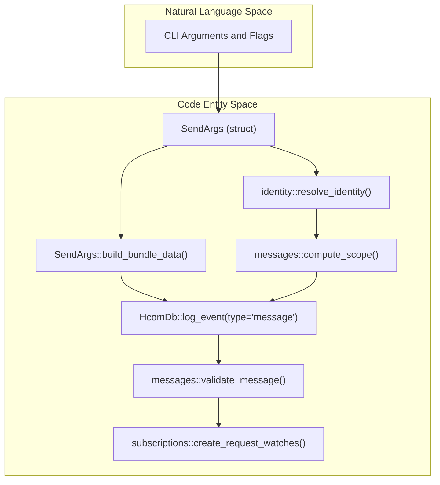
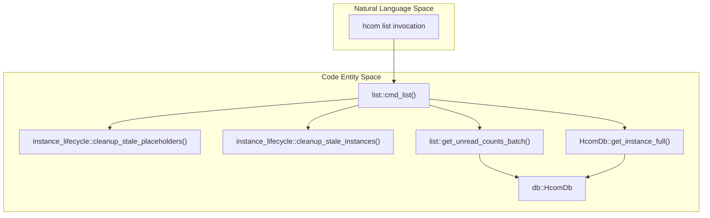

<!-- source: DeepWiki mcp.deepwiki.com · repo aannoo/hcom · page 5.2 Messaging Commands · fetched 2026-10-27 -->

# Messaging Commands

<details>
<summary>Relevant source files</summary>

The following files were used as context for generating this wiki page:

- [src/bootstrap.rs](src/bootstrap.rs)
- [src/commands/list.rs](src/commands/list.rs)
- [src/commands/send.rs](src/commands/send.rs)
- [src/commands/stop.rs](src/commands/stop.rs)
- [src/db/events.rs](src/db/events.rs)
- [src/db/sessions.rs](src/db/sessions.rs)
- [src/identity.rs](src/identity.rs)

</details>


This page documents the core messaging commands: `hcom send` and `hcom list`. These commands enable communication between AI agents, human operators, and external tools, as well as the inspection of active agent instances.

For architectural details about message routing and delivery mechanisms, see section 4.4. For querying historical events, see section 5.3.

Sources: `[src/commands/send.rs:1-12]`, `[src/commands/list.rs:1-6]`

---

## Overview

The messaging system facilitates asynchronous and synchronous communication across terminal boundaries:

- **`hcom send`**: Dispatches messages to specific agents or broadcasts to all, supporting rich metadata (intents, threads) and context attachments (bundles) `[src/commands/send.rs:1-12]()`.
- **`hcom list`**: Provides a real-time view of the multi-agent ecosystem, showing instance statuses, unread message counts, and session metadata `[src/commands/list.rs:1-6]()`.

All messaging operations are backed by the central SQLite database, utilizing the `events` table for message persistence and the `instances` table for recipient discovery `[src/commands/send.rs:5-9]()`.

Sources: `[src/commands/send.rs:1-12]`, `[src/commands/list.rs:1-6]`

---

## Send Command

The `send` command is the primary interface for inter-agent communication. It handles target resolution, identity spoofing prevention, and inline context bundling.

### Basic Syntax

```bash
# Target specific agents using @prefix
hcom send @luna @nova -- Hello agents!

# Broadcast to all active agents (no @targets before --)
hcom send -- System-wide announcement

# Send with specific intent and reply tracking
hcom send @luna --intent request --reply-to 42 -- Can you analyze this?

# Shorthand for human operator (bigboss)
hcom send -b @luna -- Take a break.
```

Sources: `[src/commands/send.rs:34-41]`, `[src/commands/send.rs:60-67]`

---

### Argument Parsing and Targeting

The `send` command uses a hybrid parsing strategy to distinguish between recipients and the message body.

1. **Positionals**: Arguments starting with `@` are treated as targets via `parse_positional()` `[src/commands/send.rs:43-51]()`.
2. **Separator**: The `--` token explicitly marks the end of flags/targets and the start of the message text `[src/commands/send.rs:66-67]()`.
3. **Target Matching**:
    - `@luna`: Matches base name `[src/commands/send.rs:19]()`.
    - `@api-luna`: Matches exact full name `[src/commands/send.rs:20]()`.
    - `@api-`: Prefix match for all local agents with exact tag 'api' `[src/commands/send.rs:21]()`.
    - `@luna:BOXE`: Targets a remote agent on device `BOXE` `[src/commands/send.rs:22]()`.

Target resolution logic is implemented in matching routines that evaluate against `InstanceInfo` structures `[src/messages.rs:10-12]()`. Scope is determined by `compute_scope()` `[src/messages.rs:10-12]()`.

Sources: `[src/commands/send.rs:17-32]`, `[src/commands/send.rs:43-67]`, `[src/messages.rs:10-12]`

---

### Sender Identity Flags

| Flag | Description | Implementation |
|------|-------------|----------------|
| `--from <name>` | Explicitly set the sender name | Overrides auto-detection `[src/commands/send.rs:97-98]()` |
| `-b` | Shorthand for `--from bigboss` | Used for human-in-the-loop `[src/commands/send.rs:101-102]()` |
| (None) | Auto-detects identity | Uses `identity::resolve_identity` `[src/commands/send.rs:7]()` |

The effective sender name is resolved in `SendArgs::sender_name()` `[src/commands/send.rs:145-153]()`. If no flag is provided, `hcom` attempts to resolve the identity based on the current process environment.

Sources: `[src/commands/send.rs:95-102]`, `[src/commands/send.rs:141-153]`, `[src/bootstrap.rs:19-32]`

---

### Message Envelopes and Metadata Flags

| Flag | Description | Requirement / Format |
|------|-------------|----------------------|
| `--intent` | Message intent classification | Values: `request`, `inform`, `ack` `[src/commands/send.rs:83-85]()` |
| `--reply-to` | Track parent event reference | Format: `42` or `42:BOXE` `[src/commands/send.rs:87-89]()` |
| `--thread` | Threaded routing | Seeds recipients once, reuses thread members `[src/commands/send.rs:91-94]()` |

Sources: `[src/commands/send.rs:83-94]`, `[src/messages.rs:9-12]`

---

### Inline Bundles

`hcom send` allows attaching structured context (files, transcripts, events) without pre-creating a bundle via the `bundle` command.

| Flag | Description | Requirement |
|------|-------------|-------------|
| `--title` | The title of the attached bundle | **Required** for inline bundles `[src/commands/send.rs:113-116]()` |
| `--description` | Detailed description of the context | **Required** with `--title` `[src/commands/send.rs:118-120]()` |
| `--events` | Comma-separated IDs or ranges (e.g., `1,5-10`) | Optional `[src/commands/send.rs:121-124]()` |
| `--files` | Comma-separated file paths | Optional `[src/commands/send.rs:125-128]()` |
| `--transcript` | Range-based transcript snippets | Optional `[src/commands/send.rs:129-132]()` |
| `--extends` | Parent bundle ID to inherit from | Optional `[src/commands/send.rs:133-136]()` |

The `SendArgs::build_bundle_data()` method `[src/commands/send.rs:161-212]()` constructs a JSON payload containing these references. This data is processed and included in the message event.

Sources: `[src/commands/send.rs:109-136]`, `[src/commands/send.rs:161-212]`

---

### Implementation and Data Flow

Title: Send Command Pipeline



**Data Flow Details**:
1. **Parsing**: `SendArgs` captures targets, flags, and the message body using `clap` `[src/commands/send.rs:54-141]()`.
2. **Identity**: The system resolves who is sending the message via `identity::resolve_identity()` `[src/commands/send.rs:8]()`.
3. **Scope Resolution**: `compute_scope()` determines if the message is a broadcast or mentions based on `@` targets `[src/messages.rs:10]()`.
4. **Validation**: `validate_message()` ensures the payload is within size limits `[src/messages.rs:11]()`.
5. **Persistence**: The message is written to the SQLite database as an event of type `message` `[src/db/HcomDb]()` via `log_event`.
6. **Request/Watch**: If the intent is `request`, `create_request_watches()` automatically sets up a subscription for the response `[src/commands/send.rs:7]()`.

Sources: `[src/commands/send.rs:54-141]`, `[src/messages.rs:9-12]`, `[src/commands/send.rs:6-8]`

---

## List Command

The `list` command queries the `instances` table to show which agents are currently active, listening, or recently stopped.

### Usage and Output Modes

| Command | Description |
|---------|-------------|
| `hcom list` | Standard human-readable table of active agents `[src/commands/list.rs:1-6]()` |
| `hcom list --json` | Machine-readable JSON array of instance objects `[src/commands/list.rs:111-114]()` |
| `hcom list --names` | Simple newline-separated list of active names `[src/commands/list.rs:117-119]()` |
| `hcom list --stopped` | Shows agents that have recently exited `[src/commands/list.rs:109-110]()` |
| `hcom list self` | Displays metadata for the current terminal's agent `[src/commands/list.rs:104-105]()` |

Sources: `[src/commands/list.rs:1-6]`, `[src/commands/list.rs:101-132]`

---

### Unread Message Tracking

`hcom list` calculates unread messages by querying the `events` table for messages where the recipient is mentioned but hasn't acknowledged them yet. This information is fetched via `get_unread_counts_batch()` `[src/commands/list.rs:161-205]()`, which scans the unread message tail and evaluates `json_each` array matching against `delivered_to` metadata `[src/commands/list.rs:184-204]()`.

Sources: `[src/commands/list.rs:148-205]`

---

### Instance Lifecycle Cleanup and Status

The `list` command reflects the current state of the `instances` table. Before display, the system checks for stale instances and placeholders via `cleanup_stale_placeholders` and `cleanup_stale_instances` `[src/commands/list.rs:12-15]()`.

**Status Indicators & Bindings**:
- `Bindings` struct `[src/commands/list.rs:27-31]()` tracks whether session and process bindings exist.
- `tool_label()` `[src/commands/list.rs:67-83]()` formats the agent tool label (e.g., `CLAUDE`, `CODEX*` if bindings are missing).

Sources: `[src/commands/list.rs:12-15]`, `[src/commands/list.rs:27-98]`

---

### Implementation Details

Title: List Command Data Retrieval



Sources: `[src/commands/list.rs:42-65]`, `[src/commands/list.rs:161-205]`, `[src/db/mod.rs:9]`

---

