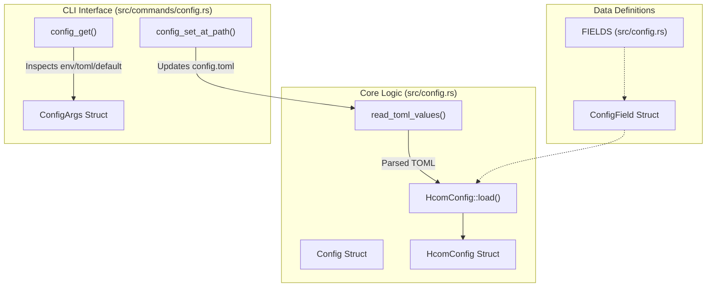
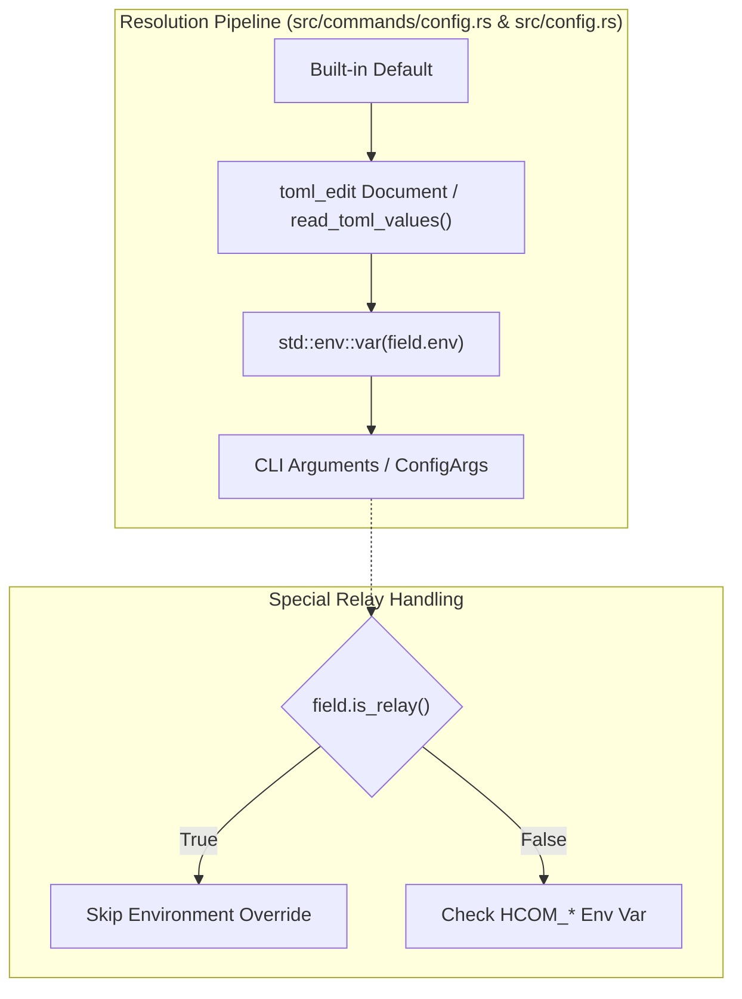

<!-- source: DeepWiki mcp.deepwiki.com · repo aannoo/hcom · page 6.1 Configuration Files and Precedence · fetched 2026-10-27 -->

# Configuration Files and Precedence

<details>
<summary>Relevant source files</summary>

The following files were used as context for generating this wiki page:

- [src/commands/config.rs](src/commands/config.rs)
- [src/config.rs](src/config.rs)
- [src/runtime_env.rs](src/runtime_env.rs)
- [src/shell_env.rs](src/shell_env.rs)

</details>


This page details the hcom configuration system's file structure, loading precedence, field mappings, and special relay field handling. The configuration system maintains two distinct layers: runtime environment variables (`Config`) and user settings (`HcomConfig`), with a strict precedence hierarchy for resolving user settings [src/config.rs:1-6](). For information about specific configuration settings and their effects, see [Settings Reference](6.3). For terminal preset customization, see [Terminal Presets](6.2).

Sources: [src/config.rs:1-6]()

## Configuration Architecture

The hcom configuration system uses two separate structs to manage different categories of settings:

- **`Config`**: Runtime environment variables loaded once at startup (`HCOM_DIR`, `HCOM_INSTANCE_NAME`, `HCOM_PROCESS_ID`) — used primarily for application initialization and path resolution [src/config.rs:25-32]().
- **`HcomConfig`**: User-facing settings defined in [`FIELDS`] [src/config.rs:182-182](), with validation, loaded dynamically with precedence rules.

### Code Entity Space: Configuration Components


Sources: [src/config.rs:25-32](), [src/config.rs:143-153](), [src/config.rs:182-182](), [src/commands/config.rs:23-52](), [src/commands/config.rs:119-159](), [src/commands/config.rs:176-190]()

### Config — Runtime Environment

The `Config` struct is a singleton initialized once at application startup via `Config::init()` or `Config::get()` [src/config.rs:35-50](). It resolves the hcom directory and captures instance/process identity from environment variables [src/config.rs:60-98]().

| Field | Environment Variable | Default | Usage |
|-------|---------------------|---------|-------|
| `hcom_dir` | `HCOM_DIR` | `~/.hcom` | Database and config file location [src/config.rs:26-27](), [src/config.rs:65-65]() |
| `instance_name` | `HCOM_INSTANCE_NAME` | `None` | Current instance identity set by launcher [src/config.rs:28-29](), [src/config.rs:87-89]() |
| `process_id` | `HCOM_PROCESS_ID` | `None` | Process binding identity set by hooks [src/config.rs:30-31](), [src/config.rs:91-91]() |

Sources: [src/config.rs:25-32](), [src/config.rs:35-50](), [src/config.rs:60-98]()

---

## Configuration Files

### config.toml

The primary configuration file resides at `~/.hcom/config.toml` (resolved via `config_path()`) [src/commands/config.rs:67-69](). It uses structured TOML tables mapped through [`FIELDS`] [src/config.rs:149-150](). Modifications are performed using `toml_edit` to preserve comments and formatting [src/commands/config.rs:71-75](), [src/commands/config.rs:143-150]().

```toml
[terminal]
active = "default"
title_mode = "combined"

[relay]
url = "mqtt://broker.example.com:1883"
id = "my-relay-id"
enabled = true

[launch]
tag = ""
subagent_timeout = 30
```

Sources: [src/commands/config.rs:67-75](), [src/commands/config.rs:143-150](), [src/config.rs:143-153]()

### config.env (Legacy)

Older installations utilized `config.env`. The presence of this file alters loading behaviors to prevent overwriting or ignoring legacy user configuration [src/config.rs:1-6]().

### shell_env.json (Cache)

Hcom resolves the user's login and interactive shell environment out-of-band via `resolved_shell_env()` [src/shell_env.rs:34-45]() to ensure nested agent launches inherit the correct `PATH` and environment variables. Results are cached in `shell_env.json` with a 6-hour TTL (`CACHE_TTL`) and version checking (`CACHE_VERSION = 3`) [src/shell_env.rs:16-21](), [src/shell_env.rs:35-44]().

Sources: [src/shell_env.rs:16-21](), [src/shell_env.rs:34-45]()

---

## Precedence Order and Precedence Resolution

Configuration values follow a strict precedence hierarchy, evaluated from lowest to highest priority:

1. **Built-in Defaults**: Hardcoded defaults defined in configuration specifications.
2. **`config.toml`**: User settings stored in the TOML configuration file [src/commands/config.rs:188-190]().
3. **`config.env` / Environment Variables**: `HCOM_*` environment variables override TOML settings [src/commands/config.rs:183-187]().
4. **CLI Flags**: Explicit command-line arguments override all file and environment settings.

### Code Entity Space: Precedence & Relay Pipeline


Sources: [src/commands/config.rs:176-190](), [src/config.rs:143-160]()

---

## Special Relay Field Handling

Relay configuration fields (`relay_*`, identified via `ConfigField::is_relay()`) [src/config.rs:156-160]() receive special handling:
- They are **never** read from or exported to `HCOM_*` environment variables [src/config.rs:147-148]().
- `config_get()` explicitly skips checking environment variables for any field where `field.is_relay()` is true, reading them exclusively from `config.toml` [src/commands/config.rs:176-190]().
- This isolation prevents sensitive broker credentials or preshared keys (`relay_psk`) from leaking across process boundaries via inherited environment variables.

Sources: [src/config.rs:147-160](), [src/commands/config.rs:176-190]()

---

