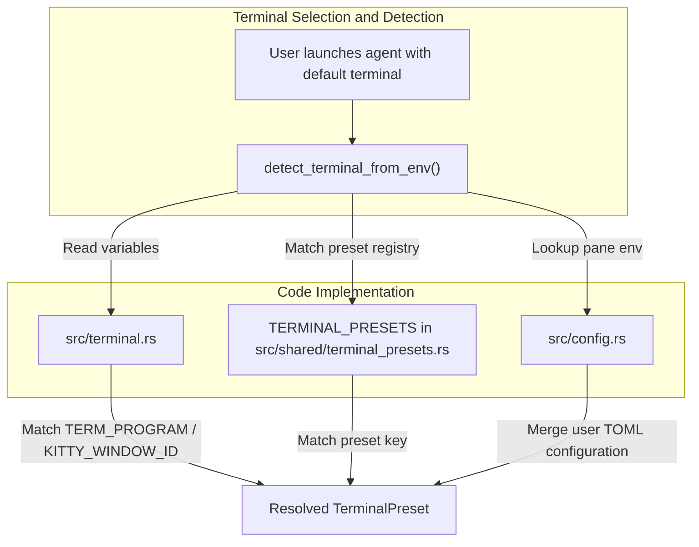
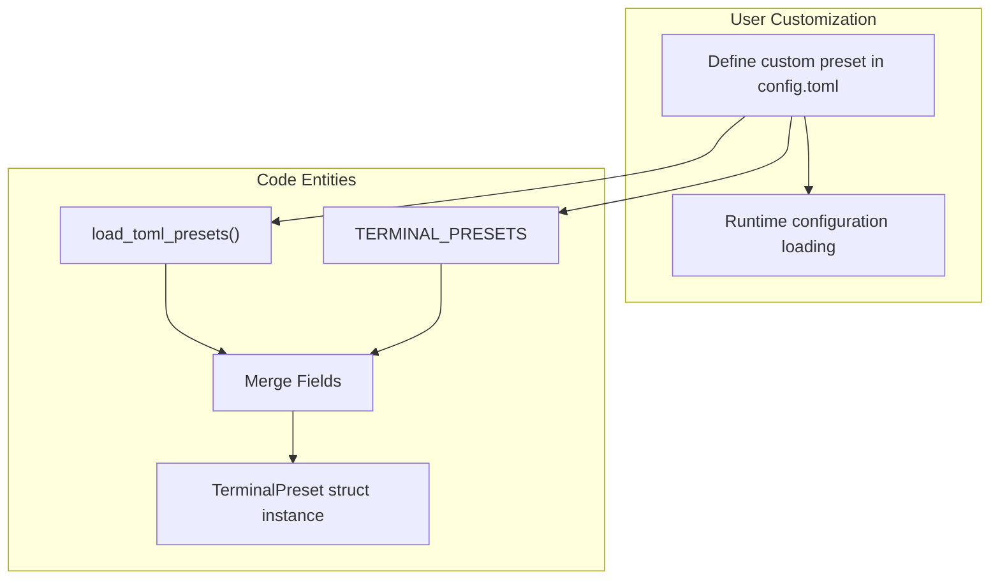

<!-- source: DeepWiki mcp.deepwiki.com · repo aannoo/hcom · page 6.2 Terminal Presets · fetched 2026-10-27 -->

# Terminal Presets

<details>
<summary>Relevant source files</summary>

The following files were used as context for generating this wiki page:

- [src/commands/kill.rs](src/commands/kill.rs)
- [src/core/tips.rs](src/core/tips.rs)
- [src/shared/platform.rs](src/shared/platform.rs)
- [src/shared/terminal_presets.rs](src/shared/terminal_presets.rs)
- [src/terminal.rs](src/terminal.rs)

</details>


Terminal presets define how `hcom` launches AI tool instances across various terminal emulators and multiplexers [src/terminal.rs:1-8](). Each preset specifies the command template required to open a new window, tab, or pane (`open`), an optional command to tear it down (`close`), binary paths, and environment variable bindings (`pane_id_env`) [src/shared/terminal_presets.rs:38-53]().

---

## Preset Anatomy

Terminal presets are structured using the `TerminalPreset` struct in the shared configuration module [src/shared/terminal_presets.rs:38-53](). The configuration maps platforms and execution arguments via `PlatformArgv` and `ArgvTemplate` [src/shared/terminal_presets.rs:5-19]().

| Field | Type | Required | Purpose |
|-------|------|----------|---------|
| `open` | `PlatformArgv` | Yes | Command template (argv) to spawn terminal pane/window/tab |
| `close` | `PlatformArgv` | No | Command template (argv) to close terminal pane before SIGTERM |
| `binary` | `Option<&str>` | No | Binary name for PATH checking and macOS app bundle fallback |
| `app_name` | `Option<&str>` | No | macOS `.app` bundle name (e.g., `"kitty"` → `"kitty.app"`) |
| `pane_id_env` | `Option<&str>` | No | Environment variable name containing the pane identifier |
| `platforms` | `&[&str]` | No | Supported operating systems (e.g., `"Darwin"`, `"Linux"`, `"Windows"`) |

Sources: [src/shared/terminal_presets.rs:38-53](), [src/shared/terminal_presets.rs:5-19]()

---

## Built-In Presets

Presets are hardcoded in the `TERMINAL_PRESETS` lazy static registry [src/shared/terminal_presets.rs:115](). They are divided into macOS native applications (`terminal.app`, `iterm`, `ghostty`) [src/shared/terminal_presets.rs:118-158](), cross-platform smart emulators (`kitty`, `kitty-window`, `wezterm`) [src/shared/terminal_presets.rs:173-213](), and multiplexers (`tmux`, `zellij`, `cmux`) [src/shared/terminal_presets.rs:161-170]().

### Detection Logic Flow

When `terminal.active = "default"`, the system detects the active terminal environment using `detect_terminal_from_env()` [src/terminal.rs:172-212]().



**Diagram: Bridging environment detection to code entities (`detect_terminal_from_env`)**

Sources: [src/terminal.rs:172-212](), [src/shared/terminal_presets.rs:115-250]()

---

## User-Defined TOML Presets and Merging

Users can define or override terminal presets in `~/.hcom/config.toml` under `[terminal.presets.*]` [src/core/tips.rs:118-126](). Partial overrides merge with built-in presets at runtime, allowing specific attributes like `open` or `close` to be modified while preserving default settings.



**Diagram: Preset resolution code mapping**

Sources: [src/terminal.rs:185-200](), [src/shared/terminal_presets.rs:115-250]()

---

## Command Templates and Placeholders

Command templates are represented as `ArgvTemplate` (a slice of static string slices) [src/shared/terminal_presets.rs:5-9](). Each element is processed independently without shell-splitting, avoiding injection vulnerabilities.

Supported placeholders include:
- `{script}`: Path to the generated shell script running the tool [src/shared/terminal_presets.rs:44]()
- `{pane_id}`: Terminal-specific identifier for targeting close actions [src/shared/terminal_presets.rs:46]()
- `{process_id}`: Process ID of the spawned launcher instance [src/terminal.rs:141]()

Sources: [src/shared/terminal_presets.rs:5-9](), [src/shared/terminal_presets.rs:44-48]()

---

## Environment Context Stripping

When `hcom` spawns terminal subprocesses, it strips terminal-identifying environment variables using `TERMINAL_CONTEXT_VARS` [src/terminal.rs:177-212](). This prevents outer terminal metadata (such as stale `TMUX_PANE` or `KITTY_WINDOW_ID` values) from leaking into newly spawned agent terminals.

```rust
pub(crate) const TERMINAL_CONTEXT_VARS: &[&str] = &[
    "CMUX_WORKSPACE_ID",
    "CMUX_SURFACE_ID",
    "TMUX_PANE",
    "ZELLIJ_PANE_ID",
    "KITTY_WINDOW_ID",
    "KITTY_PID",
    "KITTY_LISTEN_ON",
    "WEZTERM_PANE",
    ...
];
```

Sources: [src/terminal.rs:177-212]()

---

## Close Command Execution and Pane Cleanup

When an agent instance is killed via `hcom kill`, the system resolves the tracked instance, formats the close command using `format_close_command()` and `format_command_with_env()`, and evaluates the cleanup result [src/commands/kill.rs:130-158]().

The close action is **non-fatal**: if closing the terminal pane fails or encounters permissions errors, the system falls back to terminating the process group via `SIGTERM` [src/commands/kill.rs:145-147](). If a pane fails to close automatically, `hcom` outputs a retry command containing the required environment variables and formatted arguments [src/commands/kill.rs:55-73]().

Sources: [src/terminal.rs:36-84](), [src/commands/kill.rs:130-158]()

---

