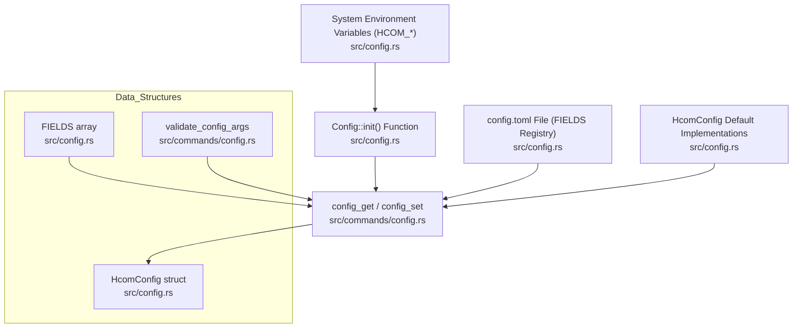

<!-- source: DeepWiki mcp.deepwiki.com · repo aannoo/hcom · page 6.3 Settings Reference · fetched 2026-10-27 -->

# Settings Reference

Relevant source files

The following files were used as context for generating this wiki page:

- [src/commands/config.rs](src/commands/config.rs)
- [src/config.rs](src/config.rs)

This page provides a comprehensive reference for all configuration settings in the `HcomConfig` struct (`[src/config.rs:5]`). Each setting controls specific behavior of the `hcom` multi-agent communication system, from agent launch parameters and tool arguments to cross-device synchronization and sandbox restrictions.

For information about configuration file structure and precedence rules, see [6.1 Configuration Files and Precedence](). For terminal preset configuration, see [6.2 Terminal Presets]().

---

## Configuration Architecture Overview

The `hcom` configuration system maintains user settings via two distinct layers:
1. **`Config`**: Runtime environment variables (`HCOM_DIR`, `HCOM_INSTANCE_NAME`, etc.) loaded at startup (`[src/config.rs:25-32]`).
2. **`HcomConfig`**: User settings loaded from `config.toml` and environment variables, defined via the `FIELDS` registry (`[src/config.rs:5]`, `[src/config.rs:182]`).

Precedence order follows: **Defaults < `config.toml` < Environment variables < CLI flags**.

### Configuration Field Mapping

Title: Configuration Field Mapping

```mermaid
graph TB
    subgraph "Launch_Settings"
        TAG["tag (HCOM_TAG)<br/>src/config.rs"]
        HINTS["hints (HCOM_HINTS)<br/>src/config.rs"]
        NOTES["notes (HCOM_NOTES)<br/>src/config.rs"]
        SUBAGENT_TO["subagent_timeout (HCOM_SUBAGENT_TIMEOUT)<br/>src/config.rs"]
        AUTO_SUB["auto_subscribe (HCOM_AUTO_SUBSCRIBE)<br/>src/config.rs"]
        AUTO_TRUST["auto_trust_workspace (HCOM_AUTO_TRUST_WORKSPACE)<br/>src/config.rs"]
    end
    
    subgraph "Tool_Specific_Settings"
        CLAUDE_ARGS["claude_args (HCOM_CLAUDE_ARGS)<br/>src/commands/config.rs"]
        GEMINI_ARGS["gemini_args (HCOM_GEMINI_ARGS)<br/>src/commands/config.rs"]
        GEMINI_SYS["gemini_system_prompt (HCOM_GEMINI_SYSTEM_PROMPT)<br/>src/commands/config.rs"]
        CODEX_ARGS["codex_args (HCOM_CODEX_ARGS)<br/>src/commands/config.rs"]
        CODEX_SANDBOX["codex_sandbox_mode (HCOM_CODEX_SANDBOX_MODE)<br/>src/commands/config.rs"]
        CODEX_SYS["codex_system_prompt (HCOM_CODEX_SYSTEM_PROMPT)<br/>src/commands/config.rs"]
        OPENCODE_ARGS["opencode_args (HCOM_OPENCODE_ARGS)<br/>src/commands/config.rs"]
        CURSOR_ARGS["cursor_args (HCOM_CURSOR_ARGS)<br/>src/commands/config.rs"]
        KIMI_ARGS["kimi_args (HCOM_KIMI_ARGS)<br/>src/commands/config.rs"]
        COPILOT_ARGS["copilot_args (HCOM_COPILOT_ARGS)<br/>src/commands/config.rs"]
    end
    
    subgraph "Terminal_Settings"
        TERMINAL["terminal (HCOM_TERMINAL)<br/>src/shared/terminal_presets.rs"]
        TITLE_MODE["title_mode (HCOM_TITLE_MODE)<br/>src/shared/constants.rs"]
    end
    
    subgraph "Relay_Settings"
        RELAY["relay (HCOM_RELAY)<br/>src/config.rs"]
        RELAY_ID["relay_id (HCOM_RELAY_ID)<br/>src/config.rs"]
        RELAY_TOKEN["relay_token (HCOM_RELAY_TOKEN)<br/>src/config.rs"]
        RELAY_ENABLED["relay_enabled (HCOM_RELAY_ENABLED)<br/>src/config.rs"]
        RELAY_PSK["relay_psk (File Only)<br/>src/config.rs"]
    end
    
    subgraph "Preferences"
        TIMEOUT["timeout (HCOM_TIMEOUT)<br/>src/config.rs"]
        AUTO_APPROVE["auto_approve (HCOM_AUTO_APPROVE)<br/>src/commands/config.rs"]
        NAME_EXPORT["name_export (HCOM_NAME_EXPORT)<br/>src/commands/config.rs"]
    end
    
    HcomConfig["HcomConfig struct"]
    
    TAG --> HcomConfig
    HINTS --> HcomConfig
    NOTES --> HcomConfig
    SUBAGENT_TO --> HcomConfig
    AUTO_SUB --> HcomConfig
    AUTO_TRUST --> HcomConfig
    
    CLAUDE_ARGS --> HcomConfig
    GEMINI_ARGS --> HcomConfig
    GEMINI_SYS --> HcomConfig
    CODEX_ARGS --> HcomConfig
    CODEX_SANDBOX --> HcomConfig
    CODEX_SYS --> HcomConfig
    OPENCODE_ARGS --> HcomConfig
    CURSOR_ARGS --> HcomConfig
    KIMI_ARGS --> HcomConfig
    COPILOT_ARGS --> HcomConfig
    
    TERMINAL --> HcomConfig
    TITLE_MODE --> HcomConfig
    
    RELAY --> HcomConfig
    RELAY_ID --> HcomConfig
    RELAY_TOKEN --> HcomConfig
    RELAY_ENABLED --> HcomConfig
    RELAY_PSK --> HcomConfig
    
    TIMEOUT --> HcomConfig
    AUTO_APPROVE --> HcomConfig
    NAME_EXPORT --> HcomConfig
```

Sources: `[src/config.rs:123-153]()`, `[src/config.rs:156-182]()`, `[src/commands/config.rs:57-182]()`

---

## Settings by Category

### Launch Settings

Settings that control instance launch behavior, naming, and message delivery.

| Field | Env Var | TOML Path | Type | Default |
|-------|---------|-----------|------|---------|
| `tag` | `HCOM_TAG` | `launch.tag` | string | `""` |
| `hints` | `HCOM_HINTS` | `launch.hints` | string | `""` |
| `notes` | `HCOM_NOTES` | `launch.notes` | string | `""` |
| `subagent_timeout` | `HCOM_SUBAGENT_TIMEOUT` | `launch.subagent_timeout` | i64 | `30` |
| `auto_subscribe` | `HCOM_AUTO_SUBSCRIBE` | `launch.auto_subscribe` | string | `"collision"` |
| `auto_trust_workspace` | `HCOM_AUTO_TRUST_WORKSPACE` | `launch.auto_trust_workspace` | bool | `false` |

Sources: `[src/config.rs:125-130]()`, `[src/commands/config.rs:58-74]()`, `[src/commands/config.rs:143-151]()`

### Tool-Specific Settings & Sandbox Modes

Settings that customize behavior and sandbox execution constraints for individual AI tools.

| Field | Env Var | TOML Path | Type | Default |
|-------|---------|-----------|------|---------|
| `claude_args` | `HCOM_CLAUDE_ARGS` | `launch.claude.args` | string | `""` |
| `gemini_args` | `HCOM_GEMINI_ARGS` | `launch.gemini.args` | string | `""` |
| `gemini_system_prompt` | `HCOM_GEMINI_SYSTEM_PROMPT` | `launch.gemini.system_prompt` | string | `""` |
| `codex_args` | `HCOM_CODEX_ARGS` | `launch.codex.args` | string | `""` |
| `codex_sandbox_mode` | `HCOM_CODEX_SANDBOX_MODE` | `launch.codex.sandbox_mode` | string | `"workspace"` |
| `codex_system_prompt` | `HCOM_CODEX_SYSTEM_PROMPT` | `launch.codex.system_prompt` | string | `""` |
| `opencode_args` | `HCOM_OPENCODE_ARGS` | `launch.opencode.args` | string | `""` |
| `cursor_args` | `HCOM_CURSOR_ARGS` | `launch.cursor.args` | string | `""` |
| `kimi_args` | `HCOM_KIMI_ARGS` | `launch.kimi.args` | string | `""` |
| `copilot_args` | `HCOM_COPILOT_ARGS` | `launch.copilot.args` | string | `""` |

Sources: `[src/config.rs:130-142]`, `[src/commands/config.rs:76-116]()`

### Terminal Settings

Settings that control where and how agent terminal windows are spawned and titled.

| Field | Env Var | TOML Path | Type | Default |
|-------|---------|-----------|------|---------|
| `terminal` | `HCOM_TERMINAL` | `terminal.active` | string | `"default"` |
| `title_mode` | `HCOM_TITLE_MODE` | `terminal.title_mode` | string | `"combined"` |

Sources: `[src/config.rs:124]()`, `[src/config.rs:152]()`, `[src/commands/config.rs:133-136]()`, `[src/commands/config.rs:158-161]()`

### Relay Settings

Settings for MQTT-based cross-device synchronization. Most fields are **file-only** (`[src/config.rs:156-160]`) — environment variable overrides are restricted or blocked for security.

| Field | Env Var | TOML Path | Type | Default |
|-------|---------|-----------|------|---------|
| `relay` | `HCOM_RELAY` | `relay.url` | string | `""` |
| `relay_id` | `HCOM_RELAY_ID` | `relay.id` | string | `""` |
| `relay_token` | `HCOM_RELAY_TOKEN` | `relay.token` | string | `""` |
| `relay_psk` | N/A | `relay.psk` | string | `""` |
| `relay_enabled` | `HCOM_RELAY_ENABLED` | `relay.enabled` | bool | `true` |

Sources: `[src/config.rs:143-147]()`, `[src/config.rs:176-182]()`, `[src/commands/config.rs:163-181]()`

### Preferences

General system preferences for timeouts, approvals, and environment exports.

| Field | Env Var | TOML Path | Type | Default |
|-------|---------|-----------|------|---------|
| `timeout` | `HCOM_TIMEOUT` | `preferences.timeout` | i64 | `86400` |
| `auto_approve` | `HCOM_AUTO_APPROVE` | `preferences.auto_approve` | bool | `true` |
| `name_export` | `HCOM_NAME_EXPORT` | `preferences.name_export` | string | `""` |

Sources: `[src/config.rs:148-150]()`, `[src/commands/config.rs:66-69]()`, `[src/commands/config.rs:138-156]()`

---

## Detailed Settings Reference

### tag

* **Purpose:** Group label for launched instances. When set, instance names become `<tag>-<name>`.
* **Type:** `string`
* **Default:** `""` (empty)
* **Env Var:** `HCOM_TAG`
* **TOML Path:** `launch.tag`
* **Validation:** Must match regex `^[a-zA-Z0-9-]+$` (`[src/config.rs:12]`).
* **Effects:** Without tag, instances get names like `luna`, `nova`. With tag `"dev"`, instances get names like `dev-luna`. Addressing via `@dev` targets all instances bearing the "dev" tag.

Sources: `[src/config.rs:125]()`, `[src/commands/config.rs:58]`, `[src/commands/config.rs:186]()`

---

### hints

* **Purpose:** Text automatically appended to every message received by launched agents.
* **Type:** `string`
* **Default:** `""` (empty)
* **Env Var:** `HCOM_HINTS`
* **TOML Path:** `launch.hints`
* **Effects:** Appended to message content. Can be set globally or per-instance via `hcom config -i <name> hints <value>` (`[src/commands/config.rs:50-52]`).

Sources: `[src/config.rs:126]()`, `[src/commands/config.rs:59]`, `[src/commands/config.rs:188]()`

---

### terminal

* **Purpose:** Specifies where `hcom` opens new agent windows (e.g., `kitty`, `tmux`, `wezterm`).
* **Type:** `string`
* **Default:** `"default"`
* **Env Var:** `HCOM_TERMINAL`
* **TOML Path:** `terminal.active`
* **Validation:** Preset name must match regex `^[a-zA-Z0-9_]+$` (`[src/config.rs:13]`).

Sources: `[src/config.rs:124]()`, `[src/config.rs:13]()`, `[src/commands/config.rs:133-136]()`

---

### auto_approve

* **Purpose:** Controls whether tool execution permissions and hooks auto-approve incoming interactions.
* **Type:** `bool`
* **Default:** `true`
* **Env Var:** `HCOM_AUTO_APPROVE`
* **TOML Path:** `preferences.auto_approve`
* **Effects:** When modified via `config_set_and_apply`, triggers background synchronization of tool permission files (`[src/commands/config.rs:163-171]`).

Sources: `[src/config.rs:148]`, `[src/commands/config.rs:163-171]()`

---

### timeout

* **Purpose:** Global idle timeout in seconds before an instance is marked stale or terminated.
* **Type:** `i64`
* **Default:** `86400` (24 hours)
* **Env Var:** `HCOM_TIMEOUT`
* **TOML Path:** `preferences.timeout`

Sources: `[src/config.rs:149]`, `[src/commands/config.rs:57]()`

---

### claude_args

* **Purpose:** Additional command-line arguments passed to Claude Code upon launch.
* **Type:** `string`
* **Default:** `""`
* **Env Var:** `HCOM_CLAUDE_ARGS`
* **TOML Path:** `launch.claude.args`
* **Validation:** Parsed via shell tokenization (`[src/commands/config.rs:106]`) and validated against integration specifications (`[src/commands/config.rs:98-117]`).

Sources: `[src/commands/config.rs:82-117]()`

---

### codex_sandbox_mode

* **Purpose:** Controls sandbox restrictions for Codex tool executions.
* **Type:** `string` (enum: `"workspace"`, `"danger-full-access"`, etc.)
* **Default:** `"workspace"`
* **Env Var:** `HCOM_CODEX_SANDBOX_MODE`
* **TOML Path:** `launch.codex.sandbox_mode`

Sources: `[src/config.rs:135]()`, `[src/commands/config.rs:76-116]()`

---

### relay_* Settings

* **Purpose:** MQTT-based cross-device synchronization and cluster communication.
* **Security Note:** `relay_psk` is deliberately excluded from environment variable mapping (`[src/config.rs:179-182]`). The Pre-Shared Key (PSK) grants encryption and decryption authority for the entire relay group and must never cross process boundaries via environment variables. Relay fields are file-only or set via specific `hcom relay` management commands.

Sources: `[src/config.rs:143-147]()`, `[src/config.rs:176-182]()`, `[src/commands/config.rs:163-181]()`

---

## Internal Implementation Details

**Configuration Loading Lifecycle**

Title: Configuration Loading and Validation

Sources: `[src/config.rs:34-50]()`, `[src/config.rs:123-153]()`, `[src/commands/config.rs:98-117]()`

**Field Mapping and Validation Constraints**

| Field | Code Symbol | Validation Logic |
|-------|-------------|-----------------|
| `tag` | `RE_TAG` | `^[a-zA-Z0-9-]+$` regex match `[src/config.rs:12]()` |
| `terminal` | `RE_PRESET_NAME` | `^[a-zA-Z0-9_]+$` regex match `[src/config.rs:13]()` |
| `title_mode` | `VALID_TITLE_MODES` | `combined`, `label`, `off` `[src/shared/constants.rs:111]()` |
| `claude_args` | `validate_config_args` | Shell token splitting & spec validation `[src/commands/config.rs:98-117]()` |

Sources: `[src/config.rs:12-13]()`, `[src/commands/config.rs:98-117]()`

---

